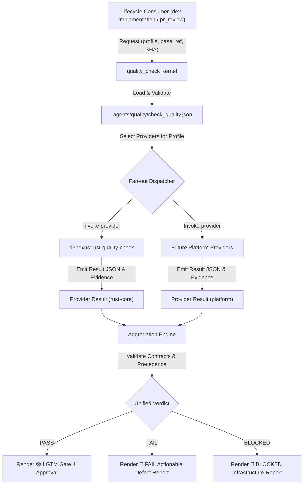
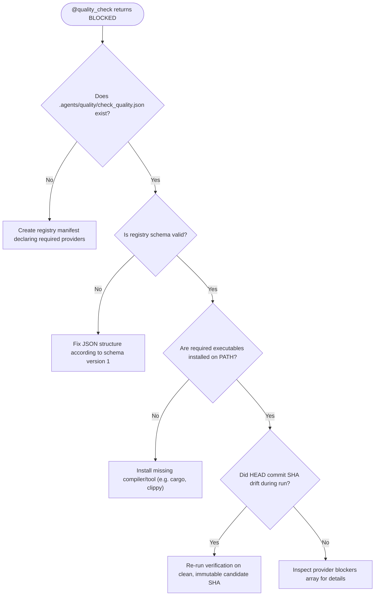

# Quality Provider System Architecture

This document specifies the architecture, contracts, and governance model of the provider-based
quality assurance system within the `ai-agent-tools` ecosystem.

Bản tiếng Việt: [quality-provider-system.vi.md](quality-provider-system.vi.md).

## Table of Contents

- [1. Architectural Overview](#1-architectural-overview)
- [2. Project Registry Contract](#2-project-registry-contract)
- [3. Provider Discovery and Invocation](#3-provider-discovery-and-invocation)
- [4. Provider Result and Evidence Contract](#4-provider-result-and-evidence-contract)
- [5. Result Aggregation and Gate Precedence](#5-result-aggregation-and-gate-precedence)
- [6. Rust Quality Provider and Architecture Governance](#6-rust-quality-provider-and-architecture-governance)
- [7. Multi-Provider Composition](#7-multi-provider-composition)
- [8. Fail-Closed Migration and Mobile Template Responsibility](#8-fail-closed-migration-and-mobile-template-responsibility)
- [9. Troubleshooting and Decision Trees](#9-troubleshooting-and-decision-trees)
- [10. References](#10-references)

---

## 1. Architectural Overview

The provider-based quality system transitions the [`quality_check`](../../skills/quality_check/SKILL.md) skill from an embedded-platform monolith into a platform-neutral composition root. Rather than detecting files (`pubspec.yaml`, `build.gradle.kts`, `Package.swift`) and hardcoding mobile test runners, the orchestrator acts as a thin kernel driven by dependency injection.

### 1.1 Core Principles

1. **Dependency Injection**: Consumer repositories declare their active quality providers in a project-owned manifest (`.agents/quality/check_quality.json`).
2. **Platform-Neutral Kernel**: The orchestrator contains zero ecosystem-specific commands, thresholds, or file heuristics.
3. **Deterministic Aggregation**: Results from all providers selected for a profile are collected and reduced using strict fail-closed precedence (`FAIL > BLOCKED > PASS`).
4. **Candidate Immutability**: All verification verdicts belong strictly to an exact repository commit SHA (`git rev-parse HEAD`). Any tree mutation during or after execution invalidates prior approval.
5. **Read-Only Verification**: Quality providers never mutate, auto-fix, or reformat source files during verification runs.

### 1.2 Orchestration Flow



---

## 2. Project Registry Contract

Every participating project defines `.agents/quality/check_quality.json` at its repository root.

### 2.1 Manifest Schema and Location

The registry schema version is integer `1`. Here is a single-provider registry declaring Rust quality assurance:

```json
{
  "schema_version": 1,
  "providers": [
    {
      "id": "rust-core",
      "skill": "d3nexus:rust-quality-check",
      "required": true,
      "profiles": ["pr", "epic", "scheduled", "release"]
    }
  ]
}
```

### 2.2 Validation Rules

- `schema_version`: Must be integer `1`. Unsupported versions trigger `BLOCKED`.
- `providers`: Non-empty array of provider objects.
- `id`: Stable alphanumeric identifier (`^[a-z0-9_-]+$`). Must be unique across the workspace.
- `skill`: Resolvable namespaced skill identifier (e.g. `d3nexus:rust-quality-check`).
- `required`: Boolean flag. If `true`, failure or blockage immediately prevents overall `PASS`.
- `profiles`: Non-empty array containing a subset of `["pr", "epic", "scheduled", "release"]` without duplicates.
- **Strict Reject**: Unknown fields are strictly rejected by the validator to prevent configuration typos from silently altering behavior.

---

## 3. Provider Discovery and Invocation

### 3.1 Normalized Invocation Contract

Callers invoke `@quality_check` with a normalized request payload:

```json
{
  "contract_version": 1,
  "profile": "epic",
  "base_ref": "main",
  "repository_sha": "5d8b7b0f1b7a9c6f7c8f6498e69c3d6f1e0a4123"
}
```

The orchestrator executes the following sequence:
1. Resolves repository root and reads candidate SHA via `git rev-parse HEAD`.
2. Validates `.agents/quality/check_quality.json`.
3. Filters providers matching the requested `profile`.
4. Invokes each provider passing the normalized request, its `provider_id`, and `required` flag.
5. Verifies candidate commit SHA after provider execution to detect SHA drift.

### 3.2 Quality Profiles and Execution Policy

| Profile | Target Lifecycle Caller | Minimum Intent |
| :--- | :--- | :--- |
| `pr` | Pull request reviews (`@pr_review`) | Fast feedback: formatting, lint, compilation, unit tests, touched scope |
| `epic` | End-of-epic verification (`@dev-implementation` Gate 4) | Deep certification: full workspace suites, architecture governance, coverage, semantic audits |
| `scheduled` | CI recurring nightlies / cron jobs | `epic` plus expensive dependency audits, license scans, security database checks |
| `release` | Release candidate preparation | `epic` plus release builds, ABI/API compatibility checks, package artifacts |

A cheaper profile never satisfies a more demanding gate. Evidence from `pr` cannot satisfy an `epic` request.

---

## 4. Provider Result and Evidence Contract

### 4.1 Result Schema and Field Semantics

Each selected provider writes a machine-readable JSON result file complying with the [Provider Result Contract](../../skills/quality_check/references/provider-result-contract.md):

```json
{
  "provider_id": "rust-core",
  "contract_version": 1,
  "profile": "epic",
  "repository_sha": "5d8b7b0f1b7a9c6f7c8f6498e69c3d6f1e0a4123",
  "status": "PASS",
  "checks": [
    {
      "id": "cargo-test",
      "category": "tests",
      "status": "PASS",
      "source": "cargo test --workspace --all-targets",
      "duration": 42.5,
      "summary": "All workspace unit and integration tests passed",
      "evidence_refs": ["ev-test-log"]
    }
  ],
  "coverage": {
    "line": {
      "measured": 0.885,
      "threshold": 0.80
    }
  },
  "evidence": [
    {
      "id": "ev-test-log",
      "type": "log",
      "source": "stdout",
      "location": "target/quality/rust-core/cargo-test.log"
    }
  ],
  "started_head": "5d8b7b0f1b7a9c6f7c8f6498e69c3d6f1e0a4123",
  "finished_head": "5d8b7b0f1b7a9c6f7c8f6498e69c3d6f1e0a4123",
  "duration": 84.2,
  "blockers": [],
  "warnings": []
}
```

### 4.2 Status Codes and NOT_APPLICABLE Constraints

Supported status codes are:
- `PASS`: All required assertions executed cleanly with zero defects.
- `FAIL`: One or more assertions executed and detected defects or regressions.
- `BLOCKED`: Missing tools, invalid configurations, schema violations, or unresolvable dependencies prevented complete execution.
- `NOT_APPLICABLE`: The check was legitimately skipped with structured evidence (e.g., target package absent).

**Strict `NOT_APPLICABLE` Constraints**:
- Requires structured `not_applicable_reason` containing valid `code` and `detail`.
- Cannot be used as an alias for a missing compiler, unavailable tool, or broken setup.
- A required provider where all checks are `NOT_APPLICABLE` is evaluated as `BLOCKED`.

---

## 5. Result Aggregation and Gate Precedence

### 5.1 Deterministic Precedence Rules

The aggregation engine enforces mathematical, fail-closed precedence:

$$\text{FAIL} > \text{BLOCKED} > \text{PASS}$$

1. **Defects Outrank Blockers**: If any check or provider returns `FAIL`, the overall verdict is `FAIL`. Known bugs must not be hidden behind missing tools.
2. **Blockers Prevent Approval**: If no failures exist but any provider returns `BLOCKED`, the overall verdict is `BLOCKED`. `BLOCKED` cannot transition Gate 4 to approved.
3. **Consensus Required**: Overall `PASS` requires every required provider to achieve `PASS` on the identical candidate SHA.
4. **Deterministic Ordering**: Providers and checks are sorted lexicographically by `id`. Output ordering is immutable.

### 5.2 Executive Report Synthesis

The engine synthesizes findings into the standardized [Executive Report Format](../../skills/quality_check/references/executive-report-format.md):
- Header with requested profile, base ref, candidate SHA, and timestamp.
- Executive summary table listing every provider, status, duration, and defect count.
- Detailed check matrix grouped by category (tests, lint, architecture, security, coverage).
- Actionable defect remediation pointers for every `FAIL` or `BLOCKED` item.

---

## 6. Rust Quality Provider and Architecture Governance

### 6.1 Read-Only Rust Capability Mapping

The [`rust-quality-check`](../../skills/rust-quality-check/SKILL.md) skill reads project configuration from `.agents/quality/rust-quality.json` and executes read-only tool suites:

| Capability | Command | Role |
| :--- | :--- | :--- |
| **Formatting** | `cargo fmt --all -- --check` | Enforce rustfmt formatting without modifying files |
| **Compiler & Lint** | `cargo clippy --workspace --all-targets -- -D warnings` | Zero-warning strict linter check |
| **Test Suites** | `cargo test --workspace --all-targets` | Unit, integration, and doctest verification |
| **Coverage** | `cargo llvm-cov --workspace --json` | Line and branch coverage threshold validation |
| **Vulnerability Audit** | `cargo audit` (optional tool) | Advisory database security vulnerability scan |
| **Dependency Governance** | `cargo deny check` (optional tool) | Banned dependencies, duplicate crates, and license checks |

### 6.2 Konsist-Equivalent Architecture Governance via Cargo Metadata and xtask

Mobile Kotlin codebases utilize Konsist for architectural guardrails. In Rust workspaces, architectural governance is enforced via `cargo_metadata` analysis and project-owned `cargo run -p xtask -- architecture-check`:

1. **Clean Architecture Boundaries**: Ensures domain models have zero inward dependencies on infrastructure, FFI, or network adapters.
2. **Feature Isolation**: Prevents lateral coupling between independent feature crates.
3. **Composition Root Wiring**: Validates that dependency injection and struct assembly occur solely in application roots.
4. **Forbidden Dependencies**: Enforces ban on unsafe crates or non-whitelisted third-party libraries.

---

## 7. Multi-Provider Composition

### 7.1 Composite Workspace Architecture

Polyglot super apps or monorepos declare multiple providers in `.agents/quality/check_quality.json`:

```json
{
  "schema_version": 1,
  "providers": [
    {
      "id": "rust-core",
      "skill": "d3nexus:rust-quality-check",
      "required": true,
      "profiles": ["pr", "epic", "scheduled", "release"]
    },
    {
      "id": "mobile-client",
      "skill": "d3nexus:android-quality-check",
      "required": true,
      "profiles": ["pr", "epic", "release"]
    }
  ]
}
```

### 7.2 Multi-Provider Execution Model

When `@quality_check` runs on a composite workspace:
1. It selects both `rust-core` and `mobile-client`.
2. Both providers execute in parallel or sequentially.
3. The aggregation engine reconciles both result documents.
4. If `rust-core` passes but `mobile-client` fails, the overall verdict is `FAIL`. Gate 4 waits for the entire composite verdict and never approves on the first provider to pass.

---

## 8. Fail-Closed Migration and Mobile Template Responsibility

### 8.1 Breaking Fail-Closed Migration

The transition to provider-based quality assurance is **breaking and fail-closed**:
- Any workspace lacking `.agents/quality/check_quality.json` immediately halts with `BLOCKED`.
- No implicit fallback to historical mobile command matrices exists.
- An empty provider selection for a profile produces `BLOCKED`.

### 8.2 Future Platform Provider Responsibility

Responsibility for mobile platform quality checks has been decoupled:
- **Android Native**: Will provide `android-quality-check` in later platform-owned work.
- **iOS Native**: Will provide `ios-quality-check` in later platform-owned work.
- **Flutter**: Will provide `flutter-quality-check` in later platform-owned work.

Until those platform providers are authored and registered, mobile projects migrating to this architecture must register their platform verification commands via a project provider manifest.

---

## 9. Troubleshooting and Decision Trees

### 9.1 Registration and Tool Resolution Issues



### 9.2 Gate 4 Failure Decision Tree

When Gate 4 machine certification reports a non-PASS verdict:
1. **If status is `FAIL`**:
   - Inspect check diagnostics in the Executive Report.
   - Route back to Stage 3 Phase 2 (`dev-implementation`) to fix identified code regressions.
   - Re-run verification in full.
2. **If status is `BLOCKED`**:
   - Resolve missing tools, invalid manifests, or SHA drift.
   - Do NOT attempt to skip, disable, or downgrade the check.
   - Re-run verification in full.

---

## 10. References

- [Provider Registry Contract](../../skills/quality_check/references/provider-registry-contract.md)
- [Provider Result Contract](../../skills/quality_check/references/provider-result-contract.md)
- [Aggregation Contract](../../skills/quality_check/references/aggregation-contract.md)
- [Executive Report Format](../../skills/quality_check/references/executive-report-format.md)
- [Rust Capability Contract](../../skills/rust-quality-check/references/rust-capability-contract.md)
- [Rust Architecture Governance](../../skills/rust-quality-check/references/rust-architecture-governance.md)
- [Rust Tool Mapping](../../skills/rust-quality-check/references/rust-tool-mapping.md)
