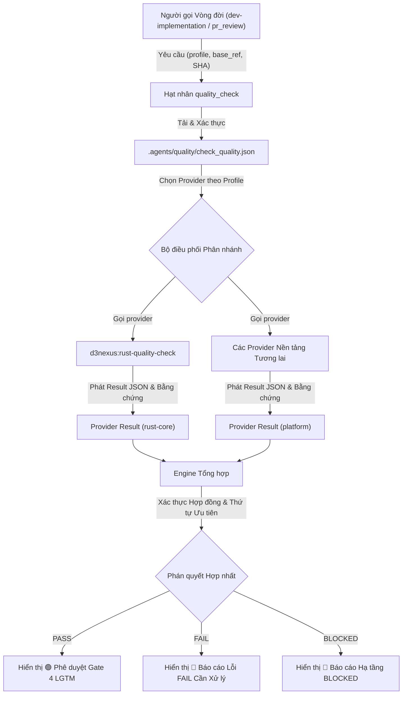
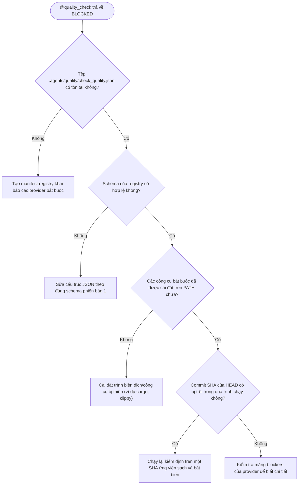

# Kiến trúc Hệ thống Provider Kiểm định Chất lượng

Tài liệu này đặc tả kiến trúc, các hợp đồng và mô hình quản trị của hệ thống đảm bảo chất lượng dựa trên provider trong hệ sinh thái `ai-agent-tools`.

English version: [quality-provider-system.en.md](quality-provider-system.en.md).

## Mục lục

- [1. Tổng quan Kiến trúc](#1-tổng-quan-kiến-trúc)
- [2. Hợp đồng Đăng ký Dự án](#2-hợp-đồng-đăng-ký-dự-án)
- [3. Khám phá và Gọi Provider](#3-khám-phá-và-gọi-provider)
- [4. Hợp đồng Kết quả và Bằng chứng Provider](#4-hợp-đồng-kết-quả-và-bằng-chứng-provider)
- [5. Tổng hợp Kết quả và Thứ tự Ưu tiên Gate](#5-tổng-hợp-kết-quả-và-thứ-tự-ưu-tiên-gate)
- [6. Provider Chất lượng Rust và Quản trị Kiến trúc](#6-provider-chất-lượng-rust-và-quản-trị-kiến-trúc)
- [7. Hợp thành Đa Provider](#7-hợp-thành-đa-provider)
- [8. Di chuyển Fail-Closed và Trách nhiệm Template Mobile](#8-di-chuyển-fail-closed-và-trách-nhiệm-template-mobile)
- [9. Xử lý Sự cố và Cây Quyết định](#9-xử-lý-sự-cố-và-cây-quyết-định)
- [10. Tài liệu Tham khảo](#10-tài-liệu-tham-khảo)

---

## 1. Tổng quan Kiến trúc

Hệ thống chất lượng dựa trên provider chuyển đổi skill [`quality_check`](../../skills/quality_check/SKILL.md) từ một khối nguyên khối nhúng cứng nền tảng di động thành một composition root trung lập với nền tảng. Thay vì tự động phát hiện tệp (`pubspec.yaml`, `build.gradle.kts`, `Package.swift`) và nhúng cứng các lệnh kiểm thử di động, orchestrator hoạt động như một hạt nhân tinh gọn được điều khiển thông qua dependency injection.

### 1.1 Các Nguyên tắc Cốt lõi

1. **Dependency Injection**: Kho lưu trữ người dùng khai báo các provider chất lượng đang hoạt động trong một manifest thuộc sở hữu của dự án (`.agents/quality/check_quality.json`).
2. **Hạt nhân Trung lập Nền tảng**: Orchestrator không chứa bất kỳ lệnh kiểm thử, ngưỡng đánh giá, hay phỏng đoán tệp nào dành riêng cho một hệ sinh thái cụ thể.
3. **Tổng hợp Xác định (Deterministic Aggregation)**: Kết quả từ tất cả các provider được chọn cho một profile sẽ được thu thập và rút gọn theo thứ tự ưu tiên fail-closed nghiêm ngặt (`FAIL > BLOCKED > PASS`).
4. **Tính Bất biến của Ứng viên (Candidate Immutability)**: Toàn bộ phán quyết kiểm định chỉ thuộc về một commit SHA chính xác (`git rev-parse HEAD`). Mọi đột biến cây mã nguồn trong hoặc sau khi chạy sẽ vô hiệu hóa phê duyệt trước đó.
5. **Kiểm định Chỉ-Đọc (Read-Only Verification)**: Các provider chất lượng không bao giờ tự ý sửa đổi, auto-fix, hoặc định dạng lại mã nguồn trong các phiên kiểm định.

### 1.2 Luồng Điều phối



---

## 2. Hợp đồng Đăng ký Dự án

Mỗi dự án tham gia định nghĩa `.agents/quality/check_quality.json` tại thư mục gốc của repository.

### 2.1 Schema Manifest và Vị trí

Phiên bản schema của manifest là số nguyên `1`. Dưới đây là ví dụ về registry đơn provider khai báo kiểm định chất lượng Rust:

```json
{
  "schema_version": 1,
  "providers": [
    {
      "id": "rust-core",
      "skill": "d3nexus:rust-quality-check",
      "required": true,
      "profiles": ["pr", "epic", "scheduled", "release"]
    }
  ]
}
```

### 2.2 Quy tắc Xác thực

- `schema_version`: Phải là số nguyên `1`. Các phiên bản không hỗ trợ sẽ kích hoạt `BLOCKED`.
- `providers`: Mảng không rỗng chứa các đối tượng provider.
- `id`: Định danh chữ số ổn định (`^[a-z0-9_-]+$`). Phải là duy nhất trong toàn workspace.
- `skill`: Định danh skill có namespace và có thể phân giải được (ví dụ `d3nexus:rust-quality-check`).
- `required`: Cờ boolean. Nếu là `true`, bất kỳ lỗi hoặc tắc nghẽn nào sẽ ngay lập tức ngăn chặn phán quyết chung `PASS`.
- `profiles`: Mảng không rỗng chứa tập con của `["pr", "epic", "scheduled", "release"]` và không được trùng lặp.
- **Từ chối Nghiêm ngặt**: Các trường không xác định sẽ bị validator từ chối nghiêm ngặt để ngăn lỗi gõ phím làm thay đổi hành vi ngoài ý muốn.

---

## 3. Khám phá và Gọi Provider

### 3.1 Hợp đồng Gọi Chuẩn hóa

Các đối tượng gọi kích hoạt `@quality_check` với một payload yêu cầu chuẩn hóa:

```json
{
  "contract_version": 1,
  "profile": "epic",
  "base_ref": "main",
  "repository_sha": "5d8b7b0f1b7a9c6f7c8f6498e69c3d6f1e0a4123"
}
```

Orchestrator thực hiện tuần tự các bước sau:
1. Phân giải thư mục gốc của repo và đọc SHA ứng viên thông qua `git rev-parse HEAD`.
2. Xác thực cấu hình `.agents/quality/check_quality.json`.
3. Lọc danh sách các provider khớp với `profile` được yêu cầu.
4. Gọi từng provider và truyền yêu cầu chuẩn hóa, `provider_id`, cùng cờ `required`.
5. Kiểm tra lại commit SHA của ứng viên sau khi provider hoàn tất để phát hiện trôi SHA (drift).

### 3.2 Các Profile Chất lượng và Chính sách Thực thi

| Profile | Đối tượng Gọi trong Vòng đời | Ý định Tối thiểu |
| :--- | :--- | :--- |
| `pr` | Đánh giá Pull Request (`@pr_review`) | Phản hồi nhanh: định dạng, lint, biên dịch, unit test, phạm vi thay đổi |
| `epic` | Xác thực cuối Epic (`@dev-implementation` Gate 4) | Chứng nhận toàn diện: toàn bộ bộ test workspace, quản trị kiến trúc, coverage, audit ngữ nghĩa |
| `scheduled` | CI định kỳ hàng đêm / cron job | Mở rộng của `epic`: quét phụ thuộc đắt đỏ, quét bản quyền giấy phép, kiểm tra cơ sở dữ liệu bảo mật |
| `release` | Chuẩn bị bản phát hành chính thức | Mở rộng của `epic`: build bản phát hành, kiểm tra tương thích ABI/API, đóng gói sản phẩm |

Một profile nhẹ hơn không bao giờ thỏa mãn một gate đòi hỏi cao hơn. Bằng chứng từ `pr` không thể đáp ứng yêu cầu của `epic`.

---

## 4. Hợp đồng Kết quả và Bằng chứng Provider

### 4.1 Schema Kết quả và Ngữ nghĩa các Trường

Mỗi provider được chọn xuất ra một tệp kết quả JSON tuân thủ [Hợp đồng Kết quả Provider](../../skills/quality_check/references/provider-result-contract.md):

```json
{
  "provider_id": "rust-core",
  "contract_version": 1,
  "profile": "epic",
  "repository_sha": "5d8b7b0f1b7a9c6f7c8f6498e69c3d6f1e0a4123",
  "status": "PASS",
  "checks": [
    {
      "id": "cargo-test",
      "category": "tests",
      "status": "PASS",
      "source": "cargo test --workspace --all-targets",
      "duration": 42.5,
      "summary": "All workspace unit and integration tests passed",
      "evidence_refs": ["ev-test-log"]
    }
  ],
  "coverage": {
    "line": {
      "measured": 0.885,
      "threshold": 0.80
    }
  },
  "evidence": [
    {
      "id": "ev-test-log",
      "type": "log",
      "source": "stdout",
      "location": "target/quality/rust-core/cargo-test.log"
    }
  ],
  "started_head": "5d8b7b0f1b7a9c6f7c8f6498e69c3d6f1e0a4123",
  "finished_head": "5d8b7b0f1b7a9c6f7c8f6498e69c3d6f1e0a4123",
  "duration": 84.2,
  "blockers": [],
  "warnings": []
}
```

### 4.2 Mã Trạng thái và Ràng buộc NOT_APPLICABLE

Các mã trạng thái được hỗ trợ:
- `PASS`: Mọi kiểm tra bắt buộc đã chạy thành công và không phát hiện bất kỳ khiếm khuyết nào.
- `FAIL`: Một hoặc nhiều kiểm tra đã thực thi và phát hiện khiếm khuyết hoặc hồi quy mã nguồn.
- `BLOCKED`: Thiếu công cụ, cấu hình không hợp lệ, sai schema hoặc phụ thuộc không phân giải được đã cản trở quá trình thực thi.
- `NOT_APPLICABLE`: Kiểm tra được bỏ qua một cách hợp lệ kèm bằng chứng có cấu trúc (ví dụ: package mục tiêu không tồn tại).

**Ràng buộc Nghiêm ngặt với `NOT_APPLICABLE`**:
- Yêu cầu cấu trúc `not_applicable_reason` chứa `code` và `detail` hợp lệ.
- Không được dùng làm bí danh cho trình biên dịch bị thiếu, công cụ không khả dụng, hay môi trường hỏng.
- Một provider bắt buộc mà toàn bộ kiểm tra đều là `NOT_APPLICABLE` sẽ bị đánh giá là `BLOCKED`.

---

## 5. Tổng hợp Kết quả và Thứ tự Ưu tiên Gate

### 5.1 Quy tắc Thứ tự Ưu tiên Xác định

Engine tổng hợp áp dụng quy tắc ưu tiên toán học, fail-closed:

$$\text{FAIL} > \text{BLOCKED} > \text{PASS}$$

1. **Khiếm khuyết Vượt trên Tắc nghẽn**: Nếu bất kỳ kiểm tra hoặc provider nào trả về `FAIL`, phán quyết chung là `FAIL`. Các lỗi đã biết không được phép bị che giấu đằng sau sự thiếu hụt công cụ.
2. **Tắc nghẽn Ngăn chặn Phê duyệt**: Nếu không có lỗi nào nhưng có provider trả về `BLOCKED`, phán quyết chung là `BLOCKED`. Trạng thái `BLOCKED` không thể chuyển đổi Gate 4 sang trạng thái được duyệt.
3. **Đồng thuận Bắt buộc**: Trạng thái `PASS` chung đòi hỏi mọi provider bắt buộc đều phải đạt `PASS` trên cùng một SHA ứng viên duy nhất.
4. **Thứ tự Xác định**: Các provider và kiểm tra được sắp xếp theo thứ tự từ điển dựa trên `id`. Thứ tự hiển thị là bất biến.

### 5.2 Tổng hợp Báo cáo Điều hành

Engine tổng hợp các phát hiện vào định dạng chuẩn [Định dạng Báo cáo Điều hành](../../skills/quality_check/references/executive-report-format.md):
- Tiêu đề chứa profile được yêu cầu, nhánh gốc (base ref), SHA ứng viên và dấu thời gian.
- Bảng tóm tắt điều hành liệt kê từng provider, trạng thái, thời gian chạy và số lượng khiếm khuyết.
- Ma trận kiểm tra chi tiết được phân nhóm theo danh mục (tests, lint, architecture, security, coverage).
- Hướng dẫn khắc phục lỗi cụ thể cho từng mục bị `FAIL` hoặc `BLOCKED`.

---

## 6. Provider Chất lượng Rust và Quản trị Kiến trúc

### 6.1 Ánh xạ Năng lực Chỉ-Đọc của Rust

Skill [`rust-quality-check`](../../skills/rust-quality-check/SKILL.md) đọc cấu hình dự án từ `.agents/quality/rust-quality.json` và thực thi các bộ công cụ ở chế độ chỉ đọc:

| Năng lực | Lệnh Thực thi | Vai trò |
| :--- | :--- | :--- |
| **Định dạng Mã nguồn** | `cargo fmt --all -- --check` | Thực thi định dạng rustfmt mà không sửa đổi tệp |
| **Biên dịch & Lint** | `cargo clippy --workspace --all-targets -- -D warnings` | Kiểm tra linter nghiêm ngặt không có cảnh báo |
| **Bộ Kiểm thử** | `cargo test --workspace --all-targets` | Xác thực unit test, integration test và doctest |
| **Độ phủ Mã nguồn** | `cargo llvm-cov --workspace --json` | Xác thực ngưỡng độ phủ theo dòng và nhánh |
| **Kiểm tra Lỗ hổng** | `cargo audit` (công cụ tùy chọn) | Quét lỗ hổng bảo mật dựa trên cơ sở dữ liệu advisory |
| **Quản trị Phụ thuộc** | `cargo deny check` (công cụ tùy chọn) | Kiểm tra phụ thuộc bị cấm, crate trùng lặp và giấy phép bản quyền |

### 6.2 Quản trị Kiến trúc Tương đương Konsist qua Cargo Metadata và xtask

Các mã nguồn Kotlin di động sử dụng Konsist để thiết lập rào chắn kiến trúc. Trong workspace Rust, việc quản trị kiến trúc được thực thi thông qua phân tích `cargo_metadata` và lệnh thuộc dự án `cargo run -p xtask -- architecture-check`:

1. **Ranh giới Clean Architecture**: Đảm bảo các domain model không có bất kỳ phụ thuộc ngược nào vào hạ tầng, FFI, hay các adapter mạng.
2. **Cô lập Feature**: Ngăn chặn sự liên kết ngang giữa các crate tính năng độc lập.
3. **Đấu nối Composition Root**: Xác nhận rằng việc dependency injection và lắp ráp struct chỉ diễn ra duy nhất tại gốc ứng dụng.
4. **Phụ thuộc Bị cấm**: Thực thi lệnh cấm các crate không an toàn (unsafe) hoặc các thư viện bên thứ ba chưa được cấp phép.

---

## 7. Hợp thành Đa Provider

### 7.1 Kiến trúc Workspace Hợp thành

Các siêu ứng dụng đa ngôn ngữ (polyglot) hoặc monorepo khai báo nhiều provider trong `.agents/quality/check_quality.json`:

```json
{
  "schema_version": 1,
  "providers": [
    {
      "id": "rust-core",
      "skill": "d3nexus:rust-quality-check",
      "required": true,
      "profiles": ["pr", "epic", "scheduled", "release"]
    },
    {
      "id": "mobile-client",
      "skill": "d3nexus:android-quality-check",
      "required": true,
      "profiles": ["pr", "epic", "release"]
    }
  ]
}
```

### 7.2 Mô hình Thực thi Đa Provider

Khi `@quality_check` chạy trên một workspace hợp thành:
1. Nó chọn cả hai provider `rust-core` và `mobile-client`.
2. Cả hai provider thực thi song song hoặc tuần tự.
3. Engine tổng hợp đối chiếu cả hai tài liệu kết quả.
4. Nếu `rust-core` đạt nhưng `mobile-client` thất bại, phán quyết chung là `FAIL`. Gate 4 đợi toàn bộ phán quyết hợp thành và không bao giờ phê duyệt khi chỉ có provider đầu tiên vượt qua.

---

## 8. Di chuyển Fail-Closed và Trách nhiệm Template Mobile

### 8.1 Di chuyển Fail-Closed Phá vỡ Tương thích

Quá trình chuyển đổi sang đảm bảo chất lượng dựa trên provider là **phá vỡ tương thích và fail-closed**:
- Bất kỳ workspace nào thiếu tệp `.agents/quality/check_quality.json` sẽ ngay lập tức dừng lại với trạng thái `BLOCKED`.
- Không tồn tại đường lui ngầm định về các ma trận lệnh di động trong lịch sử.
- Việc lựa chọn rỗng không có provider nào cho một profile cũng sẽ tạo ra `BLOCKED`.

### 8.2 Trách nhiệm của Provider Nền tảng Tương lai

Trách nhiệm kiểm tra chất lượng nền tảng di động đã được tách rời:
- **Android Native**: Sẽ cung cấp `android-quality-check` trong các công việc nền tảng thuộc chu kỳ sau.
- **iOS Native**: Sẽ cung cấp `ios-quality-check` trong các công việc nền tảng thuộc chu kỳ sau.
- **Flutter**: Sẽ cung cấp `flutter-quality-check` trong các công việc nền tảng thuộc chu kỳ sau.

Cho đến khi các provider nền tảng đó được xây dựng và đăng ký, các dự án di động chuyển đổi sang kiến trúc này phải tự đăng ký các lệnh kiểm định nền tảng của mình qua manifest provider của dự án.

---

## 9. Xử lý Sự cố và Cây Quyết định

### 9.1 Các Vấn đề Đăng ký và Phân giải Công cụ



### 9.2 Cây Quyết định Thất bại tại Gate 4

Khi quy trình chứng nhận tự động tại Gate 4 báo cáo phán quyết không phải là PASS:
1. **Nếu trạng thái là `FAIL`**:
   - Kiểm tra chẩn đoán lỗi chi tiết trong Báo cáo Điều hành.
   - Quay trở lại Stage 3 Phase 2 (`dev-implementation`) để khắc phục các lỗi hồi quy mã nguồn đã xác định.
   - Chạy lại toàn bộ quy trình kiểm định từ đầu.
2. **Nếu trạng thái là `BLOCKED`**:
   - Khắc phục công cụ bị thiếu, manifest không hợp lệ, hoặc tình trạng trôi SHA.
   - TUYỆT ĐỐI KHÔNG tìm cách bỏ qua, vô hiệu hóa, hay hạ cấp kiểm tra.
   - Chạy lại toàn bộ quy trình kiểm định từ đầu.

---

## 10. Tài liệu Tham khảo

- [Provider Registry Contract](../../skills/quality_check/references/provider-registry-contract.md)
- [Provider Result Contract](../../skills/quality_check/references/provider-result-contract.md)
- [Aggregation Contract](../../skills/quality_check/references/aggregation-contract.md)
- [Executive Report Format](../../skills/quality_check/references/executive-report-format.md)
- [Rust Capability Contract](../../skills/rust-quality-check/references/rust-capability-contract.md)
- [Rust Architecture Governance](../../skills/rust-quality-check/references/rust-architecture-governance.md)
- [Rust Tool Mapping](../../skills/rust-quality-check/references/rust-tool-mapping.md)
