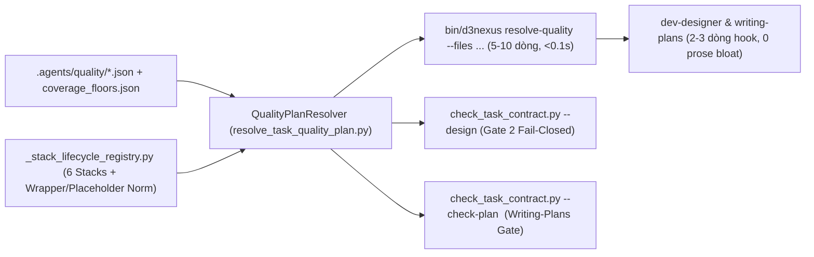

# Báo cáo Tổng hợp Cải tiến d3nexus (b2d1c99) và Độ phủ quality_check Toàn Hệ sinh thái

- **Date**: 2026-11-28
- **Diátaxis mode**: reference
- **Audience**: Role 1.0 (Human Architect) và các nhóm phát triển duy trì 5 dự án hệ sinh thái (`D3Nexus`, `lyrics-sync`, `nexus`, `android_digital_wallet`, `ios_digital_wallet`)
- **Acceptance**: Người đọc nắm rõ toàn bộ cải tiến kiến trúc Shift-Left trên `ai-agent-tools` (`b2d1c99`), đối chiếu được điểm độ phủ chuẩn kiến trúc v1/v2 cùng độ phủ kiểm thử thực nghiệm trên cả 5 dự án (`develop`), và xác định chính xác các hạng mục cần hoàn thiện tiếp theo.
- **Upstream Plugin (`ai-agent-tools`)**: Đã hợp nhất vào `main` tại commit **`b2d1c99`** (`[SHIFT_LEFT_QUALITY_RESOLVER] Merge epic/shift_left_quality_resolver`) và đồng bộ trực tiếp vào bản cài plugin `~/.gemini/config/plugins/d3nexus`.
- **Phụ lục Kiến trúc Liên kết**: [polyglot-quality-lifecycle-handoff.md](./polyglot-quality-lifecycle-handoff.md).
- **Phạm vi Hệ sinh thái Đánh giá**: **5/5 dự án** (`D3Nexus`, `lyrics-sync`, `nexus`, `android_digital_wallet`, `ios_digital_wallet`) trải rộng trên **6/6 nền tảng công nghệ** (Rust, Python, Web \[Astro/TS & Vanilla JS\], Flutter, Android Native, iOS Native) — hiện **100% (`5/5`) dự án đều đã đưa cấu hình `/quality_check` lên nhánh `develop`**.

## Mục lục

- [1 Chi tiết Thay đổi Cải tiến và Chỉnh sửa trên ai-agent-tools (b2d1c99)](#1-chi-tiết-thay-đổi-cải-tiến-và-chỉnh-sửa-trên-ai-agent-tools-b2d1c99)
- [2 Báo cáo Độ phủ Áp dụng quality_check và Độ phủ Kiểm thử trên 5 Dự án](#2-báo-cáo-độ-phủ-áp-dụng-quality_check-và-độ-phủ-kiểm-thử-trên-5-dự-án)

---

## 1 Chi tiết Thay đổi Cải tiến và Chỉnh sửa trên ai-agent-tools (b2d1c99)

### 1.1 Hợp đồng Open-Closed thứ 5 QualityPlanResolver (#0024, #0025)

- **File mới**: [resolve_task_quality_plan.py](../../skills/dev-implementation/resources/scripts/resolve_task_quality_plan.py) và lệnh CLI `d3nexus resolve-quality --files <planned_files> [--repo-root <dir>] [--base-ref <ref>] [--json]` trong [bin/d3nexus](../../bin/d3nexus).
- **Cơ chế 100% cơ học (Zero-LLM, Python 3 stdlib, `< 0.10s` in-process)**:
  - Lọc chặt theo đuôi file/manifest chạm tới (**0 dòng nhiễu** từ các stack không liên quan).
  - Tự động phát hiện yêu cầu **Dual Web Test** khi chạm `.js`/`.mjs` ở repo bật V8 LCOV `diff_coverage`: bắt buộc cả unit test sinh LCOV (`tests/js/*.test.mjs`) lẫn Playwright `# tier: C2` (`Needs: PLAYWRIGHT_BROWSER`).
  - Tra cứu ngưỡng workspace / package / diff coverage và các chốt chặn tăng đơn điệu theo từng adapter/module trong `.agents/quality/coverage_floors.json`.
  - Quét cây thư mục tìm chính xác các template `*.html` / `*.astro` / `*.jinja` / `*.jinja2` tham chiếu tới file `.js`/`.css` sửa đổi (neo ranh giới đường dẫn và phân biệt các file trùng tên `app.js` ở khác thư mục) để nhắc thêm vào `Allowed files` / `Modify:` nhằm bump `?v=`.
  - Tổng hợp câu lệnh `TIER-B` đã nội suy `{skills_dir}` -> `"$D3NEXUS_KIT/skills"`, cắt mục tiêu full-repo (`.`, `src`, `tests`) về đúng `<allowed_files>`, và tự viết lại đường dẫn tương đối theo `<dir>/` khi có `--directory <dir>` / `--project <dir>` / `--prefix <dir>`.

### 1.2 Chốt chặn Hợp đồng Fail-Closed trước khi Code (#0022, #0025)

- **Mở rộng [check_task_contract.py](../../skills/dev-implementation/resources/scripts/check_task_contract.py)** cho cả **Gate 2 Epic (`--design`)** và **Kế hoạch độc lập (`--check-plan <plan.md>`)**:
  1. **Unexpanded Placeholder & Bare `npx` Guard**: Tự động `exit 1` nếu còn sót literal `{skills_dir}`, `{base_ref}`, hoặc `npx <bin>` thiếu `--no-install`.
  2. **Intermediate-Task Full-Repo Scope Guard**: Cấm `Task 1..N-1` (khi epic/plan có `>= 2` task và không sửa `pyproject.toml`) chạy full-repo `ruff`/`mypy` trên `.` hoặc `src tests` thay vì scope theo `Allowed files`; sửa lỗi regex `_task_order_key` (`task_NN_<slug>` và thứ tự `a9 < b1`).
  3. **Web V8 LCOV Unit-Test Guard**: Tự động `exit 1` nếu chạm `.js`/`.mjs` ở repo có LCOV `diff_coverage` mà chỉ lên kế hoạch Playwright E2E, thiếu unit test sinh LCOV.
  4. **Canonical Test Layout, Pairing & Malformed Manifest Guard**: Kiểm tra `test_routing` (`canonical_test_globs`, `forbidden_test_globs`, `paired_source_globs`) và fail-closed ngay khi `*-quality.json` lỗi cú pháp.
  5. **Atomic `?v=` Cache-Bust Template Guard**: Bắt buộc đưa mọi template tham chiếu `src=`/`href=` vào cùng task khi sửa `.js`/`.css` hiện hữu.
- **Sửa triệt để lỗi ghép Prefix đa mục tiêu (`#0022`)**:
  - Mở rộng `_cap_tool_prefix()` và `matches_cap()` để hỗ trợ `uv run mypy --strict src tests` và `ruff check --extend-select ... .` cho cả danh sách file `.py` cụ thể lẫn glob/directory Python (`src/pkg/*.py`), đồng thời chặn `mypy unrelated.py` và không ép thư mục phi-Python (`docs/guide/`) vào `ruff`/`mypy`.
  - Mở rộng [_stack_lifecycle_registry.py](../../skills/dev-implementation/resources/scripts/_stack_lifecycle_registry.py): thêm `"check_vanilla_js.py"` vào mặc định Web, chuẩn hóa `{skills_dir}`, unwrap hai chiều `mise exec` + kiểm tra khớp thư mục wrapper monorepo (`uv --directory`, `npm --prefix`), và khớp basename script `.py`/`.sh` + cờ bắt buộc.

### 1.3 Đồng bộ 6 JSON Schemas Vệ sinh Receipt Gate 4 (#0023) --package-floors và Scaffolder

- **6 Provider Schemas & `_provider_manifest_common.py`**: Bổ sung `test_routing`, `coverage.package_floors` trên cả 6 stack; thêm `architecture` cho Flutter schema và `cache_enable`/`cache_purge` cho Rust/Web/Python schemas; hỗ trợ `patternProperties` (`^contracts_[a-z0-9_]+$`) trong kiểm thử parity.
- **Xóa Receipt Gate 4 cũ (`#0023`)**: [verify_polyglot_registry.py](../../skills/quality_check/resources/scripts/verify_polyglot_registry.py) tự động `unlink(missing_ok=True)` file `build/quality/gate4_receipt.json` ngay khi lượt chạy `epic`/`release` trả về `FAIL`/`BLOCKED`; [integrate_branch.py](../../skills/finishing-a-development-branch/resources/scripts/integrate_branch.py) cảnh báo khi worktree có thay đổi chưa commit ở nhánh `noop`.
- **Monotonic Package/Module Floors**: [check_diff_coverage.py](../../skills/quality_check/resources/scripts/check_diff_coverage.py) bổ sung `--package-floors <coverage_floors.json>` (`exit 2 BLOCKED` khi file hỏng/thiếu, `exit 1 FAIL` khi tụt dưới ngưỡng adapter/module, kèm trường `enforced_coverage_pct` minh bạch trong JSON).
- **Khử trùng Scaffolder & Dọn Template Cũ (`#0020`)**:
  - [scaffold_quality_manifest.py](../../skills/setup_quality_check/resources/scripts/scaffold_quality_manifest.py) và [web-quality.template.json](../../skills/setup_quality_check/resources/templates/web-quality.template.json) tách bạch `pr_diff_audit`/`pr_impact` (chỉ ở `pr`) với `workspace_audit`/`workspace_impact` (ở `epic`, `scheduled`, `release`), dùng `npx --no-install`, bỏ `cargo audit` online khỏi `pr`/`epic` của Rust, và đặt `mypy --strict src tests` cho Python.
  - [dev-designer/SKILL.md](../../skills/dev-designer/SKILL.md), [verification-rows.md](../../skills/dev-designer/references/verification-rows.md), [writing-plans/SKILL.md](../../skills/writing-plans/SKILL.md) và [plan-document-reviewer-prompt.md](../../skills/writing-plans/plan-document-reviewer-prompt.md) tích hợp gọn 2–3 dòng gọi CLI, xóa sạch các tên script cũ (`verify_importlinter_coverage.py`, `pre_review_self_probe.py`, `verify_bdd_coverage.py`).

### 1.4 Triage và Đóng đồng bộ Backlog task-observer (lyrics-sync)

- **Đã đóng `status: actioned` (`8/10` observations)**:
  - Đã fix trước trên `HEAD`: `#0017` (`397c23f`), `#0018` (`a79bc7a`), `#0019` (`9775189`).
  - Đã fix trong epic này (`b2d1c99`): `#0020`, `#0022`, `#0023`, `#0024`, `#0025`.
- **Giữ `status: open` cho Epic kế tiếp (`2/10` observations)**:
  - `#0021` (tương ứng `ai-agent-tools #2028`): Code-Tree Equivalence Fast-Path bỏ qua chạy lại Gate 4 sau commit chỉ sửa `review_results.md`.
  - `#0026`: Host-scoped `fcntl.flock` semaphore giới hạn chạy đồng thời các capability nặng liên repo + `estimate_heartbeat.py` dùng `max()`.
- **Ghi nhận mới trên `ai-agent-tools`**: Observation `#2035` (`sync_window_title()` làm bẩn `.vscode/settings.json` trong `-slot-N` worktree và gây `discarded: tree modified` giả trong `run_external_review.py`).

---

## 2 Báo cáo Độ phủ Áp dụng quality_check và Độ phủ Kiểm thử trên 5 Dự án

> [!IMPORTANT]
> **Tổng quan Độ phủ Toàn Hệ sinh thái (Cập nhật trực tiếp trên nhánh `develop` ngày 2026-11-28)**
> - **Độ phủ Triển khai Dự án & Công nghệ**: **`100%` (`5/5` dự án, `6/6` công nghệ, `8/8` stack providers, `44/44` profile checks `PASS`)** — cả `D3Nexus` (`develop@cc291840`) và `nexus` (`develop@d1222b05`) đều đã hợp nhất xong vào `develop`.
> - **Độ phủ Chuẩn Kiến trúc v1 (15 tiêu chí `/quality_check` gốc từ [polyglot-quality-lifecycle-handoff.md](./polyglot-quality-lifecycle-handoff.md))**: Trung bình toàn hệ sinh thái đạt **`94.7%` theo dự án** (`100%` ở `nexus`, `96.7%` ở `lyrics-sync`, `93.3%` ở `android` & `ios`, `90.0%` ở `D3Nexus`).
> - **Độ phủ Chuẩn Kiến trúc v2 (17 tiêu chí — tính thêm 2 tiêu chí mới vừa mở khóa: `test_routing` & `coverage_floors.json` ratchets)**: Trung bình đạt **`85.3%` theo dự án** (`91.2%` ở `lyrics-sync`, `88.2%` ở `nexus`, `82.4%` ở `android` & `ios`, `79.4%` ở `D3Nexus`).
> - **Độ phủ Dòng lệnh Thực nghiệm (Measured Line Coverage)**: Trung bình toàn hệ sinh thái đạt **`85.27%`** (mọi stack đều vượt ngưỡng sàn workspace `75–80%` và sàn từng package/module `60–65%`, với recall bắt lỗi giả lập đạt **`100%`** trên các bài benchmark).

### 2.1 Bảng Điểm Độ phủ Áp dụng theo Dự án và Stack (develop)

| Dự án (`develop` SHA) | Stack Provider | Độ phủ Chuẩn v1 (15 lớp) | Độ phủ Chuẩn v2 (17 lớp) | Độ phủ Code Thực tế (Workspace / Min Pkg / Diff) | Tốc độ Gate 4 & Inner Loop | Khoảng trống còn thiếu để đạt `100%` v2 |
| :--- | :--- | :---: | :---: | :--- | :--- | :--- |
| **`nexus`** (`develop@d1222b05`) | `flutter-core` (Flutter + 19 Melos pkgs) | **`15/15` (`100.0%`)** | **`15/17` (`88.2%`)** | **`83.49%`** (`>=75%` / `>=60%` / diff `>=80%`) | Task `5.85s`; offline LCOV meta `<0.2s` | Thêm optional `test_routing` & `coverage_floors.json` (v2). |
| **`lyrics-sync`** (`develop@4ab9fbfb`) | `python-core` + `web-quality` (Repo Union) | **`14.5/15` (`96.7%`)** | **`15.5/17` (`91.2%`)** | Py: **`87.47%`** (`>=80%`/`>=65%`/diff `>=85%`); JS V8: **`77.10%`** (`>=75%`/`>=60%`/diff `>=80%`) | Task `2.17s`; `epic` `237.7s` (`-20.5%`, `0` dup) | Khai báo thêm block `test_routing` JSON để bỏ hẳn bảng văn xuôi mục 9 trong `quality-check-strategy.md`; thêm JS formatter nếu cần. |
| **`android_digital_wallet`** (`develop@7821930`) | `android-core` (Kotlin, Compose, 11 Gradle modules) | **`14/15` (`93.3%`)** | **`14/17` (`82.4%`)** | **`82.32%`** (min module `68.51%`, sàn `80%/60%`, diff `>=80%`) | Gradle delta `2.55s` (`-37.2%`), 6 Py gates `877ms` | Bỏ `pr_diff_audit` & `pr_impact` bị lặp trong `epic`/`release` (giữ `workspace_*`); thêm `test_routing` & `coverage_floors.json`. |
| **`ios_digital_wallet`** (`develop@37c7f36`) | `ios-core` (Swift, SwiftUI, Tuist + 9 SPM pkgs) | **`14/15` (`93.3%`)** | **`14/17` (`82.4%`)** | **`87.74%`** (min pkg `75.59%`, sàn `75%/60%`, diff `>=80%`) | Host pkg `<4.0s`; `epic` `41.25s` (`-70.2%`), cached `0.72s` | Bỏ `pr_diff_audit` & `pr_impact` bị lặp trong `epic`/`release` (giữ `workspace_*`); thêm `test_routing` & `coverage_floors.json`. |
| **`D3Nexus`** (`develop@cc291840`) | `rust-core` + `web-quality` + `python-core` | **Repo: `90.0%`** (Py `93.3%`, Rust `86.7%`, Web `80.0%`) | **Repo: `79.4%`** (Py `82.4%`, Rust `76.5%`, Web `70.6%`) | Rust: **`87.10%`** (min `68.73%`); Web: **`88.64%`** (min `79.55%`); Py: **`88.12%`** (diff `>=80%`) | Cold `epic` `241.5s` (`-66.5%`); 5-step tail `246.6s` (`-88.6%`) | **(1)** Khử trùng `pr_*` + `workspace_*` (và `test` + `coverage`) trong `epic`/`release`; **(2)** Đổi `npx playwright` sang `npx --no-install`; **(3)** Tách `cargo audit` online sang `security_deps`; **(4)** Thêm Web `format` + v2 `test_routing`/`coverage_floors.json`. |

### 2.2 Ma trận Độ phủ theo Từng Lớp Kiến trúc (17 Lớp Chuẩn v2 trên 5 Dự án)

| # | Lớp Kiểm soát Chất lượng (`/quality_check` v2) | `D3Nexus` | `lyrics-sync` | `nexus` | `android` | `ios` | Độ phủ Hệ sinh thái |
| :---: | :--- | :---: | :---: | :---: | :---: | :---: | :---: |
| 1 | Ma trận đủ 4 Profile (`pr`, `epic`, `scheduled`, `release`) | ✅ | ✅ | ✅ | ✅ | ✅ | **`100%` (`5/5`)** |
| 2 | Định dạng chuẩn (`format` / `spotless` / `swiftformat`) | ⚠️ *(Rust+Py có, Web thiếu)* | ✅ *(Py)* | ✅ | ✅ | ✅ | **`90%` (`4.5/5`)** |
| 3 | Phân tích tĩnh (`clippy` / `ruff` / `eslint` / `detekt` / `swiftlint`) | ✅ | ✅ | ✅ | ✅ | ✅ | **`100%` (`5/5`)** |
| 4 | Kiểm tra kiểu / biên dịch nghiêm ngặt (`mypy --strict`, `tsc`, `check_vanilla_js`) | ✅ | ✅ | ✅ | ✅ | ✅ | **`100%` (`5/5`)** |
| 5 | Unit + Subcutaneous `Tier C1` (`< 5–15s`) tách khỏi `Tier C2` (`Needs:`) | ✅ | ✅ | ✅ | ✅ | ✅ | **`100%` (`5/5`)** |
| 6 | Độ phủ Kép (Workspace Floor + Per-Package/Module Floor) | ✅ | ✅ | ✅ | ✅ | ✅ | **`100%` (`5/5`)** |
| 7 | Hunk-Level Diff Coverage (`>= 80–85%` trên dòng code mới/sửa) | ✅ | ✅ | ✅ | ✅ | ✅ | **`100%` (`5/5`)** |
| 8 | Ranh giới Clean Architecture (`0` whitelisted violations) | ✅ *(Rust+Py)* | ✅ | ✅ | ✅ | ✅ | **`95%` (`4.75/5`)** |
| 9 | Chốt chặn Chống Stub/`TODO` (`anti_stub` trong code sản phẩm) | ✅ | ✅ | ✅ | ✅ | ✅ | **`100%` (`5/5`)** |
| 10 | Bảo mật Offline (`pr`/`epic`) tách khỏi CVE Online (`scheduled`/`release`) | ⚠️ *(Rust còn `cargo audit` ở `pr`)* | ✅ | ✅ | ✅ | ✅ | **`90%` (`4.5/5`)** |
| 11 | Code Health / UI Audit 2 chế độ (`pr_diff_audit` vs `workspace_audit --all-files`) | ✅ | ✅ | ✅ | ✅ | ✅ | **`100%` (`5/5`)** |
| 12 | 4-Layer Impact & Test Pairing (`pr_impact` vs `workspace_impact --all-files`) | ✅ | ✅ | ✅ | ✅ | ✅ | **`100%` (`5/5`)** |
| 13 | Khử trùng lặp hoàn toàn giữa `pr_*` và `workspace_*` trong `epic`/`release` | ❌ | ✅ | ✅ | ❌ | ❌ | **`40%` (`2/5`)** |
| 14 | Danh mục Chuẩn Quốc tế `.agents/quality/standards_catalog.json` (ISO/OWASP/CWE) | ✅ | ✅ | ✅ | ✅ | ✅ | **`100%` (`5/5`)** |
| 15 | Tài liệu Chiến lược English SSOT `docs/development/quality-check-strategy.md` | ✅ | ✅ | ✅ | ✅ | ✅ | **`100%` (`5/5`)** |
| 16 | **[Mới v2]** Monotonic Per-Adapter/Module Ratchet (`coverage_floors.json`) | ⏳ | ✅ | ⏳ | ⏳ | ⏳ | **`20%` (`1/5`, kit đã hỗ trợ `100%`)** |
| 17 | **[Mới v2]** Khai báo `test_routing` cơ học trong `*-quality.json` | ⏳ | ⏳ *(đang dùng defaults)* | ⏳ | ⏳ | ⏳ | **`0%` explicit (`100%` auto-default qua `d3nexus resolve-quality`)** |

### 2.3 Khuyến nghị Ngắn gọn để Đưa cả 5 Dự án lên 100% Chuẩn v2

1. **Khử trùng `epic`/`release` ở `D3Nexus`, `android_digital_wallet`, và `ios_digital_wallet` (Giảm thêm 15–30% thời gian chạy `epic`)**: Bỏ `pr_diff_audit` và `pr_impact` khỏi `profiles.epic` & `profiles.release` (vì `workspace_audit --all-files` và `workspace_impact --all-files` đã bao hàm toàn bộ); ở `D3Nexus` đổi `npx playwright` thành `npx --no-install playwright` và đưa `cargo audit` sang `security_deps`.
2. **Khai báo `test_routing` & `coverage_floors.json` (Tùy chọn, không cần viết thêm văn xuôi)**: Các repo có luật pairing đặc thù (như router/service trong `lyrics-sync` hoặc ViewModel/UseCase trong `nexus`/`android`/`ios`) chỉ cần thêm 5 dòng JSON `test_routing` vào `.agents/quality/<stack>-quality.json` để `d3nexus resolve-quality` và `check_task_contract.py` tự động cưỡng chế ngay từ Gate 2.
3. **Epic Tiếp theo trên `ai-agent-tools` (`#0021` + `#0026`)**: Triển khai **Code-Tree Equivalence Fast-Path** (bỏ qua chạy lại Gate 4 `238s` khi Cross-Model Review `AUTO_PASS_CLEAN` chỉ ghi thêm `review_results.md`) và **Host Heavy-Capability Semaphore** (`fcntl.flock`) khi chạy song song nhiều dự án trên cùng máy.
