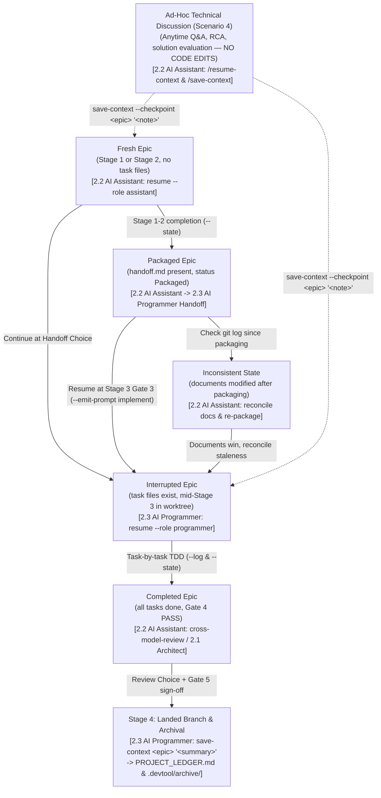

# Context Memory and Tri-Role Workflow Quick-Guide

> Vietnamese translation: [context-memory-quick-guide.vi.md](context-memory-quick-guide.vi.md).

## Table of Contents

- [Meta Data](#meta-data)
- [1. Tri-Role Governance and 10-Second Command Cheat-Sheet](#1-tri-role-governance-and-10-second-command-cheat-sheet)
- [2. End-to-End Save and Resume Workflow Diagram](#2-end-to-end-save-and-resume-workflow-diagram)
- [3. Scenario 1 — Post-Package Principal Review (AI Assistant)](#3-scenario-1--post-package-principal-review-ai-assistant)
- [4. Scenario 2 — Post-Review Task Implementation in Worktree (AI Programmer)](#4-scenario-2--post-review-task-implementation-in-worktree-ai-programmer)
- [5. Scenario 3 — Post-Implementation Cross-Model Review (AI Assistant)](#5-scenario-3--post-implementation-cross-model-review-ai-assistant)
- [6. Scenario 4 — Ad-Hoc Technical Discussion and Architecture Analysis (AI Assistant)](#6-scenario-4--ad-hoc-technical-discussion-and-architecture-analysis-ai-assistant)
- [7. Scenario 5 — Multi-Epic Parallel Work, Account Rotation, and Stage 4 Finish](#7-scenario-5--multi-epic-parallel-work-account-rotation-and-stage-4-finish)

## Meta Data

- **Kind**: `document`
- **Audience**: Human Architect (Developer) orchestrating AI Assistant and AI Programmer sessions across multi-repository workspaces (`ai-agent-tools`, `D3Nexus`, `lyrics-sync`, `nexus`) and multiple Antigravity account profiles
- **Diátaxis mode**: `how-to`
- **Non-goals**: Internal Python implementation of `scripts/resume_context.py` (see [save_resume_rules.md](architecture/save_resume_rules.md)) or platform-specific unit testing tutorials
- **Acceptance**: Within 30 seconds at any project checkpoint or account switch, the developer selects the matching scenario, runs the exact CLI command or copy-paste prompt to summon the right persona (`AI Assistant` or `AI Programmer`), and saves or restores context without role violations or multi-epic state collisions
- **Source Spec**: [2026-10-31-context-memory-quick-guide-design.en.md](../.devtool/epic/context_memory_management/2026-10-31-context-memory-quick-guide-design.en.md)

## 1. Tri-Role Governance and 10-Second Command Cheat-Sheet

### The Three Roles

| Role | Persona Header / CLI Flag | Allowed Actions | Hard Restrictions |
| :--- | :--- | :--- | :--- |
| **2.1 Human Architect (You)** | Developer / Orchestrator | Set strategy, approve Gates 1–5, make triage decisions, dispatch prompts between Assistant and Programmer | — |
| **2.2 AI Assistant** | `[PERSONA: AI ASSISTANT — TECHNICAL ADVISOR & CO-ARCHITECT]`<br/>`--role assistant` | Discuss technical problems, evaluate trade-offs, author Spec/HLD/Tasks (`dev-brainstorming`, `dev-designer`), run `principal-review` and `cross-model-review` | **NO IMPLEMENTATION**: Strictly prohibited from creating or editing production source code or application tests. May only edit `docs/`, `.devtool/`, or `shared-contracts/` |
| **2.3 AI Programmer** | `[PERSONA: AI PROGRAMMER — SENIOR TDD SOFTWARE ENGINEER]`<br/>`--role programmer` (aliases: `implementer`, `worker`) | Execute Kanban tasks via `/dev-implementation` in isolated git worktrees, write TDD tests and production code, run quality gates, and finish branches (`/finish`) | **STRICT SPEC FIDELITY**: Bound strictly to approved specs, `Decisions Already Made`, and `Allowed files`. Never alters frozen architecture or `shared-contracts/` symlinks |

### 10-Second Command & Alias Cheat-Sheet

| Goal | Terminal Command / Shell Alias | Chat Slash Skill |
| :--- | :--- | :--- |
| **Restore full project context (default)** | `resume` | `/resume-context` |
| **Restore context as AI Assistant (Advisory / Review)** | `resume --role assistant --epic <epic_slug>` | `/resume-context` |
| **Restore context as AI Programmer (Coding / TDD)** | `resume --role programmer --epic <epic_slug>` | `/dev-implementation` |
| **Save mid-flight checkpoint + custom note (no archive)** | `save-context --checkpoint <epic_slug> "<custom_note>"` | `/save-context` |
| **Save architectural snapshot ($\le 20$ lines)** | `resume --state --epic <epic_slug> --decisions "..." --status "..." --next "..." --prompt "..."` | `/save-context` |
| **Log completed coding task (AI Programmer)** | `resume --log --epic <epic_slug> --task <task_id> --request "..." --action "..." --note "..."` | Automatic in Stage 3 |
| **Emit ready-to-copy Handoff Prompt** | `resume --emit-prompt <principal-review\|implement\|cross-review\|finish\|assistant> --epic <epic_slug>` | `/save-context` |
| **Complete epic & archive Tier 2 logs into Ledger** | `save-context <epic_slug> "<milestone_summary>"` | Automatic in `/finish` |
| **Sync `.zshrc`, shared `.zsh_history` & symlinks** | `resume --sync-zshrc` | — |

## 2. End-to-End Save and Resume Workflow Diagram

### Full `dev-lifecycle` Workflow with Tri-Role Personas (`2.1 Architect`, `2.2 AI Assistant`, `2.3 AI Programmer`)

```mermaid
flowchart TD
    S1["Stage 1 — Inception &amp; Spec (dev-brainstorming)<br/>[2.2 AI Assistant: --role assistant, auto --state]"]
    G1{"Gate 1 — 2.1 Architect<br/>Spec approved?"}
    ROUTE{"Epic-scale?"}
    PLANS(["writing-plans<br/>(leaves this workflow)"])
    S2["Stage 2 — Architecture &amp; Tasks (dev-designer)<br/>[2.2 AI Assistant: --role assistant, auto --state]"]
    G2{"Gate 2 — 2.1 Architect<br/>HLD &amp; task breakdown approved?"}
    HC{"Handoff Choice — 2.1 Architect<br/>package or continue?"}
    PKG["Package epic (handoff.md, status Packaged)<br/>[2.2 AI Assistant: --state &amp; --emit-prompt]"]
    PRC{"Principal Review Choice — 2.1 Architect<br/>Done or Principal Review?"}
    PR["principal-review (Shift-Left design audit)<br/>[2.2 AI Assistant: triage, decisions, revision]"]
    PKGSTOP(["Stop: handoff.md &amp; AI Programmer Resume Prompt"])
    S3["Stage 3 — Isolated Execution (dev-implementation)<br/>[2.3 AI Programmer: --role programmer in worktree]"]
    G3{"Gate 3 — 2.1 Architect<br/>Execution order confirmed?"}
    EXEC["Phase 2-3: task-by-task TDD in worktree<br/>[2.3 AI Programmer: auto --log &amp; --state per task]"]
    G4{"Gate 4 — Machine Verdict<br/>audit + BDD traceability + quality_check 🟢 LGTM?"}
    RC{"Review Choice — 2.1 Architect<br/>Finish, Cross-model review or Local model review?"}
    XR["cross-model-review (Shift-Right external CLI)<br/>[2.2 AI Assistant: triage &amp; --emit-prompt]"]
    LR["cross-model-review (local Ollama)<br/>[2.2 AI Assistant: triage &amp; --emit-prompt]"]
    REVIEW["Phase 4.1: Developer Kanban Review<br/>(All tasks held in DONE column for visual inspection)"]
    G5{"Gate 5 — 2.1 Architect<br/>User sign-off &amp; finish approved?"}
    S4["Stage 4 — Finish Branch &amp; Archival (finishing-a-development-branch)<br/>[2.3 AI Programmer: --complete appends Ledger &amp; archives logs]"]

    S1 --> G1
    G1 -->|no, revise| S1
    G1 -->|yes| ROUTE
    ROUTE -->|no| PLANS
    ROUTE -->|yes| S2
    S2 --> G2
    G2 -->|no, adjust breakdown| S2
    G2 -->|yes| HC
    HC -->|"1. package"| PKG
    HC -->|"2. continue (--emit-prompt implement)"| S3
    PKG --> PRC
    PRC -->|"1. Done"| PKGSTOP
    PRC -->|"2. Principal Review"| PR
    PR -->|"revised and re-packaged"| PKG
    PKGSTOP -.->|"Scenario 2: AI Programmer session"| S3
    S3 --> G3
    G3 -->|no, reorder| G3
    G3 -->|yes| EXEC
    EXEC --> G4
    G4 -->|"no, fix findings as Fix commits"| EXEC
    G4 -->|"yes (--emit-prompt cross-review)"| RC
    RC -->|"1. Finish"| REVIEW
    RC -->|"2. Cross-model review"| XR
    XR -->|"round recorded &amp; fixed"| G4
    RC -->|"3. Local model review"| LR
    LR -->|"round recorded &amp; fixed"| G4
    REVIEW --> G5
    G5 -->|"no, changes as Fix commits"| EXEC
    G5 -->|"yes (--emit-prompt finish)"| S4
```



### Interrupted and Resume States Across Personas

When work pauses, accounts rotate, or an epic is packaged, the lifecycle resumes deterministically across five operational states with explicit persona ownership:



## 3. Scenario 1 — Post-Package Principal Review (AI Assistant)

### When to Use

Use this scenario immediately after Stage 2 (`dev-designer`) finishes packaging your epic (`.devtool/epic/<epic_dir>/handoff.md` is committed) and you want an **AI Assistant** (in the current session or on a rotated account) to conduct an architectural **Principal Review** before writing any code.

### Step 1: Generate or Copy the Principal Review Prompt

Run in terminal (or copy from the Stage 2 packaging output):

```bash
resume --emit-prompt principal-review --epic <epic_slug> --epic-dir <epic_dir>
```

### Step 2: Paste Prompt into the AI Assistant Session

```text
[PERSONA: AI ASSISTANT — TECHNICAL ADVISOR & CO-ARCHITECT]
Run `python3 scripts/resume_context.py --role assistant --epic <epic_slug>` first to restore context.
Invoke `d3nexus:principal-review` on `.devtool/epic/<epic_dir>/handoff.md`.
Remember: You are strictly prohibited from modifying production code or application tests.
```

### Step 3: Triage, Revise Docs, and Transition to Implementation

1. The **AI Assistant** runs `run_external_review.py run --kind principal`, verifies every finding against source code, and presents the triage table.
2. You reply with your decision (e.g., `Fix all findings`).
3. The **AI Assistant** revises the design docs, re-packages `handoff.md`, saves state to `.devtool/state/<epic_slug>.md`, and automatically prints the **Scenario 2 AI Programmer Prompt** (`--emit-prompt implement`).

## 4. Scenario 2 — Post-Review Task Implementation in Worktree (AI Programmer)

### When to Use

Use this scenario once Gate 2 (and Principal Review, if run) has passed and you are ready to hand over execution of the Kanban tasks (`task_01..task_N`) to the **AI Programmer**.

### Step 1: Generate or Copy the AI Programmer Prompt

```bash
resume --emit-prompt implement --epic <epic_slug> --epic-dir <epic_dir>
```

### Step 2: Paste Prompt into the AI Programmer Session

```text
[PERSONA: AI PROGRAMMER — SENIOR TDD SOFTWARE ENGINEER]
Run `python3 scripts/resume_context.py --role programmer --epic <epic_slug>` first.
Use the d3nexus:dev-implementation skill for the `<epic_slug>` epic.
Read .devtool/epic/<epic_dir>/handoff.md first.
Apply the Execution Guardrails for Receiving LLM before presenting Gate 3.
Gates 1 and 2 are passed; do not re-run brainstorming or design.
Gate 3 is pending: present the execution order to me and wait for my confirmation.
```

### Step 3: What Happens Automatically During `/dev-implementation`

1. **Phase 0 & Gate 3**: The **AI Programmer** loads project context (`--role programmer`), presents the task execution order at Gate 3, and waits for your confirmation before creating `.worktrees/<epic_dir>`.
2. **Phase 2 (Per-Task Checkpointing)**: Even though the **AI Programmer** runs inside `.worktrees/<epic_dir>`, `resume_context.py` resolves `git rev-parse --git-common-dir` and writes directly to the main repository's `.devtool/` after every task commit:
   ```bash
   python3 scripts/resume_context.py --log --epic <epic_slug> --task <task_id> \
     --request "<task_title>" --action "<files_and_tests>" --note "None"
   python3 scripts/resume_context.py --state --epic <epic_slug> \
     --status "<done>/<total> tasks done" --next "<next_task_id>"
   ```
3. **If You Switch Accounts Mid-Implementation**: Simply open the new account and paste the same Scenario 2 prompt above. The new **AI Programmer** reads `.devtool/state/<epic_slug>.md` and `.devtool/features/done/`, skips completed tasks, and resumes from the exact next task.
4. **Phase 4 (Gate 4 PASS)**: Once all tasks pass `audit_epic.py`, BDD traceability, and `@quality_check`, the **AI Programmer** saves the passing SHA and prints the **Scenario 3 Cross-Model Review Prompt** alongside the Review Choice menu.

## 5. Scenario 3 — Post-Implementation Cross-Model Review (AI Assistant)

### When to Use

Use this scenario after **Gate 4 PASS** when you want an **AI Assistant** to run independent Cross-Model Review (`claude`, `codex`, `agy`) or Local Model Review (`ollama`) and triage findings with you.

### Step 1: Generate or Copy the Cross-Model Review Prompt

```bash
resume --emit-prompt cross-review --epic <epic_slug> --epic-dir <epic_dir>
```

### Step 2: Paste Prompt into the AI Assistant Session

```text
[PERSONA: AI ASSISTANT — TECHNICAL ADVISOR & CO-ARCHITECT]
Run `python3 scripts/resume_context.py --role assistant --epic <epic_slug>` first.
Invoke `d3nexus:cross-model-review` for epic `<epic_dir>` after Gate 4 PASS.
Present the verified triage table and wait for my decision on each finding.
```

### Step 3: Two Possible Exits After Triage

- **Case A — Code Fixes Required**:
  - You approve which findings to fix.
  - To keep role boundaries clean (or if handing back to a dedicated programmer session), run:
    ```bash
    resume --emit-prompt implement --epic <epic_slug> --prompt "Apply fixes for Cross-Model Review Round N findings and re-run Gate 4 in full"
    ```
- **Case B — Review Clean (`0 blocking findings` / `PASS`)**:
  - The **AI Assistant** records the state and emits the **Stage 4 Finish Prompt**:
    ```bash
    resume --emit-prompt finish --epic <epic_slug> --epic-dir <epic_dir>
    ```

## 6. Scenario 4 — Ad-Hoc Technical Discussion and Architecture Analysis (AI Assistant)

### When to Use

Use this scenario whenever you open a new session or switch accounts **only to discuss technical problems, analyze a bug, evaluate architectural options, or review contracts (`shared-contracts/`)** — and you want a hard guarantee that the AI Agent will **not** prematurely edit production code.

### Step 1: Start the Session as AI Assistant

Either type `/resume-context` in chat, or paste the generated Assistant prompt from:

```bash
resume --emit-prompt assistant --epic <epic_slug> --prompt "Discuss trade-offs for <topic>"
```

Rendered prompt:

```text
[PERSONA: AI ASSISTANT — TECHNICAL ADVISOR & CO-ARCHITECT]
Run `python3 scripts/resume_context.py --role assistant --epic <epic_slug>` first.
Summarize the 6 context sections in 5-10 concise bullets, then discuss the technical problem with me.
Strictly no production code edits are permitted in this session.
```

### Step 2: Save Discussion Takeaways or Custom Prompts Anytime (`/save-context`)

Whenever you reach a conclusion, lock an architectural decision, or need to pause/switch accounts, tell the agent:

> "Use `/save-context` to save our discussion decisions and emit a prompt for the next session."

Or run directly in your terminal:

```bash
# Non-destructive checkpoint save (updates state/<epic>.md + logs/activity_<epic>.log without archiving)
save-context --checkpoint <epic_slug> "Agreed on approach B for token refresh; next step: update api_contract.md"

# Or update the <=20-line state snapshot directly with a custom prompt note
resume --state --epic <epic_slug> \
  --decisions "Selected Redis stream over polling; locked 5s lease timeout" \
  --status "Technical analysis complete" \
  --next "Run /dev-designer to update HLD" \
  --prompt "Resume from section 4 of the RFC"
```

## 7. Scenario 5 — Multi-Epic Parallel Work, Account Rotation, and Stage 4 Finish

### 7.1 Working on Multiple Epics Simultaneously (Multi-Agent Isolation)

When Agent 1 works on `epic_alpha` and Agent 2 works on `epic_beta` in the same repository:
- Agent 1 writes exclusively to `.devtool/state/epic_alpha.md` and `.devtool/logs/activity_epic_alpha.log`.
- Agent 2 writes exclusively to `.devtool/state/epic_beta.md` and `.devtool/logs/activity_epic_beta.log`.
- Every write acquires an exclusive POSIX file lock on `.devtool/.memory.lock` (`fcntl.flock`) and auto-renders `.devtool/assistant_state.md` and `.devtool/activity_stream.log`.
- To inspect only one epic during harvest, pass `--epic`:
  ```bash
  resume --epic epic_alpha
  ```

### 7.2 Switching Antigravity Accounts (`antigravity_homes/<profile>`)

Because `/Users/danhdueexoictif/.zshrc` is synchronized via `resume --sync-zshrc`:
1. **Shared Terminal History**: Every profile symlinks `.zsh_history -> /Users/danhdueexoictif/.zsh_history` with `SHARE_HISTORY` and `INC_APPEND_HISTORY`. Commands you ran in Account A appear immediately when pressing `Up Arrow` or `Ctrl+R` in Account B.
2. **Unified Workspace Paths**: Both `~/Projects` and `~/AllProjects` resolve to `/Users/danhdueexoictif/AllProjects` in every profile.
3. **One-Command Context Recovery**: In the new account's terminal, run `resume` (or tell the agent `/resume-context`) to restore the full 6-section briefing in seconds.

### 7.3 Completing an Epic in Stage 4 (`/finish`)

After you approve **Gate 5 (Developer Kanban Sign-Off)** and invoke `d3nexus:finishing-a-development-branch` (`/finish`):

```bash
resume --emit-prompt finish --epic <epic_slug> --epic-dir <epic_dir>
```

During the **Pre-Finish Hook**, the agent automatically runs:

```bash
# Equivalent to: save-context <epic_slug> "<milestone_summary>"
python3 scripts/resume_context.py --complete "<epic_slug>" "<one_line_milestone_summary>"
```

What `--complete` does on disk:
1. Appends `- **[YYYY-MM-DD] \`<epic_slug>\`**: <one_line_milestone_summary>` to `.devtool/PROJECT_LEDGER.md` (Tier 1 permanent memory).
2. Atomically moves `.devtool/state/<epic_slug>.md` and `.devtool/logs/activity_<epic_slug>.log` into `.devtool/archive/`.
3. Re-renders `.devtool/assistant_state.md` and `.devtool/activity_stream.log` from any remaining active epics (leaving other in-flight epics 100% untouched).
