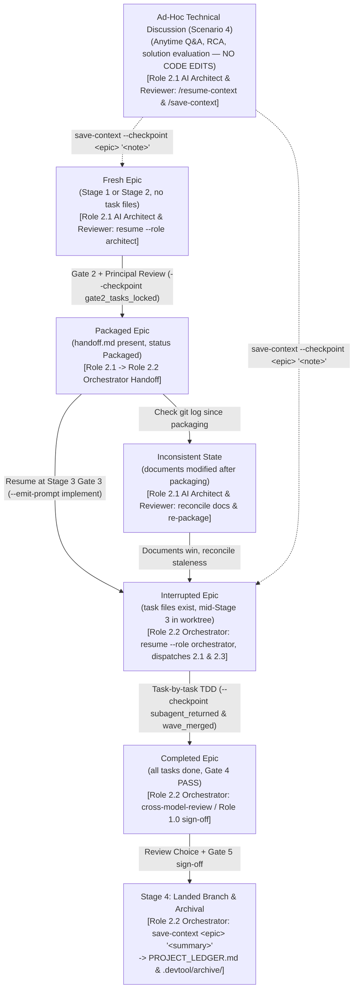

# Context Memory and Four-Persona Workflow Quick-Guide

> Vietnamese translation: [context-memory-quick-guide.vi.md](context-memory-quick-guide.vi.md).

## Table of Contents

- [Meta Data](#meta-data)
- [1. Four-Persona Governance and 10-Second Command Cheat-Sheet](#1-four-persona-governance-and-10-second-command-cheat-sheet)
- [2. End-to-End Save and Resume Workflow Diagram](#2-end-to-end-save-and-resume-workflow-diagram)
- [3. Scenario 1 — Post-Gate 2 Principal Review (Role 2.1 & Role 2.2)](#3-scenario-1--post-gate-2-principal-review-role-21--role-22)
- [4. Scenario 2 — Stage 3 Orchestration & Isolated Task Execution (Role 2.2 & Role 2.3)](#4-scenario-2--stage-3-orchestration--isolated-task-execution-role-22--role-23)
- [5. Scenario 3 — Post-Gate 4 Cross-Model Review & Risk Routing (Role 2.2 & Role 2.1)](#5-scenario-3--post-gate-4-cross-model-review--risk-routing-role-22--role-21)
- [6. Scenario 4 — Ad-Hoc Technical Discussion and Architecture Analysis (Role 2.1)](#6-scenario-4--ad-hoc-technical-discussion-and-architecture-analysis-role-21)
- [7. Scenario 5 — Multi-Epic Parallel Work, Account Pool Rotation, and Stage 4 Finish](#7-scenario-5--multi-epic-parallel-work-account-pool-rotation-and-stage-4-finish)

## Meta Data

- **Kind**: `document`
- **Audience**: Human Architect (Role 1.0) coordinating Role 2.1 AI Architect & Reviewer, Role 2.2 Orchestrator, and Role 2.3 Programmer sessions across multi-repository workspaces and multiple Antigravity account profiles
- **Diátaxis mode**: `how-to`
- **Non-goals**: Internal Python implementation of `scripts/resume_context.py` (see [save_resume_rules.md](architecture/save_resume_rules.md)) or full `/d3nexus:dev-config` reference (see [dev-config-quick-guide.en.md](dev-config-quick-guide.en.md))
- **Acceptance**: Within 30 seconds at any project checkpoint or account switch, the Human Architect selects the matching scenario, runs the exact CLI command or copy-paste prompt to summon the right persona (`architect`, `orchestrator`, or `programmer`), checks quota or low-quota state, and saves or restores context without role violations or multi-epic state collisions
- **Source Spec**: [2026-11-17-four-persona-governance-design.en.md](../.devtool/epic/four_persona_governance/2026-11-17-four-persona-governance-design.en.md)

## 1. Four-Persona Governance and 10-Second Command Cheat-Sheet

### The Four Personas

| Persona | Banner / CLI Flag & Config Key | Allowed Actions | Hard Restrictions |
| :--- | :--- | :--- | :--- |
| **Role 1.0 Human Architect** | Human (`—`) | Vision, strategy, architectural trade-offs, approve Gates 1, 2, and 5, resolve escalations, pick models with `/d3nexus:dev-config`, own Stage 4 Finish | — |
| **Role 2.1 AI Architect & Reviewer** | `[PERSONA: Role 2.1 AI Architect & Reviewer]`<br/>`--role architect` (`assistant` kept as alias); config key `ai_architect_reviewer` | Stage 1–2 Spec/HLD/BDD/task authoring, `/principal-review` & `principal-reviser`, `package_epic.py`; Stage 3 read-only `task-reviewer` & `fix-planner` (`fix_plan_round<N>.md`) | **READ-ONLY ON CODE**: Never edits `src/` or `tests/`, never runs test suites, linters, or type checkers, never dispatches subagents or manages the worker pool |
| **Role 2.2 Orchestrator** | `[PERSONA: Role 2.2 Orchestrator]`<br/>`--role orchestrator`; config key `orchestrator` | Stage 3–4 main session: Gate 3, worker pool (`manage_worker_pool.py`), `dev_config.py quota-check`, pooled subagent dispatch (`dev_config.py dispatch`), independent SHA/clean-tree/diff checks, `--checkpoint`, `/cross-model-review` risk routing, marking tasks `done`, `--complete` | **NO CODE OR DESIGN EDITS**: Never reads or edits `src/` or `tests/`, never edits HLD, BDD, task Verification tables, DoD, or `Allowed files`, never runs tests, linters, or `run_task_checks.py` |
| **Role 2.3 Programmer** | `[PERSONA: Role 2.3 Programmer — Senior TDD Software Engineer]`<br/>`--role programmer`; config key `programmer` | Subagents `task-implementer` (TDD in isolated slot worktrees), `review-fixer` (`fast-track` or `apply-plan`), and `gate4-verifier` (runs full Gate 4) | **STRICT SPEC FIDELITY**: Bounded strictly to approved specs, `Decisions Already Made`, and `Allowed files`. Never alters HLD, BDD, `shared-contracts/`, Verification tables, DoD, or `Allowed files`, and never calls `manage_worker_pool.py` |

### 10-Second Command & Alias Cheat-Sheet

| Goal | Terminal Command / Shell Alias | Chat Slash Skill |
| :--- | :--- | :--- |
| **Restore full project context (latest checkpoint first)** | `resume` | `/resume-context` |
| **Restore context as Role 2.1 AI Architect & Reviewer** | `resume --role architect --epic <epic_slug>` | `/resume-context` |
| **Restore context as Role 2.2 Orchestrator** | `resume --role orchestrator --epic <epic_slug>` | `/dev-implementation` |
| **Restore context as Role 2.3 Programmer** | `resume --role programmer --epic <epic_slug>` | — |
| **Write mandatory lifecycle checkpoint to heartbeat + JSONL** | `resume --checkpoint <gate2_tasks_locked\|subagent_returned\|wave_merged\|model_unavailable\|turn_budget\|low_quota_stop\|quota_low> --epic <epic_slug> --next "<next_step>"` | Automatic in Stages 2–3 |
| **Save architectural snapshot ($\le 20$ lines)** | `resume --state --epic <epic_slug> --decisions "..." --status "..." --next "..." --prompt "..."` | `/save-context` |
| **Log completed coding task** | `resume --log --epic <epic_slug> --task <task_id> --request "..." --action "..." --note "..."` | Automatic in Stage 3 |
| **Emit ready-to-copy Handoff or Subagent Brief Prompt** | `resume --emit-prompt <principal-review\|implement\|cross-review\|finish\|assistant\|brief> --epic <epic_slug>` | `/save-context` |
| **Configure persona models, provider shortcut, or agy pool** | `python3 scripts/dev_config.py status` / `--provider <agy\|claude\|codex>` / `set <persona> ...` | `/d3nexus:dev-config` |
| **Check 5-hour & weekly quota gate or toggle low-quota mode** | `python3 scripts/dev_config.py quota-check` / `low-quota on\|off` | `/d3nexus:dev-config` |
| **Complete epic & archive Tier 2 logs into Ledger** | `save-context <epic_slug> "<milestone_summary>"` | Automatic in `/finish` |
| **Sync `.zshrc`, shared `.zsh_history` & symlinks** | `resume --sync-zshrc` | — |

## 2. End-to-End Save and Resume Workflow Diagram

### Full `dev-lifecycle` Workflow with Four Personas (`1.0 Human`, `2.1 Architect`, `2.2 Orchestrator`, `2.3 Programmer`)

```mermaid
flowchart TD
    S1["Stage 1 — Inception &amp; Spec (dev-brainstorming)<br/>[Role 2.1 AI Architect &amp; Reviewer: --role architect, auto --state]"]
    G1{"Gate 1 — Role 1.0 Human Architect<br/>Spec approved?"}
    ROUTE{"Epic-scale?"}
    PLANS(["writing-plans<br/>(leaves this workflow)"])
    S2["Stage 2 — Architecture &amp; Tasks (dev-designer)<br/>[Role 2.1 AI Architect &amp; Reviewer: --role architect, --checkpoint gate2_tasks_locked]"]
    G2{"Gate 2 — Role 1.0 Human Architect<br/>HLD &amp; task breakdown approved?"}
    PRC{"Provider Priority Choice — Role 1.0<br/>pick /principal-review CLI order?"}
    PR["principal-review (Shift-Left design audit)<br/>[Role 2.1 AI Architect &amp; Reviewer: triage &amp; principal-reviser]"]
    PKG["Package epic (handoff.md, status Packaged)<br/>[Role 2.1 AI Architect &amp; Reviewer: --state &amp; --emit-prompt implement]"]
    HC{"Handoff Choice — Role 1.0 Human Architect<br/>Triển khai (tự động) or Dừng lại?"}
    PKGSTOP(["Stop: handoff.md &amp; Role 2.2 Orchestrator Prompt"])
    S3["Stage 3 — Isolated Execution (dev-implementation)<br/>[Role 2.2 Orchestrator: --role orchestrator, quota-check, dev_config.py dispatch]"]
    G3{"Gate 3 — Role 1.0 Human Architect<br/>Execution order confirmed?"}
    EXEC["Phase 2-3: task-by-task TDD in slot worktrees<br/>[Role 2.3 Programmer: task-implementer; Role 2.1: task-reviewer when gated;<br/>Role 2.2: --checkpoint subagent_returned &amp; wave_merged]"]
    G4{"Gate 4 — Machine Verdict<br/>audit + BDD traceability + quality_check 🟢 LGTM?<br/>[fresh Role 2.3 gate4-verifier]"}
    RC{"Review Choice — Role 1.0 Human Architect<br/>Finish, Cross-model review or Local model review?"}
    XR["cross-model-review (Shift-Right external CLI)<br/>[Role 2.2 Orchestrator: triage, 2.3 fast-track or 2.1 fix-planner]"]
    LR["cross-model-review (local Ollama)<br/>[Role 2.2 Orchestrator: triage &amp; risk-routed fixes]"]
    REVIEW["Phase 4.1: Developer Kanban Review<br/>(All tasks held in DONE column for visual inspection)"]
    G5{"Gate 5 — Role 1.0 Human Architect<br/>User sign-off &amp; finish approved?"}
    S4["Stage 4 — Finish Branch &amp; Archival (finishing-a-development-branch)<br/>[Role 2.2 Orchestrator: --complete appends Ledger &amp; archives logs]"]

    S1 --> G1
    G1 -->|no, revise| S1
    G1 -->|yes| ROUTE
    ROUTE -->|no| PLANS
    ROUTE -->|yes| S2
    S2 --> G2
    G2 -->|no, adjust breakdown| S2
    G2 -->|yes| PRC
    PRC -->|"priority set"| PR
    PR -->|"revised (readiness OK)"| PR
    PR -->|"converged"| PKG
    PKG --> HC
    HC -->|"1. Triển khai (tự động)"| S3
    HC -->|"2. Dừng lại (take prompt)"| PKGSTOP
    PKGSTOP -.->|"Scenario 2: Orchestrator session"| S3
    S3 --> G3
    G3 -->|no, reorder| G3
    G3 -->|yes| EXEC
    EXEC --> G4
    G4 -->|"no, fix findings as Fix commits"| EXEC
    G4 -->|"yes (--emit-prompt cross-review)"| RC
    RC -->|"1. Finish"| REVIEW
    RC -->|"2. Cross-model review"| XR
    XR -->|"round recorded &amp; fixed"| G4
    RC -->|"3. Local model review"| LR
    LR -->|"round recorded &amp; fixed"| G4
    REVIEW --> G5
    G5 -->|"no, changes as Fix commits"| EXEC
    G5 -->|"yes (--emit-prompt finish)"| S4
```



### Interrupted and Resume States Across Personas

When work pauses, accounts rotate, or quota stops trigger (`model_unavailable`, `turn_budget`, `low_quota_stop`, `quota_low`), the lifecycle resumes deterministically from the latest `checkpoint` block in `.devtool/state/<slug>.heartbeat.json`:



## 3. Scenario 1 — Post-Gate 2 Principal Review (Role 2.1 & Role 2.2)

### When to Use

Use this scenario immediately after Stage 2 (`dev-designer`, Role 2.1) records Gate 2 and `--checkpoint gate2_tasks_locked` (`check_epic_readiness.py` has verified English-only epic docs and disjoint `Allowed files` for parallel tasks) and you want `/principal-review` run before packaging `handoff.md`.

### Step 1: Generate or Copy the Principal Review Prompt

Run in terminal:

```bash
resume --emit-prompt principal-review --epic <epic_slug> --epic-dir <epic_dir>
```

### Step 2: Paste Prompt into the Session

```text
[PERSONA: Role 2.2 Orchestrator]
Run `python3 scripts/resume_context.py --role orchestrator --epic <epic_slug>` first.
Review the English SSOT docs and invoke `d3nexus:principal-review` (`Claude -> Codex -> Kiro -> Argon`, max 3 rounds).
Delegate doc edits to a Role 2.1 `principal-reviser` subagent, then run `check_epic_readiness.py <epic_dir>`.
Remember: You are strictly prohibited from reading/editing `src/` or `tests/`.
```

### Step 3: Triage, Revise Docs, Package, and Transition

1. `run_external_review.py run --kind principal --epic-dir <epic_dir> --base <base_branch>` inspects the English SSOT docs (`<epic_dir>.md`, `bdd_scenarios.md`, `task_*.md`) and `triage` presents the findings (for a single design spec outside an epic directory, pass `--doc <spec_path>` instead of `--epic-dir <epic_dir>`).
2. Valid findings are applied in place by Role 2.1 `principal-reviser` (`check_epic_readiness.py` re-runs after edits).
3. On convergence, `package_epic.py` commits `handoff.md`, updates `.devtool/state/<epic_slug>.md`, prints `--emit-prompt implement` naming the configured `orchestrator` model, and presents **Triển khai (tự động)** vs **Dừng lại**.

## 4. Scenario 2 — Stage 3 Orchestration & Isolated Task Execution (Role 2.2 & Role 2.3)

### When to Use

Use this scenario once Gate 2 and `/principal-review` have converged, `handoff.md` is packaged, and you are opening a Stage 3 main session on the configured `orchestrator` model (`--role orchestrator`) to drive `/dev-implementation`.

### Step 1: Generate or Copy the Stage 3 Orchestrator Prompt

```bash
resume --emit-prompt implement --epic <epic_slug> --epic-dir <epic_dir>
```

### Step 2: Paste Prompt into the Role 2.2 Orchestrator Session

```text
[PERSONA: Role 2.2 Orchestrator]
Run `python3 scripts/resume_context.py --role orchestrator --epic <epic_slug>` first.
Activate `/dev-implementation` (`d3nexus:dev-implementation`) for `<epic_slug>`, following `skills/dev-lifecycle/references/orchestration-roles.md`.
Read `.devtool/epic/<epic_dir>/handoff.md` and English SSOT epic docs first (never open `*.vi.md`).
NEVER read/edit `src/` or `tests/`, and NEVER run test suites or `run_task_checks.py` in the main session.
```

### Step 3: What Happens Automatically During `/dev-implementation`

1. **Quota Gate & Pool Check**: Before Stage 3 and before each wave, Role 2.2 runs `python3 scripts/dev_config.py quota-check`. If any required persona fails the 5-hour or weekly threshold (exit `2`), Role 2.2 checkpoints `quota_low`, records a `quota` pending decision, and stops for Role 1.0.
2. **Pooled Dispatch & Briefs**: Role 2.2 generates subagent briefs via `resume_context.py --emit-prompt brief --brief-role task-implementer --epic <epic_slug>` and dispatches Role 2.3 Programmer subagents via `python3 scripts/dev_config.py dispatch --persona programmer --mode write ...` (using the `agy` profile pool and `$REAL_HOME/.d3nexus/agy_profile_leases.json` when configured).
3. **Mandatory Checkpoints & Selective Review**: After each subagent summary contract, Role 2.2 writes `python3 scripts/resume_context.py --checkpoint subagent_returned --epic <epic_slug>`. When selective gating triggers (`review_tier: "full"`, high-risk labels, or `> 2` non-test modules), Role 2.2 dispatches a read-only Role 2.1 `task-reviewer` before marking the task `done`. After merging each wave, Role 2.2 writes `--checkpoint wave_merged`.
4. **Low-Quota Mode & Account Recovery**: If you enable `/d3nexus:dev-config low-quota on`, the turn budget halves (8 -> 4), Role 2.2 finishes the wave in flight, writes `--checkpoint low_quota_stop`, prints `--emit-prompt implement`, and stops cleanly without starting a new wave.
5. **Gate 4 PASS**: Role 2.2 dispatches a fresh Role 2.3 `gate4-verifier` to run `audit_epic.py`, BDD traceability, and `@quality_check`.

## 5. Scenario 3 — Post-Gate 4 Cross-Model Review & Risk Routing (Role 2.2 & Role 2.1)

### When to Use

Use this scenario after **Gate 4 PASS** to run independent Cross-Model Review (`Claude -> Codex -> Kiro -> Argon`) or Local Model Review (`ollama`) with risk-based routing.

### Step 1: Generate or Copy the Cross-Model Review Prompt

```bash
resume --emit-prompt cross-review --epic <epic_slug> --epic-dir <epic_dir>
```

### Step 2: Paste Prompt into the Role 2.2 Orchestrator Session

```text
[PERSONA: Role 2.2 Orchestrator]
Run `python3 scripts/resume_context.py --role orchestrator --epic <epic_slug>` first.
Gate 4 has PASSED. Activate `d3nexus:cross-model-review` following `skills/dev-lifecycle/references/orchestration-roles.md`.
Run `run_external_review.py run` and `triage`. NEVER read/edit `src/` or `tests/` in the main session.
```

### Step 3: Risk-Routed Fixes and Exit to Stage 4

- **Low-Risk Findings** (all `Valid`, no escalation marker, or first Gate 4 failure): Role 2.2 dispatches a Role 2.3 `review-fixer` (`--brief-role review-fixer`) in `fast-track` mode, checks `git diff --name-only`, checkpoints `subagent_returned`, and dispatches a fresh Role 2.3 `gate4-verifier`.
- **High-Risk Findings** (any `Critical`, escalation marker, or repeated Gate 4 failure): Role 2.2 dispatches a read-only Role 2.1 `fix-planner` (`--brief-role fix-planner`):
  - `PLANNED`: Role 2.2 writes `fix_plan_round<N>.md` and dispatches Role 2.3 `review-fixer` in `apply-plan` mode.
  - `ESCALATE`: Any of the five halt criteria (`CRITICAL_CONFLICT`, `Debatable`/`Not shown`, `SHARED_CONTRACT_CONFLICT`, `FIX_LOOP`, `MAX_ROUNDS_CRITICAL_REMAINING`) halts with `--pending-decision` for Role 1.0.
- **Clean Convergence**: Once Gate 4 passes on the latest SHA, emit the Stage 4 Finish prompt:
  ```bash
  resume --emit-prompt finish --epic <epic_slug> --epic-dir <epic_dir>
  ```

## 6. Scenario 4 — Ad-Hoc Technical Discussion and Architecture Analysis (Role 2.1)

### When to Use

Use this scenario whenever you open a session or switch accounts **only to discuss technical problems, analyze a bug, evaluate architectural options, or review contracts** — and want a hard guarantee that no production or test code is edited.

### Step 1: Start the Session as Role 2.1 AI Architect & Reviewer

Either type `/resume-context` in chat, or emit the prompt with:

```bash
resume --emit-prompt assistant --epic <epic_slug> --prompt "Discuss trade-offs for <topic>"
```

Rendered prompt:

```text
[PERSONA: Role 2.1 AI Architect & Reviewer]
Run `python3 scripts/resume_context.py --role architect --epic <epic_slug>` first.
Engage in technical discussion, root cause analysis (RCA), architecture design, and solution trade-off evaluation over English SSOT docs.
STRICTLY PROHIBITED from modifying production/test code or committing changes.
```

### Step 2: Save Discussion Takeaways or Checkpoints Anytime (`/save-context`)

Whenever you lock a decision or need to pause/switch accounts, tell the agent:

> "Use `/save-context` to save our discussion decisions and emit a prompt for the next session."

Or run directly in your terminal:

```bash
# Non-destructive checkpoint save (updates state/<epic>.md + logs/activity_<epic>.log without archiving)
save-context --checkpoint <epic_slug> "Agreed on approach B for token refresh; next step: update api_contract.md"

# Or update the <=20-line state snapshot directly with a custom prompt note
resume --state --role architect --epic <epic_slug> \
  --decisions "Selected Redis stream over polling; locked 5s lease timeout" \
  --status "Technical analysis complete" \
  --next "Run /dev-designer to update HLD" \
  --prompt "Resume from section 4 of the RFC"
```

## 7. Scenario 5 — Multi-Epic Parallel Work, Account Pool Rotation, and Stage 4 Finish

### 7.1 Working on Multiple Epics Simultaneously (Multi-Agent Isolation)

When Agent 1 works on `epic_alpha` and Agent 2 works on `epic_beta` in the same repository:
- Agent 1 writes exclusively to `.devtool/state/epic_alpha.md`, `.devtool/state/epic_alpha.heartbeat.json`, and `.devtool/logs/activity_epic_alpha.log`.
- Agent 2 writes exclusively to `.devtool/state/epic_beta.md`, `.devtool/state/epic_beta.heartbeat.json`, and `.devtool/logs/activity_epic_beta.log`.
- Every write acquires an exclusive POSIX file lock (`fcntl.flock`) and auto-renders `.devtool/assistant_state.md` and `.devtool/activity_stream.log`.
- To inspect only one epic during harvest, pass `--epic`:
  ```bash
  resume --epic epic_alpha
  ```

### 7.2 Switching Antigravity Accounts & Using the `agy` Profile Pool

Because `$REAL_HOME/.zshrc` is synchronized via `resume --sync-zshrc` and persona models live globally under `$REAL_HOME/.d3nexus/`:
1. **Shared Persona Config & Pool Leases**: `$REAL_HOME/.d3nexus/personas.json` carries your model choices across every repository, and `$REAL_HOME/.d3nexus/agy_profile_leases.json` tracks which `agy` profile (`profile_a`, `profile_b`, etc.) each orchestrator slot holds so concurrent runs never collide.
2. **Quota Gate & Model Switching**: Before Stage 3 or each wave, `dev_config.py quota-check` checks both 5-hour and weekly Gemini windows (`>= 15%` 5h and `> 2%` weekly). When every pool profile runs out of quota, the kit stops with a report and never switches models automatically — use `/d3nexus:dev-config set programmer codex-gpt xhigh` or `/d3nexus:dev-config set programmer kiro-sonnet high` (or `/d3nexus:dev-config --provider claude`).
3. **One-Command Context Recovery**: In the new profile's terminal, run `resume` (it prints the latest checkpoint first) or paste the emitted prompt to resume from the exact checkpoint.

### 7.3 Completing an Epic in Stage 4 (`/finish`)

After Role 1.0 approves **Gate 5 (Developer Kanban Sign-Off)** and invokes `d3nexus:finishing-a-development-branch` (`/finish`):

```bash
resume --emit-prompt finish --epic <epic_slug> --epic-dir <epic_dir>
```

During the **Pre-Finish Hook**, Role 2.2 Orchestrator automatically runs:

```bash
# Equivalent to: save-context <epic_slug> "<milestone_summary>"
python3 scripts/resume_context.py --complete "<epic_slug>" "<one_line_milestone_summary>"
```

What `--complete` does on disk:
1. Appends `- **[YYYY-MM-DD] \`<epic_slug>\`**: <one_line_milestone_summary>` to `.devtool/PROJECT_LEDGER.md` (Tier 1 permanent memory).
2. Atomically moves `.devtool/state/<epic_slug>.md` and `.devtool/logs/activity_<epic_slug>.log` into `.devtool/archive/`.
3. Re-renders `.devtool/assistant_state.md` and `.devtool/activity_stream.log` from any remaining active epics (leaving other in-flight epics 100% untouched).
