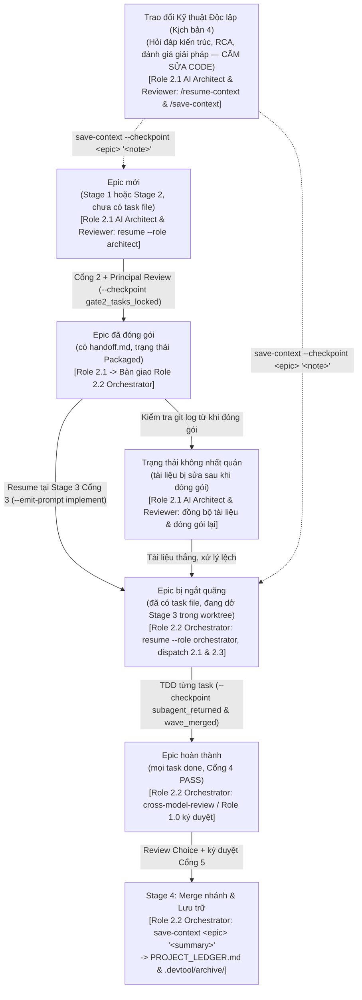

# Sổ tay Nhanh (Quick-Guide): Quy trình Lưu/Khôi phục Ngữ cảnh và Quản trị Bốn Vai trò

> Bản dịch của [context-memory-quick-guide.en.md](context-memory-quick-guide.en.md).

## Table of Contents

- [Meta Data](#meta-data)
- [1. Quản trị Bốn Vai trò và Bảng Cheat-Sheet Lệnh 10 Giây](#1-quản-trị-bốn-vai-trò-và-bảng-cheat-sheet-lệnh-10-giây)
- [2. Sơ đồ Luồng Lưu và Khôi phục Ngữ cảnh Toàn trình](#2-sơ-đồ-luồng-lưu-và-khôi-phục-ngữ-cảnh-toàn-trình)
- [3. Kịch bản 1 — Sau Cổng 2: Thực hiện Principal Review (Role 2.1 & Role 2.2)](#3-kịch-bản-1--sau-cổng-2-thực-hiện-principal-review-role-21--role-22)
- [4. Kịch bản 2 — Điều phối Stage 3 & Thực thi Task Cô lập (Role 2.2 & Role 2.3)](#4-kịch-bản-2--điều-phối-stage-3--thực-thi-task-cô-lập-role-22--role-23)
- [5. Kịch bản 3 — Sau Cổng 4: Cross-Model Review & Phân tuyến Rủi ro (Role 2.2 & Role 2.1)](#5-kịch-bản-3--sau-cổng-4-cross-model-review--phân-tuyến-rủi-ro-role-22--role-21)
- [6. Kịch bản 4 — Trao đổi Kỹ thuật Độc lập và Phân tích Kiến trúc (Role 2.1)](#6-kịch-bản-4--trao-đổi-kỹ-thuật-độc-lập-và-phân-tích-kiến-trúc-role-21)
- [7. Kịch bản 5 — Chạy Đa Epic Song song, Pool Tài khoản và Đóng nhánh Stage 4](#7-kịch-bản-5--chạy-đa-epic-song-song-pool-tài-khoản-và-đóng-nhánh-stage-4)

## Meta Data

- **Kind**: `document`
- **Audience**: Human Architect (Role 1.0) điều phối các phiên Role 2.1 AI Architect & Reviewer, Role 2.2 Orchestrator và Role 2.3 Programmer trên không gian đa repository và nhiều profile Antigravity
- **Diátaxis mode**: `how-to`
- **Non-goals**: Không đi sâu vào mã nguồn cài đặt Python của `scripts/resume_context.py` (xem [save_resume_rules.md](architecture/save_resume_rules.md)) hoặc hướng dẫn đầy đủ `/d3nexus:dev-config` (xem [dev-config-quick-guide.vi.md](dev-config-quick-guide.vi.md))
- **Acceptance**: Trong vòng chưa đầy 30 giây tại bất kỳ checkpoint hay lần đổi tài khoản nào, Human Architect chọn được đúng kịch bản, chạy đúng lệnh CLI hoặc copy-paste khối prompt chuẩn để triệu hồi đúng vai trò (`architect`, `orchestrator` hoặc `programmer`), kiểm tra quota hoặc chế độ tiết kiệm quota, và lưu/khôi phục ngữ cảnh không vi phạm ranh giới
- **Source Spec**: [2026-11-17-four-persona-governance-design.en.md](../.devtool/epic/four_persona_governance/2026-11-17-four-persona-governance-design.en.md)

## 1. Quản trị Bốn Vai trò và Bảng Cheat-Sheet Lệnh 10 Giây

### Bốn Vai trò trong Dự án (Four-Persona Governance)

| Vai trò | Banner / Cờ CLI & Key Cấu hình | Quyền hạn & Nhiệm vụ | Giới hạn Cứng (Hard Restrictions) |
| :--- | :--- | :--- | :--- |
| **Role 1.0 Human Architect** | Con người (`—`) | Tầm nhìn, chiến lược, đánh đổi kiến trúc, duyệt Cổng 1, 2 và 5, xử lý leo thang, chọn model qua `/d3nexus:dev-config`, quyết định Stage 4 Finish | — |
| **Role 2.1 AI Architect & Reviewer** | `[PERSONA: Role 2.1 AI Architect & Reviewer]`<br/>`--role architect` (`assistant` được giữ làm bí danh); key cấu hình `ai_architect_reviewer` | Stage 1–2 soạn Spec/HLD/BDD/tasks, `/principal-review` & `principal-reviser`, `package_epic.py`; Stage 3 chỉ đọc với `task-reviewer` & `fix-planner` (`fix_plan_round<N>.md`) | **CHỈ ĐỌC VỚI CODE**: Cấm sửa `src/` hoặc `tests/`, cấm chạy test/linter/type-checker, cấm dispatch subagent hoặc quản lý worker pool |
| **Role 2.2 Orchestrator** | `[PERSONA: Role 2.2 Orchestrator]`<br/>`--role orchestrator`; key cấu hình `orchestrator` | Phiên chính Stage 3–4: Cổng 3, worker pool (`manage_worker_pool.py`), `dev_config.py quota-check`, dispatch subagent qua pool (`dev_config.py dispatch`), đối chiếu SHA/clean tree/diff độc lập, `--checkpoint`, phân tuyến `/cross-model-review`, đánh dấu task `done`, `--complete` | **CẤM ĐỌC/SỬA CODE HAY THIẾT KẾ**: Cấm đọc hoặc sửa `src/`/`tests/`, cấm sửa HLD, BDD, Verification tables, DoD hay `Allowed files`, cấm chạy test, linter hoặc `run_task_checks.py` |
| **Role 2.3 Programmer** | `[PERSONA: Role 2.3 Programmer — Senior TDD Software Engineer]`<br/>`--role programmer`; key cấu hình `programmer` | Subagents `task-implementer` (TDD trong slot worktree cô lập), `review-fixer` (`fast-track` hoặc `apply-plan`), và `gate4-verifier` (chạy trọn vẹn Cổng 4) | **TUÂN THỦ TUYỆT ĐỐI SPEC**: Bị giới hạn chặt trong spec đã duyệt, `Decisions Already Made` và `Allowed files`. Không sửa HLD, BDD, `shared-contracts/`, Verification tables, DoD hoặc `Allowed files`, và không gọi `manage_worker_pool.py` |

### Bảng Cheat-Sheet Lệnh & Alias 10 Giây

| Mục đích | Lệnh Terminal / Shell Alias | Slash Skill trong Chat |
| :--- | :--- | :--- |
| **Khôi phục toàn bộ ngữ cảnh (in checkpoint mới nhất trước)** | `resume` | `/resume-context` |
| **Khôi phục ngữ cảnh với Role 2.1 AI Architect & Reviewer** | `resume --role architect --epic <epic_slug>` | `/resume-context` |
| **Khôi phục ngữ cảnh với Role 2.2 Orchestrator** | `resume --role orchestrator --epic <epic_slug>` | `/dev-implementation` |
| **Khôi phục ngữ cảnh với Role 2.3 Programmer** | `resume --role programmer --epic <epic_slug>` | — |
| **Ghi checkpoint bắt buộc vào heartbeat + JSONL** | `resume --checkpoint <gate2_tasks_locked\|subagent_returned\|wave_merged\|model_unavailable\|turn_budget\|low_quota_stop\|quota_low> --epic <epic_slug> --next "<next_step>"` | Tự động ở Stages 2–3 |
| **Lưu bản chụp kiến trúc ($\le 20$ dòng)** | `resume --state --epic <epic_slug> --decisions "..." --status "..." --next "..." --prompt "..."` | `/save-context` |
| **Ghi nhật ký sau khi hoàn thành 1 task** | `resume --log --epic <epic_slug> --task <task_id> --request "..." --action "..." --note "..."` | Tự động ở Stage 3 |
| **Xuất Prompt Bàn giao hoặc Subagent Brief dựng sẵn** | `resume --emit-prompt <principal-review\|implement\|cross-review\|finish\|assistant\|brief> --epic <epic_slug>` | `/save-context` |
| **Cấu hình model cho các vai trò, `--provider` hoặc pool agy** | `python3 scripts/dev_config.py status` / `--provider <agy\|claude\|codex>` / `set <persona> ...` | `/d3nexus:dev-config` |
| **Kiểm tra cổng quota 5h & tuần hoặc bật low-quota** | `python3 scripts/dev_config.py quota-check` / `low-quota on\|off` | `/d3nexus:dev-config` |
| **Hoàn tất epic & nén log Tier 2 vào Sổ cái Tier 1** | `save-context <epic_slug> "<milestone_summary>"` | Tự động trong `/finish` |
| **Đồng bộ `.zshrc`, `.zsh_history` dùng chung & symlinks** | `resume --sync-zshrc` | — |

## 2. Sơ đồ Luồng Lưu và Khôi phục Ngữ cảnh Toàn trình

### Sơ đồ Toàn trình `dev-lifecycle` gắn với Bốn Vai trò (`1.0 Human`, `2.1 Architect`, `2.2 Orchestrator`, `2.3 Programmer`)

```mermaid
flowchart TD
    S1["Stage 1 — Khởi đầu &amp; Spec (dev-brainstorming)<br/>[Role 2.1 AI Architect &amp; Reviewer: --role architect, auto --state]"]
    G1{"Cổng 1 — Role 1.0 Human Architect<br/>Spec được duyệt?"}
    ROUTE{"Quy mô epic?"}
    PLANS(["writing-plans<br/>(rời workflow này)"])
    S2["Stage 2 — Kiến trúc &amp; Task (dev-designer)<br/>[Role 2.1 AI Architect &amp; Reviewer: --role architect, --checkpoint gate2_tasks_locked]"]
    G2{"Cổng 2 — Role 1.0 Human Architect<br/>HLD &amp; phân rã task được duyệt?"}
    PRC{"Lựa chọn Thứ tự Ưu tiên Provider/Model — Role 1.0<br/>chọn thứ tự cho /principal-review?"}
    PR["principal-review (Rà soát kiến trúc Shift-Left)<br/>[Role 2.1 AI Architect &amp; Reviewer: triage &amp; principal-reviser]"]
    PKG["Package epic (handoff.md, status Packaged)<br/>[Role 2.1 AI Architect &amp; Reviewer: --state &amp; --emit-prompt implement]"]
    HC{"Handoff Choice — Role 1.0 Human Architect<br/>Triển khai (tự động) hay Dừng lại?"}
    PKGSTOP(["Dừng: handoff.md &amp; Prompt Role 2.2 Orchestrator"])
    S3["Stage 3 — Thực thi độc lập (dev-implementation)<br/>[Role 2.2 Orchestrator: --role orchestrator, quota-check, dev_config.py dispatch]"]
    G3{"Cổng 3 — Role 1.0 Human Architect<br/>Thứ tự thực thi đã xác nhận?"}
    EXEC["Phase 2-3: TDD từng task trong slot worktree<br/>[Role 2.3 Programmer: task-implementer; Role 2.1: task-reviewer khi cần gate;<br/>Role 2.2: --checkpoint subagent_returned &amp; wave_merged]"]
    G4{"Cổng 4 — Máy chấm tự động<br/>audit + BDD traceability + quality_check 🟢 LGTM?<br/>[Role 2.3 gate4-verifier phiên mới]"}
    RC{"Review Choice — Role 1.0 Human Architect<br/>Finish, Cross-model review hay Local model review?"}
    XR["cross-model-review (Shift-Right external CLI)<br/>[Role 2.2 Orchestrator: triage, 2.3 fast-track hoặc 2.1 fix-planner]"]
    LR["cross-model-review (local Ollama)<br/>[Role 2.2 Orchestrator: triage &amp; sửa theo mức rủi ro]"]
    REVIEW["Phase 4.1: Developer Kanban Review<br/>(Mọi task giữ ở cột DONE để kiểm tra trực quan)"]
    G5{"Cổng 5 — Role 1.0 Human Architect<br/>Người dùng ký duyệt &amp; cho phép finish?"}
    S4["Stage 4 — Hoàn tất nhánh &amp; Lưu trữ (finishing-a-development-branch)<br/>[Role 2.2 Orchestrator: --complete ghi Ledger &amp; nén log vào archive/]"]

    S1 --> G1
    G1 -->|chưa, chỉnh sửa| S1
    G1 -->|rồi| ROUTE
    ROUTE -->|không| PLANS
    ROUTE -->|có| S2
    S2 --> G2
    G2 -->|chưa, điều chỉnh phân rã| S2
    G2 -->|rồi| PRC
    PRC -->|"đã chọn thứ tự"| PR
    PR -->|"đã chỉnh sửa (readiness OK)"| PR
    PR -->|"hội tụ PASS"| PKG
    PKG --> HC
    HC -->|"1. Triển khai (tự động)"| S3
    HC -->|"2. Dừng lại (lấy prompt)"| PKGSTOP
    PKGSTOP -.->|"Kịch bản 2: Phiên Orchestrator"| S3
    S3 --> G3
    G3 -->|chưa, sắp xếp lại| G3
    G3 -->|rồi| EXEC
    EXEC --> G4
    G4 -->|"chưa, sửa bằng Fix commit"| EXEC
    G4 -->|"rồi (--emit-prompt cross-review)"| RC
    RC -->|"1. Finish"| REVIEW
    RC -->|"2. Cross-model review"| XR
    XR -->|"đã ghi nhận round &amp; fix"| G4
    RC -->|"3. Local model review"| LR
    LR -->|"đã ghi nhận round &amp; fix"| G4
    REVIEW --> G5
    G5 -->|"chưa, yêu cầu đổi bằng Fix commit"| EXEC
    G5 -->|"rồi (--emit-prompt finish)"| S4
```



### Trạng thái Ngắt quãng và Khôi phục (Resume) theo Bốn Vai trò

Khi công việc tạm dừng, đổi tài khoản Antigravity, hoặc chạm ngưỡng dừng quota (`model_unavailable`, `turn_budget`, `low_quota_stop`, `quota_low`), vòng đời khôi phục tất định từ khối `checkpoint` mới nhất trong `.devtool/state/<slug>.heartbeat.json`:



## 3. Kịch bản 1 — Sau Cổng 2: Thực hiện Principal Review (Role 2.1 & Role 2.2)

### Khi nào sử dụng

Sử dụng ngay sau khi Stage 2 (`dev-designer`, Role 2.1) ghi nhận Cổng 2 và `--checkpoint gate2_tasks_locked` (`check_epic_readiness.py` đã xác nhận tài liệu tiếng Anh chuẩn và `Allowed files` rời nhau cho các task song song) và bạn muốn chạy `/principal-review` trước khi đóng gói `handoff.md`.

### Bước 1: Lấy khối Prompt Principal Review

```bash
resume --emit-prompt principal-review --epic <epic_slug> --epic-dir <epic_dir>
```

### Bước 2: Dán Prompt vào Phiên làm việc

```text
[PERSONA: Role 2.1 AI Architect & Reviewer]
You are acting as Role 2.1 AI Architect & Reviewer (Model: gemini-4-argon-high, Thinking/Effort: high).
Startup command:
python3 scripts/resume_context.py --role architect --epic <epic_slug>

MANDATORY TASKS & RULES:
1. Review the English SSOT docs: .devtool/epic/<epic_dir>/<epic_dir>.md, .devtool/epic/<epic_dir>/bdd_scenarios.md (HLD at .devtool/epic/<epic_dir>/<epic_dir>.md, BDD at .devtool/epic/<epic_dir>/bdd_scenarios.md).
2. Run `d3nexus:principal-review` (`Claude -> Codex -> Kiro -> Argon`, max 3 rounds). Run `principal-reviser` inline in this Role 2.1 Stage 2 session or as a same-model subagent (`python3 scripts/dev_config.py resolve ai_architect_reviewer --format argv --mode write`), then run `check_epic_readiness.py <epic_dir>` in the main session.
3. DO NOT read/edit `src/` or `tests/` or modify production code.
```

### Bước 3: Triage, Cập nhật Tài liệu, Đóng gói và Chuyển tiếp

1. `run_external_review.py run --kind principal --epic-dir <epic_dir> --base <base_branch>` rà soát bộ tài liệu tiếng Anh (`<epic_dir>.md`, `bdd_scenarios.md`, `task_*.md`) và `triage` trình bày bảng kết quả (nếu rà soát một tệp design spec đơn lẻ ngoài thư mục epic, dùng `--doc <spec_path>` thay cho `--epic-dir <epic_dir>`).
2. Các phát hiện hợp lệ được Role 2.1 `principal-reviser` cập nhật trực tiếp (`check_epic_readiness.py` chạy lại sau khi sửa).
3. Khi hội tụ PASS, `package_epic.py` commit `handoff.md`, cập nhật `.devtool/state/<epic_slug>.md`, in `--emit-prompt implement` ghi rõ model `orchestrator` đã cấu hình, và đưa ra lựa chọn **Triển khai (tự động)** hay **Dừng lại**.

## 4. Kịch bản 2 — Điều phối Stage 3 & Thực thi Task Cô lập (Role 2.2 & Role 2.3)

### Khi nào sử dụng

Sử dụng sau khi Cổng 2 và `/principal-review` đã hội tụ, `handoff.md` đã đóng gói, và bạn mở phiên Stage 3 trên model `orchestrator` (`--role orchestrator`) để chạy `/dev-implementation`.

### Bước 1: Lấy khối Prompt cho Role 2.2 Orchestrator

```bash
resume --emit-prompt implement --epic <epic_slug> --epic-dir <epic_dir>
```

### Bước 2: Dán Prompt vào Phiên của Role 2.2 Orchestrator

```text
[PERSONA: Role 2.2 Orchestrator]
Run `python3 scripts/resume_context.py --role orchestrator --epic <epic_slug>` first.
Activate `/dev-implementation` (`d3nexus:dev-implementation`) for `<epic_slug>`, following `skills/dev-lifecycle/references/orchestration-roles.md`.
Read `.devtool/epic/<epic_dir>/handoff.md` and English SSOT epic docs first (never open `*.vi.md`).
NEVER read/edit `src/` or `tests/`, and NEVER run test suites or `run_task_checks.py` in the main session.
```

### Bước 3: Những gì Tự động Diễn ra trong `/dev-implementation`

1. **Cổng Quota & Kiểm tra Pool**: Trước Stage 3 và trước mỗi wave, Role 2.2 chạy `python3 scripts/dev_config.py quota-check`. Nếu thiếu quota ở cửa sổ 5 giờ hoặc theo tuần (exit `2`), Role 2.2 ghi `--checkpoint quota_low`, ghi pending decision `quota` và dừng chờ Role 1.0.
2. **Dispatch qua Pool & Subagent Brief**: Role 2.2 tạo brief bằng `resume_context.py --emit-prompt brief --brief-role task-implementer --epic <epic_slug>` và dispatch Role 2.3 Programmer qua `python3 scripts/dev_config.py dispatch --persona programmer --mode write ...` (dùng pool profile `agy` và `$REAL_HOME/.d3nexus/agy_profile_leases.json` nếu có).
3. **Checkpoint Bắt buộc & Review Chọn lọc**: Sau mỗi summary contract trả về, Role 2.2 ghi `python3 scripts/resume_context.py --checkpoint subagent_returned --epic <epic_slug>`. Khi selective gating kích hoạt (`review_tier: "full"`, nhãn rủi ro cao hoặc `> 2` module non-test), Role 2.2 dispatch Role 2.1 `task-reviewer` (chỉ đọc) trước khi đánh dấu task `done`. Sau khi merge từng wave, Role 2.2 ghi `--checkpoint wave_merged`.
4. **Chế độ Low-Quota & Dừng an toàn**: Khi bật `/d3nexus:dev-config low-quota on`, turn budget giảm một nửa (8 -> 4), Role 2.2 hoàn thành wave đang chạy, ghi `--checkpoint low_quota_stop`, in `--emit-prompt implement`, ghi pending decision và dừng trước wave tiếp theo.
5. **Gate 4 PASS**: Role 2.2 dispatch một Role 2.3 `gate4-verifier` phiên mới chạy `audit_epic.py`, BDD traceability và `@quality_check`.

## 5. Kịch bản 3 — Sau Cổng 4: Cross-Model Review & Phân tuyến Rủi ro (Role 2.2 & Role 2.1)

### Khi nào sử dụng

Sử dụng ngay sau khi **Cổng 4 PASS** để chạy Cross-Model Review (`Claude -> Codex -> Kiro -> Argon`) hoặc Local Model Review (`ollama`) với cơ chế phân tuyến theo rủi ro.

### Bước 1: Lấy khối Prompt Cross-Model Review

```bash
resume --emit-prompt cross-review --epic <epic_slug> --epic-dir <epic_dir>
```

### Bước 2: Dán Prompt vào Phiên của Role 2.2 Orchestrator

```text
[PERSONA: Role 2.2 Orchestrator]
Run `python3 scripts/resume_context.py --role orchestrator --epic <epic_slug>` first.
Gate 4 has PASSED. Activate `d3nexus:cross-model-review` following `skills/dev-lifecycle/references/orchestration-roles.md`.
Run `run_external_review.py run` and `triage`. NEVER read/edit `src/` or `tests/` in the main session.
```

### Bước 3: Sửa theo Mức Rủi ro và Chuyển sang Stage 4

- **Findings Rủi ro Thấp** (toàn bộ `Valid`, không có dấu hiệu leo thang, hoặc lỗi Gate 4 lần đầu): Role 2.2 dispatch Role 2.3 `review-fixer` (`--brief-role review-fixer`) ở chế độ `fast-track`, kiểm tra `git diff --name-only`, ghi checkpoint `subagent_returned`, và dispatch Role 2.3 `gate4-verifier` phiên mới.
- **Findings Rủi ro Cao** (có `Critical`, dấu hiệu leo thang, hoặc lỗi Gate 4 lặp lại): Role 2.2 dispatch Role 2.1 `fix-planner` (`--brief-role fix-planner`, chỉ đọc):
  - `PLANNED`: Role 2.2 ghi `fix_plan_round<N>.md` và dispatch Role 2.3 `review-fixer` ở chế độ `apply-plan`.
  - `ESCALATE`: Bất kỳ tiêu chí dừng nào trong năm tiêu chí (`CRITICAL_CONFLICT`, `Debatable`/`Not shown`, `SHARED_CONTRACT_CONFLICT`, `FIX_LOOP`, `MAX_ROUNDS_CRITICAL_REMAINING`) đều dừng và ghi `--pending-decision` chờ Role 1.0.
- **Hội tụ Sạch**: Khi Cổng 4 đạt PASS trên SHA mới nhất, xuất prompt Đóng nhánh Stage 4:
  ```bash
  resume --emit-prompt finish --epic <epic_slug> --epic-dir <epic_dir>
  ```

## 6. Kịch bản 4 — Trao đổi Kỹ thuật Độc lập và Phân tích Kiến trúc (Role 2.1)

### Khi nào sử dụng

Sử dụng bất kỳ lúc nào bạn mở phiên mới hoặc đổi tài khoản **chỉ để trao đổi kỹ thuật, tìm nguyên nhân gốc rễ (RCA), đánh giá phương án kiến trúc hoặc xem xét contract** — và muốn khóa cứng không sửa production code hay test code.

### Bước 1: Khởi tạo Phiên với Role 2.1 AI Architect & Reviewer

Gõ `/resume-context` trong khung chat, hoặc lấy khối prompt chuẩn bằng lệnh:

```bash
resume --emit-prompt assistant --epic <epic_slug> --prompt "Discuss trade-offs for <topic>"
```

Khối prompt xuất ra:

```text
[PERSONA: Role 2.1 AI Architect & Reviewer]
Run `python3 scripts/resume_context.py --role architect --epic <epic_slug>` first.
Engage in technical discussion, root cause analysis (RCA), architecture design, and solution trade-off evaluation over English SSOT docs.
STRICTLY PROHIBITED from modifying production/test code or committing changes.
```

### Bước 2: Lưu lại Kết luận Thảo luận hoặc Checkpoint Bất kỳ lúc nào (`/save-context`)

Bất cứ khi nào chốt được quyết định hoặc trước khi đổi tài khoản, yêu cầu Agent:

> "Chạy `/save-context` để lưu các quyết định vừa thống nhất và xuất prompt cho phiên tiếp theo."

Hoặc chạy trực tiếp trên terminal:

```bash
# Lưu checkpoint không phá hủy (cập nhật state/<epic>.md + logs/activity_<epic>.log mà không đóng epic)
save-context --checkpoint <epic_slug> "Chốt phương án B cho cơ chế refresh token; bước tiếp theo: cập nhật api_contract.md"

# Hoặc cập nhật trực tiếp bản chụp trạng thái (<= 20 dòng) kèm ghi chú custom prompt
resume --state --role architect --epic <epic_slug> \
  --decisions "Chọn Redis stream thay vì polling; khóa lease timeout ở mức 5s" \
  --status "Hoàn tất phân tích kỹ thuật" \
  --next "Chạy /dev-designer để cập nhật HLD" \
  --prompt "Tiếp tục từ mục 4 của tài liệu RFC"
```

## 7. Kịch bản 5 — Chạy Đa Epic Song song, Pool Tài khoản và Đóng nhánh Stage 4

### 7.1 Nhiều AI Agents Chạy Nhiều Epics Song song trên Cùng một Project

Khi Agent 1 làm việc trên `epic_alpha` và Agent 2 làm việc trên `epic_beta` trong cùng một repository:
- Agent 1 chỉ ghi vào `.devtool/state/epic_alpha.md`, `.devtool/state/epic_alpha.heartbeat.json` và `.devtool/logs/activity_epic_alpha.log`.
- Agent 2 chỉ ghi vào `.devtool/state/epic_beta.md`, `.devtool/state/epic_beta.heartbeat.json` và `.devtool/logs/activity_epic_beta.log`.
- Mọi thao tác ghi đều lấy khóa độc quyền trên `.devtool/.memory.lock` (`fcntl.flock`) và tự động cập nhật `.devtool/assistant_state.md` cùng `.devtool/activity_stream.log`.
- Để lọc xem ngữ cảnh của riêng một epic khi thu hoạch, truyền `--epic`:
  ```bash
  resume --epic epic_alpha
  ```

### 7.2 Đổi Tài khoản Antigravity & Sử dụng Pool Profile `agy`

Nhờ `$REAL_HOME/.zshrc` đồng bộ qua `resume --sync-zshrc` và cấu hình model đặt tập trung dưới `$REAL_HOME/.d3nexus/`:
1. **Cấu hình Vai trò & Lease dùng chung**: `$REAL_HOME/.d3nexus/personas.json` giữ lựa chọn model xuyên suốt mọi repository, còn `$REAL_HOME/.d3nexus/agy_profile_leases.json` ghi nhận profile `agy` (`profile_a`, `profile_b`, ...) mà từng slot điều phối đang giữ để các phiên song song không giẫm chân nhau.
2. **Cổng Quota & Đổi Model**: Trước Stage 3 hoặc mỗi wave, `dev_config.py quota-check` kiểm tra cả cửa sổ 5 giờ lẫn theo tuần của Gemini (`>= 15%` 5h và `> 2%` tuần). Khi mọi profile trong pool hết quota, kit dừng kèm báo cáo và không bao giờ tự đổi model — dùng `/d3nexus:dev-config set programmer codex-gpt xhigh`, `/d3nexus:dev-config set programmer kiro-sonnet high`, hoặc `/d3nexus:dev-config --provider claude`.
3. **Khôi phục Ngữ cảnh Bằng Một Lệnh**: Trên terminal của profile mới, chạy `resume` (in checkpoint mới nhất lên đầu) hoặc dán prompt vừa xuất để tiếp tục đúng từ checkpoint đó.

### 7.3 Hoàn tất Epic và Nén Bộ nhớ tại Stage 4 (`/finish`)

Sau khi Role 1.0 duyệt **Gate 5 (Developer Kanban Sign-Off)** và gọi `d3nexus:finishing-a-development-branch` (`/finish`):

```bash
resume --emit-prompt finish --epic <epic_slug> --epic-dir <epic_dir>
```

Tại bước **Pre-Finish Hook**, Role 2.2 Orchestrator tự động thực thi:

```bash
# Tương đương với alias: save-context <epic_slug> "<milestone_summary>"
python3 scripts/resume_context.py --complete "<epic_slug>" "<one_line_milestone_summary>"
```

Những gì `--complete` thực hiện trên đĩa:
1. Ghi nối tiếp cột mốc `- **[YYYY-MM-DD] \`<epic_slug>\`**: <one_line_milestone_summary>` vào `.devtool/PROJECT_LEDGER.md` (Bộ nhớ kiến trúc vĩnh viễn Tier 1).
2. Di chuyển nguyên tử chỉ riêng `.devtool/state/<epic_slug>.md` và `.devtool/logs/activity_<epic_slug>.log` vào `.devtool/archive/`.
3. Kết xuất lại `.devtool/assistant_state.md` và `.devtool/activity_stream.log` từ các epics còn đang chạy (bảo toàn 100% trạng thái của các epics song song khác).
