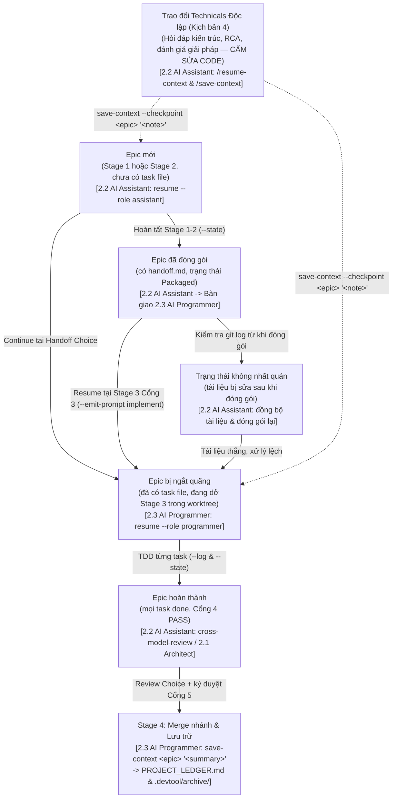

# Sổ tay Nhanh (Quick-Guide): Quy trình Lưu/Khôi phục Ngữ cảnh và Quản trị Ba Vai trò

> Bản dịch của [context-memory-quick-guide.en.md](context-memory-quick-guide.en.md).

## Table of Contents

- [Meta Data](#meta-data)
- [1. Quản trị Ba Vai trò và Bảng Cheat-Sheet Lệnh 10 Giây](#1-quản-trị-ba-vai-trò-và-bảng-cheat-sheet-lệnh-10-giây)
- [2. Sơ đồ Luồng Lưu và Khôi phục Ngữ cảnh Toàn trình](#2-sơ-đồ-luồng-lưu-và-khôi-phục-ngữ-cảnh-toàn-trình)
- [3. Kịch bản 1 — Sau bước Đóng gói Epic: Gọi AI Assistant thực hiện Principal Review](#3-kịch-bản-1--sau-bước-đóng-gói-epic-gọi-ai-assistant-thực-hiện-principal-review)
- [4. Kịch bản 2 — Sau khi Review PASS: Giao Prompt cho AI Programmer thực thi trong Worktree](#4-kịch-bản-2--sau-khi-review-pass-giao-prompt-cho-ai-programmer-thực-thi-trong-worktree)
- [5. Kịch bản 3 — Sau khi Implementation hoàn tất (Gate 4 PASS): Gọi AI Assistant thực hiện Cross-Model Review](#5-kịch-bản-3--sau-khi-implementation-hoàn-tất-gate-4-pass-gọi-ai-assistant-thực-hiện-cross-model-review)
- [6. Kịch bản 4 — Gọi AI Assistant Đọc hiểu Context chỉ để Trao đổi Technicals và Phân tích Kiến trúc](#6-kịch-bản-4--gọi-ai-assistant-đọc-hiểu-context-chỉ-để-trao-đổi-technicals-và-phân-tích-kiến-trúc)
- [7. Kịch bản 5 — Chạy Đa Epic Song song, Đổi Tài khoản Antigravity và Đóng nhánh Stage 4](#7-kịch-bản-5--chạy-đa-epic-song-song-đổi-tài-khoản-antigravity-và-đóng-nhánh-stage-4)

## Meta Data

- **Kind**: `document`
- **Audience**: Human Architect (Bạn / Developer) điều phối các phiên làm việc của AI Assistant và AI Programmer trên không gian đa repository (`ai-agent-tools`, `D3Nexus`, `lyrics-sync`, `nexus`) và đa tài khoản Antigravity
- **Diátaxis mode**: `how-to`
- **Non-goals**: Không đi sâu vào mã nguồn cài đặt Python của `scripts/resume_context.py` (xem [save_resume_rules.md](architecture/save_resume_rules.md)) hoặc hướng dẫn viết unit test cho từng nền tảng
- **Acceptance**: Trong vòng chưa đầy 30 giây tại bất kỳ điểm dừng nào của dự án hoặc sau khi đổi tài khoản, bạn chọn được đúng kịch bản, chạy đúng lệnh CLI hoặc copy-paste khối prompt chuẩn để triệu hồi đúng vai trò (`AI Assistant` hoặc `AI Programmer`), và lưu/khôi phục ngữ cảnh mà không bị vượt quyền hay đè mất trạng thái giữa các epics
- **Source Spec**: [2026-10-31-context-memory-quick-guide-design.vi.md](../.devtool/epic/context_memory_management/2026-10-31-context-memory-quick-guide-design.vi.md)

## 1. Quản trị Ba Vai trò và Bảng Cheat-Sheet Lệnh 10 Giây

### Ba Vai trò trong Dự án (Tri-Role Governance)

| Vai trò | Header Persona / Cờ CLI | Quyền hạn & Nhiệm vụ | Giới hạn Cứng (Hard Restrictions) |
| :--- | :--- | :--- | :--- |
| **2.1 Human Architect (Bạn)** | Developer / Orchestrator | Định hướng kiến trúc, phê duyệt Gates 1–5, ra quyết định triage khi review, điều phối prompt giữa Assistant và Programmer | — |
| **2.2 AI Assistant** | `[PERSONA: AI ASSISTANT — TECHNICAL ADVISOR & CO-ARCHITECT]`<br/>`--role assistant` | Trao đổi bài toán kỹ thuật, phân tích đánh đổi (trade-offs), soạn Spec/HLD/Tasks (`dev-brainstorming`, `dev-designer`), thực hiện `principal-review` và `cross-model-review` | **CẤM THỰC THI CODE (`NO IMPLEMENTATION`)**: Cấm tuyệt đối việc tạo hoặc sửa đổi production code hay test code của ứng dụng. Chỉ được sửa `docs/`, `.devtool/`, hoặc `shared-contracts/` |
| **2.3 AI Programmer** | `[PERSONA: AI PROGRAMMER — SENIOR TDD SOFTWARE ENGINEER]`<br/>`--role programmer` (bí danh: `implementer`, `worker`) | Thực thi Kanban tasks qua `/dev-implementation` trong git worktree cô lập, lập trình TDD (Red-Green-Refactor), chạy cổng chất lượng và đóng nhánh (`/finish`) | **TUÂN THỦ TUYỆT ĐỐI SPEC (`STRICT SPEC FIDELITY`)**: Bám sát đặc tả đã duyệt, `Decisions Already Made`, và `Allowed files`. Không tự ý đổi kiến trúc hoặc sửa symlink `shared-contracts/` |

### Bảng Cheat-Sheet Lệnh & Alias 10 Giây

| Mục đích | Lệnh Terminal / Shell Alias | Slash Skill trong Chat |
| :--- | :--- | :--- |
| **Khôi phục toàn bộ ngữ cảnh dự án (mặc định)** | `resume` | `/resume-context` |
| **Khôi phục ngữ cảnh với vai trò AI Assistant (Tư vấn / Review)** | `resume --role assistant --epic <epic_slug>` | `/resume-context` |
| **Khôi phục ngữ cảnh với vai trò AI Programmer (Code / TDD)** | `resume --role programmer --epic <epic_slug>` | `/dev-implementation` |
| **Lưu nhanh checkpoint giữa chừng + ghi chú (không đóng epic)** | `save-context --checkpoint <epic_slug> "<custom_note>"` | `/save-context` |
| **Lưu bản chụp kiến trúc ($\le 20$ dòng)** | `resume --state --epic <epic_slug> --decisions "..." --status "..." --next "..." --prompt "..."` | `/save-context` |
| **Ghi nhật ký sau khi code xong 1 task (AI Programmer)** | `resume --log --epic <epic_slug> --task <task_id> --request "..." --action "..." --note "..."` | Tự động ở Stage 3 |
| **Xuất khối Prompt Bàn giao dựng sẵn** | `resume --emit-prompt <principal-review\|implement\|cross-review\|finish\|assistant> --epic <epic_slug>` | `/save-context` |
| **Hoàn tất epic & nén log Tier 2 vào Sổ cái Tier 1** | `save-context <epic_slug> "<milestone_summary>"` | Tự động trong `/finish` |
| **Đồng bộ `.zshrc`, `.zsh_history` dùng chung & symlinks** | `resume --sync-zshrc` | — |

## 2. Sơ đồ Luồng Lưu và Khôi phục Ngữ cảnh Toàn trình

### Sơ đồ Toàn trình `dev-lifecycle` gắn với 3 Vai trò (`2.1 Architect`, `2.2 AI Assistant`, `2.3 AI Programmer`)

```mermaid
flowchart TD
    S1["Stage 1 — Khởi đầu &amp; Spec (dev-brainstorming)<br/>[2.2 AI Assistant: --role assistant, auto --state]"]
    G1{"Cổng 1 — 2.1 Architect<br/>Spec được duyệt?"}
    ROUTE{"Quy mô epic?"}
    PLANS(["writing-plans<br/>(rời workflow này)"])
    S2["Stage 2 — Kiến trúc &amp; Task (dev-designer)<br/>[2.2 AI Assistant: --role assistant, auto --state]"]
    G2{"Cổng 2 — 2.1 Architect<br/>HLD &amp; phân rã task được duyệt?"}
    HC{"Handoff Choice — 2.1 Architect<br/>package hay continue?"}
    PKG["Package epic (handoff.md, status Packaged)<br/>[2.2 AI Assistant: --state &amp; --emit-prompt]"]
    PRC{"Principal Review Choice — 2.1 Architect<br/>Done hay Principal Review?"}
    PR["principal-review (Rà soát kiến trúc Shift-Left)<br/>[2.2 AI Assistant: triage, decisions, chỉnh sửa]"]
    PKGSTOP(["Dừng: handoff.md &amp; AI Programmer Resume Prompt"])
    S3["Stage 3 — Thực thi độc lập (dev-implementation)<br/>[2.3 AI Programmer: --role programmer trong worktree]"]
    G3{"Cổng 3 — 2.1 Architect<br/>Thứ tự thực thi đã xác nhận?"}
    EXEC["Phase 2-3: TDD từng task trong worktree<br/>[2.3 AI Programmer: tự động --log &amp; --state sau mỗi task]"]
    G4{"Cổng 4 — Máy chấm tự động<br/>audit + BDD traceability + quality_check 🟢 LGTM?"}
    RC{"Review Choice — 2.1 Architect<br/>Finish, Cross-model review hay Local model review?"}
    XR["cross-model-review (Shift-Right external CLI)<br/>[2.2 AI Assistant: triage &amp; --emit-prompt]"]
    LR["cross-model-review (local Ollama)<br/>[2.2 AI Assistant: triage &amp; --emit-prompt]"]
    REVIEW["Phase 4.1: Developer Kanban Review<br/>(Mọi task giữ ở cột DONE để kiểm tra trực quan)"]
    G5{"Cổng 5 — 2.1 Architect<br/>Người dùng ký duyệt &amp; cho phép finish?"}
    S4["Stage 4 — Hoàn tất nhánh &amp; Lưu trữ (finishing-a-development-branch)<br/>[2.3 AI Programmer: --complete ghi Ledger &amp; nén log vào archive/]"]

    S1 --> G1
    G1 -->|chưa, chỉnh sửa| S1
    G1 -->|rồi| ROUTE
    ROUTE -->|không| PLANS
    ROUTE -->|có| S2
    S2 --> G2
    G2 -->|chưa, điều chỉnh phân rã| S2
    G2 -->|rồi| HC
    HC -->|"1. package"| PKG
    HC -->|"2. continue (--emit-prompt implement)"| S3
    PKG --> PRC
    PRC -->|"1. Done"| PKGSTOP
    PRC -->|"2. Principal Review"| PR
    PR -->|"revised and re-packaged"| PKG
    PKGSTOP -.->|"Kịch bản 2: Phiên AI Programmer"| S3
    S3 --> G3
    G3 -->|chưa, sắp xếp lại| G3
    G3 -->|rồi| EXEC
    EXEC --> G4
    G4 -->|"chưa, sửa bằng Fix commit"| EXEC
    G4 -->|"rồi (--emit-prompt cross-review)"| RC
    RC -->|"1. Finish"| REVIEW
    RC -->|"2. Cross-model review"| XR
    XR -->|"đã ghi nhận round &amp; fix"| G4
    RC -->|"3. Local model review"| LR
    LR -->|"đã ghi nhận round &amp; fix"| G4
    REVIEW --> G5
    G5 -->|"chưa, yêu cầu đổi bằng Fix commit"| EXEC
    G5 -->|"rồi (--emit-prompt finish)"| S4
```



### Trạng thái Ngắt quãng và Khôi phục (Resume) theo Personas

Khi công việc tạm dừng, đổi tài khoản Antigravity, hoặc một epic được đóng gói, vòng đời khôi phục một cách tất định qua năm trạng thái vận hành gắn liền với đúng vai trò (`AI Assistant` hoặc `AI Programmer`):



## 3. Kịch bản 1 — Sau bước Đóng gói Epic: Gọi AI Assistant thực hiện Principal Review

### Khi nào sử dụng

Sử dụng ngay sau khi hoàn tất đóng gói epic ở cuối Stage 2 (`.devtool/epic/<epic_dir>/handoff.md` đã được commit) và bạn muốn gọi **AI Assistant** (ở phiên mới hoặc trên một tài khoản khác) để thực hiện **Principal Review** kiểm tra chéo kiến trúc trước khi bắt đầu code.

### Bước 1: Lấy khối Prompt Principal Review

Chạy lệnh sau trên terminal (hoặc copy từ đầu ra của bước `Package`):

```bash
resume --emit-prompt principal-review --epic <epic_slug> --epic-dir <epic_dir>
```

### Bước 2: Dán Prompt vào Phiên làm việc của AI Assistant

```text
[PERSONA: AI ASSISTANT — TECHNICAL ADVISOR & CO-ARCHITECT]
Run `python3 scripts/resume_context.py --role assistant --epic <epic_slug>` first to restore context.
Invoke `d3nexus:principal-review` on `.devtool/epic/<epic_dir>/handoff.md`.
Remember: You are strictly prohibited from modifying production code or application tests.
```

### Bước 3: Triage, Cập nhật Tài liệu và Chuyển sang Implementation

1. **AI Assistant** chạy `run_external_review.py run --kind principal`, kiểm tra từng phát hiện (finding) với mã nguồn thực tế, và trình bày bảng Triage.
2. Bạn đưa ra quyết định (ví dụ: `Fix toàn bộ findings`).
3. **AI Assistant** sửa các tài liệu thiết kế, đóng gói lại `handoff.md`, lưu trạng thái vào `.devtool/state/<epic_slug>.md`, và tự động xuất **Prompt Kịch bản 2 cho AI Programmer** (`--emit-prompt implement`).

## 4. Kịch bản 2 — Sau khi Review PASS: Giao Prompt cho AI Programmer thực thi trong Worktree

### Khi nào sử dụng

Sử dụng sau khi Gate 2 (và vòng lặp Principal Review) đã đạt `PASS`, khi bạn muốn giao việc lập trình các Kanban tasks (`task_01..task_N`) cho **AI Programmer**.

### Bước 1: Lấy khối Prompt cho AI Programmer

```bash
resume --emit-prompt implement --epic <epic_slug> --epic-dir <epic_dir>
```

### Bước 2: Dán Prompt vào Phiên Thực thi của AI Programmer

```text
[PERSONA: AI PROGRAMMER — SENIOR TDD SOFTWARE ENGINEER]
Run `python3 scripts/resume_context.py --role programmer --epic <epic_slug>` first.
Use the d3nexus:dev-implementation skill for the `<epic_slug>` epic.
Read .devtool/epic/<epic_dir>/handoff.md first.
Apply the Execution Guardrails for Receiving LLM before presenting Gate 3.
Gates 1 and 2 are passed; do not re-run brainstorming or design.
Gate 3 is pending: present the execution order to me and wait for my confirmation.
```

### Bước 3: Những gì Tự động Diễn ra trong `/dev-implementation`

1. **Phase 0 & Gate 3**: **AI Programmer** nạp ngữ cảnh dự án (`--role programmer`), trình bày thứ tự thực thi task tại Gate 3 và chờ bạn xác nhận trước khi tạo `.worktrees/<epic_dir>`.
2. **Phase 2 (Tự động Lưu Log & State sau mỗi Task)**: Dù **AI Programmer** chạy bên trong `.worktrees/<epic_dir>`, `resume_context.py` tự động phân giải `git rev-parse --git-common-dir` để ghi thẳng về thư mục `.devtool/` của repo chính ngay sau mỗi commit hoàn thành task:
   ```bash
   python3 scripts/resume_context.py --log --epic <epic_slug> --task <task_id> \
     --request "<task_title>" --action "<files_and_tests>" --note "None"
   python3 scripts/resume_context.py --state --epic <epic_slug> \
     --status "<done>/<total> tasks done" --next "<next_task_id>"
   ```
3. **Nếu Bạn Đổi Tài khoản Giữa Chừng Khi Đang Code**: Chỉ cần mở tài khoản mới và dán lại đúng khối Prompt Kịch bản 2 ở trên. **AI Programmer** mới sẽ đọc `.devtool/state/<epic_slug>.md` và `.devtool/features/done/`, bỏ qua các task đã xong, và tiếp tục ngay tại task kế tiếp.
4. **Phase 4 (Khi Gate 4 PASS)**: Khi toàn bộ tasks vượt qua `audit_epic.py`, BDD traceability và `@quality_check`, **AI Programmer** tự động lưu SHA ứng viên và in kèm **Prompt Kịch bản 3 (Cross-Model Review)** bên cạnh menu Review Choice.

## 5. Kịch bản 3 — Sau khi Implementation hoàn tất (Gate 4 PASS): Gọi AI Assistant thực hiện Cross-Model Review

### Khi nào sử dụng

Sử dụng ngay sau khi **Gate 4 PASS** khi bạn muốn gọi **AI Assistant** để thực hiện đánh giá code độc lập bằng Cross-Model Review (`claude`, `codex`, `agy`) hoặc Local Model Review (`ollama`) và phân loại findings cùng bạn.

### Bước 1: Lấy khối Prompt Cross-Model Review

```bash
resume --emit-prompt cross-review --epic <epic_slug> --epic-dir <epic_dir>
```

### Bước 2: Dán Prompt vào Phiên của AI Assistant

```text
[PERSONA: AI ASSISTANT — TECHNICAL ADVISOR & CO-ARCHITECT]
Run `python3 scripts/resume_context.py --role assistant --epic <epic_slug>` first.
Invoke `d3nexus:cross-model-review` for epic `<epic_dir>` after Gate 4 PASS.
Present the verified triage table and wait for my decision on each finding.
```

### Bước 3: Hai Hướng Chuyển tiếp Sau Bước Triage

- **Trường hợp A — Cần Sửa Code (Fix Findings)**:
  - Bạn chốt các findings cần sửa.
  - Để giữ đúng ranh giới vai trò (hoặc bàn giao lại cho phiên của AI Programmer), chạy lệnh:
    ```bash
    resume --emit-prompt implement --epic <epic_slug> --prompt "Apply fixes for Cross-Model Review Round N findings and re-run Gate 4 in full"
    ```
- **Trường hợp B — Code Đạt Chuẩn (`0 blocking findings` / `PASS`)**:
  - **AI Assistant** lưu trạng thái và xuất **Prompt Đóng nhánh Stage 4**:
    ```bash
    resume --emit-prompt finish --epic <epic_slug> --epic-dir <epic_dir>
    ```

## 6. Kịch bản 4 — Gọi AI Assistant Đọc hiểu Context chỉ để Trao đổi Technicals và Phân tích Kiến trúc

### Khi nào sử dụng

Sử dụng bất kỳ lúc nào bạn mở một phiên làm việc mới hoặc vừa đổi tài khoản **chỉ để trao đổi bài toán kỹ thuật, tìm nguyên nhân gốc rễ của bug (RCA), đánh giá ưu/nhược điểm của các giải pháp, hoặc kiểm tra hợp đồng giao tiếp (`shared-contracts/`)** — và muốn khóa cứng không cho AI Agent tự ý sửa đổi production code.

### Bước 1: Khởi tạo Phiên với Vai trò AI Assistant

Bạn có thể gõ trực tiếp `/resume-context` trong khung chat, hoặc lấy khối prompt chuẩn bằng lệnh:

```bash
resume --emit-prompt assistant --epic <epic_slug> --prompt "Discuss trade-offs for <topic>"
```

Khối prompt xuất ra:

```text
[PERSONA: AI ASSISTANT — TECHNICAL ADVISOR & CO-ARCHITECT]
Run `python3 scripts/resume_context.py --role assistant --epic <epic_slug>` first.
Summarize the 6 context sections in 5-10 concise bullets, then discuss the technical problem with me.
Strictly no production code edits are permitted in this session.
```

### Bước 2: Lưu lại Kết luận Thảo luận hoặc Custom Prompt Bất kỳ lúc nào (`/save-context`)

Bất cứ khi nào hai bên chốt được một quyết định kiến trúc hoặc trước khi bạn đóng phiên / đổi tài khoản, hãy yêu cầu Agent:

> "Chạy `/save-context` để lưu các quyết định vừa thống nhất và xuất prompt cho phiên tiếp theo."

Hoặc chạy trực tiếp trên terminal của bạn:

```bash
# Lưu checkpoint không phá hủy (cập nhật state/<epic>.md + logs/activity_<epic>.log mà không đóng epic)
save-context --checkpoint <epic_slug> "Chốt phương án B cho cơ chế refresh token; bước tiếp theo: cập nhật api_contract.md"

# Hoặc cập nhật trực tiếp bản chụp trạng thái (<= 20 dòng) kèm ghi chú custom prompt
resume --state --epic <epic_slug> \
  --decisions "Chọn Redis stream thay vì polling; khóa lease timeout ở mức 5s" \
  --status "Hoàn tất phân tích kỹ thuật" \
  --next "Chạy /dev-designer để cập nhật HLD" \
  --prompt "Tiếp tục từ mục 4 của tài liệu RFC"
```

## 7. Kịch bản 5 — Chạy Đa Epic Song song, Đổi Tài khoản Antigravity và Đóng nhánh Stage 4

### 7.1 Nhiều AI Agents Chạy Nhiều Epics Song song trên Cùng một Project

Khi Agent 1 làm việc trên `epic_alpha` và Agent 2 làm việc trên `epic_beta` trong cùng một repository:
- Agent 1 chỉ ghi vào `.devtool/state/epic_alpha.md` và `.devtool/logs/activity_epic_alpha.log`.
- Agent 2 chỉ ghi vào `.devtool/state/epic_beta.md` và `.devtool/logs/activity_epic_beta.log`.
- Mọi thao tác ghi đều lấy khóa độc quyền trên `.devtool/.memory.lock` (`fcntl.flock`) và tự động cập nhật hai file tổng hợp `.devtool/assistant_state.md` cùng `.devtool/activity_stream.log`.
- Để chỉ lọc xem ngữ cảnh của riêng một epic khi thu hoạch, truyền thêm `--epic`:
  ```bash
  resume --epic epic_alpha
  ```

### 7.2 Đổi Tài khoản Antigravity (`antigravity_homes/<profile>`)

Nhờ `/Users/danhdueexoictif/.zshrc` đã được đồng bộ qua `resume --sync-zshrc`:
1. **Chia sẻ Lịch sử Terminal Thời gian thực**: Mọi profile đều trỏ symlink `.zsh_history -> /Users/danhdueexoictif/.zsh_history` kèm `SHARE_HISTORY` và `INC_APPEND_HISTORY`. Lệnh bạn vừa gõ ở Tài khoản A sẽ xuất hiện ngay lập tức khi bấm phím `Mũi tên Lên` hoặc `Ctrl+R` ở Tài khoản B.
2. **Đường dẫn Workspace Đồng nhất**: Cả `~/Projects` và `~/AllProjects` đều trỏ về `/Users/danhdueexoictif/AllProjects` trên mọi profile.
3. **Khôi phục Ngữ cảnh Bằng Một Lệnh**: Trên terminal của tài khoản mới, gõ `resume` (hoặc nhắn `/resume-context` trong chat) để khôi phục toàn bộ 6 phần ngữ cảnh trong vài giây.

### 7.3 Hoàn tất Epic và Nén Bộ nhớ tại Stage 4 (`/finish`)

Sau khi bạn phê duyệt **Gate 5 (Developer Kanban Sign-Off)** và gọi `d3nexus:finishing-a-development-branch` (`/finish`):

```bash
resume --emit-prompt finish --epic <epic_slug> --epic-dir <epic_dir>
```

Tại bước **Pre-Finish Hook**, Agent tự động thực thi:

```bash
# Tương đương với alias: save-context <epic_slug> "<milestone_summary>"
python3 scripts/resume_context.py --complete "<epic_slug>" "<one_line_milestone_summary>"
```

Những gì `--complete` thực hiện trên đĩa:
1. Ghi nối tiếp cột mốc `- **[YYYY-MM-DD] \`<epic_slug>\`**: <one_line_milestone_summary>` vào `.devtool/PROJECT_LEDGER.md` (Bộ nhớ kiến trúc vĩnh viễn Tier 1).
2. Di chuyển nguyên tử chỉ riêng `.devtool/state/<epic_slug>.md` và `.devtool/logs/activity_<epic_slug>.log` vào `.devtool/archive/`.
3. Kết xuất lại `.devtool/assistant_state.md` và `.devtool/activity_stream.log` từ những epics còn đang chạy (bảo toàn 100% trạng thái và log của các epics song song khác).
