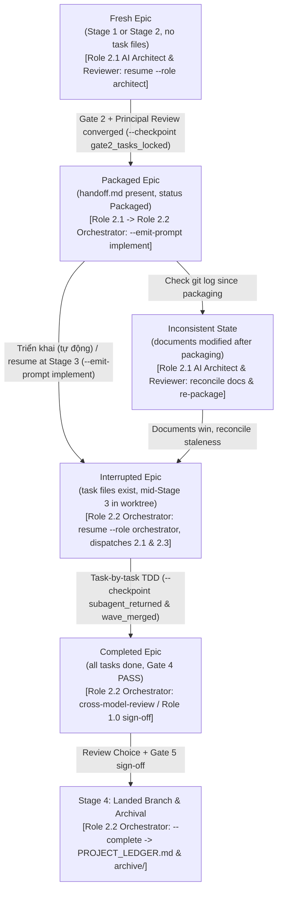
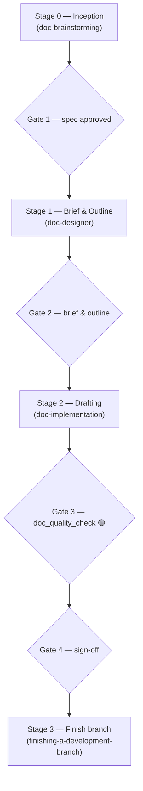
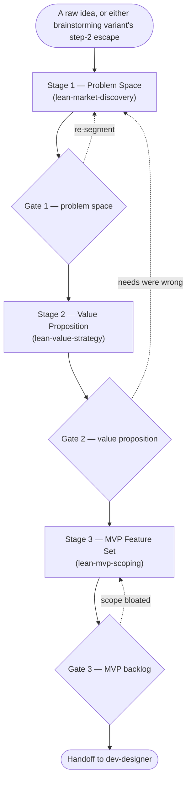
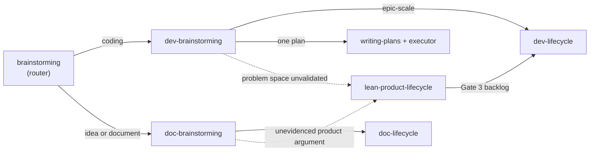

# The three lifecycles

Reference for what each lifecycle in this kit is for, what it produces, and how it runs.

This page **describes**.
To decide which one a specific piece of work belongs to, see [choosing-a-lifecycle.en.md](choosing-a-lifecycle.en.md).

## Contents

1. [At a glance](#at-a-glance)
2. [dev-lifecycle](#dev-lifecycle)
3. [doc-lifecycle](#doc-lifecycle)
4. [lean-product-lifecycle](#lean-product-lifecycle)
5. [What is not a lifecycle](#what-is-not-a-lifecycle)
6. [How they connect](#how-they-connect)

## At a glance

Each lifecycle is defined by what exists when it ends.

| | `dev-lifecycle` | `doc-lifecycle` | `lean-product-lifecycle` |
|---|---|---|---|
| **Purpose** | Build code that ships | Produce a document someone reads | Decide what to build, and for whom |
| **Produces** | A merged branch | A published document | A validated MVP backlog |
| **Gates** | 5 | 4 | 3 |
| **Gate approvers** | 4 human, 1 machine | 3 human, 1 machine | 3 human |
| **Artefacts live in** | `.devtool/epic/<slug>/` | `.devtool/epic/<slug>/`, deliverable in `docs/` | `.devtool/product/<slug>/` |
| **Verified by** | `quality_check` | `doc_quality_check` | human judgement only |

The two quality gates share no tier, no audit and no tooling, and neither invokes the other.

## dev-lifecycle

**Purpose.** Orchestrate epic-scale code work from an idea to a merged branch.
It owns sequence and gates only; each stage's method lives in that stage's own skill.

**What it produces.** A merged branch, plus an English-only High-Level Design (`<epic_dir>.md`),
Gherkin BDD scenarios (`bdd_scenarios.md`), and one task file per unit of work
— all archived into `.devtool/epic/<slug>/` when the epic closes (`.vi.md` mirrors are produced only on explicit Role 1.0 request, are not SSOT, and are excluded from agent context).

**When it does not apply.** A single component that one implementation plan covers.
That work uses `dev-brainstorming` then `writing-plans`, which leaves this lifecycle and its remaining gates behind.

```mermaid
flowchart TD
    S1["Stage 1 — Inception &amp; Spec<br/>(dev-brainstorming)<br/>[Role 2.1 AI Architect &amp; Reviewer: --role architect, auto --state]"]
    G1{"Gate 1 — Role 1.0 Human Architect<br/>Spec approved?"}
    ROUTE{"Epic-scale?"}
    PLANS(["writing-plans<br/>(leaves this workflow)"])
    S2["Stage 2 — Architecture &amp; Tasks<br/>(dev-designer)<br/>[Role 2.1 AI Architect &amp; Reviewer: --role architect, --checkpoint gate2_tasks_locked]"]
    G2{"Gate 2 — Role 1.0 Human Architect<br/>HLD &amp; task breakdown approved?"}
    PRC{"Provider Priority Choice — Role 1.0 Human Architect<br/>pick /principal-review provider/model order?"}
    PR["principal-review<br/>(Auto Shift-Left design audit, up to 3 rounds)<br/>[Role 2.1 AI Architect &amp; Reviewer: triage, decisions, principal-reviser]"]
    PKG["Package epic &amp; Emit Prompt<br/>handoff.md, status Packaged<br/>[Role 2.1 AI Architect &amp; Reviewer: --state &amp; --emit-prompt implement]"]
    HC{"Handoff choice — Role 1.0 Human Architect<br/>Triển khai (tự động) or Dừng lại?"}
    PKGSTOP(["Stop: handoff.md and Role 2.2 Orchestrator Implement Prompt"])
    S3["Stage 3 — Isolated Execution<br/>(dev-implementation)<br/>[Role 2.2 Orchestrator: --role orchestrator, quota-check, dispatches 2.1 &amp; 2.3]"]
    G3{"Gate 3 — Role 1.0 Human Architect<br/>Execution order confirmed?"}
    EXEC["Phase 2-3: task-by-task TDD<br/>[Role 2.2 Orchestrator: pool, --checkpoint subagent_returned/wave_merged;<br/>Role 2.3 Programmer: TDD in slots; Role 2.1 task-reviewer when gated]"]
    RC{"Review Choice — Role 1.0 Human Architect<br/>Finish, Cross-model review or Local model review?"}
    XR["cross-model-review<br/>(Shift-Right external CLI: Claude/Codex/Kiro/Argon)<br/>[Role 2.2 Orchestrator: triage, 2.3 fast-track or 2.1 fix-planner]"]
    LR["cross-model-review (local)<br/>(Shift-Right local model: Ollama)<br/>[Role 2.2 Orchestrator: triage &amp; risk-routed fixes]"]
    G4{"Gate 4<br/>audit + result-based traceability + quality_check 🟢 LGTM?<br/>[fresh Role 2.3 gate4-verifier]"}
    REVIEW["Phase 4.1: Developer Kanban Review<br/>(All tasks held in DONE column for visual inspection)"]
    G5{"Gate 5 — Role 1.0 Human Architect<br/>User sign-off &amp; finish approved?"}
    S4["Stage 4 — Finish Branch &amp; Archival<br/>(finishing-a-development-branch)<br/>[Role 2.2 Orchestrator: --complete appends Ledger &amp; archives logs]"]

    S1 --> G1
    G1 -->|no, revise| S1
    G1 -->|yes| ROUTE
    ROUTE -->|no| PLANS
    ROUTE -->|yes| S2
    S2 --> G2
    G2 -->|no, adjust breakdown| S2
    G2 -->|yes| PRC
    PRC -->|"provider/model priority set"| PR
    PR -->|"round revised (readiness OK)"| PR
    PR -->|"converged"| PKG
    PKG --> HC
    HC -->|"1. Triển khai (tự động)"| S3
    HC -->|"2. Dừng lại (take prompt)"| PKGSTOP
    PKGSTOP -.->|"later session or other AI Agent"| S3
    S3 --> G3
    G3 -->|no, reorder| G3
    G3 -->|yes| EXEC
    EXEC --> G4
    G4 -->|"no, fix findings as Fix commits"| EXEC
    G4 -->|"yes"| RC
    RC -->|"1. Finish"| REVIEW
    RC -->|"2. Cross-model review"| XR
    XR -->|"round recorded"| G4
    RC -->|"3. Local model review"| LR
    LR -->|"round recorded"| G4
    REVIEW --> G5
    G5 -->|"no, changes as Fix commits"| EXEC
    G5 -->|yes| S4
```

The lifecycle proceeds through four stages and five approval gates, with explicit human choice points:
- **Stage 2 -> Principal Review Transition & Post-Review Packaging**: Once Gate 1 passes, epic-scale work routes to Stage 2 (`dev-designer`, Role 2.1 AI Architect & Reviewer). When Gate 2 passes, Role 2.1 writes `resume_context.py --checkpoint gate2_tasks_locked`, verifies readiness (`check_epic_readiness.py`, including exclusive file ownership across parallel tasks), does **NOT** run `package_epic.py` yet, and asks Role 1.0 Human Architect for the **provider/model priority order** for `/principal-review`. Once confirmed, `/principal-review` runs automatically (up to 3 rounds via `run_external_review.py`, refining English-only design docs/tasks in place via `principal-reviser`). Only after `/principal-review` converges does packaging run (`package_epic.py` generating `handoff.md` and `Packaged` status), followed immediately by printing the Role 2.2 Orchestrator prompt (`--emit-prompt implement`, naming the configured `orchestrator` binding) and asking **Triển khai (tự động)** (continue in current session) vs **Dừng lại** (stop so Role 1.0 can open a session on the `orchestrator` model).
- **Isolated Execution**: Role 2.2 Orchestrator runs `dev_config.py quota-check` before Stage 3 and before each wave (checking both 5-hour and weekly Gemini windows plus provider limits; exit `2` writes `--checkpoint quota_low`, records a `quota` pending decision, and stops). Tasks execute in isolated slot worktrees via `dev_config.py dispatch` (which routes `agy` bindings through the global profile pool and `$REAL_HOME/.d3nexus/agy_profile_leases.json`), with Role 2.3 Programmer (`task-implementer`) writing TDD code and Role 2.2 checkpointing `subagent_returned` and `wave_merged`. When selective review gating triggers (`review_tier: "full"`, high-risk labels, or `> 2` non-test modules), Role 2.2 dispatches a read-only Role 2.1 `task-reviewer` before marking the task `done`.
- **Gate 4 and Review Choice loop**: Gate 4 is the only machine verdict in this kit's development path. A fresh Role 2.3 `gate4-verifier` runs `audit_epic.py`, `check_bdd_traceability.py tests --results`, and `@quality_check` profile `epic` on the exact candidate commit SHA. Every PASS presents **Review Choice**: **Finish** advances to Gate 5; **Cross-model review** (Claude, Codex, Kiro, or Argon) and **Local model review** (Ollama) invoke `cross-model-review`. Role 2.2 triages findings and routes by risk: low-risk code defects go to Role 2.3 `review-fixer` (`fast-track`), while high-risk findings (`Critical`, escalation markers, or repeated Gate 4 check failure) go to Role 2.1 `fix-planner`, which writes `fix_plan_round<N>.md` (`PLANNED` -> Role 2.3 `review-fixer` `apply-plan`, or `ESCALATE` -> Role 1.0). Each round records into `review_results.md` and returns to a full Gate 4 run. The loop repeats until Role 1.0 selects Finish.
- **Autonomous Pipeline Mode (`/dev-lifecycle --autonomous`)**: `lifecycle_runner.py` acts as Role 2.2 Orchestrator: it resolves persona bindings through `/d3nexus:dev-config` (`scripts/persona_config.py`, kit default `gemini-4-hydrogen-xhigh` for `programmer`), enforces `quota-check` and `max_orchestrator_turns_before_checkpoint` (halved in `/d3nexus:dev-config low-quota on`), dispatches Role 2.1 and Role 2.3 subagents through `dev_config.py`/pooled dispatch with no automatic fallback (`MODEL_UNAVAILABLE` or `QUOTA_LOW` stops and reports), routes high-risk findings to Role 2.1 `fix-planner`, runs fresh `gate4-verifier`, synthesizes the Top 3 Highest-Risk Findings, and halts at `AWAITING_FINISH` for Role 1.0 merge sign-off.
- **Gate 5 Developer Kanban Review**: Completed tasks are retained in `.devtool/features/done/` for Role 1.0 sign-off before Stage 4 rebases, verifies by tier, lands the branch with a `--no-ff` merge, and archives tasks into `.devtool/epic/<slug>/`.

### Interrupted and resume states

When work stops or an epic is packaged, the lifecycle resumes deterministically across five operational states (starting from the latest `checkpoint` in `.devtool/state/<slug>.heartbeat.json`):

These diagrams and explanations describe the lifecycle for humans; runtime skills (`dev-lifecycle`, `dev-implementation`) and scripts are the operational source of truth. To prevent LLM **Attention Dilution** and **Lost-in-the-Middle** degradation during execution, each runtime `SKILL.md` holds only its concise operational sequence and gates, while the workflow architecture, skill catalog, and review convergence rules are documented below and in on-demand `references/*.md` files.

### dev-lifecycle Skills Catalog & Autonomous Convergence Architecture

1. **Stage & Skill Catalog (Decoupled Responsibilities)**:
   - **`dev-brainstorming` (Stage 1 — Inception & Spec)**: Collaborative design exploration (Role 2.1 with Role 1.0) producing English-only specs (`YYYY-MM-DD-<topic>-design.md`) and shared-contract warnings (Gate 1).
   - **`dev-designer` (Stage 2 — Architecture & Tasks)**: Role 2.1 produces the English-only 3-Tier Design Package (`<epic_dir>.md` HLD, `bdd_scenarios.md`, and `task_*.md` files with 3-Level Test Scope Pyramid verification rows and disjoint parallel `Allowed files`), records Gate 2 + `--checkpoint gate2_tasks_locked`, and asks the provider/model priority order for `/principal-review`.
   - **`principal-review` (Stage 2 — Shift-Left Design Audit)**: Executes cross-model inspection of HLD, BDD scenarios, and task contracts against the codebase (`principal_review.md`; Role 2.1 `principal-reviser` updates docs), then packages `handoff.md` (`package_epic.py`), prints `--emit-prompt implement`, and prompts **Triển khai (tự động)** vs **Dừng lại**.
   - **`dev-config` (Cross-Stage Persona & Quota Config)**: `/d3nexus:dev-config` configures the three AI personas across kit, global (`$REAL_HOME/.d3nexus/personas.json`), and project (`.agents/config/personas.json`) layers, supports the one-command `--provider agy|claude|codex` shortcut, `set` with `--provider`, `--model`, `--effort`, and `--profile`, manages the `agy` profile pool and `agy_profile_leases.json`, toggles profile-scoped `low-quota` mode, and runs `quota-check` and pooled `dispatch`.
   - **`dev-implementation` (Stage 3 — Isolated TDD Execution)**: Role 2.2 Orchestrator coordinates waves, `quota-check`, checkpoints (`subagent_returned`, `wave_merged`), `dev_config.py dispatch`, and selective Role 2.1 `task-reviewer`; Role 2.3 Programmer (bound via `/d3nexus:dev-config`, kit default `gemini-4-hydrogen-xhigh` at `xhigh`) executes TDD inside isolated worktrees (`Allowed files`), followed by fresh Role 2.3 `gate4-verifier` Gate 4 verification and Gate 5 Kanban review.
   - **`quality_check` (Stage 3 — Gate 4 Machine Orchestrator)**: Platform-neutral quality gatekeeper bound to the candidate `repository_sha` (`profile: "epic"`).
   - **`cross-model-review` (Stage 3 — Shift-Right Code Audit)**: Role 2.2 runs `run_external_review.py` after Gate 4 PASS (`review_results.md`) and routes low-risk findings to Role 2.3 `review-fixer` (`fast-track`) or high-risk findings to Role 2.1 `fix-planner` (`PLANNED` -> `apply-plan`, `ESCALATE` -> Role 1.0).
   - **`finishing-a-development-branch` (Stage 4 — Land & Archive)**: Role 2.2 runs `--complete`, rebases onto `develop` (dispatching Role 2.3 when code/test steps are needed), runs the full-suite regression gate (`Test All`), merges `--no-ff`, and archives completed tasks into `.devtool/epic/<slug>/`.

2. **End-to-End Autonomous Workflow vs. Interactive Mode**:
   - **Autonomous Pipeline Flow**: `Design (Gate 2 + gate2_tasks_locked) -> Provider/Model Priority -> Principal Review (--auto-quota, Max 3 Rounds) -> Package Handoff & Emit Implement Prompt -> Quota Gate (dev_config.py quota-check) -> Role 2.3 Programmer (dev-config binding, default gemini-4-hydrogen-xhigh) + Role 2.1 task-reviewer -> Checkpoints (subagent_returned, wave_merged, turn_budget) -> Gate 4 (fresh gate4-verifier) -> Cross-Model Review (--auto-quota, risk-routed fast-track / fix-planner) -> Gate 4 -> Finish (Test All on Merge)`.
   - **Quota Gate & Provider Priority**: External reviews prioritize `Claude -> Codex -> Kiro -> Argon` (`5H >= 15% & 7D > 2%` for `claude`/`codex`/`agy` Gemini windows, `Monthly >= 3% & >= 15 credits` for `kiro`, `Weekly >= 10%` for `argon`). `dev_config.py quota-check` enforces the matching 5-hour and weekly thresholds on persona bindings before Stage 3, each wave, and each fix round (stopping with `--checkpoint quota_low` and `decision_kind: quota` when exhausted; never auto-switching models).

3. **3-Round Scope-Narrowing Convergence Funnel & 4 Anti-Fix-Loop Prompt Strategies**:
   - **Round 1 (`full`)**: Full-scope audit with **Strategy 1 (Exhaustive Per-File Pass)** to report all `Critical`/`Important` defects per file up front (no drip-feeding).
   - **Round 2 (`delta`)** & **Round 3 (`convergence`, Blocker-Only)**: Enforce **Strategy 2 (Universal Anti-Ping-Pong Guardrail)** across both single-model and mixed-model rounds, **Strategy 3 (Previously Fixed Locations Registry — `Verify-Then-Close`)**, and **Strategy 4 (Diff-Hunk Isolation on Fixed Files)** so untouched lines in fixed files are never re-flagged.

4. **5 Halt Criteria & 3-Level Test Scope Pyramid**:
   - **Halt Criteria (Immediate Stop & Escalation with Top 3 Highest-Risk Findings)**:
     1. `CRITICAL_CONFLICT`: A proposed fix contradicts the approved HLD or `Decisions Already Made`.
     2. `Debatable` / `Not shown`: A finding cannot be verified against live source code.
     3. `SHARED_CONTRACT_CONFLICT`: Any finding or fix touches `shared-contracts/`.
     4. `FIX_LOOP`: A location marked `fixed in <sha>` in Round $N-1$ still fails with `[INCOMPLETE_FIX]` or `[NEW_REGRESSION]` in Round $N$.
     5. `MAX_ROUNDS_CRITICAL_REMAINING`: Any `Critical` finding surviving after Round 3 (`0 Critical` triggers `AUTO_PASS_FINAL_SWEEP`).
   - **3-Level Test Scope Pyramid**: Level 1 (`Task-Scoped` `< 5s` per task) -> Level 2 (`Blast-Radius Scoped` `< 30s` at Gate 4) -> Level 3 (`Test All` full workspace suite once in `finishing-a-development-branch` before merging to `develop`).

### Role and Model Matrix

Roles in `dev-lifecycle` are separated by function, not by model (see [orchestration-roles.md](../skills/dev-lifecycle/references/orchestration-roles.md), [CRITICAL_RULES.md §8](../rules/CRITICAL_RULES.md), and [dev-config-quick-guide.en.md](dev-config-quick-guide.en.md)):

1. **Four-Persona Governance & Subagents**:

   | Persona / Subagent | Config Key & Kit Default | Responsibilities & Boundaries |
   |---|---|---|
   | **Role 1.0 Human Architect** | `—` (Human) | Owns product vision, Gates 1, 2, and 5, Stage 4 Finish/Merge strategy, and every escalation (`CRITICAL_CONFLICT`, `Debatable`, `SHARED_CONTRACT_CONFLICT`, `FIX_LOOP`, `MAX_ROUNDS_CRITICAL_REMAINING`, `MODEL_UNAVAILABLE`, `QUOTA_LOW`, `LOW_QUOTA_STOP`). |
   | **Role 2.1 AI Architect & Reviewer** (`--role architect`; `principal-reviser`, `task-reviewer`, `fix-planner`) | `ai_architect_reviewer` — kit default **`argon`** (`gemini-4-argon-high`, effort **`high`**; configured via `/d3nexus:dev-config`) | Authors Stage 1–2 Spec/HLD/BDD/task Verification tables & `Allowed files`, runs `/principal-review` & `principal-reviser`, packages `handoff.md`; in Stage 3 runs read-only `task-reviewer` and `fix-planner` (`fix_plan_round<N>.md`). **Forbidden**: editing `src/` or `tests/`, running test suites/linters/type-checkers, dispatching subagents, or managing the worker pool. |
   | **Role 2.2 Orchestrator** *(Stage 3–4 main session; `--role orchestrator`)* | `orchestrator` — kit default **`hydrogen`** (`gemini-4-hydrogen-high`, effort **`high`**; or Stage 2 session model under **Triển khai (tự động)**) | Owns Gate 3, worker pool (`manage_worker_pool.py`), `dev_config.py quota-check`, pooled subagent dispatch (`dev_config.py dispatch`), independent SHA/clean-tree/diff-scope verification, checkpoints (`--checkpoint`), `/cross-model-review` risk routing, and marking tasks `done`. **Forbidden**: reading/editing `src/` or `tests/`, editing HLD/BDD/Verification/DoD/`Allowed files`, or running tests/linters/`run_task_checks.py`. |
   | **Role 2.3 Programmer** (`--role programmer`; `task-implementer`, `review-fixer`, `gate4-verifier`) | `programmer` — kit default **`hydrogen`** (**`gemini-4-hydrogen-xhigh`**, effort **`xhigh`**; configured via `/d3nexus:dev-config` / `dev_config.py resolve` — never substitute `flash` or `inherit`) | - `task-implementer`: TDD (`RED -> GREEN`), `check_code_impact.py`, `run_task_checks.py verify` within `Allowed files`. - `review-fixer`: applies low-risk `fast-track` or `PLANNED` `apply-plan` code/test fixes with Tier 1 scoped tests. - `gate4-verifier`: fresh context running `audit_epic.py`, BDD traceability, and `@quality_check`. **Forbidden**: editing HLD/BDD/`shared-contracts/`/Verification/DoD/`Allowed files`, or calling `manage_worker_pool.py`. |

   Persona bindings resolve across four layers (`scripts/personas.default.json` < `$REAL_HOME/.d3nexus/personas.json` < `.agents/config/personas.json` < CLI flags). Use `/d3nexus:dev-config --provider agy|claude|codex` for one-command presets, `/d3nexus:dev-config set <persona> --provider ... --model ... --effort ... --profile ...` for per-persona bindings, `/d3nexus:dev-config profiles` for `agy` pool & `agy_profile_leases.json` management, and `/d3nexus:dev-config low-quota on` to halve the turn budget and stop after the wave in flight.

2. **External Reviewer CLIs (Stage 2 `/principal-review` & Stage 3 `/cross-model-review`)**:
   Independent of persona model bindings and selected via `--auto-quota` (code default priority `["claude", "codex", "kiro", "agy"]` in `skills/dev-implementation/resources/scripts/run_external_review.py`, i.e., `Claude -> Codex -> Kiro -> Argon`; from a local, git-ignored `.devtool/review_config.json`, `run_external_review.py` reads only `provider_priority` because `evaluate_provider_quota()` uses the module constant `QUOTA_THRESHOLDS`, while `quota_thresholds` in that file is read by `scripts/dev_config.py` (`quota-check` and non-pool `profiles probe`) and `scripts/agy_dispatch.py` (pooled dispatch)):

   | Provider CLI | Configured Model | Thinking Level | Role |
   |---|---|---|---|
   | `claude` | `opus` | `high` | Stage 2 architecture/task audit & Stage 3 code/delta review (max 3 rounds) |
   | `codex` | `gpt-6.1-sol` | `high` | Stage 2 architecture/task audit & Stage 3 code/delta review (max 3 rounds) |
   | `kiro` | `claude-opus-5.5` | `high` | Stage 2 architecture/task audit & Stage 3 code/delta review (max 3 rounds) |
   | `agy` (Argon) | `gemini-4-argon-high` | `high` | Fallback review CLI when higher-priority providers lack quota |
   | `ollama` *(optional local)* | `gemma4:31b-it-qat` | `high` | Offline local review via `--cli ollama` |

## doc-lifecycle

**Purpose.** Orchestrate work whose deliverable is a document rather than code
— a runbook, a handbook, an onboarding guide, a set of reference pages.

**What it produces.** The finished document, in the place it belongs: `docs/`, a README, a skill's `references/`.
Its working artefacts — the brief, the outline, one task per section — stay in `.devtool/epic/<slug>/`.
A deliverable left inside `.devtool/` has not shipped.

**Why four gates and not five.** Code and prose differ in four ways that change what verification can mean:
the unit of work is a section rather than an independently testable deliverable;
verification is mechanical checks plus human judgement rather than a machine running tests;
the governing constraint is the **audience** rather than the architecture;
and the cost of being wrong is low.
Because the cost of being wrong is low, the gate count stays below the development side's five.

The first of the four is inception, and it is **not optional**.
It was once, and its skip condition asked whether the content was already known
— a question an agent answers yes to essentially always.
What makes a mandatory stage affordable is that its *depth* scales while its *existence* does not:
a runbook still passes through Stage 0, and its spec is three sentences.
A runbook that costs five approvals does not get written through the lifecycle
— it gets written around it.

**When it does not apply.** A typo, a broken link, a single Architecture Decision Record,
or any change a reviewer would not meaningfully gate.

Stage 0 is mandatory — its depth scales, its existence does not.
Stage 1 establishes the audience, classifies the document into exactly one Diátaxis type,
and turns the outline into one task per section.

## lean-product-lifecycle

**Purpose.** Decide what to build and for whom, before any engineering begins.
It implements Dan Olsen's Lean Product Process and enforces problem-space discipline:
needs are described as needs, not as the features someone already has in mind.

**What it produces.** Three signed-off specifications in `.devtool/product/<slug>/` — `01_problem_space_spec.md`, `02_value_proposition_spec.md`, `03_mvp_feature_backlog.md`.
The backlog is what engineering receives.

**What it does not cover.** Steps 5 and 6 of Olsen's process
— building an MVP prototype and testing it with customers — are not implemented in this release.
The orchestrator says so at Gate 3 rather than implying the journey is complete.

The dotted edges are the Tectonic Plates protocol: when a gate fails,
the failing hypothesis is located on the five-layer Product-Market Fit Pyramid and re-validated from there upward,
rather than patched at the layer the work is standing on.

## What is not a lifecycle

Five things route work without being lifecycles themselves.

| | What it is | Gates |
|---|---|---|
| `brainstorming` | The router. Asks whether the work is idea development, a document, or coding, then invokes the matching variant. Holds no process of its own | None — it routes and is finished |
| `dev-brainstorming` | Turns an idea for code work into an approved design spec. Exits to `dev-designer`, `writing-plans` or `lean-product-lifecycle` | A design approval and a spec review, both human |
| `doc-brainstorming` | Turns an idea or a document request into an approved content spec. Exits to `doc-designer`, `decision-records` or `lean-product-lifecycle` | A design approval and a spec review, both human |
| `writing-plans` + an executor | The small-code path. `writing-plans` produces the plan; `subagent-driven-development` or `executing-plans` carries it out | None of its own |
| `decision-records` | A single Architecture Decision Record or spike report, written and committed directly | None |

## How they connect

Two rules hold across every connection.
**The deliverable decides, not the amount of writing involved**
— if the work changes a file that ships in the build, it is development work.
And **two specs are never merged into one epic**:
each keeps its own spec → design → implementation lineage.
