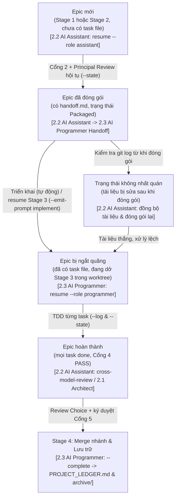
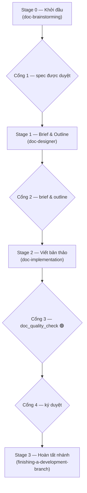
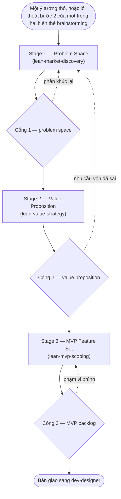
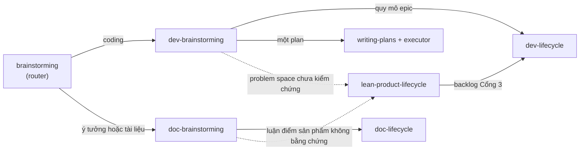

# Ba lifecycle

> Bản dịch của [lifecycles.en.md](lifecycles.en.md). Bản tiếng Anh là nguồn sự thật cho tooling và
> agent; bản này phục vụ trao đổi trong nhóm và phải luôn đồng bộ về cấu trúc lẫn sự kiện.

Tài liệu tra cứu về việc mỗi lifecycle trong kit này dùng để làm gì, cho ra cái gì, và chạy ra sao.

Trang này **mô tả**.
Muốn quyết định một việc cụ thể thuộc lifecycle nào, xem [choosing-a-lifecycle.vi.md](choosing-a-lifecycle.vi.md).

## Mục lục

1. [Tổng quan](#tổng-quan)
2. [dev-lifecycle](#dev-lifecycle)
3. [doc-lifecycle](#doc-lifecycle)
4. [lean-product-lifecycle](#lean-product-lifecycle)
5. [Những thứ không phải lifecycle](#những-thứ-không-phải-lifecycle)
6. [Chúng nối với nhau thế nào](#chúng-nối-với-nhau-thế-nào)

## Tổng quan

Mỗi lifecycle được định nghĩa bằng **thứ tồn tại khi nó kết thúc**.

| | `dev-lifecycle` | `doc-lifecycle` | `lean-product-lifecycle` |
|---|---|---|---|
| **Mục đích** | Xây code đi vào build | Tạo ra tài liệu có người đọc | Quyết định nên xây gì, cho ai |
| **Cho ra** | Một nhánh đã merge | Một tài liệu đã xuất bản | Một MVP backlog đã kiểm chứng |
| **Số cổng** | 5 | 4 | 3 |
| **Ai duyệt cổng** | 4 người, 1 máy | 3 người, 1 máy | 3 người |
| **Artefact nằm ở** | `.devtool/epic/<slug>/` | `.devtool/epic/<slug>/`, thành phẩm ở `docs/` | `.devtool/product/<slug>/` |
| **Xác minh bởi** | `quality_check` | `doc_quality_check` | chỉ bằng phán đoán người |

Hai cổng chất lượng **không chia sẻ tier, audit hay tooling nào**, và không cái nào gọi cái kia.

## dev-lifecycle

**Mục đích.** Điều phối công việc code quy mô epic, từ ý tưởng tới nhánh đã merge.
Nó chỉ sở hữu trình tự và các cổng; cách làm của từng stage nằm trong skill của stage đó.

**Cho ra cái gì.** Một nhánh đã merge, cộng với một High-Level Design bằng tiếng Anh và tiếng Việt,
một bộ BDD viết bằng Gherkin, và mỗi đơn vị công việc một file task
— tất cả được archive vào `.devtool/epic/<slug>/` khi epic đóng.

**Khi nào không áp dụng.** Một thành phần đơn lẻ mà một implementation plan là đủ.
Việc đó dùng `dev-brainstorming` rồi `writing-plans`, tức là rời khỏi lifecycle này cùng các cổng còn lại của nó.

```mermaid
flowchart TD
    S1["Stage 1 — Khởi đầu &amp; Spec<br/>(dev-brainstorming)<br/>[2.2 AI Assistant: --role assistant, auto --state]"]
    G1{"Cổng 1 — 2.1 Architect<br/>Spec được duyệt?"}
    ROUTE{"Quy mô epic?"}
    PLANS(["writing-plans<br/>(rời workflow này)"])
    S2["Stage 2 — Kiến trúc &amp; Task<br/>(dev-designer)<br/>[2.2 AI Assistant: --role assistant, auto --state]"]
    G2{"Cổng 2 — 2.1 Architect<br/>HLD &amp; phân rã task được duyệt?"}
    PRC{"Lựa chọn Thứ tự Ưu tiên Provider/Model — 2.1 Architect<br/>chọn thứ tự cho /principal-review?"}
    PR["principal-review<br/>(Tự động rà soát kiến trúc Shift-Left, tối đa 3 round)<br/>[2.2 AI Assistant: triage, decisions, chỉnh sửa]"]
    PKG["Package epic &amp; Emit Prompt<br/>handoff.md, status Packaged<br/>[2.2 AI Assistant: --state &amp; --emit-prompt implement]"]
    HC{"Handoff choice — 2.1 Architect<br/>Triển khai (tự động) hay Dừng lại?"}
    PKGSTOP(["Dừng: handoff.md và AI Programmer Implement Prompt"])
    S3["Stage 3 — Thực thi độc lập<br/>(dev-implementation)<br/>[2.3 AI Programmer: --role programmer trong worktree]"]
    G3{"Cổng 3 — 2.1 Architect<br/>Thứ tự thực thi đã xác nhận?"}
    EXEC["Phase 2-3: TDD từng task<br/>[2.3 AI Programmer: tự động --log &amp; --state mỗi task,<br/>tích hợp vào develop sau mỗi task]"]
    RC{"Review Choice — 2.1 Architect<br/>Finish, Cross-model review hay Local model review?"}
    XR["cross-model-review<br/>(Shift-Right external CLI: Claude/Codex)<br/>[2.2 AI Assistant: triage &amp; --emit-prompt]"]
    LR["cross-model-review (local)<br/>(Shift-Right local model: Ollama)<br/>[2.2 AI Assistant: triage &amp; --emit-prompt]"]
    G4{"Cổng 4<br/>audit + BDD traceability + quality_check 🟢 LGTM?"}
    REVIEW["Phase 4.1: Developer Kanban Review<br/>(Mọi task giữ ở cột DONE để kiểm tra trực quan)"]
    G5{"Cổng 5 — 2.1 Architect<br/>Người dùng ký duyệt &amp; cho phép finish?"}
    S4["Stage 4 — Hoàn tất nhánh &amp; Lưu trữ<br/>(finishing-a-development-branch)<br/>[2.3 AI Programmer: --complete ghi Ledger &amp; nén log]"]

    S1 --> G1
    G1 -->|chưa, chỉnh sửa| S1
    G1 -->|rồi| ROUTE
    ROUTE -->|không| PLANS
    ROUTE -->|có| S2
    S2 --> G2
    G2 -->|chưa, điều chỉnh phân rã| S2
    G2 -->|rồi| PRC
    PRC -->|"đã chọn thứ tự provider/model"| PR
    PR -->|"round đã chỉnh sửa (readiness OK)"| PR
    PR -->|"hội tụ PASS"| PKG
    PKG --> HC
    HC -->|"1. Triển khai (tự động)"| S3
    HC -->|"2. Dừng lại (lấy prompt)"| PKGSTOP
    PKGSTOP -.->|"phiên sau hoặc AI Agent khác"| S3
    S3 --> G3
    G3 -->|chưa, sắp xếp lại| G3
    G3 -->|rồi| EXEC
    EXEC --> G4
    G4 -->|"chưa, sửa bằng Fix commit"| EXEC
    G4 -->|"rồi"| RC
    RC -->|"1. Finish"| REVIEW
    RC -->|"2. Cross-model review"| XR
    XR -->|"đã ghi nhận round"| G4
    RC -->|"3. Local model review"| LR
    LR -->|"đã ghi nhận round"| G4
    REVIEW --> G5
    G5 -->|"chưa, yêu cầu đổi bằng Fix commit"| EXEC
    G5 -->|rồi| S4
```

Vòng đời trải qua bốn giai đoạn (stage) và năm cổng phê duyệt (approval gate), cùng các điểm lựa chọn rõ ràng:
- **Chuyển tiếp Stage 2 -> Principal Review & Đóng gói sau Review**: Sau khi qua Cổng 1, công việc quy mô epic đi tới Stage 2 (`dev-designer`). Khi Cổng 2 được duyệt, agent **KHÔNG** chạy `package_epic.py` (`handoff.md`) ngay; thay vào đó, agent hỏi nhà phát triển **trình tự ưu tiên provider/model** cho `/principal-review`. Ngay khi xác nhận, `/principal-review` chạy tự động (tối đa 3 round qua `run_external_review.py`, cập nhật trực tiếp HLD/BDD/tasks sau mỗi round triage mà không đóng gói giữa chừng). Chỉ tới cuối `/principal-review` sau khi hội tụ PASS, agent mới chạy `package_epic.py` (tạo `handoff.md`, trạng thái `Packaged`), **in prompt triển khai (`--emit-prompt implement`)**, rồi hỏi lựa chọn **Triển khai (tự động)** (đi tiếp vào Stage 3 ngay) hay **Dừng lại** (*"Dừng lại ở đây để tôi lấy prompt cho một AI Agents khác triển khai"*).
- **Thực thi độc lập**: Stage 3 thực thi từng task độc lập trong git worktree theo phương pháp TDD và tích hợp liên tục vào `develop`. Khi mọi task đã xong, agent chạy Cổng 4 trên SHA ứng viên.
- **Vòng lặp Cổng 4 và Review Choice**: Cổng 4 là cổng máy duy nhất trên nhánh phát triển của kit này. Nó chỉ cấp 🟢 khi `audit_epic.py` exit 0, `check_bdd_traceability.py tests --results` exit 0, và `@quality_check` profile `epic` trả về PASS trên đúng commit SHA ứng viên. Mỗi lần PASS sẽ đưa ra **Review Choice**: **Finish** đi tới Cổng 5; **Cross-model review** (Claude CLI, Codex CLI hoặc Antigravity CLI) và **Local model review** (Ollama) kích hoạt `cross-model-review` (rà soát độc lập Shift-Right đối với mã nguồn, diff và tính toàn vẹn của test). Mỗi round review được ghi nhận vào `review_results.md` rồi quay lại chạy đầy đủ Cổng 4. Mỗi round review được triage cùng nhà phát triển (`run_external_review.py triage`) trước mọi lần sửa. Vòng lặp tiếp tục cho tới khi nhà phát triển chọn Finish.
- **Chế độ Vòng đời Tự động (`/dev-lifecycle --autonomous`)**: Đối với quy trình thực thi rảnh tay, `lifecycle_runner.py` điều phối toàn bộ đường ống: tự động probe năng lực model, thực thi Principal Review với cổng auto-triage (`AUTO_PASS_CLEAN`, `AUTO_PASS_FINAL_MINOR_SWEEP`, `AUTO_FIX_ELIGIBLE`), tự động tính thứ tự topo Cổng 3, chạy tiến trình AI Programmer headless cấu hình qua `.devtool/review_config.json["providers"]["programmer"]` (mặc định `gemini-4-hydrogen-xhigh`, `--effort xhigh`) dưới sự giám sát của process group, đánh giá fix plan qua AI Assistant (`APPROVED`/`ADJUSTED`/`CRITICAL_CONFLICT`), chạy trọn vẹn nghiệm thu máy Cổng 4, và tổng hợp báo cáo Top 3 Rủi ro Cao nhất qua mọi round review. Runner chỉ dừng lại khi gặp rủi ro nghiêm trọng, xung đột nghiệp vụ, hoặc `SHARED_CONTRACT_CONFLICT`, và dừng tại `AWAITING_FINISH` để ký duyệt hoàn tất merge nhánh.
- **Ký duyệt Kanban Cổng 5**: Tất cả task hoàn tất được giữ lại ở `.devtool/features/done/` để nhà phát triển kiểm tra trực quan trên bảng Kanban trước khi Stage 4 rebase, verify theo tier, merge `--no-ff` vào `develop`, và lưu trữ task vào `.devtool/epic/<slug>/`.

### Trạng thái ngắt quãng và khôi phục (Resume)

Khi công việc tạm dừng hoặc một epic được đóng gói, vòng đời khôi phục một cách tất định qua năm trạng thái vận hành:

Các sơ đồ và giải thích này mô tả vòng đời cho con người; các runtime skill (`dev-lifecycle`, `dev-implementation`) và script là nguồn sự thật vận hành. Để tránh hiện tượng **Attention Dilution (Pha loãng sự chú ý)** và **Lost-in-the-Middle (Trôi thông tin ở giữa ngữ cảnh)** cho LLM khi thực thi, mỗi file `SKILL.md` chỉ giữ trình tự vận hành và các cổng kiểm soát cốt lõi, trong khi kiến trúc workflow, danh mục skill và thuật toán hội tụ review được tách riêng tại đây và trong các file `references/*.md` đọc theo ngữ cảnh.

### Danh mục Skill của dev-lifecycle & Kiến trúc Hội tụ Tự động

1. **Danh mục Stage & Skill (Phân tách trách nhiệm độc lập)**:
   - **`dev-brainstorming` (Stage 1 — Khởi đầu & Spec)**: Khám phá bài toán và thiết kế, xuất spec song ngữ (`*-design.{en,vi}.md`) kèm cảnh báo `shared-contracts/` (Cổng 1).
   - **`dev-designer` (Stage 2 — Kiến trúc & Task)**: Sinh gói thiết kế 3 tầng (`<epic_dir>.{en,vi}.md` HLD, `bdd_scenarios.{en,vi}.md`, và `task_*.md` tiếng Anh gắn Tháp Kiểm Thử 3 Tầng), ghi nhận Cổng 2 và hỏi trình tự ưu tiên provider/model cho `/principal-review` (chưa đóng gói `handoff.md`).
   - **`principal-review` (Stage 2 — Rà soát Thiết kế Shift-Left)**: Tự động kiểm tra chéo HLD, BDD và task với mã nguồn thực tế (`principal_review.md`), và khi hội tụ sẽ chạy `package_epic.py` (`handoff.md`), in `--emit-prompt implement` và hỏi **Triển khai (tự động)** hay **Dừng lại**.
   - **`dev-implementation` (Stage 3 — Thực thi TDD Cô lập)**: Role 2.3 AI Programmer (cấu hình qua `.devtool/review_config.json["providers"]["programmer"]`, mặc định `gemini-4-hydrogen-xhigh`) thực thi từng task trong git worktree cô lập (Cổng 3), nối tiếp bởi Cổng 4 và Cổng 5 Kanban.
   - **`quality_check` (Stage 3 — Cổng máy Cổng 4)**: Bộ điều phối chất lượng gắn chặt với `repository_sha` (`profile: "epic"`).
   - **`cross-model-review` (Stage 3 — Rà soát Code Shift-Right)**: Kiểm tra chéo mã nguồn và diff sau khi Cổng 4 đạt PASS (`review_results.md`).
   - **`finishing-a-development-branch` (Stage 4 — Hoàn tất & Lưu trữ)**: Rebase lên `develop`, chạy kiểm thử toàn cục (`Test All`) đúng 1 lần, merge `--no-ff`, và lưu trữ task vào `.devtool/epic/<slug>/`.

2. **Luồng Tự động Đầu-Cuối (Autonomous Pipeline) & Luồng Tương tác**:
   - **Chuỗi vận hành tự động**: `Design (Cổng 2) -> Thứ tự ưu tiên Provider/Model -> Principal Review (--auto-quota, Tự động fix tối đa 3 rounds) -> Đóng gói Handoff (package_epic.py) & In Prompt Triển khai -> Đổi vai trò Role 2.3 AI Programmer (review_config.json, mặc định gemini-4-hydrogen-xhigh) -> Triển khai TDD -> Check Quality tiền Cross-Model Review (Cổng 4) -> Cross-Model Review (--auto-quota, Tự động fix tối đa 3 rounds) -> Quality Check (Cổng 4) -> Finish (Test All khi merge)`.
   - **Thứ tự ưu tiên Model theo Quota (`check-quota`)**: `Claude -> Codex -> Kiro -> Argon` (`Claude/Codex: 5H >= 15% & 7D > 2%`; `Kiro: Tháng >= 3% & >= 15 credits`; `Argon: Tuần >= 10%` hoặc `5H >= 15%`).

3. **Phễu Hội Tụ 3 Vòng (3-Round Convergence Funnel) & 4 Chiến thuật Prompt Chống Lặp Lỗi (Anti-Fix-Loop)**:
   - **Round 1 (`full`)**: Rà soát toàn diện kèm **Chiến thuật 1 (Exhaustive Per-File Pass)** — bắt buộc gom hết lỗi `Critical`/`Important` trên từng file ngay ở Round 1 (cấm bắt lỗi nhỏ giọt).
   - **Round 2 (`delta`)** & **Round 3 (`convergence`, Blocker-Only)**: Bơm **Chiến thuật 2 (Universal Anti-Ping-Pong Guardrail)** cho cả cùng model lẫn khác model, **Chiến thuật 3 (Previously Fixed Locations Registry — `Verify-Then-Close`)**, và **Chiến thuật 4 (Diff-Hunk Isolation on Fixed Files)** — cấm báo lỗi muộn trên các dòng không chạm tới của file vừa sửa.

4. **3 Ngưỡng Dừng Khẩn Cấp (Circuit Breakers) & Tháp Kiểm Thử 3 Tầng**:
   - **3 Circuit Breakers (Dừng ngay lập tức & Báo cáo Top 3 Highest-Risk Findings)**:
     1. `CIRCUIT_BREAKER_HALT (SHARED_CONTRACT_CONFLICT)`: Bất kỳ lỗi `Critical`/`Important` nào ở bất kỳ round nào đụng chạm/xung đột với `shared-contracts/` (tuyệt đối không tự ý lùi thiết kế HLD đã chốt về contract cũ).
     2. `CIRCUIT_BREAKER_HALT (FIX_LOOP)`: File đã đánh dấu `fixed in <sha>` ở Round $N-1$ vẫn bị báo `[INCOMPLETE_FIX]` hoặc `[NEW_REGRESSION]` ở Round $N$.
     3. `CIRCUIT_BREAKER_HALT (MAX_ROUNDS_CRITICAL_REMAINING)`: Sau 3 rounds vẫn còn bất kỳ lỗi `Critical` nào (ngược lại nếu Round 3 đạt `0 Critical` thì `AUTO_PASS_FINAL_SWEEP` sửa nốt `Important`/`Minor` 1 lượt rồi hoàn tất).
   - **Tháp Kiểm Thử 3 Tầng**: Tầng 1 (`Task-Scoped` `< 5s` mỗi task) -> Tầng 2 (`Blast-Radius Scoped` `< 30s` tại Cổng 4) -> Tầng 3 (`Test All` toàn bộ repo đúng 1 lần tại `finishing-a-development-branch` trước khi merge vào `develop`).

## doc-lifecycle

**Mục đích.** Điều phối công việc mà sản phẩm cuối là **tài liệu**, không phải code
— runbook, sổ tay, hướng dẫn onboarding, một bộ trang tra cứu.

**Cho ra cái gì.** Tài liệu hoàn chỉnh, đặt đúng nơi nó thuộc về:
`docs/`, một README, thư mục `references/` của một skill.
Các artefact quá trình — brief, outline, mỗi section một task — ở lại `.devtool/epic/<slug>/`.
**Một thành phẩm còn nằm trong `.devtool/` là chưa ship.**

**Vì sao bốn cổng chứ không phải năm.** Code và văn bản khác nhau ở bốn chỗ làm đổi ý nghĩa của việc xác minh: đơn vị công việc là một section chứ không phải một deliverable test được độc lập;
xác minh là kiểm tra cơ học cộng phán đoán người chứ không phải máy chạy test;
ràng buộc chi phối là **độc giả** chứ không phải kiến trúc; và chi phí sai là thấp.
Vì chi phí sai thấp nên số cổng vẫn ít hơn năm cổng của phía phát triển.

Cổng đầu tiên trong bốn cổng là khởi đầu, và nó **không phải tùy chọn**.
Trước đây nó từng là, với điều kiện bỏ qua hỏi rằng nội dung đã biết hay chưa
— một câu mà agent hầu như luôn trả lời là rồi.
Thứ khiến một giai đoạn bắt buộc vẫn kham được là *độ sâu* của nó co giãn còn *sự tồn tại* thì không:
một runbook vẫn đi qua Stage 0, và spec của nó dài ba câu.
Một runbook mà tốn năm lần phê duyệt thì sẽ không được viết *qua* lifecycle
— nó sẽ được viết *vòng qua* lifecycle.

**Khi nào không áp dụng.** Một lỗi chính tả, một link hỏng, một ADR lẻ,
hay bất kỳ thay đổi nào không người review nào buồn gate.

Stage 0 là bắt buộc — độ sâu co giãn, sự tồn tại thì không.
Stage 1 xác lập độc giả, phân loại tài liệu vào **đúng một** mode Diátaxis,
và biến outline thành mỗi section một task.

## lean-product-lifecycle

**Mục đích.** Quyết định nên xây gì và cho ai, **trước khi** bắt đầu bất kỳ việc kỹ thuật nào.
Nó hiện thực hóa Lean Product Process của Dan Olsen và thi hành kỷ luật problem-space:
nhu cầu phải được mô tả như nhu cầu, không phải như tính năng mà ai đó đã nghĩ sẵn trong đầu.

**Cho ra cái gì.** Ba đặc tả đã được ký duyệt trong `.devtool/product/<slug>/` — `01_problem_space_spec.md`, `02_value_proposition_spec.md`, `03_mvp_feature_backlog.md`.
Backlog là thứ mà bên kỹ thuật nhận được.

**Nó không phủ cái gì.** Bước 5 và 6 trong quy trình của Olsen
— dựng prototype MVP và đem thử với khách hàng — **chưa được hiện thực** trong bản này.
Bộ điều phối nói thẳng điều đó ở Cổng 3 thay vì để người dùng tưởng hành trình đã trọn vẹn.

Các cạnh nét đứt là giao thức Tectonic Plates: khi một cổng fail,
ta **định vị giả thuyết hỏng** trên kim tự tháp Product-Market Fit năm tầng rồi kiểm chứng lại từ đó đi lên,
thay vì vá ngay tại tầng mình đang đứng.

## Những thứ không phải lifecycle

Năm thứ định tuyến công việc mà bản thân không phải lifecycle.

| | Là cái gì | Cổng |
|---|---|---|
| `brainstorming` | Router. Hỏi công việc là phát triển ý tưởng, làm tài liệu hay coding, rồi gọi biến thể tương ứng. Không giữ quy trình nào của riêng nó | Không — nó định tuyến rồi kết thúc |
| `dev-brainstorming` | Biến một ý tưởng về việc code thành design spec được duyệt. Lối ra: `dev-designer`, `writing-plans` hoặc `lean-product-lifecycle` | Một lần duyệt thiết kế và một lần soát spec, đều là người |
| `doc-brainstorming` | Biến một ý tưởng hoặc yêu cầu tài liệu thành content spec được duyệt. Lối ra: `doc-designer`, `decision-records` hoặc `lean-product-lifecycle` | Một lần duyệt thiết kế và một lần soát spec, đều là người |
| `writing-plans` + một executor | Đường code nhỏ. `writing-plans` sinh ra plan; `subagent-driven-development` hoặc `executing-plans` thực thi nó | Không có cổng riêng |
| `decision-records` | Một ADR hoặc một spike report lẻ, viết rồi commit thẳng | Không |

## Chúng nối với nhau thế nào

Hai luật đúng cho mọi kết nối. **Sản phẩm cuối quyết định, không phải lượng chữ phải viết**
— chỉ cần việc đó đổi một file đi vào build thì đó là việc phát triển.
Và **không bao giờ gộp hai spec vào một epic**:
mỗi spec giữ dòng đời spec → thiết kế → thi công của riêng nó.
