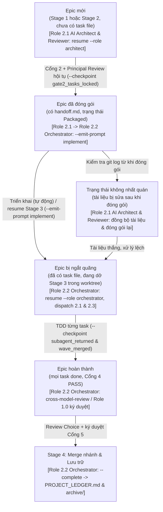
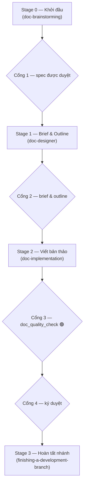
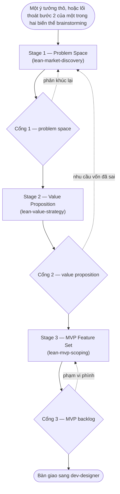
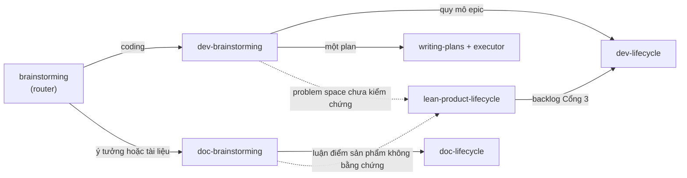

# Ba lifecycle

> Bản dịch của [lifecycles.en.md](lifecycles.en.md). Bản tiếng Anh là nguồn sự thật cho tooling và
> agent; bản này phục vụ trao đổi trong nhóm và phải luôn đồng bộ về cấu trúc lẫn sự kiện.

Tài liệu tra cứu về việc mỗi lifecycle trong kit này dùng để làm gì, cho ra cái gì, và chạy ra sao.

Trang này **mô tả**.
Muốn quyết định một việc cụ thể thuộc lifecycle nào, xem [choosing-a-lifecycle.vi.md](choosing-a-lifecycle.vi.md).

## Mục lục

1. [Tổng quan](#tổng-quan)
2. [dev-lifecycle](#dev-lifecycle)
3. [doc-lifecycle](#doc-lifecycle)
4. [lean-product-lifecycle](#lean-product-lifecycle)
5. [Những thứ không phải lifecycle](#những-thứ-không-phải-lifecycle)
6. [Chúng nối với nhau thế nào](#chúng-nối-với-nhau-thế-nào)

## Tổng quan

Mỗi lifecycle được định nghĩa bằng **thứ tồn tại khi nó kết thúc**.

| | `dev-lifecycle` | `doc-lifecycle` | `lean-product-lifecycle` |
|---|---|---|---|
| **Mục đích** | Xây code đi vào build | Tạo ra tài liệu có người đọc | Quyết định nên xây gì, cho ai |
| **Cho ra** | Một nhánh đã merge | Một tài liệu đã xuất bản | Một MVP backlog đã kiểm chứng |
| **Số cổng** | 5 | 4 | 3 |
| **Ai duyệt cổng** | 4 người, 1 máy | 3 người, 1 máy | 3 người |
| **Artefact nằm ở** | `.devtool/epic/<slug>/` | `.devtool/epic/<slug>/`, thành phẩm ở `docs/` | `.devtool/product/<slug>/` |
| **Xác minh bởi** | `quality_check` | `doc_quality_check` | chỉ bằng phán đoán người |

Hai cổng chất lượng **không chia sẻ tier, audit hay tooling nào**, và không cái nào gọi cái kia.

## dev-lifecycle

**Mục đích.** Điều phối công việc code quy mô epic, từ ý tưởng tới nhánh đã merge.
Nó chỉ sở hữu trình tự và các cổng; cách làm của từng stage nằm trong skill của stage đó.

**Cho ra cái gì.** Một nhánh đã merge, cộng với High-Level Design chỉ bằng tiếng Anh (`<epic_dir>.md`),
kịch bản BDD viết bằng Gherkin (`bdd_scenarios.md`), và mỗi đơn vị công việc một file task
— tất cả được archive vào `.devtool/epic/<slug>/` khi epic đóng (bản dịch `.vi.md` chỉ được tạo khi Role 1.0 yêu cầu rõ, không phải SSOT và không được nạp vào ngữ cảnh của agent).

**Khi nào không áp dụng.** Một thành phần đơn lẻ mà một implementation plan là đủ.
Việc đó dùng `dev-brainstorming` rồi `writing-plans`, tức là rời khỏi lifecycle này cùng các cổng còn lại của nó.

```mermaid
flowchart TD
    S1["Stage 1 — Khởi đầu &amp; Spec<br/>(dev-brainstorming)<br/>[Role 2.1 AI Architect &amp; Reviewer: --role architect, auto --state]"]
    G1{"Cổng 1 — Role 1.0 Human Architect<br/>Spec được duyệt?"}
    ROUTE{"Quy mô epic?"}
    PLANS(["writing-plans<br/>(rời workflow này)"])
    S2["Stage 2 — Kiến trúc &amp; Task<br/>(dev-designer)<br/>[Role 2.1 AI Architect &amp; Reviewer: --role architect, --checkpoint gate2_tasks_locked]"]
    G2{"Cổng 2 — Role 1.0 Human Architect<br/>HLD &amp; phân rã task được duyệt?"}
    PRC{"Lựa chọn Thứ tự Ưu tiên Provider/Model — Role 1.0 Human Architect<br/>chọn thứ tự cho /principal-review?"}
    PR["principal-review<br/>(Tự động rà soát kiến trúc Shift-Left, tối đa 3 round)<br/>[Role 2.1 AI Architect &amp; Reviewer: triage, decisions, principal-reviser]"]
    PKG["Package epic &amp; Emit Prompt<br/>handoff.md, status Packaged<br/>[Role 2.1 AI Architect &amp; Reviewer: --state &amp; --emit-prompt implement]"]
    HC{"Handoff choice — Role 1.0 Human Architect<br/>Triển khai (tự động) hay Dừng lại?"}
    PKGSTOP(["Dừng: handoff.md và Prompt Triển khai cho Role 2.2 Orchestrator"])
    S3["Stage 3 — Thực thi độc lập<br/>(dev-implementation)<br/>[Role 2.2 Orchestrator: --role orchestrator, quota-check, dispatch 2.1 &amp; 2.3]"]
    G3{"Cổng 3 — Role 1.0 Human Architect<br/>Thứ tự thực thi đã xác nhận?"}
    EXEC["Phase 2-3: TDD từng task<br/>[Role 2.2 Orchestrator: pool, --checkpoint subagent_returned/wave_merged;<br/>Role 2.3 Programmer: TDD trong slot; Role 2.1 task-reviewer khi cần gate]"]
    RC{"Review Choice — Role 1.0 Human Architect<br/>Finish, Cross-model review hay Local model review?"}
    XR["cross-model-review<br/>(Shift-Right external CLI: Claude/Codex/Kiro/Argon)<br/>[Role 2.2 Orchestrator: triage, 2.3 fast-track hoặc 2.1 fix-planner]"]
    LR["cross-model-review (local)<br/>(Shift-Right local model: Ollama)<br/>[Role 2.2 Orchestrator: triage &amp; sửa theo mức rủi ro]"]
    G4{"Cổng 4<br/>audit + BDD traceability + quality_check 🟢 LGTM?<br/>[Role 2.3 gate4-verifier phiên mới]"}
    REVIEW["Phase 4.1: Developer Kanban Review<br/>(Mọi task giữ ở cột DONE để kiểm tra trực quan)"]
    G5{"Cổng 5 — Role 1.0 Human Architect<br/>Người dùng ký duyệt &amp; cho phép finish?"}
    S4["Stage 4 — Hoàn tất nhánh &amp; Lưu trữ<br/>(finishing-a-development-branch)<br/>[Role 2.2 Orchestrator: --complete ghi Ledger &amp; nén log]"]

    S1 --> G1
    G1 -->|chưa, chỉnh sửa| S1
    G1 -->|rồi| ROUTE
    ROUTE -->|không| PLANS
    ROUTE -->|có| S2
    S2 --> G2
    G2 -->|chưa, điều chỉnh phân rã| S2
    G2 -->|rồi| PRC
    PRC -->|"đã chọn thứ tự provider/model"| PR
    PR -->|"round đã chỉnh sửa (readiness OK)"| PR
    PR -->|"hội tụ PASS"| PKG
    PKG --> HC
    HC -->|"1. Triển khai (tự động)"| S3
    HC -->|"2. Dừng lại (lấy prompt)"| PKGSTOP
    PKGSTOP -.->|"phiên sau hoặc AI Agent khác"| S3
    S3 --> G3
    G3 -->|chưa, sắp xếp lại| G3
    G3 -->|rồi| EXEC
    EXEC --> G4
    G4 -->|"chưa, sửa bằng Fix commit"| EXEC
    G4 -->|"rồi"| RC
    RC -->|"1. Finish"| REVIEW
    RC -->|"2. Cross-model review"| XR
    XR -->|"đã ghi nhận round"| G4
    RC -->|"3. Local model review"| LR
    LR -->|"đã ghi nhận round"| G4
    REVIEW --> G5
    G5 -->|"chưa, yêu cầu đổi bằng Fix commit"| EXEC
    G5 -->|rồi| S4
```

Vòng đời trải qua bốn giai đoạn (stage) và năm cổng phê duyệt (approval gate), cùng các điểm lựa chọn rõ ràng:
- **Chuyển tiếp Stage 2 -> Principal Review & Đóng gói sau Review**: Sau khi qua Cổng 1, công việc quy mô epic đi tới Stage 2 (`dev-designer`, Role 2.1 AI Architect & Reviewer). Khi Cổng 2 được duyệt, Role 2.1 ghi `resume_context.py --checkpoint gate2_tasks_locked`, chạy kiểm tra sẵn sàng (`check_epic_readiness.py`, gồm kiểm tra sở hữu file độc quyền giữa các task song song), **KHÔNG** chạy `package_epic.py` ngay, và hỏi Role 1.0 Human Architect **trình tự ưu tiên provider/model** cho `/principal-review`. Ngay khi xác nhận, `/principal-review` chạy tự động (tối đa 3 round qua `run_external_review.py`, cập nhật trực tiếp tài liệu tiếng Anh thông qua `principal-reviser`). Chỉ khi `/principal-review` hội tụ PASS, agent mới chạy `package_epic.py` (tạo `handoff.md`, trạng thái `Packaged`), in prompt Role 2.2 Orchestrator (`--emit-prompt implement`, nêu rõ model `orchestrator` đã cấu hình), rồi hỏi **Triển khai (tự động)** (tiếp tục trong phiên hiện tại) hay **Dừng lại** (*"Dừng lại ở đây để tôi lấy prompt cho một AI Agents khác triển khai"*).
- **Thực thi độc lập**: Role 2.2 Orchestrator chạy `dev_config.py quota-check` trước Stage 3 và trước mỗi wave (kiểm tra cả cửa sổ 5 giờ và theo tuần của Gemini cùng ngưỡng các provider khác; exit `2` ghi `--checkpoint quota_low`, ghi pending decision `quota` và dừng). Mỗi task chạy trong slot worktree cô lập qua `dev_config.py dispatch` (dùng pool profile `agy` và `$REAL_HOME/.d3nexus/agy_profile_leases.json` nếu có cấu hình), với Role 2.3 Programmer (`task-implementer`) viết code TDD và Role 2.2 ghi `--checkpoint subagent_returned` và `--checkpoint wave_merged`. Khi selective review gating kích hoạt (`review_tier: "full"`, nhãn rủi ro cao hoặc `> 2` module non-test), Role 2.2 gọi Role 2.1 `task-reviewer` (chỉ đọc) trước khi đánh dấu task `done`.
- **Vòng lặp Cổng 4 và Review Choice**: Cổng 4 là cổng máy duy nhất trên nhánh phát triển của kit này. Một Role 2.3 `gate4-verifier` phiên mới chạy `audit_epic.py`, `check_bdd_traceability.py tests --results`, và `@quality_check` profile `epic` trên đúng commit SHA ứng viên. Mỗi lần PASS sẽ đưa ra **Review Choice**: **Finish** đi tới Cổng 5; **Cross-model review** (Claude, Codex, Kiro hoặc Argon) và **Local model review** (Ollama) kích hoạt `cross-model-review`. Role 2.2 triage findings và phân tuyến theo rủi ro: lỗi code rủi ro thấp đi qua Role 2.3 `review-fixer` (`fast-track`), còn finding rủi ro cao (`Critical`, dấu hiệu leo thang, hoặc cùng một kiểm tra Gate 4 fail lặp lại) đi qua Role 2.1 `fix-planner` viết `fix_plan_round<N>.md` (`PLANNED` -> Role 2.3 `review-fixer` `apply-plan`, hoặc `ESCALATE` -> Role 1.0). Mỗi round được ghi nhận vào `review_results.md` rồi quay lại chạy đầy đủ Cổng 4. Vòng lặp tiếp tục cho tới khi Role 1.0 chọn Finish.
- **Chế độ Vòng đời Tự động (`/dev-lifecycle --autonomous`)**: `lifecycle_runner.py` đóng vai Role 2.2 Orchestrator: phân giải binding qua `/d3nexus:dev-config` (`scripts/persona_config.py`, mặc định `gemini-4-hydrogen-xhigh` cho `programmer`), thi hành `quota-check` và `max_orchestrator_turns_before_checkpoint` (giảm một nửa khi bật `/d3nexus:dev-config low-quota on`), dispatch subagent Role 2.1 và Role 2.3 qua `dev_config.py` không fallback tự động (`MODEL_UNAVAILABLE` hoặc `QUOTA_LOW` dừng và báo cáo), chuyển finding rủi ro cao cho Role 2.1 `fix-planner`, chạy `gate4-verifier` mới, tổng hợp Top 3 Rủi ro Cao nhất, và dừng tại `AWAITING_FINISH` chờ Role 1.0 ký duyệt merge.
- **Ký duyệt Kanban Cổng 5**: Tất cả task hoàn tất được giữ lại ở `.devtool/features/done/` để Role 1.0 kiểm tra trực quan trước khi Stage 4 rebase, verify theo tier, merge `--no-ff` vào `develop`, và lưu trữ task vào `.devtool/epic/<slug>/`.

### Trạng thái ngắt quãng và khôi phục (Resume)

Khi công việc tạm dừng hoặc một epic được đóng gói, vòng đời khôi phục một cách tất định qua năm trạng thái vận hành (bắt đầu từ khối `checkpoint` mới nhất trong `.devtool/state/<slug>.heartbeat.json`):

Các sơ đồ và giải thích này mô tả vòng đời cho con người; các runtime skill (`dev-lifecycle`, `dev-implementation`) và script là nguồn sự thật vận hành. Để tránh hiện tượng **Attention Dilution (Pha loãng sự chú ý)** và **Lost-in-the-Middle (Trôi thông tin ở giữa ngữ cảnh)** cho LLM khi thực thi, mỗi file `SKILL.md` chỉ giữ trình tự vận hành và các cổng kiểm soát cốt lõi, trong khi kiến trúc workflow, danh mục skill và thuật toán hội tụ review được tách riêng tại đây và trong các file `references/*.md` đọc theo ngữ cảnh.

### Danh mục Skill của dev-lifecycle & Kiến trúc Hội tụ Tự động

1. **Danh mục Stage & Skill (Phân tách trách nhiệm độc lập)**:
   - **`dev-brainstorming` (Stage 1 — Khởi đầu & Spec)**: Khám phá bài toán và thiết kế (Role 2.1 cùng Role 1.0), xuất spec chỉ bằng tiếng Anh (`YYYY-MM-DD-<topic>-design.md`) kèm cảnh báo `shared-contracts/` (Cổng 1).
   - **`dev-designer` (Stage 2 — Kiến trúc & Task)**: Role 2.1 sinh gói thiết kế 3 tầng chỉ bằng tiếng Anh (`<epic_dir>.md` HLD, `bdd_scenarios.md`, và `task_*.md` gắn Tháp Kiểm Thử 3 Tầng cùng `Allowed files` rời nhau cho các task song song), ghi nhận Cổng 2 + `--checkpoint gate2_tasks_locked`, và hỏi trình tự ưu tiên provider/model cho `/principal-review`.
   - **`principal-review` (Stage 2 — Rà soát Thiết kế Shift-Left)**: Tự động kiểm tra chéo HLD, BDD và task với mã nguồn thực tế (`principal_review.md`; Role 2.1 `principal-reviser` cập nhật tài liệu), và khi hội tụ sẽ chạy `package_epic.py` (`handoff.md`), in `--emit-prompt implement` và hỏi **Triển khai (tự động)** hay **Dừng lại**.
   - **`dev-config` (Cấu hình Bốn Vai trò & Quota xuyên Stage)**: `/d3nexus:dev-config` cấu hình 3 vai trò AI qua các tầng kit, global (`$REAL_HOME/.d3nexus/personas.json`) và project (`.agents/config/personas.json`), hỗ trợ lệnh tắt `--provider agy|claude|codex`, `set` với `--provider`, `--model`, `--effort`, `--profile`, quản lý pool profile `agy` và file lease `agy_profile_leases.json`, bật tắt `low-quota` theo profile, và chạy `quota-check` cùng `dispatch`.
   - **`dev-implementation` (Stage 3 — Thực thi TDD Cô lập)**: Role 2.2 Orchestrator điều phối wave, `quota-check`, checkpoints (`subagent_returned`, `wave_merged`), `dev_config.py dispatch` và Role 2.1 `task-reviewer` theo selective gating; Role 2.3 Programmer (cấu hình qua `/d3nexus:dev-config`, mặc định `gemini-4-hydrogen-xhigh` ở `xhigh`) thực thi TDD trong slot worktree (`Allowed files`), tiếp nối bởi Role 2.3 `gate4-verifier` phiên mới và Cổng 5 Kanban.
   - **`quality_check` (Stage 3 — Cổng máy Cổng 4)**: Bộ điều phối chất lượng gắn chặt với `repository_sha` (`profile: "epic"`).
   - **`cross-model-review` (Stage 3 — Rà soát Code Shift-Right)**: Role 2.2 chạy `run_external_review.py` sau khi Cổng 4 đạt PASS (`review_results.md`) và phân tuyến finding rủi ro thấp cho Role 2.3 `review-fixer` (`fast-track`) hoặc rủi ro cao cho Role 2.1 `fix-planner` (`PLANNED` -> `apply-plan`, `ESCALATE` -> Role 1.0).
   - **`finishing-a-development-branch` (Stage 4 — Hoàn tất & Lưu trữ)**: Role 2.2 chạy `--complete`, rebase lên `develop` (gọi Role 2.3 khi cần xử lý code/test), chạy kiểm thử toàn cục (`Test All`) đúng 1 lần, merge `--no-ff`, và lưu trữ task vào `.devtool/epic/<slug>/`.

2. **Luồng Tự động Đầu-Cuối (Autonomous Pipeline) & Luồng Tương tác**:
   - **Chuỗi vận hành tự động**: `Design (Cổng 2 + gate2_tasks_locked) -> Thứ tự ưu tiên Provider/Model -> Principal Review (--auto-quota, tối đa 3 rounds) -> Đóng gói Handoff & In Prompt Triển khai -> Cổng Quota (dev_config.py quota-check) -> Role 2.3 Programmer (dev-config, mặc định gemini-4-hydrogen-xhigh) + Role 2.1 task-reviewer -> Checkpoints (subagent_returned, wave_merged, turn_budget) -> Cổng 4 (gate4-verifier mới) -> Cross-Model Review (--auto-quota, phân tuyến fast-track / fix-planner) -> Cổng 4 -> Finish (Test All khi merge)`.
   - **Cổng Quota & Thứ tự ưu tiên Provider**: Review bên ngoài ưu tiên `Claude -> Codex -> Kiro -> Argon` (`5H >= 15% & 7D > 2%` cho `claude`/`codex`/`agy` Gemini, `Tháng >= 3% & >= 15 credits` cho `kiro`, `Tuần >= 10%` cho `argon`). `dev_config.py quota-check` áp dụng đúng ngưỡng cửa sổ 5 giờ và theo tuần lên các binding của từng vai trò trước Stage 3, mỗi wave và mỗi vòng sửa lỗi (dừng với `--checkpoint quota_low` và `decision_kind: quota` khi thiếu; không tự đổi model).

3. **Phễu Hội Tụ 3 Vòng (3-Round Convergence Funnel) & 4 Chiến thuật Prompt Chống Lặp Lỗi (Anti-Fix-Loop)**:
   - **Round 1 (`full`)**: Rà soát toàn diện kèm **Chiến thuật 1 (Exhaustive Per-File Pass)** — bắt buộc gom hết lỗi `Critical`/`Important` trên từng file ngay ở Round 1 (cấm bắt lỗi nhỏ giọt).
   - **Round 2 (`delta`)** & **Round 3 (`convergence`, Blocker-Only)**: Bơm **Chiến thuật 2 (Universal Anti-Ping-Pong Guardrail)** cho cả cùng model lẫn khác model, **Chiến thuật 3 (Previously Fixed Locations Registry — `Verify-Then-Close`)**, và **Chiến thuật 4 (Diff-Hunk Isolation on Fixed Files)** — cấm báo lỗi muộn trên các dòng không chạm tới của file vừa sửa.

4. **5 Tiêu chí Dừng Khẩn Cấp & Tháp Kiểm Thử 3 Tầng**:
   - **5 Tiêu chí Dừng (Dừng ngay & Báo cáo Top 3 Highest-Risk Findings cho Role 1.0)**:
     1. `CRITICAL_CONFLICT`: Giải pháp mâu thuẫn với HLD đã duyệt hoặc `Decisions Already Made`.
     2. `Debatable` / `Not shown`: Không thể xác minh finding dựa trên mã nguồn hiện tại.
     3. `SHARED_CONTRACT_CONFLICT`: Bất kỳ finding hoặc giải pháp nào chạm vào `shared-contracts/`.
     4. `FIX_LOOP`: Vị trí đã đánh dấu `fixed in <sha>` ở Round $N-1$ vẫn fail với `[INCOMPLETE_FIX]` hoặc `[NEW_REGRESSION]` ở Round $N$.
     5. `MAX_ROUNDS_CRITICAL_REMAINING`: Sau 3 rounds vẫn còn lỗi `Critical` (ngược lại Round 3 đạt `0 Critical` sẽ kích hoạt `AUTO_PASS_FINAL_SWEEP`).
   - **Tháp Kiểm Thử 3 Tầng**: Tầng 1 (`Task-Scoped` `< 5s` mỗi task) -> Tầng 2 (`Blast-Radius Scoped` `< 30s` tại Cổng 4) -> Tầng 3 (`Test All` toàn bộ repo đúng 1 lần tại `finishing-a-development-branch` trước khi merge vào `develop`).

### Ma trận Role và Model

Các vai trò trong `dev-lifecycle` được phân tách theo chức năng, không gắn cứng theo tên model (xem [orchestration-roles.md](../skills/dev-lifecycle/references/orchestration-roles.md), [CRITICAL_RULES.md §8](../rules/CRITICAL_RULES.md), và [dev-config-quick-guide.vi.md](dev-config-quick-guide.vi.md)):

1. **Quản trị Bốn Vai trò (Four-Persona Governance) & Subagents**:

   | Vai trò / Subagent | Key Cấu hình & Mặc định Kit | Trách nhiệm & Giới hạn |
   |---|---|---|
   | **Role 1.0 Human Architect** | `—` (Con người) | Nắm tầm nhìn sản phẩm, duyệt **Cổng 1, 2, 5**, chiến lược Finish/Merge ở Stage 4, và mọi điểm leo thang (`CRITICAL_CONFLICT`, `Debatable`, `SHARED_CONTRACT_CONFLICT`, `FIX_LOOP`, `MAX_ROUNDS_CRITICAL_REMAINING`, `MODEL_UNAVAILABLE`, `QUOTA_LOW`, `LOW_QUOTA_STOP`). |
   | **Role 2.1 AI Architect & Reviewer** (`--role architect`; `principal-reviser`, `task-reviewer`, `fix-planner`) | `ai_architect_reviewer` — mặc định kit **`argon`** (`gemini-4-argon-high`, effort **`high`**; cấu hình qua `/d3nexus:dev-config`) | Soạn Spec/HLD/BDD/task Verification tables & `Allowed files` ở Stage 1–2, chạy `/principal-review` & `principal-reviser`, đóng gói `handoff.md`; ở Stage 3 chạy read-only `task-reviewer` và `fix-planner` (`fix_plan_round<N>.md`). **Cấm**: sửa `src/` hoặc `tests/`, chạy test/linter/type-checker, dispatch subagent hoặc gọi pool. |
   | **Role 2.2 Orchestrator** *(phiên chính Stage 3–4; `--role orchestrator`)* | `orchestrator` — mặc định kit **`hydrogen`** (`gemini-4-hydrogen-high`, effort **`high`**; hoặc model phiên Stage 2 khi chọn **Triển khai (tự động)**) | Chủ trì Cổng 3, worker pool (`manage_worker_pool.py`), `dev_config.py quota-check`, dispatch subagent qua pool (`dev_config.py dispatch`), đối chiếu SHA/clean tree/diff scope độc lập, checkpoints (`--checkpoint`), phân tuyến `/cross-model-review` và đánh dấu task `done`. **Cấm**: đọc/sửa `src/` hoặc `tests/`, sửa HLD/BDD/Verification/DoD/`Allowed files`, chạy test/linter/`run_task_checks.py`. |
   | **Role 2.3 Programmer** (`--role programmer`; `task-implementer`, `review-fixer`, `gate4-verifier`) | `programmer` — mặc định kit **`hydrogen`** (**`gemini-4-hydrogen-xhigh`**, effort **`xhigh`**; cấu hình qua `/d3nexus:dev-config` / `dev_config.py resolve` — cấm thay bằng `flash` hay `inherit`) | - `task-implementer`: code TDD (`RED -> GREEN`), `check_code_impact.py`, `run_task_checks.py verify` trong `Allowed files`. - `review-fixer`: sửa code/test cho `/cross-model-review` (`fast-track` hoặc `apply-plan`) kèm Tier 1 scoped tests. - `gate4-verifier`: chạy độc lập `audit_epic.py`, BDD traceability và `@quality_check`. **Cấm**: sửa HLD/BDD/`shared-contracts/`/Verification/DoD/`Allowed files`, hoặc gọi `manage_worker_pool.py`. |

   Cấu hình vai trò được hợp nhất qua 4 tầng (`scripts/personas.default.json` < `$REAL_HOME/.d3nexus/personas.json` < `.agents/config/personas.json` < cờ CLI). Dùng `/d3nexus:dev-config --provider agy|claude|codex` để đổi nhanh toàn bộ vai trò, `/d3nexus:dev-config set <persona> --provider ... --model ... --effort ... --profile ...` để chỉnh từng vai trò, `/d3nexus:dev-config profiles` để quản lý pool `agy` và `agy_profile_leases.json`, và `/d3nexus:dev-config low-quota on` để giảm nửa turn budget và dừng an toàn sau wave đang chạy.

2. **External Reviewer CLIs (Stage 2 `/principal-review` & Stage 3 `/cross-model-review`)**:
   Độc lập với cấu hình model của các vai trò nội bộ và được chọn theo `--auto-quota` (thứ tự ưu tiên mặc định trong mã nguồn `skills/dev-implementation/resources/scripts/run_external_review.py` là `["claude", "codex", "kiro", "agy"]`, tức `Claude -> Codex -> Kiro -> Argon`; tệp cục bộ `.devtool/review_config.json` được git-ignore có thể ghi đè `provider_priority` và `quota_thresholds`):

   | Provider CLI | Model cấu hình | Thinking Level | Vai trò |
   |---|---|---|---|
   | `claude` | `opus` | `high` | Audit kiến trúc/task (Stage 2) & review code/delta (Stage 3), tối đa 3 vòng |
   | `codex` | `gpt-6.1-sol` | `high` | Audit kiến trúc/task (Stage 2) & review code/delta (Stage 3), tối đa 3 vòng |
   | `kiro` | `claude-opus-5.5` | `high` | Audit kiến trúc/task (Stage 2) & review code/delta (Stage 3), tối đa 3 vòng |
   | `agy` (Argon) | `gemini-4-argon-high` | `high` | Fallback review CLI khi các provider ưu tiên hơn thiếu quota |
   | `ollama` *(tuỳ chọn local)* | `gemma4:31b-it-qat` | `high` | Review offline trên máy local khi chạy `--cli ollama` |

## doc-lifecycle

**Mục đích.** Điều phối công việc mà sản phẩm cuối là **tài liệu**, không phải code
— runbook, sổ tay, hướng dẫn onboarding, một bộ trang tra cứu.

**Cho ra cái gì.** Tài liệu hoàn chỉnh, đặt đúng nơi nó thuộc về:
`docs/`, một README, thư mục `references/` của một skill.
Các artefact quá trình — brief, outline, mỗi section một task — ở lại `.devtool/epic/<slug>/`.
**Một thành phẩm còn nằm trong `.devtool/` là chưa ship.**

**Vì sao bốn cổng chứ không phải năm.** Code và văn bản khác nhau ở bốn chỗ làm đổi ý nghĩa của việc xác minh: đơn vị công việc là một section chứ không phải một deliverable test được độc lập;
xác minh là kiểm tra cơ học cộng phán đoán người chứ không phải máy chạy test;
ràng buộc chi phối là **độc giả** chứ không phải kiến trúc; và chi phí sai là thấp.
Vì chi phí sai thấp nên số cổng vẫn ít hơn năm cổng của phía phát triển.

Cổng đầu tiên trong bốn cổng là khởi đầu, và nó **không phải tùy chọn**.
Trước đây nó từng là, với điều kiện bỏ qua hỏi rằng nội dung đã biết hay chưa
— một câu mà agent hầu như luôn trả lời là rồi.
Thứ khiến một giai đoạn bắt buộc vẫn kham được là *độ sâu* của nó co giãn còn *sự tồn tại* thì không:
một runbook vẫn đi qua Stage 0, và spec của nó dài ba câu.
Một runbook mà tốn năm lần phê duyệt thì sẽ không được viết *qua* lifecycle
— nó sẽ được viết *vòng qua* lifecycle.

**Khi nào không áp dụng.** Một lỗi chính tả, một link hỏng, một ADR lẻ,
hay bất kỳ thay đổi nào không người review nào buồn gate.

Stage 0 là bắt buộc — độ sâu co giãn, sự tồn tại thì không.
Stage 1 xác lập độc giả, phân loại tài liệu vào **đúng một** mode Diátaxis,
và biến outline thành mỗi section một task.

## lean-product-lifecycle

**Mục đích.** Quyết định nên xây gì và cho ai, **trước khi** bắt đầu bất kỳ việc kỹ thuật nào.
Nó hiện thực hóa Lean Product Process của Dan Olsen và thi hành kỷ luật problem-space:
nhu cầu phải được mô tả như nhu cầu, không phải như tính năng mà ai đó đã nghĩ sẵn trong đầu.

**Cho ra cái gì.** Ba đặc tả đã được ký duyệt trong `.devtool/product/<slug>/` — `01_problem_space_spec.md`, `02_value_proposition_spec.md`, `03_mvp_feature_backlog.md`.
Backlog là thứ mà bên kỹ thuật nhận được.

**Nó không phủ cái gì.** Bước 5 và 6 trong quy trình của Olsen
— dựng prototype MVP và đem thử với khách hàng — **chưa được hiện thực** trong bản này.
Bộ điều phối nói thẳng điều đó ở Cổng 3 thay vì để người dùng tưởng hành trình đã trọn vẹn.

Các cạnh nét đứt là giao thức Tectonic Plates: khi một cổng fail,
ta **định vị giả thuyết hỏng** trên kim tự tháp Product-Market Fit năm tầng rồi kiểm chứng lại từ đó đi lên,
thay vì vá ngay tại tầng mình đang đứng.

## Những thứ không phải lifecycle

Năm thứ định tuyến công việc mà bản thân không phải lifecycle.

| | Là cái gì | Cổng |
|---|---|---|
| `brainstorming` | Router. Hỏi công việc là phát triển ý tưởng, làm tài liệu hay coding, rồi gọi biến thể tương ứng. Không giữ quy trình nào của riêng nó | Không — nó định tuyến rồi kết thúc |
| `dev-brainstorming` | Biến một ý tưởng về việc code thành design spec được duyệt. Lối ra: `dev-designer`, `writing-plans` hoặc `lean-product-lifecycle` | Một lần duyệt thiết kế và một lần soát spec, đều là người |
| `doc-brainstorming` | Biến một ý tưởng hoặc yêu cầu tài liệu thành content spec được duyệt. Lối ra: `doc-designer`, `decision-records` hoặc `lean-product-lifecycle` | Một lần duyệt thiết kế và một lần soát spec, đều là người |
| `writing-plans` + một executor | Đường code nhỏ. `writing-plans` sinh ra plan; `subagent-driven-development` hoặc `executing-plans` thực thi nó | Không có cổng riêng |
| `decision-records` | Một ADR hoặc một spike report lẻ, viết rồi commit thẳng | Không |

## Chúng nối với nhau thế nào

Hai luật đúng cho mọi kết nối. **Sản phẩm cuối quyết định, không phải lượng chữ phải viết**
— chỉ cần việc đó đổi một file đi vào build thì đó là việc phát triển.
Và **không bao giờ gộp hai spec vào một epic**:
mỗi spec giữ dòng đời spec → thiết kế → thi công của riêng nó.
