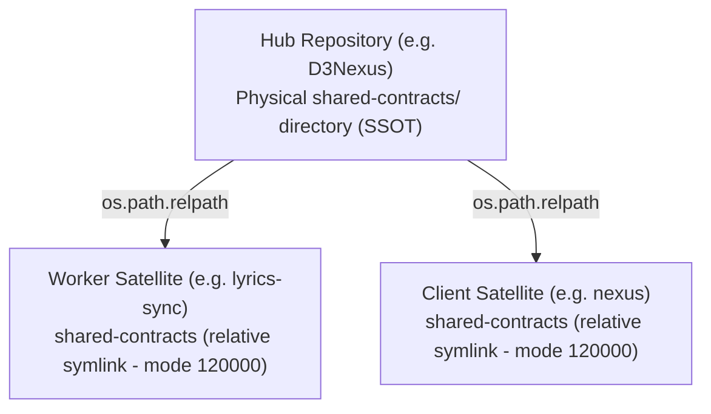
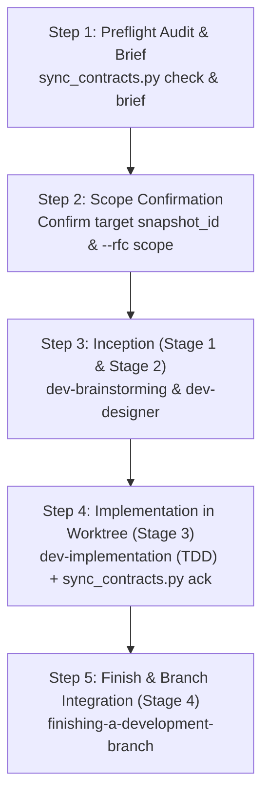

# Quick-Guide: Managing and Synchronizing Shared Contracts Between Hub & Satellite

> Vietnamese version: [shared-contracts-quick-guide.vi.md](shared-contracts-quick-guide.vi.md).

A comprehensive practical guide for Day-0 initial setup with `/setup-shared-contracts`, Day-2 continuous monitoring and synchronization with `/sync-shared-contracts`, and the standard 5-step integration lifecycle (`dev-lifecycle`) between the central repository (Hub) and consumer/worker repositories (Satellites).

---

## Table of Contents

- [1. Contract Architecture & Three Governance Invariants](#1-contract-architecture--three-governance-invariants)
  - [Star Topology Layout](#star-topology-layout)
  - [The Canonical Contract Triad](#the-canonical-contract-triad)
  - [3 Governance Invariants](#3-governance-invariants)
- [2. Complete Command Cheat-Sheet](#2-complete-command-cheat-sheet)
  - [2.1 Chat Slash Command Cheat-Sheet](#21-chat-slash-command-cheat-sheet)
  - [2.2 Terminal CLI Cheat-Sheet](#22-terminal-cli-cheat-sheet)
- [3. Day-0 Initial Setup with /setup-shared-contracts](#3-day-0-initial-setup-with-setup-shared-contracts)
  - [3.1 Initialize Hub SSOT (`init-hub`)](#31-initialize-hub-ssot-init-hub)
  - [3.2 Link Satellite via Relative Symlink (`link-satellite`)](#32-link-satellite-via-relative-symlink-link-satellite)
  - [3.3 Audit Configuration Integrity (`verify`)](#33-audit-configuration-integrity-verify)
  - [3.4 Create Brand New Domain Contracts and Register Mappings](#34-create-brand-new-domain-contracts-and-register-mappings)
- [4. Day-2 Continuous Monitoring & Synchronization with /sync-shared-contracts](#4-day-2-continuous-monitoring--synchronization-with-sync-shared-contracts)
  - [3-Layer Hybrid Delta Engine](#3-layer-hybrid-delta-engine)
  - [Worktree-Aware Topology Resolution](#worktree-aware-topology-resolution)
  - [Watermark Ledger Schema (`.agents/contract_sync.json`)](#watermark-ledger-schema-agentscontract_syncjson)
- [5. The 5-Step Lifecycle Bridge into dev-lifecycle](#5-the-5-step-lifecycle-bridge-into-dev-lifecycle)
  - [Lifecycle Flowchart](#lifecycle-flowchart)
  - [Detailed Step Breakdown](#detailed-step-breakdown)
  - [Interactive One-Click Cross-Repo Automation Mechanism](#interactive-one-click-cross-repo-automation-mechanism)
  - [Task Responsibilities: Hub Mode vs Satellite Mode](#task-responsibilities-hub-mode-vs-satellite-mode)
- [6. Practical Scenarios & Walkthroughs](#6-practical-scenarios--walkthroughs)
  - [Scenario 1: Fresh Hub-Satellite Ecosystem Initialization](#scenario-1-fresh-hub-satellite-ecosystem-initialization)
  - [Scenario 2: Hub Updates Contract and Implements Backend](#scenario-2-hub-updates-contract-and-implements-backend)
  - [Scenario 3: Satellite Syncs Upstream Changes from Hub](#scenario-3-satellite-syncs-upstream-changes-from-hub)
  - [Scenario 4: Satellite Proposes Breaking Change (RFC Ledger)](#scenario-4-satellite-proposes-breaking-change-rfc-ledger)
  - [Scenario 5: Selective Scoped RFC Synchronization (`--rfc <ID>`)](#scenario-5-selective-scoped-rfc-synchronization---rfc-id)
  - [Scenario 6: Automated Contract Evolution via One-Click Confirmation](#scenario-6-automated-contract-evolution-via-one-click-confirmation)
- [7. Troubleshooting & Common Pitfalls](#7-troubleshooting--common-pitfalls)

---

## 1. Contract Architecture & Three Governance Invariants

### Star Topology Layout

In a distributed ecosystem consisting of a central control plane (**Hub**) and satellite consumer applications (**Satellites** — background worker daemons, web frontends, or native mobile clients), contracts and schema specifications must never be scattered ad-hoc. The architecture is organized in a strict **Star Topology**:



- **Hub Repository (e.g. `D3Nexus`)**: The physical Single Source of Truth (SSOT). Hub physically owns `shared-contracts/` and controls all contract change commits.
- **Satellite Repositories (e.g. `lyrics-sync`, `nexus`)**: Never own physical contract files. Instead, they connect to the Hub via Git mode `120000` relative symbolic links (`shared-contracts -> <relative_target>`).

---

### The Canonical Contract Triad

Every domain directory under `shared-contracts/<domain>/` must contain exactly three canonical Markdown files:

| Canonical File | Purpose & Contents |
| :--- | :--- |
| **`api_contract.md`** | Wire-level protocols (REST, SSE, IPC), HTTP endpoints, methods, authentication headers (`X-Worker-Token`), telemetry heartbeats, and request/response JSON payload schemas. |
| **`architecture_and_flow.md`** | Component topology diagrams, 7 canonical processing pipeline steps, state machine transitions, cancellation fencing (< 50ms early exit), and scratch directory cleanup. |
| **`gaps_and_rfcs.md`** | Asynchronous gap ledger (`GAP-XX`) and non-breaking RFC proposals (`RFC-001`) for backward-compatible schema evolution. |

---

### 3 Governance Invariants

> [!CRITICAL]
> These three rules are hard constraints across all workflows and MUST be respected by all AI Agents, plugins, and developers:

1. **Git Boundary Isolation**:
   - Satellite repositories must **NEVER** include `shared-contracts/` in `Files Allowed` for git commits.
   - Running `git add shared-contracts/...` in a satellite causes a fatal Git error: `fatal: pathspec is beyond a symbolic link`.
2. **Stateless Worker Isolation**:
   - Worker satellites (such as `lyrics-sync`) operate strictly as stateless compute nodes.
   - Satellite workers are **STRICTLY PROHIBITED** from connecting directly to the Hub database (`DATABASE_URL`, PostgreSQL, SQLite). All state transitions, lease acquisitions, and result handoffs occur over authenticated REST/SSE endpoints.
3. **Non-Breaking Schema Guarantee**:
   - Never unilaterally rename fields, remove JSON properties, or alter pipeline enums without prior alignment in `shared-contracts/`.
   - All schema changes must maintain backward compatibility (new fields must be optional with safe defaults).

---

## 2. Complete Command Cheat-Sheet

### 2.1 Chat Slash Command Cheat-Sheet

| Slash Command | Usage Purpose | Execution Behavior |
| :--- | :--- | :--- |
| `/setup-shared-contracts` | Initialize or verify contract topology | Interactive guide to initialize Hub (`init-hub`), link Satellite (`link-satellite`), or audit integrity (`verify`). |
| `/sync-shared-contracts` | Audit contract drift and synchronize | Executes drift checking (`check`), generates requirements briefs (`brief`), and records snapshot watermarks (`ack`). |

---

### 2.2 Terminal CLI Cheat-Sheet

All tools are standard-library Python scripts with zero external pip dependencies:

#### `/setup-shared-contracts` Toolset:
```bash
# Script location:
# skills/setup-shared-contracts/resources/scripts/setup_contracts.py

# 1. Initialize Hub SSOT repository (creates physical directory, README, domain, and rules)
python3 skills/setup-shared-contracts/resources/scripts/setup_contracts.py init-hub \
  --domain <domain_name> [--repo-root <path>] [--force]

# 2. Link Satellite repository to a Hub domain via relative symlink
python3 skills/setup-shared-contracts/resources/scripts/setup_contracts.py link-satellite \
  --hub <path_to_hub> \
  --domain <domain_name> \
  [--satellite-root <path>] [--force]

# 3. Audit configuration integrity (auto-detects Hub or Satellite mode)
python3 skills/setup-shared-contracts/resources/scripts/setup_contracts.py verify \
  [--repo-root <path>]
```

#### `/sync-shared-contracts` Toolset:
```bash
# Script location:
# skills/sync-shared-contracts/resources/scripts/sync_contracts.py

# 1. Check contract drift (outputs IN_SYNC or DRIFT_DETECTED)
python3 skills/sync-shared-contracts/resources/scripts/sync_contracts.py check \
  [--domain <name>] [--json] [--strict] [--rfc <ID> ...]

# 2. Generate Contract Requirements Brief for dev-lifecycle
python3 skills/sync-shared-contracts/resources/scripts/sync_contracts.py brief \
  [--domain <name>] [--output <path_to_brief.md>]

# 3. Acknowledge synchronization watermark (updates .agents/contract_sync.json)
python3 skills/sync-shared-contracts/resources/scripts/sync_contracts.py ack \
  [--domain <name>] --snapshot <snapshot_id> [--rfc <ID> ... | --all-rfcs]
```

---

## 3. Day-0 Initial Setup with `/setup-shared-contracts`

The goal of Day-0 is initializing contract infrastructure, configuring Git mode `120000` relative symlinks, and installing local boundary governance rules.

```text
       [Day-0: setup_contracts.py]
  Hub:       init-hub --domain <domain>  ──► Creates physical dir + 3 canonical files
                                            + .agents/rules/contract_rules.md
                                            + README.md (Outbound Symlink Table)
                                                    │
                                                    ▼
  Satellite: link-satellite --hub <path> ──► Creates relative symlink: shared-contracts
                            --domain <name>  + .agents/rules/contract_rules.md (Read-only)
                                             + Appends reference to AGENTS.md
                                                    │
                                                    ▼
  Audit:     verify                      ──► Verifies relative link, no cycles,
                                             3 canonical files present & readable
```

### 3.1 Initialize Hub SSOT (`init-hub`)

Run this command at the root of the Hub repository:
```bash
python3 skills/setup-shared-contracts/resources/scripts/setup_contracts.py init-hub --domain lyrics-sync
```

**Actions performed automatically**:
1. Safety check: Aborts if `shared-contracts/` is an existing symbolic link (Hub must never be a symlink).
2. Creates the physical directory `shared-contracts/`.
3. Renders `shared-contracts/README.md` containing the *Outbound Symlink Mappings* table.
4. Populates domain directory `shared-contracts/lyrics-sync/` with the 3 canonical templates: `api_contract.md`, `architecture_and_flow.md`, and `gaps_and_rfcs.md`.
5. Installs SSOT local rule at `.agents/rules/contract_rules.md`.

---

### 3.2 Link Satellite via Relative Symlink (`link-satellite`)

Run this command from the root of the Satellite repository:
```bash
python3 /path/to/ai-agent-tools/skills/setup-shared-contracts/resources/scripts/setup_contracts.py link-satellite \
  --hub ../D3Nexus \
  --domain lyrics-sync
```

**Actions performed automatically**:
1. Validates that Hub exists and contains `shared-contracts/lyrics-sync/`.
2. Guard against self-linking and accidental Hub directory erasure.
3. Aborts if `shared-contracts/` is an existing non-empty physical directory unless `--force` is provided.
4. Calculates single-direction relative path via `os.path.relpath(hub_domain_dir, satellite_root)` (e.g. `../D3Nexus/shared-contracts/lyrics-sync`).
5. Atomically creates relative symlink (via temporary sibling swap).
6. Installs `.agents/rules/contract_rules.md` in Satellite enforcing Git read-only boundary constraints.
7. Appends `@.agents/rules/contract_rules.md` to `AGENTS.md` if present.

---

### 3.3 Audit Configuration Integrity (`verify`)

Run the audit in either Hub or Satellite:
```bash
python3 skills/setup-shared-contracts/resources/scripts/setup_contracts.py verify
```

- **In Hub Mode**:
  - Validates `shared-contracts/` is a physical directory.
  - Confirms `README.md` contains the `Outbound Symlink Mappings` table.
  - Verifies all domain subfolders contain all 3 canonical files.
  - Ensures Hub local rule contains "Single Source of Truth" constraints.
- **In Satellite Mode**:
  - Validates `shared-contracts` is a **relative symlink** (rejects absolute paths like `/Users/...`).
  - Ensures symlink target resolves safely without dangling links.
  - Bounds symlink traversal to $\le 10$ hops and checks for circular link loops.
  - Verifies target domain contains all 3 canonical files.
  - Checks Satellite rule for mandatory markers: `Satellite Consumer`, `read-only`, `NEVER stage`.

---

### 3.4 Create Brand New Domain Contracts and Register Mappings

When the system introduces an entirely new service domain or specialized worker (e.g. `audio-processor` or `vocal-separation`):

1. **Initialize New Domain at Hub**:
   ```bash
   python3 skills/setup-shared-contracts/resources/scripts/setup_contracts.py init-hub --domain audio-processor
   ```
   - Creates directory `shared-contracts/audio-processor/` populated with the 3 canonical templates `api_contract.md`, `architecture_and_flow.md`, `gaps_and_rfcs.md`.
   - Automatically appends the new domain row to the `Outbound Symlink Mappings` table in `shared-contracts/README.md`.
2. **Link New Satellite Workspace**:
   ```bash
   python3 skills/setup-shared-contracts/resources/scripts/setup_contracts.py link-satellite \
     --hub ../D3Nexus \
     --domain audio-processor
   ```
   - Configures the relative symbolic link from Satellite to the Hub domain directory.
3. **Adding New APIs within an Existing Domain**:
   - If the domain already exists, simply add the endpoint table row or narrative block with its JSON payload schema in `shared-contracts/<domain>/api_contract.md`. The `sync_contracts.py` engine automatically parses and extracts payload keys and dotted field types.

---

## 4. Day-2 Continuous Monitoring & Synchronization with `/sync-shared-contracts`

Day-2 guarantees that source code implementations stay strictly synchronized with contracts during continuous development.

### 3-Layer Hybrid Delta Engine

The `sync_contracts.py` CLI uses a 3-layer detection engine:

1. **Layer 1 — Git History & SHA-256 Composite Snapshot**:
   - Calculates individual SHA-256 hashes for each canonical file and generates a composite `snapshot_id`:
     $$\text{snapshot\_id} = \text{sha256}(H(\text{api}) + \text{":"} + H(\text{arch}) + \text{":"} + H(\text{gaps}))$$
   - Stores normalized `baseline_snapshot` in `.agents/contract_sync.json` (including dotted types such as `metrics.duration_ms: integer`). This detects semantic drift even without Git history or with uncommitted local edits.
2. **Layer 2 — Dual-Format Markdown Parser**:
   - Parses both Markdown tables and narrative formats (`### Title (POST /path)`, version metadata `<!-- Version: X.Y.Z -->`).
   - Normalizes RFC/Gap statuses into:
     - `ACTIONABLE_PENDING`: `OPEN`, `PROPOSED`, `DRAFT`, `IN_REVIEW`.
     - `ACKNOWLEDGED_ACTIVE`: `ACCEPTED`, `APPROVED`, `IMPLEMENTED`.
     - `INACTIVE`: `SUPERSEDED`, `REJECTED`.
3. **Layer 3 — Heuristic Codebase Scanner**:
   - Recursively walks target source code (`.py`, `.rs`, `.dart`, `.kt`, `.swift`, `.ts`, etc.), skipping build artifacts and `.worktrees/`.
   - Cross-checks parameterized endpoints, auth headers, and DTO fields (`snake_case` and `camelCase`).
   - Marks each contract item as either `FOUND_IN_CODE` or `MISSING_IN_CODE`.

---

### Worktree-Aware Topology Resolution

During Stage 3 (`dev-implementation`), tasks execute inside isolated git worktrees at `.worktrees/<epic_dir>`. Directory depth shifts by 2 levels.

`sync_contracts.py` automatically detects `.git` worktree metadata and recalculates relative symlink target paths against the primary checkout root **without altering the tracked symlink in Git**. Source code scanning and `.agents/contract_sync.json` persistence remain isolated within the worktree.

---

### Watermark Ledger Schema (`.agents/contract_sync.json`)

This is the only contract synchronization state file tracked in Satellite repositories:

```json
{
  "schema_version": 1,
  "mode": "satellite",
  "domains": {
    "lyrics-sync": {
      "snapshot_id": "sha256:9f86d081884c7d659a2feaa0c55ad015a3bf4f1b2b0b822cd15d6c15b0f00a08",
      "hub_commit_sha": "a1b2c3d4e5f6a1b2c3d4e5f6a1b2c3d4e5f6a1b2",
      "contract_version": "1.1.0",
      "last_synced_at": "2026-10-30T18:30:00Z",
      "file_hashes": {
        "api_contract.md": "sha256:...",
        "architecture_and_flow.md": "sha256:...",
        "gaps_and_rfcs.md": "sha256:..."
      },
      "acknowledged_rfcs": ["RFC-001"],
      "pending_rfcs": [],
      "acknowledged_endpoints": [
        "POST /api/v1/lyrics-sync/tasks/claim",
        "GET /api/v1/lyrics-sync/status"
      ],
      "baseline_snapshot": {
        "endpoints": ["POST /api/v1/lyrics-sync/tasks/claim"],
        "headers": ["Authorization", "X-Worker-Token"],
        "payload_keys": ["task_id", "lease_duration_ms"],
        "payload_fields": {
          "task_id": "string",
          "lease_duration_ms": "integer"
        },
        "pipeline_steps": ["Lease Acquisition", "Input Validation"],
        "rfcs": {
          "RFC-001": {
            "status": "ACKNOWLEDGED_ACTIVE",
            "raw_status": "APPROVED",
            "title": "Initial Baseline"
          }
        }
      }
    }
  }
}
```

---

## 5. The 5-Step Lifecycle Bridge into `dev-lifecycle`

### Lifecycle Flowchart



---

### Detailed Step Breakdown

#### Step 1: Preflight Audit & Brief Generation
Run drift checking and generate the requirements brief:
```bash
# Check for contract drift
python3 skills/sync-shared-contracts/resources/scripts/sync_contracts.py check --domain <domain>

# Generate Contract Requirements Brief
python3 skills/sync-shared-contracts/resources/scripts/sync_contracts.py brief --domain <domain> --output .devtool/contract_brief.md
```
- If `shared-contracts` is missing or dangling $\rightarrow$ Immediately invoke `/setup-shared-contracts`.
- If status is `IN_SYNC` and no `MISSING_IN_CODE` items exist $\rightarrow$ Codebase is already in sync; stop.

#### Step 2: Scope Confirmation
Present the generated Brief to the developer:
- Record the target `snapshot_id`.
- Confirm implementation scope: either all active RFCs (`--all-rfcs`) or a specific subset (`--rfc RFC-001`).

#### Step 3: Inception (Stage 1 & Stage 2)
Feed the brief into `dev-lifecycle`:
- **Stage 1 (`dev-brainstorming`)**: Draft bilingual specifications (`.en.md` and `.vi.md`) adhering strictly to the agreed wire contracts without debating settled protocols.
- **Stage 2 (`dev-designer`)**: Formulate High-Level Design (HLD) and breakdown Kanban tasks (`task_*.md`).

#### Step 4: Implementation in Worktree (Stage 3)
Switch to the `AI Programmer` persona and execute `dev-implementation` inside an isolated worktree:
- Execute tasks following strict TDD (Red-Green-Refactor).
- In the final task, run `sync_contracts.py ack` and verify strict check.
- Pass automated Gate 4 checks (Quality Check + Traceability + Code Health Audit).
- Halt at **Review Choice** for human developer review (Finish or External Model Review).

#### Step 5: Finish & Branch Integration (Stage 4)
Invoke `finishing-a-development-branch` to merge code, archive logs into `.devtool/archive/`, and update `.devtool/PROJECT_LEDGER.md`.

---

### Interactive One-Click Cross-Repo Automation Mechanism

To eliminate the friction of manually switching between Hub and Satellite workspaces, `/dev-designer` supports a controlled, semi-automated cross-repo workflow:

```text
[Satellite: dev-designer]
       │
       ▼
Directly draft RFC/Contract changes via Symlink into Hub disk
       │
       ▼
Inspect git diff & Present Confirmation Prompt (Y/N)
       │
       ├─► (Developer inputs 'Y')
       ▼
Automatically execute: git -C <Hub> add & commit
       │
       ▼
Automatically execute: sync_contracts.py ack on Satellite
       │
       ▼
Proceed directly to dev-implementation without switching workspaces!
```

1. **Direct Drafting via Symlink**: Because `shared-contracts/` in Satellite is a relative symlink pointing into Hub's physical tree, the AI Assistant can write proposed RFCs or schema updates directly into `gaps_and_rfcs.md` or `api_contract.md`.
2. **Diff Presentation & Human Confirmation**: The agent runs:
   ```bash
   git -C $(readlink -f shared-contracts)/.. diff shared-contracts/<domain>/
   ```
   It presents the exact diff and halts with an explicit confirmation prompt: *"Do you confirm committing this contract change to the Hub repository? (Y/N)"*.
3. **Execution of Cross-Repo Commit**: Upon developer confirmation (strictly adhering to Critical Rule 7.1), the agent runs:
   ```bash
   git -C $(readlink -f shared-contracts)/.. add shared-contracts/<domain>/ && git -C $(readlink -f shared-contracts)/.. commit -m "[CONTRACT] <title>"
   ```
4. **Immediate Watermark Synchronization**: The agent runs `sync_contracts.py ack` in the Satellite workspace to immediately record the new `snapshot_id` in `.agents/contract_sync.json`. Satellite can now proceed with `task_01` (DTOs) and feature tasks without being blocked at `task_final`.

---

### Task Responsibilities: Hub Mode vs Satellite Mode

The table below contrasts task breakdown requirements in `dev-designer` (Stage 2) and `dev-implementation` (Stage 3):

| Aspect | Hub Mode | Satellite Mode |
| :--- | :--- | :--- |
| **Contract Location** | Physical directory `shared-contracts/<domain>/` | Relative symlink pointing to Hub |
| **`task_01` Mandate** | **Update Canonical Contract**: Edit 3 canonical files in `shared-contracts/<domain>/`. At task conclusion, run `sync_contracts.py brief` to capture `refreshed_snapshot_id`. | **Update Consumer DTOs & Client**: Implement client models, remote data sources, and network adapters matching contract. |
| **Contract Modification** | **ALLOWED**: Directory `shared-contracts/` is listed in `Files Allowed` for `task_01`. | **STRICTLY FORBIDDEN**: Directory `shared-contracts/` is **NEVER** in `Files Allowed`. |
| **Final Task Mandate** | Run:<br/>`sync_contracts.py ack --snapshot <refreshed_id>` to confirm Hub's own refreshed snapshot. | Run:<br/>`sync_contracts.py ack --snapshot <id> [--rfc <ID> ... \| --all-rfcs]`<br/>File `.agents/contract_sync.json` **must be in `Files Allowed`**. |
| **Strict Exit Gate** | Run `sync_contracts.py check --strict` returning `IN_SYNC`. | Run `sync_contracts.py check --strict [--rfc <ID>]` returning `IN_SYNC`. |

---

## 6. Practical Scenarios & Walkthroughs

### Scenario 1: Fresh Hub-Satellite Ecosystem Initialization

**Context**: You are setting up Hub `D3Nexus` and connecting worker satellite `lyrics-sync` for domain `lyrics-sync`.

**Steps**:

1. In Hub repo `D3Nexus`:
   ```bash
   python3 skills/setup-shared-contracts/resources/scripts/setup_contracts.py init-hub --domain lyrics-sync
   git add shared-contracts/ .agents/rules/contract_rules.md
   git commit -m "[SHARED_CONTRACTS] Initialize hub shared contracts" -m "- Initialize lyrics-sync domain with canonical contract triad
   - Setup SSOT local rules"
   ```
2. In Satellite repo `lyrics-sync`:
   ```bash
   python3 /path/to/ai-agent-tools/skills/setup-shared-contracts/resources/scripts/setup_contracts.py link-satellite \
     --hub ../D3Nexus \
     --domain lyrics-sync
   git add .agents/rules/contract_rules.md AGENTS.md
   # NOTE: Never git add shared-contracts
   git commit -m "[SHARED_CONTRACTS] Link shared contracts to D3Nexus" -m "- Link lyrics-sync domain via relative symlink
   - Install satellite read-only rules"
   ```
3. Audit integrity:
   ```bash
   python3 skills/setup-shared-contracts/resources/scripts/setup_contracts.py verify
   # Result: PASS: Shared contracts verification succeeded
   ```

---

### Scenario 2: Hub Updates Contract and Implements Backend

**Context**: Hub `D3Nexus` needs to add `execution_time_ms: integer` to `POST /api/v1/lyrics-sync/tasks/claim`.

**Steps**:

1. Start `/dev-lifecycle` on `D3Nexus`.
2. In Stage 2 (`dev-designer`):
   - Formulate `task_01_update_contract.md`: Update `shared-contracts/lyrics-sync/api_contract.md` (bump version to `1.1.0`, add `execution_time_ms`).
   - Subsequent tasks: Update FastAPI routes, Pydantic models, unit test suite.
   - Final task: Run `sync_contracts.py ack --snapshot <refreshed_id>`.
3. In Stage 3 (`dev-implementation`):
   - Implement `task_01`, then run:
     ```bash
     python3 skills/sync-shared-contracts/resources/scripts/sync_contracts.py brief --domain lyrics-sync
     ```
     Record refreshed snapshot hash (e.g. `sha256:7c9e...`).
   - Implement backend tasks.
   - In final task, run:
     ```bash
     python3 skills/sync-shared-contracts/resources/scripts/sync_contracts.py ack --domain lyrics-sync --snapshot sha256:7c9e... --all-rfcs
     python3 skills/sync-shared-contracts/resources/scripts/sync_contracts.py check --domain lyrics-sync --strict
     ```
4. Commit and finish branch on Hub.

---

### Scenario 3: Satellite Syncs Upstream Changes from Hub

**Context**: After Hub commits updated contracts, worker `lyrics-sync` needs to update its client model and processing logic.

**Steps**:

1. In Satellite repo `lyrics-sync`, run preflight check:
   ```bash
   python3 skills/sync-shared-contracts/resources/scripts/sync_contracts.py check --domain lyrics-sync
   # Result: Domain 'lyrics-sync' status: DRIFT_DETECTED
   # Added Payload Keys: execution_time_ms
   ```
2. Generate Requirements Brief:
   ```bash
   python3 skills/sync-shared-contracts/resources/scripts/sync_contracts.py brief --domain lyrics-sync --output .devtool/sync_brief.md
   ```
   Brief highlights: `execution_time_ms` is `MISSING_IN_CODE`.
3. Start `/dev-lifecycle`:
   - Stage 2 (`dev-designer`):
     - `task_01`: Update worker DTOs and telemetry reporting (`shared-contracts/` is NOT in `Allowed files`).
     - `task_02`: Update pipeline step execution metrics.
     - `task_03`: Acceptance task, run `sync_contracts.py ack --snapshot <snapshot_id>` and persist `.agents/contract_sync.json`.
4. Stage 3 (`dev-implementation` in worktree):
   - Code and pass tests for all tasks.
   - In `task_03`:
     ```bash
     python3 skills/sync-shared-contracts/resources/scripts/sync_contracts.py ack --domain lyrics-sync --snapshot <snapshot_id> --all-rfcs
     python3 skills/sync-shared-contracts/resources/scripts/sync_contracts.py check --domain lyrics-sync --strict
     # Result: Domain 'lyrics-sync' status: IN_SYNC (Exit 0)
     ```
5. Merge branch via `/finishing-a-development-branch`.

---

### Scenario 4: Satellite Proposes Breaking Change (RFC Ledger)

**Context**: During satellite development, an engineer discovers a missing endpoint or requires a payload modification not yet present in the Hub.

**Rules**:
1. **NEVER** invent undocumented fields in satellite source code or edit symlink `shared-contracts/` directly.
2. The Satellite engineer documents an entry in `gaps_and_rfcs.md` (or emits an Upstream Contract Handoff Summary).
3. The proposal is registered as `GAP-XX` or `RFC-XXX` detailing:
   - Technical Rationale.
   - Proposed Schema Modifications.
   - Backward Compatibility Transition Strategy.
4. Hub architects review and transition status to `APPROVED`.
5. Hub implements the change first (Scenario 2), after which Satellite executes synchronization (Scenario 3).

---

### Scenario 5: Selective Scoped RFC Synchronization (`--rfc <ID>`)

**Context**: Hub has multiple active RFCs (`RFC-001`, `RFC-002`, `RFC-003`), but Satellite only implements `RFC-002` in the current sprint.

**Steps**:

1. In Satellite, generate brief:
   ```bash
   python3 skills/sync-shared-contracts/resources/scripts/sync_contracts.py brief --domain lyrics-sync
   ```
2. In Stage 2 (`dev-designer`), break down tasks specifically for `RFC-002`.
3. In final task of Stage 3 (`dev-implementation`), execute scoped ack:
   ```bash
   python3 skills/sync-shared-contracts/resources/scripts/sync_contracts.py ack \
     --domain lyrics-sync \
     --snapshot <current_snapshot_id> \
     --rfc RFC-002
   ```
4. Verify scoped compliance:
   ```bash
   python3 skills/sync-shared-contracts/resources/scripts/sync_contracts.py check \
     --domain lyrics-sync \
     --strict \
     --rfc RFC-002
   # Result: Domain 'lyrics-sync' scoped check for ['RFC-002']: IN_SYNC (Exit 0)
   ```
   *(Ledger `.agents/contract_sync.json` records `RFC-002` in `acknowledged_rfcs`, while remaining RFCs stay in `pending_rfcs` for future epics without failing quality gates).*

---

### Scenario 6: Automated Contract Evolution via One-Click Confirmation

**Context**: During an epic on `lyrics-sync`, you need to add field `execution_time_ms: integer` to an API without opening extra terminal windows or switching workspaces to Hub.

**Execution Walkthrough (Under 30 Seconds)**:

1. In `lyrics-sync`, trigger `/dev-designer`.
2. Agent designs the requirements and drafts the field additions into `shared-contracts/lyrics-sync/api_contract.md` (via symlink).
3. At Gate 2, Agent presents the diff and halts with a confirmation prompt:
   ```text
   [Cross-Repo Commit Confirmation (D3Nexus)]
   - File: shared-contracts/lyrics-sync/api_contract.md (+ execution_time_ms: integer)
   Do you confirm committing this change to the Hub repository? (Y/N)
   ```
4. You enter `Y`.
5. Agent automatically commits to Hub:
   ```bash
   git -C $(readlink -f shared-contracts)/.. add shared-contracts/lyrics-sync/
   git -C $(readlink -f shared-contracts)/.. commit -m "[CONTRACT] Add execution_time_ms to lyrics-sync claim API"
   ```
6. Agent runs `sync_contracts.py ack` to record the new watermark on Satellite:
   ```bash
   python3 skills/sync-shared-contracts/resources/scripts/sync_contracts.py ack --domain lyrics-sync --snapshot <new_snapshot_id> --all-rfcs
   ```
7. All Stage 3 (`dev-implementation`) tasks on Satellite proceed normally, and `task_final` check (`check --strict`) will PASS immediately.

---

## 7. Troubleshooting & Common Pitfalls

### 1. Error: `fatal: pathspec is beyond a symbolic link`
- **Root Cause**: You ran `git add shared-contracts/...` or included `shared-contracts/` in `Files Allowed` within a Satellite repository. Git refuses to track paths across symbolic links.
- **Resolution**:
  - Never stage `shared-contracts` in a Satellite.
  - Only stage local source files and `.agents/contract_sync.json`.

### 2. Error: `ERROR: SNAPSHOT_MISMATCH: expected sha256:..., got sha256:...`
- **Root Cause**: While working in Satellite, someone modified or committed contract changes on the Hub, altering the hash from what was captured in Step 2.
- **Resolution**:
  - Re-run `python3 skills/sync-shared-contracts/resources/scripts/sync_contracts.py brief` to inspect the latest Hub changes.
  - If changes are compatible, update the `--snapshot` parameter with the new snapshot ID.

### 3. Error: `Satellite symlink MUST be a relative path, but is absolute`
- **Root Cause**: Symlink was created using an absolute path (e.g. `ln -s /Users/username/repo...`), breaking immediately on CI/CD runners or other team members' machines.
- **Resolution**:
  - Re-link using the CLI: `python3 setup_contracts.py link-satellite --hub <path> --domain <domain>`.
  - The tool calculates a portable relative path using `os.path.relpath`.

### 4. Error: `UNSUPPORTED_CONTRACT_FORMAT`
- **Root Cause**: File `api_contract.md` was altered such that tables or narrative headers no longer conform to supported Markdown schemas, or contains zero detectable endpoints.
- **Resolution**:
  - Align with the canonical template (`resources/templates/api_contract.md.tmpl`).
  - Ensure endpoints use markdown table rows with `Method` and `Path` columns, or headers like `### Title (METHOD /path)`.
