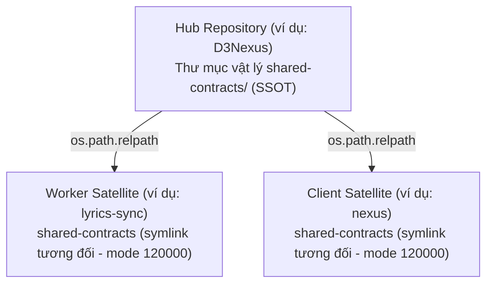
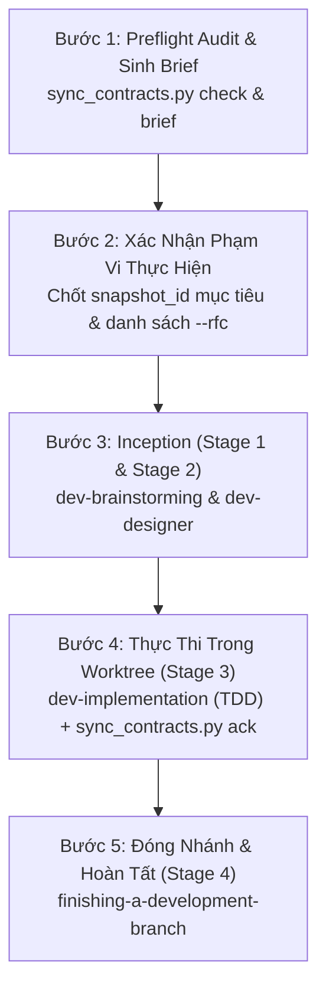

# Cẩm Nang Tra Cứu Nhanh: Quản Trị và Đồng Bộ Hợp Đồng (Shared Contracts) Giữa Hub & Satellite

> English version: [shared-contracts-quick-guide.en.md](shared-contracts-quick-guide.en.md).

Tài liệu hướng dẫn thực hành toàn diện về thiết lập ban đầu (Day-0) với `/setup-shared-contracts`, giám sát và đồng bộ liên tục (Day-2) với `/sync-shared-contracts`, cùng quy trình tích hợp 5 bước chuẩn vào vòng đời phát triển phần mềm (`dev-lifecycle`) giữa kho lưu trữ trung tâm (Hub) và các kho lưu trữ vệ tinh (Satellites).

---

## Mục Lục

- [1. Kiến Trúc Hợp Đồng & Ba Nguyên Tắc Bất Biến](#1-kiến-trúc-hợp-đồng--ba-nguyên-tắc-bất-biến)
  - [Mô hình Topology Hình Sao (Star Topology)](#mô-hình-topology-hình-sao-star-topology)
  - [Bộ Ba Tệp Hợp Đồng Chuẩn Tắc (The Canonical Triad)](#bộ-ba-tệp-hợp-đồng-chuẩn-tắc-the-canonical-triad)
  - [3 Nguyên Tắc Quản Trị Bất Biến](#3-nguyên-tắc-quản-trị-bất-biến)
- [2. Bảng Tra Cứu Toàn Bộ Câu Lệnh (Command Cheat-Sheet)](#2-bảng-tra-cứu-toàn-bộ-câu-lệnh-command-cheat-sheet)
  - [2.1 Bảng Tra Cứu Slash Command Trong Chat](#21-bảng-tra-cứu-slash-command-trong-chat)
  - [2.2 Bảng Tra Cứu Terminal CLI](#22-bảng-tra-cứu-terminal-cli)
- [3. Thiết Lập Ban Đầu Day-0 với /setup-shared-contracts](#3-thiết-lập-ban-đầu-day-0-với-setup-shared-contracts)
  - [3.1 Khởi tạo Hub SSOT (`init-hub`)](#31-khởi-tạo-hub-ssot-init-hub)
  - [3.2 Liên kết Satellite qua Symlink Tương Đối (`link-satellite`)](#32-liên-kết-satellite-qua-symlink-tương-đối-link-satellite)
  - [3.3 Kiểm tra toàn vẹn cấu hình (`verify`)](#33-kiểm-tra-toàn-vẹn-cấu-hình-verify)
- [4. Giám Sát và Đồng Bộ Liên Tục Day-2 với /sync-shared-contracts](#4-giám-sát-và-đồng-bộ-liên-tục-day-2-với-sync-shared-contracts)
  - [Động cơ So Lệch Lai 3 Lớp (3-Layer Hybrid Delta Engine)](#động-cơ-so-lệch-lai-3-lớp-3-layer-hybrid-delta-engine)
  - [Cơ Chế Phân Giải Symlink Tương Thích Worktree](#cơ-chế-phân-giải-symlink-tương-thích-worktree)
  - [Cấu Trúc Sổ Cái Dấu Mốc `.agents/contract_sync.json`](#cấu-trúc-sổ-cái-dấu-mốc-agentscontract_syncjson)
- [5. Quy Trình 5 Bước Tích Hợp Vào dev-lifecycle](#5-quy-trình-5-bước-tích-hợp-vào-dev-lifecycle)
  - [Sơ Đồ Luồng 5 Bước Tích Hợp](#sơ-đồ-luồng-5-bước-tích-hợp)
  - [Chi Tiết Từng Bước Thực Thi](#chi-tiết-từng-bước-thực-thi)
  - [Khác Biệt Nhiệm Vụ Giữa Hub Mode và Satellite Mode](#khác-biệt-nhiệm-vụ-giữa-hub-mode-và-satellite-mode)
- [6. Hướng Dẫn Thực Hành Theo Từng Kịch Bản](#6-hướng-dẫn-thực-hành-theo-từng-kịch-bản)
  - [Kịch Bản 1: Khởi tạo hệ sinh thái Hub-Satellite từ đầu](#kịch-bản-1-khởi-tạo-hệ-sinh-thái-hub-satellite-từ-đầu)
  - [Kịch Bản 2: Hub cập nhật hợp đồng và triển khai backend](#kịch-bản-2-hub-cập-nhật-hợp-đồng-và-triển-khai-backend)
  - [Kịch Bản 3: Satellite cập nhật code theo hợp đồng mới từ Hub](#kịch-bản-3-satellite-cập-nhật-code-theo-hợp-đồng-mới-từ-hub)
  - [Kịch Bản 4: Satellite đề xuất thay đổi không tương thích (RFC Ledger)](#kịch-bản-4-satellite-đề-xuất-thay-đổi-không-tương-thích-rfc-ledger)
  - [Kịch Bản 5: Đồng bộ có chọn lọc một phần RFC (`--rfc <ID>`)](#kịch-bản-5-đồng-bộ-có-chọn-lọc-một-phần-rfc---rfc-id)
- [7. Xử Lý Sự Cố và Bẫy Thường Gặp (Troubleshooting & FAQs)](#7-xử-lý-sự-cố-và-bẫy-thường-gặp-troubleshooting--faqs)

---

## 1. Kiến Trúc Hợp Đồng & Ba Nguyên Tắc Bất Biến

### Mô hình Topology Hình Sao (Star Topology)

Trong một hệ sinh thái phân tán bao gồm một hệ thống điều khiển trung tâm (**Hub**) và các ứng dụng vệ tinh (**Satellites** — worker xử lý ngầm, giao diện người dùng web, hoặc ứng dụng di động), các đặc tả giao diện và luồng xử lý không được phân tán lộn xộn. Toàn bộ cấu trúc vận hành theo **Mô hình Hình Sao (Star Topology)**:



- **Hub Repository (ví dụ: `D3Nexus`)**: Là nguồn chân lý duy nhất (Single Source of Truth - SSOT). Hub sở hữu thư mục vật lý `shared-contracts/` và kiểm soát mọi commit thay đổi hợp đồng.
- **Satellite Repositories (ví dụ: `lyrics-sync`, `nexus`)**: Không bao giờ chứa thư mục vật lý `shared-contracts/`. Thay vào đó, chúng kết nối tới Hub thông qua liên kết mềm tương đối (relative symbolic link, Git mode `120000`).

---

### Bộ Ba Tệp Hợp Đồng Chuẩn Tắc (The Canonical Triad)

Mỗi thư mục nghiệp vụ (domain) bên dưới `shared-contracts/<domain>/` bắt buộc phải có đầy đủ 3 tệp Markdown chuẩn tắc:

| Tệp Chuẩn Tắc | Mục Đích & Nội Dung Quy Định |
| :--- | :--- |
| **`api_contract.md`** | Giao thức truyền tin wire-level (REST, SSE, IPC), đường dẫn endpoints, phương thức HTTP, headers xác thực (`X-Worker-Token`), nhịp tim telemetry, và cấu trúc payload JSON (request/response). |
| **`architecture_and_flow.md`** | Sơ đồ tương tác giữa các thành phần, 7 bước chuẩn của pipeline xử lý, máy trạng thái (state machine), cơ chế hủy sớm (< 50ms cancellation fencing), và dọn dẹp tài nguyên tạm. |
| **`gaps_and_rfcs.md`** | Sổ cái ghi nhận bất đồng bộ (GAP Ledger) và các đề xuất tiến hóa schema không gây vỡ tương thích (RFC Proposals). |

---

### 3 Nguyên Tắc Quản Trị Bất Biến

> [!CRITICAL]
> Ba nguyên tắc dưới đây là ràng buộc bắt buộc trong mọi quy trình và bắt buộc phải được toàn bộ AI Agents, plugins và lập trình viên tuân thủ:

1. **Ranh Giới Git Cô Lập (Git Boundary Isolation)**:
   - Các repo Satellite **TUYỆT ĐỐI KHÔNG** đưa `shared-contracts/` vào danh sách tệp cho phép commit (`Files Allowed`).
   - Việc `git add shared-contracts/...` từ repo vệ tinh sẽ gây lỗi nghiêm trọng: `fatal: pathspec is beyond a symbolic link`.
2. **Nút Tính Toán Phi Trạng Thái (Stateless Worker Isolation)**:
   - Các worker vệ tinh (như `lyrics-sync`) hoạt động hoàn toàn phi trạng thái (stateless compute).
   - **NGHIÊM CẤM** worker kết nối trực tiếp vào cơ sở dữ liệu của Hub (`DATABASE_URL`, PostgreSQL, SQLite). Mọi giao dịch trạng thái, lấy việc (lease acquisition), và trả kết quả phải thực hiện qua REST API/SSE có chứng thực worker token.
3. **Bảo Đảm Tiến Hóa Schema Không Phá Vỡ (Non-Breaking Schema Guarantee)**:
   - Không được đơn phương đổi tên trường, xóa trường JSON, hoặc sửa enum pipeline khi chưa có sự thống nhất trong `shared-contracts/`.
   - Mọi thay đổi schema phải đảm bảo tính tương thích ngược (trường mới phải là optional kèm giá trị mặc định an toàn).

---

## 2. Bảng Tra Cứu Toàn Bộ Câu Lệnh (Command Cheat-Sheet)

### 2.1 Bảng Tra Cứu Slash Command Trong Chat

| Slash Command | Mục Đích Sử Dụng | Hành Vi Thực Thi |
| :--- | :--- | :--- |
| `/setup-shared-contracts` | Thiết lập hoặc xác thực cấu trúc liên kết | Hướng dẫn khởi tạo Hub (`init-hub`), liên kết Satellite (`link-satellite`), hoặc kiểm tra tính toàn vẹn (`verify`). |
| `/sync-shared-contracts` | Kiểm tra độ lệch và đồng bộ hợp đồng | Chạy kiểm tra sai lệch (`check`), lập bản tóm tắt yêu cầu (`brief`), và ghi nhận dấu mốc (`ack`). |

---

### 2.2 Bảng Tra Cứu Terminal CLI

Toàn bộ công cụ được viết bằng thư viện chuẩn Python (không yêu cầu cài đặt thêm pip package ngoài):

#### Bộ công cụ `/setup-shared-contracts`:
```bash
# Đường dẫn script:
# skills/setup-shared-contracts/resources/scripts/setup_contracts.py

# 1. Khởi tạo Hub Repository SSOT (tạo thư mục vật lý, README, domain và rules)
python3 skills/setup-shared-contracts/resources/scripts/setup_contracts.py init-hub \
  --domain <domain_name> [--repo-root <path>] [--force]

# 2. Liên kết Satellite Repository vào một domain của Hub qua relative symlink
python3 skills/setup-shared-contracts/resources/scripts/setup_contracts.py link-satellite \
  --hub <path_to_hub> \
  --domain <domain_name> \
  [--satellite-root <path>] [--force]

# 3. Kiểm tra tính toàn vẹn và hợp lệ của cấu hình (tự nhận diện Hub hoặc Satellite)
python3 skills/setup-shared-contracts/resources/scripts/setup_contracts.py verify \
  [--repo-root <path>]
```

#### Bộ công cụ `/sync-shared-contracts`:
```bash
# Đường dẫn script:
# skills/sync-shared-contracts/resources/scripts/sync_contracts.py

# 1. Kiểm tra độ lệch hợp đồng (In ra IN_SYNC hoặc DRIFT_DETECTED)
python3 skills/sync-shared-contracts/resources/scripts/sync_contracts.py check \
  [--domain <name>] [--json] [--strict] [--rfc <ID> ...]

# 2. Sinh tài liệu Contract Requirements Brief phục vụ dev-lifecycle
python3 skills/sync-shared-contracts/resources/scripts/sync_contracts.py brief \
  [--domain <name>] [--output <path_to_brief.md>]

# 3. Ghi nhận dấu mốc đồng bộ (Cập nhật .agents/contract_sync.json)
python3 skills/sync-shared-contracts/resources/scripts/sync_contracts.py ack \
  [--domain <name>] --snapshot <snapshot_id> [--rfc <ID> ... | --all-rfcs]
```

---

## 3. Thiết Lập Ban Đầu Day-0 với `/setup-shared-contracts`

Mục tiêu của Day-0 là chuẩn bị sẵn hạ tầng thư mục, tạo symlink tương đối đúng chuẩn Git mode `120000`, và cài đặt các rule kiểm soát ranh giới cục bộ.

```text
       [Day-0: setup_contracts.py]
  Hub:       init-hub --domain <domain>  ──► Tạo thư mục vật lý + 3 canonical files
                                            + .agents/rules/contract_rules.md
                                            + README.md (Outbound Symlink Table)
                                                    │
                                                    ▼
  Satellite: link-satellite --hub <path> ──► Tạo relative symlink: shared-contracts
                            --domain <name>  + .agents/rules/contract_rules.md (Read-only)
                                             + Thêm reference vào AGENTS.md
                                                    │
                                                    ▼
  Audit:     verify                      ──► Kiểm tra không đứt gãy, không loop,
                                             đúng cấu trúc 3 canonical files
```

### 3.1 Khởi tạo Hub SSOT (`init-hub`)

Chạy lệnh này tại thư mục gốc của repository đóng vai trò Hub:
```bash
python3 skills/setup-shared-contracts/resources/scripts/setup_contracts.py init-hub --domain lyrics-sync
```

**Những gì script thực hiện tự động**:
1. Kiểm tra an toàn: Nếu `shared-contracts/` đã là một symlink, lập tức báo lỗi và dừng lại (Hub không bao giờ được là symlink).
2. Tạo thư mục vật lý `shared-contracts/`.
3. Sinh tệp `shared-contracts/README.md` chứa bảng *Outbound Symlink Mappings* (liệt kê danh sách domain, target path và các satellite đích).
4. Tạo thư mục domain `shared-contracts/lyrics-sync/` chứa sẵn 3 tệp mẫu: `api_contract.md`, `architecture_and_flow.md`, và `gaps_and_rfcs.md`.
5. Tạo tệp quy tắc `.agents/rules/contract_rules.md` xác nhận Hub là SSOT.

---

### 3.2 Liên kết Satellite qua Symlink Tương Đối (`link-satellite`)

Chạy lệnh này từ thư mục gốc của repository Satellite cần liên kết:
```bash
python3 /path/to/ai-agent-tools/skills/setup-shared-contracts/resources/scripts/setup_contracts.py link-satellite \
  --hub ../D3Nexus \
  --domain lyrics-sync
```

**Những gì script thực hiện tự động**:
1. Xác thực thư mục Hub tồn tại và có domain `shared-contracts/lyrics-sync/`.
2. Kiểm tra an toàn: Không cho phép liên kết nếu thư mục Satellite và Hub là một (chống tự liên kết vòng).
3. Nếu thư mục `shared-contracts/` ở satellite đang là thư mục vật lý có tệp bên trong, script từ chối ghi đè (trừ khi có cờ `--force`).
4. Tính toán đường dẫn tương đối qua `os.path.relpath(hub_domain_dir, satellite_root)` (ví dụ: `../D3Nexus/shared-contracts/lyrics-sync`).
5. Tạo symlink tương đối nguyên tử (atomic symlink swap qua temporary symlink).
6. Cài đặt `.agents/rules/contract_rules.md` cho Satellite (chỉ định chế độ Read-Only, cấm stage vào Git).
7. Tự động thêm `@.agents/rules/contract_rules.md` vào `AGENTS.md` (nếu tệp này tồn tại).

---

### 3.3 Kiểm tra toàn vẹn cấu hình (`verify`)

Chạy lệnh xác thực tại bất kỳ repo nào (Hub hoặc Satellite):
```bash
python3 skills/setup-shared-contracts/resources/scripts/setup_contracts.py verify
```

- **Khi chạy tại Hub**:
  - Đảm bảo `shared-contracts/` là thư mục vật lý (physical directory).
  - Đảm bảo `README.md` có bảng `Outbound Symlink Mappings`.
  - Kiểm tra mọi thư mục domain bên dưới đều có đủ 3 tệp chuẩn tắc.
  - Xác thực `.agents/rules/contract_rules.md` có chứa ràng buộc SSOT.
- **Khi chạy tại Satellite**:
  - Đảm bảo `shared-contracts` là **symlink tương đối** (báo lỗi nếu dùng đường dẫn tuyệt đối như `/Users/...`).
  - Kiểm tra symlink trỏ đến đích hợp lệ, không bị gãy (dangling).
  - Đảm bảo số bước nhảy symlink không vượt quá giới hạn ($\le 10$ hops) và không bị vòng lặp chu trình.
  - Kiểm tra đích đến có đủ 3 tệp chuẩn tắc.
  - Xác thực satellite rule chứa đầy đủ từ khóa kiểm soát: `Satellite Consumer`, `read-only`, `NEVER stage`.

---

## 4. Giám Sát và Đồng Bộ Liên Tục Day-2 với `/sync-shared-contracts`

Day-2 là giai đoạn bảo đảm hợp đồng và mã nguồn thực tế luôn đồng bộ trong quá trình phát triển tính năng mới.

### Động cơ So Lệch Lai 3 Lớp (3-Layer Hybrid Delta Engine)

Script `sync_contracts.py` sử dụng động cơ phân tích 3 tầng:

1. **Lớp 1 — Git History & SHA-256 Composite Snapshot**:
   - Tính mã băm SHA-256 cho từng tệp trong bộ ba chuẩn tắc và tạo ra một mã băm tổng hợp `snapshot_id`:
     $$\text{snapshot\_id} = \text{sha256}(H(\text{api}) + \text{":"} + H(\text{arch}) + \text{":"} + H(\text{gaps}))$$
   - Lưu trữ bản chụp trạng thái chuẩn hóa (`baseline_snapshot`) trong `.agents/contract_sync.json` (bao gồm cả dạng kiểu dữ liệu như `metrics.duration_ms: integer`). Nhờ đó, động cơ phát hiện được sai lệch ngữ nghĩa ngay cả khi chưa commit git hoặc làm việc trong môi trường không có lịch sử git.
2. **Lớp 2 — Trình Phân Tích Markdown Đa Định Dạng (Dual-Format Parser)**:
   - Đọc hiểu cả dạng bảng Markdown chuẩn lẫn dạng văn bản tường thuật (narrative headings `### Title (POST /path)`, phiên bản `<!-- Version: X.Y.Z -->`).
   - Tự động chuẩn hóa trạng thái của các RFC/GAP thành 3 nhóm:
     - `ACTIONABLE_PENDING`: `OPEN`, `PROPOSED`, `DRAFT`, `IN_REVIEW`.
     - `ACKNOWLEDGED_ACTIVE`: `ACCEPTED`, `APPROVED`, `IMPLEMENTED`.
     - `INACTIVE`: `SUPERSEDED`, `REJECTED`.
3. **Lớp 3 — Quét Dò Mã Nguồn Mục Tiêu (Heuristic Codebase Scanner)**:
   - Quét đệ quy toàn bộ mã nguồn của dự án (`.py`, `.rs`, `.dart`, `.kt`, `.swift`, `.ts`, v.v.), bỏ qua các thư mục sinh tự động và `.worktrees/`.
   - Đối soát các endpoints (kể cả dạng tham số hóa như `/tasks/{id}/progress`), headers xác thực, và trường dữ liệu DTO (`snake_case` lẫn `camelCase`).
   - Đánh dấu từng mục là `FOUND_IN_CODE` (đã có trong mã nguồn) hoặc `MISSING_IN_CODE` (chưa có trong mã nguồn).

---

### Cơ Chế Phân Giải Symlink Tương Thích Worktree

Trong quá trình thực thi tính năng ở Stage 3 (`dev-implementation`), mã nguồn được chạy trong một git worktree cô lập (ví dụ: `.worktrees/<epic_dir>`). Khi đó, độ sâu thư mục bị thụt vào thêm 2 cấp.

`sync_contracts.py` tự động phát hiện metadata `.git` để biết đang chạy trong worktree và tính toán lại đích đến của symlink trỏ về repo gốc mà **không sửa đổi tệp symlink được theo dõi trong Git**. Toàn bộ việc quét mã nguồn và ghi nhận `.agents/contract_sync.json` diễn ra độc lập bên trong worktree.

---

### Cấu Trúc Sổ Cái Dấu Mốc `.agents/contract_sync.json`

Đây là tệp lưu trạng thái đồng bộ duy nhất được phép commit vào Satellite:

```json
{
  "schema_version": 1,
  "mode": "satellite",
  "domains": {
    "lyrics-sync": {
      "snapshot_id": "sha256:9f86d081884c7d659a2feaa0c55ad015a3bf4f1b2b0b822cd15d6c15b0f00a08",
      "hub_commit_sha": "a1b2c3d4e5f6a1b2c3d4e5f6a1b2c3d4e5f6a1b2",
      "contract_version": "1.1.0",
      "last_synced_at": "2026-10-30T18:30:00Z",
      "file_hashes": {
        "api_contract.md": "sha256:...",
        "architecture_and_flow.md": "sha256:...",
        "gaps_and_rfcs.md": "sha256:..."
      },
      "acknowledged_rfcs": ["RFC-001"],
      "pending_rfcs": [],
      "acknowledged_endpoints": [
        "POST /api/v1/lyrics-sync/tasks/claim",
        "GET /api/v1/lyrics-sync/status"
      ],
      "baseline_snapshot": {
        "endpoints": ["POST /api/v1/lyrics-sync/tasks/claim"],
        "headers": ["Authorization", "X-Worker-Token"],
        "payload_keys": ["task_id", "lease_duration_ms"],
        "payload_fields": {
          "task_id": "string",
          "lease_duration_ms": "integer"
        },
        "pipeline_steps": ["Lease Acquisition", "Input Validation"],
        "rfcs": {
          "RFC-001": {
            "status": "ACKNOWLEDGED_ACTIVE",
            "raw_status": "APPROVED",
            "title": "Initial Baseline"
          }
        }
      }
    }
  }
}
```

---

## 5. Quy Trình 5 Bước Tích Hợp Vào `dev-lifecycle`

### Sơ Đồ Luồng 5 Bước Tích Hợp



---

### Chi Tiết Từng Bước Thực Thi

#### Bước 1: Preflight Audit & Sinh Brief
Chạy kiểm tra độ lệch và tạo tài liệu tóm tắt yêu cầu:
```bash
# Kiểm tra sai lệch
python3 skills/sync-shared-contracts/resources/scripts/sync_contracts.py check --domain <domain>

# Tạo bản tóm tắt Contract Requirements Brief
python3 skills/sync-shared-contracts/resources/scripts/sync_contracts.py brief --domain <domain> --output .devtool/contract_brief.md
```
- Nếu `shared-contracts` bị thiếu hoặc hỏng symlink $\rightarrow$ Chạy ngay `/setup-shared-contracts`.
- Nếu trạng thái là `IN_SYNC` và không có mục nào là `MISSING_IN_CODE` $\rightarrow$ Hợp đồng và mã nguồn đã khớp hoàn toàn, dừng lại.

#### Bước 2: Xác Nhận Phạm Vi (Scope Confirmation)
Trình bày bản tóm tắt yêu cầu (Brief) cho Developer:
- Ghi nhận mã băm `snapshot_id` mục tiêu.
- Thống nhất phạm vi triển khai: hoặc toàn bộ các RFCs còn tồn đọng (`--all-rfcs`), hoặc danh sách cụ thể các RFC (`--rfc RFC-001`).

#### Bước 3: Inception (Stage 1 & Stage 2)
Đưa thông tin từ Brief vào luồng `dev-lifecycle`:
- **Stage 1 (`dev-brainstorming`)**: Soạn thảo spec song ngữ (`.en.md` và `.vi.md`) bám sát wire-contract đã duyệt, không mở lại tranh luận về định dạng truyền tin đã thống nhất.
- **Stage 2 (`dev-designer`)**: Thiết kế HLD và phân rã các Kanban tasks (`task_*.md`).

#### Bước 4: Thực Thi Độc Lập (Stage 3)
Chuyển sang vai trò `AI Programmer`, chạy `dev-implementation` trong git worktree độc lập:
- Thực hiện lập trình theo chu trình TDD (Red-Green-Refactor) cho từng task.
- Trong task cuối cùng, chạy lệnh ghi nhận `ack` và xác thực strict check.
- Vượt qua Cổng 4 máy chấm (Audit + BDD Traceability + Quality Check).
- Dừng lại tại **Review Choice** để Developer lựa chọn (Finish hoặc External Review).

#### Bước 5: Đóng Nhánh & Lưu Trữ (Stage 4)
Gọi skill `finishing-a-development-branch` để hòa trộn (merge) mã nguồn, nén nhật ký vào `.devtool/archive/` và cập nhật `.devtool/PROJECT_LEDGER.md`.

---

### Khác Biệt Nhiệm Vụ Giữa Hub Mode và Satellite Mode

Bảng dưới đây chỉ rõ sự khác nhau cốt tử giữa việc làm việc trên Hub và trên Satellite trong `dev-designer` (Stage 2) và `dev-implementation` (Stage 3):

| Tiêu Chí | Chế Độ Hub (Hub Mode) | Chế Độ Satellite (Satellite Mode) |
| :--- | :--- | :--- |
| **Vị Trí Hợp Đồng** | Thư mục vật lý `shared-contracts/<domain>/` | Symlink tương đối trỏ về Hub |
| **Quy Định `task_01`** | **Cập nhật Canonical Contract**: Sửa 3 tệp chuẩn tắc trong `shared-contracts/<domain>/`. Cuối task 1, chạy `sync_contracts.py brief` để lấy mã băm `refreshed_snapshot_id`. | **Cập nhật Consumer DTO & Client**: Cập nhật remote data source, client models, parser theo hợp đồng mới. |
| **Quyền Sửa Hợp Đồng** | **ĐƯỢC PHÉP**: Thư mục `shared-contracts/` nằm trong `Files Allowed` của `task_01`. | **CẤM TUYỆT ĐỐI**: Thư mục `shared-contracts/` **KHÔNG BAO GIỜ** được có mặt trong `Files Allowed`. |
| **Quy Định Task Cuối** | Bắt buộc chạy:<br/>`sync_contracts.py ack --snapshot <refreshed_id>` để xác nhận bản chụp hợp đồng mới nhất của Hub. | Bắt buộc chạy:<br/>`sync_contracts.py ack --snapshot <id> [--rfc <ID> ... \| --all-rfcs]`<br/>Tệp `.agents/contract_sync.json` **phải nằm trong `Files Allowed`**. |
| **Kiểm Tra Kết Thúc** | Chạy `sync_contracts.py check --strict` đạt kết quả `IN_SYNC`. | Chạy `sync_contracts.py check --strict [--rfc <ID>]` đạt `IN_SYNC`. |

---

## 6. Hướng Dẫn Thực Hành Theo Từng Kịch Bản

### Kịch Bản 1: Khởi tạo hệ sinh thái Hub-Satellite từ đầu

**Tình huống**: Bạn muốn thiết lập dự án Hub `D3Nexus` và kết nối worker satellite `lyrics-sync` cho domain `lyrics-sync`.

**Thao tác**:

1. Tại repo `D3Nexus`:
   ```bash
   python3 skills/setup-shared-contracts/resources/scripts/setup_contracts.py init-hub --domain lyrics-sync
   git add shared-contracts/ .agents/rules/contract_rules.md
   git commit -m "[SHARED_CONTRACTS] Initialize hub shared contracts" -m "- Initialize lyrics-sync domain with canonical contract triad
   - Setup SSOT local rules"
   ```
2. Tại repo `lyrics-sync`:
   ```bash
   python3 /path/to/ai-agent-tools/skills/setup-shared-contracts/resources/scripts/setup_contracts.py link-satellite \
     --hub ../D3Nexus \
     --domain lyrics-sync
   git add .agents/rules/contract_rules.md AGENTS.md
   # LƯU Ý: Không bao giờ git add shared-contracts
   git commit -m "[SHARED_CONTRACTS] Link shared contracts to D3Nexus" -m "- Link lyrics-sync domain via relative symlink
   - Install satellite read-only rules"
   ```
3. Xác minh tính toàn vẹn:
   ```bash
   python3 skills/setup-shared-contracts/resources/scripts/setup_contracts.py verify
   # Kết quả: PASS: Shared contracts verification succeeded
   ```

---

### Kịch Bản 2: Hub cập nhật hợp đồng và triển khai backend

**Tình huống**: Hub `D3Nexus` cần bổ sung trường `execution_time_ms: integer` vào endpoint `POST /api/v1/lyrics-sync/tasks/claim`.

**Thao tác**:

1. Chạy `/dev-lifecycle` trên `D3Nexus`.
2. Trong Stage 2 (`dev-designer`):
   - Tạo `task_01_update_contract.md`: Cập nhật `shared-contracts/lyrics-sync/api_contract.md` (tăng phiên bản lên `1.1.0`, bổ sung trường `execution_time_ms`).
   - Các task tiếp theo: Cập nhật route FastAPI, Pydantic schemas, unit tests.
   - Task cuối: Chạy `sync_contracts.py ack --snapshot <refreshed_id>`.
3. Trong Stage 3 (`dev-implementation`):
   - Thực thi `task_01`, sau đó chạy:
     ```bash
     python3 skills/sync-shared-contracts/resources/scripts/sync_contracts.py brief --domain lyrics-sync
     ```
     Lấy mã băm mới (ví dụ: `sha256:7c9e...`).
   - Thực thi các task code backend.
   - Tại task cuối, chạy:
     ```bash
     python3 skills/sync-shared-contracts/resources/scripts/sync_contracts.py ack --domain lyrics-sync --snapshot sha256:7c9e... --all-rfcs
     python3 skills/sync-shared-contracts/resources/scripts/sync_contracts.py check --domain lyrics-sync --strict
     ```
4. Commit và kết thúc nhánh trên Hub.

---

### Kịch Bản 3: Satellite cập nhật code theo hợp đồng mới từ Hub

**Tình huống**: Sau khi Hub đã commit hợp đồng mới, worker `lyrics-sync` cần cập nhật client model và logic xử lý để đón nhận trường mới.

**Thao tác**:

1. Tại repo `lyrics-sync`, chạy kiểm tra sơ bộ:
   ```bash
   python3 skills/sync-shared-contracts/resources/scripts/sync_contracts.py check --domain lyrics-sync
   # Kết quả: Domain 'lyrics-sync' status: DRIFT_DETECTED
   # Added Payload Keys: execution_time_ms
   ```
2. Sinh Brief yêu cầu:
   ```bash
   python3 skills/sync-shared-contracts/resources/scripts/sync_contracts.py brief --domain lyrics-sync --output .devtool/sync_brief.md
   ```
   Brief chỉ rõ: trường `execution_time_ms` đang ở trạng thái `MISSING_IN_CODE`.
3. Khởi động `/dev-lifecycle`:
   - Stage 2 (`dev-designer`):
     - `task_01`: Cập nhật DTO worker model và telemetry reporter. (`shared-contracts/` không có trong `Allowed files`).
     - `task_02`: Cập nhật pipeline step ghi nhận metrics.
     - `task_03`: Task nghiệm thu, chạy `sync_contracts.py ack --snapshot <snapshot_id>` và lưu `.agents/contract_sync.json`.
4. Stage 3 (`dev-implementation` trong worktree):
   - Code và pass unit tests cho các tasks.
   - Tại `task_03`:
     ```bash
     python3 skills/sync-shared-contracts/resources/scripts/sync_contracts.py ack --domain lyrics-sync --snapshot <snapshot_id> --all-rfcs
     python3 skills/sync-shared-contracts/resources/scripts/sync_contracts.py check --domain lyrics-sync --strict
     # Kết quả: Domain 'lyrics-sync' status: IN_SYNC (Exit 0)
     ```
5. Đóng nhánh tính năng qua `/finishing-a-development-branch`.

---

### Kịch Bản 4: Satellite đề xuất thay đổi không tương thích (RFC Ledger)

**Tình huống**: Trong quá trình phát triển vệ tinh, lập trình viên phát hiện cần một endpoint mới hoặc một trường dữ liệu chưa có trong Hub.

**Quy tắc xử lý**:
1. **NGHIÊM CẤM** tự ý chế thêm trường dữ liệu tùy tiện hoặc sửa trực tiếp vào symlink `shared-contracts/` từ satellite.
2. Lập trình viên Satellite tạo một đề xuất trong sổ cái `gaps_and_rfcs.md` (hoặc thông qua báo cáo tóm tắt Upstream Contract Handoff).
3. Đề xuất có mã hiệu `GAP-XX` hoặc `RFC-XXX`, nêu rõ:
   - Lý do kỹ thuật (Rationale).
   - Đề xuất thay đổi schema (Proposed Schema Change).
   - Chiến lược tương thích ngược (Backward Compatibility Strategy).
4. Hub xem xét, chấp thuận và chuyển trạng thái sang `APPROVED`.
5. Hub triển khai trước (Kịch bản 2), sau đó Satellite mới tiến hành đồng bộ (Kịch bản 3).

---

### Kịch Bản 5: Đồng bộ có chọn lọc một phần RFC (`--rfc <ID>`)

**Tình huống**: Hub đã phê duyệt nhiều RFC (`RFC-001`, `RFC-002`, `RFC-003`), nhưng Satellite trong đợt phát triển này chỉ tập trung hoàn thành riêng `RFC-002`.

**Thao tác**:

1. Tại Satellite, sinh brief:
   ```bash
   python3 skills/sync-shared-contracts/resources/scripts/sync_contracts.py brief --domain lyrics-sync
   ```
2. Trong Stage 2 (`dev-designer`), thiết kế các task phục vụ riêng cho `RFC-002`.
3. Trong task kết thúc ở Stage 3 (`dev-implementation`), chạy lệnh `ack` có phạm vi:
   ```bash
   python3 skills/sync-shared-contracts/resources/scripts/sync_contracts.py ack \
     --domain lyrics-sync \
     --snapshot <current_snapshot_id> \
     --rfc RFC-002
   ```
4. Kiểm tra nghiệm thu có phạm vi:
   ```bash
   python3 skills/sync-shared-contracts/resources/scripts/sync_contracts.py check \
     --domain lyrics-sync \
     --strict \
     --rfc RFC-002
   # Kết quả: Domain 'lyrics-sync' scoped check for ['RFC-002']: IN_SYNC (Exit 0)
   ```
   *(Sổ cái `.agents/contract_sync.json` sẽ ghi nhận `RFC-002` vào `acknowledged_rfcs`, trong khi các RFC còn lại vẫn nằm trong `pending_rfcs` để làm tiếp ở các epic sau mà không gây lỗi gate).*

---

## 7. Xử Lý Sự Cố và Bẫy Thường Gặp (Troubleshooting & FAQs)

### 1. Lỗi: `fatal: pathspec is beyond a symbolic link`
- **Nguyên nhân**: Bạn vừa chạy `git add shared-contracts/...` hoặc đưa `shared-contracts/` vào `Files Allowed` bên trong một repo Satellite. Git từ chối theo dõi các tệp nằm bên ngoài ranh giới làm việc của symlink.
- **Cách khắc phục**:
  - Không bao giờ thêm `shared-contracts` vào git của Satellite.
  - Chỉ commit các tệp mã nguồn của Satellite và tệp trạng thái `.agents/contract_sync.json`.

### 2. Lỗi: `ERROR: SNAPSHOT_MISMATCH: expected sha256:..., got sha256:...`
- **Nguyên nhân**: Trong lúc bạn đang lập trình ở Satellite, hợp đồng trên Hub đã bị ai đó sửa đổi hoặc commit thêm, khiến mã băm hiện tại không khớp với snapshot bạn đã chốt ở Bước 2.
- **Cách khắc phục**:
  - Chạy lại `python3 skills/sync-shared-contracts/resources/scripts/sync_contracts.py brief` để kiểm tra các thay đổi mới nhất từ Hub.
  - Nếu thay đổi mới không xung đột, cập nhật cờ `--snapshot` với mã băm mới nhất.

### 3. Lỗi: `Satellite symlink MUST be a relative path, but is absolute`
- **Nguyên nhân**: Symlink được tạo bằng đường dẫn tuyệt đối (ví dụ: `ln -s /Users/name/repo...`), khiến dự án bị hỏng ngay lập tức khi clone sang máy tính khác hoặc môi trường CI/CD.
- **Cách khắc phục**:
  - Sử dụng lệnh chuẩn: `python3 setup_contracts.py link-satellite --hub <path> --domain <domain>`.
  - Script sẽ tự động tính toán đường dẫn tương đối an toàn qua `os.path.relpath`.

### 4. Lỗi: `UNSUPPORTED_CONTRACT_FORMAT`
- **Nguyên nhân**: Tệp `api_contract.md` bị sửa đổi tùy tiện, làm mất cấu trúc bảng Markdown hoặc không chứa bất kỳ endpoint nào nhận diện được.
- **Cách khắc phục**:
  - Luôn đảm bảo tệp tuân thủ mẫu chuẩn (`resources/templates/api_contract.md.tmpl`).
  - Các endpoint phải ở định dạng bảng có cột `Method` và `Endpoint / Path`, hoặc tiêu đề `### Tên Endpoint (METHOD /path)`.
