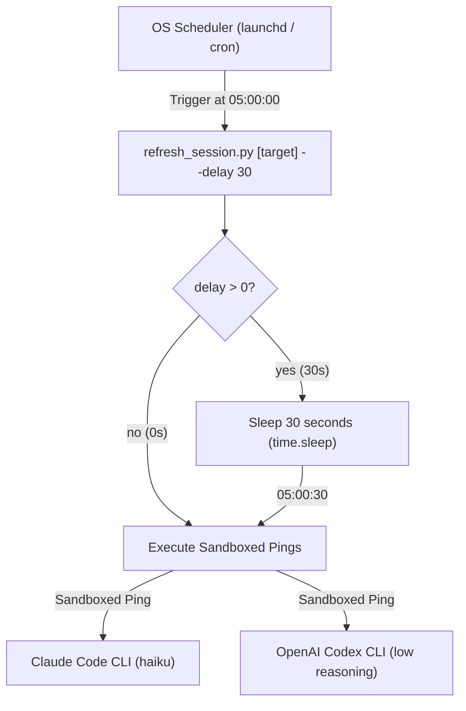

# Refresh Session Delay Buffer Implementation Plan

- **Date:** 2026-11-01
- **Status:** Draft
- **Spec:** [`docs/superpowers/specs/2026-11-01-refresh-session-schedule-design.en.md`](../specs/2026-11-01-refresh-session-schedule-design.en.md)
- **Scope:** `skills/refresh-session/resources/scripts/refresh_session.py`, `skills/refresh-session/resources/scripts/test_refresh_session.py`, `skills/refresh-session/SKILL.md`, `docs/refresh-session-quick-guide.en.md`, `docs/refresh-session-quick-guide.vi.md`

---

## Table of Contents

- [1. Overview & Architecture](#1-overview--architecture)
- [2. Proposed File Changes](#2-proposed-file-changes)
- [3. Bite-Sized Tasks](#3-bite-sized-tasks)
  - [Task 1: Add Unit Tests for Delay / Offset Parsing, Plist Generation, and Execution (RED)](#task-1-add-unit-tests-for-delay--offset-parsing-plist-generation-and-execution-red)
  - [Task 2: Implement Delay Buffer Logic in Engine and Scheduler (GREEN)](#task-2-implement-delay-buffer-logic-in-engine-and-scheduler-green)
  - [Task 3: Update Skill Documentation, Quick Guides, and Perform Live Verification](#task-3-update-skill-documentation-quick-guides-and-perform-live-verification)
  - [Task 4: Release v1.21.0 and Synchronize Local Plugins](#task-4-release-v1210-and-synchronize-local-plugins)
- [4. Verification and Quality Gates](#4-verification-and-quality-gates)

---

## 1. Overview & Architecture

When scheduling an automated pre-warming daemon via macOS `launchd` or Linux `crontab`, triggering at the exact minute boundary (`05:00:00`) risks firing before remote cloud rate-limit workers (Anthropic/OpenAI) have completed rolling over the 5-hour quota window.

This plan implements a **30-second safety delay buffer**:
- **Scheduled Daemons (`schedule --time <time>`)**: Default `--delay 30` (with alias `--offset 30`) automatically embedded into `launchd` plist `ProgramArguments` and `crontab` lines.
- **On-Demand Pings (`refresh_session.py [target]`)**: Defaults to `--delay 0` (instant execution, zero waiting).
- **Execution Hook**: When `delay > 0`, the engine logs `Waiting {delay}s delay buffer after reset minute...` and sleeps for `delay` seconds (`time.sleep`) prior to firing CLI pings.
- **Status Reporting**: `schedule --status` inspects and reports the configured delay buffer.

---

## 2. Proposed File Changes

| File | Nature | Purpose |
|---|---|---|
| `skills/refresh-session/resources/scripts/refresh_session.py` | Modify | Add `--delay`/`--offset` argument handling, sleep hook, plist argument injection, crontab command generation, and status parsing |
| `skills/refresh-session/resources/scripts/test_refresh_session.py` | Modify | Add unit tests for delay argument parsing, plist XML generation with delay, sleep execution, status inspection, and update existing mock assertions |
| `skills/refresh-session/SKILL.md` | Modify | Document 30-second delay buffer, `--delay`/`--offset` options |
| `docs/refresh-session-quick-guide.en.md` | Modify | Document delay buffer in cheat-sheet and timeline diagram |
| `docs/refresh-session-quick-guide.vi.md` | Modify | Document delay buffer in Vietnamese quick-guide |
| `CHANGELOG.md` | Modify | Add version 1.21.0 release entry documenting delay buffer |
| `RELEASE_NOTES.md` | Modify | Document version 1.21.0 release highlights and quality gate verdicts |

---

## 3. Bite-Sized Tasks

### Task 1: Add Unit Tests for Delay / Offset Parsing, Plist Generation, and Execution (RED)

- **Files touched**: `skills/refresh-session/resources/scripts/test_refresh_session.py`
- **Actions**:
  1. Add test `test_parse_arguments_delay_defaults`:
     - Assert default delay is 0 for on-demand execution.
     - Assert default delay is 30 for schedule subcommand.
  2. Add test `test_parse_arguments_delay_custom`:
     - Assert `--delay 45` and `--offset 45` override delay value.
  3. Add test `test_build_darwin_plist_with_delay`:
     - Assert generated plist includes `<string>--delay</string>` and `<string>30</string>` in `ProgramArguments`.
  4. Add test `test_main_delay_sleep_invoked`:
     - Mock `time.sleep` and `ping_cli`, execute `main(["claude", "--delay", "30"])`, assert `time.sleep(30)` called.
  5. Run tests: `python3 -m unittest skills/refresh-session/resources/scripts/test_refresh_session.py` to confirm failure (RED).

### Task 2: Implement Delay Buffer Logic in Engine and Scheduler (GREEN)

- **Files touched**: `skills/refresh-session/resources/scripts/refresh_session.py`, `skills/refresh-session/resources/scripts/test_refresh_session.py`
- **Actions**:
  1. In `parse_args`:
     - In `sched_parser`: add `--delay`, `--offset` (type=int, default=30).
     - In root `parser`: add `--delay`, `--offset` (type=int, default=0).
  2. In `build_darwin_plist`:
     - Accept `delay: int = 30`. If `delay > 0`, append `--delay` and `str(delay)` to `ProgramArguments`.
  3. In `install_schedule_darwin`, `install_schedule_linux`, and wrapper `install_schedule`:
     - Accept `delay: int = 30` and pass it down.
  4. In `get_schedule_status_darwin` & `get_schedule_status_linux`:
     - Extract `delay` from plist arguments / crontab command string (updating regex to handle `--delay` without eating optional target).
  5. In `main`:
     - In `args.command == "schedule"`:
       - Status mode: print `Delay buffer: {status.get('delay', 30)}s` safely without KeyError.
       - Install mode: pass `delay=args.delay` to `install_schedule`.
     - In on-demand mode:
       - If `args.delay > 0`: print status message and invoke `time.sleep(args.delay)`.
  6. Update existing test assertion in `test_refresh_session.py`:
     - Update `test_main_schedule_install` to `mock_install.assert_called_once_with(5, 0, target="codex", delay=30)`.
  7. Run tests: `python3 -m unittest skills/refresh-session/resources/scripts/test_refresh_session.py` to confirm GREEN.
  8. Run `ruff check skills/refresh-session/resources/scripts/`.
  9. Commit: `[REFRESH_SESSION] Implement 30-second delay buffer for session schedules`.

### Task 3: Update Skill Documentation, Quick Guides, and Perform Live Verification

- **Files touched**: `skills/refresh-session/SKILL.md`, `docs/refresh-session-quick-guide.en.md`, `docs/refresh-session-quick-guide.vi.md`
- **Actions**:
  1. Update `SKILL.md` with `--delay`/`--offset` option descriptions.
  2. Update English and Vietnamese quick-guides with delay buffer explanations.
  3. Smoke test on live host:
     - Run `python3 skills/refresh-session/resources/scripts/refresh_session.py schedule --time 05:00`.
     - Run `python3 skills/refresh-session/resources/scripts/refresh_session.py schedule --status` (verify delay 30s is reported).
     - Run `python3 skills/refresh-session/resources/scripts/refresh_session.py schedule --uninstall`.
  4. Run `bash scripts/verify.sh` to ensure all 16 sections PASS.
  5. Commit: `[REFRESH_SESSION] Document 30-second delay buffer across guides and skill`.

### Task 4: Release v1.21.0 and Synchronize Local Plugins

- **Files touched**: `CHANGELOG.md`, `RELEASE_NOTES.md`
- **Actions**:
  1. Add `1.21.0 — 2026-11-01` section to `CHANGELOG.md`.
  2. Write `RELEASE_NOTES.md` for `v1.21.0`.
  3. Execute `export CLAUDE_CODE_PLUGIN_GIT_TIMEOUT_MS=600000 && ./scripts/release.sh 1.21.0`.
  4. Verify all local plugins (Claude, Codex, Antigravity) are updated to `1.21.0`.

---

## 4. Verification and Quality Gates

1. Unit tests: `python3 -m unittest skills/refresh-session/resources/scripts/test_refresh_session.py` (all tests PASS).
2. Linter: `ruff check skills/refresh-session/resources/scripts/` (0 errors).
3. System verify: `bash scripts/verify.sh` (16/16 sections PASS).
4. Release sync: `release.sh 1.21.0` completes successfully.

