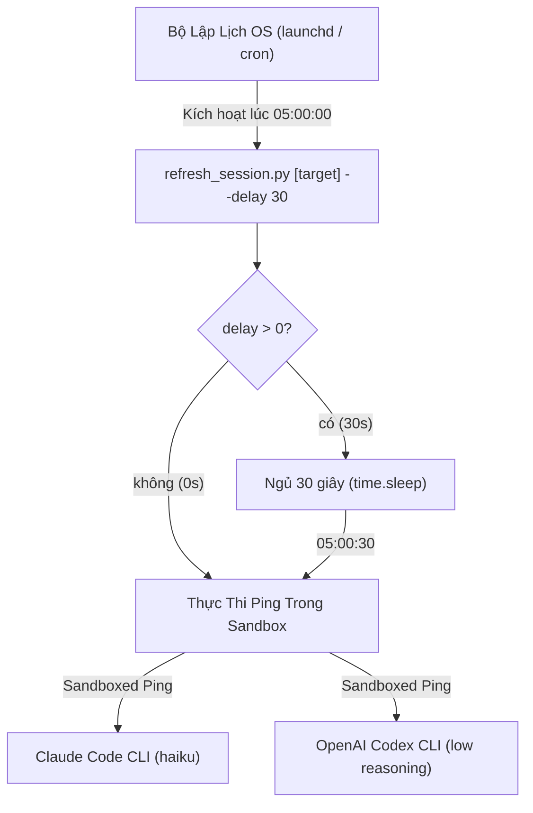

# Kế Hoạch Triển Khai Bộ Đệm Trễ An Toàn Cho Refresh Session

- **Ngày:** 2026-11-01
- **Trạng thái:** Bản thảo (Draft)
- **Tài liệu thiết kế:** [`docs/superpowers/specs/2026-11-01-refresh-session-schedule-design.vi.md`](../specs/2026-11-01-refresh-session-schedule-design.vi.md)
- **Phạm vi:** `skills/refresh-session/resources/scripts/refresh_session.py`, `skills/refresh-session/resources/scripts/test_refresh_session.py`, `skills/refresh-session/SKILL.md`, `docs/refresh-session-quick-guide.en.md`, `docs/refresh-session-quick-guide.vi.md`

---

## Mục Lục

- [1. Tổng Quan & Kiến Trúc](#1-tổng-quan--kiến-trúc)
- [2. Danh Sách File Thay Đổi](#2-danh-sách-file-thay-đổi)
- [3. Các Nhiệm Vụ Chi Tiết](#3-các-nhiệm-vụ-chi-tiết)
  - [Task 1: Thêm Unit Test cho Phân Tích Delay / Offset, Sinh Plist và Thực Thi (RED)](#task-1-thêm-unit-test-cho-phân-tích-delay--offset-sinh-plist-và-thực-thi-red)
  - [Task 2: Triển Khai Logic Bộ Đệm Trễ Trong Engine và Bộ Đặt Lịch (GREEN)](#task-2-triển-khai-logic-bộ-đệm-trễ-trong-engine-và-bộ-đặt-lịch-green)
  - [Task 3: Cập Nhật Tài Liệu Kỹ Năng, Quick Guide và Kiểm Thử Thực Tế](#task-3-cập-nhật-tài-liệu-kỹ-năng-quick-guide-và-kiểm-thử-thực-tế)
  - [Task 4: Phát Hành v1.21.0 và Đồng Bộ Plugin Ngược Về Máy](#task-4-phát-hành-v1210-và-đồng-bộ-plugin-ngược-về-máy)
- [4. Xác Thực và Cổng Chất Lượng](#4-xác-thực-và-cổng-chất-lượng)

---

## 1. Tổng Quan & Kiến Trúc

Khi đặt lịch daemon tự động pre-warm phiên qua macOS `launchd` hoặc Linux `crontab`, việc kích hoạt đúng ranh giới phút chẵn (`05:00:00`) tiềm ẩn rủi ro gửi request trước khi các worker rate-limit đám mây (Anthropic/OpenAI) hoàn tất việc reset cửa sổ hạn mức 5 giờ.

Kế hoạch này triển khai **bộ đệm an toàn trễ 30 giây (Safety Delay Buffer)**:
- **Daemon Đặt Lịch (`schedule --time <time>`)**: Tự động nhận `--delay 30` (hỗ trợ alias `--offset 30`) được nhúng trực tiếp vào `ProgramArguments` của file plist `launchd` và dòng cấu hình `crontab`.
- **Ping Thủ Công Tức Thì (`refresh_session.py [target]`)**: Mặc định `--delay 0` (thực thi ngay lập tức, không chờ đợi).
- **Hook Thực Thi**: Khi `delay > 0`, engine in log `Waiting {delay}s delay buffer after reset minute...` và ngủ đúng `delay` giây (`time.sleep`) trước khi gửi ping tới các CLI.
- **Báo Cáo Trạng Thái**: `schedule --status` kiểm tra và hiển thị bộ đệm trễ đã cấu hình.

---

## 2. Danh Sách File Thay Đổi

| File | Hành Động | Mục Đích |
|---|---|---|
| `skills/refresh-session/resources/scripts/refresh_session.py` | Sửa đổi | Thêm xử lý tham số `--delay`/`--offset`, hook ngủ trễ, nhúng cờ vào plist và crontab, phân tích trạng thái |
| `skills/refresh-session/resources/scripts/test_refresh_session.py` | Sửa đổi | Thêm unit test kiểm tra parse tham số delay, sinh XML plist có delay, thực thi sleep, đọc trạng thái và cập nhật mock assertion hiện có |
| `skills/refresh-session/SKILL.md` | Sửa đổi | Ghi chú bộ đệm trễ mặc định 30s, bổ sung tùy chọn `--delay`/`--offset` |
| `docs/refresh-session-quick-guide.en.md` | Sửa đổi | Cập nhật bảng tra cứu và sơ đồ luồng thời gian kèm bộ đệm 30s |
| `docs/refresh-session-quick-guide.vi.md` | Sửa đổi | Cập nhật bảng tra cứu tiếng Việt và giải thích kỹ thuật bộ đệm 30s |
| `CHANGELOG.md` | Sửa đổi | Thêm mục release 1.21.0 ghi nhận tính năng bộ đệm trễ |
| `RELEASE_NOTES.md` | Sửa đổi | Ghi chép chi tiết điểm nhấn và kết quả kiểm thử phiên bản 1.21.0 |

---

## 3. Các Nhiệm Vụ Chi Tiết

### Task 1: Thêm Unit Test cho Phân Tích Delay / Offset, Sinh Plist và Thực Thi (RED)

- **File tác động**: `skills/refresh-session/resources/scripts/test_refresh_session.py`
- **Các bước thực hiện**:
  1. Thêm test `test_parse_arguments_delay_defaults`:
     - Kiểm tra default delay là 0 cho lệnh chạy tức thì.
     - Kiểm tra default delay là 30 cho subcommand `schedule`.
  2. Thêm test `test_parse_arguments_delay_custom`:
     - Kiểm tra `--delay 45` và `--offset 45` ghi đè chính xác giá trị delay.
  3. Thêm test `test_build_darwin_plist_with_delay`:
     - Kiểm tra file plist được tạo chứa `<string>--delay</string>` và `<string>30</string>` trong `ProgramArguments`.
  4. Thêm test `test_main_delay_sleep_invoked`:
     - Mock `time.sleep` và `ping_cli`, chạy `main(["claude", "--delay", "30"])`, xác nhận `time.sleep(30)` được gọi.
  5. Chạy test: `python3 -m unittest skills/refresh-session/resources/scripts/test_refresh_session.py` để xác nhận test thất bại (RED).

### Task 2: Triển Khai Logic Bộ Đệm Trễ Trong Engine và Bộ Đặt Lịch (GREEN)

- **File tác động**: `skills/refresh-session/resources/scripts/refresh_session.py`, `skills/refresh-session/resources/scripts/test_refresh_session.py`
- **Các bước thực hiện**:
  1. Trong `parse_args`:
     - Trong `sched_parser`: thêm `--delay`, `--offset` (type=int, default=30).
     - Trong root `parser`: thêm `--delay`, `--offset` (type=int, default=0).
  2. Trong `build_darwin_plist`:
     - Nhận `delay: int = 30`. Nếu `delay > 0`, thêm `--delay` và `str(delay)` vào `ProgramArguments`.
  3. Trong `install_schedule_darwin`, `install_schedule_linux`, và wrapper `install_schedule`:
     - Nhận `delay: int = 30` và truyền xuống hàm sinh cấu hình.
  4. Trong `get_schedule_status_darwin` & `get_schedule_status_linux`:
     - Trích xuất `delay` từ các tham số trong plist hoặc dòng lệnh crontab (cập nhật regex an toàn khi có `--delay`).
  5. Trong `main`:
     - Với `args.command == "schedule"`:
       - Chế độ status: in `Delay buffer: {status.get('delay', 30)}s` an toàn không bị KeyError.
       - Chế độ install: truyền `delay=args.delay` vào `install_schedule`.
     - Với chế độ ping tức thì:
       - Nếu `args.delay > 0`: in thông báo và gọi `time.sleep(args.delay)`.
  6. Cập nhật assertion test hiện có trong `test_refresh_session.py`:
     - Cập nhật `test_main_schedule_install` thành `mock_install.assert_called_once_with(5, 0, target="codex", delay=30)`.
  7. Chạy test: `python3 -m unittest skills/refresh-session/resources/scripts/test_refresh_session.py` để xác nhận toàn bộ test chuyển xanh (GREEN).
  8. Chạy linter: `ruff check skills/refresh-session/resources/scripts/`.
  9. Commit: `[REFRESH_SESSION] Implement 30-second delay buffer for session schedules`.

### Task 3: Cập Nhật Tài Liệu Kỹ Năng, Quick Guide và Kiểm Thử Thực Tế

- **File tác động**: `skills/refresh-session/SKILL.md`, `docs/refresh-session-quick-guide.en.md`, `docs/refresh-session-quick-guide.vi.md`
- **Các bước thực hiện**:
  1. Cập nhật `SKILL.md` với mô tả tùy chọn `--delay`/`--offset` và giá trị mặc định 30s.
  2. Cập nhật cả 2 bản quick-guide Anh & Việt: bổ sung cột/mô tả bộ đệm trễ 30s vào bảng tra cứu và sơ đồ chiến thuật Shift-Left.
  3. Chạy smoke test thực tế trên máy host:
     - Chạy `python3 skills/refresh-session/resources/scripts/refresh_session.py schedule --time 05:00`.
     - Chạy `python3 skills/refresh-session/resources/scripts/refresh_session.py schedule --status` (xác nhận hiển thị `Delay buffer: 30s`).
     - Chạy `python3 skills/refresh-session/resources/scripts/refresh_session.py schedule --uninstall`.
  4. Chạy `bash scripts/verify.sh` để đảm bảo vượt qua 16/16 mục.
  5. Commit: `[REFRESH_SESSION] Document 30-second delay buffer across guides and skill`.

### Task 4: Phát Hành v1.21.0 và Đồng Bộ Plugin Ngược Về Máy

- **File tác động**: `CHANGELOG.md`, `RELEASE_NOTES.md`
- **Các bước thực hiện**:
  1. Thêm mục `1.21.0 — 2026-11-01` vào `CHANGELOG.md`.
  2. Soạn thảo `RELEASE_NOTES.md` cho `v1.21.0`.
  3. Chạy `export CLAUDE_CODE_PLUGIN_GIT_TIMEOUT_MS=600000 && ./scripts/release.sh 1.21.0`.
  4. Xác nhận toàn bộ plugin trên máy (Claude, Codex, Antigravity) được cập nhật lên `1.21.0`.

---

## 4. Xác Thực và Cổng Chất Lượng

1. Unit tests: `python3 -m unittest skills/refresh-session/resources/scripts/test_refresh_session.py` (vượt qua 100%).
2. Linter: `ruff check skills/refresh-session/resources/scripts/` (0 lỗi).
3. System verify: `bash scripts/verify.sh` (16/16 mục đạt PASS).
4. Đồng bộ phát hành: `release.sh 1.21.0` hoàn tất thành công.
