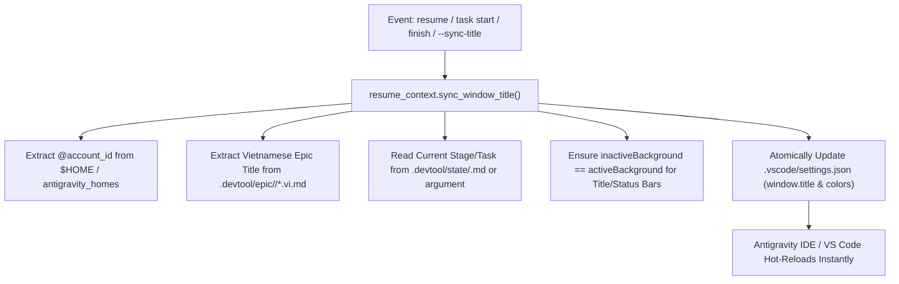

# Visual Multi-Epic Workspace Title and Color Synchronization Implementation Plan

- **Date:** 2026-11-04
- **Status:** Approved
- **Spec:** [`docs/superpowers/specs/2026-11-04-visual-multi-epic-workspace-sync-design.en.md`](../specs/2026-11-04-visual-multi-epic-workspace-sync-design.en.md)
- **Scope:** `rules/CRITICAL_RULES.md`, `scripts/resume_context.py`, `scripts/test_resume_context.py`, `templates/`, `skills/resume-context/SKILL.md`, `skills/dev-designer/SKILL.md`, `skills/dev-implementation/SKILL.md`, `skills/save-context/SKILL.md`

---

## Table of Contents

- [1. Overview & Architecture](#1-overview--architecture)
- [2. Proposed File Changes](#2-proposed-file-changes)
- [3. Bite-Sized Tasks](#3-bite-sized-tasks)
  - [Task 1: Add Unit Tests for Window Title and Inactive Bar Synchronization in `test_resume_context.py` (RED)](#task-1-add-unit-tests-for-window-title-and-inactive-bar-synchronization-in-test_resume_contextpy-red)
  - [Task 2: Refine Engine Implementation in `scripts/resume_context.py` (GREEN)](#task-2-refine-engine-implementation-in-scriptsresume_contextpy-green)
  - [Task 3: Update `rules/CRITICAL_RULES.md` and Create Scaffolding Templates](#task-3-update-rulescritical_rulesmd-and-create-scaffolding-templates)
  - [Task 4: Update Skill Documentation Across the Epic Lifecycle](#task-4-update-skill-documentation-across-the-epic-lifecycle)
  - [Task 5: End-to-End Test Suite Verification and Local Plugin Synchronization](#task-5-end-to-end-test-suite-verification-and-local-plugin-synchronization)
- [4. Verification and Quality Gates](#4-verification-and-quality-gates)

---

## 1. Overview & Architecture

When running multiple AI coding agents across projects (`lyrics-sync`, `D3Nexus`, `nexus`, `ai-agent-tools`) and Antigravity profile accounts (`[@danhdue]`, `[@tess]`), developers need immediate visual clarity regarding which repository, profile, active epic, and task state are active in any editor window. Furthermore, window title bars and status bars must stay permanently colored whether active or inactive (`inactiveBackground = activeBackground`), eliminating inactive window gray-out.

This implementation plan delivers:
1. Automated title synchronization in `scripts/resume_context.py` formatting `"<ICON> [<REPO_NAME>] [@<account_id>] <Vietnamese Epic Name> - <Stage / Task>"`.
2. Automatic enforcement of inactive top/bottom bar color parity in `.vscode/settings.json`.
3. Critical rule standard in `rules/CRITICAL_RULES.md` (Section 8.4) and local rule template.
4. Templates for workspace settings and local rules.
5. Lifecycle skill updates (`resume-context`, `dev-designer`, `dev-implementation`, `save-context`).
6. Comprehensive unit test suite in `scripts/test_resume_context.py`.



---

## 2. Proposed File Changes

| File | Nature | Purpose |
|---|---|---|
| `scripts/test_resume_context.py` | Modify | Add comprehensive unit tests for `sync_window_title`, profile detection, inactive color parity, and CLI `--sync-title` flag |
| `scripts/resume_context.py` | Modify | Refine `sync_window_title` with inactive bar enforcement, add `--sync-title` and `--stage` CLI options, and ensure Python 3.9-3.12 compatibility |
| `rules/CRITICAL_RULES.md` | Modify | Add Section 8.4: Mandatory Window Title Synchronization & Persistent Top/Bottom Bar Customization |
| `templates/.vscode/settings.json` | Create | Scaffolding template for project workspace settings with active/inactive bar colors and title pattern |
| `templates/.agents/rules/window_title_sync.md` | Create | Standardized project-level rule template enforcing window title and bar synchronization |
| `skills/resume-context/SKILL.md` | Modify | Document automatic window title sync upon session resumption |
| `skills/dev-designer/SKILL.md` | Modify | Document Gate 2 window title transition (`- Stage 2: Design Approved`) |
| `skills/dev-implementation/SKILL.md` | Modify | Document task start and Gate 4 window title transitions |
| `skills/save-context/SKILL.md` | Modify | Document epic completion window title transition (`- Completed & Archived`) |

---

## 3. Bite-Sized Tasks

### Task 1: Add Unit Tests for Window Title and Inactive Bar Synchronization in `test_resume_context.py` (RED)

- **Files touched**: `scripts/test_resume_context.py`
- **Actions**:
  1. Add `test_sync_window_title_with_vietnamese_epic_and_colors`:
     - Creates temporary mock repo with `.vscode/settings.json` containing `titleBar.activeBackground = "#b45309"`.
     - Creates `.devtool/epic/mock-epic/mock-epic.vi.md` with `# Epic: Thiết Lập Đồng Bộ Giao Diện`.
     - Calls `sync_window_title` with `mock-epic` and stage override `Stage 2: Design Approved`.
     - Asserts `window.title` becomes `🟠 [AGENT-TOOLS] [@<id>] Thiết Lập Đồng Bộ Giao Diện - Stage 2: Design Approved`.
     - Asserts `titleBar.inactiveBackground` and `statusBar.inactiveBackground` are automatically set to match active colors.
  2. Add `test_sync_window_title_antigravity_home_profile`:
     - Sets `HOME=/Users/danhdueexoictif/antigravity_homes/tess`.
     - Invokes `sync_window_title`.
     - Asserts `[@tess]` is cleanly parsed into `window.title`.
  3. Add `test_sync_window_title_fallback_without_epic`:
     - Invokes `sync_window_title` with `epic_slug=None`.
     - Asserts `window.title` falls back to `🟠 [AGENT-TOOLS] [@<id>] ${activeEditorMedium}${separator}${rootName}`.
  4. Add `test_sync_window_title_cli_flags`:
     - Executes `scripts/resume_context.py --sync-title --epic mock-epic --stage "Task 1/3: Test"`.
     - Asserts zero return code and verified title in `.vscode/settings.json`.
- **Verification**: Run `python3.12 scripts/test_resume_context.py` and confirm new tests fail or need completion before engine refinements.

---

### Task 2: Refine Engine Implementation in `scripts/resume_context.py` (GREEN)

- **Files touched**: `scripts/resume_context.py`
- **Actions**:
  1. Ensure `from __future__ import annotations` is at the very top.
  2. Refine `sync_window_title(root, epic_slug, stage_override)`:
     - Check and parse existing `.vscode/settings.json`.
     - Synthesize `prefix = "<ICON> [<REPO_TAG>] [@<account_id>]"`.
     - Parse Vietnamese H1 title from `.devtool/epic/<slug>/*.vi.md` if available.
     - Extract current task/stage from `.devtool/state/<slug>.md` if no `stage_override`.
     - Enforce inactive bar background colors in `workbench.colorCustomizations`:
       - If `titleBar.activeBackground` exists and `titleBar.inactiveBackground` is absent or different, sync it.
       - If `statusBar.background` exists and `statusBar.inactiveBackground` is absent or different, sync it.
     - Save updated `settings.json` with `indent=2, ensure_ascii=False`.
  3. Add CLI arguments to `main()` argument parser:
     - `--sync-title`: Synchronize window title and bar colors directly.
     - `--stage`: Custom stage/task string override.
  4. Integrate `sync_window_title` calls into `main()`, `write_epic_state()`, and `complete_feature_and_rotate()`.
- **Verification**: Run `python3.12 scripts/test_resume_context.py` to confirm 100% pass across all tests.

---

### Task 3: Update `rules/CRITICAL_RULES.md` and Create Scaffolding Templates

- **Files touched**:
  - `rules/CRITICAL_RULES.md`
  - `templates/.vscode/settings.json`
  - `templates/.agents/rules/window_title_sync.md`
- **Actions**:
  1. In `rules/CRITICAL_RULES.md`:
     - Add Section 8.4 detailing Mandatory Window Title Synchronization & Persistent Top/Bottom Bar Customization.
     - Document the 4-repo color signature table (`lyrics-sync` 🔴, `D3Nexus` 🟢, `nexus` 🔵, `ai-agent-tools` 🟠).
     - Specify inactive background color equality rule (`inactiveBackground = activeBackground`).
  2. Create `templates/.vscode/settings.json`:
     - Define standard JSON template containing `window.title`, `workbench.colorCustomizations` (with both active and inactive title and status bar colors), and terminal guardrails.
  3. Create `templates/.agents/rules/window_title_sync.md`:
     - Provide standard project rule for window title synchronization and color maintenance.
- **Verification**: Run markdown lint checks and inspect JSON validity using `python3 -m json.tool`.

---

### Task 4: Update Skill Documentation Across the Epic Lifecycle

- **Files touched**:
  - `skills/resume-context/SKILL.md`
  - `skills/dev-designer/SKILL.md`
  - `skills/dev-implementation/SKILL.md`
  - `skills/save-context/SKILL.md`
- **Actions**:
  1. In `skills/resume-context/SKILL.md`:
     - Add section explaining automatic window title and persistent top/bottom bar synchronization when `resume` runs.
  2. In `skills/dev-designer/SKILL.md`:
     - Document that on Gate 2 design approval and state update, `window.title` transitions to `<ICON> [<REPO>] [@<id>] <Epic Name> - Stage 2: Design Approved`.
  3. In `skills/dev-implementation/SKILL.md`:
     - Document task start update (`- Task X/Y: <Title>`), Gate 4 check update (`- Stage 4: Gate 4 Quality Check`), and Review Choice update (`- Stage 4.1: Review Choice`).
  4. In `skills/save-context/SKILL.md`:
     - Document that `--complete` automatically updates the window title to `- Completed & Archived`.
- **Verification**: Inspect all markdown files for valid heading hierarchy, code fence language tags, and markdown cleanliness.

---

### Task 5: End-to-End Test Suite Verification and Local Plugin Synchronization

- **Files touched**:
  - `~/.gemini/config/plugins/d3nexus/rules/CRITICAL_RULES.md`
  - Local repository git tree
- **Actions**:
  1. Run `python3.12 scripts/test_resume_context.py` and confirm all test cases pass cleanly.
  2. Synchronize updated `rules/CRITICAL_RULES.md` to global plugin directory `~/.gemini/config/plugins/d3nexus/rules/CRITICAL_RULES.md`.
  3. Verify `.vscode/settings.json` in all 4 projects (`lyrics-sync`, `D3Nexus`, `nexus`, `ai-agent-tools`) have both active and inactive titleBar and statusBar backgrounds configured.
  4. Stage and commit changes in `ai-agent-tools` using standard commit message format (`[SETTINGS]`).
- **Verification**: Run `git status` to verify working tree is clean and local commit is recorded.

---

## 4. Verification and Quality Gates

1. **Automated Unit Tests**:
   ```bash
   /Users/danhdueexoictif/.local/bin/python3.12 scripts/test_resume_context.py
   ```
   Must exit with code 0 (100% tests passing).

2. **JSON Template Validation**:
   ```bash
   python3 -m json.tool templates/.vscode/settings.json > /dev/null
   python3 -m json.tool .vscode/settings.json > /dev/null
   ```
   Must exit with code 0 without syntax errors.

3. **Workspace Inactive Bar Parity**:
   Assert that every workspace `.vscode/settings.json` has `titleBar.inactiveBackground == titleBar.activeBackground` and `statusBar.inactiveBackground == statusBar.background`.

4. **Git Commit Check**:
   Local commit created with two `-m` flags, bracketed scope `[SETTINGS]`, and no trailer lines. Strictly no `git push`.
