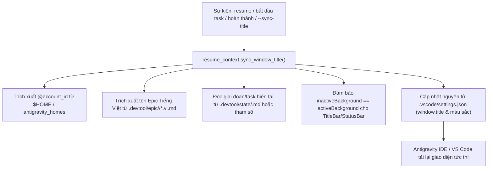

# Kế Hoạch Triển Khai Đồng Bộ Tiêu Đề Cửa Sổ Và Màu Sắc Không Gian Làm Việc Đa Epic Trực Quan

- **Ngày:** 2026-11-04
- **Trạng thái:** Đã duyệt
- **Bản thiết kế:** [`docs/superpowers/specs/2026-11-04-visual-multi-epic-workspace-sync-design.vi.md`](../specs/2026-11-04-visual-multi-epic-workspace-sync-design.vi.md)
- **Phạm vi:** `rules/CRITICAL_RULES.md`, `scripts/resume_context.py`, `scripts/test_resume_context.py`, `templates/`, `skills/resume-context/SKILL.md`, `skills/dev-designer/SKILL.md`, `skills/dev-implementation/SKILL.md`, `skills/save-context/SKILL.md`

---

## Mục lục

- [1. Tổng quan & Kiến trúc](#1-tổng-quan--kiến-trúc)
- [2. Danh sách tệp đề xuất thay đổi](#2-danh-sách-tệp-đề-xuất-thay-đổi)
- [3. Danh sách tác vụ chi tiết](#3-danh-sách-tác-vụ-chi-tiết)
  - [Tác vụ 1: Thêm kiểm thử đơn vị cho việc đồng bộ tiêu đề cửa sổ và thanh trạng thái không hoạt động trong `test_resume_context.py` (RED)](#tác-vụ-1-thêm-kiểm-thử-đơn-vị-cho-việc-đồng-bộ-tiêu-đề-cửa-sổ-và-thanh-trạng-thái-không-hoạt-động-trong-test_resume_contextpy-red)
  - [Tác vụ 2: Tinh chỉnh mã nguồn engine trong `scripts/resume_context.py` (GREEN)](#tác-vụ-2-tinh-chỉnh-mã-nguồn-engine-trong-scriptsresume_contextpy-green)
  - [Tác vụ 3: Cập nhật `rules/CRITICAL_RULES.md` và tạo các mẫu cấu hình](#tác-vụ-3-cập-nhật-rulescritical_rulesmd-và-tạo-các-mẫu-cấu-hình)
  - [Tác vụ 4: Cập nhật tài liệu kỹ năng xuyên suốt vòng đời Epic](#tác-vụ-4-cập-nhật-tài-liệu-kỹ-năng-xuyên-suốt-vòng-đời-epic)
  - [Tác vụ 5: Xác minh bộ kiểm thử đầu cuối và đồng bộ Plugin cục bộ](#tác-vụ-5-xác-minh-bộ-kiểm-thử-đầu-cuối-và-đồng-bộ-plugin-cục-bộ)
- [4. Xác minh và Cổng chất lượng](#4-xác-minh-và-cổng-chất-lượng)

---

## 1. Tổng quan & Kiến trúc

Khi vận hành nhiều tác nhân AI lập trình trên các dự án song song (`lyrics-sync`, `D3Nexus`, `nexus`, `ai-agent-tools`) và nhiều tài khoản hồ sơ Antigravity (`[@danhdue]`, `[@tess]`), lập trình viên cần nhận biết ngay lập tức kho mã nguồn, hồ sơ tài khoản, epic và tác vụ hiện tại trên từng cửa sổ biên tập. Hơn nữa, thanh tiêu đề (TitleBar) và thanh trạng thái (StatusBar) phải luôn hiển thị màu nhận diện dự án bất kể cửa sổ đang được kích hoạt hay không (`inactiveBackground = activeBackground`), loại bỏ tình trạng thanh công cụ bị mờ/xám khi mất focus.

Kế hoạch triển khai này cung cấp:
1. Tự động hóa đồng bộ tiêu đề trong `scripts/resume_context.py` theo định dạng `"<ICON> [<REPO_NAME>] [@<account_id>] <Tên Epic Tiếng Việt> - <Stage / Task>"`.
2. Tự động đảm bảo màu sắc của thanh trên/dưới đồng nhất khi không hoạt động trong `.vscode/settings.json`.
3. Chuẩn hóa quy tắc cốt lõi trong `rules/CRITICAL_RULES.md` (Mục 8.4) và mẫu quy tắc cục bộ.
4. Tạo mẫu thiết lập không gian làm việc và mẫu quy tắc cục bộ.
5. Cập nhật các kỹ năng vòng đời (`resume-context`, `dev-designer`, `dev-implementation`, `save-context`).
6. Bổ sung bộ kiểm thử đơn vị toàn diện trong `scripts/test_resume_context.py`.



---

## 2. Danh sách tệp đề xuất thay đổi

| Tệp | Bản chất | Mục đích |
|---|---|---|
| `scripts/test_resume_context.py` | Sửa đổi | Bổ sung kiểm thử đơn vị cho `sync_window_title`, nhận diện hồ sơ, màu sắc thanh không hoạt động và cờ CLI `--sync-title` |
| `scripts/resume_context.py` | Sửa đổi | Tinh chỉnh `sync_window_title` với kiểm tra màu thanh không hoạt động, thêm tùy chọn CLI `--sync-title` và `--stage`, tương thích Python 3.9-3.12 |
| `rules/CRITICAL_RULES.md` | Sửa đổi | Thêm Mục 8.4: Đồng bộ Tiêu đề Cửa sổ Bắt buộc & Tùy biến Màu sắc Thanh Trên/Dưới Bền vững |
| `templates/.vscode/settings.json` | Tạo mới | Mẫu cấu hình không gian làm việc với màu sắc thanh trên/dưới và mẫu tiêu đề tiêu chuẩn |
| `templates/.agents/rules/window_title_sync.md` | Tạo mới | Mẫu quy tắc cấp dự án tiêu chuẩn bắt buộc đồng bộ tiêu đề và màu sắc cửa sổ |
| `skills/resume-context/SKILL.md` | Sửa đổi | Ghi lại việc tự động đồng bộ tiêu đề cửa sổ khi khôi phục phiên làm việc |
| `skills/dev-designer/SKILL.md` | Sửa đổi | Ghi lại bước chuyển tiêu đề cửa sổ tại Cổng 2 (`- Stage 2: Design Approved`) |
| `skills/dev-implementation/SKILL.md` | Sửa đổi | Ghi lại bước chuyển tiêu đề cửa sổ khi bắt đầu tác vụ và tại Cổng 4 |
| `skills/save-context/SKILL.md` | Sửa đổi | Ghi lại bước chuyển tiêu đề cửa sổ khi hoàn thành epic (`- Completed & Archived`) |

---

## 3. Danh sách tác vụ chi tiết

### Tác vụ 1: Thêm kiểm thử đơn vị cho việc đồng bộ tiêu đề cửa sổ và thanh trạng thái không hoạt động trong `test_resume_context.py` (RED)

- **Các tệp tác động**: `scripts/test_resume_context.py`
- **Hành động**:
  1. Thêm `test_sync_window_title_with_vietnamese_epic_and_colors`:
     - Tạo thư mục repo giả lập với `.vscode/settings.json` chứa `titleBar.activeBackground = "#b45309"`.
     - Tạo `.devtool/epic/mock-epic/mock-epic.vi.md` với tiêu đề `# Epic: Thiết Lập Đồng Bộ Giao Diện`.
     - Gọi `sync_window_title` với `mock-epic` và chuỗi ghi đè giai đoạn `Stage 2: Design Approved`.
     - Khẳng định `window.title` trở thành `🟠 [AGENT-TOOLS] [@<id>] Thiết Lập Đồng Bộ Giao Diện - Stage 2: Design Approved`.
     - Khẳng định `titleBar.inactiveBackground` và `statusBar.inactiveBackground` được tự động thiết lập trùng với màu đang hoạt động.
  2. Thêm `test_sync_window_title_antigravity_home_profile`:
     - Đặt `HOME=/Users/danhdueexoictif/antigravity_homes/tess`.
     - Gọi `sync_window_title`.
     - Khẳng định `[@tess]` được phân tích chính xác vào `window.title`.
  3. Thêm `test_sync_window_title_fallback_without_epic`:
     - Gọi `sync_window_title` với `epic_slug=None`.
     - Khẳng định `window.title` quay về định dạng mặc định `🟠 [AGENT-TOOLS] [@<id>] ${activeEditorMedium}${separator}${rootName}`.
  4. Thêm `test_sync_window_title_cli_flags`:
     - Chạy `scripts/resume_context.py --sync-title --epic mock-epic --stage "Task 1/3: Test"`.
     - Khẳng định mã trả về bằng 0 và tiêu đề đã được cập nhật chính xác trong `.vscode/settings.json`.
- **Xác minh**: Chạy `python3.12 scripts/test_resume_context.py` và xác nhận các bài kiểm tra mới thất bại hoặc cần tinh chỉnh mã nguồn trước khi hoàn thiện engine.

---

### Tác vụ 2: Tinh chỉnh mã nguồn engine trong `scripts/resume_context.py` (GREEN)

- **Các tệp tác động**: `scripts/resume_context.py`
- **Hành động**:
  1. Đảm bảo dòng `from __future__ import annotations` nằm ở đầu tệp.
  2. Tinh chỉnh hàm `sync_window_title(root, epic_slug, stage_override)`:
     - Kiểm tra và phân tích `.vscode/settings.json` hiện có.
     - Tổng hợp tiền tố `prefix = "<ICON> [<REPO_TAG>] [@<account_id>]"`.
     - Phân tích tiêu đề Tiếng Việt từ `.devtool/epic/<slug>/*.vi.md` nếu tồn tại.
     - Trích xuất trạng thái/tác vụ hiện tại từ `.devtool/state/<slug>.md` nếu không có `stage_override`.
     - Thực thi quy tắc màu sắc thanh không hoạt động trong `workbench.colorCustomizations`:
       - Nếu `titleBar.activeBackground` tồn tại và `titleBar.inactiveBackground` chưa có hoặc khác biệt, đồng bộ ngay lập tức.
       - Nếu `statusBar.background` tồn tại và `statusBar.inactiveBackground` chưa có hoặc khác biệt, đồng bộ ngay lập tức.
     - Lưu lại `settings.json` với `indent=2, ensure_ascii=False`.
  3. Thêm các cờ CLI vào bộ phân tích cú pháp trong hàm `main()`:
     - `--sync-title`: Đồng bộ trực tiếp tiêu đề cửa sổ và màu thanh công cụ.
     - `--stage`: Chuỗi ghi đè giai đoạn/tác vụ tùy chỉnh.
  4. Tích hợp các lệnh gọi `sync_window_title` vào `main()`, `write_epic_state()`, và `complete_feature_and_rotate()`.
- **Xác minh**: Chạy `python3.12 scripts/test_resume_context.py` để xác nhận 100% bài kiểm tra vượt qua thành công.

---

### Tác vụ 3: Cập nhật `rules/CRITICAL_RULES.md` và tạo các mẫu cấu hình

- **Các tệp tác động**:
  - `rules/CRITICAL_RULES.md`
  - `templates/.vscode/settings.json`
  - `templates/.agents/rules/window_title_sync.md`
- **Hành động**:
  1. Trong `rules/CRITICAL_RULES.md`:
     - Bổ sung Mục 8.4 quy định chi tiết về việc bắt buộc đồng bộ tiêu đề cửa sổ và cấu hình bền vững thanh trên/dưới.
     - Ghi nhận bảng màu chuẩn cho 4 kho mã nguồn (`lyrics-sync` 🔴, `D3Nexus` 🟢, `nexus` 🔵, `ai-agent-tools` 🟠).
     - Quy định quy tắc bình đẳng màu nền khi không hoạt động (`inactiveBackground = activeBackground`).
  2. Tạo `templates/.vscode/settings.json`:
     - Định nghĩa tệp mẫu JSON chuẩn chứa `window.title`, `workbench.colorCustomizations` (với cả màu thanh tiêu đề và trạng thái lúc hoạt động cũng như không hoạt động) cùng các hàng rào bảo vệ terminal.
  3. Tạo `templates/.agents/rules/window_title_sync.md`:
     - Cung cấp quy tắc dự án chuẩn về đồng bộ tiêu đề cửa sổ và duy trì màu sắc.
- **Xác minh**: Chạy kiểm tra lint markdown và kiểm tra tính hợp lệ của JSON bằng `python3 -m json.tool`.

---

### Tác vụ 4: Cập nhật tài liệu kỹ năng xuyên suốt vòng đời Epic

- **Các tệp tác động**:
  - `skills/resume-context/SKILL.md`
  - `skills/dev-designer/SKILL.md`
  - `skills/dev-implementation/SKILL.md`
  - `skills/save-context/SKILL.md`
- **Hành động**:
  1. Trong `skills/resume-context/SKILL.md`:
     - Bổ sung mục giải thích việc tự động đồng bộ tiêu đề cửa sổ và màu sắc bền vững khi chạy `resume`.
  2. Trong `skills/dev-designer/SKILL.md`:
     - Ghi lại việc cập nhật trạng thái tại Cổng 2 sẽ chuyển tiêu đề cửa sổ thành `<ICON> [<REPO>] [@<id>] <Tên Epic> - Stage 2: Design Approved`.
  3. Trong `skills/dev-implementation/SKILL.md`:
     - Ghi lại cập nhật khi bắt đầu tác vụ (`- Task X/Y: <Tiêu đề>`), kiểm tra Cổng 4 (`- Stage 4: Gate 4 Quality Check`), và Lựa chọn Đánh giá (`- Stage 4.1: Review Choice`).
  4. Trong `skills/save-context/SKILL.md`:
     - Ghi lại việc `--complete` tự động chuyển tiêu đề cửa sổ thành `- Completed & Archived`.
- **Xác minh**: Kiểm tra tính chuẩn xác của các tệp markdown (phân cấp tiêu đề, thẻ ngôn ngữ khối mã, không có khoảng trắng thừa).

---

### Tác vụ 5: Xác minh bộ kiểm thử đầu cuối và đồng bộ Plugin cục bộ

- **Các tệp tác động**:
  - `~/.gemini/config/plugins/d3nexus/rules/CRITICAL_RULES.md`
  - Cây git của kho lưu trữ cục bộ
- **Hành động**:
  1. Chạy `python3.12 scripts/test_resume_context.py` và xác nhận tất cả kiểm thử đều vượt qua.
  2. Đồng bộ `rules/CRITICAL_RULES.md` đã cập nhật sang thư mục plugin toàn cục `~/.gemini/config/plugins/d3nexus/rules/CRITICAL_RULES.md`.
  3. Xác minh `.vscode/settings.json` trên cả 4 dự án (`lyrics-sync`, `D3Nexus`, `nexus`, `ai-agent-tools`) đều đã cấu hình màu nền hoạt động và không hoạt động cho cả titleBar và statusBar.
  4. Tạo commit cục bộ trong `ai-agent-tools` theo đúng chuẩn thông điệp commit (`[SETTINGS]`).
- **Xác minh**: Chạy `git status` để bảo đảm cây làm việc sạch và commit cục bộ đã được ghi nhận an toàn.

---

## 4. Xác minh và Cổng chất lượng

1. **Kiểm thử đơn vị tự động**:
   ```bash
   /Users/danhdueexoictif/.local/bin/python3.12 scripts/test_resume_context.py
   ```
   Bắt buộc thoát với mã 0 (100% bài kiểm tra vượt qua).

2. **Xác minh cú pháp tệp mẫu JSON**:
   ```bash
   python3 -m json.tool templates/.vscode/settings.json > /dev/null
   python3 -m json.tool .vscode/settings.json > /dev/null
   ```
   Bắt buộc thoát với mã 0, không có lỗi cú pháp.

3. **Tính đồng nhất màu sắc thanh khi không hoạt động**:
   Khẳng định mọi tệp `.vscode/settings.json` đều thỏa mãn `titleBar.inactiveBackground == titleBar.activeBackground` và `statusBar.inactiveBackground == statusBar.background`.

4. **Kiểm tra Commit Git**:
   Commit cục bộ được tạo với 2 cờ `-m`, phạm vi trong ngoặc `[SETTINGS]`, không có dòng trailer attribution. Tuyệt đối không tự ý thực hiện `git push`.
