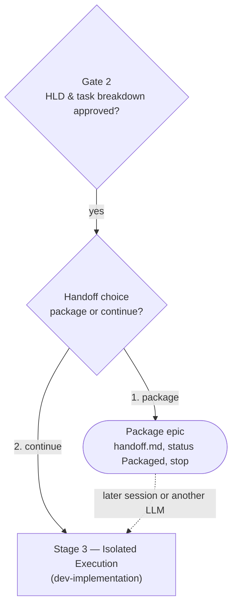

# Epic Handoff Choice Design

- **Date**: 2026-10-15
- **Status**: Approved
- **Scope**: `dev-lifecycle`, `dev-designer`, `dev-implementation`, a new
  `dev-lifecycle/references/handoff-template.md`
- **Next step**: `writing-plans` (one implementation plan, no HLD)

## Table of Contents

- [1. Background](#1-background)
- [2. Goals and Non-Goals](#2-goals-and-non-goals)
- [3. Decisions](#3-decisions)
- [4. Flow](#4-flow)
- [5. Components](#5-components)
- [6. Handoff File](#6-handoff-file)
- [7. Packaging Procedure](#7-packaging-procedure)
- [8. Entry-Point Detection in dev-implementation](#8-entry-point-detection-in-dev-implementation)
- [9. Error Handling](#9-error-handling)
- [10. Testing](#10-testing)
- [11. Risks and Dependencies](#11-risks-and-dependencies)
- [12. Out of Scope](#12-out-of-scope)

## 1. Background

[dev-lifecycle](../../../skills/dev-lifecycle/SKILL.md) moves from Gate 2 straight into Stage 3:
once the developer confirms the task breakdown at the
[dev-designer](../../../skills/dev-designer/SKILL.md) checkpoint, the task files are written and
committed, and the next step is `dev-implementation`. There is no point at which the developer is
asked whether implementation should start now.

Two situations need a different path:

1. **Do it later.** The design is finished but implementation will happen in another session, days
   later.
2. **Assign another LLM.** A different agent — Codex, Antigravity, or a fresh Claude Code session —
   should implement what this session designed.

The data needed to resume already exists. `dev-implementation` Phase 0 reloads the HLD, the BDD
scenarios, and the task files from disk. Two things are missing:

- **The decision point**, and a short brief that tells the receiving agent where it stands: which
  gates passed, which identifiers to use, what not to redo, and what the design session knew but
  did not write down.
- **Re-entry.** [dev-implementation](../../../skills/dev-implementation/SKILL.md) assumes every
  invocation is the first. It always computes the order, asks Gate 3, and runs
  `git worktree add .worktrees/<epic_dir> -b epic/<epic_slug>`. After an interrupted session that
  command fails because the branch exists, and nothing tells the agent to skip tasks already
  `done`. A packaged epic handed to another LLM makes interrupted sessions more likely, not less.

## 2. Goals and Non-Goals

**Goals:**

- After Gate 2, ask the developer to choose between packaging the epic and continuing to Stage 3.
- Make packaging produce a committed, self-explanatory handoff that a receiving agent with the kit
  installed can act on without the design session's conversation.
- Let `dev-implementation <epic>` — given either the epic directory name or the slug — work out from
  disk where the epic stands and enter at the right point: Gate 3 for an epic not yet started, the
  next unfinished task for an interrupted one, Phase 4 for one whose tasks are all done.
- Keep the five gates unchanged. A packaged or resumed epic still passes Gate 3 with a human in the
  loop.
- Reuse existing tooling. No new scripts.

**Non-Goals:**

- A self-contained bundle for an LLM without repository access or without the kit.
- Writing a new handoff midway through Stage 3. Resuming midway is in scope; packaging midway is
  not.
- An equivalent choice in `doc-lifecycle`.
- Changing task statuses when packaging.

## 3. Decisions

| # | Decision | Reason |
|---|----------|--------|
| D1 | The receiver has repository access, so the package is a file committed inside the epic directory | No archive, no copy of rules to drift from the skills |
| D2 | Task statuses stay as they are; the epic overview Status becomes `Packaged` | The receiver only invokes `dev-implementation`, with no status to flip back. Accepted consequence: under dev-designer's Concurrent-Epic Backlog Rule, the packaged epic still counts as active and later epics queue behind it |
| D3 | The receiver always has the d3nexus kit, so the handoff points at skills instead of restating them | Gates 3 to 5 stay enforced by `dev-implementation`; the handoff stays short |
| D4 | The agent writes the handoff from a template and runs existing scripts as preflight (Approach A) | A new `package_epic.py` would duplicate `compute_execution_order.py` and `check_document.py`, and the most valuable section — open notes from the conversation — needs the agent anyway. A git-tag-only package was rejected: agents rarely read tags and open notes would sit outside the epic directory |
| D5 | The choice is a routing decision owned by `dev-lifecycle`, not a sixth gate | It decides *what runs next*, like Stage 1's routing decision. The gate table, numbering and every cross-reference stay valid |
| D6 | `handoff.md` is English-only, with a complete table of contents | Its reader is an agent. It joins `task_*.md` as an exception to the bilingual Document Contract, but not to the ToC and lint rules |
| D7 | Packaging never pushes without the developer's explicit permission | [CRITICAL_RULES](../../../rules/CRITICAL_RULES.md#git-push-operations-no-unauthorized-push) |
| D8 | `dev-implementation` derives its entry point from signals already on disk: `handoff.md`, the overview Status, task statuses, the epic branch and the worktree. `handoff.md` stays a static record | One source of truth for progress. A living progress log in `handoff.md` was rejected: it would duplicate task frontmatter and drift from it |
| D9 | A resumed epic re-confirms Gate 3 for its remaining tasks only | The earlier confirmation lives in a conversation the new session cannot see, and so does the permission to fast-forward `develop` |

## 4. Flow



The question is asked after `dev-designer` Step 3 has committed the task files, or, when
`auto_commit` is `false`, right after they are written. It is phrased runtime-neutrally — "ask the
developer" — so it works in Claude Code, Antigravity and Codex alike:

> Gate 2 passed: the HLD, BDD scenarios and N task files for `<epic_slug>` are written. How do you
> want to proceed?
>
> 1. **Package** — write `handoff.md`, mark the epic `Packaged`, and stop, so the work can be
>    picked up later or by another LLM.
> 2. **Continue** — enter Stage 3 now (`dev-implementation`, starting with Gate 3: execution order).

## 5. Components

| File | Change |
|------|--------|
| `skills/dev-lifecycle/SKILL.md` | New "Handoff Choice" section between Stage 2 and Stage 3, holding the question (§4) and the packaging procedure (§7). New "Resuming an Epic" rule: when the named epic's directory already holds task files, Gate 2 has passed, so invoke `dev-implementation` with that name and let its Phase 0 pick the entry point (§8). Updated sequence diagram. Document Contract names `handoff.md` beside `task_*.md` as English-only. New Red Flags (§9) |
| `skills/dev-lifecycle/references/handoff-template.md` | New. The template for `handoff.md` (§6) |
| `skills/dev-designer/SKILL.md` | Step 3 ends with a pointer to the Handoff Choice; dev-designer never invokes `dev-implementation` directly |
| `skills/dev-implementation/SKILL.md` | Accepts the epic directory name or the slug. Phase 0 gains Entry-Point Detection and reads `handoff.md` when present. A Resume Procedure joins Phase 1. Phase 1 step 4 sets a `Packaged` epic to `In Progress`. Process diagram and Red Flags updated (§8, §9) |

`dev-lifecycle` resolves script paths from its own directory, as `dev-implementation` does for
`integrate_branch.py`:

```bash
SKILL_DIR=<absolute path of the directory containing dev-lifecycle/SKILL.md>
SCRIPTS="$SKILL_DIR/../dev-implementation/resources/scripts"
CHECK_DOC="$SKILL_DIR/../doc_quality_check/resources/scripts/check_document.py"
```

## 6. Handoff File

Path: `.devtool/epic/<epic_dir>/handoff.md`. English-only, a linked table of contents covering every
`##` section, markdown-lint clean. Sections, in order:

| Section | Content |
|---------|---------|
| Status | Packaging date; the SHA of the design commit the package is based on (`HEAD` before the packaging commit); base branch; gates passed (1, 2); next step — Stage 3, where Gate 3 still needs a human |
| Identifiers | A table with the real values of `<epic_dir>` and `<epic_slug>`, which `dev-implementation` warns are usually different strings |
| Read First | Ordered list: HLD `.en.md`, `bdd_scenarios.en.md`, source spec `.en.md`, and the task count, with tasks listed in the HLD's Kanban Tasks Breakdown |
| Resume Prompt | A `text` block the developer pastes into the receiving agent |
| Open Notes | What the design session knows that the documents do not say: decisions taken in conversation, risks, doubts. `None` when empty |
| Rules for the Receiving Agent | Do not re-run `dev-brainstorming` or `dev-designer`; raise wrong documents at Gate 3. This handoff does not pass Gate 3. If `git log <sha>..HEAD -- .devtool/epic/<epic_dir>` lists commits, the documents changed after packaging: they win, and this file may be stale |

Resume Prompt, as rendered with real values:

```text
Use the d3nexus:dev-implementation skill for the `<epic_slug>` epic.
Read .devtool/epic/<epic_dir>/handoff.md first.
Gates 1 and 2 are passed; do not re-run brainstorming or design.
Gate 3 is pending: present the execution order to me and wait for my confirmation.
```

Task links are deliberately absent. Live task files are archived into the epic directory at
Stage 4, which changes their paths; the HLD's breakdown section is the one list kept current.

`handoff.md` is never updated after packaging (D8). It stays in the epic directory after Stage 4 as
a dated record.

## 7. Packaging Procedure

When the developer picks option 1:

1. **Preflight, read-only.**

   ```bash
   python3 "$SCRIPTS"/compute_execution_order.py <epic_slug>
   ls .devtool/epic/<epic_dir>/task_*.md | wc -l
   ```

   The scan summary's matched count `M` must equal the number of mirrored task files in the epic
   directory, and the command must exit 0. Otherwise a task has broken frontmatter, a wrong `epic:`
   value, or a dependency cycle: fix it before packaging, because the receiving agent has no
   context to diagnose it.
2. Write `handoff.md` from the template, filling Open Notes from this session's conversation.
3. Lint it:

   ```bash
   python3 "$CHECK_DOC" --require-toc .devtool/epic/<epic_dir>/handoff.md
   ```

4. Mark the epic packaged, then confirm both overview variants actually changed — the script reports
   the documents it found, not the documents it wrote:

   ```bash
   python3 "$SCRIPTS"/sync_task_status.py epic <epic_dir> Packaged
   grep -n -E '^- \*\*(Status|Trạng thái)\*\*: Packaged' \
     .devtool/epic/<epic_dir>/<epic_dir>.en.md .devtool/epic/<epic_dir>/<epic_dir>.vi.md
   ```

   Task statuses are not touched (D2).
5. Commit, when `auto_commit` is `true` or absent: stage `handoff.md` and the overview pair, then
   `git commit -m "[<EPIC_NAME>] Package epic for handoff"`, with no trailer. When `auto_commit` is
   `false`, skip it and warn that an agent in another clone will not see the package.
6. Offer to push; push only on explicit permission (D7). Say that a receiver in another clone or on
   another machine needs the push.
7. Print the `handoff.md` path and the rendered Resume Prompt, then stop. No worktree, no Stage 3.

## 8. Entry-Point Detection in dev-implementation

### 8.1 Resolve the Epic

`dev-implementation` takes one epic name, either form:

1. If `.devtool/epic/<name>/` exists, `<epic_dir>` is `<name>`, and `<epic_slug>` is the `epic:`
   value in that directory's `task_*.md` mirrors.
2. Otherwise treat `<name>` as a slug: `<epic_dir>` is the directory under `.devtool/epic/` whose
   `task_*.md` files carry `epic: "<name>"`.
3. With no name, or no match, list the epic directories whose overview Status is not `Done` and ask
   which one. Never guess, even when only one is listed.

### 8.2 Read the Signals

All read-only, from the main checkout:

```bash
test -f .devtool/epic/<epic_dir>/handoff.md && echo packaged-handoff
grep -m1 -E '^- \*\*Status\*\*:' .devtool/epic/<epic_dir>/<epic_dir>.en.md
git rev-parse --verify --quiet refs/heads/epic/<epic_slug>
git worktree list --porcelain | grep -F "/.worktrees/<epic_dir>"
python3 "$SKILL_DIR"/resources/scripts/compute_execution_order.py <epic_slug>
```

The last command's flattened order prints each task's status as `[priority, status]`. Task files
stay in `.devtool/features/` while `done` until Stage 4 archives them, so the scan sees every task.

### 8.3 Pick the Entry Point

Evaluate top-down; the first matching row wins.

| # | Signals | State | Entry point |
|---|---------|-------|-------------|
| 1 | Overview Status is `Done` | Finished | Report it and stop |
| 2 | No epic branch, and any task is `backlog` | Queued behind another epic | Stop. Flipping `backlog` to `todo` is the developer's call |
| 3 | No epic branch, no worktree, every task `todo` | Not started — packaged if `handoff.md` exists | Phase 0 → Phase 1 → Gate 3 → new worktree, as today |
| 4 | Epic branch exists, no worktree, some task not `done` | Interrupted, worktree removed | Resume Procedure (§8.4); recreate the worktree after Gate 3 with `git worktree add .worktrees/<epic_dir> epic/<epic_slug>` (no `-b`), then bootstrap |
| 5 | Worktree exists, some task not `done` | Interrupted midway through Stage 3 | Resume Procedure (§8.4) |
| 6 | Epic branch exists, every task `done` | Tasks finished | Recreate the worktree as in row 4 if it is missing, then Phase 4, a full `quality_check` run — a verdict from another session cannot be tied to this SHA |
| 7 | Anything else, for example tasks `in-progress` or `done` with no epic branch | Inconsistent | Stop, report the signals, ask |

Announce the row: "Entry point: row N — <state>."

### 8.4 Resume Procedure

1. In the worktree, run the `integrate_branch.py preflight` that Phase 2 step 7 already uses. A
   rebase in progress, or a base that diverged, is handled the way step 7 prescribes before
   anything else happens.
2. Find the interrupted task: one at `in-progress` or `review`. If the worktree has uncommitted
   changes, collect `git status --short`. Uncommitted changes with no interrupted task are still
   presented in step 3, with the same keep-or-discard choice.
3. **Gate 3 (resume).** In one message, present:
   - the tasks already `done`, with their commits from `git log --oneline develop..epic/<epic_slug>`;
   - the remaining order — the flattened order with `done` tasks removed, which keeps every
     dependency satisfied;
   - for the interrupted task with uncommitted changes, a choice between keeping them and
     continuing the task, or discarding them and restarting it — discard only on that explicit
     answer;
   - the request for permission to fast-forward `develop`, asked again because it does not carry
     across sessions (D9).

   Wait for confirmation.
4. Row 4 only: recreate the worktree from the existing branch. Then, for rows 4 and 5, check the
   bootstrap with the platform checks of Phase 1 step 5, and re-run the bootstrap if they fail.
5. If the overview Status is `Packaged`, set it to `In Progress`.
6. Enter Phase 2 at the interrupted task, or at the first remaining task if none was interrupted.

### 8.5 Status Change on a Fresh Start

For row 3, Phase 1 step 4 adds one action after the worktree is created: if the overview Status is
`Packaged`, run `sync_task_status.py epic <epic_dir> "In Progress"`. The change travels with the
first task commit, as task status changes already do.

## 9. Error Handling

| Failure | Guard |
|---------|-------|
| The agent skips the question and goes straight to implementation | Pointer at the end of dev-designer Step 3; Red Flag in `dev-lifecycle` |
| The receiver redesigns or regenerates tasks | Rules section in `handoff.md`; Resume Prompt; Red Flag |
| The receiver treats Gate 3 as passed | Resume Prompt says so; Gate 3, and Gate 3 (resume), are unchanged in kind; Red Flag |
| Broken task frontmatter surfaces only in the next session | Packaging preflight, step 1 |
| Documents change after packaging | Recorded SHA plus the `git log` check; documents win |
| The package never reaches the receiver | Warnings at packaging steps 5 and 6 |
| The overview has no `- **Status**:` line, so the status script writes nothing while reporting success | The `grep` in packaging step 4; on no match, set the Status line by hand in both variants |
| The epic name matches nothing, or matches as both a directory and a different epic's slug | §8.1: the directory match wins; no match lists candidates and asks |
| A resumed session re-runs `git worktree add -b` and fails on the existing branch | Rows 4 and 5 never use `-b`; Red Flag |
| Uncommitted work from the interrupted session is lost | §8.4 step 3: discard only on explicit answer |
| Signals contradict each other | Row 7: stop and ask, never guess |

New Red Flags in `dev-lifecycle`:

- Invoking `dev-implementation` straight after `dev-designer` without asking the Handoff Choice.
- Treating a packaged epic's Gate 3 as already passed.
- Re-running `dev-brainstorming` or `dev-designer` for an epic whose task files already exist.
- Packaging without the preflight.

New Red Flags in `dev-implementation`:

- Starting Phase 1 without running Entry-Point Detection.
- Running `git worktree add -b` for an epic whose branch already exists.
- Re-implementing a task already `done`.
- Discarding an interrupted session's uncommitted changes without an explicit answer.

## 10. Testing

1. `scripts/verify.sh` passes: internal links resolve, ToC anchors match headings, the changed
   mermaid diagrams render.
2. Dry runs inside a throwaway git repository in the scratchpad — never the live repository —
   seeded with a copy of `.devtool/epic/python_quality_provider_and_onboarding/` and its task files
   set back to `todo`:
   - **Packaging (§7):** `check_document.py --require-toc` accepts `handoff.md` with no `.vi.md`
     sibling; `sync_task_status.py epic … Packaged` changes the Status line in both overview
     variants and the step-4 `grep` matches; the preflight count check fails when one task's `epic:`
     value is deliberately corrupted.
   - **Entry-point signals (§8.2, §8.3):** each fixture yields the signals its row expects — row 3
     with `handoff.md` and no branch; row 4 with the branch but the worktree removed; row 5 with a
     worktree and one task `done`; row 6 with every task `done`. Row 4's
     `git worktree add .worktrees/<epic_dir> epic/<epic_slug>` succeeds without `-b`.
   - **Epic name resolution (§8.1):** both the directory name and the slug resolve to the same pair.
3. The quality gate is `@quality_check`, because `SKILL.md` files ship in the plugin. The plan
   follows `writing-skills` for the skill edits.

## 11. Risks and Dependencies

- **Agent compliance.** The handoff's content and the entry-point decision depend on the agent
  following the text (D4, D8). Mitigated by mechanical steps — preflight, lint, the signal commands
  and the explicit row announcement.
- **Known blocker-parsing defect.** `compute_execution_order.py` reads `Blocked by` line by line and
  silently drops wrapped blockers. Neither preflight nor entry-point detection catches it; Gate 3
  remains the place where a human checks the order.
- **Queueing.** A packaged epic keeps its tasks `todo`, so a newly designed epic queues behind it
  (D2). Developers who park an epic for long should know this.
- **Status reads.** Task statuses are read from the main checkout. They are mirrored into every
  checkout by `sync_task_status.py`, so the main checkout and the worktree agree unless someone
  edits a copy by hand.
- No dependency on other in-flight work.

## 12. Out of Scope

- Packaging for an LLM without repository access or without the kit.
- Writing a handoff midway through Stage 3, and a matching choice in `doc-lifecycle`.
- A new packaging script, git-tag packages, a living progress log, and task status changes.
- Automated integration tests mapped to BDD scenarios. Requested in the same session, it changes
  the testing strategy rather than the lifecycle sequence, and gets its own spec.
