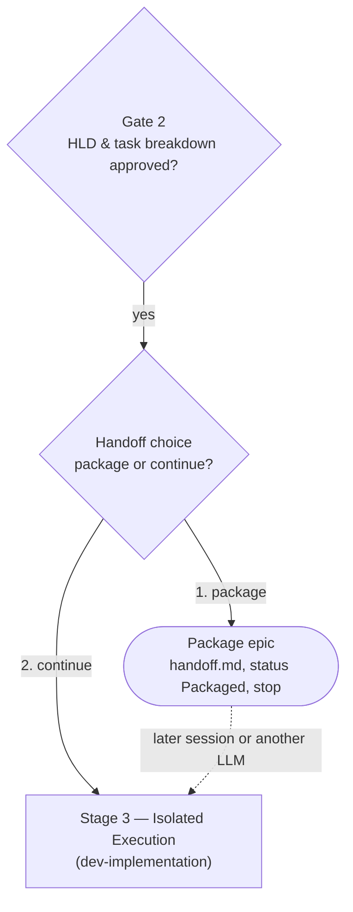

# Thiết kế lựa chọn bàn giao epic

- **Ngày**: 2026-10-15
- **Trạng thái**: Đã duyệt
- **Phạm vi**: `dev-lifecycle`, `dev-designer`, `dev-implementation`, file mới
  `dev-lifecycle/references/handoff-template.md`
- **Bước tiếp theo**: `writing-plans` (một implementation plan, không cần HLD)

## Mục lục

- [1. Bối cảnh](#1-bối-cảnh)
- [2. Mục tiêu và ngoài mục tiêu](#2-mục-tiêu-và-ngoài-mục-tiêu)
- [3. Quyết định](#3-quyết-định)
- [4. Luồng](#4-luồng)
- [5. Thành phần](#5-thành-phần)
- [6. File bàn giao](#6-file-bàn-giao)
- [7. Quy trình đóng gói](#7-quy-trình-đóng-gói)
- [8. Xác định điểm vào trong dev-implementation](#8-xác-định-điểm-vào-trong-dev-implementation)
- [9. Xử lý lỗi](#9-xử-lý-lỗi)
- [10. Kiểm thử](#10-kiểm-thử)
- [11. Rủi ro và phụ thuộc](#11-rủi-ro-và-phụ-thuộc)
- [12. Ngoài phạm vi](#12-ngoài-phạm-vi)

## 1. Bối cảnh

[dev-lifecycle](../../../skills/dev-lifecycle/SKILL.md) đi thẳng từ Gate 2 sang Stage 3. Khi
developer xác nhận cách chia task ở checkpoint của [dev-designer](../../../skills/dev-designer/SKILL.md),
các file task được ghi và commit, và bước tiếp theo là `dev-implementation`. Không có thời điểm nào
developer được hỏi có muốn bắt đầu implementation ngay hay không.

Có hai tình huống cần một lối đi khác:

1. **Làm sau.** Thiết kế đã xong nhưng implementation sẽ diễn ra ở một phiên khác, vài ngày sau.
2. **Giao cho LLM khác.** Một agent khác — Codex, Antigravity, hoặc một phiên Claude Code mới — sẽ
   implement những gì phiên này đã thiết kế.

Dữ liệu cần để tiếp tục đã có sẵn. Phase 0 của `dev-implementation` đọc lại HLD, các BDD scenario và
các file task từ đĩa. Hai thứ còn thiếu:

- **Điểm quyết định**, và một bản tóm tắt ngắn cho agent nhận biết mình đang ở đâu: gate nào đã qua,
  dùng định danh nào, không được làm lại gì, và những gì phiên thiết kế biết nhưng chưa ghi ra.
- **Khả năng vào lại.** [dev-implementation](../../../skills/dev-implementation/SKILL.md) giả định mọi
  lần gọi đều là lần đầu. Nó luôn tính thứ tự, hỏi Gate 3, và chạy
  `git worktree add .worktrees/<epic_dir> -b epic/<epic_slug>`. Sau một phiên bị ngắt, lệnh đó lỗi vì
  branch đã tồn tại, và không có gì bảo agent bỏ qua các task đã `done`. Một epic đóng gói rồi giao
  cho LLM khác làm cho việc phiên bị ngắt dễ xảy ra hơn chứ không ít đi.

## 2. Mục tiêu và ngoài mục tiêu

**Mục tiêu:**

- Sau Gate 2, hỏi developer chọn giữa đóng gói epic và tiếp tục sang Stage 3.
- Việc đóng gói tạo ra một bản bàn giao đã commit, tự giải thích được, để agent nhận có cài kit có
  thể làm tiếp mà không cần cuộc hội thoại của phiên thiết kế.
- Cho phép `dev-implementation <epic>` — nhận tên thư mục epic hoặc slug — tự suy ra từ đĩa epic đang
  ở đâu và vào đúng điểm: Gate 3 cho epic chưa bắt đầu, task chưa xong tiếp theo cho epic bị ngắt,
  Phase 4 cho epic đã xong hết task.
- Giữ nguyên năm gate. Epic đã đóng gói hoặc được tiếp tục vẫn qua Gate 3 với con người xác nhận.
- Dùng lại tooling hiện có. Không thêm script mới.

**Ngoài mục tiêu:**

- Gói tự chứa cho LLM không có quyền truy cập repo hoặc không cài kit.
- Viết bản bàn giao mới giữa Stage 3. Tiếp tục giữa chừng nằm trong phạm vi; đóng gói giữa chừng thì
  không.
- Lựa chọn tương tự trong `doc-lifecycle`.
- Đổi trạng thái task khi đóng gói.

## 3. Quyết định

| # | Quyết định | Lý do |
|---|------------|-------|
| D1 | Người nhận có quyền truy cập repo, nên gói là một file được commit trong thư mục epic | Không cần file nén, không chép lại quy tắc để rồi lệch khỏi skill |
| D2 | Trạng thái task giữ nguyên; Status của epic overview chuyển thành `Packaged` | Người nhận chỉ cần gọi `dev-implementation`, không phải lật trạng thái lại. Hệ quả được chấp nhận: theo Concurrent-Epic Backlog Rule của dev-designer, epic đã đóng gói vẫn được tính là đang chạy và các epic sau sẽ xếp hàng phía sau |
| D3 | Người nhận luôn có kit d3nexus, nên bản bàn giao trỏ tới skill thay vì chép lại chúng | Gate 3 đến 5 vẫn do `dev-implementation` thực thi; bản bàn giao giữ ngắn |
| D4 | Agent ghi bản bàn giao từ template và chạy các script có sẵn làm preflight (Phương án A) | Một `package_epic.py` mới sẽ lặp lại `compute_execution_order.py` và `check_document.py`, và phần giá trị nhất — ghi chú còn mở từ cuộc hội thoại — vẫn cần agent viết. Phương án gói bằng git tag bị loại: agent hiếm khi đọc tag và ghi chú sẽ nằm ngoài thư mục epic |
| D5 | Lựa chọn này là quyết định định tuyến do `dev-lifecycle` sở hữu, không phải gate thứ sáu | Nó quyết định *bước nào chạy tiếp*, giống quyết định định tuyến ở Stage 1. Bảng gate, cách đánh số và mọi tham chiếu chéo vẫn đúng |
| D6 | `handoff.md` chỉ viết tiếng Anh, có mục lục đầy đủ | Người đọc là agent. File này cùng `task_*.md` là ngoại lệ của Document Contract song ngữ, nhưng vẫn phải tuân quy tắc mục lục và lint |
| D7 | Đóng gói không bao giờ push khi chưa có sự cho phép rõ ràng của developer | [CRITICAL_RULES](../../../rules/CRITICAL_RULES.md#git-push-operations-no-unauthorized-push) |
| D8 | `dev-implementation` suy ra điểm vào từ các tín hiệu đã có trên đĩa: `handoff.md`, Status của overview, trạng thái task, epic branch và worktree. `handoff.md` vẫn là bản ghi tĩnh | Một nguồn sự thật duy nhất cho tiến độ. Phương án nhật ký sống trong `handoff.md` bị loại: nó lặp lại frontmatter của task và sẽ lệch khỏi đó |
| D9 | Epic được tiếp tục phải xác nhận lại Gate 3 cho các task còn lại | Lần xác nhận trước nằm trong một cuộc hội thoại mà phiên mới không thấy, quyền fast-forward `develop` cũng vậy |

## 4. Luồng



Câu hỏi được đặt ra sau khi Step 3 của `dev-designer` đã commit các file task, hoặc ngay sau khi các
file được ghi nếu `auto_commit` là `false`. Câu hỏi viết trung lập — "hỏi developer" — để chạy được
trên Claude Code, Antigravity và Codex:

> Gate 2 đã qua: HLD, các BDD scenario và N file task của `<epic_slug>` đã được ghi. Anh/chị muốn đi
> tiếp thế nào?
>
> 1. **Đóng gói** — ghi `handoff.md`, đánh dấu epic là `Packaged`, rồi dừng, để làm sau hoặc giao cho
>    LLM khác.
> 2. **Tiếp tục** — vào Stage 3 ngay (`dev-implementation`, bắt đầu bằng Gate 3: thứ tự thực thi).

## 5. Thành phần

| File | Thay đổi |
|------|----------|
| `skills/dev-lifecycle/SKILL.md` | Mục mới "Handoff Choice" giữa Stage 2 và Stage 3, chứa câu hỏi (§4) và quy trình đóng gói (§7). Quy tắc mới "Resuming an Epic": khi thư mục của epic được nêu tên đã có file task, Gate 2 đã qua, nên gọi `dev-implementation` với tên đó và để Phase 0 của nó chọn điểm vào (§8). Cập nhật sơ đồ trình tự. Document Contract ghi `handoff.md` cạnh `task_*.md` là file chỉ tiếng Anh. Red Flags mới (§9) |
| `skills/dev-lifecycle/references/handoff-template.md` | Mới. Template cho `handoff.md` (§6) |
| `skills/dev-designer/SKILL.md` | Step 3 kết thúc bằng một đoạn trỏ sang Handoff Choice; dev-designer không bao giờ gọi thẳng `dev-implementation` |
| `skills/dev-implementation/SKILL.md` | Nhận tên thư mục epic hoặc slug. Phase 0 có thêm Entry-Point Detection và đọc `handoff.md` nếu có. Thêm Resume Procedure vào Phase 1. Phase 1 bước 4 chuyển epic `Packaged` sang `In Progress`. Cập nhật sơ đồ quy trình và Red Flags (§8, §9) |

`dev-lifecycle` xác định đường dẫn script từ chính thư mục của nó, giống cách `dev-implementation`
làm với `integrate_branch.py`:

```bash
SKILL_DIR=<absolute path of the directory containing dev-lifecycle/SKILL.md>
SCRIPTS="$SKILL_DIR/../dev-implementation/resources/scripts"
CHECK_DOC="$SKILL_DIR/../doc_quality_check/resources/scripts/check_document.py"
```

## 6. File bàn giao

Đường dẫn: `.devtool/epic/<epic_dir>/handoff.md`. Chỉ tiếng Anh, có mục lục liên kết tới mọi mục
`##`, đạt markdown lint. Các mục, theo thứ tự:

| Mục | Nội dung |
|-----|----------|
| Status | Ngày đóng gói; SHA của commit thiết kế mà gói dựa vào (`HEAD` trước commit đóng gói); base branch; các gate đã qua (1, 2); bước tiếp theo — Stage 3, nơi Gate 3 vẫn cần con người xác nhận |
| Identifiers | Bảng giá trị thật của `<epic_dir>` và `<epic_slug>`, hai chuỗi mà `dev-implementation` cảnh báo thường khác nhau |
| Read First | Danh sách có thứ tự: HLD `.en.md`, `bdd_scenarios.en.md`, spec gốc `.en.md`, và số lượng task, với danh sách task nằm trong mục Kanban Tasks Breakdown của HLD |
| Resume Prompt | Một khối `text` để developer dán vào agent nhận |
| Open Notes | Những gì phiên thiết kế biết mà tài liệu chưa nói: quyết định chốt trong hội thoại, rủi ro, điểm còn ngờ. Ghi `None` nếu không có |
| Rules for the Receiving Agent | Không chạy lại `dev-brainstorming` hay `dev-designer`; tài liệu sai thì nêu ra tại Gate 3. Bản bàn giao này không thay cho Gate 3. Nếu `git log <sha>..HEAD -- .devtool/epic/<epic_dir>` có commit, tài liệu đã thay đổi sau khi đóng gói: tài liệu thắng, và file này có thể đã cũ |

Resume Prompt sau khi điền giá trị thật:

```text
Use the d3nexus:dev-implementation skill for the `<epic_slug>` epic.
Read .devtool/epic/<epic_dir>/handoff.md first.
Gates 1 and 2 are passed; do not re-run brainstorming or design.
Gate 3 is pending: present the execution order to me and wait for my confirmation.
```

Cố ý không có link tới từng task. File task đang hoạt động sẽ được lưu trữ vào thư mục epic ở
Stage 4, nên đường dẫn của chúng thay đổi; mục breakdown của HLD là danh sách duy nhất luôn được cập
nhật.

`handoff.md` không bao giờ được cập nhật sau khi đóng gói (D8). File ở lại thư mục epic sau Stage 4
như một bản ghi có ngày tháng.

## 7. Quy trình đóng gói

Khi developer chọn phương án 1:

1. **Preflight, chỉ đọc.**

   ```bash
   python3 "$SCRIPTS"/compute_execution_order.py <epic_slug>
   ls .devtool/epic/<epic_dir>/task_*.md | wc -l
   python3 "$SCRIPTS"/check_bdd_traceability.py plan \
     --scenarios .devtool/epic/<epic_dir>/bdd_scenarios.en.md \
     --tasks .devtool/epic/<epic_dir>/task_*.md
   ```

   Số task khớp `M` trong dòng tóm tắt phải bằng số file task mirror trong thư mục epic, và cả hai
   script phải exit 0. Nếu không, có task bị hỏng frontmatter, sai giá trị `epic:`, có vòng phụ thuộc,
   hoặc có scenario không được dòng `Covers:` nào nêu tên: sửa trước khi đóng gói, vì agent nhận không
   có ngữ cảnh để chẩn đoán.
2. Ghi `handoff.md` từ template, điền Open Notes từ cuộc hội thoại của phiên này.
3. Lint file:

   ```bash
   python3 "$CHECK_DOC" --require-toc .devtool/epic/<epic_dir>/handoff.md
   ```

4. Đánh dấu epic đã đóng gói, rồi xác nhận cả hai bản overview thực sự đã đổi — script báo số tài
   liệu nó tìm thấy, không phải số tài liệu nó đã ghi:

   ```bash
   python3 "$SCRIPTS"/sync_task_status.py epic <epic_dir> Packaged
   grep -n -E '^- \*\*(Status|Trạng thái)\*\*: Packaged' \
     .devtool/epic/<epic_dir>/<epic_dir>.en.md .devtool/epic/<epic_dir>/<epic_dir>.vi.md
   ```

   Trạng thái task không bị đụng tới (D2).
5. Commit, khi `auto_commit` là `true` hoặc không được khai báo: stage `handoff.md` và cặp overview,
   rồi chạy `git commit -m "[<EPIC_NAME>] Package epic for handoff"`, không có trailer. Khi
   `auto_commit` là `false`, bỏ qua và cảnh báo rằng agent ở clone khác sẽ không thấy gói.
6. Đề nghị push; chỉ push khi được cho phép rõ ràng (D7). Nói rõ rằng người nhận ở clone khác hoặc
   máy khác cần bản push này.
7. In đường dẫn `handoff.md` và Resume Prompt đã điền, rồi dừng. Không tạo worktree, không vào
   Stage 3.

## 8. Xác định điểm vào trong dev-implementation

### 8.1 Xác định epic

`dev-implementation` nhận một tên epic, ở dạng nào cũng được:

1. Nếu `.devtool/epic/<name>/` tồn tại, `<epic_dir>` là `<name>`, và `<epic_slug>` là giá trị `epic:`
   trong các file mirror `task_*.md` của thư mục đó.
2. Nếu không, coi `<name>` là slug: `<epic_dir>` là thư mục dưới `.devtool/epic/` có các file
   `task_*.md` mang `epic: "<name>"`.
3. Khi không có tên, hoặc không khớp, liệt kê các thư mục epic có Status của overview khác `Done` và
   hỏi chọn epic nào. Không bao giờ đoán, kể cả khi danh sách chỉ có một epic.

### 8.2 Đọc tín hiệu

Tất cả chỉ đọc, chạy từ main checkout:

```bash
test -f .devtool/epic/<epic_dir>/handoff.md && echo packaged-handoff
grep -m1 -E '^- \*\*Status\*\*:' .devtool/epic/<epic_dir>/<epic_dir>.en.md
git rev-parse --verify --quiet refs/heads/epic/<epic_slug>
git worktree list --porcelain | grep -F "/.worktrees/<epic_dir>"
python3 "$SKILL_DIR"/resources/scripts/compute_execution_order.py <epic_slug>
```

Thứ tự phẳng mà lệnh cuối in ra ghi trạng thái từng task dưới dạng `[priority, status]`. File task
vẫn nằm trong `.devtool/features/` khi đã `done` cho tới khi Stage 4 lưu trữ chúng, nên lệnh quét
thấy mọi task.

### 8.3 Chọn điểm vào

Xét từ trên xuống; dòng đầu tiên khớp sẽ được chọn.

| # | Tín hiệu | Trạng thái | Điểm vào |
|---|----------|-----------|----------|
| 1 | Status của overview là `Done` | Đã xong | Báo cáo và dừng |
| 2 | Không có epic branch, và có task ở `backlog` | Đang xếp hàng sau epic khác | Dừng. Chuyển `backlog` sang `todo` là quyết định của developer |
| 3 | Không có epic branch, không có worktree, mọi task `todo` | Chưa bắt đầu — đã đóng gói nếu có `handoff.md` | Phase 0 → Phase 1 → Gate 3 → tạo worktree mới, như hiện nay |
| 4 | Có epic branch, không có worktree, có task chưa `done` | Bị ngắt, worktree đã bị xóa | Resume Procedure (§8.4); tạo lại worktree sau Gate 3 bằng `git worktree add .worktrees/<epic_dir> epic/<epic_slug>` (không có `-b`), rồi bootstrap |
| 5 | Có worktree, có task chưa `done` | Bị ngắt giữa Stage 3 | Resume Procedure (§8.4) |
| 6 | Có epic branch, mọi task `done` | Đã xong các task | Tạo lại worktree như dòng 4 nếu thiếu, rồi vào Phase 4, chạy `quality_check` đầy đủ — verdict từ phiên khác không gắn được với SHA này |
| 7 | Mọi trường hợp khác, ví dụ task `in-progress` hoặc `done` mà không có epic branch | Không nhất quán | Dừng, báo các tín hiệu, hỏi |

Thông báo dòng đã chọn: "Entry point: row N — <state>."

### 8.4 Quy trình tiếp tục

1. Trong worktree, chạy `integrate_branch.py preflight` mà Phase 2 bước 7 đang dùng. Nếu có rebase
   dang dở, hoặc base đã phân kỳ, xử lý theo cách bước 7 quy định trước khi làm bất cứ việc gì khác.
2. Tìm task bị ngắt: task ở `in-progress` hoặc `review`. Nếu worktree có thay đổi chưa commit, lấy
   `git status --short`. Thay đổi chưa commit mà không có task nào bị ngắt vẫn được trình bày ở bước
   3, với cùng lựa chọn giữ lại hoặc bỏ đi.
3. **Gate 3 (tiếp tục).** Trước hết chạy kiểm tra mapping BDD của Phase 1 bước 3, kể cả phần bổ
   sung định danh cho epic thiết kế trước khi có scenario ID; commit bổ sung nằm trên epic branch.
   Sau đó, trong cùng một tin nhắn, trình bày:
   - các task đã `done`, kèm commit của chúng từ `git log --oneline develop..epic/<epic_slug>`;
   - thứ tự còn lại — thứ tự phẳng đã bỏ các task `done`, vẫn thỏa mọi phụ thuộc;
   - với task bị ngắt có thay đổi chưa commit, lựa chọn giữ lại thay đổi và làm tiếp task, hoặc bỏ
     thay đổi và làm lại task từ đầu — chỉ bỏ khi có câu trả lời rõ ràng như vậy;
   - yêu cầu xin quyền fast-forward `develop`, hỏi lại vì quyền này không mang qua phiên khác (D9).

   Chờ xác nhận.
4. Chỉ với dòng 4: tạo lại worktree từ branch có sẵn. Sau đó, với dòng 4 và 5, kiểm tra bootstrap
   bằng các bước kiểm tra theo nền tảng ở Phase 1 bước 5, và chạy lại bootstrap nếu không đạt.
5. Nếu Status của overview là `Packaged`, chuyển thành `In Progress`.
6. Vào Phase 2 tại task bị ngắt, hoặc tại task còn lại đầu tiên nếu không có task nào bị ngắt.

### 8.5 Đổi trạng thái khi bắt đầu mới

Với dòng 3, Phase 1 bước 4 thêm một thao tác sau khi worktree được tạo: nếu Status của overview là
`Packaged`, chạy `sync_task_status.py epic <epic_dir> "In Progress"`. Thay đổi này đi cùng commit
task đầu tiên, giống cách trạng thái task đang được đồng bộ.

## 9. Xử lý lỗi

| Lỗi | Chặn bằng |
|-----|-----------|
| Agent bỏ qua câu hỏi, đi thẳng sang implementation | Đoạn trỏ ở cuối Step 3 của dev-designer; Red Flag trong `dev-lifecycle` |
| Người nhận thiết kế lại hoặc sinh lại task | Mục Rules trong `handoff.md`; Resume Prompt; Red Flag |
| Người nhận coi Gate 3 là đã qua | Resume Prompt nói rõ; Gate 3 và Gate 3 (tiếp tục) giữ nguyên bản chất; Red Flag |
| Frontmatter task hỏng chỉ lộ ra ở phiên sau | Preflight đóng gói, bước 1 |
| Tài liệu thay đổi sau khi đóng gói | SHA đã ghi cùng lệnh kiểm tra `git log`; tài liệu thắng |
| Gói không tới được người nhận | Cảnh báo ở bước đóng gói 5 và 6 |
| Overview không có dòng `- **Status**:`, nên script không ghi gì mà vẫn báo thành công | Lệnh `grep` ở bước đóng gói 4; nếu không khớp, sửa tay dòng Status ở cả hai bản |
| Tên epic không khớp gì, hoặc vừa khớp tên thư mục vừa khớp slug của epic khác | §8.1: khớp thư mục được ưu tiên; không khớp thì liệt kê ứng viên và hỏi |
| Phiên tiếp tục chạy lại `git worktree add -b` và lỗi vì branch đã tồn tại | Dòng 4 và 5 không bao giờ dùng `-b`; Red Flag |
| Mất thay đổi chưa commit của phiên bị ngắt | §8.4 bước 3: chỉ bỏ khi có câu trả lời rõ ràng |
| Các tín hiệu mâu thuẫn nhau | Dòng 7: dừng và hỏi, không bao giờ đoán |

Red Flags mới trong `dev-lifecycle`:

- Gọi `dev-implementation` ngay sau `dev-designer` mà không hỏi Handoff Choice.
- Coi Gate 3 của một epic đã đóng gói là đã qua.
- Chạy lại `dev-brainstorming` hoặc `dev-designer` cho một epic đã có file task.
- Đóng gói mà không chạy preflight.

Red Flags mới trong `dev-implementation`:

- Bắt đầu Phase 1 mà không chạy Entry-Point Detection.
- Chạy `git worktree add -b` cho một epic đã có branch.
- Implement lại một task đã `done`.
- Bỏ thay đổi chưa commit của phiên bị ngắt khi chưa có câu trả lời rõ ràng.

## 10. Kiểm thử

1. `scripts/verify.sh` đạt: link nội bộ trỏ đúng, anchor của mục lục khớp heading, các sơ đồ mermaid
   đã sửa render được.
2. Chạy thử trong một repo git dùng một lần ở scratchpad — không bao giờ trên repo thật — được tạo từ
   bản sao của `.devtool/epic/python_quality_provider_and_onboarding/` cùng các file task đã đặt lại
   về `todo`:
   - **Đóng gói (§7):** `check_document.py --require-toc` chấp nhận `handoff.md` khi không có file
     `.vi.md` đi kèm; `sync_task_status.py epic … Packaged` đổi dòng Status ở cả hai bản overview và
     lệnh `grep` ở bước 4 khớp; kiểm tra số lượng ở preflight thất bại khi cố ý làm hỏng giá trị
     `epic:` của một task.
   - **Tín hiệu điểm vào (§8.2, §8.3):** mỗi fixture cho ra đúng tín hiệu của dòng tương ứng — dòng 3
     với `handoff.md` và chưa có branch; dòng 4 với branch nhưng worktree đã bị xóa; dòng 5 với
     worktree và một task `done`; dòng 6 với mọi task `done`. Lệnh
     `git worktree add .worktrees/<epic_dir> epic/<epic_slug>` của dòng 4 chạy được mà không cần `-b`.
   - **Xác định tên epic (§8.1):** cả tên thư mục lẫn slug đều cho ra cùng một cặp giá trị.
3. Quality gate là `@quality_check`, vì các file `SKILL.md` được phát hành trong plugin. Plan làm
   theo `writing-skills` khi sửa skill.

## 11. Rủi ro và phụ thuộc

- **Agent có làm đúng không.** Nội dung bản bàn giao và quyết định điểm vào phụ thuộc vào việc agent
  làm theo văn bản (D4, D8). Giảm thiểu bằng các bước cơ học — preflight, lint, các lệnh đọc tín hiệu
  và việc thông báo rõ dòng đã chọn.
- **Lỗi đã biết khi parse blocker.** `compute_execution_order.py` đọc `Blocked by` theo từng dòng và
  lặng lẽ bỏ các blocker bị xuống dòng. Cả preflight lẫn bước xác định điểm vào đều không bắt được
  lỗi này; Gate 3 vẫn là nơi con người kiểm tra thứ tự.
- **Xếp hàng.** Epic đã đóng gói giữ các task ở `todo`, nên epic mới thiết kế sẽ xếp hàng sau nó
  (D2). Developer để epic chờ lâu cần biết điều này.
- **Đọc trạng thái.** Trạng thái task được đọc từ main checkout. `sync_task_status.py` mirror chúng
  vào mọi checkout, nên main checkout và worktree khớp nhau trừ khi có người sửa tay một bản.
- **Truy vết BDD đã được triển khai trước** (merge `bde3493`). Vì vậy spec này đảm nhận bước
  `check_bdd_traceability.py plan` trong preflight đóng gói (§7) và dùng lại kiểm tra mapping ở Gate 3
  mà truy vết BDD đã thêm vào Phase 1 bước 3 của dev-implementation (§8.4).

## 12. Ngoài phạm vi

- Đóng gói cho LLM không có quyền truy cập repo hoặc không cài kit.
- Viết bản bàn giao giữa Stage 3, và lựa chọn tương tự trong `doc-lifecycle`.
- Script đóng gói mới, gói bằng git tag, nhật ký tiến độ sống, và việc đổi trạng thái task.
- Automation integration test map với BDD scenario. Yêu cầu này được nêu trong cùng phiên, nhưng nó
  thay đổi chiến lược test chứ không phải trình tự lifecycle, nên có spec riêng.
