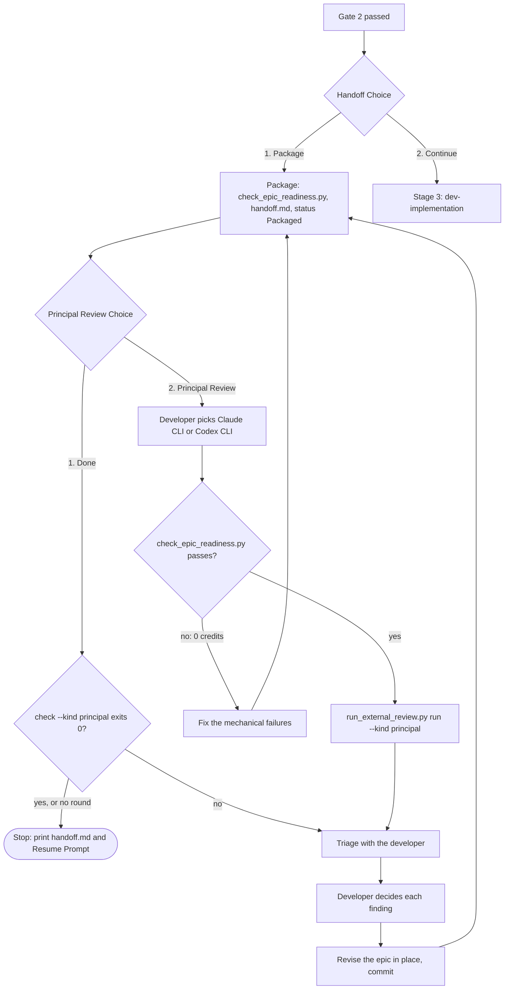

# Principal Review Design

- **Date**: 2026-10-22
- **Status**: Draft, awaiting Gate 1 review
- **Scope**: `dev-lifecycle`, `dev-implementation` (scripts, references and Gate 3), `docs/lifecycles.*.md`,
  `scripts/test_lifecycle_document_contract.py`
- **Next step**: `dev-designer` (epic `principal_review`)

## Table of Contents

- [1. Background](#1-background)
- [2. Goals and Non-Goals](#2-goals-and-non-goals)
- [3. Decisions](#3-decisions)
- [4. Flow](#4-flow)
- [5. Components](#5-components)
- [6. Principal Review Loop Procedure](#6-principal-review-loop-procedure)
- [7. Error Handling](#7-error-handling)
- [8. Testing](#8-testing)
- [9. Risks and Dependencies](#9-risks-and-dependencies)
- [10. Out of Scope](#10-out-of-scope)

## 1. Background

An epic leaves Stage 2 with an HLD, BDD scenarios and task files that passed four mechanical
checks: `compute_execution_order.py`, the task-mirror count, `check_bdd_traceability.py plan` and
`check_task_contract.py --design`, plus the document linter. Those checks prove the documents are
well formed. They do not prove the documents are right.

A manual pre-implementation review of the packaged `flashcard_compact_data_enrichment` epic in
`lyrics-sync` (2026-10-22) found these defects after all four checks had passed:

| Defect class | Example | Would have cost |
|---|---|---|
| Names that do not exist | routes `/api/tts/ocr-upload`, `/api/preview/persist-track`; symbols `buildPersistTrackPayload`, `infer_collocations_batch` | Stop-and-Report on Tasks 1–3 |
| Wrong model of the code | `Collocation` described as a dataclass; it is a Pydantic model with aliases | Task 1 rewritten mid-flight |
| Contract against a pinned test | DB-offline must return `saved_disk_only`; an existing test pins `failed` | Task 2 blocked |
| Missing writer | no task allowed the module that copies `lyrics.json` into the DB row | feature silently inert |
| Design that breaks a neighbour | the new format dropped the surface term the TTS adapter anchors words with | popovers no longer clickable |
| Unpassable Gate 4 | `Integration results:` ran 2 files; 10 scenarios had no result | Gate 4 never green |
| Doc drift | task Gherkin tagged `Tier A`, canonical BDD `Tier B - Unit`; broken `Epic:` links | noise, mis-tiered tests |
| Baseline failures | 3 tests in a file a GREEN row ran already failed under Node v25 | false RED/GREEN |

The sibling epic `studio_adaptive_ocr_chunk_enrichment` had needed the same kind of revision a few
hours earlier. The kit already has the machinery for a second opinion: `run_external_review.py`
drives the Claude CLI and the Codex CLI read-only, records rounds, and enforces triage. But it only
reviews finished code, after Gate 4.

## 2. Goals and Non-Goals

### Goals

- Catch the defect classes above **before** Stage 3, when fixing them costs a document edit
  instead of a stopped executor.
- A mechanical script, `check_epic_readiness.py`, that folds the existing packaging preflight
  together with the checks a machine can decide.
- A cross-model **Principal Review**: Claude CLI or Codex CLI, chosen by the developer, playing the
  Principal Reviewer who signs off the epic. It judges consistency, grounding against the source,
  impact, risks and task split, and proposes edits.
- A **Principal Review Choice** after Package, looping like Review Choice until the developer
  chooses Done.

### Non-Goals

- Reviewing code: the post-Gate 4 Review Choice keeps that job.
- Applying edits automatically: the reviewer only proposes.
- Making Principal Review mandatory.
- Running two reviewers in parallel and merging their findings.
- Local Ollama models as Principal Reviewers.

## 3. Decisions

| # | Decision | Reason |
|---|----------|--------|
| D1 | Principal Review is an option offered after every Package, like Review Choice: **1. Done** or **2. Principal Review**. The developer picks Claude CLI or Codex CLI; the agent never picks | The developer's choice (2026-10-22). Review costs credits and tens of minutes, so not every epic needs it |
| D2 | When the epic was designed by a different or fast model (for example an Antigravity session or a Flash-class model), judged from the HLD's `Author` line or the developer's word, the choice carries a strong recommendation for Principal Review | Mirrors the existing fast-executor recommendation in Review Choice; both reviewed epics came from Antigravity |
| D3 | `run_external_review.py` gains `--kind principal`; the default `--kind code` behaves exactly as today | Reuses CLI invocation, round recording, `check`, `triage`, the precondition banner and the tree-change guard. A separate engine would duplicate and drift |
| D4 | `check_epic_readiness.py` is a precondition of a Principal Review round. Any FAIL blocks the CLI (0 credits); its full report is passed to the reviewer as facts | The model's time goes to judgement, not to what a script can decide |
| D5 | `check_epic_readiness.py` replaces the four preflight commands in the packaging procedure | One command instead of four, and it frees words under the 2500-word ceiling of `dev-lifecycle/SKILL.md` |
| D6 | Rounds are recorded in `.devtool/epic/<epic_dir>/principal_review.md`, apart from `review_results.md` | Design findings and code findings have different subjects and different SHAs |
| D7 | A finding is a claim to verify. Every round is triaged with the developer before anything changes; a dismissal needs the developer's own words | Same discipline as `review-triage.md`; reviewers produce false positives |
| D8 | Accepted findings become an in-place revision of the epic (dev-designer edits, no re-split or renumbering), committed as `[EPIC_NAME] Revise epic after Principal Review round <n>`, followed by a full re-package | Keeps one lineage of documents; `handoff.md` stays a dated record and is regenerated, never edited |
| D9 | Done requires `run_external_review.py check --kind principal` to exit 0, when a round exists | No epic is handed over with an undecided Critical or Important finding |
| D10 | Gate 3 runs the same `check` when `principal_review.md` exists and stops on exit 1. An epic never reviewed shows `Principal Review: not run` in the Gate 3 summary | Catches a hand-over that skipped Done; never-reviewed epics stay allowed (D1) |
| D11 | The Continue path (implement now) offers no Principal Review | The developer chose to start immediately; YAGNI |
| D12 | `sync_task_status.py epic` writes only to the current checkout and to worktrees on the epic's own `epic/<epic_slug>` branch. Task-level sync keeps mirroring across every checkout | The re-package loop would otherwise rewrite other epics' worktrees on every round, leaving uncommitted changes another session may commit into the wrong epic |
| D13 | The procedure lives in `dev-lifecycle/references/principal-review.md`; `SKILL.md` keeps a short pointer and the pinned invariants | `SKILL.md` is at 2454 of 2500 words |

## 4. Flow



## 5. Components

### 5.1 `check_epic_readiness.py`

Location: `skills/dev-implementation/resources/scripts/`, beside the scripts it reuses.

```bash
python3 "$SCRIPTS"/check_epic_readiness.py <epic_dir> [--baseline] [--row-timeout 600]
```

| Check | Rule | Severity |
|---|---|---|
| R1 Preflight | `compute_execution_order.py` exits 0. The scan matches as many tasks as the epic directory holds. `check_bdd_traceability.py plan` and `check_task_contract.py --design` exit 0. `check_document.py` passes with `--require-toc --require-bilingual` on the spec, HLD and BDD pairs, with `--require-toc` on `handoff.md` when present, and on every task file | FAIL |
| R2 Mirror parity | Each `.devtool/epic/<epic_dir>/task_*.md` equals its mirror in `.devtool/features/` (or `features/done/`) once the location-dependent `Epic:` and `Spec:` links are normalised | FAIL |
| R3 Scenario parity | Each scenario block in a task equals the canonical block in `bdd_scenarios.en.md`, tier tag included; `bdd_scenarios.vi.md` carries the same identifier set | FAIL |
| R4 Tier tags | Every scenario is tagged `[Tier A - Unit]` or `[Tier C - Integration]`; Tier B is tooling only | FAIL |
| R5 Grounding | In each task's `Target Files & Symbols`, every symbol listed for a file that exists and is not `(new)` occurs in that file, unless the bullet marks it `new` | FAIL |
| R5b Routes | Every `/api/...` route named in a task or the HLD occurs in a tracked source file outside `.devtool/` and `docs/` | WARN |
| R6 Gate 4 coverage | Every task with a `Covers:` line has a `TIER-C` row, and every path argument of a `TIER-C` row that points into an `Integration test roots` directory is named by, or lies under a directory named by, an `Integration results:` command of the HLD | FAIL |
| R7 Metadata | An HLD Status of `Packaged` comes with `handoff.md` and the reverse. The handoff's design commit resolves and is an ancestor of `HEAD`, unless it reads `uncommitted`. Task frontmatter names this epic and a valid status | FAIL |
| R7b Spec status | The spec Status no longer reads as a draft or as awaiting Gate 1 (`dev-brainstorming` does not update it on approval today) | WARN |
| R8 Baseline (opt-in) | With `--baseline` and a clean tree, every `GREEN` and `TIER-B` row whose command names no `(new)` path runs in the current checkout; a failure is reported with the row id and the last lines of its output | WARN |

Output: one line per check (`R1 PASS`, `R5 FAIL task_2:…: buildPersistTrackPayload not in src/…/tts-studio.js`), then
`Result: <n> FAIL, <m> WARN — PASS|FAIL`. Exit 0 with no FAIL, 1 with any FAIL, 2 on a usage error.
R8 runs in place because a packaged epic's commits change documents only, so the checkout's code
is the base the tasks will start from.

### 5.2 `run_external_review.py --kind principal`

```bash
python3 "$SCRIPTS"/run_external_review.py run --kind principal --epic-dir <epic_dir> --base <base_ref> --cli claude|codex [--model <name>] [--timeout 1800]
python3 "$SCRIPTS"/run_external_review.py check --kind principal --epic-dir <epic_dir>
python3 "$SCRIPTS"/run_external_review.py triage --kind principal --epic-dir <epic_dir>
```

- `--kind` defaults to `code`; everything the code review does today is unchanged.
- `--kind principal` with `--cli ollama` is a usage error (exit 2).
- **Preconditions**: the CLI is on PATH and the tree is clean, as today. `check_epic_readiness.py <epic_dir>` must exit 0; otherwise the existing precondition banner is printed and the CLI is not invoked.
- **Facts**: the readiness report, the base ref and its SHA, the reviewed SHA (`HEAD`), and the artefact list (spec pair, HLD pair, BDD pair, task files, `handoff.md`). No code diff is sent: the reviewer reads the source itself, read-only (`claude -p --permission-mode plan`, `codex exec --sandbox read-only`).
- **Record**: `principal_review.md` uses the round, findings-table and decision format of `review_results.md`, with `Kind: principal` in each round's metadata. `check` and `triage` read the file `--kind` selects.
- `--model` is passed through. `principal-review.md` recommends the strongest reasoning model each CLI offers.

### 5.3 Principal Review prompt and rules

New files in `skills/dev-implementation/references/`, beside the code-review prompt:
`principal-review-prompt.md` and `principal-review-rules.md`. The reviewer acts as the Principal
Reviewer who signs off the epic before implementation. It is strictly read-only and checks the
artefacts against the source at the reviewed SHA:

| # | Checklist item |
|---|---|
| P1 | Consistency across spec, HLD, BDD, tasks and `handoff.md`: decisions, field names, numbers, titles, statuses |
| P2 | Grounding: every path, symbol, signature, return type, route and constant in `Decisions Already Made` and `Impact Analysis` exists as described |
| P3 | Pinned behaviour: existing tests that pin a behaviour a task changes, when those tests are outside the task's Allowed files |
| P4 | Blast radius: other writers and readers of the changed data, background jobs, callers outside Allowed files, migrations and backfill |
| P5 | Task split and Verification: dependency order, RED rows that can fail before implementation (the behaviour is not already there), GREEN rows that can pass at baseline, DoD references, Stop conditions |
| P6 | BDD quality: valid Gherkin, dimensions that match their scenarios, grounded assertions, tier tags |
| P7 | Gate 4 feasibility: `Integration results:` covers every scenario; the Verification Environment declares every resource the rows need |
| P8 | Risks, rollout and rollback |

Output keeps the parser contract of the code review: a closing `Verdict: PASS` or
`Verdict: CHANGES REQUIRED`, then one line per finding,
`[Critical|Important|Minor] <artefact>:<location> — <problem>. Proposed: <edit>`.
The severities mean:
- **Critical**: the epic cannot reach its goal or Gate 4 as designed;
- **Important**: a task would hit Stop-and-Report or ship wrong behaviour;
- **Minor**: wording and consistency.

### 5.4 `dev-lifecycle`

- **Packaging procedure step 1**: one command, `check_epic_readiness.py <epic_dir>`, replaces the four preflight commands.
- **After step 7**: a short pointer to Principal Review Choice and `references/principal-review.md`. The new reference file carries §6, the choice wording, the D2 recommendation and the re-package rule.
- **Red Flags gains two items**: picking the Principal Review CLI for the developer, and acting on a Principal Review finding before triage.
- **Unchanged**: all invariants pinned by `test_lifecycle_document_contract.py`, and the 2500-word ceiling.

### 5.5 `dev-implementation`

Phase 0 and the Resume Procedure: when `principal_review.md` exists, run
`run_external_review.py check --kind principal --epic-dir <epic_dir>` before Gate 3. On exit 1,
stop and present the triage. The Gate 3 summary states the Principal Review status: `not run`,
`round <n>: PASS`, or `round <n>: decided`.

### 5.6 `sync_task_status.py epic`

The `epic` subcommand narrows its roots to the current checkout plus the worktrees whose branch is
`epic/<epic_slug>`. The `task`, `archive-epic` and `archive-done` subcommands keep every checkout.

### 5.7 Human documentation and template

- `docs/lifecycles.en.md` and `docs/lifecycles.vi.md` gain the Principal Review Choice loop in the Stage 2 diagram, and one paragraph.
- `handoff-template.md` lists `principal_review.md, when present` under Read First.

## 6. Principal Review Loop Procedure

1. After the packaging procedure prints `handoff.md`, present:
   > Packaged. 1. **Done** — stop here. 2. **Principal Review** — a cross-model review of the design against the source before implementation (Claude CLI or Codex CLI).

   Add the D2 recommendation when it applies.
2. **Done**: if `principal_review.md` exists, run `check --kind principal`. Exit 0 stops with the handoff path and the Resume Prompt; exit 1 goes to step 5.
3. **Principal Review**: ask which CLI, Claude CLI or Codex CLI, and optionally which model. Never choose for the developer.
4. Run `run_external_review.py run --kind principal --epic-dir <epic_dir> --base <base_branch> --cli <cli>`. A readiness FAIL prints the banner: fix the named failures as an epic revision, re-package, and return to step 1.
5. Present `triage --kind principal`, filled as `review-triage.md` describes: every finding is verified against the source at the round's SHA. Stop and wait for the developer's decision on each finding.
6. Apply each accepted finding as an in-place revision of the epic (D8). Write the Decision cells (`fixed in <sha>` or `dismissed: <developer's words>`) and commit `[EPIC_NAME] Revise epic after Principal Review round <n>`.
7. Re-run the packaging procedure from step 1: readiness, a regenerated `handoff.md` with the new design commit, lint, status, commit. Then return to step 1 of this procedure.

## 7. Error Handling

| Situation | Behaviour |
|---|---|
| CLI not on PATH, dirty tree, `--cli ollama` with `--kind principal` | Exit 2; no round recorded |
| `check_epic_readiness.py` FAIL | Precondition banner, CLI not invoked, exit 2; the report names each failure |
| R8 row exceeds `--row-timeout` | WARN `timeout` for that row; the other rows still run |
| Reviewer output has no Verdict line | Round recorded as incomplete, exit 2, as for code review |
| Reviewer changes a file despite read-only mode | Existing tree-change guard records the paths in the round |
| Developer chooses Done with undecided blocking findings | Done refused; triage presented (D9) |
| `principal_review.md` exists but cannot be parsed at Gate 3 | `check` exits 1; Gate 3 stops and names the row |

## 8. Testing

- `test_check_epic_readiness.py`: one passing and one failing fixture epic per check R1–R8, built in temporary git repositories. The failing fixtures reproduce the defect classes of §1: a missing symbol, Tier A versus Tier B drift, an uncovered `TIER-C` path, a draft spec Status, a broken mirror and a failing baseline row.
- `test_run_external_review.py`: every existing test stays unchanged and passing. New tests cover:
  - `--kind principal`: prompt selection, the facts it carries, the readiness precondition banner, and that `principal_review.md` is written while `review_results.md` stays untouched;
  - `check` and `triage` on the principal file;
  - the `ollama` usage error.
- `test_sync_task_status.py`: `epic` leaves a worktree of another epic's branch untouched and updates the epic's own worktree.
- `scripts/test_lifecycle_document_contract.py`:
  - expected tokens for `dev-lifecycle/SKILL.md` (`Principal Review Choice`, `check_epic_readiness.py`, `references/principal-review.md`);
  - the `PRC` transitions in both `docs/lifecycles.*.md`;
  - the 2500-word ceiling still holds.
- `scripts/verify.sh` passes before release.

## 9. Risks and Dependencies

- **Word ceiling**: the pointer must fit under 2500 words. D5 frees the preflight block; if that is not enough, the duplicated prose around the Review Choice transitions is trimmed, never a pinned token.
- **Code-review regression**: `run_external_review.py` serves Gate 4's Review Choice. Every new path sits behind `--kind principal`, and the existing test suite is the guard.
- **False positives**: triage with source verification is mandatory (D7). Minor findings never block Done.
- **Heuristic checks**: R5 fails only on explicit `path: symbol` pairs, and route mismatches stay WARN (R5b). R8 is opt-in because it runs project commands.
- **Cost**: each round spends CLI credits and can take up to the 1800 s timeout. The choice stays optional (D1).
- **Dependencies**: Claude CLI or Codex CLI installed and authenticated; the task-file conventions `check_task_contract.py` already enforces (`Target Files & Symbols`, `(new)` markers, Verification rows).

## 10. Out of Scope

- Parallel review by both CLIs with merged findings.
- Reviewer-generated patches applied to documents.
- Principal Review on the Continue path, or for document lifecycles (`doc-lifecycle`).
- Local Ollama models as Principal Reviewers.
- Changing the code-review prompt or the Gate 4 Review Choice.
