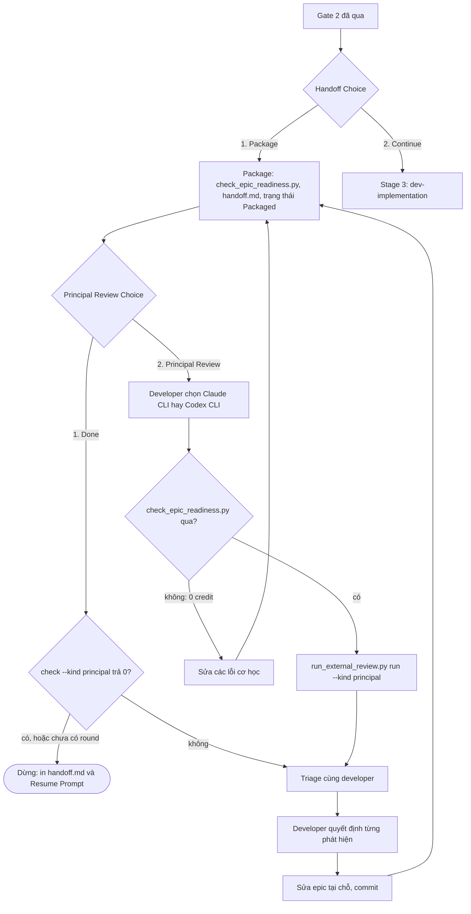

# Thiết kế Principal Review

- **Ngày**: 2026-10-22
- **Trạng thái**: Bản nháp, chờ duyệt Gate 1
- **Phạm vi**: `dev-lifecycle`, `dev-implementation` (script, references và Gate 3), `docs/lifecycles.*.md`,
  `scripts/test_lifecycle_document_contract.py`
- **Bước tiếp theo**: `dev-designer` (epic `principal_review`)

## Mục lục

- [1. Bối cảnh](#1-bối-cảnh)
- [2. Mục tiêu và ngoài mục tiêu](#2-mục-tiêu-và-ngoài-mục-tiêu)
- [3. Quyết định](#3-quyết-định)
- [4. Luồng](#4-luồng)
- [5. Thành phần](#5-thành-phần)
- [6. Quy trình vòng Principal Review](#6-quy-trình-vòng-principal-review)
- [7. Xử lý lỗi](#7-xử-lý-lỗi)
- [8. Kiểm thử](#8-kiểm-thử)
- [9. Rủi ro và phụ thuộc](#9-rủi-ro-và-phụ-thuộc)
- [10. Ngoài phạm vi](#10-ngoài-phạm-vi)

## 1. Bối cảnh

Một epic rời Stage 2 với HLD, kịch bản BDD và các file task đã qua bốn kiểm tra cơ học:
`compute_execution_order.py`, đếm số bản task, `check_bdd_traceability.py plan` và
`check_task_contract.py --design`, cộng thêm bộ lint tài liệu. Các kiểm tra đó chứng minh tài liệu
đúng định dạng. Chúng không chứng minh tài liệu đúng.

Một đợt review thủ công trước triển khai cho epic đã đóng gói `flashcard_compact_data_enrichment`
trong `lyrics-sync` (2026-10-22) tìm ra các lỗi sau, dù cả bốn kiểm tra đều đã qua:

| Loại lỗi | Ví dụ | Hậu quả nếu không phát hiện |
|---|---|---|
| Tên không tồn tại | route `/api/tts/ocr-upload`, `/api/preview/persist-track`; symbol `buildPersistTrackPayload`, `infer_collocations_batch` | Stop-and-Report ở Task 1–3 |
| Hiểu sai code | `Collocation` được mô tả là dataclass; thực ra là model Pydantic có alias | Task 1 phải viết lại giữa chừng |
| Hợp đồng ngược với test đang ghim | DB offline phải trả `saved_disk_only`; một test hiện có ghim `failed` | Task 2 bị chặn |
| Thiếu nơi ghi dữ liệu | không task nào được sửa module chép `lyrics.json` vào dòng DB | tính năng âm thầm không chạy |
| Thiết kế làm hỏng thành phần lân cận | định dạng mới bỏ cụm nguyên văn mà TTS adapter dùng để gắn vào từ | popover không còn bấm được |
| Gate 4 không thể pass | `Integration results:` chạy 2 file; 10 scenario không có kết quả | Gate 4 không bao giờ xanh |
| Tài liệu lệch nhau | Gherkin trong task gắn `Tier A`, BDD gốc ghi `Tier B - Unit`; link `Epic:` hỏng | gây nhiễu, test sai tier |
| Lỗi có sẵn ở baseline | 3 test trong file mà một dòng GREEN chạy đã fail sẵn với Node v25 | RED/GREEN sai |

Epic anh em `studio_adaptive_ocr_chunk_enrichment` cũng đã phải sửa đúng kiểu như vậy vài giờ
trước đó. Kit đã có sẵn cơ chế lấy ý kiến thứ hai: `run_external_review.py` điều khiển Claude CLI
và Codex CLI ở chế độ chỉ đọc, ghi lại từng round và bắt buộc triage. Nhưng nó chỉ review code đã
xong, sau Gate 4.

## 2. Mục tiêu và ngoài mục tiêu

### Mục tiêu

- Bắt các loại lỗi ở trên **trước** Stage 3, khi sửa chỉ tốn một lần sửa tài liệu thay vì một executor phải dừng lại.
- Một script cơ học, `check_epic_readiness.py`, gộp preflight đóng gói hiện có với các kiểm tra mà máy tự quyết được.
- Một **Principal Review** cross-model: Claude CLI hoặc Codex CLI do developer chọn, đóng vai Principal Reviewer ký duyệt epic. Nó đánh giá sự thống nhất, grounding với source, impact, rủi ro và cách chia task, rồi đề xuất chỉnh sửa.
- Một **Principal Review Choice** sau bước Package, lặp như Review Choice cho đến khi developer chọn Done.

### Ngoài mục tiêu

- Review code: Review Choice sau Gate 4 vẫn giữ việc đó.
- Tự động áp dụng chỉnh sửa: reviewer chỉ đề xuất.
- Bắt buộc Principal Review.
- Chạy hai reviewer song song rồi gộp phát hiện.
- Dùng model Ollama cục bộ làm Principal Reviewer.

## 3. Quyết định

| # | Quyết định | Lý do |
|---|----------|--------|
| D1 | Principal Review là một lựa chọn được đưa ra sau mỗi lần Package, giống Review Choice: **1. Done** hoặc **2. Principal Review**. Developer chọn Claude CLI hay Codex CLI; agent không bao giờ tự chọn | Lựa chọn của developer (2026-10-22). Review tốn credit và hàng chục phút, nên không phải epic nào cũng cần |
| D2 | Khi epic được thiết kế bởi một model khác hoặc model nhanh (ví dụ một session Antigravity hoặc model cỡ Flash), xét theo dòng `Author` của HLD hoặc lời developer, lựa chọn kèm khuyến nghị mạnh nên chạy Principal Review | Giống khuyến nghị dành cho fast executor trong Review Choice; cả hai epic đã review đều đến từ Antigravity |
| D3 | `run_external_review.py` có thêm `--kind principal`; mặc định `--kind code` hoạt động y hệt hiện nay | Tái dùng cách gọi CLI, cách ghi round, `check`, `triage`, banner precondition và cơ chế phát hiện thay đổi cây thư mục. Một engine riêng sẽ trùng lặp và trôi lệch |
| D4 | `check_epic_readiness.py` là điều kiện tiên quyết của một round Principal Review. Có FAIL thì không gọi CLI (0 credit); toàn bộ báo cáo được đưa cho reviewer làm dữ kiện | Thời gian của model dành cho phán đoán, không cho những gì script tự quyết được |
| D5 | `check_epic_readiness.py` thay cho bốn lệnh preflight trong quy trình đóng gói | Một lệnh thay vì bốn, và giải phóng chữ dưới trần 2500 từ của `dev-lifecycle/SKILL.md` |
| D6 | Các round được ghi trong `.devtool/epic/<epic_dir>/principal_review.md`, tách khỏi `review_results.md` | Phát hiện về thiết kế và phát hiện về code có đối tượng và SHA khác nhau |
| D7 | Một phát hiện là một nhận định cần kiểm chứng. Mọi round đều được triage cùng developer trước khi sửa gì; muốn bỏ qua một phát hiện phải có lời của chính developer | Cùng kỷ luật với `review-triage.md`; reviewer có thể báo sai |
| D8 | Phát hiện được chấp nhận trở thành một lần sửa epic tại chỗ (sửa theo dev-designer, không chia lại hay đánh số lại task), commit là `[EPIC_NAME] Revise epic after Principal Review round <n>`, sau đó đóng gói lại toàn bộ | Giữ một dòng lịch sử tài liệu; `handoff.md` vẫn là bản ghi có ngày và được tạo lại, không bao giờ sửa |
| D9 | Done chỉ được chấp nhận khi `run_external_review.py check --kind principal` trả exit 0, nếu đã có round | Không epic nào được bàn giao khi còn phát hiện Critical hoặc Important chưa quyết |
| D10 | Gate 3 chạy cùng lệnh `check` khi có `principal_review.md` và dừng nếu exit 1. Epic chưa từng review hiển thị `Principal Review: not run` trong tóm tắt Gate 3 | Bắt trường hợp bàn giao mà bỏ qua Done; epic chưa review vẫn được phép (D1) |
| D11 | Nhánh Continue (implement ngay) không có Principal Review | Developer đã chọn bắt đầu ngay; YAGNI |
| D12 | `sync_task_status.py epic` chỉ ghi vào checkout hiện tại và các worktree trên nhánh `epic/<epic_slug>` của chính epic đó. Đồng bộ cấp task vẫn mirror qua mọi checkout | Nếu không, vòng đóng gói lại sẽ ghi vào worktree của epic khác ở mỗi round, để lại thay đổi chưa commit mà session khác có thể commit nhầm vào epic của họ |
| D13 | Quy trình nằm trong `dev-lifecycle/references/principal-review.md`; `SKILL.md` chỉ giữ một con trỏ ngắn và các bất biến đã ghim | `SKILL.md` đang ở 2454 trên 2500 từ |

## 4. Luồng



## 5. Thành phần

### 5.1 `check_epic_readiness.py`

Vị trí: `skills/dev-implementation/resources/scripts/`, cạnh các script mà nó tái dùng.

```bash
python3 "$SCRIPTS"/check_epic_readiness.py <epic_dir> [--baseline] [--row-timeout 600]
```

| Kiểm tra | Quy tắc | Mức |
|---|---|---|
| R1 Preflight | `compute_execution_order.py` trả 0. Số task quét được bằng số task trong thư mục epic. `check_bdd_traceability.py plan` và `check_task_contract.py --design` trả 0. `check_document.py` qua với `--require-toc --require-bilingual` trên các cặp spec, HLD và BDD, với `--require-toc` trên `handoff.md` khi có, và trên mọi file task | FAIL |
| R2 Bản task khớp nhau | Mỗi `.devtool/epic/<epic_dir>/task_*.md` bằng bản mirror trong `.devtool/features/` (hoặc `features/done/`) sau khi chuẩn hóa các link `Epic:` và `Spec:` phụ thuộc vị trí | FAIL |
| R3 Scenario khớp nhau | Mỗi khối scenario trong task bằng khối gốc trong `bdd_scenarios.en.md`, kể cả tier tag; `bdd_scenarios.vi.md` có cùng bộ mã | FAIL |
| R4 Tier tag | Mọi scenario được gắn `[Tier A - Unit]` hoặc `[Tier C - Integration]`; Tier B chỉ dành cho tooling | FAIL |
| R5 Grounding | Trong `Target Files & Symbols` của mỗi task, mọi symbol được liệt kê cho một file đã tồn tại và không phải `(new)` đều có trong file đó, trừ khi dòng đó ghi `new` | FAIL |
| R5b Route | Mọi route `/api/...` được nêu trong task hoặc HLD đều có trong một file source được git theo dõi, ngoài `.devtool/` và `docs/` | WARN |
| R6 Phủ Gate 4 | Mọi task có dòng `Covers:` đều có một dòng `TIER-C`, và mọi tham số đường dẫn của dòng `TIER-C` trỏ vào một thư mục `Integration test roots` đều được nêu, hoặc nằm dưới một thư mục được nêu, bởi một lệnh `Integration results:` của HLD | FAIL |
| R7 Metadata | HLD ở `Packaged` thì phải có `handoff.md` và ngược lại. Design commit trong handoff tồn tại và là tổ tiên của `HEAD`, trừ khi ghi `uncommitted`. Frontmatter của task ghi đúng epic này và một trạng thái hợp lệ | FAIL |
| R7b Trạng thái spec | Trạng thái spec không còn là bản nháp hay đang chờ Gate 1 (hiện `dev-brainstorming` không cập nhật nó khi được duyệt) | WARN |
| R8 Baseline (tùy chọn) | Với `--baseline` và cây sạch, mọi dòng `GREEN` và `TIER-B` có lệnh không nhắc đường dẫn `(new)` nào được chạy ngay trong checkout hiện tại; dòng nào fail thì báo kèm mã dòng và vài dòng cuối của output | WARN |

Đầu ra: mỗi kiểm tra một dòng (`R1 PASS`, `R5 FAIL task_2:…: buildPersistTrackPayload not in src/…/tts-studio.js`),
sau đó là `Result: <n> FAIL, <m> WARN — PASS|FAIL`. Exit 0 khi không có FAIL, 1 khi có FAIL, 2 khi
dùng sai lệnh. R8 chạy tại chỗ vì commit của một epic đã đóng gói chỉ đổi tài liệu, nên code trong
checkout chính là base mà các task sẽ bắt đầu.

### 5.2 `run_external_review.py --kind principal`

```bash
python3 "$SCRIPTS"/run_external_review.py run --kind principal --epic-dir <epic_dir> --base <base_ref> --cli claude|codex [--model <name>] [--timeout 1800]
python3 "$SCRIPTS"/run_external_review.py check --kind principal --epic-dir <epic_dir>
python3 "$SCRIPTS"/run_external_review.py triage --kind principal --epic-dir <epic_dir>
```

- `--kind` mặc định là `code`; mọi thứ review code đang làm giữ nguyên.
- `--kind principal` đi với `--cli ollama` là dùng sai lệnh (exit 2).
- **Điều kiện tiên quyết**: CLI có trên PATH và cây sạch, như hiện nay. `check_epic_readiness.py <epic_dir>` phải trả 0; nếu không thì in banner precondition hiện có và không gọi CLI.
- **Dữ kiện**: báo cáo readiness, base ref và SHA của nó, SHA được review (`HEAD`), và danh sách tài liệu (cặp spec, cặp HLD, cặp BDD, file task, `handoff.md`). Không gửi diff code: reviewer tự đọc source ở chế độ chỉ đọc (`claude -p --permission-mode plan`, `codex exec --sandbox read-only`).
- **Bản ghi**: `principal_review.md` dùng cùng định dạng round, bảng phát hiện và cột quyết định của `review_results.md`, với `Kind: principal` trong metadata mỗi round. `check` và `triage` đọc file mà `--kind` chọn.
- `--model` được truyền thẳng. `principal-review.md` khuyến nghị dùng model suy luận mạnh nhất mà mỗi CLI có.

### 5.3 Prompt và quy tắc Principal Review

File mới trong `skills/dev-implementation/references/`, cạnh prompt review code:
`principal-review-prompt.md` và `principal-review-rules.md`. Reviewer đóng vai Principal Reviewer ký
duyệt epic trước khi implement. Nó tuyệt đối chỉ đọc, và đối chiếu tài liệu với source tại SHA
được review:

| # | Mục kiểm tra |
|---|---|
| P1 | Thống nhất giữa spec, HLD, BDD, task và `handoff.md`: quyết định, tên trường, con số, tiêu đề, trạng thái |
| P2 | Grounding: mọi đường dẫn, symbol, chữ ký hàm, kiểu trả về, route và hằng số trong `Decisions Already Made` và `Impact Analysis` tồn tại đúng như mô tả |
| P3 | Hành vi đã ghim: các test hiện có ghim một hành vi mà task định đổi, khi các test đó nằm ngoài Allowed files của task |
| P4 | Phạm vi ảnh hưởng: các nơi khác đọc hoặc ghi dữ liệu bị đổi, tác vụ nền, caller ngoài Allowed files, migration và backfill |
| P5 | Chia task và Verification: thứ tự phụ thuộc, dòng RED có thể fail trước khi implement (hành vi chưa có sẵn), dòng GREEN có thể pass ở baseline, tham chiếu DoD, điều kiện dừng |
| P6 | Chất lượng BDD: Gherkin hợp lệ, chiều kiểm thử khớp với scenario, assertion có căn cứ, tier tag |
| P7 | Gate 4 khả thi: `Integration results:` phủ mọi scenario; Verification Environment khai báo mọi tài nguyên các dòng cần |
| P8 | Rủi ro, rollout và rollback |

Đầu ra giữ hợp đồng parser của review code: kết thúc bằng `Verdict: PASS` hoặc
`Verdict: CHANGES REQUIRED`, sau đó mỗi phát hiện một dòng,
`[Critical|Important|Minor] <artefact>:<location> — <problem>. Proposed: <edit>`.
Ý nghĩa các mức:
- **Critical**: epic không thể đạt mục tiêu hoặc qua Gate 4 như đã thiết kế;
- **Important**: một task sẽ chạm Stop-and-Report hoặc ship hành vi sai;
- **Minor**: câu chữ và sự thống nhất.

### 5.4 `dev-lifecycle`

- **Bước 1 của quy trình đóng gói**: một lệnh, `check_epic_readiness.py <epic_dir>`, thay cho bốn lệnh preflight.
- **Sau bước 7**: một con trỏ ngắn tới Principal Review Choice và `references/principal-review.md`. File reference mới chứa §6, câu chữ của lựa chọn, khuyến nghị D2 và quy tắc đóng gói lại.
- **Red Flags có thêm hai mục**: chọn CLI Principal Review thay cho developer, và hành động theo phát hiện Principal Review trước khi triage.
- **Giữ nguyên**: mọi bất biến mà `test_lifecycle_document_contract.py` ghim, và trần 2500 từ.

### 5.5 `dev-implementation`

Phase 0 và Resume Procedure: khi có `principal_review.md`, chạy
`run_external_review.py check --kind principal --epic-dir <epic_dir>` trước Gate 3. Nếu exit 1 thì
dừng và trình bày triage. Tóm tắt Gate 3 ghi trạng thái Principal Review: `not run`,
`round <n>: PASS` hoặc `round <n>: decided`.

### 5.6 `sync_task_status.py epic`

Lệnh con `epic` thu hẹp các root về checkout hiện tại cộng các worktree có nhánh `epic/<epic_slug>`.
Các lệnh con `task`, `archive-epic` và `archive-done` vẫn dùng mọi checkout.

### 5.7 Tài liệu cho người đọc và template

- `docs/lifecycles.en.md` và `docs/lifecycles.vi.md` có thêm vòng Principal Review Choice trong sơ đồ Stage 2, và một đoạn văn.
- `handoff-template.md` liệt kê `principal_review.md, when present` trong Read First.

## 6. Quy trình vòng Principal Review

1. Sau khi quy trình đóng gói in `handoff.md`, trình bày:
   > Packaged. 1. **Done** — dừng tại đây. 2. **Principal Review** — review cross-model thiết kế đối chiếu với source trước khi implement (Claude CLI hoặc Codex CLI).

   Thêm khuyến nghị D2 khi áp dụng.
2. **Done**: nếu có `principal_review.md`, chạy `check --kind principal`. Exit 0 thì dừng, in đường dẫn handoff và Resume Prompt; exit 1 thì sang bước 5.
3. **Principal Review**: hỏi dùng CLI nào, Claude CLI hay Codex CLI, và tùy chọn model nào. Không bao giờ chọn thay developer.
4. Chạy `run_external_review.py run --kind principal --epic-dir <epic_dir> --base <base_branch> --cli <cli>`. Nếu readiness FAIL thì banner được in: sửa các lỗi được nêu như một lần sửa epic, đóng gói lại, rồi quay về bước 1.
5. Trình bày `triage --kind principal`, điền như `review-triage.md` mô tả: mọi phát hiện được kiểm chứng với source tại SHA của round. Dừng và chờ developer quyết định từng phát hiện.
6. Áp dụng mỗi phát hiện được chấp nhận như một lần sửa epic tại chỗ (D8). Ghi các ô Decision (`fixed in <sha>` hoặc `dismissed: <lời của developer>`) và commit `[EPIC_NAME] Revise epic after Principal Review round <n>`.
7. Chạy lại quy trình đóng gói từ bước 1: readiness, tạo lại `handoff.md` với design commit mới, lint, trạng thái, commit. Sau đó quay về bước 1 của quy trình này.

## 7. Xử lý lỗi

| Tình huống | Hành vi |
|---|---|
| CLI không có trên PATH, cây không sạch, `--cli ollama` đi với `--kind principal` | Exit 2; không ghi round |
| `check_epic_readiness.py` FAIL | Banner precondition, không gọi CLI, exit 2; báo cáo nêu từng lỗi |
| Một dòng R8 vượt `--row-timeout` | WARN `timeout` cho dòng đó; các dòng khác vẫn chạy |
| Output của reviewer không có dòng Verdict | Ghi round là chưa hoàn tất, exit 2, như review code |
| Reviewer sửa file dù ở chế độ chỉ đọc | Cơ chế phát hiện thay đổi cây hiện có ghi các đường dẫn vào round |
| Developer chọn Done khi còn phát hiện chặn chưa quyết | Từ chối Done; trình bày triage (D9) |
| Có `principal_review.md` nhưng không parse được ở Gate 3 | `check` trả 1; Gate 3 dừng và nêu dòng lỗi |

## 8. Kiểm thử

- `test_check_epic_readiness.py`: mỗi kiểm tra R1–R8 có một epic fixture qua và một epic fixture fail, dựng trong repo git tạm. Các fixture fail tái hiện các loại lỗi ở §1: symbol không có, lệch Tier A với Tier B, đường dẫn `TIER-C` không được phủ, trạng thái spec còn là nháp, bản mirror lệch, và một dòng baseline fail.
- `test_run_external_review.py`: mọi test hiện có giữ nguyên và vẫn pass. Test mới gồm:
  - `--kind principal`: chọn đúng prompt, các dữ kiện nó mang theo, banner precondition khi readiness fail, và việc ghi `principal_review.md` trong khi `review_results.md` không bị đụng tới;
  - `check` và `triage` trên file principal;
  - lỗi dùng sai lệnh với `ollama`.
- `test_sync_task_status.py`: `epic` không đụng tới worktree trên nhánh của epic khác và cập nhật worktree của chính epic.
- `scripts/test_lifecycle_document_contract.py`:
  - token mong đợi cho `dev-lifecycle/SKILL.md` (`Principal Review Choice`, `check_epic_readiness.py`, `references/principal-review.md`);
  - các chuyển tiếp `PRC` trong cả hai `docs/lifecycles.*.md`;
  - trần 2500 từ vẫn giữ.
- `scripts/verify.sh` pass trước khi phát hành.

## 9. Rủi ro và phụ thuộc

- **Trần số từ**: con trỏ phải vừa dưới 2500 từ. D5 giải phóng khối preflight; nếu chưa đủ thì rút gọn đoạn văn trùng lặp quanh các chuyển tiếp Review Choice, không bao giờ bỏ token đã ghim.
- **Hồi quy review code**: `run_external_review.py` phục vụ Review Choice của Gate 4. Mọi đường mới nằm sau `--kind principal`, và bộ test hiện có là lớp bảo vệ.
- **Báo sai**: triage có kiểm chứng với source là bắt buộc (D7). Phát hiện Minor không bao giờ chặn Done.
- **Kiểm tra dựa trên heuristic**: R5 chỉ FAIL với các cặp `path: symbol` tường minh, và lệch route chỉ là WARN (R5b). R8 là tùy chọn vì nó chạy lệnh của dự án.
- **Chi phí**: mỗi round tốn credit CLI và có thể kéo dài tới timeout 1800 giây. Lựa chọn vẫn là tùy chọn (D1).
- **Phụ thuộc**: Claude CLI hoặc Codex CLI đã cài và đăng nhập; các quy ước file task mà `check_task_contract.py` đã bắt buộc (`Target Files & Symbols`, đánh dấu `(new)`, các dòng Verification).

## 10. Ngoài phạm vi

- Review song song bằng cả hai CLI rồi gộp phát hiện.
- Áp dụng patch do reviewer sinh ra vào tài liệu.
- Principal Review trên nhánh Continue, hoặc cho lifecycle tài liệu (`doc-lifecycle`).
- Model Ollama cục bộ làm Principal Reviewer.
- Thay đổi prompt review code hoặc Review Choice của Gate 4.
