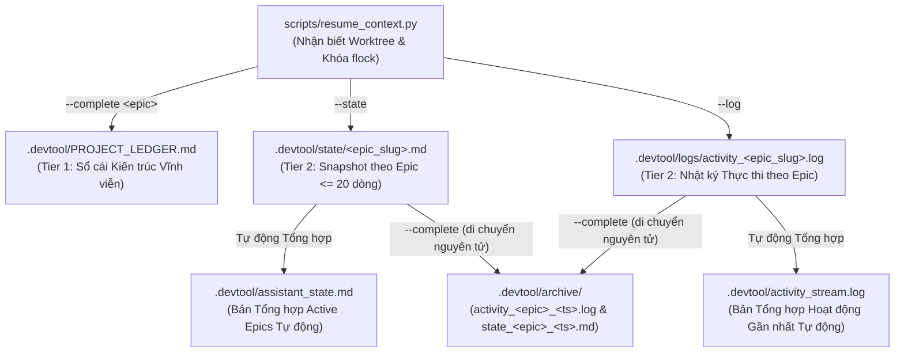
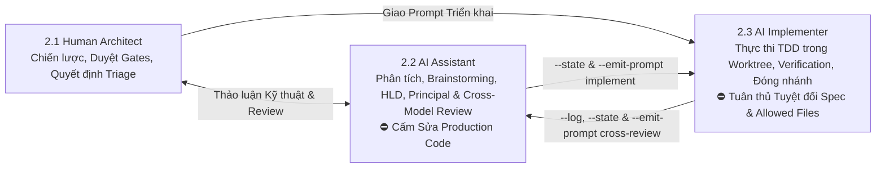

# Đặc tả Bộ nhớ Dự án Hai Tầng, Quản trị Ba Vai trò và Khôi phục/Lưu Ngữ cảnh

## Table of Contents

- [1. Tổng quan và Phát biểu Bài toán](#1-tổng-quan-và-phát-biểu-bài-toán)
- [2. Mục tiêu và Phạm vi Ngoài Mục tiêu](#2-mục-tiêu-và-phạm-vi-ngoài-mục-tiêu)
- [3. Đồng nhất Môi trường và Shell Aliases](#3-đồng-nhất-môi-trường-và-shell-aliases)
- [4. Kiến trúc Lưu trữ Hai Tầng Đa Epic](#4-kiến-trúc-lưu-trữ-hai-tầng-đa-epic)
- [5. Đặc tả CLI Engine](#5-đặc-tả-cli-engine)
- [6. Mô hình Quản trị Ba Vai trò và Ma trận Chuyển giao](#6-mô-hình-quản-trị-ba-vai-trò-và-ma-trận-chuyển-giao)
- [7. Thiết kế Skills và Tích hợp Dev-Lifecycle](#7-thiết-kế-skills-và-tích-hợp-dev-lifecycle)
- [8. Xử lý Lỗi, Đa luồng và Chiến lược Kiểm thử](#8-xử-lý-lỗi-đa-luồng-và-chiến-lược-kiểm-thử)

## 1. Tổng quan và Phát biểu Bài toán

Quá trình phát triển phần mềm có AI hỗ trợ trên không gian làm việc đa repository (`ai-agent-tools`, `D3Nexus`, `lyrics-sync`, `nexus`) và đa tài khoản Antigravity (`antigravity_homes/<profile>`) gặp ba thách thức lớn về tính liên tục:

1. **Mất ngữ cảnh khi xoay vòng tài khoản và chuyển phiên**: Khi đổi tài khoản hoặc mở session mới, trạng thái hội thoại bị mất nếu các quyết định kiến trúc, tiến độ task và lịch sử thực thi gần nhất không được lưu trữ định sẵn trên đĩa.
2. **Xung đột khi nhiều AI Agents chạy song song nhiều Epics**: Khi nhiều AI Agents cùng làm việc trên các Epics khác nhau trong cùng một repository, việc ghi đè lên một file `.devtool/assistant_state.md` duy nhất hoặc xoay vòng một file `.devtool/activity_stream.log` duy nhất sẽ làm mất trạng thái và cuốn mất log của các Epics đang chạy dở.
3. **Nhập nhằng vai trò giữa Tư vấn (Assistant) và Thực thi (Implementer)**: Nếu không có ranh giới quyền hạn rõ ràng, một AI Agent được gọi lên để phân tích kỹ thuật, chạy Principal Review hoặc Cross-Model Review có thể tự ý sửa code thực thi, hoặc một Agent thực thi có thể tự ý làm lệch thiết kế đã khóa.

Tài liệu đặc tả này định nghĩa CLI engine **Two-Tier Project Memory** (`scripts/resume_context.py`), cơ chế đồng bộ môi trường trong `.zshrc` (bao gồm chia sẻ lịch sử terminal và bộ alias chuẩn), hai skills chuyên biệt (`resume-context` và `save-context`), **Mô hình Quản trị Ba Vai trò** (Human Architect, AI Assistant, AI Implementer), và các điểm chạm tự động lưu ngữ cảnh xuyên suốt toàn bộ các giai đoạn của `d3nexus:dev-lifecycle`.

## 2. Mục tiêu và Phạm vi Ngoài Mục tiêu

### Mục tiêu

- Đồng nhất các biến môi trường shell (`REAL_HOME`, `WORKSPACE_ROOT`, `HISTFILE`), các symlink thư mục (`AllProjects`, `Projects`, `.zsh_history`), và các alias (`resume`, `save-context`) trên mọi profile Antigravity thông qua `/Users/danhdueexoictif/.zshrc`.
- Xây dựng CLI engine bằng Python chuẩn không phụ thuộc thư viện ngoài tại `scripts/resume_context.py`, hỗ trợ phân vùng trạng thái Tier 2 theo từng Epic (`.devtool/state/<epic_slug>.md` và `.devtool/logs/activity_<epic_slug>.log`) kèm cơ chế tự động tổng hợp ra `.devtool/assistant_state.md` và `.devtool/activity_stream.log`.
- Hỗ trợ định tuyến nhận biết git worktree để các lệnh chạy bên trong `.worktrees/<epic_dir>` tự động trỏ về thư mục `.devtool/` của repository gốc.
- Thực thi **Mô hình Quản trị Ba Vai trò** (Human Architect, AI Assistant, AI Implementer) với chế độ thu hoạch ngữ cảnh theo vai trò và trình sinh prompt bàn giao tự động (`--emit-prompt`) qua bốn kịch bản chuyển giao thực tế.
- Tạo mới `skills/resume-context/SKILL.md` và `skills/save-context/SKILL.md`, đồng thời tích hợp lưu ngữ cảnh tự động vào `dev-brainstorming`, `dev-designer`, `dev-lifecycle`, `principal-review`, `dev-implementation`, `cross-model-review`, `finishing-a-development-branch`, và `rules/CRITICAL_RULES.md`.

### Phạm vi Ngoài Mục tiêu

- Không sử dụng cơ sở dữ liệu ngoài hoặc dịch vụ lưu trữ đám mây (mọi trạng thái đều lưu trên file cục bộ trong `.devtool/`).
- Không sửa đổi logic nghiệp vụ của các repo vệ tinh (`D3Nexus`, `lyrics-sync`, `nexus`) trong phạm vi epic công cụ này.
- Không thay thế lịch sử git hoặc các file Kanban task (`.devtool/features/task_*.md`).

## 3. Đồng nhất Môi trường và Shell Aliases

Tất cả các thư mục profile Antigravity (`/Users/danhdueexoictif/antigravity_homes/<profile>/.zshrc`) đều symlink về `/Users/danhdueexoictif/.zshrc`. Để đảm bảo đồng nhất tuyệt đối giữa Terminal tích hợp trên IDE, phiên `<profile>-cli`, và zsh độc lập:

1. **Workspace Root và Symlink Dự án**:
   - Khai báo `export REAL_HOME="/Users/danhdueexoictif"` và `export WORKSPACE_ROOT="$REAL_HOME/AllProjects"` ở đầu `/Users/danhdueexoictif/.zshrc`.
   - Duy trì symlink `/Users/danhdueexoictif/Projects -> /Users/danhdueexoictif/AllProjects` và bổ sung `AllProjects`, `Projects`, cùng `.zsh_history` vào mảng `sync_items` bên trong hàm `ag_run()`.
2. **Chia sẻ Lịch sử Terminal (`.zsh_history`) Xuyên suốt Mọi Tài khoản**:
   - Gộp các lệnh hiện có từ `.zsh_history` của từng profile vào `/Users/danhdueexoictif/.zsh_history` và tạo symlink `.zsh_history` tại mỗi profile trỏ về `$REAL_HOME/.zsh_history`.
   - Cấu hình biến lịch sử zsh ngay sau dòng `source $ZSH/oh-my-zsh.sh` để không bị Oh-My-Zsh ghi đè `HISTFILE`:
     ```zsh
     export HISTFILE="$REAL_HOME/.zsh_history"
     export HISTSIZE=50000
     export SAVEHIST=50000
     setopt INC_APPEND_HISTORY
     setopt SHARE_HISTORY
     setopt HIST_IGNORE_DUPS
     ```
3. **Chuẩn hóa Aliases Ngữ cảnh**:
   ```zsh
   alias resume='python3 $HOME/Projects/ai-agent-tools/scripts/resume_context.py'
   alias save-context='python3 $HOME/Projects/ai-agent-tools/scripts/resume_context.py --complete'
   ```

## 4. Kiến trúc Lưu trữ Hai Tầng Đa Epic

Để ngăn chặn xung đột khi nhiều AI Agents chạy song song nhiều Epics trong cùng một repository, thư mục `.devtool/` sử dụng cơ chế phân vùng theo Epic ở Tier 2 đồng thời duy trì các file tổng hợp tương thích ngược:



### Quy tắc Tổ chức Lưu trữ

- **Tier 1 — `.devtool/PROJECT_LEDGER.md`**:
  - Lưu trữ vĩnh viễn cấu trúc hệ thống, các bất biến cốt lõi và lịch sử các cột mốc Epic đã hoàn thành (`- **[YYYY-MM-DD] \`<epic_slug>\`**: <summary>`). Không bao giờ xóa file này.
- **Tier 2 — `.devtool/state/<epic_slug>.md` và `.devtool/assistant_state.md`**:
  - Mỗi Epic đang hoạt động (hoặc `general` cho công việc không thuộc epic) sở hữu một file `.devtool/state/<epic_slug>.md` giới hạn tối đa 20 dòng, bao gồm:
    - `Active Epic`: `<epic_slug>` (kèm vai trò và dấu thời gian cập nhật)
    - `Recent Decisions Locked`: các quyết định kiến trúc hoặc kết quả review vừa khóa
    - `Repo/Task Status`: giai đoạn hiện tại, nhánh/worktree và tỷ lệ hoàn thành task
    - `Next Immediate Step`: bước hành động kế tiếp cụ thể
    - `Custom Prompt / Notes`: ghi chú ngữ cảnh tùy chỉnh từ developer hoặc agent
  - Mỗi lần chạy `--state` hoặc `--complete`, hệ thống tự động kết xuất lại `.devtool/assistant_state.md` bằng cách ghép toàn bộ các file `.devtool/state/*.md` đang active.
- **Tier 2 — `.devtool/logs/activity_<epic_slug>.log` và `.devtool/activity_stream.log`**:
  - Sau mỗi yêu cầu sửa code hoặc mỗi task hoàn thành, Implementer ghi nối tiếp 1–3 dòng vào `.devtool/logs/activity_<epic_slug>.log`:
    `[YYYY-MM-DD HH:MM] [<repo>/<epic_slug>/<task_id>] Request: <summary> | Action: <files & tests> | Note: <deviations or None>`
  - Mỗi lần chạy `--log` hoặc `--complete`, hệ thống tự động làm mới `.devtool/activity_stream.log` từ các file log của những Epic đang active.
- **Đóng Epic & Nén Log Cô lập (`--complete`)**:
  - Lệnh `--complete <epic_slug> "<summary>"` ghi cột mốc vào `PROJECT_LEDGER.md`, di chuyển nguyên tử chỉ riêng `.devtool/logs/activity_<epic_slug>.log` và `.devtool/state/<epic_slug>.md` vào `.devtool/archive/`, sau đó cập nhật lại các file tổng hợp từ những Epics còn đang chạy. Các Epics song song khác được bảo toàn nguyên vẹn 100%.

## 5. Đặc tả CLI Engine

`scripts/resume_context.py` cung cấp bốn chế độ vận hành chính cùng trình sinh prompt bàn giao:

1. **Chế độ Thu hoạch & Khôi phục Ngữ cảnh (Mặc định)**:
   ```bash
   python3 scripts/resume_context.py [--workspace-root <path>] [--repo <name>] [--epic <slug>] [--role assistant|implementer] [--tail <N>] [--json]
   ```
   - Tự động nhận diện `WORKSPACE_ROOT` từ `--workspace-root`, `$WORKSPACE_ROOT`, đường dẫn thực của script (`Path(__file__).resolve().parents[1].parent`), hoặc `$HOME/Projects` / `$HOME/AllProjects`.
   - Phân giải git worktrees qua `git rev-parse --git-common-dir` để mọi lệnh gọi bên trong `.worktrees/<epic_dir>` đều đọc và ghi về đúng `.devtool/` của repository chính.
   - Hiển thị 6 phần thông tin:
     0. `0. PROJECT ARCHITECTURAL LEDGER (.devtool/PROJECT_LEDGER.md)`
     1. `1. ACTIVE EPIC STATE (.devtool/state/*.md & .devtool/assistant_state.md)`
     2. `2. RECENT IMPLEMENTER ACTIVITY (.devtool/logs/activity_*.log)` ($N$ dòng cuối cho mỗi epic đang active)
     3. `3. GIT WORKING TREE & WORKTREE STATUS ACROSS REPOS`
     4. `4. OPEN CONTRACT GAPS & RFCS (shared-contracts/*/gaps_and_rfcs.md)`
     5. `5. ACTIVE & COMPLETED KANBAN TASKS (.devtool/features/task_*.md & done/)`
   - Khi truyền `--role assistant` hoặc `--role implementer`, in kèm **Khung Quyền hạn Vai trò (Role Governance Banner)** quy định rõ quyền hạn và giới hạn.

2. **Chế độ Ghi Snapshot Kiến trúc (`--state`)**:
   ```bash
   python3 scripts/resume_context.py --state --epic <slug> [--repo <name>] \
     [--decisions "<text>"] [--status "<text>"] [--next "<text>"] [--prompt "<custom_note>"]
   ```
   - Kiểm soát giới hạn tối đa 20 dòng trên `.devtool/state/<epic_slug>.md`, lấy khóa độc quyền (`.devtool/.memory.lock`), ghi snapshot của epic và tái tạo `.devtool/assistant_state.md`.

3. **Chế độ Ghi Nhật ký Thực thi (`--log`)**:
   ```bash
   python3 scripts/resume_context.py --log --epic <slug> [--repo <name>] [--task <task_id>] \
     --request "<summary>" --action "<files_and_tests>" [--note "<deviations_or_prompt>"]
   ```
   - Ghi nối tiếp một dòng chuẩn hóa vào `.devtool/logs/activity_<epic_slug>.log` dưới khóa file và làm mới `.devtool/activity_stream.log`.

4. **Chế độ Hoàn tất Feature & Xoay vòng Log (`--complete` / `save-context`)**:
   ```bash
   python3 scripts/resume_context.py --complete <epic_slug> "<milestone_summary>" [--repo <name>] [--checkpoint]
   ```
   - Mặc định `--complete <epic_slug> "<summary>"`: ghi cột mốc vào `PROJECT_LEDGER.md`, đưa state và activity log của `<epic_slug>` vào `.devtool/archive/`, và làm mới các file tổng hợp.
   - Nếu truyền thêm cờ `--checkpoint` (ví dụ `save-context --checkpoint <epic_slug> "<custom_prompt>"`), chỉ lưu bản chụp Tier 2 (`--state` + `--log`) mà không đóng hay lưu trữ epic.

5. **Trình Sinh Prompt Bàn giao Gắn Vai trò (`--emit-prompt`)**:
   ```bash
   python3 scripts/resume_context.py --emit-prompt <principal-review|implement|cross-review|finish|assistant> [--epic <slug>] [--epic-dir <dir>] [--prompt "<custom_note>"]
   ```
   - Xuất các khối prompt dựng sẵn có gắn khóa persona rõ ràng để chuyển giao tức thì giữa phiên Assistant và phiên Implementer.

## 6. Mô hình Quản trị Ba Vai trò và Ma trận Chuyển giao

Việc phát triển dự án được điều phối chặt chẽ qua ba vai trò:



### Bốn Kịch bản Chuyển giao Vận hành Thực tế

| Kịch bản | Vai trò Kích hoạt | Điểm Kích hoạt & Lệnh Khởi đầu | Trạng thái Đầu ra & Prompt Bàn giao Tiếp theo |
| :--- | :--- | :--- | :--- |
| **1. Principal Review sau bước Đóng gói** | **AI Assistant (2.2)** | Kích hoạt sau bước `Package` ở Stage 2. Nạp ngữ cảnh qua `resume_context.py --role assistant --epic <slug>` và chạy `d3nexus:principal-review`. | Lưu kết quả vòng review qua `--state` và xuất **Prompt Thực thi cho Implementer** (`--emit-prompt implement`). |
| **2. Triển khai Code sau Review** | **AI Implementer (2.3)** | Kích hoạt qua `/dev-implementation` với `[PERSONA: AI IMPLEMENTER]`. Nạp `resume_context.py --role implementer --epic <slug>` và `handoff.md`. | Ghi nhật ký mỗi task qua `--log` + `--state`. Khi Gate 4 PASS, lưu SHA ứng viên và xuất `--emit-prompt cross-review`. |
| **3. Cross-Model Review sau khi Implement xong** | **AI Assistant (2.2)** | Kích hoạt sau khi Gate 4 PASS qua `/cross-model-review`. Nạp ngữ cảnh bằng `resume_context.py --role assistant --epic <slug>` và phân loại findings cùng Human Architect. | Xuất **Prompt Sửa lỗi cho Implementer** (nếu có mục cần sửa) hoặc **Prompt Đóng nhánh** (`--emit-prompt finish`) cho `/finish`. |
| **4. Thảo luận Kỹ thuật Độc lập (Ad-Hoc)** | **AI Assistant (2.2)** | Kích hoạt bất kỳ lúc nào qua `/resume-context` để trao đổi kiến trúc, phân tích lỗi hoặc đánh giá giải pháp. Khóa cứng không sửa production code. | Lưu lại kết luận thảo luận bất kỳ lúc nào qua `/save-context` (`--state --prompt "<note>"`). |

## 7. Thiết kế Skills và Tích hợp Dev-Lifecycle

### Hai Skills Mới

1. **`skills/resume-context/SKILL.md`**:
   - Thực thi `scripts/resume_context.py` khi khởi động session mới hoặc sau khi đổi tài khoản.
   - Thực thi **Mô hình Quản trị Ba Vai trò**: mặc định kích hoạt **AI Assistant** (đọc hiểu mã nguồn, thảo luận kỹ thuật, điều phối review) trừ khi người dùng truyền prompt triển khai hoặc gọi `/dev-implementation` (kích hoạt **AI Implementer**).
   - Tóm tắt trạng thái dự án trong 5–10 gạch đầu dòng súc tích trước khi giải quyết yêu cầu của người dùng.
2. **`skills/save-context/SKILL.md`**:
   - Lưu trạng thái tức thời kèm hỗ trợ custom prompt (`--state --prompt "..."`, `--log`, hoặc `--complete`).
   - Tự động xuất các khối prompt bàn giao gắn vai trò (`--emit-prompt`) giúp developer chuyển đổi tài khoản hoặc chuyển giao giữa Assistant và Implementer chỉ trong một bước.

### Các Điểm chạm Tích hợp trong Lifecycle

- **`skills/dev-brainstorming/SKILL.md` (Stage 1)**: Ngay sau khi Spec được duyệt ở Gate 1, lưu các quyết định kiến trúc qua `resume_context.py --state`.
- **`skills/dev-designer/SKILL.md` & `skills/dev-lifecycle/SKILL.md` (Stage 2)**: Tại Gate 2 và trong bước `Package`, cập nhật `--state`, nhúng khối `[PERSONA: AI IMPLEMENTER]` cùng lệnh `resume_context.py --role implementer` vào `references/handoff-template.md`, đồng thời xuất `--emit-prompt principal-review` và `--emit-prompt implement`.
- **`skills/principal-review/SKILL.md`**: Khi hoàn tất vòng lặp review/chỉnh sửa tài liệu, ghi nhận trạng thái qua `--state` và xuất `--emit-prompt implement` cho `/dev-implementation`.
- **`skills/dev-implementation/SKILL.md` (Stage 3)**:
  - Phase 0 chạy `resume_context.py --role implementer --epic <epic_slug>`.
  - Phase 2 chạy `resume_context.py --log` và `--state` ngay sau mỗi commit hoàn thành task.
  - Phase 4 (khi Gate 4 PASS) chạy `resume_context.py --state` và xuất `--emit-prompt cross-review` bên cạnh bảng Review Choice.
- **`skills/cross-model-review/SKILL.md`**: Sau khi ghi nhận quyết định triage, chạy `resume_context.py --state` và xuất prompt bước tiếp theo (Implementer fix hoặc Stage 4 finish).
- **`skills/finishing-a-development-branch/SKILL.md` (Stage 4 `/finish`)**: Trong **Pre-Finish Hook** (cùng bước `sync_task_status.py archive-done`), thực thi `resume_context.py --complete "<epic_slug>" "<milestone_summary>"` để ghi cột mốc vĩnh viễn vào Tier 1 (`PROJECT_LEDGER.md`) và xoay vòng state/logs Tier 2 của epic đó vào `.devtool/archive/`.
- **`rules/CRITICAL_RULES.md`**: Bổ sung Rule 7 bắt buộc tuân thủ Two-Tier Project Memory và kỷ luật phân quyền Ba Vai trò trên mọi dự án và plugin.

## 8. Xử lý Lỗi, Đa luồng và Chiến lược Kiểm thử

- **Khóa File Đồng thời (`fcntl.flock`)**: Mọi thao tác ghi vào `PROJECT_LEDGER.md`, `.devtool/state/*.md`, `.devtool/logs/*.log`, và các file tổng hợp đều phải lấy khóa độc quyền trên `.devtool/.memory.lock` để chống hỏng dữ liệu khi nhiều Agents chạy song song.
- **Kiểm soát Giới hạn 20 Dòng**: Chế độ `--state` tự động cắt gọn hoặc nén nội dung để đảm bảo mỗi file `.devtool/state/<epic_slug>.md` không bao giờ vượt quá 20 dòng.
- **Di trú Dữ liệu Cũ (Legacy Migration)**: Nếu một repository đã có `.devtool/assistant_state.md` hoặc `.devtool/activity_stream.log` theo cấu trúc cũ (chưa có `.devtool/state/` hay `.devtool/logs/`), `resume_context.py` sẽ tự động chuyển nội dung cũ vào `state/general.md` và `logs/activity_general.log` trong lần ghi đầu tiên mà không làm mất dữ liệu.
- **Kiểm thử Tự động**:
  - `scripts/test_resume_context.py` kiểm chứng khởi tạo sổ cái Tier 1, cô lập đa epic ở Tier 2 (đóng `epic-a` vẫn giữ nguyên state và log của `epic-b`), định tuyến từ worktree về repo chính, giới hạn 20 dòng của snapshot, và kết quả xuất `--emit-prompt` cho mọi vai trò.
  - `scripts/verify.sh` kiểm tra định dạng markdown, tính đồng bộ của cặp spec song ngữ, liên kết mục lục (TOC), và chạy toàn bộ unit tests.
