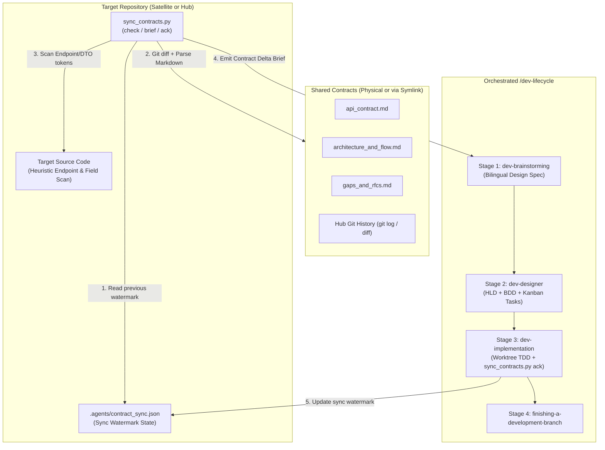

# Sync Shared Contracts Design

- **Date**: 2026-10-30
- **Status**: Draft (Pending Gate 1 Approval)
- **Scope**: New skill `skills/sync-shared-contracts/`, CLI engine `sync_contracts.py`, canonical delta brief template, hermetic test suite `test_sync_contracts.py`, integration with `scripts/verify.sh`
- **Next step**: `d3nexus:dev-designer` (Stage 2 — High-Level Design, BDD Scenarios, and Kanban Breakdown)

## Table of Contents

- [1. Background and Motivation](#1-background-and-motivation)
- [2. Goals and Non-Goals](#2-goals-and-non-goals)
- [3. Architecture and Dual-Mode Detection](#3-architecture-and-dual-mode-detection)
- [4. Directory Structure and Sync Watermark Schema](#4-directory-structure-and-sync-watermark-schema)
- [5. CLI Engine Specifications](#5-cli-engine-specifications)
- [6. Target Codebase Heuristic Scanner](#6-target-codebase-heuristic-scanner)
- [7. Orchestrated Lifecycle Bridge](#7-orchestrated-lifecycle-bridge)
- [8. Verification and Test Strategy](#8-verification-and-test-strategy)
- [9. Error Handling and Edge Cases](#9-error-handling-and-edge-cases)
- [10. Risks and Mitigations](#10-risks-and-mitigations)

## 1. Background and Motivation

With the introduction of `setup-shared-contracts`, multi-repository ecosystems (such as the control plane `D3Nexus` paired with worker satellites like `lyrics-sync` and mobile clients like `nexus`) have a standardized way to initialize physical `shared-contracts/` directories, relative symbolic links, and governance rules.

However, after initial setup (Day-0), teams face continuous synchronization challenges (Day-2 operations):
- When the Hub repository updates `api_contract.md` or `architecture_and_flow.md` (or approves an RFC in `gaps_and_rfcs.md`), satellite repositories lack an automated tool to detect what changed since their last implementation cycle.
- When a satellite repository logs a new `Draft` or `In Review` proposal in `gaps_and_rfcs.md`, the Hub repository needs a deterministic check to discover actionable RFCs and incorporate them into backend implementation plans.
- Transitioning from detected contract deltas into `d3nexus:dev-lifecycle` (Spec -> HLD & BDD -> Worktree TDD Implementation -> Branch Finishing) currently requires manual inspection and copy-pasting of endpoints, schemas, and governance constraints.

To bridge contract changes directly into target repository execution, we are introducing the `sync-shared-contracts` skill and its companion CLI engine `sync_contracts.py`.

## 2. Goals and Non-Goals

### Goals
- Provide a zero-dependency standard-library Python CLI (`sync_contracts.py`) supporting `check`, `brief`, and `ack` subcommands.
- Implement a **3-Layer Hybrid Delta Engine**:
  1. **Git & SHA-256 Watermark Diff**: Compare Hub git history and canonical file hashes against `.agents/contract_sync.json`.
  2. **Structured Markdown Contract Parser**: Parse endpoints, headers, JSON payload keys, pipeline steps, and active RFC tables from the 3 canonical contract files (`api_contract.md`, `architecture_and_flow.md`, `gaps_and_rfcs.md`).
  3. **Target Codebase Heuristic Scanner**: Scan target repository source files to classify contract endpoints, headers, and payload keys as `FOUND_IN_CODE` or `MISSING_IN_CODE`.
- Support **Dual-Mode Execution** (auto-detecting Satellite symlink mode vs Hub physical directory mode).
- Generate a structured **Contract Requirements Brief** (`brief`) that feeds directly into `d3nexus:dev-lifecycle` across all 4 stages (`dev-brainstorming` -> `dev-designer` -> `dev-implementation` -> `finishing-a-development-branch`).
- Provide an atomic watermark update command (`ack`) that records the synced contract version, Hub commit SHA, file hashes, and acknowledged RFCs/endpoints in `.agents/contract_sync.json`.

### Non-Goals
- Modifying or replacing `setup-shared-contracts` topology initialization (`init-hub`, `link-satellite`).
- Autonomously committing across git symlink boundaries in violation of Rule 7 of `CRITICAL_RULES.md`.
- Pushing git commits to remote repositories without explicit user confirmation (prohibited by Rule 3).

## 3. Architecture and Dual-Mode Detection

The skill operates across both sides of the Star Topology by inspecting `<repo_root>/shared-contracts`:

1. **Satellite Mode (`shared-contracts` is a relative symbolic link)**:
   - Resolves the symlink target to identify the `<domain>` folder and parent `<hub_root>`.
   - Detects upstream changes made in the Hub repository (new endpoints, updated payload fields, pipeline rules, and `Approved` RFCs) that need to be implemented in the satellite consumer/worker codebase.
   - Enforces the strict Git read-only symlink boundary (never staging `shared-contracts/` inside the satellite repository; tracking sync state exclusively in `.agents/contract_sync.json`).
2. **Hub Mode (`shared-contracts/` is a physical directory)**:
   - Iterates over domain subdirectories `shared-contracts/<domain>/` (or targets a specific `--domain`).
   - Detects `Draft`, `In Review`, or `Approved` RFCs and gaps proposed by satellites in `gaps_and_rfcs.md`, as well as contract changes not yet reflected in the Hub backend source code or `.agents/contract_sync.json`.
   - Enforces the `task_01` Contract-First synchronization rule during `dev-designer` task breakdown.



## 4. Directory Structure and Sync Watermark Schema

### 4.1 Skill Directory Structure

```text
skills/sync-shared-contracts/
├── SKILL.md
└── resources/
    ├── scripts/
    │   ├── sync_contracts.py
    │   └── test_sync_contracts.py
    └── templates/
        └── contract_delta_brief.md.tmpl
```

### 4.2 Sync Watermark Schema (`.agents/contract_sync.json`)

The watermark file is stored inside the target repository at `.agents/contract_sync.json`:

```json
{
  "schema_version": 1,
  "mode": "satellite",
  "domains": {
    "lyrics-sync": {
      "hub_commit_sha": "a1b2c3d4e5f6a1b2c3d4e5f6a1b2c3d4e5f6a1b2",
      "contract_version": "1.1.0",
      "last_synced_at": "2026-10-30T18:30:00Z",
      "file_hashes": {
        "api_contract.md": "sha256:e3b0c44298fc1c149afbf4c8996fb92427ae41e4649b934ca495991b7852b855",
        "architecture_and_flow.md": "sha256:...",
        "gaps_and_rfcs.md": "sha256:..."
      },
      "acknowledged_rfcs": ["RFC-001", "RFC-002"],
      "acknowledged_endpoints": [
        "POST /api/v1/lyrics-sync/tasks/claim",
        "POST /api/v1/lyrics-sync/tasks/{id}/progress",
        "POST /api/v1/lyrics-sync/tasks/{id}/complete",
        "GET /api/v1/lyrics-sync/status"
      ]
    }
  }
}
```

## 5. CLI Engine Specifications

The script `sync_contracts.py` provides three subcommands:

### 5.1 Command: `check`
```bash
python3 sync_contracts.py check [--repo-root <path>] [--domain <domain_name>] [--json] [--strict]
```
- **Validation**:
  - Verifies `shared-contracts` exists and resolves cleanly (no dangling symlinks, all 3 canonical files present).
- **Actions**:
  1. Loads `.agents/contract_sync.json` if present; otherwise marks the domain status as `INITIAL_SYNC`.
  2. Computes current `sha256` hashes for `api_contract.md`, `architecture_and_flow.md`, and `gaps_and_rfcs.md`, and queries the latest git commit SHA affecting the domain folder in the Hub repository (falling back gracefully if git history is unavailable).
  3. Parses the 3 canonical Markdown files to extract version metadata, required headers, endpoints matrix rows, JSON schema keys, pipeline steps, and RFC ledger entries.
  4. Runs the Target Codebase Heuristic Scanner across `<repo_root>` to check whether extracted endpoints, headers, and payload keys appear in source code.
  5. Determines overall sync status: `IN_SYNC`, `INITIAL_SYNC`, or `DRIFT_DETECTED`.
- **Exit Codes**:
  - `0` when `IN_SYNC` (or when `DRIFT_DETECTED` / `INITIAL_SYNC` without `--strict`).
  - `1` when topology/symlink errors occur, or when `--strict` is passed and status is not `IN_SYNC`.

### 5.2 Command: `brief`
```bash
python3 sync_contracts.py brief [--repo-root <path>] [--domain <domain_name>] [--output <path>]
```
- **Actions**:
  - Executes the full 3-layer delta analysis from `check`.
  - Renders `contract_delta_brief.md.tmpl` into a structured Markdown report containing:
    1. **Topology & Sync Metadata**: Mode (`hub` / `satellite`), Domain, Version transition (`previous -> current`), Hub commit range, and Changed files list.
    2. **API & Schema Requirements**: Endpoints and JSON payload fields added or modified, annotated with heuristic scan status (`FOUND_IN_CODE` vs `MISSING_IN_CODE`).
    3. **Architecture & Pipeline Invariants**: Canonical pipeline steps, state machine transitions, and cancellation/isolation constraints.
    4. **Actionable RFCs & Gaps**: Pending or newly approved entries from `gaps_and_rfcs.md` requiring action in the current repository mode.
    5. **Lifecycle Execution Rules**: Mandatory instructions for `dev-brainstorming`, `dev-designer` (`task_01` rule and symlink boundary rules), and `dev-implementation` (`sync_contracts.py ack` verification step).

### 5.3 Command: `ack`
```bash
python3 sync_contracts.py ack [--repo-root <path>] [--domain <domain_name>] [--rfc <RFC-ID> ...]
```
- **Actions**:
  - Computes the current file hashes, contract version, Hub git commit SHA, endpoints list, and RFC IDs (all `Approved` / `Implemented` RFCs plus any explicitly passed via `--rfc`).
  - Writes or updates `.agents/contract_sync.json` atomically using a temporary file and `os.replace()`.

## 6. Target Codebase Heuristic Scanner

To provide immediate visibility into whether contract items are already implemented in the target repository (especially during `INITIAL_SYNC` or partial implementations):
- **Scanned Directories**: Walks `<repo_root>` recursively while excluding `.git`, `shared-contracts`, `.devtool`, `.agents`, `node_modules`, `build`, `dist`, `target`, `.dart_tool`, and `__pycache__`.
- **Supported Source Extensions**: `.py`, `.rs`, `.dart`, `.kt`, `.kts`, `.swift`, `.ts`, `.tsx`, `.js`, `.go`, `.java`, `.yaml`, `.yml`, `.json`.
- **Token Normalization**:
  - For endpoints like `/api/v1/lyrics-sync/tasks/{id}/progress`, extracts static path segments (e.g., `/api/v1/lyrics-sync/tasks` and `/progress` or `tasks/claim`) and checks whether those route fragments exist in source files.
  - For headers (`X-Worker-Token`, `X-Correlation-ID`) and top-level JSON schema keys (`task_id`, `lease_duration_ms`, `output_data`), checks identifier presence (both `snake_case` and `camelCase` equivalents for mobile/frontend clients like Dart/Swift/TypeScript).

## 7. Orchestrated Lifecycle Bridge

When a developer invokes `/sync-shared-contracts` (or asks to check contract changes and execute on a target repo), the skill orchestrates the following 5-step workflow:

1. **Step 1 — Contract Audit & Brief Generation**:
   - Run `sync_contracts.py check` and `sync_contracts.py brief`.
   - If `shared-contracts` is missing or broken, direct the user to `d3nexus:setup-shared-contracts`.
   - If `IN_SYNC` and no `MISSING_IN_CODE` items or pending RFCs exist, report that the repository is fully synchronized and stop.
2. **Step 2 — Scope Confirmation**:
   - Present the generated **Contract Requirements Brief** to the developer and confirm which deltas/RFCs to target and the `<epic_slug>`.
3. **Step 3 — Stage 1 (`dev-brainstorming`) & Stage 2 (`dev-designer`)**:
   - Enter `d3nexus:dev-lifecycle` using the confirmed Contract Requirements Brief as grounding context:
     - **Stage 1 (`dev-brainstorming`)**: Produce the bilingual spec pair (`docs/superpowers/specs/YYYY-MM-DD-<topic>-design.en.md` and `.vi.md`) anchored on the contract delta without re-asking questions already settled by the contract, then obtain Gate 1 approval.
     - **Stage 2 (`dev-designer`)**: Generate the bilingual HLD, 5-dimension BDD scenarios (`bdd_scenarios.en.md` / `.vi.md`), and Kanban task breakdown (`task_*.md`) for Gate 2:
       - In **Hub Mode**: `task_01` updates the physical `shared-contracts/<domain>/` files (`api_contract.md`, `architecture_and_flow.md`, `gaps_and_rfcs.md`).
       - In **Satellite Mode**: `task_01` updates internal consumer DTOs, API clients, and mock fixtures (never including `shared-contracts/` in `Files Allowed`).
       - In **Both Modes**: The final task (or `task_01` verification hook) includes `.agents/contract_sync.json` in `Files Allowed` and runs `sync_contracts.py ack` + `sync_contracts.py check --strict` so the sync watermark is committed alongside the implementation.
4. **Step 4 — Stage 3 (`dev-implementation`)**:
   - Execute tasks in an isolated worktree via TDD, verify `sync_contracts.py check --strict` passes, run Gate 4 (`quality_check` + `check_bdd_traceability.py` + `audit_epic.py`), and pass the Review Choice loop and Gate 5.
5. **Step 5 — Stage 4 (`finishing-a-development-branch`)**:
   - Rebase, verify, merge `--no-ff`, and archive epic artifacts into `.devtool/epic/<epic_slug>/`.

## 8. Verification and Test Strategy

The hermetic test suite in `skills/sync-shared-contracts/resources/scripts/test_sync_contracts.py` uses Python's standard `unittest` framework and `tempfile.TemporaryDirectory`:
- **Test Initial Sync & Dual-Mode Detection**: Verifies `check` accurately detects Hub physical mode and Satellite symlink mode on fresh repositories without `.agents/contract_sync.json`.
- **Test Markdown Contract Parser**: Verifies extraction of `Version`, headers, `Endpoints Matrix` rows, JSON schema keys, pipeline steps, and `Active RFC Ledger` statuses.
- **Test Target Codebase Heuristic Scanner**: Verifies detection of implemented vs missing endpoints and `snake_case` / `camelCase` DTO fields across mock source files.
- **Test Watermark Ack & Incremental Drift**: Verifies that running `ack` transitions `check --strict` to exit `0` (`IN_SYNC`), and subsequent edits to `api_contract.md` or `gaps_and_rfcs.md` in the Hub trigger `DRIFT_DETECTED` (exit `1` under `--strict`) with accurate git commit log and file hash deltas.
- **Test Brief Rendering & Error Handling**: Verifies `brief` output structure and graceful error codes for missing or dangling `shared-contracts` links.
- **Harness Integration**: Registered in `scripts/verify.sh` alongside `test_setup_contracts.py`.

## 9. Error Handling and Edge Cases

| Scenario | Handled By | Behavior |
|---|---|---|
| `shared-contracts` does not exist | `check` / `brief` / `ack` | Exits `1` with remediation prompt pointing to `setup_contracts.py`. |
| Satellite `shared-contracts` is a dangling symlink | `check` / `brief` / `ack` | Detects broken target, exits `1` with instructions to re-run `link-satellite --force`. |
| `.agents/contract_sync.json` does not exist yet | `check` / `brief` | Reports status `INITIAL_SYNC`, parses full contract baseline, and classifies items via codebase heuristic scan. |
| `.agents/contract_sync.json` contains malformed JSON | `check` / `ack` | Logs warning, treats state as unsynced during `check`, and overwrites cleanly on `ack`. |
| Hub directory is not a Git repository | `check` / `brief` / `ack` | Skips `git log` / `git rev-parse` gracefully and relies on `sha256` file hashes and `Version` metadata. |

## 10. Risks and Mitigations

- **Risk: False negatives in Heuristic Codebase Scanner when target repos use camelCase or segmented route constants.**
  *Mitigation*: The scanner checks normalized route suffixes (stripping `{param}` placeholders) and checks both `snake_case` and `camelCase` field tokens, while treating heuristic results as advisory indicators alongside the authoritative `.agents/contract_sync.json` watermark.
- **Risk: Satellite agents accidentally staging `shared-contracts/` when updating sync state.**
  *Mitigation*: Sync state is stored strictly inside `<repo_root>/.agents/contract_sync.json`, completely outside the `shared-contracts` symlink, and `brief` explicitly injects the `Files Allowed` prohibition reminder for `dev-designer`.
