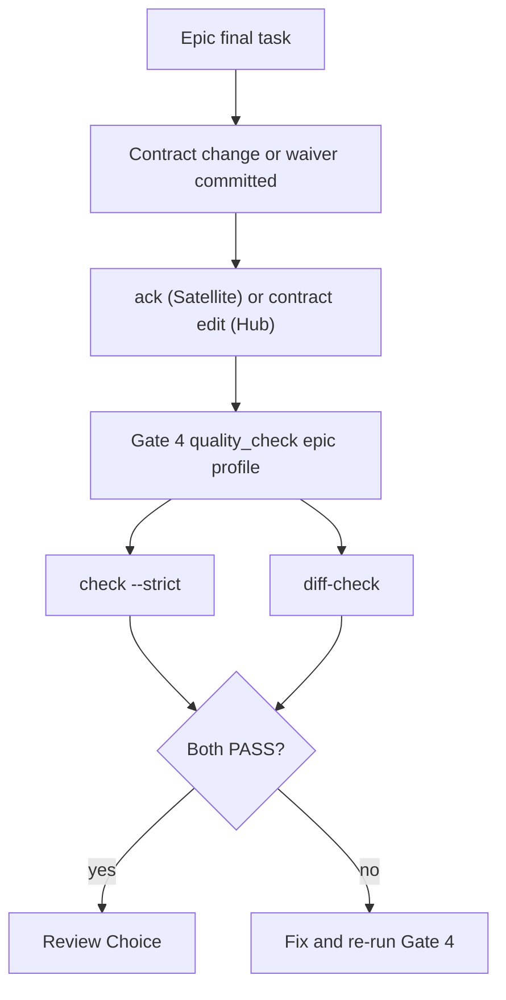

# Contract Diff Gate Design

## Table of Contents

- [Summary](#summary)
- [Goals and Non-Goals](#goals-and-non-goals)
- [Decisions Already Made](#decisions-already-made)
- [Design](#design)
  - [Contract Map File](#contract-map-file)
  - [Hub Rules](#hub-rules)
  - [Satellite Rules](#satellite-rules)
  - [Waivers](#waivers)
  - [Brainstorming Warning and Human Confirmation](#brainstorming-warning-and-human-confirmation)
  - [Gate 4 Integration](#gate-4-integration)
- [Rollout and Repository Boundaries](#rollout-and-repository-boundaries)
- [Testing](#testing)
- [Files Changed](#files-changed)
- [Risks and Limits](#risks-and-limits)

## Summary

`sync_contracts.py check --strict` only proves that a repository acknowledged the current contract
snapshot. It does not notice code that changed a route, DTO or schema while the contract stayed
untouched. This design adds `sync_contracts.py diff-check`, a Gate 4 capability that compares the
git diff of an epic against a per-repository map of contract-bearing files, so a contract-relevant
change cannot reach merge without a contract update, an acknowledgement, or an audited waiver.

## Goals and Non-Goals

Goals:

- Hub (`D3Nexus`): a change to mapped files must come with a change under `shared-contracts/<domain>/`, or a waiver.
- Satellite (`lyrics-sync`, `nexus`): a change to mapped files must come with a fresh `ack` of the current snapshot, or a waiver.
- `dev-brainstorming` warns about contract drift and requires an explicit human decision per warning.
- Reuse the existing topology resolver; standard library only.

Non-goals:

- Parsing source code to discover endpoints (heuristic scanning stays in `brief`).
- Proving that code really matches the contract. `ack` stays a self-declaration.
- Committing to repositories other than `ai-agent-tools` from this epic.

## Decisions Already Made

| # | Decision |
|---|---|
| 1 | Detection works on the git diff against `merge-base(base_ref, HEAD)`. |
| 2 | Each repository declares its own file-to-domain map in `.agents/contract_map.json`. |
| 3 | Exceptions are waivers recorded in the map, shown in the report, and valid only when added in the diff under test. |
| 4 | Satellite proof is an `ack` in the same diff pointing at the current `snapshot_id`, or a waiver that cites an existing `GAP-XX`. |
| 5 | Implementation is a new `diff-check` subcommand in `sync_contracts.py` (approach A). |
| 6 | `dev-brainstorming` only checks and warns; it never edits contracts, acknowledges or changes code. A human decision is required per warning. |

## Design

### Contract Map File

```json
{
  "schema_version": 1,
  "base_ref": "main",
  "domains": {
    "lyrics-sync": { "paths": ["crates/**/routes/**", "crates/**/dto/**"], "exclude": ["**/tests/**"] }
  },
  "waivers": [
    { "id": "W-001", "domain": "lyrics-sync", "paths": ["crates/x/routes/y.rs"],
      "reason": "Internal refactor, wire format unchanged", "gap": null }
  ]
}
```

A missing or invalid map is `BLOCKED` (fail-closed). The gate never guesses globs.

### Hub Rules

1. Diff = committed changes from `merge-base(base_ref, HEAD)` to `HEAD`. A dirty working tree is `BLOCKED`, matching SHA-bound Gate 4.
2. For every domain with a changed file matching `paths` (minus `exclude`), the gate passes when the diff changes a file under `shared-contracts/<domain>/` or adds a waiver for that domain.
3. Otherwise it fails and lists the offending files and domain.
4. `check --strict` still runs as its own capability, so a changed contract that is not acknowledged still fails.

### Satellite Rules

`shared-contracts/` is a read-only symlink, so the gate never asks for contract edits.

1. Diff and `BLOCKED` conditions are the same as Hub; an unresolvable symlink is `BLOCKED`.
2. For every domain with a changed mapped file, the gate passes when the diff modifies `.agents/contract_sync.json` and the domain's `snapshot_id` equals the current snapshot, or when the diff adds a waiver.
3. A stale or wrong snapshot in the diff does not count.
4. Otherwise it fails and lists offending files and domain.

### Waivers

- A waiver is honoured only when it is added in the diff under test, so old waivers never mask later changes.
- A waiver with `gap` is valid only if that `GAP-XX` exists in the domain's `gaps_and_rfcs.md`; otherwise the gate fails. This is the lawful path when code needs something the contract lacks.
- A waiver without `gap` is for changes unrelated to the contract.
- Every new waiver and its reason is printed in the report for review at Gate 4 and Gate 5.

### Brainstorming Warning and Human Confirmation

When `shared-contracts/` exists, `dev-brainstorming` runs the read-only `check` and `brief` and warns. It does not edit contracts, run `ack` or change code.

1. Warnings are shown in a message of their own: drift, `MISSING_IN_CODE` items, and ideas touching routes, DTOs, schemas or pipeline states.
2. The user decides each warning: include in this epic, split into another epic (named), or ignore with a reason. Silence is not consent and the agent never decides.
3. Gate 1 cannot pass while a warning has no decision.
4. Decisions are written to the spec under `## Shared Contract Warnings`, read by `dev-designer` to build `task_01` and waivers. With no warning, the spec records one line naming the `snapshot_id` that was checked.

### Gate 4 Integration



| Repository | Manifest | Capabilities added to `epic` and `pr` |
|---|---|---|
| D3Nexus | `rust-quality.json` | `contract_diff` (plus existing `contracts_*`) |
| lyrics-sync | `python-quality.json` | `contract_diff`, `contracts` |
| nexus | `flutter-quality.json` | `contract_diff`, `contracts` |

Commands use the `{skills_dir}` placeholder. Its documentation is extended from `rust-quality-check` to `python-quality-check` and `flutter-quality-check`. `ack` and `contract_map.json` are part of the epic's final task `Allowed files` and happen before Gate 4, never after it.

## Rollout and Repository Boundaries

This epic changes only `ai-agent-tools` and ships a new plugin release first. Adoption in `D3Nexus`, `lyrics-sync` and `nexus` (map file, baseline through `check` then `brief`, code fixes, `ack`) is a separate epic per repository. No commit is made to another repository without the user's confirmation. A repository still on the old plugin cannot resolve the new subcommand, so each manifest is updated only after the release.

## Testing

Standard library, temporary git repositories, run from `verify.sh`.

- Hub: contract change passes; missing change fails; new waiver passes; old waiver does not mask; missing map is `BLOCKED`; dirty tree is `BLOCKED`.
- Satellite: matching ack passes; stale ack fails; waiver with missing `GAP-XX` fails; waiver without `gap` passes with a warning; broken symlink is `BLOCKED`.
- Worktree (`.worktrees/<epic>`) and symlink resolution.
- Documentation checks for the changed skills and the new template.

## Files Changed

- `skills/sync-shared-contracts/resources/scripts/sync_contracts.py` (new `diff-check`) and a new test file.
- `skills/sync-shared-contracts/SKILL.md` (workflow, `contract_map.json` schema).
- `skills/dev-brainstorming/SKILL.md` (check and warn only, human confirmation, `## Shared Contract Warnings`; supersedes the 1.18.0 wording).
- `skills/dev-designer/SKILL.md` (final task Allowed files, waivers).
- `skills/rust-quality-check`, `skills/python-quality-check`, `skills/flutter-quality-check` (`{skills_dir}` placeholder).
- `skills/setup-shared-contracts` (`contract_map.json` template).
- `CHANGELOG.md` and the next release.

## Risks and Limits

- `ack` remains a self-declaration; `diff-check` proves only that an ack or contract change accompanies a mapped change.
- A `GAP-XX` citation proves the request was recorded, not that the Hub handled it.
- Map globs can go stale; a missing map is blocked, but an outdated one is not detected.
- Waivers must be re-declared per epic. This is deliberate, to avoid permanent silent exceptions.
- Plugin version skew: a repository on an older plugin cannot run the new capability.

