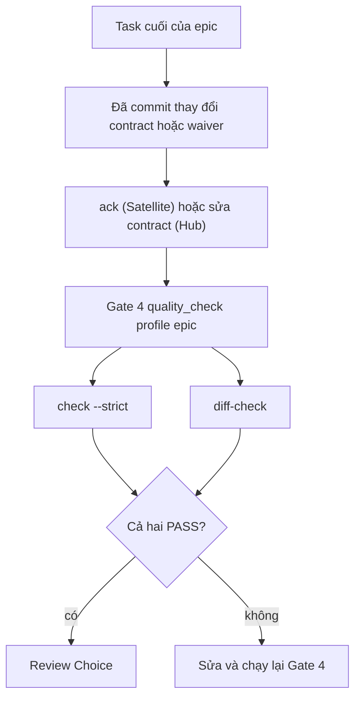

# Thiết kế Contract Diff Gate

## Mục lục

- [Tóm tắt](#tóm-tắt)
- [Mục tiêu và ngoài phạm vi](#mục-tiêu-và-ngoài-phạm-vi)
- [Các quyết định đã chốt](#các-quyết-định-đã-chốt)
- [Thiết kế](#thiết-kế)
  - [File map contract](#file-map-contract)
  - [Quy tắc Hub](#quy-tắc-hub)
  - [Quy tắc Satellite](#quy-tắc-satellite)
  - [Waiver](#waiver)
  - [Cảnh báo ở brainstorming và xác nhận của con người](#cảnh-báo-ở-brainstorming-và-xác-nhận-của-con-người)
  - [Tích hợp Gate 4](#tích-hợp-gate-4)
- [Triển khai và ranh giới repo](#triển-khai-và-ranh-giới-repo)
- [Kiểm thử](#kiểm-thử)
- [File thay đổi](#file-thay-đổi)
- [Rủi ro và giới hạn](#rủi-ro-và-giới-hạn)

## Tóm tắt

`sync_contracts.py check --strict` chỉ chứng minh một repo đã `ack` snapshot contract hiện tại. Nó không phát
hiện code đã đổi route, DTO hay schema trong khi contract không đổi. Thiết kế này thêm
`sync_contracts.py diff-check`, một capability của Gate 4, so diff git của epic với bản map file mang contract
của từng repo. Nhờ đó một thay đổi liên quan contract không thể tới bước merge nếu thiếu cập nhật contract,
`ack` hoặc waiver có kiểm toán.

## Mục tiêu và ngoài phạm vi

Mục tiêu:

- Hub (`D3Nexus`): đổi file được map thì phải có thay đổi trong `shared-contracts/<domain>/`, hoặc waiver.
- Satellite (`lyrics-sync`, `nexus`): đổi file được map thì phải có `ack` mới của snapshot hiện tại, hoặc waiver.
- `dev-brainstorming` cảnh báo drift contract và đòi quyết định rõ ràng của con người cho từng cảnh báo.
- Tái dùng bộ resolve topology hiện có, chỉ dùng thư viện chuẩn.

Ngoài phạm vi:

- Phân tích mã nguồn để tìm endpoint (quét heuristic vẫn nằm ở `brief`).
- Chứng minh code thật sự khớp contract. `ack` vẫn là tự khai báo.
- Commit vào repo khác ngoài `ai-agent-tools` từ epic này.

## Các quyết định đã chốt

| # | Quyết định |
|---|---|
| 1 | Phát hiện dựa trên diff git so với `merge-base(base_ref, HEAD)`. |
| 2 | Mỗi repo tự khai báo map file → domain trong `.agents/contract_map.json`. |
| 3 | Ngoại lệ là waiver ghi trong map, hiện trong báo cáo, và chỉ hợp lệ khi được thêm trong diff đang kiểm tra. |
| 4 | Bằng chứng ở Satellite là `ack` trong cùng diff trỏ đúng `snapshot_id` hiện tại, hoặc waiver trích dẫn một `GAP-XX` có thật. |
| 5 | Cài đặt là subcommand `diff-check` mới trong `sync_contracts.py` (hướng A). |
| 6 | `dev-brainstorming` chỉ check và cảnh báo; không sửa contract, không `ack`, không sửa code. Mỗi cảnh báo cần một quyết định của con người. |

## Thiết kế

### File map contract

```json
{
  "schema_version": 1,
  "base_ref": "main",
  "domains": {
    "lyrics-sync": { "paths": ["crates/**/routes/**", "crates/**/dto/**"], "exclude": ["**/tests/**"] }
  },
  "waivers": [
    { "id": "W-001", "domain": "lyrics-sync", "paths": ["crates/x/routes/y.rs"],
      "reason": "Internal refactor, wire format unchanged", "gap": null }
  ]
}
```

Map thiếu hoặc không hợp lệ thì `BLOCKED` (fail-closed). Gate không bao giờ tự đoán glob.

### Quy tắc Hub

1. Diff là các thay đổi đã commit từ `merge-base(base_ref, HEAD)` đến `HEAD`. Cây làm việc bẩn thì `BLOCKED`, khớp với Gate 4 gắn SHA.
2. Với mỗi domain có file khớp `paths` (trừ `exclude`) bị đổi, gate pass khi diff đổi một file dưới `shared-contracts/<domain>/` hoặc thêm một waiver cho domain đó.
3. Ngược lại gate fail và liệt kê file cùng domain vi phạm.
4. `check --strict` vẫn chạy như capability riêng, nên contract đã đổi mà chưa `ack` vẫn fail.

### Quy tắc Satellite

`shared-contracts/` là symlink chỉ đọc, nên gate không bao giờ đòi sửa contract.

1. Diff và các điều kiện `BLOCKED` giống Hub; symlink không resolve được thì `BLOCKED`.
2. Với mỗi domain có file được map bị đổi, gate pass khi diff sửa `.agents/contract_sync.json` và `snapshot_id` của domain khớp snapshot hiện tại, hoặc khi diff thêm một waiver.
3. Snapshot cũ hoặc sai trong diff không được tính.
4. Ngược lại gate fail và liệt kê file cùng domain vi phạm.

### Waiver

- Waiver chỉ được chấp nhận khi được thêm trong chính diff đang kiểm tra, nên waiver cũ không che được thay đổi sau.
- Waiver có `gap` chỉ hợp lệ nếu `GAP-XX` đó tồn tại trong `gaps_and_rfcs.md` của domain; nếu không gate fail. Đây là đường hợp lệ khi code cần thứ contract chưa có.
- Waiver không có `gap` dùng cho thay đổi không liên quan contract.
- Mọi waiver mới cùng lý do được in ra báo cáo để duyệt ở Gate 4 và Gate 5.

### Cảnh báo ở brainstorming và xác nhận của con người

Khi `shared-contracts/` tồn tại, `dev-brainstorming` chạy `check` và `brief` ở chế độ chỉ đọc rồi cảnh báo. Nó không sửa contract, không chạy `ack`, không sửa code.

1. Cảnh báo hiển thị trong một tin nhắn riêng: drift, mục `MISSING_IN_CODE`, và ý tưởng chạm route, DTO, schema hay pipeline state.
2. Người dùng quyết định từng cảnh báo: đưa vào epic này, tách thành epic khác (ghi tên), hoặc bỏ qua kèm lý do. Im lặng không phải đồng ý và agent không tự quyết định.
3. Gate 1 không qua được khi còn cảnh báo chưa có quyết định.
4. Quyết định được ghi vào spec trong `## Shared Contract Warnings`, `dev-designer` đọc mục này để dựng `task_01` và waiver. Nếu không có cảnh báo, spec ghi một dòng nêu `snapshot_id` đã kiểm tra.

### Tích hợp Gate 4



| Repo | Manifest | Capability thêm vào `epic` và `pr` |
|---|---|---|
| D3Nexus | `rust-quality.json` | `contract_diff` (cùng các `contracts_*` đã có) |
| lyrics-sync | `python-quality.json` | `contract_diff`, `contracts` |
| nexus | `flutter-quality.json` | `contract_diff`, `contracts` |

Lệnh dùng placeholder `{skills_dir}`. Tài liệu của nó được mở rộng từ `rust-quality-check` sang `python-quality-check` và `flutter-quality-check`. `ack` và `contract_map.json` nằm trong `Allowed files` của task cuối và diễn ra trước Gate 4, không bao giờ sau Gate 4.

## Triển khai và ranh giới repo

Epic này chỉ sửa `ai-agent-tools` và phát hành bản plugin mới trước. Việc áp dụng vào `D3Nexus`, `lyrics-sync` và `nexus` (file map, tạo baseline bằng `check` rồi `brief`, sửa code, `ack`) là epic riêng của từng repo. Không commit vào repo khác khi chưa có xác nhận của người dùng. Repo còn dùng plugin cũ không chạy được subcommand mới, nên manifest chỉ được cập nhật sau khi có bản phát hành.

## Kiểm thử

Thư viện chuẩn, repo git tạm, chạy trong `verify.sh`.

- Hub: đổi contract thì pass; thiếu thay đổi thì fail; waiver mới thì pass; waiver cũ không che; thiếu map thì `BLOCKED`; cây bẩn thì `BLOCKED`.
- Satellite: ack khớp thì pass; ack cũ thì fail; waiver có `GAP-XX` không tồn tại thì fail; waiver không có `gap` thì pass kèm cảnh báo; symlink hỏng thì `BLOCKED`.
- Worktree (`.worktrees/<epic>`) và resolve symlink.
- Kiểm tra tài liệu cho các skill đã đổi và mẫu mới.

## File thay đổi

- `skills/sync-shared-contracts/resources/scripts/sync_contracts.py` (thêm `diff-check`) và một file test mới.
- `skills/sync-shared-contracts/SKILL.md` (luồng làm việc, schema `contract_map.json`).
- `skills/dev-brainstorming/SKILL.md` (chỉ check và cảnh báo, xác nhận của con người, `## Shared Contract Warnings`; thay câu chữ của bản 1.18.0).
- `skills/dev-designer/SKILL.md` (Allowed files của task cuối, waiver).
- `skills/rust-quality-check`, `skills/python-quality-check`, `skills/flutter-quality-check` (placeholder `{skills_dir}`).
- `skills/setup-shared-contracts` (mẫu `contract_map.json`).
- `CHANGELOG.md` và bản phát hành kế tiếp.

## Rủi ro và giới hạn

- `ack` vẫn là tự khai báo; `diff-check` chỉ chứng minh có `ack` hoặc thay đổi contract đi kèm thay đổi file được map.
- Trích dẫn `GAP-XX` chỉ chứng minh yêu cầu đã được ghi lại, không chứng minh Hub đã xử lý.
- Glob trong map có thể lỗi thời; map thiếu bị chặn, nhưng map cũ thì không phát hiện được.
- Waiver phải khai báo lại ở mỗi epic. Đây là chủ ý để tránh ngoại lệ vĩnh viễn âm thầm.
- Lệch phiên bản plugin: repo dùng plugin cũ không chạy được capability mới.

