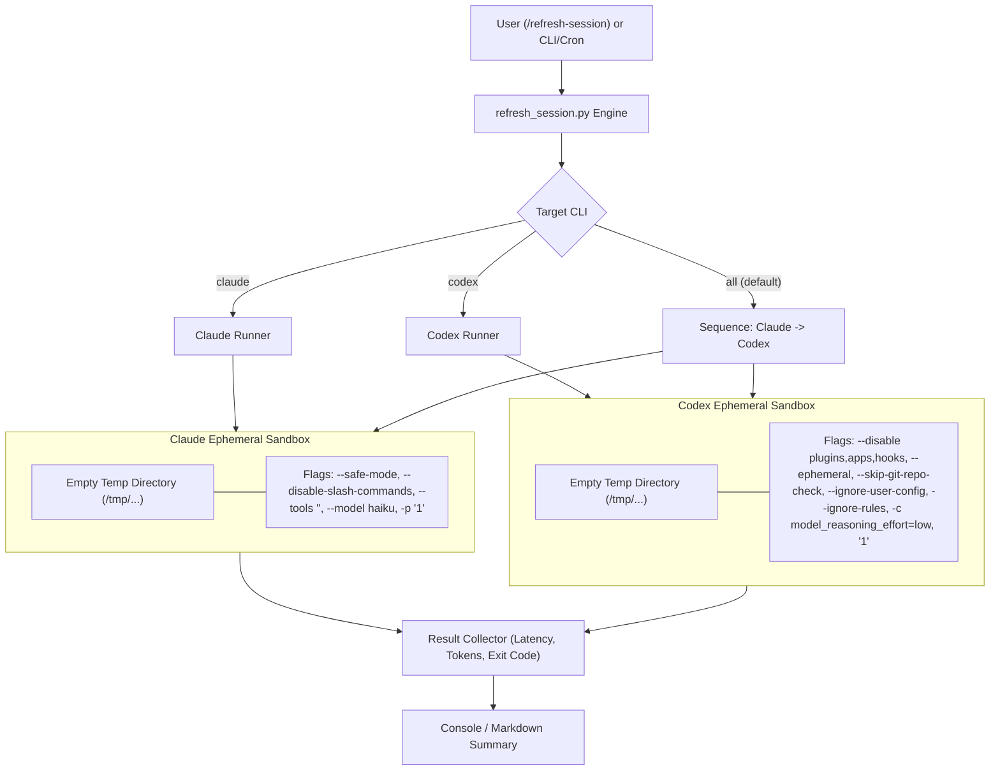

# Refresh Session Skill Design

- **Date**: 2026-11-01
- **Status**: Approved
- **Scope**: `skills/refresh-session/SKILL.md`, `skills/refresh-session/resources/scripts/refresh_session.py`, `skills/refresh-session/resources/scripts/test_refresh_session.py`, `scripts/verify.sh`
- **Next step**: `writing-plans` (one implementation plan, single-skill delivery)

## Table of Contents

- [1. Background](#1-background)
- [2. Goals and Non-Goals](#2-goals-and-non-goals)
- [3. Architecture and Sandboxing](#3-architecture-and-sandboxing)
- [4. CLI Execution Contracts](#4-cli-execution-contracts)
  - [4.1. Claude CLI Execution Contract](#41-claude-cli-execution-contract)
  - [4.2. Codex CLI Execution Contract](#42-codex-cli-execution-contract)
- [5. Standalone Python Engine (`refresh_session.py`)](#5-standalone-python-engine-refresh_sessionpy)
- [6. Skill Wrapper (`refresh-session/SKILL.md`)](#6-skill-wrapper-refresh-sessionskillmd)
- [7. Verification and Testing Strategy](#7-verification-and-testing-strategy)
- [8. Risks and Mitigations](#8-risks-and-mitigations)

---

## 1. Background

Frontier coding assistants such as Claude Code CLI (`claude`) and OpenAI Codex CLI (`codex`) operate under rolling 5-hour session/rate-limit quotas. The 5-hour countdown typically starts from the moment the first interaction occurs.

Developers frequently want to pre-initialize or "refresh" this rolling 5-hour window in advance (e.g., at the beginning of the morning or prior to a lunch break) so that a refreshed quota is available during peak coding hours. However, invoking `claude` or `codex` directly from inside a codebase repository normally causes the CLI to:
1. Traverse directory trees and read `CLAUDE.md`, `.rules`, or config files.
2. Scan and initialize installed skills (`~/.claude/skills/`, `.agents/skills/`), MCP servers, and background plugins.
3. Inject tens of thousands of tokens into the prompt context for a simple greeting, consuming substantial quota and API tokens unnecessarily.

This design introduces the `/refresh-session` skill and an underlying standalone utility (`refresh_session.py`) designed to send a minimal single-token ping under strictly sandboxed conditions, completely bypassing skill discovery, plugin loading, and repository context.

---

## 2. Goals and Non-Goals

### Goals
- Support targeted execution: `/refresh-session claude`, `/refresh-session codex`, or `/refresh-session all` (default when no argument is specified).
- Enforce strict filesystem isolation using temporary directories (`mktemp -d` / `tempfile.TemporaryDirectory`) so no repository context is scanned.
- Suppress all customizations, skills, plugins, MCP servers, and tools during invocation to guarantee near-zero token consumption.
- Select the most cost-effective and lightweight model available (`haiku` for Claude; `low` reasoning effort for Codex).
- Provide both a chat-invocable skill (`SKILL.md`) and a standalone Python script runnable directly via terminal CLI or automated cron/scheduling.
- Provide comprehensive unit tests covering CLI argument parsing, command generation, sandbox creation, timeout enforcement, and report rendering, integrated into `scripts/verify.sh`.

### Non-Goals
- Does not manage user authentication or login flows; assumes `claude` and `codex` have already been authenticated locally.
- Does not modify any user workspace files or persistent configuration.
- Does not execute any multi-turn tasks or coding logic.

---

## 3. Architecture and Sandboxing

The architecture ensures that neither CLI is ever invoked within the working tree of an active project.



---

## 4. CLI Execution Contracts

### 4.1. Claude CLI Execution Contract

To prevent Claude Code from loading workspace context, reading keychain prompts via `--bare` (which can break browser OAuth), or registering skills/tools:
- **Working Directory**: Isolated empty temporary directory.
- **Command Structure**:
  ```bash
  claude --safe-mode --disable-slash-commands --tools "" --model haiku -p "1"
  ```
- **Flag Semantics**:
  - `--safe-mode`: Disables `CLAUDE.md`, skills, plugins, hooks, MCP servers, custom agents, and workflows.
  - `--disable-slash-commands`: Explicitly disables all slash commands and skills.
  - `--tools ""`: Disables all built-in tools so no tool definitions/schemas are injected into the prompt.
  - `--model haiku`: Forces Claude 3.5 Haiku to minimize cost and latency.
  - `-p "1"`: Non-interactive print mode with a single character prompt `"1"`.
- **Expected Token Usage**: $\le 50$ tokens.

### 4.2. Codex CLI Execution Contract

To prevent Codex CLI from indexing git history, loading user `.rules`, or triggering remote MCP endpoints:
- **Working Directory**: Isolated empty temporary directory.
- **Command Structure**:
  ```bash
  codex exec --disable plugins --disable apps --disable hooks --ephemeral --skip-git-repo-check --ignore-user-config --ignore-rules -c model_reasoning_effort=low "1"
  ```
- **Flag Semantics**:
  - `--disable plugins --disable apps --disable hooks`: Deactivates all plugin hooks and app integrations.
  - `--ephemeral`: Runs without writing thread/session state to disk.
  - `--skip-git-repo-check`: Allows running outside a git working tree.
  - `--ignore-user-config`: Ignores `$CODEX_HOME/config.toml` while preserving existing auth.
  - `--ignore-rules`: Bypasses all workspace and user execpolicy `.rules` files.
  - `-c model_reasoning_effort=low`: Caps reasoning budget to `low` (minimum supported for standard ChatGPT accounts).
  - `"1"`: Single character prompt.
- **Expected Token Usage**: Base model system footprint only (~1,695 tokens; zero repo context).

---

## 5. Standalone Python Engine (`refresh_session.py`)

Located at `skills/refresh-session/resources/scripts/refresh_session.py`:
- **CLI Options**:
  ```text
  usage: refresh_session.py [-h] [--timeout TIMEOUT] [--json] [target]

  positional arguments:
    target                Target CLI to ping: 'claude', 'codex', or 'all' (default: 'all')

  options:
    --timeout TIMEOUT     Timeout in seconds per CLI call (default: 60)
    --json                Emit structured JSON report
  ```
- **Execution Flow**:
  1. Inspect available CLIs on `$PATH` (`shutil.which`). If target CLI is not found, report clear warning/skip without failure.
  2. For each requested target, create an ephemeral temporary directory (`tempfile.TemporaryDirectory`).
  3. Execute subprocess with isolated environment and capture `stdout`, `stderr`, latency (wall-clock time), and token metrics where available.
  4. Parse token usage from CLI output (e.g. `tokens used <count>`).
  5. Format and print user-friendly summary.
  6. Return exit code `0` on success, `1` on execution failure, `2` on bad arguments.

---

## 6. Skill Wrapper (`refresh-session/SKILL.md`)

Located at `skills/refresh-session/SKILL.md`:
- Complies strictly with the 2-key frontmatter rule (`name` and `description` only).
- Description explains *what* it does and *when* to use it in third person.
- Instructs the AI agent to invoke `refresh_session.py` with appropriate target flags when the user issues `/refresh-session [target]`.

---

## 7. Verification and Testing Strategy

1. **Unit Tests (`test_refresh_session.py`)**:
   - `test_argument_parsing`: Verifies parsing of `claude`, `codex`, `all`, `--timeout`, and `--json`.
   - `test_command_construction_claude`: Asserts exact flags (`--safe-mode`, `--disable-slash-commands`, `--tools ""`, `--model haiku`).
   - `test_command_construction_codex`: Asserts exact flags (`--disable plugins`, `--ephemeral`, `--skip-git-repo-check`, `--ignore-user-config`, `-c model_reasoning_effort=low`).
   - `test_temp_dir_isolation`: Confirms subprocess runs inside a dedicated temporary directory outside repository roots.
   - `test_missing_cli_handling`: Verifies graceful skip/warning when a CLI executable is missing from `$PATH`.
   - `test_token_parsing`: Verifies extraction of token count from CLI output.
   - `test_timeout_handling`: Verifies timeout abort and error reporting.

2. **Full Kit Integration**:
   - Add unit test suite to `scripts/verify.sh` under Section 11 or 12.
   - Run `bash scripts/verify.sh` to ensure all 67 skills and lint gates pass.

---

## 8. Risks and Mitigations

| Risk | Impact | Mitigation |
|---|---|---|
| Claude `--bare` breaks OAuth login | Authentication failure | Avoid `--bare`; use `--safe-mode --disable-slash-commands --tools ""` instead, preserving OAuth while stripping all context. |
| Codex rejects `reasoning_effort=none` | Exit 400 error | Use `-c model_reasoning_effort=low` which is universally supported across ChatGPT and API Codex models. |
| CLI executable not installed on user machine | Script crash | Script checks `shutil.which()` upfront and reports an informative skip message if the tool is absent. |
| Network timeout during ping | Long hang | Enforce a strict 60s timeout per invocation with clean subprocess termination. |
