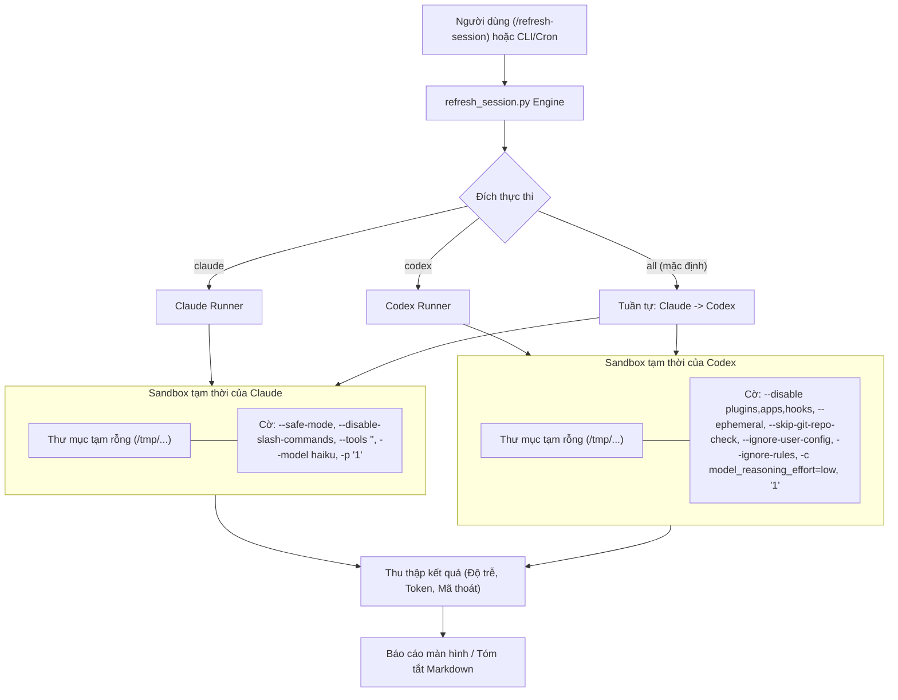

# Thiết kế Skill Refresh Session

- **Ngày**: 2026-11-01
- **Trạng thái**: Đã phê duyệt (Approved)
- **Phạm vi**: `skills/refresh-session/SKILL.md`, `skills/refresh-session/resources/scripts/refresh_session.py`, `skills/refresh-session/resources/scripts/test_refresh_session.py`, `scripts/verify.sh`
- **Bước kế tiếp**: `writing-plans` (một kế hoạch triển khai, phân phối đơn skill)

## Mục lục

- [1. Bối cảnh](#1-bối-cảnh)
- [2. Mục tiêu và Ngoài phạm vi](#2-mục-tiêu-và-ngoài-phạm-vi)
- [3. Kiến trúc và Cơ chế Cô lập Sandbox](#3-kiến-trúc-và-cơ-chế-cô-lập-sandbox)
- [4. Ràng buộc Thực thi CLI](#4-ràng-buộc-thực-thi-cli)
  - [4.1. Ràng buộc Thực thi Claude CLI](#41-ràng-buộc-thực-thi-claude-cli)
  - [4.2. Ràng buộc Thực thi Codex CLI](#42-ràng-buộc-thực-thi-codex-cli)
- [5. Engine Python Độc lập (`refresh_session.py`)](#5-engine-python-độc-lập-refresh_sessionpy)
- [6. Skill Wrapper (`refresh-session/SKILL.md`)](#6-skill-wrapper-refresh-sessionskillmd)
- [7. Chiến lược Kiểm thử và Xác thực](#7-chiến-lược-kiểm-thử-và-xác-thực)
- [8. Rủi ro và Biện pháp Giảm thiểu](#8-rủi-ro-và-biện-pháp-giảm-thiểu)

---

## 1. Bối cảnh

Các trợ lý AI coding dòng frontier như Claude Code CLI (`claude`) và OpenAI Codex CLI (`codex`) hoạt động dựa trên chu kỳ giới hạn hạn mức (quota / rate limit) dạng rolling 5 giờ. Đồng hồ đếm ngược 5 giờ này thường bắt đầu kích hoạt tính từ thời điểm lệnh gọi API đầu tiên của phiên làm việc diễn ra.

Các lập trình viên thường có nhu cầu khởi động sớm hoặc "làm mới" chu kỳ 5 giờ này trước (ví dụ vào đầu buổi sáng khi vừa mở máy, hoặc trước giờ nghỉ trưa) để sẵn sàng có một hạn mức mới đầy đủ trong các khung giờ cao điểm viết mã. Tuy nhiên, việc gọi trực tiếp `claude` hoặc `codex` từ bên trong một thư mục dự án mã nguồn thường khiến CLI:
1. Quét cây thư mục và nạp `CLAUDE.md`, `.rules`, hoặc các tệp cấu hình dự án.
2. Quét và khởi tạo toàn bộ skills đã cài đặt (`~/.claude/skills/`, `.agents/skills/`), các MCP servers và các plugin chạy nền.
3. Bơm hàng chục nghìn token vào context của prompt chỉ để nhận một câu chào hỏi đơn giản, làm lãng phí nghiêm trọng quota và token API.

Bản thiết kế này giới thiệu skill `/refresh-session` cùng công cụ thực thi độc lập (`refresh_session.py`) được thiết kế riêng để gửi một tín hiệu ping tối thiểu 1 ký tự trong điều kiện sandbox cô lập hoàn toàn, triệt tiêu việc quét dự án, nạp skill và plugin.

---

## 2. Mục tiêu và Ngoài phạm vi

### Mục tiêu
- Hỗ trợ chọn đích thực thi linh hoạt: `/refresh-session claude`, `/refresh-session codex`, hoặc `/refresh-session all` (mặc định khi không truyền tham số).
- Bắt buộc cô lập hệ thống tệp bằng thư mục tạm thời (`mktemp -d` / `tempfile.TemporaryDirectory`), đảm bảo không có context dự án nào bị quét.
- Triệt tiêu toàn bộ tùy biến cá nhân, skills, plugins, MCP servers và các công cụ trong suốt quá trình gọi lệnh nhằm đảm bảo lượng token tiêu tốn gần như bằng 0.
- Chọn mô hình nhỏ nhất và tiết kiệm chi phí nhất hiện có (`haiku` cho Claude; mức suy luận `low` cho Codex).
- Cung cấp cả skill gọi được từ chat (`SKILL.md`) lẫn script Python độc lập có thể chạy trực tiếp từ Terminal hoặc đặt lịch tự động (Cron/Antigravity schedule).
- Cung cấp bộ unit test toàn diện kiểm thử việc phân tích tham số CLI, khởi tạo lệnh, tạo sandbox, xử lý timeout và hiển thị báo cáo, được tích hợp vào `scripts/verify.sh`.

### Ngoài phạm vi
- Không quản lý luồng đăng nhập hay thông tin xác thực; mặc định `claude` và `codex` đã được người dùng đăng nhập sẵn trên máy cục bộ.
- Không chỉnh sửa bất kỳ tệp workspace nào của người dùng hay cấu hình cố định trên hệ thống.
- Không thực hiện bất kỳ tác vụ coding hay hội thoại đa lượt nào.

---

## 3. Kiến trúc và Cơ chế Cô lập Sandbox

Kiến trúc đảm bảo không một CLI nào bị thực thi bên trong thư mục làm việc của một dự án đang mở.



---

## 4. Ràng buộc Thực thi CLI

### 4.1. Ràng buộc Thực thi Claude CLI

Để ngăn Claude Code nạp context dự án, gây lỗi xác thực keychain khi dùng `--bare` (vốn làm hỏng OAuth trình duyệt), hoặc đăng ký skills/tools:
- **Thư mục làm việc**: Thư mục tạm thời rỗng biệt lập.
- **Cấu trúc lệnh**:
  ```bash
  claude --safe-mode --disable-slash-commands --tools "" --model haiku -p "1"
  ```
- **Ý nghĩa các cờ**:
  - `--safe-mode`: Tắt toàn bộ `CLAUDE.md`, skills, plugins, hooks, MCP servers, custom agents và workflows.
  - `--disable-slash-commands`: Tắt triệt để toàn bộ slash commands và skills.
  - `--tools ""`: Vô hiệu hóa toàn bộ tools tích hợp sẵn, loại bỏ hoàn toàn schema định nghĩa tool khỏi prompt context.
  - `--model haiku`: Ép dùng Claude 3.5 Haiku nhằm tối ưu chi phí và độ trễ.
  - `-p "1"`: Chế độ in kết quả không tương tác (print mode) với prompt vỏn vẹn 1 ký tự `"1"`.
- **Ước tính token sử dụng**: $\le 50$ tokens.

### 4.2. Ràng buộc Thực thi Codex CLI

Để ngăn Codex CLI lập chỉ mục git, nạp quy tắc `.rules` của người dùng, hoặc kích hoạt các kết nối MCP từ xa:
- **Thư mục làm việc**: Thư mục tạm thời rỗng biệt lập.
- **Cấu trúc lệnh**:
  ```bash
  codex exec --disable plugins --disable apps --disable hooks --ephemeral --skip-git-repo-check --ignore-user-config --ignore-rules -c model_reasoning_effort=low "1"
  ```
- **Ý nghĩa các cờ**:
  - `--disable plugins --disable apps --disable hooks`: Vô hiệu hóa toàn bộ plugin hooks và ứng dụng tích hợp.
  - `--ephemeral`: Chạy phiên tạm thời, không lưu tệp phiên vào đĩa.
  - `--skip-git-repo-check`: Cho phép chạy an toàn ngoài cây thư mục git.
  - `--ignore-user-config`: Bỏ qua `$CODEX_HOME/config.toml` nhưng vẫn duy trì phiên xác thực hiện hữu.
  - `--ignore-rules`: Bỏ qua toàn bộ tệp quy tắc `.rules` của dự án và người dùng.
  - `-c model_reasoning_effort=low`: Giới hạn ngân sách suy luận ở mức `low` (mức tối thiểu được hỗ trợ cho tài khoản ChatGPT thông thường).
  - `"1"`: Prompt tối thiểu 1 ký tự.
- **Ước tính token sử dụng**: Chỉ gồm base prompt tối thiểu của mô hình (~1,695 tokens; hoàn toàn không có context mã nguồn).

---

## 5. Engine Python Độc lập (`refresh_session.py`)

Được đặt tại `skills/refresh-session/resources/scripts/refresh_session.py`:
- **Giao diện tham số CLI**:
  ```text
  usage: refresh_session.py [-h] [--timeout TIMEOUT] [--json] [target]

  positional arguments:
    target                CLI đích cần ping: 'claude', 'codex', hoặc 'all' (mặc định: 'all')

  options:
    --timeout TIMEOUT     Thời gian chờ tối đa (giây) cho mỗi lệnh (mặc định: 60)
    --json                Xuất kết quả dưới dạng JSON cấu trúc
  ```
- **Quy trình thực thi**:
  1. Kiểm tra các CLI có sẵn trong biến môi trường `$PATH` (`shutil.which`). Nếu CLI yêu cầu không tồn tại, in thông báo cảnh báo/bỏ qua rõ ràng mà không gây crash chương trình.
  2. Đối với mỗi CLI mục tiêu, tạo một thư mục tạm thời độc lập (`tempfile.TemporaryDirectory`).
  3. Khởi chạy tiến trình con với môi trường cô lập, thu thập `stdout`, `stderr`, đo lường thời gian phản hồi (latency) và phân tích lượng token tiêu thụ nếu có.
  4. Trích xuất thông tin token từ output (ví dụ: `tokens used <count>`).
  5. Định dạng và hiển thị kết quả tóm tắt thân thiện với người dùng.
  6. Trả về mã thoát `0` khi thành công, `1` khi gặp lỗi thực thi, `2` khi truyền tham số sai.

---

## 6. Skill Wrapper (`refresh-session/SKILL.md`)

Được đặt tại `skills/refresh-session/SKILL.md`:
- Tuân thủ nghiêm ngặt quy tắc frontmatter 2 khóa duy nhất (`name` và `description`).
- Mục description mô tả *làm gì* và *khi nào nên dùng* ở ngôi thứ ba.
- Hướng dẫn AI Agent tự động gọi `refresh_session.py` với các tham số tương ứng khi người dùng ra lệnh `/refresh-session [target]`.

---

## 7. Chiến lược Kiểm thử và Xác thực

1. **Unit Tests (`test_refresh_session.py`)**:
   - `test_argument_parsing`: Kiểm tra phân tích đúng các tham số `claude`, `codex`, `all`, `--timeout`, và `--json`.
   - `test_command_construction_claude`: Kiểm tra chính xác các cờ bắt buộc của Claude (`--safe-mode`, `--disable-slash-commands`, `--tools ""`, `--model haiku`).
   - `test_command_construction_codex`: Kiểm tra chính xác các cờ bắt buộc của Codex (`--disable plugins`, `--ephemeral`, `--skip-git-repo-check`, `--ignore-user-config`, `-c model_reasoning_effort=low`).
   - `test_temp_dir_isolation`: Xác nhận tiến trình chạy trong thư mục tạm thời nằm ngoài thư mục dự án.
   - `test_missing_cli_handling`: Kiểm tra việc bỏ qua an toàn và thông báo rõ khi máy chưa cài CLI.
   - `test_token_parsing`: Kiểm tra trích xuất đúng số lượng token từ văn bản output.
   - `test_timeout_handling`: Kiểm tra cơ chế ngắt tiến trình con khi vượt quá thời gian timeout.

2. **Tích hợp vào Bộ Kiểm định Dự án**:
   - Bổ sung test suite vào kịch bản kiểm thử `scripts/verify.sh`.
   - Chạy toàn bộ `bash scripts/verify.sh` để đảm bảo 67+ skills và các cổng chất lượng đều xanh (`PASS`).

---

## 8. Rủi ro và Biện pháp Giảm thiểu

| Rủi ro | Tác động | Biện pháp giảm thiểu |
|---|---|---|
| Cờ `--bare` của Claude làm hỏng đăng nhập OAuth | Không xác thực được | Không dùng `--bare`; thay bằng `--safe-mode --disable-slash-commands --tools ""`, vừa giữ được OAuth vừa triệt tiêu context. |
| Codex báo lỗi khi đặt `reasoning_effort=none` | Mã lỗi 400 | Sử dụng `-c model_reasoning_effort=low`, mức được hỗ trợ rộng rãi trên cả tài khoản ChatGPT và API. |
| Máy người dùng chưa cài một trong hai CLI | Lỗi script | Script kiểm tra `shutil.which()` trước và thông báo bỏ qua một cách minh bạch. |
| Lỗi mạng khiến lệnh ping bị treo | Treo terminal lâu | Giới hạn timeout 60 giây cho mỗi lệnh gọi với cơ chế kill subprocess an toàn. |
