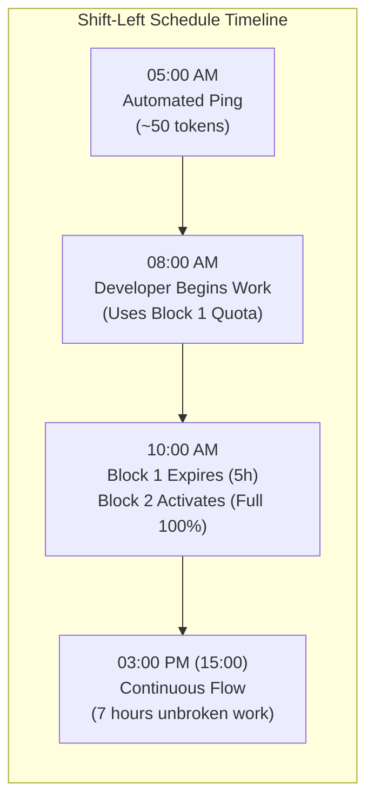
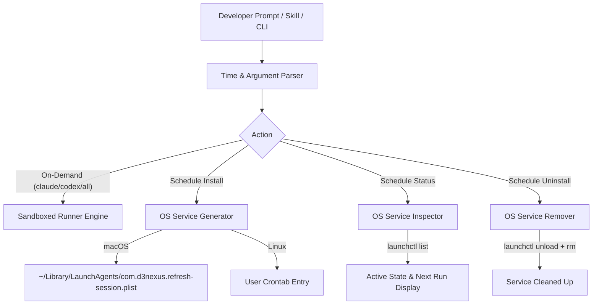

# Refresh Session Schedule & Daemon Automation Design

- **Date**: 2026-11-01
- **Status**: Approved
- **Scope**: `skills/refresh-session/SKILL.md`, `skills/refresh-session/resources/scripts/refresh_session.py`, `skills/refresh-session/resources/scripts/test_refresh_session.py`, `docs/refresh-session-quick-guide.en.md`, `docs/refresh-session-quick-guide.vi.md`, `scripts/verify.sh`
- **Next step**: `writing-plans` (one implementation plan, single-skill delivery)

## Table of Contents

- [1. Background and Motivation](#1-background-and-motivation)
- [2. Goals and Non-Goals](#2-goals-and-non-goals)
- [3. Staggered Rolling Window Strategy](#3-staggered-rolling-window-strategy)
- [4. Architecture and Scheduling Mechanism](#4-architecture-and-scheduling-mechanism)
  - [4.1. Flexible Time Parser Specification](#41-flexible-time-parser-specification)
  - [4.2. macOS `launchd` Service Specification](#42-macos-launchd-service-specification)
  - [4.3. Linux `crontab` Fallback Specification](#43-linux-crontab-fallback-specification)
- [5. CLI Command Specification](#5-cli-command-specification)
  - [5.1. On-Demand Execution (100% Backward Compatible)](#51-on-demand-execution-100-backward-compatible)
  - [5.2. Schedule Subcommand Specification](#52-schedule-subcommand-specification)
- [6. Skill Wrapper Integration (`SKILL.md`)](#6-skill-wrapper-integration-skillmd)
- [7. Verification and Testing Strategy](#7-verification-and-testing-strategy)
- [8. Risks and Mitigations](#8-risks-and-mitigations)

---

## 1. Background and Motivation

In version `1.19.0`, the `refresh-session` skill introduced on-demand, zero-token sandboxed pings to pre-warm the rolling 5-hour rate-limit windows of Claude Code CLI (`claude`) and OpenAI Codex CLI (`codex`).

While on-demand execution is effective, developers frequently start high-intensity coding sessions early in the morning (e.g. 08:00 AM). If a developer initiates their session at 08:00 AM, they consume their 5-hour quota window from 08:00 AM to 01:00 PM (13:00). If that quota is exhausted by 10:00 AM due to intense multi-agent reviews or large test iterations, the developer faces a 3-hour lockout until 01:00 PM.

By contrast, pre-warming the session at an earlier staggered hour (e.g. 05:00 AM or 06:00 AM while asleep) initializes the first 5-hour block early. When work commences at 08:00 AM:
1. The developer has 2 hours of quota available from Block 1 (08:00–10:00).
2. At 10:00 AM (exactly 5 hours after the 05:00 AM ping), Block 1 expires and Block 2 (a brand new, 100% full 5-hour quota) activates automatically.
3. The developer continues coding continuously from 08:00 AM to 03:00 PM (15:00) without hitting a blocking lockout.

This design extends `refresh_session.py` and `/refresh-session` with flexible automated scheduling capabilities.

---

## 2. Goals and Non-Goals

### Goals
- **100% Backward Compatibility**: Preserve all existing on-demand invocations (`/refresh-session`, `/refresh-session claude`, `/refresh-session codex`, `/refresh-session all`).
- **Flexible Start Time Parsing**: Accept standard 24h formats (`05:00`, `06:30`), short hour representations (`5h`, `6h`, `5`, `6`), and 12h AM/PM strings (`5am`, `6pm`).
- **Native macOS `launchd` Integration**: Automatically generate, validate, and load/unload `~/Library/LaunchAgents/com.d3nexus.refresh-session.plist` without requiring `sudo` privileges.
- **Linux Crontab Support**: Provide transparent crontab install/remove fallback on Linux systems.
- **Lifecycle Management**: Provide clear subcommands for scheduling: `--time` / install, `--status` (inspect active jobs and next run time), and `--uninstall` / `--remove`.
- **Target Selection in Scheduling**: Allow scheduling for `all` (default), `claude`, or `codex`.
- **Dedicated Quick-Guides**: Publish bilingual quick-guides (`docs/refresh-session-quick-guide.en.md` and `.vi.md`) containing a complete reference cheat-sheet for all manual and scheduled commands.
- **Automated Verification**: Include unit tests for time parsing, plist generation, status queries, and uninstall logic in `test_refresh_session.py` wired into `scripts/verify.sh`.

### Non-Goals
- Does not build a custom daemon process that must run indefinitely in user terminals; relies on OS-native init systems (`launchd` on macOS, `cron` on Linux) to persist across system reboots and IDE closures.
- Does not modify any user credentials or login states.

---

## 3. Staggered Rolling Window Strategy

The timeline below illustrates the rolling window shift when scheduling at 05:00 AM for an 08:00 AM workday:



---

## 4. Architecture and Scheduling Mechanism



### 4.1. Flexible Time Parser Specification

The parser accepts the following formats and converts them to `(hour: int, minute: int)` in 24-hour time:
- `05:00`, `5:00`, `14:30`, `9:15` $\rightarrow$ `(5, 0)`, `(5, 0)`, `(14, 30)`, `(9, 15)`.
- `5h`, `6h`, `14h` $\rightarrow$ `(5, 0)`, `(6, 0)`, `(14, 0)`.
- `5`, `6`, `14` $\rightarrow$ `(5, 0)`, `(6, 0)`, `(14, 0)`.
- `5am`, `5:30am`, `6pm`, `6:15pm` $\rightarrow$ `(5, 0)`, `(5, 30)`, `(18, 0)`, `(18, 15)`.

Invalid values (such as `25:00`, `-1h`, `abc`) raise a descriptive `ValueError` with supported format examples.

### 4.2. macOS `launchd` Service Specification

- **File Path**: `~/Library/LaunchAgents/com.d3nexus.refresh-session.plist`
- **Label**: `com.d3nexus.refresh-session`
- **Schedule Structure**:
  ```xml
  <key>StartCalendarInterval</key>
  <dict>
      <key>Hour</key>
      <integer>{hour}</integer>
      <key>Minute</key>
      <integer>{minute}</integer>
  </dict>
  ```
- **Execution Target**: `/usr/bin/python3 <absolute_path_to_refresh_session.py> <target>`
- **Standard Logs**:
  - Out: `~/.devtool/logs/refresh_session_daemon.log`
  - Err: `~/.devtool/logs/refresh_session_daemon.err`
- **Lifecycle Management**:
  - Install: Write plist file $\rightarrow$ execute `launchctl unload <plist>` (if previously running) $\rightarrow$ execute `launchctl load <plist>`.
  - Status: Read plist file, check `launchctl list | grep com.d3nexus.refresh-session`.
  - Uninstall: Execute `launchctl unload <plist>` $\rightarrow$ delete plist file.

### 4.3. Linux `crontab` Fallback Specification

On Linux (`sys.platform.startswith("linux")`), the engine:
- Reads `crontab -l`.
- Strips any existing block demarcated by `# BEGIN d3nexus-refresh-session` and `# END d3nexus-refresh-session`.
- Inserts `{minute} {hour} * * * /usr/bin/python3 <script_path> <target> >> ~/.devtool/logs/refresh_session_daemon.log 2>&1`.
- Pipes updated content to `crontab -`.

---

## 5. CLI Command Specification

### 5.1. On-Demand Execution (100% Backward Compatible)

```bash
# Ping both Claude Code and OpenAI Codex immediately (default)
python3 refresh_session.py [all]

# Ping Claude Code immediately
python3 refresh_session.py claude

# Ping Codex CLI immediately
python3 refresh_session.py codex

# Emit machine-readable JSON
python3 refresh_session.py all --json
```

### 5.2. Schedule Subcommand Specification

```bash
# Install daily schedule at 05:00 AM (default target: all)
python3 refresh_session.py schedule --time 05:00
python3 refresh_session.py schedule --time 5h
python3 refresh_session.py schedule --time 6am --target claude

# Check current schedule status
python3 refresh_session.py schedule --status

# Remove / uninstall daily schedule
python3 refresh_session.py schedule --uninstall
# or alias
python3 refresh_session.py schedule --remove
```

---

## 6. Skill Wrapper Integration (`SKILL.md`)

Update `skills/refresh-session/SKILL.md` to document the unified invocation table:

| Invocation | Mode | Action |
|---|---|---|
| `/refresh-session` or `/refresh-session all` | Manual (Instant) | Pings Claude Code and OpenAI Codex immediately |
| `/refresh-session claude` | Manual (Instant) | Pings Claude Code immediately |
| `/refresh-session codex` | Manual (Instant) | Pings Codex CLI immediately |
| `/refresh-session schedule <time>` | Scheduled (Daily) | Installs daily OS daemon for specified time (`5h`, `05:00`, `6am`) |
| `/refresh-session schedule status` | Inspection | Checks active schedule status and next run time |
| `/refresh-session schedule remove` | Uninstall | Removes daily scheduled OS daemon |

Natural language triggers:
- *"Lên lịch refresh session lúc 5h sáng hàng ngày"*
- *"Hẹn giờ chạy /refresh-session vào 6h"*
- *"Kiểm tra lịch refresh session"*
- *"Hủy lịch tự động refresh session"*

---

## 7. Verification and Testing Strategy

1. **Unit Tests (`test_refresh_session.py`)**:
   - `test_parse_flexible_time_valid`: Tests `5h`, `6h`, `05:00`, `6am`, `06:30`, `14:00`, `2pm`.
   - `test_parse_flexible_time_invalid`: Tests `25:00`, `invalid`, `-1h`.
   - `test_build_plist_content`: Verifies generated plist contains correct path, hour, minute, and labels.
   - `test_schedule_install_darwin`: Mocks `subprocess.run` to test `launchctl load` and file writing.
   - `test_schedule_status_darwin`: Tests status detection when loaded vs inactive.
   - `test_schedule_uninstall_darwin`: Tests `launchctl unload` and file removal.
2. **Harness Integration (`scripts/verify.sh`)**:
   - Section 16 automatically executes `test_refresh_session.py` and verifies that all scheduling unit tests pass.
3. **Live Host Verification**:
   - Install a test schedule at `05:00`, run `schedule --status`, verify output, and cleanly uninstall.

---

## 8. Risks and Mitigations

| Risk | Mitigation |
|---|---|
| macOS sleeping at 05:00 AM | `launchd` `StartCalendarInterval` jobs run automatically when the machine wakes or enters Power Nap. |
| User moves the repository directory | The installer resolves `pathlib.Path(__file__).resolve()` to record the absolute canonical path at install time. |
| Lingering old plists | The installer explicitly runs `launchctl unload` prior to overwriting and reloading the plist. |

