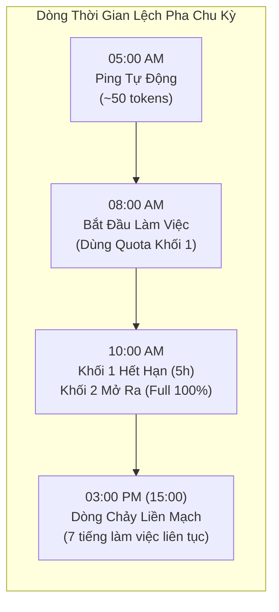
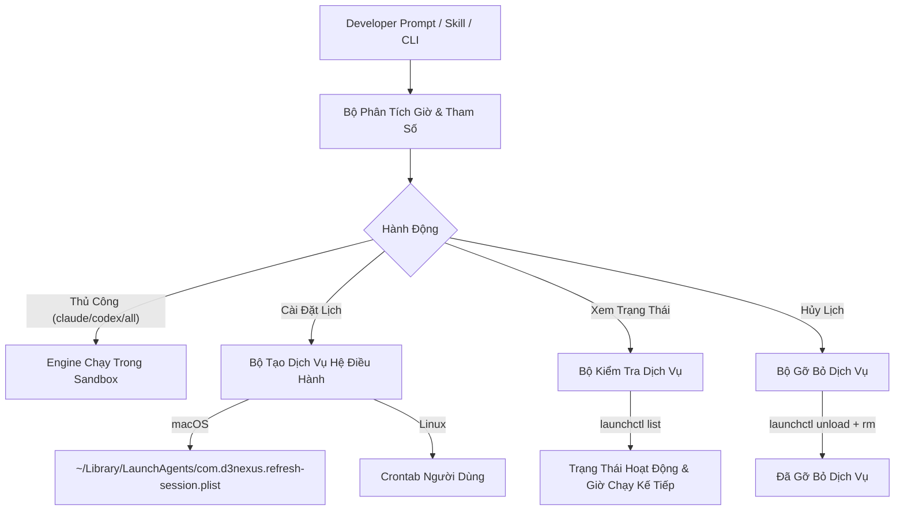

# Thiết Kế Lập Lịch & Tự Động Hóa Daemon Cho Refresh Session

- **Ngày**: 2026-11-01
- **Trạng thái**: Đã phê duyệt (Approved)
- **Phạm vi**: `skills/refresh-session/SKILL.md`, `skills/refresh-session/resources/scripts/refresh_session.py`, `skills/refresh-session/resources/scripts/test_refresh_session.py`, `docs/refresh-session-quick-guide.en.md`, `docs/refresh-session-quick-guide.vi.md`, `scripts/verify.sh`
- **Bước tiếp theo**: `writing-plans` (kế hoạch triển khai độc lập cho tính năng)

## Mục Lục

- [1. Bối Cảnh và Động Lực](#1-bối-cảnh-và-động-lực)
- [2. Mục Tiêu và Phi Mục Tiêu](#2-mục-tiêu-và-phi-mục-tiêu)
- [3. Chiến Thuật Lệch Pha Chu Kỳ (Staggered Rolling Window)](#3-chiến-thuật-lệch-pha-chu-kỳ-staggered-rolling-window)
- [4. Kiến Trúc và Cơ Chế Lập Lịch](#4-kiến-trúc-và-cơ-chế-lập-lịch)
  - [4.1. Đặc Tả Bộ Phân Tích Giờ Linh Hoạt](#41-đặc-tả-bộ-phân-tích-giờ-linh-hoạt)
  - [4.2. Đặc Tả Dịch Vụ macOS `launchd`](#42-đặc-tả-dịch-vụ-macos-launchd)
  - [4.3. Đặc Tả Dự Phòng Linux `crontab`](#43-đặc-tả-dự-phòng-linux-crontab)
- [5. Đặc Tả Giao Diện Dòng Lệnh CLI](#5-đặc-tả-giao-diện-dòng-lệnh-cli)
  - [5.1. Chạy Thủ Công Ngay Lập Tức (Tương Thích Ngược 100%)](#51-chạy-thủ-công-ngay-lập-tức-tương-thích-ngược-100)
  - [5.2. Đặc Tả Subcommand Lập Lịch (`schedule`)](#52-đặc-tả-subcommand-lập-lịch-schedule)
- [6. Tích Hợp Skill Wrapper (`SKILL.md`)](#6-tích-hợp-skill-wrapper-skillmd)
- [7. Chiến Lược Kiểm Thử và Xác Thực](#7-chiến-lược-kiểm-thử-và-xác-thực)
- [8. Rủi Ro và Biện Pháp Giảm Thiểu](#8-rủi-ro-và-biện-pháp-giảm-thiểu)

---

## 1. Bối Cảnh và Động Lực

Trong phiên bản `1.19.0`, kỹ năng `refresh-session` đã giới thiệu khả năng gửi ping 1-token trong môi trường sandbox cô lập để kích hoạt sớm cửa sổ giới hạn tỷ lệ (rate-limit) cuốn 5 giờ cho Claude Code CLI (`claude`) và OpenAI Codex CLI (`codex`).

Dù việc thực thi thủ công rất hiệu quả, các lập trình viên thường bắt đầu phiên làm việc cường độ cao vào đầu giờ sáng (ví dụ: 08:00 AM). Nếu bắt đầu phiên làm việc lúc 08:00 AM, cửa sổ 5 giờ sẽ kéo dài từ 08:00 AM đến 01:00 PM (13:00). Nếu hạn mức bị tiêu thụ cạn kiệt lúc 10:00 AM do chạy nhiều lượt rà soát đa mô hình hoặc chuỗi test lớn, lập trình viên sẽ bị gián đoạn công việc suốt 3 tiếng cho đến 01:00 PM.

Ngược lại, việc tự động pre-warm phiên làm việc vào một mốc giờ sớm hơn (như 05:00 AM hoặc 06:00 AM trong khi vẫn đang ngủ) sẽ kích hoạt sớm khối 5 giờ đầu tiên. Khi bắt đầu làm việc lúc 08:00 AM:
1. Lập trình viên có 2 tiếng sử dụng hạn mức của Khối 1 (08:00–10:00).
2. Đúng 10:00 AM (chính xác 5 giờ sau ping lúc 05:00 AM), Khối 1 hết hạn và Khối 2 (hạn mức 5 giờ mới tinh, đầy 100%) tự động kích hoạt.
3. Lập trình viên làm việc liên tục từ 08:00 AM đến 03:00 PM (15:00) mà không bị rơi vào trạng thái khóa do hết quota.

Tài liệu này đặc tả việc nâng cấp `refresh_session.py` và `/refresh-session` với khả năng lập lịch tự động linh hoạt.

---

## 2. Mục Tiêu và Phi Mục Tiêu

### Mục Tiêu
- **Tương Thích Ngược 100%**: Giữ nguyên toàn bộ các lệnh chạy thủ công hiện có (`/refresh-session`, `/refresh-session claude`, `/refresh-session codex`, `/refresh-session all`).
- **Phân Tích Giờ Bắt Đầu Linh Hoạt**: Chấp nhận định dạng chuẩn 24h (`05:00`, `06:30`), dạng giờ ngắn gọn (`5h`, `6h`, `5`, `6`), và dạng 12h AM/PM (`5am`, `6pm`).
- **Tích Hợp Native macOS `launchd`**: Tự động sinh, kiểm tra và nạp/hủy file `~/Library/LaunchAgents/com.d3nexus.refresh-session.plist` mà không cần quyền `sudo`.
- **Hỗ Trợ Crontab Trên Linux**: Tự động cài đặt và gỡ bỏ mục crontab dự phòng nếu chạy trên môi trường Linux.
- **Quản Lý Vòng Đời Rõ Ràng**: Cung cấp các subcommand trực quan: `--time` / cài đặt, `--status` (kiểm tra trạng thái dịch vụ và giờ chạy tiếp theo), và `--uninstall` / `--remove`.
- **Chọn Mục Tiêu Khi Lên Lịch**: Cho phép chỉ định mục tiêu `all` (mặc định), `claude`, hoặc `codex`.
- **Tài Liệu Quick-Guide Riêng Biệt**: Xuất bản cẩm nang tra cứu nhanh song ngữ (`docs/refresh-session-quick-guide.en.md` và `.vi.md`) với bảng cheat-sheet đầy đủ cho cả lệnh thủ công và lịch hẹn giờ.
- **Xác Thực Tự Động**: Bổ sung bộ unit test toàn diện cho parsing giờ, tạo file plist, truy vấn trạng thái và hủy dịch vụ trong `test_refresh_session.py`, tích hợp vào `scripts/verify.sh`.

### Phi Mục Tiêu
- Không tạo một daemon tiến trình tùy biến chạy thường trực trong terminal; dựa hoàn toàn vào hệ thống init native của OS (`launchd` trên macOS, `cron` trên Linux) để duy trì ngay cả khi khởi động lại máy hoặc đóng IDE.
- Không can thiệp vào token xác thực hay trạng thái đăng nhập của người dùng.

---

## 3. Chiến Thuật Lệch Pha Chu Kỳ (Staggered Rolling Window)

Sơ đồ dưới đây mô tả cách lệch pha chu kỳ khi hẹn giờ lúc 05:00 AM cho ngày làm việc bắt đầu lúc 08:00 AM:



---

## 4. Kiến Trúc và Cơ Chế Lập Lịch



### 4.1. Đặc Tả Bộ Phân Tích Giờ Linh Hoạt

Bộ phân tích chấp nhận các định dạng sau và chuyển đổi thành tuple `(hour: int, minute: int)` theo hệ 24 giờ:
- `05:00`, `5:00`, `14:30`, `9:15` $\rightarrow$ `(5, 0)`, `(5, 0)`, `(14, 30)`, `(9, 15)`.
- `5h`, `6h`, `14h` $\rightarrow$ `(5, 0)`, `(6, 0)`, `(14, 0)`.
- `5`, `6`, `14` $\rightarrow$ `(5, 0)`, `(6, 0)`, `(14, 0)`.
- `5am`, `5:30am`, `6pm`, `6:15pm` $\rightarrow$ `(5, 0)`, `(5, 30)`, `(18, 0)`, `(18, 15)`.

Các giá trị không hợp lệ (như `25:00`, `-1h`, `abc`) sẽ ném ngoại lệ `ValueError` kèm ví dụ hướng dẫn rõ ràng.

### 4.2. Đặc Tả Dịch Vụ macOS `launchd`

- **Đường Dẫn File**: `~/Library/LaunchAgents/com.d3nexus.refresh-session.plist`
- **Nhãn (Label)**: `com.d3nexus.refresh-session`
- **Cấu Trúc Lịch**:
  ```xml
  <key>StartCalendarInterval</key>
  <dict>
      <key>Hour</key>
      <integer>{hour}</integer>
      <key>Minute</key>
      <integer>{minute}</integer>
  </dict>
  ```
- **Lệnh Thực Thi**: `/usr/bin/python3 <đường_dẫn_tuyệt_đối_refresh_session.py> <target>`
- **Log Tiêu Chuẩn**:
  - Out: `~/.devtool/logs/refresh_session_daemon.log`
  - Err: `~/.devtool/logs/refresh_session_daemon.err`
- **Quản Lý Vòng Đời**:
  - Cài đặt: Ghi file plist $\rightarrow$ chạy `launchctl unload <plist>` (nếu trước đó đang chạy) $\rightarrow$ chạy `launchctl load <plist>`.
  - Trạng thái: Đọc file plist, kiểm tra `launchctl list | grep com.d3nexus.refresh-session`.
  - Hủy lịch: Chạy `launchctl unload <plist>` $\rightarrow$ xóa file plist.

### 4.3. Đặc Tả Dự Phòng Linux `crontab`

Trên Linux (`sys.platform.startswith("linux")`), engine sẽ:
- Đọc nội dung `crontab -l`.
- Loại bỏ khối cấu hình cũ nằm giữa `# BEGIN d3nexus-refresh-session` và `# END d3nexus-refresh-session`.
- Chèn dòng mới `{minute} {hour} * * * /usr/bin/python3 <đường_dẫn_script> <target> >> ~/.devtool/logs/refresh_session_daemon.log 2>&1`.
- Ghi lại bằng lệnh `crontab -`.

---

## 5. Đặc Tả Giao Diện Dòng Lệnh CLI

### 5.1. Chạy Thủ Công Ngay Lập Tức (Tương Thích Ngược 100%)

```bash
# Ping cả Claude Code và OpenAI Codex ngay lập tức (mặc định)
python3 refresh_session.py [all]

# Chỉ ping Claude Code ngay lập tức
python3 refresh_session.py claude

# Chỉ ping OpenAI Codex ngay lập tức
python3 refresh_session.py codex

# Xuất báo cáo dạng JSON
python3 refresh_session.py all --json
```

### 5.2. Đặc Tả Subcommand Lập Lịch (`schedule`)

```bash
# Cài đặt lịch chạy hàng ngày lúc 05:00 AM (mục tiêu mặc định: all)
python3 refresh_session.py schedule --time 05:00
python3 refresh_session.py schedule --time 5h
python3 refresh_session.py schedule --time 6am --target claude

# Kiểm tra trạng thái lịch hiện tại
python3 refresh_session.py schedule --status

# Hủy bỏ / gỡ lịch chạy hàng ngày
python3 refresh_session.py schedule --uninstall
# hoặc alias
python3 refresh_session.py schedule --remove
```

---

## 6. Tích Hợp Skill Wrapper (`SKILL.md`)

Cập nhật `skills/refresh-session/SKILL.md` để mô tả bảng tra cứu lệnh thống nhất:

| Cú Pháp Gọi | Chế Độ | Hành Vi Thực Thi |
|---|---|---|
| `/refresh-session` hoặc `/refresh-session all` | Thủ Công (Tức thì) | Ping Claude Code và OpenAI Codex ngay lập tức |
| `/refresh-session claude` | Thủ Công (Tức thì) | Chỉ ping Claude Code ngay lập tức |
| `/refresh-session codex` | Thủ Công (Tức thì) | Chỉ ping OpenAI Codex ngay lập tức |
| `/refresh-session schedule <time>` | Lập Lịch (Hàng ngày) | Cài đặt daemon hệ điều hành chạy vào mốc giờ chỉ định (`5h`, `05:00`, `6am`) |
| `/refresh-session schedule status` | Kiểm Tra | Kiểm tra trạng thái lịch hoạt động và lần chạy tiếp theo |
| `/refresh-session schedule remove` | Hủy Lịch | Xóa bỏ daemon lịch chạy hàng ngày |

Kích hoạt qua ngôn ngữ tự nhiên:
- *"Lên lịch refresh session lúc 5h sáng hàng ngày"*
- *"Hẹn giờ chạy /refresh-session vào 6h"*
- *"Kiểm tra lịch refresh session"*
- *"Hủy lịch tự động refresh session"*

---

## 7. Chiến Lược Kiểm Thử và Xác Thực

1. **Unit Tests (`test_refresh_session.py`)**:
   - `test_parse_flexible_time_valid`: Kiểm tra `5h`, `6h`, `05:00`, `6am`, `06:30`, `14:00`, `2pm`.
   - `test_parse_flexible_time_invalid`: Kiểm tra các giá trị lỗi `25:00`, `invalid`, `-1h`.
   - `test_build_plist_content`: Xác thực nội dung plist sinh ra chứa đúng path, hour, minute và label.
   - `test_schedule_install_darwin`: Mock `subprocess.run` để kiểm tra `launchctl load` và ghi file.
   - `test_schedule_status_darwin`: Kiểm tra phát hiện trạng thái khi đã nạp và khi chưa nạp.
   - `test_schedule_uninstall_darwin`: Kiểm tra `launchctl unload` và xóa file.
2. **Tích Hợp Vào Harness (`scripts/verify.sh`)**:
   - Section 16 tự động chạy `test_refresh_session.py` và bảo đảm tất cả các unit test lập lịch đều đạt xanh.
3. **Xác Thực Thực Tế Trên Máy Host**:
   - Thử cài đặt lịch lúc `05:00`, kiểm tra bằng `schedule --status`, xác nhận output và gỡ sạch sẽ.

---

## 8. Rủi Ro và Biện Pháp Giảm Thiểu

| Rủi Ro | Biện Pháp Giảm Thiểu |
|---|---|
| Máy Mac đang Sleep lúc 05:00 AM | Dịch vụ `launchd` dùng `StartCalendarInterval` sẽ tự động kích hoạt ngay khi máy thức dậy hoặc vào chế độ Power Nap. |
| Người dùng di chuyển thư mục dự án | Script giải quyết đường dẫn tuyệt đối chuẩn xác qua `pathlib.Path(__file__).resolve()` tại thời điểm cài đặt. |
| Tồn đọng file plist cũ không đồng bộ | Bộ cài đặt luôn chủ động chạy `launchctl unload` trước khi ghi đè và load lại plist mới. |

