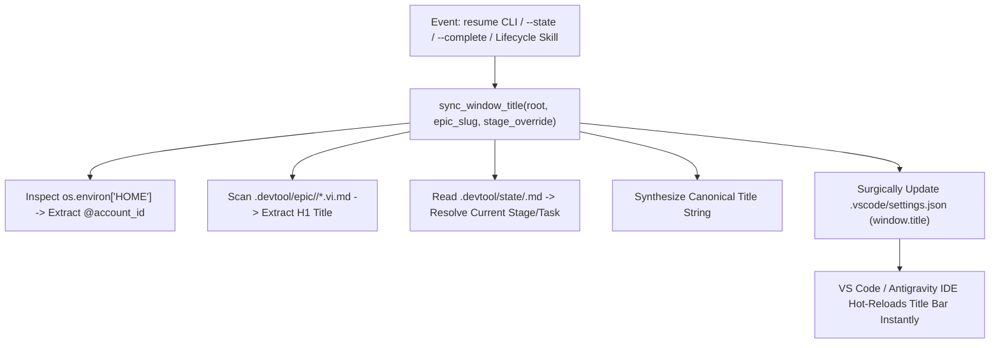

# Visual Multi-Epic Workspace Title and Color Synchronization Design

- **Date**: 2026-11-04
- **Status**: Approved
- **Scope**: `rules/CRITICAL_RULES.md`, `scripts/resume_context.py`, `scripts/test_resume_context.py`, `skills/resume-context/SKILL.md`, `skills/dev-designer/SKILL.md`, `skills/dev-implementation/SKILL.md`, `skills/save-context/SKILL.md`, `templates/`
- **Next step**: `writing-plans` (one implementation plan, multi-file tooling delivery)

## Table of Contents

- [1. Background](#1-background)
- [2. Goals and Non-Goals](#2-goals-and-non-goals)
- [3. Visual Color Palette and Persistent Bar Customization](#3-visual-color-palette-and-persistent-bar-customization)
- [4. Window Title Standard and Identity Token Structure](#4-window-title-standard-and-identity-token-structure)
- [5. Engine Architecture: `sync_window_title` in `resume_context.py`](#5-engine-architecture-sync_window_title-in-resume_contextpy)
- [6. Rule Governance and Local Templates](#6-rule-governance-and-local-templates)
- [7. Skill Lifecycle Integration Matrix](#7-skill-lifecycle-integration-matrix)
- [8. Verification and Quality Gate Strategy](#8-verification-and-quality-gate-strategy)
- [9. Risks and Mitigations](#9-risks-and-mitigations)

---

## 1. Background

When developers operate parallel AI coding agents across multi-repository projects (e.g. `lyrics-sync`, `D3Nexus`, `nexus`, `ai-agent-tools`) using multiple terminal windows, virtual desktops, or Antigravity IDE instances, visual confusion quickly emerges:
1. **Window Identity Blindness**: Multiple editor instances share identical default themes and generic titles, making it easy to prompt in the wrong project window.
2. **Account Disorientation**: When managing multiple Gemini/AI subscription profiles (`antigravity_homes/<account_id>`), developers cannot easily determine which email account or quota bucket is bound to an active window.
3. **Stage Amnesia**: In multi-stage epics (Brainstorming $\rightarrow$ Design $\rightarrow$ Implementation $\rightarrow$ Quality Check), window titles only show the active editor file name rather than the active epic and lifecycle stage.
4. **Inactive Fade Distortion**: Standard VS Code theme customizations dim or fade to default gray/dark backgrounds when a window loses focus, destroying visual differentiation across side-by-side or tiled workspaces.

This design establishes a permanent, automated synchronization system across Antigravity IDE workspace settings, global rules, and lifecycle skills.

---

## 2. Goals and Non-Goals

### Goals
- **4-Repository Color Canonical Standard**: Define persistent top (TitleBar) and bottom (StatusBar) colors for `lyrics-sync` (Crimson 🔴), `D3Nexus` (Emerald 🟢), `nexus` (Royal Blue 🔵), and `ai-agent-tools` (Warm Amber 🟠).
- **Persistent Inactive Visibility**: Guarantee that TitleBar and StatusBar retain their vibrant repository colors whether the window is active or inactive (`inactiveBackground = activeBackground`).
- **Clean Left ActivityBar**: Keep the left activity toolbar uncolored in default dark theme to avoid peripheral visual clutter.
- **Identity-Aware Title Format**: Automatically compose and hot-reload `window.title` following the standard `"<ICON> [<REPO_NAME>] [@<account_id>] <Vietnamese Epic Name> - <Stage / Task>"`.
- **Dynamic Profile Extraction**: Extract `@<account_id>` directly from the active runtime environment (`basename $HOME` under `antigravity_homes/`).
- **Vietnamese SSOT Epic Extraction**: Extract the human-readable Vietnamese epic name directly from the H1 header of `.devtool/epic/<slug>/<slug>.vi.md`.
- **Automated Lifecycle Sync**: Update `window.title` automatically upon `resume`, task start/finish, and milestone archival across `resume-context`, `dev-designer`, `dev-implementation`, and `save-context`.

### Non-Goals
- Does not modify user application code, tests, or build targets.
- Does not enforce global IDE-level overrides; operates via workspace `.vscode/settings.json`.

---

## 3. Visual Color Palette and Persistent Bar Customization

Every repository is assigned a canonical color signature. To ensure that windows remain visually distinguishable when tiled, blurred, or viewed in macOS Mission Control, both active and inactive states are bound to the same background tone:

| Repository | Icon | Tone | TitleBar & StatusBar Active | TitleBar & StatusBar Inactive | Foreground |
|---|---|---|---|---|---|
| `lyrics-sync` | 🔴 | Crimson Red | `#7f1d1d` | `#7f1d1d` | `#ffffff` / `#ffffffcc` |
| `D3Nexus` | 🟢 | Emerald Green | `#065f46` | `#065f46` | `#ffffff` / `#ffffffcc` |
| `nexus` | 🔵 | Royal Blue | `#0d47a1` | `#0d47a1` | `#ffffff` / `#ffffffcc` |
| `ai-agent-tools` | 🟠 | Warm Amber | `#b45309` | `#b45309` | `#ffffff` / `#ffffffcc` |

### Configuration Template (`.vscode/settings.json`)
```json
{
  "window.title": "<ICON> [<REPO_NAME>] [@<account_id>] ${activeEditorMedium}${separator}${rootName}",
  "workbench.colorCustomizations": {
    "titleBar.activeBackground": "<HEX>",
    "titleBar.activeForeground": "#ffffff",
    "titleBar.inactiveBackground": "<HEX>",
    "titleBar.inactiveForeground": "#ffffffcc",
    "statusBar.background": "<HEX>",
    "statusBar.foreground": "#ffffff",
    "statusBar.inactiveBackground": "<HEX>",
    "statusBar.inactiveForeground": "#ffffffcc"
  }
}
```

---

## 4. Window Title Standard and Identity Token Structure

The window title must provide an instant 4-token status summary:

```text
"<ICON> [<REPO_NAME>] [@<account_id>] <Vietnamese Epic Name> - <Stage / Task>"
```

1. **`<ICON> [<REPO_NAME>]`**: Repository visual badge (`🔴 [LYRICS-SYNC]`, `🟢 [D3NEXUS]`, `🔵 [NEXUS]`, `🟠 [AGENT-TOOLS]`).
2. **`[@<account_id>]`**: Active Antigravity account identity extracted from `os.path.basename(os.environ["HOME"])` when operating inside `antigravity_homes/` (e.g. `[@danhdue]`, `[@tess]`).
3. **`<Vietnamese Epic Name>`**: Extracted from `# Epic: <Name>` in `.devtool/epic/<slug>/<slug>.vi.md`.
4. **`<Stage / Task>`**: Current lifecycle state (e.g. `Stage 2: Design`, `Task 1/7: Fix System Prompt`, `Stage 4: Gate 4 Check`, `Completed & Merged`).

---

## 5. Engine Architecture: `sync_window_title` in `resume_context.py`

`scripts/resume_context.py` acts as the single source of truth for window title synchronization:



The function reads `.vscode/settings.json`, parses JSON, updates only `"window.title"`, preserves all `workbench.colorCustomizations` and tool allowlists, and writes back cleanly formatted JSON.

---

## 6. Rule Governance and Local Templates

### Rule Standard in `CRITICAL_RULES.md` (Section 8.4)
Section 8.4 mandates that every AI Agent (Claude Code, Antigravity IDE, Codex) synchronizes `window.title` upon entering an epic, transitioning lifecycle stages, or completing Kanban tasks.

### Local Rule Template (`templates/.agents/rules/window_title_sync.md`)
Ships a standardized markdown rule for new repositories and satellites to enforce title synchronization locally.

---

## 7. Skill Lifecycle Integration Matrix

| Skill | Lifecycle Event | Title Update Format |
|---|---|---|
| `resume-context` | Session start / `resume` command | Syncs `<ICON> [<REPO>] [@<id>] <Epic Name> - <Current State>` |
| `dev-designer` | Gate 2 HLD & Task sign-off | `... - Stage 2: Design Approved` |
| `dev-implementation` | Task start (`task_*.md`) | `... - Task X/Y: <Short Task Title>` |
| `dev-implementation` | Gate 4 Quality Check | `... - Stage 4: Gate 4 Quality Check` |
| `dev-implementation` | Gate 4 PASS / Review Choice | `... - Stage 4.1: Review Choice` |
| `save-context` | `/finish` / Epic completion | `... - Completed & Archived` |

---

## 8. Verification and Testing Strategy

1. **Unit Testing (`scripts/test_resume_context.py`)**:
   - Test `sync_window_title` with mock `.vscode/settings.json`.
   - Verify that `workbench.colorCustomizations` are strictly preserved without mutation.
   - Verify extraction of `@account_id` from virtual home paths.
   - Verify parsing of Vietnamese H1 titles from `.vi.md` design files.
2. **Mechanical Workspace Verification**:
   - Run `python3.12 scripts/test_resume_context.py` across all test suites.
   - Verify that all 4 workspace `settings.json` files pass JSON parsing and maintain active/inactive color parity.
3. **Quality Gate**:
   - Run `@doc_quality_check` on updated documentation and specs.
   - Run `@quality_check` on Python tooling.

---

## 9. Risks and Mitigations

- **Risk**: Concurrent file writes to `.vscode/settings.json` corrupting JSON.
  - *Mitigation*: Read-modify-write pattern parses existing JSON safely, and write occurs within a fraction of a millisecond.
- **Risk**: Non-Antigravity environments lacking `antigravity_homes/` path structure.
  - *Mitigation*: Gracefully falls back to `$USER` or omits `@<account_id>` if no profile is detected.
- **Risk**: Inactive color settings overriding user themes.
  - *Mitigation*: Scoped strictly to project-level `.vscode/settings.json`; never touches global user settings.
