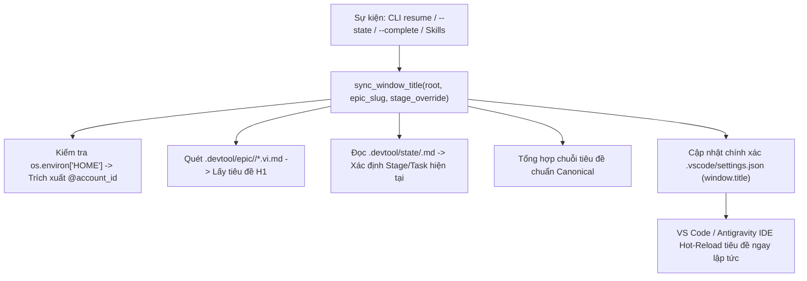

# Thiết kế Đồng bộ Hóa Tiêu đề và Màu sắc Workspace Đa Epic

- **Ngày**: 2026-11-04
- **Trạng thái**: Đã duyệt
- **Phạm vi**: `rules/CRITICAL_RULES.md`, `scripts/resume_context.py`, `scripts/test_resume_context.py`, `skills/resume-context/SKILL.md`, `skills/dev-designer/SKILL.md`, `skills/dev-implementation/SKILL.md`, `skills/save-context/SKILL.md`, `templates/`
- **Bước tiếp theo**: `writing-plans` (một kế hoạch triển khai, phân phối tooling đa file)

## Mục lục

- [1. Bối cảnh](#1-bối-cảnh)
- [2. Mục tiêu và ngoài mục tiêu](#2-mục-tiêu-và-ngoài-mục-tiêu)
- [3. Bảng màu trực quan và tùy biến thanh Top/Bottom liên tục](#3-bảng-màu-trực-quan-và-tùy-biến-thanh-topbottom-liên-tục)
- [4. Tiêu chuẩn tiêu đề cửa sổ và cấu trúc Token nhận diện](#4-tiêu-chuẩn-tiêu-đề-cửa-sổ-và-cấu-trúc-token-nhận-diện)
- [5. Kiến trúc động cơ: `sync_window_title` trong `resume_context.py`](#5-kiến-trúc-động-cơ-sync_window_title-trong-resume_contextpy)
- [6. Quản trị quy tắc và Template cục bộ](#6-quản-trị-quy-tắc-và-template-cục-bộ)
- [7. Ma trận tích hợp vòng đời Skills](#7-ma-trận-tích-hợp-vòng-đời-skills)
- [8. Chiến lược kiểm chứng và Quality Gate](#8-chiến-lược-kiểm-chứng-và-quality-gate)
- [9. Rủi ro và biện pháp giảm thiểu](#9-rủi-ro-và-biện-pháp-giảm-thiểu)

---

## 1. Bối cảnh

Khi lập trình viên điều phối các AI coding agent chạy song song trên nhiều repository dự án (như `lyrics-sync`, `D3Nexus`, `nexus`, `ai-agent-tools`) bằng nhiều cửa sổ terminal, không gian Desktop ảo hoặc các phiên Antigravity IDE, sự nhầm lẫn về mặt thị giác rất dễ xảy ra:
1. **Mất phương hướng nhận diện cửa sổ**: Nhiều cửa sổ IDE dùng chung theme tối mặc định và tiêu đề chung chung, dẫn đến việc dễ paste nhầm prompt sang cửa sổ dự án khác.
2. **Nhầm lẫn tài khoản**: Khi quản lý nhiều profile/tài khoản Gemini (`antigravity_homes/<account_id>`), lập trình viên khó nhận biết cửa sổ đang mở thuộc về tài khoản email hay hạn mức quota nào.
3. **Mất dấu tiến độ vòng đời**: Trong các epic nhiều giai đoạn (Brainstorming $\rightarrow$ Design $\rightarrow$ Implementation $\rightarrow$ Quality Check), tiêu đề cửa sổ chỉ hiển thị tên file đang mở thay vì tên Epic và Stage đang thực hiện.
4. **Hiện tượng mờ màu khi mất focus**: Các tùy biến màu thông thường của VS Code bị mờ hoặc tối đi khi cửa sổ mất focus (inactive), làm mất đi khả năng nhận diện màu sắc khi đặt các cửa sổ cạnh nhau hoặc nhìn qua Mission Control.

Bản thiết kế này thiết lập một hệ thống tự động hóa đồng bộ vĩnh viễn xuyên suốt cấu hình workspace của Antigravity IDE, Critical Rules toàn cục và các skills phát triển.

---

## 2. Mục tiêu và ngoài mục tiêu

### Mục tiêu
- **Tiêu chuẩn màu sắc chuẩn cho 4 Repository**: Định nghĩa màu sắc cố định cho thanh đỉnh (TitleBar) và đáy (StatusBar) cho `lyrics-sync` (Đỏ thẫm 🔴), `D3Nexus` (Xanh ngọc lục bảo 🟢), `nexus` (Xanh dương đậm 🔵), và `ai-agent-tools` (Cam hổ phách 🟠).
- **Hiển thị màu liên tục khi Inactive**: Đảm bảo thanh TitleBar và StatusBar giữ nguyên sắc màu rực rỡ của dự án dù cửa sổ đang được active hay không active (`inactiveBackground = activeBackground`).
- **Thanh ActivityBar sạch sẽ**: Giữ nguyên thanh công cụ bên trái ở màu theme tối mặc định để tránh gây rối mắt thị giác ngoại vi.
- **Định dạng tiêu đề gắn liền nhận diện**: Tự động tổng hợp và hot-reload `window.title` theo chuẩn: `"<ICON> [<REPO_NAME>] [@<account_id>] <Tên Epic Tiếng Việt> - <Stage / Task>"`.
- **Trích xuất Profile động**: Trích xuất `@<account_id>` trực tiếp từ môi trường runtime (`basename $HOME` trong `antigravity_homes/`).
- **Trích xuất tên Epic tiếng Việt chuẩn SSOT**: Đọc trực tiếp tên Epic tiếng Việt từ tiêu đề H1 của `.devtool/epic/<slug>/<slug>.vi.md`.
- **Tự động đồng bộ theo vòng đời**: Cập nhật `window.title` tự động khi chạy `resume`, khi bắt đầu/kết thúc task, và khi lưu trữ milestone qua các skill `resume-context`, `dev-designer`, `dev-implementation`, và `save-context`.

### Ngoài mục tiêu
- Không chỉnh sửa mã nguồn ứng dụng của người dùng, test suite hay build target.
- Không áp đặt cấu hình đè lên toàn bộ IDE máy chủ; chỉ hoạt động trong phạm vi `.vscode/settings.json` của workspace.

---

## 3. Bảng màu trực quan và tùy biến thanh Top/Bottom liên tục

Mỗi repository được gán một bộ nhận diện màu sắc chuẩn chỉ. Để đảm bảo cửa sổ luôn phân biệt được khi xếp cạnh nhau hoặc xem qua Mission Control, cả trạng thái active và inactive đều dùng chung tông màu nền:

| Dự án | Biểu tượng | Sắc màu | TitleBar & StatusBar Active | TitleBar & StatusBar Inactive | Màu chữ |
|---|---|---|---|---|---|
| `lyrics-sync` | 🔴 | Đỏ thẫm (Crimson) | `#7f1d1d` | `#7f1d1d` | `#ffffff` / `#ffffffcc` |
| `D3Nexus` | 🟢 | Xanh ngọc lục bảo | `#065f46` | `#065f46` | `#ffffff` / `#ffffffcc` |
| `nexus` | 🔵 | Xanh dương đậm | `#0d47a1` | `#0d47a1` | `#ffffff` / `#ffffffcc` |
| `ai-agent-tools` | 🟠 | Cam hổ phách | `#b45309` | `#b45309` | `#ffffff` / `#ffffffcc` |

### Mẫu cấu hình (`.vscode/settings.json`)
```json
{
  "window.title": "<ICON> [<REPO_NAME>] [@<account_id>] ${activeEditorMedium}${separator}${rootName}",
  "workbench.colorCustomizations": {
    "titleBar.activeBackground": "<HEX>",
    "titleBar.activeForeground": "#ffffff",
    "titleBar.inactiveBackground": "<HEX>",
    "titleBar.inactiveForeground": "#ffffffcc",
    "statusBar.background": "<HEX>",
    "statusBar.foreground": "#ffffff",
    "statusBar.inactiveBackground": "<HEX>",
    "statusBar.inactiveForeground": "#ffffffcc"
  }
}
```

---

## 4. Tiêu chuẩn tiêu đề cửa sổ và cấu trúc Token nhận diện

Tiêu đề cửa sổ cung cấp bản tóm tắt trạng thái 4 token tức thì:

```text
"<ICON> [<REPO_NAME>] [@<account_id>] <Tên Epic Tiếng Việt> - <Stage / Task>"
```

1. **`<ICON> [<REPO_NAME>]`**: Huy hiệu thị giác của repo (`🔴 [LYRICS-SYNC]`, `🟢 [D3NEXUS]`, `🔵 [NEXUS]`, `🟠 [AGENT-TOOLS]`).
2. **`[@<account_id>]`**: Định danh tài khoản Antigravity active trích xuất từ `os.path.basename(os.environ["HOME"])` khi chạy trong `antigravity_homes/` (ví dụ: `[@danhdue]`, `[@tess]`).
3. **`<Tên Epic Tiếng Việt>`**: Trích xuất từ `# Epic: <Tên>` trong `.devtool/epic/<slug>/<slug>.vi.md`.
4. **`<Stage / Task>`**: Trạng thái vòng đời hiện tại (ví dụ: `Stage 2: Design`, `Task 1/7: Fix System Prompt`, `Stage 4: Gate 4 Check`, `Completed & Merged`).

---

## 5. Kiến trúc động cơ: `sync_window_title` trong `resume_context.py`

`scripts/resume_context.py` đóng vai trò là nguồn dữ liệu chuẩn (SSOT) cho việc đồng bộ tiêu đề cửa sổ:



Hàm đọc file `.vscode/settings.json`, phân tích JSON, chỉ cập nhật trường `"window.title"`, giữ nguyên toàn bộ các cấu hình `workbench.colorCustomizations` và whitelist của terminal, rồi ghi lại JSON có format sạch sẽ.

---

## 6. Quản trị quy tắc và Template cục bộ

### Chuẩn hóa trong `CRITICAL_RULES.md` (Mục 8.4)
Mục 8.4 bắt buộc tất cả AI Agent (Claude Code, Antigravity IDE, Codex) phải đồng bộ `window.title` khi bước vào một epic, chuyển giai đoạn vòng đời, hoặc hoàn thành một Kanban task.

### Template quy tắc cục bộ (`templates/.agents/rules/window_title_sync.md`)
Cung cấp một file rule markdown chuẩn để các repo mới hoặc repo vệ tinh tự động thừa hưởng quy định này tại chỗ.

---

## 7. Ma trận tích hợp vòng đời Skills

| Skill | Sự kiện vòng đời | Định dạng tiêu đề cập nhật |
|---|---|---|
| `resume-context` | Khởi động phiên / lệnh `resume` | Đồng bộ `<ICON> [<REPO>] [@<id>] <Tên Epic> - <Trạng thái hiện tại>` |
| `dev-designer` | Chốt Gate 2 HLD & Task breakdown | `... - Stage 2: Design Approved` |
| `dev-implementation` | Bắt đầu Task (`task_*.md`) | `... - Task X/Y: <Tên Task ngắn>` |
| `dev-implementation` | Gate 4 Quality Check | `... - Stage 4: Gate 4 Quality Check` |
| `dev-implementation` | Gate 4 PASS / Review Choice | `... - Stage 4.1: Review Choice` |
| `save-context` | Lệnh `/finish` / Hoàn tất Epic | `... - Completed & Archived` |

---

## 8. Chiến lược kiểm chứng và Quality Gate

1. **Kiểm thử Unit Test (`scripts/test_resume_context.py`)**:
   - Kiểm thử `sync_window_title` với mock file `.vscode/settings.json`.
   - Xác nhận các cấu hình `workbench.colorCustomizations` được bảo toàn nguyên vẹn không bị ghi đè hay mất mát.
   - Xác nhận khả năng trích xuất `@account_id` từ đường dẫn virtual home.
   - Xác nhận phân tích tiêu đề tiếng Việt từ file thiết kế `.vi.md`.
2. **Kiểm chứng cơ học Workspace**:
   - Chạy `python3.12 scripts/test_resume_context.py` qua toàn bộ test suite.
   - Xác minh cả 4 file `settings.json` của 4 repo đều parse JSON hợp lệ và duy trì màu sắc tương đồng giữa active và inactive.
3. **Quality Gate**:
   - Chạy `@doc_quality_check` cho tài liệu đặc tả vừa cập nhật.
   - Chạy `@quality_check` cho mã nguồn Python.

---

## 9. Rủi ro và biện pháp giảm thiểu

- **Rủi ro**: Ghi đè file `.vscode/settings.json` đồng thời gây lỗi cú pháp JSON.
  - *Biện pháp*: Mô hình đọc-sửa-ghi parse JSON an toàn, thời gian ghi file diễn ra trong phần nghìn giây.
- **Rủi ro**: Môi trường không phải Antigravity không có cấu trúc thư mục `antigravity_homes/`.
  - *Biện pháp*: Tự động fallback về `$USER` hoặc bỏ qua token `@<account_id>` nếu không phát hiện profile.
- **Rủi ro**: Cài đặt màu inactive ghi đè lên theme cá nhân của người dùng.
  - *Biện pháp*: Giới hạn tuyệt đối trong phạm vi `.vscode/settings.json` của từng project; không can thiệp vào User Settings toàn cục.

