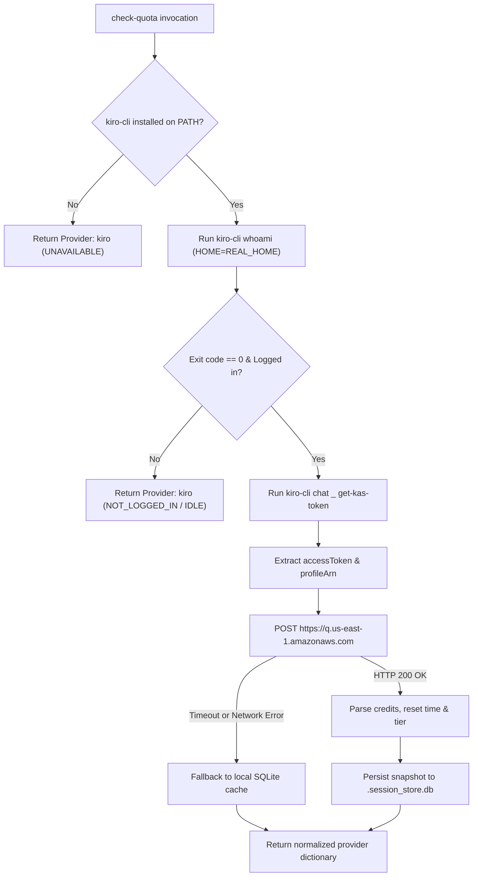

# Kiro Quota Provider Integration Design

- **Date**: 2026-11-08
- **Status**: Approved
- **Scope**: `scripts/agy_quota.py`, `skills/check-quota/SKILL.md`, `skills/check-quota/resources/dashboard/quota_dashboard.html`, `tests/test_kiro_quota.py`, `scripts/verify.sh`
- **Next step**: `writing-plans` (one implementation plan, single-skill delivery)

## Table of Contents

- [1. Background](#1-background)
- [2. Goals and Non-Goals](#2-goals-and-non-goals)
- [3. Architecture and Data Flow](#3-architecture-and-data-flow)
- [4. Data Schema and UI Display](#4-data-schema-and-ui-display)
  - [4.1. Unified Data Schema](#41-unified-data-schema)
  - [4.2. Terminal Card and Table View](#42-terminal-card-and-table-view)
  - [4.3. Web Dashboard Integration](#43-web-dashboard-integration)
- [5. Error Handling and Resilience](#5-error-handling-and-resilience)
- [6. Shared Contract Warnings](#6-shared-contract-warnings)
- [7. Verification and Testing Strategy](#7-verification-and-testing-strategy)
- [8. Risks and Mitigations](#8-risks-and-mitigations)

---

## 1. Background

The `/check-quota` capability displays executive Dark Mode dashboard views and terminal status cards across configured LLM providers and Antigravity profiles (`danhdue`, `huynhminhtien0510`, `tess`, Claude Code, and OpenAI Codex).

Kiro CLI (`kiro-cli` / `kiro`) is an agentic coding assistant powered by AWS CodeWhisperer and Amazon Q Developer infrastructure. Developers using Kiro CLI need real-time quota visibility directly within the `/check-quota` suite (both Terminal CLI and Web Dashboard). Unlike Claude Code, OpenAI Codex, or Gemini CLI—which operate with 5-hour rolling session windows and weekly limits—Kiro CLI operates exclusively under a **Monthly Credit Pool** model (e.g. 1,000 credits/month for Kiro Student, with invocation costs determined by model rate multipliers such as Claude Opus 5.5 at 2.0x or Haiku 5.5 at 0.06x).

This design integrates Kiro as a first-class AI Agent Provider into `scripts/agy_quota.py` and the accompanying Web Dashboard, providing zero-token real-time status and quota monitoring.

---

## 2. Goals and Non-Goals

### Goals
- Automatically detect the presence of `kiro-cli` on `PATH` and extract login identity via `kiro-cli whoami` with host environment boundary preservation (`$REAL_HOME`).
- Resolve and automatically refresh OIDC access tokens via the native `kiro-cli chat _ get-kas-token` IPC command.
- Query real-time credit consumption, limit, subscription title (e.g. `KIRO STUDENT`, `KIRO PRO`), overage status, and billing cycle reset timestamps from AWS CodeWhisperer backend (`AmazonCodeWhispererService.GetUsageLimits`) with sub-300ms latency and zero prompt token consumption.
- Present a dedicated single-bar terminal card (`check-quota kiro`), include Kiro in multi-provider summaries (`check-quota all`), and support rapid synchronization (`check-quota refresh kiro`).
- Apply standardized 3-tier color thresholds: Emerald Green ($\ge 50\%$), Amber Orange ($10\% - 49\%$), and Crimson Red ($< 10\%$).
- Render Kiro in the AI Agent Providers section of the interactive Dark Mode Web Dashboard (`quota_dashboard.html`).
- Provide resilient offline fallback to local SQLite cache (`~/.devtool/state/.session_store.db`).
- Maintain 100% test coverage and integration with `scripts/verify.sh`.

### Non-Goals
- Does not modify Kiro configuration or launch interactive chat sessions.
- Does not manage user authentication or interactive login (prompts user to run `kiro-cli login` if unauthenticated).
- Does not support arbitrary custom AWS regions outside Kiro's operational service endpoints (`us-east-1`).

---

## 3. Architecture and Data Flow

The integration executes inside `scripts/agy_quota.py` via `fetch_kiro_quota()`, running concurrently within the existing `ThreadPoolExecutor`:



1. **Subprocess Boundary**: The CLI calls execute with `HOME=REAL_HOME` (`/Users/danhdueexoictif`) to guarantee access to host credentials in `~/.kiro` and `~/Library/Application Support/kiro-cli`.
2. **Token Acquisition**: `kiro-cli chat _ get-kas-token` emits JSON containing `accessToken`, `profileArn`, and `expiresAt`. If the token is near expiration, Kiro CLI natively renews it before returning.
3. **AWS CodeWhisperer Request**:
   - **Endpoint**: `https://q.us-east-1.amazonaws.com` (secondary fallback: `https://codewhisperer.us-east-1.amazonaws.com`).
   - **Method**: `POST`, timeout: `4.0s`.
   - **Headers**:
     - `Authorization: Bearer <accessToken>`
     - `Content-Type: application/x-amz-json-1.0`
     - `x-amz-target: AmazonCodeWhispererService.GetUsageLimits`
     - `User-Agent: kiro-cli/3.1.0`
   - **Payload**: `{"profileArn": "<profileArn>"}`.
4. **Offline Resilience**: When disconnected, `fetch_kiro_quota()` retrieves the last recorded snapshot from `~/.devtool/state/.session_store.db` and flags the status with `⏱ Cached`.

---

## 4. Data Schema and UI Display

### 4.1. Unified Data Schema

The returned dictionary matches the standard provider schema consumed by both terminal formatters and web dashboards:

```python
{
    "profile": "kiro",
    "displayName": "Kiro CLI",
    "isProvider": True,
    "providerType": "kiro",
    "tier": "KIRO STUDENT",
    "priority": 90,
    "email": "Elenor.Zulaufell001@mymdc.net",
    "status": "ACTIVE",
    "isSessionActive": True,
    "resetTime": "2026-12-01T00:00:00Z",
    "resetTimeLocal": "01/12 07:00",
    "remainingCountdown": "⏱ 23d 06h (01/12)",
    "hasArgon": False,
    "isCreditOnly": True,
    "creditsPool": {
        "name": "Monthly Credits Pool",
        "used": 7.22,
        "limit": 1000.0,
        "remaining": 992.78,
        "fraction": 0.9928,
        "countdown": "⏱ 23d 06h (01/12)",
        "resetDate": "01/12",
        "unavailable": False,
    },
    "gemini5h": {
        "name": "Monthly Credits Pool",
        "fraction": 0.9928,
        "countdown": "⏱ 23d 06h (01/12)",
        "resetTime": "2026-12-01T00:00:00Z",
        "resetTimeLocal": "01/12",
        "unavailable": False,
    },
    "claude5h": None,
    "geminiWeekly": None,
    "overageStatus": "DISABLED",
    "defaultModel": "auto (1.0x)",
}
```

### 4.2. Terminal Card and Table View

- **Card View (`check-quota kiro`)**: Renders a single-bar card reflecting the monthly credits pool:
  ```text
  ┌────────────────────────────────────────────────────────────────────────┐
  │  Kiro CLI  [◆ KIRO STUDENT]                            Active  Priority: 90  │
  │  Elenor.Zulaufell001@mymdc.net                                         │
  ├────────────────────────────────────────────────────────────────────────┤
  │  Monthly Credits Pool                                                  │
  │  [████████████████████████████████████████████████░]  99.3% remaining  │
  │  992.78 / 1,000.0 credits (Used: 7.22)   ⏱ Resets on 01/12             │
  ├────────────────────────────────────────────────────────────────────────┤
  │  Default Model: auto (1.0x)   •   Overages: Disabled                   │
  └────────────────────────────────────────────────────────────────────────┘
  ```
- **Color Thresholds**:
  - Green (`#72bc82`): remaining $\ge 50\%$.
  - Amber (`#f59e0b`): $10\% \le$ remaining $< 50\%$.
  - Red (`#ef4444`): remaining $< 10\%$.
- **Summary Table (`check-quota all` / `--table`)**: Inserts a row into the Providers section:
  `kiro | KIRO STUDENT | ACTIVE | 99.3% (992.8/1000) | ⏱ 23d 06h (01/12)`.

### 4.3. Web Dashboard Integration

- In `quota_dashboard.html`, Kiro is placed alongside Claude Code and OpenAI Codex in the `AI Agent Providers` section.
- Respects `isCreditOnly: true` to suppress irrelevant secondary bars and show a streamlined single progress bar with quick refresh action.

---

## 5. Error Handling and Resilience

1. **Missing Executable**: If `kiro-cli` is absent, the provider yields `status: "UNAVAILABLE"` and is safely omitted from batch views.
2. **Unauthenticated Session**: If `kiro-cli whoami` fails or reports "Not logged in", the card renders with badge `[◆ NOT LOGGED IN]`, `fraction: 0.0`, and guidance to execute `kiro-cli login`.
3. **API Unavailability**: Bounded by a strict 4-second timeout. If network requests fail, cached values from `.session_store.db` are loaded without throwing unhandled exceptions.
4. **Overage Detection**: When `overageConfiguration.overageStatus == "DISABLED"` and credits reach 0, status is marked `EXHAUSTED` and the bar turns solid red.

---

## 6. Shared Contract Warnings

`shared-contracts/` is not present in `ai-agent-tools` (this repository is the standalone agent tooling kit). No API contract drift or upstream synchronization is required.

---

## 7. Verification and Testing Strategy

1. **Unit Testing (`tests/test_kiro_quota.py`)**:
   - `test_kiro_whoami_parsing`: Validates regex extraction of Builder ID emails and unauthenticated handling.
   - `test_kiro_token_extraction`: Mocks `kiro-cli chat _ get-kas-token` JSON payload.
   - `test_kiro_api_response_parsing`: Verifies credit calculations ($1000 - 7.22 = 992.78 \rightarrow 99.3\%$), reset timestamp formatting, and tier classification.
   - `test_kiro_color_thresholds`: Asserts green at $\ge 50\%$, amber at $10\%-49\%$, red at $<10\%$.
   - `test_kiro_offline_fallback`: Verifies reading from `.session_store.db` on network timeout.
2. **Integration Verification**:
   - Live execution: `python3 scripts/agy_quota.py kiro` matching `app.kiro.dev` account status ($7.22$ used / $1000$ limit).
   - Live batch summary: `python3 scripts/agy_quota.py all`.
   - Live instant pre-warm/refresh: `python3 scripts/agy_quota.py refresh kiro`.
3. **Repository Verification**:
   - Run `scripts/verify.sh` to guarantee all tests, linter checks, and markdown standards pass.

---

## 8. Risks and Mitigations

- **Risk**: Kiro CLI internal subcommand `chat _ get-kas-token` changes in future releases.
  - **Mitigation**: Direct SQLite fallback reads token from `~/Library/Application Support/kiro-cli/data.sqlite3` (`auth_kv` table).
- **Risk**: Subprocess latency slowing down `check-quota`.
  - **Mitigation**: Parallelized inside `ThreadPoolExecutor` with a strict 4.0s timeout and cached session store.
