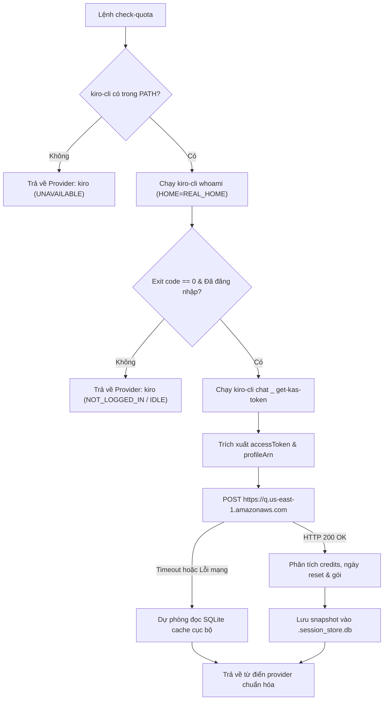

# Thiết kế Tích hợp LLM Provider Kiro vào Chức năng Quota

- **Ngày**: 2026-11-08
- **Trạng thái**: Đã phê duyệt
- **Phạm vi**: `scripts/agy_quota.py`, `skills/check-quota/SKILL.md`, `skills/check-quota/resources/dashboard/quota_dashboard.html`, `tests/test_kiro_quota.py`, `scripts/verify.sh`
- **Bước tiếp theo**: `writing-plans` (một kế hoạch thực thi, phát triển tính năng đơn lẻ)

## Mục lục

- [1. Bối cảnh](#1-bối-cảnh)
- [2. Mục tiêu và Ngoài phạm vi](#2-mục-tiêu-và-ngoài-phạm-vi)
- [3. Kiến trúc và Luồng dữ liệu](#3-kiến-trúc-và-luồng-dữ-liệu)
- [4. Cấu trúc dữ liệu và Giao diện hiển thị](#4-cấu-trúc-dữ-liệu-và-giao-diện-hiển-thị)
  - [4.1. Cấu trúc dữ liệu chuẩn hóa](#41-cấu-trúc-dữ-liệu-chuẩn-hóa)
  - [4.2. Giao diện Terminal Card và Bảng tổng hợp](#42-giao-diện-terminal-card-và-bảng-tổng-hợp)
  - [4.3. Tích hợp trên Web Dashboard](#43-tích-hợp-trên-web-dashboard)
- [5. Xử lý ngoại lệ và Khả năng phục hồi](#5-xử-lý-ngoại-lệ-và-khả-năng-phục-hồi)
- [6. Cảnh báo Shared Contract](#6-cảnh-báo-shared-contract)
- [7. Chiến lược kiểm thử và Xác minh](#7-chiến-lược-kiểm-thử-và-xác-minh)
- [8. Rủi ro và Biện pháp giảm thiểu](#8-rủi-ro-và-biện-pháp-giảm-thiểu)

---

## 1. Bối cảnh

Tính năng `/check-quota` hiển thị giao diện Dashboard Dark Mode và các card trạng thái dòng lệnh cho các LLM provider và hồ sơ Antigravity được cấu hình (`danhdue`, `huynhminhtien0510`, `tess`, Claude Code và OpenAI Codex).

Kiro CLI (`kiro-cli` / `kiro`) là trợ lý lập trình thông minh chạy trên hạ tầng AWS CodeWhisperer và Amazon Q Developer. Các lập trình viên sử dụng Kiro CLI cần khả năng theo dõi hạn mức thời gian thực trực tiếp trong bộ công cụ `/check-quota` (cả Terminal CLI lẫn Web Dashboard). Khác với Claude Code, OpenAI Codex hoặc Gemini CLI—vốn vận hành theo cơ chế cửa sổ trượt 5 giờ và hạn mức tuần—Kiro CLI vận hành hoàn toàn theo mô hình **Hạn mức tín dụng hàng tháng (Monthly Credit Pool)** (ví dụ: 1,000 credits/tháng cho gói Kiro Student, với chi phí invocation tính theo hệ số nhân của từng model như Claude Opus 5.5 ở mức 2.0x hay Haiku 5.5 ở mức 0.06x).

Tài liệu thiết kế này tích hợp Kiro như một AI Agent Provider chính thức vào `scripts/agy_quota.py` và Web Dashboard đi kèm, mang lại khả năng giám sát trạng thái và hạn mức thời gian thực với chi phí 0 token prompt.

---

## 2. Mục tiêu và Ngoài phạm vi

### Mục tiêu
- Tự động phát hiện sự hiện diện của `kiro-cli` trong `PATH` và trích xuất danh tính đăng nhập qua lệnh `kiro-cli whoami` với ranh giới môi trường máy chủ được bảo toàn (`$REAL_HOME`).
- Phân giải và tự động làm mới access token OIDC thông qua lệnh IPC nội bộ `kiro-cli chat _ get-kas-token`.
- Truy vấn số credit tiêu thụ thực tế, tổng hạn mức, gói đăng ký (ví dụ: `KIRO STUDENT`, `KIRO PRO`), trạng thái overage và thời điểm reset chu kỳ từ backend AWS CodeWhisperer (`AmazonCodeWhispererService.GetUsageLimits`) với độ trễ dưới 300ms và không tiêu hao token prompt.
- Hiển thị card terminal thanh đơn chuyên dụng (`check-quota kiro`), đưa Kiro vào bảng tổng kết đa provider (`check-quota all`), và hỗ trợ đồng bộ nhanh (`check-quota refresh kiro`).
- Áp dụng chuẩn 3 ngưỡng màu: Xanh lá ($\ge 50\%$), Vàng cam ($10\% - 49\%$), và Đỏ ($< 10\%$).
- Hiển thị Kiro trong mục AI Agent Providers của Web Dashboard Dark Mode (`quota_dashboard.html`).
- Cung cấp cơ chế dự phòng ngoại tuyến tin cậy với bộ nhớ đệm SQLite cục bộ (`~/.devtool/state/.session_store.db`).
- Đảm bảo 100% độ bao phủ kiểm thử và tích hợp hoàn chỉnh vào `scripts/verify.sh`.

### Ngoài phạm vi
- Không chỉnh sửa cấu hình của Kiro hoặc khởi chạy các phiên chat tương tác.
- Không quản lý luồng xác thực hoặc đăng nhập của người dùng (hướng dẫn người dùng chạy `kiro-cli login` nếu chưa đăng nhập).
- Không hỗ trợ các AWS region tùy biến nằm ngoài endpoint vận hành mặc định của Kiro (`us-east-1`).

---

## 3. Kiến trúc và Luồng dữ liệu

Việc tích hợp được thực thi bên trong `scripts/agy_quota.py` thông qua hàm `fetch_kiro_quota()`, chạy đồng thời bên trong `ThreadPoolExecutor` có sẵn:



1. **Ranh giới Tiến trình con**: Các lệnh CLI thực thi với `HOME=REAL_HOME` (`/Users/danhdueexoictif`) nhằm đảm bảo quyền truy cập chứng chỉ máy chủ tại `~/.kiro` và `~/Library/Application Support/kiro-cli`.
2. **Thu thập Token**: `kiro-cli chat _ get-kas-token` trả về JSON chứa `accessToken`, `profileArn` và `expiresAt`. Nếu token sắp hết hạn, Kiro CLI sẽ tự động gia hạn trước khi trả về.
3. **Yêu cầu AWS CodeWhisperer**:
   - **Endpoint**: `https://q.us-east-1.amazonaws.com` (dự phòng thứ hai: `https://codewhisperer.us-east-1.amazonaws.com`).
   - **Phương thức**: `POST`, timeout: `4.0s`.
   - **Headers**:
     - `Authorization: Bearer <accessToken>`
     - `Content-Type: application/x-amz-json-1.0`
     - `x-amz-target: AmazonCodeWhispererService.GetUsageLimits`
     - `User-Agent: kiro-cli/3.1.0`
   - **Payload**: `{"profileArn": "<profileArn>"}`.
4. **Độ bền bỉ khi mất mạng**: Khi ngắt kết nối, `fetch_kiro_quota()` truy xuất snapshot đã lưu gần nhất từ `~/.devtool/state/.session_store.db` và gắn nhãn trạng thái `⏱ Cached`.

---

## 4. Cấu trúc dữ liệu và Giao diện hiển thị

### 4.1. Cấu trúc dữ liệu chuẩn hóa

Từ điển trả về tuân theo schema provider tiêu chuẩn được tiêu thụ bởi cả bộ định dạng terminal và web dashboard:

```python
{
    "profile": "kiro",
    "displayName": "Kiro CLI",
    "isProvider": True,
    "providerType": "kiro",
    "tier": "KIRO STUDENT",
    "priority": 90,
    "email": "Elenor.Zulaufell001@mymdc.net",
    "status": "ACTIVE",
    "isSessionActive": True,
    "resetTime": "2026-12-01T00:00:00Z",
    "resetTimeLocal": "01/12 07:00",
    "remainingCountdown": "⏱ 23d 06h (01/12)",
    "hasArgon": False,
    "isCreditOnly": True,
    "creditsPool": {
        "name": "Monthly Credits Pool",
        "used": 7.22,
        "limit": 1000.0,
        "remaining": 992.78,
        "fraction": 0.9928,
        "countdown": "⏱ 23d 06h (01/12)",
        "resetDate": "01/12",
        "unavailable": False,
    },
    "gemini5h": {
        "name": "Monthly Credits Pool",
        "fraction": 0.9928,
        "countdown": "⏱ 23d 06h (01/12)",
        "resetTime": "2026-12-01T00:00:00Z",
        "resetTimeLocal": "01/12",
        "unavailable": False,
    },
    "claude5h": None,
    "geminiWeekly": None,
    "overageStatus": "DISABLED",
    "defaultModel": "auto (1.0x)",
}
```

### 4.2. Giao diện Terminal Card và Bảng tổng hợp

- **Giao diện Card (`check-quota kiro`)**: Hiển thị card thanh đơn phản ánh số dư tín dụng hàng tháng:
  ```text
  ┌────────────────────────────────────────────────────────────────────────┐
  │  Kiro CLI  [◆ KIRO STUDENT]                            Active  Priority: 90  │
  │  Elenor.Zulaufell001@mymdc.net                                         │
  ├────────────────────────────────────────────────────────────────────────┤
  │  Monthly Credits Pool                                                  │
  │  [████████████████████████████████████████████████░]  99.3% remaining  │
  │  992.78 / 1,000.0 credits (Used: 7.22)   ⏱ Resets on 01/12             │
  ├────────────────────────────────────────────────────────────────────────┤
  │  Default Model: auto (1.0x)   •   Overages: Disabled                   │
  └────────────────────────────────────────────────────────────────────────┘
  ```
- **Ngưỡng màu hiển thị**:
  - Xanh lá (`#72bc82`): còn lại $\ge 50\%$.
  - Vàng cam (`#f59e0b`): còn lại $10\% \le$ và $< 50\%$.
  - Đỏ (`#ef4444`): còn lại $< 10\%$.
- **Bảng tổng kết (`check-quota all` / `--table`)**: Chèn thêm một hàng vào mục Providers:
  `kiro | KIRO STUDENT | ACTIVE | 99.3% (992.8/1000) | ⏱ 23d 06h (01/12)`.

### 4.3. Tích hợp trên Web Dashboard

- Trong `quota_dashboard.html`, Kiro được đặt cạnh Claude Code và OpenAI Codex ở phần `AI Agent Providers`.
- Tiếp nhận cờ `isCreditOnly: true` để ẩn các thanh phụ không liên quan, hiển thị một thanh tiến trình duy nhất tinh gọn cùng hành động làm mới nhanh.

---

## 5. Xử lý ngoại lệ và Khả năng phục hồi

1. **Thiếu file thực thi**: Nếu `kiro-cli` không tồn tại, provider trả về `status: "UNAVAILABLE"` và tự động ẩn khỏi giao diện quét hàng loạt một cách an toàn.
2. **Chưa đăng nhập**: Nếu `kiro-cli whoami` thất bại hoặc báo "Not logged in", card hiển thị badge `[◆ NOT LOGGED IN]`, `fraction: 0.0`, và hướng dẫn chạy `kiro-cli login`.
3. **Mạng hoặc API gián đoạn**: Bị giới hạn bởi timeout nghiêm ngặt 4 giây. Nếu request mạng thất bại, dữ liệu lưu trong `.session_store.db` sẽ được tải mà không gây lỗi chương trình.
4. **Phát hiện cạn hạn mức (Overage)**: Khi `overageConfiguration.overageStatus == "DISABLED"` và credits chạm mốc 0, trạng thái chuyển sang `EXHAUSTED` và thanh tiến trình chuyển sang màu đỏ toàn phần.

---

## 6. Cảnh báo Shared Contract

Thư mục `shared-contracts/` không tồn tại trong `ai-agent-tools` (kho mã nguồn này là bộ kit công cụ agent độc lập). Không phát sinh sai lệch hợp đồng API hay yêu cầu đồng bộ upstream.

---

## 7. Chiến lược kiểm thử và Xác minh

1. **Unit Testing (`tests/test_kiro_quota.py`)**:
   - `test_kiro_whoami_parsing`: Xác thực biểu thức chính quy trích xuất email Builder ID và xử lý khi chưa đăng nhập.
   - `test_kiro_token_extraction`: Giả lập payload JSON của `kiro-cli chat _ get-kas-token`.
   - `test_kiro_api_response_parsing`: Xác minh các phép tính credit ($1000 - 7.22 = 992.78 \rightarrow 99.3\%$), định dạng timestamp reset và phân loại tier.
   - `test_kiro_color_thresholds`: Khẳng định màu xanh khi $\ge 50\%$, vàng khi $10\%-49\%$, đỏ khi $<10\%$.
   - `test_kiro_offline_fallback`: Xác minh đọc dữ liệu từ `.session_store.db` khi timeout mạng.
2. **Kiểm thử Tích hợp (Thực thi trực tiếp)**:
   - Chạy trực tiếp: `python3 scripts/agy_quota.py kiro` khớp chính xác với số liệu tài khoản trên `app.kiro.dev` ($7.22$ đã dùng / $1000$ hạn mức).
   - Chạy bảng tổng hợp: `python3 scripts/agy_quota.py all`.
   - Chạy làm mới nhanh: `python3 scripts/agy_quota.py refresh kiro`.
3. **Kiểm thử Toàn diện Repository**:
   - Chạy `scripts/verify.sh` để đảm bảo toàn bộ unit test, kiểm tra định dạng và chuẩn markdown vượt qua 100%.

---

## 8. Rủi ro và Biện pháp giảm thiểu

- **Rủi ro**: Lệnh nội bộ `chat _ get-kas-token` của Kiro CLI thay đổi trong các bản phát hành tương lai.
  - **Biện pháp giảm thiểu**: Cơ chế dự phòng đọc trực tiếp SQLite từ `~/Library/Application Support/kiro-cli/data.sqlite3` (bảng `auth_kv`).
- **Rủi ro**: Độ trễ của tiến trình con làm chậm lệnh `check-quota`.
  - **Biện pháp giảm thiểu**: Chạy song song trong `ThreadPoolExecutor` với timeout 4.0s nghiêm ngặt và lưu cache vào session store.
