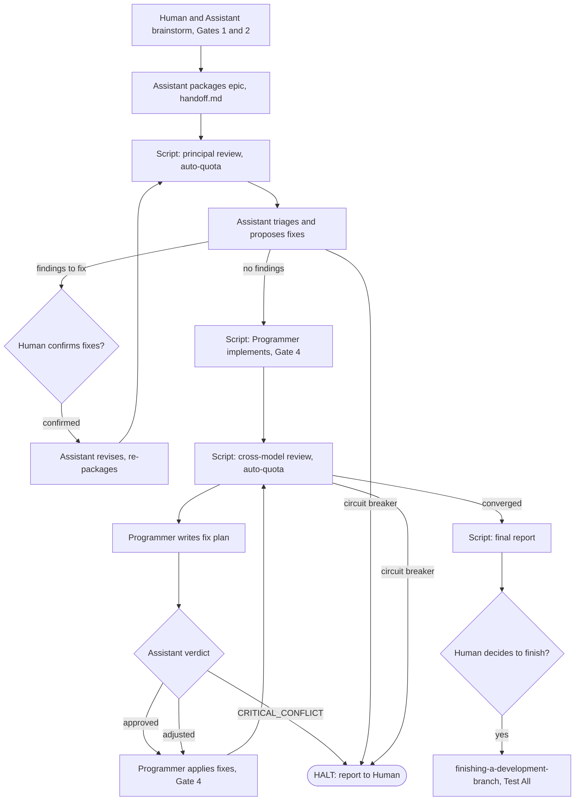

# Autonomous Lifecycle Runner Design

Design for an opt-in script that drives `dev-lifecycle` from handoff to the final Human report, with three actors (Human, AI Assistant, AI Programmer) and headless model dispatch.

## Contents

1. [Summary](#summary)
2. [Goals and Non-Goals](#goals-and-non-goals)
3. [Actors and Models](#actors-and-models)
4. [Pipeline Flow](#pipeline-flow)
5. [Human Checkpoints](#human-checkpoints)
6. [Runner Architecture](#runner-architecture)
7. [Rule Changes](#rule-changes)
8. [Risks and Mitigations](#risks-and-mitigations)
9. [Testing](#testing)
10. [Shared Contract Warnings](#shared-contract-warnings)

## Summary

Today the lifecycle stops at several menus (Handoff Choice, Gate 3, Review Choice) and at every non-critical review finding. A new script, `lifecycle_runner.py`, removes the menus and runs each stage in a separate headless `agy` process that uses the model and effort that stage needs. Human decisions are kept only where the Human asked for them.

## Goals and Non-Goals

Goals:

- Run the pipeline from handoff to the final report without menu stops.
- Dispatch the Programmer as Gemini 3.8 Flash at high effort, and the Assistant as a stronger model.
- Add an Assistant review of the Programmer's fix plan after every cross-model review round.
- Survive restarts: all state lives in `.devtool/`.

Non-goals:

- No change to interactive mode: the runner is opt-in through `/dev-lifecycle --autonomous`.
- No change to Gates 1 and 2, the 3-round cap, or the three Circuit Breakers.
- No auto-merge: the Human always decides on `/finishing-a-development-branch`.

## Actors and Models

| Actor | Role | Model source |
|---|---|---|
| Human (2.1) | Chooses the solution, confirms Principal Review fixes, decides to finish | n/a |
| AI Assistant (2.2) | Writes the design, triages review findings, approves fix plans | `.devtool/review_config.json` (`assistant` entry) |
| AI Programmer (2.3) | Implements tasks, proposes and applies fixes | `gemini-3.8-flash`, effort `high` |

The command shape was verified on this machine: `agy --print "<prompt>" --model gemini-3.8-flash --effort high --mode plan` exits 0 and answers. Programmer calls use `--mode auto` so the process can edit files in its worktree.

## Pipeline Flow

## Human Checkpoints

1. **Brainstorming and design (Gates 1 and 2)**: unchanged, the Human approves the spec and the task breakdown.
2. **Principal Review fixes**: the Assistant verifies every finding against the source and the approved design, presents the proposed fixes, and stops until the Human confirms. A round with zero findings continues without a stop. Minor-only rounds are included in the confirmation batch. After confirmation the Assistant revises, re-packages and the script starts the next round (maximum 3).
3. **Cross-model review fixes**: no Human stop. The Programmer proposes the fixes, the Assistant approves or adjusts the plan, the Programmer applies it, and Gate 4 re-runs.
4. **Circuit Breakers**: `SHARED_CONTRACT_CONFLICT`, `FIX_LOOP` and `MAX_ROUNDS_CRITICAL_REMAINING` always halt and report, in both review stages.
5. **Assistant CRITICAL_CONFLICT**: a fix plan that would change an approved decision halts and reports.
6. **Final report**: after review convergence and a green Gate 4, the runner prints the executive report and stops. The Human chooses `/finishing-a-development-branch`; merge then runs `Test All`.

## Runner Architecture

The script lives at `skills/dev-lifecycle/resources/scripts/lifecycle_runner.py` and is a resumable state machine.

- **State**: `.devtool/state/<epic>.pipeline.json` records the current stage, round number, last SHA and last verdict. The Gate Ledger (`.devtool/GATE_LEDGER.md`) stays the record of approvals.
- **Dispatch**: each AI step is one subprocess, `agy --print <prompt> --model <model> --effort <effort> --mode <mode>`, run in the epic worktree with a timeout and its own process group.
- **Prompts**: built from `.devtool/` files only (handoff, task file, triage output, review ledger), because headless sessions share no context.
- **Fix plan**: the Programmer writes `.devtool/epic/<epic>/fix_plan_round<N>.md`. The Assistant answers with one verdict line: `APPROVED`, `ADJUSTED` (with the edited plan) or `CRITICAL_CONFLICT`.
- **Startup probe**: before the first dispatch the runner calls each configured model with a one-word prompt and stops with a clear error if it is not accepted.
- **Existing scripts reused**: `package_epic.py`, `run_external_review.py` (`run`, `triage`, `check`), `audit_epic.py`, `compute_execution_order.py`, `resume_context.py`.

## Rule Changes

- `rules/CRITICAL_RULES.md` section 5 (mandatory Review Choice): in autonomous mode the runner enters cross-model review automatically after the first Gate 4 PASS and presents no menu. Interactive mode is unchanged.
- `rules/CRITICAL_RULES.md` section 6: in autonomous mode `Debatable` and `False Positive` findings in cross-model review are resolved by the Assistant verdict, not by a Human stop.
- Gate 3 (execution order): in autonomous mode it is confirmed automatically from the output of `compute_execution_order.py`, and the order is recorded in the Gate Ledger.
- `skills/dev-lifecycle/SKILL.md`, `skills/dev-implementation/SKILL.md`, `skills/principal-review/SKILL.md`, `skills/cross-model-review/SKILL.md` and `docs/lifecycles.{en,vi}.md` describe the autonomous path in short form and point to a reference file for the detail.

## Risks and Mitigations

| Risk | Mitigation |
|---|---|
| The model identifier is rejected on another machine or profile | Startup probe fails fast; model and effort come from configuration, not code |
| Assistant approval is weaker than Human approval | The Assistant sees only the fix plan and the approved design; Gate 4 re-runs after every fix; the 3-round cap and Circuit Breakers stay |
| A headless Programmer edits outside its scope | Runs only in the epic worktree; `Allowed files` from the task file are in the prompt; `audit_epic.py` still flags protected-path changes |
| A crash leaves the pipeline half-done | State file plus Gate Ledger; the runner resumes from the recorded stage |
| Quota exhaustion mid-run | `--auto-quota` provider order; a provider with no quota left is skipped, and if none remain the runner halts and reports |

## Testing

- Unit tests use a fake `agy` executable, the same pattern as `test_run_external_review.py`.
- Cases: each stage transition, resume after a crash at every stage, each halt condition, the Principal Review stop-and-confirm, fix-plan verdict parsing, and the startup probe failure.
- `scripts/verify.sh` runs the new test file as part of the release check.

## Shared Contract Warnings

`shared-contracts/` is absent in this repository, so there are no contract warnings. Clean state confirmed.
