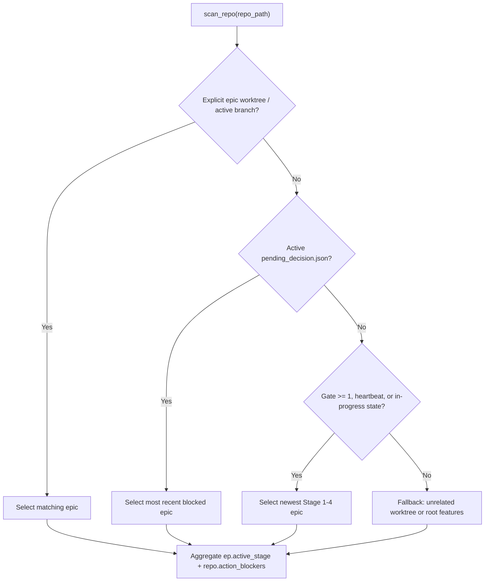

# Check-Tasks Action Alerts & English UI Design

- **Date**: 2026-11-14
- **PIC**: phungthuy8901
- **Status**: Approved
- **Scope**: `skills/check-tasks/resources/scripts/check_tasks.py`, `skills/check-tasks/resources/dashboard/tasks_dashboard.html`, `tests/test_ltsp_harvester_pipeline.py`, `tests/test_ltsp_dashboard_ui.py`, `tests/test_lifecycle_telemetry_and_stage_progress.py`
- **Next step**: `writing-plans` (single implementation plan)

## Table of Contents

- [1. Problem Statement & Root Cause](#1-problem-statement--root-cause)
- [2. Goals and Non-Goals](#2-goals-and-non-goals)
- [3. Backend Aggregation & Priority Design](#3-backend-aggregation--priority-design)
  - [3.1. Active Epic Resolution Priority](#31-active-epic-resolution-priority)
  - [3.2. Repo-Level Action Blockers Aggregation](#32-repo-level-action-blockers-aggregation)
- [4. Frontend Alert Unification & English UI Standardization](#4-frontend-alert-unification--english-ui-standardization)
  - [4.1. Unified Action Blocker Helper & Cache Signatures](#41-unified-action-blocker-helper--cache-signatures)
  - [4.2. Four-Location Confirmation Alert Behavior](#42-four-location-confirmation-alert-behavior)
  - [4.3. English UI Localization Standard](#43-english-ui-localization-standard)
- [5. Shared Contract Warnings](#5-shared-contract-warnings)
- [6. Verification and Testing Strategy](#6-verification-and-testing-strategy)

---

## 1. Problem Statement & Root Cause

When a repository pauses for human confirmation (e.g., `pending_decision.json` active blocker, Gate approval, or Choice A handoff), the `/check-tasks` web dashboard previously surfaced warnings at two locations (Execution card banner and `TIẾN ĐỘ EPICS` sidebar item) while missing alerts at two critical top-level locations (Repo selector tab and `ĐIỂM NGHẼN CẦN PHÊ DUYỆT` card). Additionally, the UI displayed Vietnamese titles alongside English telemetry, and secondary epic alerts fell back to inaccurate placeholder text (`Đang xử lý theo worktree...` and hardcoded `Stage 3`).

Root cause analysis confirmed two compounding issues:

1. **Backend resolution & aggregation (`check_tasks.py`)**:
   - `resolve_active_epic()` scanned `.worktrees/<other>/.devtool/features/task_*.md` before checking active `pending_decision.json` entries and active Stage 1–4 telemetry. In `lyrics-sync`, stale `unstarted` tasks (`mac_mini_to_cloud_roadmap`) inside `.worktrees/acr-live` masked an active Principal Review blocker (`alignment_flow_hardening`).
   - `_scan_repo_impl()` computed `repo.is_human_action_required` strictly from the single resolved `active_epic` and omitted `active_stage` / repo-level `action_blockers` for non-primary epics.
2. **Frontend rendering & signature caching (`tasks_dashboard.html`)**:
   - `renderRepoTabs()` and `renderEpicsOverviewAndApprovalGate()` checked only `repo.is_human_action_required === true` and ignored `epics_summary.epics[*].is_action_required` and `pending_decision.decisions`.
   - `buildOverviewSig()` omitted per-epic `is_action_required` / `action_prompt` / `pending_decision`, preventing polling updates from refreshing the approval card.
   - `renderExecutionEpics()` dropped `epicMeta.action_prompt` and `active_stage` whenever `isPrimaryActive === false`.
   - On crimson repo tabs (`lyrics-sync`), a small red corner dot alone lacks visual contrast; an explicit tab badge pill makes action-required states unmistakable.

---

## 2. Goals and Non-Goals

### Goals

- Ensure `resolve_active_epic()` prioritizes live `pending_decision.json` blockers and active Stage 1–4 epics over stale `unstarted` backlog tasks in unrelated worktrees.
- Aggregate action-required blockers across **all** non-completed epics in a repository (`repo.is_human_action_required`, `repo.action_blockers`, `ep.active_stage`).
- Display consistent visual warnings across all four dashboard locations:
  1. **Execution Epic Card Banner**: Show real `action_prompt` and accurate `active_stage`.
  2. **Kanban Sidebar (`EPICS PROGRESS`)**: Highlight blocked epic border with pulsing dot and English tooltip.
  3. **Top Repo Selector Tab**: Display pulsing notification indicator plus explicit `⚠️ <N> Confirm` badge pill.
  4. **Overview Approval Blockers Card**: Switch from `Clear` to crimson `Action Required` / `Confirmation Required` listing every blocked epic and reason.
- Standardize all dashboard titles, section headers, alert banners, status badges, buttons, modal titles, and tooltips in `tasks_dashboard.html` to English.
- Verify live DOM behavior via unit tests, Chrome DevTools Protocol (CDP) integration tests, and `browser_subagent`.

### Non-Goals

- Does not alter external repository `.devtool/` files or auto-resolve pending decisions.
- Does not rewrite legacy Vietnamese user-authored strings inside persisted `gate_ledger.md` or `quick_note` content.

---

## 3. Backend Aggregation & Priority Design

### 3.1. Active Epic Resolution Priority

Update `resolve_active_epic()` in `skills/check-tasks/resources/scripts/check_tasks.py`:

1. Keep explicit worktree branches (`epic/<slug>`, `feat/<slug>`), worktree `.devtool/epic/<slug>` dirty files, and worktree directories matching an epic slug (`_strip_slot_suffix(d.name)`) at top priority.
2. When checking `.worktrees/<dir>/.devtool/features/task_*.md`, accept an epic **only** if `<dir>` matches that epic slug (normalized) OR no active `pending_decision.json` / `in_progress` Gate/heartbeat candidate exists; otherwise allow `pending_decision.json` and Stage 1–4 candidates (`in_progress` epics, active heartbeat, `gate >= 1`) to win before falling back to unrelated `.worktrees/<other>/.devtool/features/` backlog files.

### 3.2. Repo-Level Action Blockers Aggregation

Add `action_blockers: list[dict[str, str]] = field(default_factory=list)` to `RepoMetadata` and compute in `_scan_repo_impl()`:

- Derive `ep_decision = derive_lifecycle_state(repo_path, slug, pending_decision=ep_pd)` for active/in-progress epics so every non-done epic in `epics_summary.epics` carries accurate `active_stage`, `is_action_required`, and `action_prompt` (falling back cleanly to `ep_decision.prompt` when `ep_pd` has no explicit reason).
- Build `action_blockers` deterministically across both `active_epic` (when `decision.is_human_action_required`) and any non-done epic in `epics_summary.epics` where `ep.is_action_required` is `True` (deduplicated by normalized slug, each entry shaped `{"epic": slug, "stage": stage_name, "reason": prompt}`).
- Set `repo.is_human_action_required = bool(decision.is_human_action_required or action_blockers)`.
- If `decision.is_human_action_required` is `False` while `action_blockers` is non-empty, keep `repo.prompt` actionable (e.g., `<epic>: <reason>` or summarized blocker count) instead of `"Idle"`.

---

## 4. Frontend Alert Unification & English UI Standardization

### 4.1. Unified Action Blocker Helper & Cache Signatures

Add `collectRepoActionBlockers(repo)` in `skills/check-tasks/resources/dashboard/tasks_dashboard.html`:

- Sources blockers from `repo.action_blockers`, `repo.pending_decision.decisions`, `repo.pending_decision` (legacy), `epics_summary.epics.filter(e => e.status !== 'done' && e.is_action_required === true)`, and `repo.is_human_action_required`.
- Deduplicates by normalized epic slug (`slugsMatch`) while keeping non-empty `stage` and `reason` strings.
- Include blocker count + serialized reasons in `tabsSig` (`renderRepoTabs`) and `buildOverviewSig` (`renderEpicsOverviewAndApprovalGate`) so 5s polling updates trigger immediate re-rendering without stale DOM caches.

### 4.2. Four-Location Confirmation Alert Behavior

| Location | Function | New Behavior |
|---|---|---|
| 1. Execution Card Banner | `renderExecutionEpics()` | Displays `epicMeta.action_prompt` or matching `collectRepoActionBlockers` reason (never `"Đang xử lý theo worktree..."`) and real `epicMeta.active_stage` |
| 2. Kanban Sidebar Item | `renderKanbanDashboard()` | Keeps `#ef4444` border + pulsing dot when `epNeedsConfirm === true`; English tooltip `"Epic requires user confirmation / approval"` |
| 3. Top Repo Selector Tab | `renderRepoTabs()` | Triggers `needsConfirm` when `collectRepoActionBlockers(r).length > 0`; renders `.tab-notification-badge` + visible `⚠️ <N> Confirm` badge pill in `.tab-badges` |
| 4. Overview Blockers Card | `renderEpicsOverviewAndApprovalGate()` | Switches card styling to crimson alert when `blockers.length > 0`, displays `Action Required` / `Confirmation Required`, and lists every blocked epic and reason |

### 4.3. English UI Localization Standard

Standardize all Vietnamese UI strings in `tasks_dashboard.html` to clear, concise English while retaining multi-lingual prompt keyword detection (`Approve`, `Phê duyệt`, `Waiting /finish`, `Chờ /finish`) in `hasPromptActionWords` and `isWaitingFinish` for backwards compatibility with existing state fixtures:

- Top bar & loading: `Refresh`, `Open Antigravity Quota Dashboard (Dialog)`, `Loading repository and worktree data from server...`, `Notification`.
- Section & Panel titles: `I. Project Overview`, `II. Worktree & Profile Execution`, `Epics Overview`, `Approval Blockers`, `EPICS PROGRESS`, `Epics Roadmap (from .devtool/epic/)`, `Strategic Notes (Human Architect)`.
- Cards, Sub-labels & Badges: `Root branch:`, `In progress`, `Backlog / Queued`, `Completed`, `Paused / Cancelled`, `Confirmation Required`, `✓ Clear`, `No blocking gates`, `Action Required`, `Human Decision Required:`, `Current Task:`, `Status: Waiting for decision`, `Next Step:`, `Task Progress:`, `Execution Logs`, `View all N logs`, `Collapse`, `Create Triage Table`, `All tasks completed ✓`, `Setting up tasks...`, `Assign PIC...`, `Unassigned`, `Open IDE`, `Copy folder path`, `Copy worktree path`.
- Modals & Toasts: `Project Epics List`, `Kanban Tasks Board`, `Two-Tier Memory: PROJECT_LEDGER vs Assistant State`, `Principal Review Results`, `Review Results`, `Evidence / Raw Output`, plus English clipboard/PIC/launch toast messages.

---

## 5. Shared Contract Warnings

No `shared-contracts/` directory exists in `ai-agent-tools`; all schema additions (`RepoMetadata.action_blockers`, per-epic `active_stage`) are internal additive JSON fields backward-compatible with `check-tasks` API consumers.

---

## 6. Verification and Testing Strategy

1. **Unit & Harvester Tests (`tests/test_ltsp_harvester_pipeline.py`)**:
   - Reproduce `lyrics-sync` stale `.worktrees/<other>/.devtool/features/` backlog alongside an active `pending_decision.json` blocker; verify `resolve_active_epic` picks the blocked epic (not the stale unstarted backlog).
   - Verify multi-epic repo where `active_epic` runs autonomously while a sibling `in_progress` epic has an active `pending_decision`: assert `repo.is_human_action_required is True`, `repo.action_blockers` contains the blocked epic with reason/stage, and `ep["active_stage"]` matches.
2. **UI & CDP Browser Acceptance Tests (`tests/test_ltsp_dashboard_ui.py`, `tests/test_lifecycle_telemetry_and_stage_progress.py`)**:
   - Serve live `TasksServer` with synthetic multi-epic action-required repo (`lyrics-sync` red theme + secondary blocker).
   - Assert via headless Chrome CDP that **all 4 locations** display action-required alerts simultaneously (Repo tab pill + dot, Approval Blockers card listing blocker, Kanban `EPICS PROGRESS` item border/dot, Execution card banner with exact reason and accurate stage) and key English titles render without Vietnamese UI regressions.
   - Verify clearing the blocker transitions all 4 locations cleanly back to `✓ Clear` / `No blocking gates`.
3. **Full Suite & Live Browser Subagent Check**:
   - Dispatch `browser_subagent` against live `TasksServer` rendering workspace repos (including `lyrics-sync`) and confirm visual clarity.
   - Run `ruff format --check`, `ruff check`, `mypy`, `bash scripts/verify.sh --full`.
