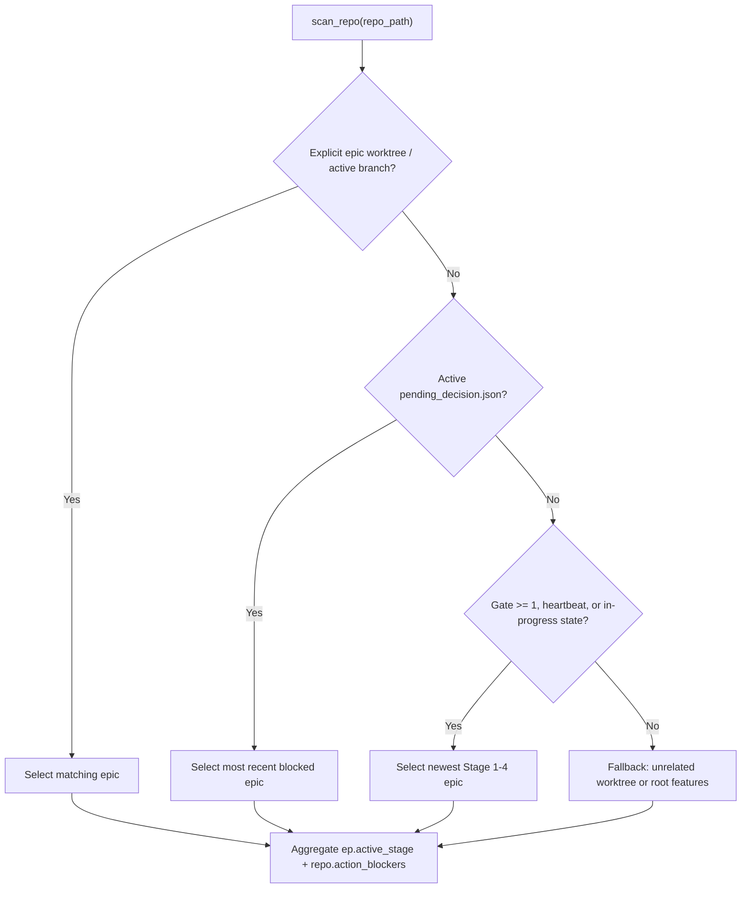

# Thiết Kế Cảnh Báo Action Required & Chuẩn Hóa UI Tiếng Anh Trên Check-Tasks

- **Ngày**: 2026-11-14
- **PIC**: phungthuy8901
- **Trạng thái**: Đã phê duyệt
- **Phạm vi**: `skills/check-tasks/resources/scripts/check_tasks.py`, `skills/check-tasks/resources/dashboard/tasks_dashboard.html`, `tests/test_ltsp_harvester_pipeline.py`, `tests/test_ltsp_dashboard_ui.py`, `tests/test_lifecycle_telemetry_and_stage_progress.py`
- **Bước tiếp theo**: `writing-plans` (một kế hoạch triển khai đơn)

## Mục Lục

- [1. Vấn Đề & Nguyên Nhân Gốc](#1-vấn-đề--nguyên-nhân-gốc)
- [2. Mục Tiêu Và Phạm Vi Loại Trừ](#2-mục-tiêu-và-phạm-vi-loại-trừ)
- [3. Thiết Kế Tổng Hợp Backend & Độ Ưu Tiên](#3-thiết-kế-tổng-hợp-backend--độ-ưu-tiên)
  - [3.1. Độ Ưu Tiên Xác Định Active Epic](#31-độ-ưu-tiên-xác-định-active-epic)
  - [3.2. Tổng Hợp Action Blockers Cấp Repo](#32-tổng-hợp-action-blockers-cấp-repo)
- [4. Đồng Nhất Cảnh Báo Frontend & Chuẩn Hóa Giao Diện Tiếng Anh](#4-đồng-nhất-cảnh-báo-frontend--chuẩn-hóa-giao-diện-tiếng-anh)
  - [4.1. Helper Tổng Hợp Blocker & Cache Signatures](#41-helper-tổng-hợp-blocker--cache-signatures)
  - [4.2. Hành Vi Cảnh Báo Tại 4 Vị Trí](#42-hành-vi-cảnh-báo-tại-4-vị-trí)
  - [4.3. Tiêu Chuẩn Chuẩn Hóa Giao Diện Tiếng Anh](#43-tiêu-chuẩn-chuẩn-hóa-giao-diện-tiếng-anh)
- [5. Cảnh báo Shared Contract](#5-cảnh-báo-shared-contract)
- [6. Chiến Lược Kiểm Thử Và Xác Minh](#6-chiến-lược-kiểm-thử-và-xác-minh)

---

## 1. Vấn Đề & Nguyên Nhân Gốc

Khi một repository tạm dừng chờ người dùng xác nhận (ví dụ có blocker trong `pending_decision.json`, phê duyệt Gate hoặc Choice A handoff), web dashboard `/check-tasks` trước đây chỉ hiển thị cảnh báo ở 2 vị trí (banner trong thẻ Execution và mục sidebar `TIẾN ĐỘ EPICS`) nhưng lại thiếu ở 2 vị trí cấp repo phía trên (Tab chọn repo và thẻ `ĐIỂM NGHẼN CẦN PHÊ DUYỆT`). Ngoài ra, giao diện vẫn còn lẫn tiêu đề tiếng Việt cùng telemetry tiếng Anh, và cảnh báo cho epic phụ rơi về chuỗi fallback thiếu chính xác (`Đang xử lý theo worktree...` và gán cứng `Stage 3`).

Phân tích nguyên nhân gốc cho thấy hai vấn đề cộng hưởng:

1. **Tổng hợp & phân giải phía Backend (`check_tasks.py`)**:
   - `resolve_active_epic()` quét `.worktrees/<other>/.devtool/features/task_*.md` trước khi kiểm tra `pending_decision.json` đang active và telemetry Stage 1–4. Tại `lyrics-sync`, các task `unstarted` cũ (`mac_mini_to_cloud_roadmap`) trong `.worktrees/acr-live` đã che mất blocker Principal Review đang active (`alignment_flow_hardening`).
   - `_scan_repo_impl()` chỉ tính `repo.is_human_action_required` theo đúng một `active_epic` duy nhất và thiếu trường `active_stage` / `action_blockers` cho các epic không phải primary.
2. **Hiển thị & cache signature phía Frontend (`tasks_dashboard.html`)**:
   - `renderRepoTabs()` và `renderEpicsOverviewAndApprovalGate()` chỉ kiểm tra `repo.is_human_action_required === true`, bỏ qua `epics_summary.epics[*].is_action_required` và `pending_decision.decisions`.
   - `buildOverviewSig()` không đưa `is_action_required` / `action_prompt` / `pending_decision` theo từng epic vào chữ ký cache, khiến polling 5s không cập nhật khối phê duyệt.
   - `renderExecutionEpics()` bỏ qua `epicMeta.action_prompt` và `active_stage` khi `isPrimaryActive === false`.
   - Trên tab repo nền đỏ sẵn (`lyrics-sync`), chỉ chấm tròn đỏ nhỏ ở góc rất khó nhận biết; cần thêm badge pill rõ ràng ngay trong cụm badge của tab.

---

## 2. Mục Tiêu Và Phạm Vi Loại Trừ

### Mục Tiêu

- Đảm bảo `resolve_active_epic()` ưu tiên `pending_decision.json` đang active và các epic Stage 1–4 đang chạy trước các task backlog `unstarted` cũ nằm trong worktree không liên quan.
- Tổng hợp trạng thái chờ xác nhận trên **toàn bộ** epic chưa hoàn thành của repo (`repo.is_human_action_required`, `repo.action_blockers`, `ep.active_stage`).
- Hiển thị cảnh báo đồng nhất tại đủ cả 4 vị trí trên dashboard:
  1. **Banner Thẻ Execution Epic**: Hiển thị đúng `action_prompt` và `active_stage` thực tế.
  2. **Kanban Sidebar (`EPICS PROGRESS`)**: Giữ viền đỏ và chấm tròn pulse kèm tooltip tiếng Anh.
  3. **Tab Chọn Repo Phía Trên**: Hiện chấm thông báo pulse kèm badge pill nổi bật `⚠️ <N> Confirm`.
  4. **Thẻ Approval Blockers Phần Overview**: Chuyển từ `Clear` sang trạng thái cảnh báo đỏ `Action Required` / `Confirmation Required` liệt kê đầy đủ từng epic bị nghẽn và lý do.
- Chuẩn hóa toàn bộ tiêu đề, heading, alert banner, badge trạng thái, nút bấm, tiêu đề modal và tooltip trong `tasks_dashboard.html` sang tiếng Anh.
- Kiểm chứng hành vi DOM trực tiếp qua unit tests, kiểm thử Chrome DevTools Protocol (CDP) và `browser_subagent`.

### Phạm Vi Loại Trừ

- Không chỉnh sửa file `.devtool/` của các repository khác và không tự động xóa `pending_decision` thực tế.
- Không dịch lại nội dung người dùng tự nhập trong `gate_ledger.md` hay `quick_note`.

---

## 3. Thiết Kế Tổng Hợp Backend & Độ Ưu Tiên

### 3.1. Độ Ưu Tiên Xác Định Active Epic

Cập nhật `resolve_active_epic()` trong `skills/check-tasks/resources/scripts/check_tasks.py`:

1. Giữ nguyên ưu tiên cao nhất cho nhánh worktree chuẩn (`epic/<slug>`, `feat/<slug>`), thay đổi dirty trong `.devtool/epic/<slug>`, và thư mục worktree trùng slug epic (`_strip_slot_suffix(d.name)`).
2. Khi duyệt `.worktrees/<dir>/.devtool/features/task_*.md`, chỉ chấp nhận epic đó **khi** `<dir>` trùng slug epic (sau chuẩn hóa) HOẶC không tồn tại ứng viên active từ `pending_decision.json` / `in_progress` Gate/heartbeat; nhờ vậy `pending_decision.json` và các ứng viên Stage 1–4 (`in_progress`, heartbeat active, `gate >= 1`) luôn thắng backlog `unstarted` cũ nằm ở worktree khác.

### 3.2. Tổng Hợp Action Blockers Cấp Repo

Thêm trường `action_blockers: list[dict[str, str]] = field(default_factory=list)` vào `RepoMetadata` và tính trong `_scan_repo_impl()`:

- Chạy `ep_decision = derive_lifecycle_state(repo_path, slug, pending_decision=ep_pd)` cho các epic active/in-progress để mỗi epic chưa hoàn thành trong `epics_summary.epics` đều có `active_stage`, `is_action_required`, và `action_prompt` chính xác (fallback sạch về `ep_decision.prompt` nếu `ep_pd` không ghi `reason`).
- Dựng danh sách `action_blockers` từ cả `active_epic` (nếu `decision.is_human_action_required`) lẫn mọi epic chưa `done` trong `epics_summary.epics` có `ep.is_action_required == True` (loại trùng theo slug chuẩn hóa, mỗi phần tử gồm `{"epic": slug, "stage": stage_name, "reason": prompt}`).
- Gán `repo.is_human_action_required = bool(decision.is_human_action_required or action_blockers)`.
- Khi `decision.is_human_action_required` là `False` nhưng `action_blockers` khác rỗng, giữ `repo.prompt` ở trạng thái phản ánh blocker (ví dụ `<epic>: <reason>`) thay vì để `"Idle"`.

---

## 4. Đồng Nhất Cảnh Báo Frontend & Chuẩn Hóa Giao Diện Tiếng Anh

### 4.1. Helper Tổng Hợp Blocker & Cache Signatures

Thêm helper `collectRepoActionBlockers(repo)` trong `skills/check-tasks/resources/dashboard/tasks_dashboard.html`:

- Gom blocker từ `repo.action_blockers`, `repo.pending_decision.decisions`, `repo.pending_decision` (legacy), `epics_summary.epics.filter(e => e.status !== 'done' && e.is_action_required === true)`, và `repo.is_human_action_required`.
- Khử trùng theo slug chuẩn hóa (`slugsMatch`) đồng thời giữ nguyên chuỗi `stage` và `reason`.
- Đưa số lượng và chi tiết blocker vào `tabsSig` (`renderRepoTabs`) và `buildOverviewSig` (`renderEpicsOverviewAndApprovalGate`) để chu kỳ polling 5s tự cập nhật DOM ngay lập tức.

### 4.2. Hành Vi Cảnh Báo Tại 4 Vị Trí

| Vị trí | Hàm | Hành vi mới |
|---|---|---|
| 1. Banner Thẻ Execution | `renderExecutionEpics()` | Hiển thị đúng `epicMeta.action_prompt` hoặc lý do từ `collectRepoActionBlockers` (không hiện `"Đang xử lý theo worktree..."`) và `epicMeta.active_stage` chính xác |
| 2. Mục Sidebar Kanban | `renderKanbanDashboard()` | Giữ viền đỏ `#ef4444` + chấm đỏ pulse khi `epNeedsConfirm === true`; tooltip tiếng Anh `"Epic requires user confirmation / approval"` |
| 3. Tab Chọn Repo Trên Cùng | `renderRepoTabs()` | Bật `needsConfirm` khi `collectRepoActionBlockers(r).length > 0`; hiện chấm `.tab-notification-badge` kèm badge pill nổi bật `⚠️ <N> Confirm` trong `.tab-badges` |
| 4. Thẻ Approval Blockers | `renderEpicsOverviewAndApprovalGate()` | Chuyển nền/viền cảnh báo đỏ khi `blockers.length > 0`, hiện `Action Required` / `Confirmation Required` và liệt kê từng epic kèm lý do |

### 4.3. Tiêu Chuẩn Chuẩn Hóa Giao Diện Tiếng Anh

Chuyển toàn bộ chuỗi UI tiếng Việt trong `tasks_dashboard.html` sang tiếng Anh gọn gàng, đồng thời giữ cả từ khóa nhận diện tiếng Việt cũ (`Approve`, `Phê duyệt`, `Waiting /finish`, `Chờ /finish`) trong `hasPromptActionWords` và `isWaitingFinish` để tương thích ngược với dữ liệu fixture/state đang tồn tại:

- Thanh trên cùng & loading: `Refresh`, `Open Antigravity Quota Dashboard (Dialog)`, `Loading repository and worktree data from server...`, `Notification`.
- Tiêu đề khu vực & panel: `I. Project Overview`, `II. Worktree & Profile Execution`, `Epics Overview`, `Approval Blockers`, `EPICS PROGRESS`, `Epics Roadmap (from .devtool/epic/)`, `Strategic Notes (Human Architect)`.
- Thẻ, nhãn phụ & badge: `Root branch:`, `In progress`, `Backlog / Queued`, `Completed`, `Paused / Cancelled`, `Confirmation Required`, `✓ Clear`, `No blocking gates`, `Action Required`, `Human Decision Required:`, `Current Task:`, `Status: Waiting for decision`, `Next Step:`, `Task Progress:`, `Execution Logs`, `View all N logs`, `Collapse`, `Create Triage Table`, `All tasks completed ✓`, `Setting up tasks...`, `Assign PIC...`, `Unassigned`, `Open IDE`, `Copy folder path`, `Copy worktree path`.
- Modals & Toasts: `Project Epics List`, `Kanban Tasks Board`, `Two-Tier Memory: PROJECT_LEDGER vs Assistant State`, `Principal Review Results`, `Review Results`, `Evidence / Raw Output`, cùng toàn bộ toast thông báo copy/PIC/launch bằng tiếng Anh.

---

## 5. Cảnh báo Shared Contract

Repository `ai-agent-tools` không chứa thư mục `shared-contracts/`; mọi bổ sung schema (`RepoMetadata.action_blockers`, `active_stage` theo từng epic) đều là trường JSON mở rộng nội bộ tương thích ngược hoàn toàn với client của `check-tasks`.

---

## 6. Chiến Lược Kiểm Thử Và Xác Minh

1. **Unit & Harvester Tests (`tests/test_ltsp_harvester_pipeline.py`)**:
   - Tái hiện đúng tình huống của `lyrics-sync`: worktree lạ chứa backlog `unstarted` cũ song song với `pending_decision.json` active của epic khác; kiểm tra `resolve_active_epic` ưu tiên đúng epic đang chờ quyết định.
   - Kiểm tra repo chạy nhiều epic song song khi epic phụ đang dừng chờ confirm: xác nhận `repo.is_human_action_required is True`, `repo.action_blockers` chứa đúng epic + lý do + stage, và `ep["active_stage"]` khớp thực tế.
2. **UI & CDP Browser Acceptance Tests (`tests/test_ltsp_dashboard_ui.py`, `tests/test_lifecycle_telemetry_and_stage_progress.py`)**:
   - Khởi chạy `TasksServer` thật với repo đa-epic đang chờ confirm (`lyrics-sync` nền đỏ + blocker phụ).
   - Xác minh qua Chrome DevTools Protocol (CDP) headless rằng **cả 4 vị trí** đều hiện cảnh báo đồng bộ (tab repo có pill + chấm đỏ, thẻ Approval Blockers liệt kê đúng blocker, mục sidebar `EPICS PROGRESS` đỏ/chấm pulse, banner Execution hiện đúng lý do và stage thật) cùng các tiêu đề tiếng Anh sạch hoàn toàn.
   - Xác minh khi xóa `pending_decision`, cả 4 vị trí tự động trở về trạng thái `✓ Clear` / `No blocking gates`.
3. **Full Suite & Kiểm Tra Browser Thực Tế**:
   - Dùng `browser_subagent` mở `TasksServer` live kiểm tra hiển thị trực quan với dữ liệu workspace thực (`lyrics-sync`).
   - Chạy `ruff format --check`, `ruff check`, `mypy`, `bash scripts/verify.sh --full`.
