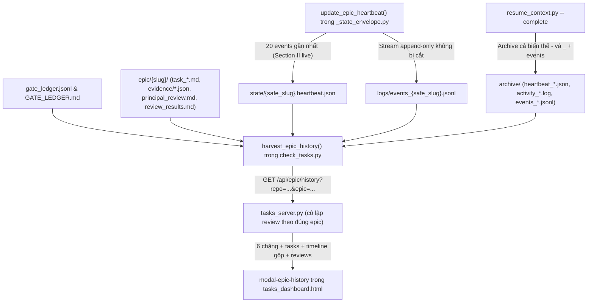

# Thiết kế Modal Lịch sử Epic & Telemetry Append-Only cho Check-Tasks

- **Ngày**: 2026-11-15
- **Trạng thái**: Bản nháp (Chờ phê duyệt Gate 1)
- **PIC**: `phungthuy8901`
- **Thư mục Epic**: `check_tasks_epic_history_modal`
- **Epic Slug**: `check_tasks_epic_history_modal`
- **Phạm vi**: `scripts/_state_envelope.py`, `scripts/resume_context.py`, `skills/check-tasks/resources/scripts/check_tasks.py`, `skills/check-tasks/resources/scripts/tasks_server.py`, `skills/check-tasks/resources/dashboard/tasks_dashboard.html`, `tests/`
- **Bước tiếp theo**: `dev-designer` (Stage 2)

## Mục lục

- [1. Bối cảnh](#1-bối-cảnh)
- [2. Mục tiêu và Ngoài phạm vi](#2-mục-tiêu-và-ngoài-phạm-vi)
  - [Mục tiêu](#mục-tiêu)
  - [Ngoài phạm vi](#ngoài-phạm-vi)
- [3. Kiến trúc và Dòng dữ liệu](#3-kiến-trúc-và-dòng-dữ-liệu)
- [4. Thiết kế Chi tiết các Thành phần](#4-thiết-kế-chi-tiết-các-thành-phần)
  - [4.1. Luồng Event Append-Only theo Epic và Cơ chế Archive](#41-luồng-event-append-only-theo-epic-và-cơ-chế-archive)
  - [4.2. Bộ tổng hợp Lịch sử theo nhu cầu và API Cô lập Epic](#42-bộ-tổng-hợp-lịch-sử-theo-nhu-cầu-và-api-cô-lập-epic)
  - [4.3. Giao diện Modal Lịch sử Epic và Tách Helper Dùng chung](#43-giao-diện-modal-lịch-sử-epic-và-tách-helper-dùng-chung)
- [5. Xử lý lỗi và Khả năng phục hồi](#5-xử-lý-lỗi-và-khả-năng-phục-hồi)
- [6. Cảnh báo Shared Contract](#6-cảnh-báo-shared-contract)
- [7. Chiến lược Kiểm thử và Xác minh](#7-chiến-lược-kiểm-thử-và-xác-minh)
- [8. Ánh xạ Phụ thuộc và Rủi ro](#8-ánh-xạ-phụ-thuộc-và-rủi-ro)

---

## 1. Bối cảnh

Trên `/check-tasks` Web Dashboard (`skills/check-tasks/resources/dashboard/tasks_dashboard.html`), **Section III ("Project Epics Roadmap (`.devtool/epic/`)")** liệt kê toàn bộ epic trong repo (`Done`, `In Progress`, `Packaged`, `Backlog`, `Abandon`), tuy nhiên từng dòng `.roadmap-epic-row` hiện chưa có tương tác:

1. **Thiếu trình xem lại lịch sử Epic**: Khi bấm vào bất kỳ epic nào trong bảng Roadmap, giao diện không phản hồi. Các epic `Done`, `Packaged`, `Backlog` hay `Abandon` rời khỏi **Section II** sau khi hoàn tất, khiến người dùng không thể xem lại 6 chặng pipeline, kết quả từng task, bằng chứng verify (`evidence/*.json`), timeline hoạt động, hoặc kết quả Principal / Cross-Model Review mà không làm xáo trộn epic đang chạy ở Section II.
2. **Telemetry từng bước bị cắt 20 dòng và phân mảnh `-`/`_`**: Hàm `update_epic_heartbeat` trong `scripts/_state_envelope.py` giới hạn `.heartbeat.json` ở `max_events = 20`, làm mất các log step cũ trên các epic dài. Ngoài ra, `_sanitize_epic_slug` đổi `_` thành `-`, dẫn đến telemetry bị chia đôi giữa hai file (ví dụ `alignment-flow-hardening.heartbeat.json` và `alignment_flow_hardening.heartbeat.json`), trong khi `resume_context.py --complete` chỉ archive biến thể `<safe_slug>.heartbeat.json`.
3. **Fallback Review thiếu cô lập**: Hàm `parse_review_results` trong `skills/check-tasks/resources/scripts/tasks_server.py` vẫn fallback về `.devtool/principal_review.md` và `.devtool/review_results.md` cấp repo ngay cả khi có tham số `epic`, dễ hiển thị nhầm review của epic khác khi xem epic cũ không có file review riêng.

---

## 2. Mục tiêu và Ngoài phạm vi

### Mục tiêu

- Cho phép click vào mọi dòng trong **Project Epics Roadmap** (`Done`, `In Progress`, `Packaged`, `Backlog`, `Abandon`) để mở Pop-up Modal chuyên biệt **`modal-epic-history`**, giữ nguyên **Section II** phía trên cho các epic đang chạy song song và tách biệt hoàn toàn khỏi thao tác dropdown `<select>` ở cột `PIC`.
- Cung cấp màn hình kiểm toán read-only đồng bộ bên trong `modal-epic-history`:
  - Phần đầu cố định gồm metadata (badge repo, tiêu đề/slug epic, trạng thái, PIC, thời gian cập nhật, nút Refresh & Đóng) và thanh **6-Stage Pipeline Summary** (`1. Spec` -> `6. Finish` kèm sub-step strip giống Section II).
  - Các tab chuyển trực tiếp bên trong modal: **`Timeline & Step Logs`** (lọc `All / Gates / Steps / Activity / Evidence`), **`Tasks & Evidence`** (trạng thái task + dòng verify `evidence/*.json` mở rộng được), **`Principal Review`** và **`Cross-Model Review`** (Round selector + bảng Triage 6 cột + Raw output đóng/mở).
- Thực thi cơ chế **Hybrid Telemetry Continuity**:
  - Với **epic cũ**: ghép timeline thống nhất theo thời gian từ mọi nguồn hiện có qua cả biến thể `-` và `_` (`gate_ledger.jsonl` / `GATE_LEDGER.md`, `activity_*.log` trong `logs/` và `archive/`, heartbeat ở `state/` và `archive/`, các lượt chạy trong `evidence/*.json`, và timestamp từng round review).
  - Với **epic mới từ nay về sau**: ghi thêm các bước chuyển trạng thái/sub-step đã khử trùng vào file append-only `.devtool/logs/events_<safe_slug>.jsonl` (không bị cắt) và archive cả `events_<safe_slug>.jsonl` lẫn cả hai biến thể `-`/`_` heartbeat khi chạy `resume_context.py --complete`.
- Giữ luồng polling `/api/tasks` nhẹ khi repo có trên 118 epic bằng cách tải lịch sử chi tiết theo nhu cầu qua `GET /api/epic/history?repo=<repo>&epic=<slug>`.

### Ngoài phạm vi

- Không nhúng terminal/IDE tương tác hay cho phép chỉnh sửa trạng thái task bên trong modal lịch sử (ngoài dropdown `PIC` vốn có ở bảng Roadmap).
- Không sửa các file `.devtool/` lịch sử của các repo vệ tinh (`D3Nexus`, `lyrics-sync`, `nexus`) và không tái tạo lại raw stdout log chưa từng được ghi cho epic cũ.
- Không lưu toàn bộ raw CLI stdout của mọi câu lệnh kiểm tra vào JSONL khi đã có thông điệp có cấu trúc và `evidence/*.json`.

---

## 3. Kiến trúc và Dòng dữ liệu

---

## 4. Thiết kế Chi tiết các Thành phần

### 4.1. Luồng Event Append-Only theo Epic và Cơ chế Archive

1. **`update_epic_heartbeat` (`scripts/_state_envelope.py`)**:
   - Giữ nguyên ring-buffer 20 phần tử (`max_events: int = 20`) trong `<safe_slug>.heartbeat.json` để payload polling của `/api/tasks` luôn gọn nhẹ.
   - Bên trong cùng transactional `file_lock` qua các thư mục `.devtool` được mirror, khi có event mới (hoặc chuyển sang `stage` / `sub_step` / `sub_step_detail` / `last_event` / `review_state` khác), append một dòng JSON chuẩn (`ts`, `stage`, `sub_step`, `sub_step_detail`, `message`, `review_state`) vào `.devtool/logs/events_<safe_slug>.jsonl`.
   - Giữ nguyên chữ ký hàm để tương thích ngược hoàn toàn với mọi caller (`dev-lifecycle`, `dev-implementation`, `quality_check`, `run_external_review.py`, `resume_context.py`).
2. **Archive khi Hoàn tất (`scripts/resume_context.py`)**:
   - Mở rộng bước `--complete` dưới `file_lock(devtool_dir)` để chuyển `.devtool/logs/events_<safe_slug>.jsonl` sang `.devtool/archive/events_<safe_slug>_<timestamp>.jsonl` (kèm biến thể `<epic_slug>` nếu tồn tại).
   - Archive cả hai biến thể `.devtool/state/<safe_slug>.heartbeat.json` và `<epic_slug>.heartbeat.json` (cũng như biến thể `-`/`_` còn lại) để không bỏ sót telemetry ở `state/`.

### 4.2. Bộ tổng hợp Lịch sử theo nhu cầu và API Cô lập Epic

1. **`harvest_epic_history(repo_path: Path, epic_slug: str)` (`skills/check-tasks/resources/scripts/check_tasks.py`)**:
   - **Tìm kiếm đa biến thể**: Chuẩn hóa `-` / `_` qua worktree khớp epic (nếu có), root `.devtool/epic/<slug>/`, `.devtool/state/`, `.devtool/logs/` và `.devtool/archive/`.
   - **Metadata & Danh mục Artifact**: Trả về `title`, `status` (`done`, `in_progress`, `packaged`, `unstarted`, `abandoned`), `pic`, `last_updated`, `theme_color` và cờ tồn tại artifact (`spec`, `hld`, `bdd`, `handoff`, `manual_smoke`).
   - **Tasks & Bằng chứng Verify**: Đọc toàn bộ `task_*.md` (ưu tiên worktree `.devtool/features/` nếu epic đang `in_progress`, ngược lại đọc ở `.devtool/epic/<slug>/task_*.md` theo thứ tự số tự nhiên). Ghép tóm tắt từ `evidence/<task_id>.json` (`head` SHA, `started`, `finished`, số row `PASS`/`FAIL`, danh sách `rows` gồm `id`, `phase`, `command`, `outcome`, và `output_tail` giới hạn gọn cho modal).
   - **6-Stage Pipeline Summary**: Hợp nhất các file heartbeat tìm được (cả `-` và `_`, ưu tiên trạng thái mới nhất theo `generation`/`updated_at` kèm đầy đủ event đã ghép) rồi gọi `compute_pipeline_telemetry(..., is_completed=(status == "done"))` để 6 chặng và sub-steps hiển thị đồng bộ với Section II.
   - **Unified Chronological Timeline**: Thu thập, chuẩn hóa timestamp ISO-8601 UTC, khử trùng lặp và sắp xếp theo thời gian từ:
     - `gate_ledger.jsonl` và `GATE_LEDGER.md` (`category: "gate"`)
     - `events_<slug>.jsonl` ở `logs/` + `archive/` (`category: "step"`)
     - `events` trong các file `heartbeat*.json` (`category: "step"`, đánh dấu rõ nguồn snapshot nếu chưa có `events_*.jsonl`)
     - `activity_<slug>*.log` ở `logs/` + `archive/` (`category: "activity"`)
     - Thời điểm bắt đầu/kết thúc trong `evidence/*.json` (`category: "evidence"`)
     - Thời điểm từng Round từ `principal_review.md` và `review_results.md` (`category: "review"`)
2. **`GET /api/epic/history` & Cô lập `parse_review_results` (`skills/check-tasks/resources/scripts/tasks_server.py`)**:
   - Kiểm tra `repo` phải thuộc `workspace_root` (chặn path traversal bằng HTTP `400`/`404`), nhận `epic` cùng tham số tùy chọn `round_principal` và `round_cross`.
   - Thêm cờ `strict_epic: bool = False` vào `parse_review_results()`: khi `strict_epic=True` (dùng cho `/api/epic/history`), chỉ dò file trong phạm vi epic (`.worktrees/<slug_or_alt>/.devtool/epic/<slug_or_alt>/...` và `repo_dir/.devtool/epic/<slug_or_alt>/...`), tuyệt đối **không** fallback về `.devtool/principal_review.md` hay `.devtool/review_results.md` chung cấp repo. Trả về đồng thời `reviews.principal` và `reviews.cross_model` (`available_rounds`, metadata round hiện chọn, `findings`, `raw_output`, `present: bool`).

### 4.3. Giao diện Modal Lịch sử Epic và Tách Helper Dùng chung

Trong `skills/check-tasks/resources/dashboard/tasks_dashboard.html`:

1. **Kích hoạt dòng Roadmap (`renderRoadmapTableRows`)**:
   - Bật tương tác click trên `<tr class="roadmap-epic-row">` gọi `openEpicHistoryModal(repoName, slug)` cùng hiệu ứng hover rõ ràng.
   - Gắn `event.stopPropagation()` trên `<select>` cột `PIC` để đổi PIC không vô tình mở Modal.
2. **Bố cục Modal (`#modal-epic-history`)**:
   - Tích hợp vào hệ `openLiveModal` / `closeLiveModal` (đóng bằng `ESC`, click backdrop hoặc nút `✕`) với viền `theme_color` của repo, giữ **Section II** phía dưới nguyên vẹn.
   - **Phần đầu cố định**: Repo pill, tên/slug epic, status badge, PIC, thời gian cập nhật, nhãn nguồn log (`Full Event Stream` hoặc `Snapshot + Ledger`), nút Refresh thủ công, và **6-Stage Pipeline Stepper + Sub-step Strip** tách từ helper dùng chung (`renderPipelineStepperSummaryHtml`).
   - **4 Tab chuyển trực tiếp**:
     - `Timeline & Step Logs`: Các chip lọc (`All`, `Gates`, `Steps`, `Activity`, `Evidence`), danh sách sự kiện kèm timestamp, badge stage/sub-step, nguồn log và nút copy Commit SHA.
     - `Tasks & Evidence`: Danh sách task với ID, tiêu đề, status badge, priority, nguồn (`worktree` vs `epic`) và phần mở rộng tại dòng xem `V1..Vn` verify rows từ `evidence/*.json`.
     - `Principal Review`: Tab chọn Round đổi tại chỗ, header metadata (`SHA`, `Reviewer`, `Model`, `Thinking`, `Verdict`), **bảng Triage 6 cột** tách thành helper dùng chung (`renderReviewTriageTableHtml`) với `modal-cross-review`, cùng panel Raw Output đóng/mở.
     - `Cross-Model Review`: Bố cục đồng nhất cho phép chuyển trực tiếp qua lại với `Principal Review` và chuyển Round mượt mà không bật modal thứ hai.
3. **Đồng bộ Live cho Epic `In Progress`**:
   - Khi `#modal-epic-history` đang mở một epic `in_progress`, chu kỳ polling 5 giây của dashboard tự làm mới âm thầm nội dung modal (giữ nguyên tab đang xem, round đã chọn và vị trí cuộn).

---

## 5. Xử lý lỗi và Khả năng phục hồi

- **Click nhanh liên tiếp / Đóng modal sớm**: Dùng biến đếm `epicHistoryRequestToken` kết hợp `AbortController`; response đến muộn hoặc sau khi đóng modal bị loại bỏ hoàn toàn.
- **Epic `Backlog` / `Packaged` hoặc Epic cũ thiếu artifact**: Hiển thị empty state rõ ràng trên từng tab tương ứng (ví dụ *"Epic này chưa có dữ liệu Principal Review"*, *"Chưa tách danh sách Tasks"*, *"Chỉ có dữ liệu snapshot/ledger do epic chạy trước khi bật append-only step log"*) thay vì báo lỗi hoặc rò file của epic khác.
- **File hỏng / Sai định dạng**: Parse từng dòng `.jsonl`, `.json` và markdown bằng `contextlib.suppress`; lỗi cục bộ ở một dòng hoặc một file không làm gãy các tab còn lại.
- **Kiểm soát đầu vào & Mạng**: Chặn `repo` ngoài `workspace_root` hoặc tham số thiếu bằng HTTP `400`/`404`; khi gọi API lỗi, hiển thị banner thông báo cùng nút **Retry** ngay trong Modal.

---

## 6. Cảnh báo Shared Contract

- **Trạng thái**: Sạch — thư mục `shared-contracts/` không tồn tại trong `ai-agent-tools`, và thay đổi API chỉ nằm trong local dashboard server (`tasks_server.py`) cùng file telemetry nội bộ dưới `.devtool/`.
- Không phát sinh xung đột hoặc trôi lệch contract liên repo.

---

## 7. Chiến lược Kiểm thử và Xác minh

1. **Unit & Backend Integration Tests (`pytest`)**:
   - **Telemetry Stream & Archival**: Kiểm thử `update_epic_heartbeat` giữ nguyên giới hạn 20 event trong `.heartbeat.json` đồng thời append > 20 event liên tiếp vào `.devtool/logs/events_<safe_slug>.jsonl` an toàn dưới lock; kiểm thử `--complete` archive đúng `events_*.jsonl` và cả hai biến thể `-`/`_` heartbeat.
   - **History Aggregator & API**: Kiểm thử `harvest_epic_history` và `GET /api/epic/history` xử lý slug `-`/`_`, ưu tiên task từ worktree khi đang chạy vs `.devtool/epic/<slug>/` khi đã xong, ghép `evidence/*.json`, hợp nhất + khử trùng timeline, xử lý `Backlog` sạch sẽ, chặn path traversal, và **cô lập hoàn toàn Review theo epic** (không fallback sang `.devtool/review_results.md` cấp repo).
2. **Browser / UI Integration Tests (`Playwright` / CDP)**:
   - Xác nhận đổi dropdown `PIC` trên bảng Roadmap **không** mở `modal-epic-history`.
   - Xác nhận click dòng `Done`, `In Progress`, `Backlog` đều mở được `modal-epic-history` trong khi **Section II** phía trên giữ nguyên; hiển thị đủ 6-Stage Stepper, chuyển đổi mượt giữa 4 tab (`Timeline`, `Tasks & Evidence`, `Principal Review`, `Cross-Model Review`) và chuyển Round; đóng đúng qua nút `✕` và phím `ESC`.
3. **Cổng chất lượng trước bàn giao**:
   - Chạy `bash scripts/verify.sh --full`, `ruff`, `mypy`, và `@quality_check` với `--profile pr`.

---

## 8. Ánh xạ Phụ thuộc và Rủi ro

| Hạng mục | Phân loại | Tác động & Cách giảm thiểu |
|---|---|---|
| Các caller của `update_epic_heartbeat` (`dev-lifecycle`, `dev-implementation`, `quality_check`, `run_external_review.py`, `resume_context.py`) | Phụ thuộc liên tính năng | Việc ghi thêm `.jsonl` nằm gọn bên trong `_state_envelope.py`, không đổi signature API nên giữ tương thích ngược 100%. |
| Code render UI trong `tasks_dashboard.html` | Liên kết nội bộ | Nhân bản markup 6-stage stepper hoặc bảng Triage 6 cột dễ gây lệch giao diện; tách thành pure JS helper dùng chung trước khi nối `modal-epic-history`. |
| Dung lượng log & evidence ở epic lớn | Rủi ro hiệu năng | Epic nhiều task/evidence có thể làm JSON nặng; chỉ fetch khi bấm mở epic qua `/api/epic/history`, rút gọn mặc định `output_tail` và thu gọn `raw_output`. |
| Bản snapshot plugin tại `~/.gemini/config/plugins/d3nexus/` | Giả định môi trường | Các profile chạy bằng bản plugin cài sẵn sẽ nhận luồng event mới và giao diện Modal sau khi đồng bộ lại plugin từ repo này. |
| Epic cũ hoàn thành trước khi có `events_*.jsonl` | Giới hạn dữ liệu lịch sử | Các epic trước đây chỉ còn `gate_ledger`, `activity_*.log` (nếu có), `evidence/*.json`, reviews và snapshot heartbeat cuối; UI gắn nhãn rõ ràng để tránh hiểu nhầm. |
