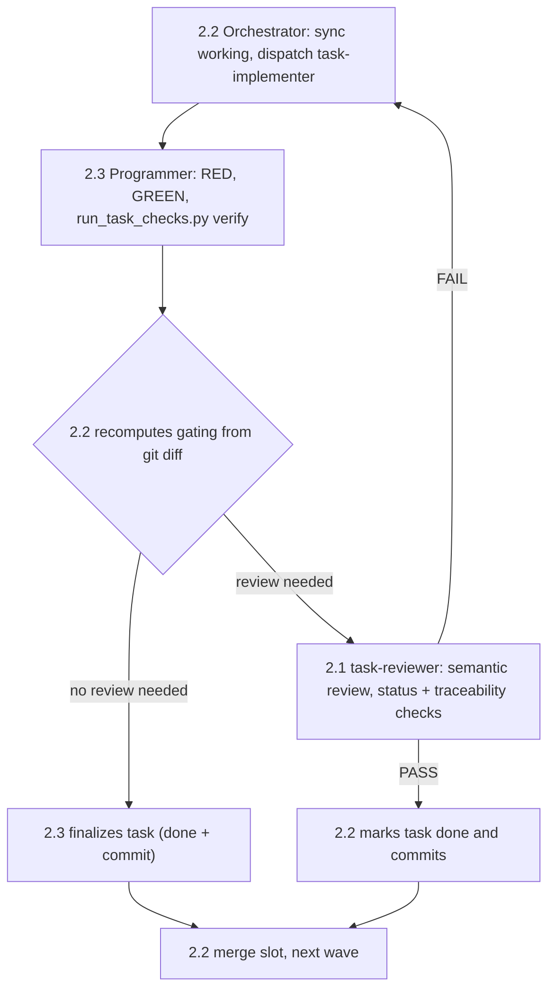

# Four-Persona Governance, Persona Model Config, and English-Only Dev Artefacts

- **Date**: 2026-11-17
- **PIC**: danhdue
- **Status**: Draft (awaiting Gate 1)
- **Epic**: `four_persona_governance`
- **Next step**: `dev-designer` (epic-scale: rules, five skills, a new skill, lifecycle scripts, kit docs)

## Table of Contents

- [1. Problem Statement](#1-problem-statement)
- [2. Goals and Non-Goals](#2-goals-and-non-goals)
- [3. Persona Model](#3-persona-model)
  - [3.1. The Four Personas](#31-the-four-personas)
  - [3.2. Role Renumbering](#32-role-renumbering)
  - [3.3. Session Map](#33-session-map)
  - [3.4. Subagent Brief Roles](#34-subagent-brief-roles)
- [4. Stage Flows](#4-stage-flows)
  - [4.1. Stage 2 to Stage 3 Handoff](#41-stage-2-to-stage-3-handoff)
  - [4.2. Per-Task Flow](#42-per-task-flow)
  - [4.3. Gate 4 and Risk Escalation](#43-gate-4-and-risk-escalation)
- [5. Persona Model Configuration](#5-persona-model-configuration)
  - [5.1. Files and Precedence](#51-files-and-precedence)
  - [5.2. Schema](#52-schema)
  - [5.3. The dev-config Skill](#53-the-dev-config-skill)
  - [5.4. Dispatch](#54-dispatch)
  - [5.5. Unavailable Models](#55-unavailable-models)
- [6. English-Only Dev Artefacts](#6-english-only-dev-artefacts)
  - [6.1. Language Rule](#61-language-rule)
  - [6.2. File Naming and Legacy Compatibility](#62-file-naming-and-legacy-compatibility)
  - [6.3. Vietnamese Mirrors and Context Loading](#63-vietnamese-mirrors-and-context-loading)
  - [6.4. What Stays Bilingual](#64-what-stays-bilingual)
- [7. Exclusive File Ownership Check](#7-exclusive-file-ownership-check)
- [8. check-tasks Dashboard Sync](#8-check-tasks-dashboard-sync)
- [9. Testing Strategy](#9-testing-strategy)
- [10. Dependencies, Assumptions, and Risks](#10-dependencies-assumptions-and-risks)
- [11. Open Items](#11-open-items)
- [12. Shared Contract Warnings](#12-shared-contract-warnings)

## 1. Problem Statement

The Tri-Role model (Human Architect, AI Assistant, AI Programmer) makes the Stage 3 main session do two
jobs: it is both the design authority (fix-plan rulings, revisions) and the mechanical orchestrator
(worker pool, dispatch, SHA checks). Both jobs therefore run on one model, even though design judgement
benefits from a strong reasoning model (Argon) and orchestration only needs a dependable, cheaper one
(Hydrogen at `high`). The `task-reviewer` subagent runs on the Programmer model, so the code that a
model writes is reviewed by the same model family that wrote it.

Model selection is scattered: `.devtool/review_config.json["providers"]["programmer"|"assistant"]`, the
`AGY_PROGRAMMER_*` and `AGY_ASSISTANT_MODEL` environment variables, `lifecycle_runner.py` constants and
CLI flags. Switching models when credits run out means editing JSON by hand in every repository.

Every dev-lifecycle design artefact (spec, HLD, BDD scenarios, non-epic plan) is produced as a
synchronised `.en.md` / `.vi.md` pair. The Vietnamese variant doubles authoring and review tokens, is
loaded into agent context alongside the English one, and is rarely read by the Human Architect.

## 2. Goals and Non-Goals

Goals:

1. Replace Tri-Role with four personas whose boundaries separate design judgement from orchestration.
2. Bind each AI persona to a model through one layered configuration file, editable through a new
   `/d3nexus:dev-config` skill, with presets for switching when credits change.
3. Make dev-lifecycle artefacts English-only, keep chat with the Human Architect free to use
   Vietnamese, and stop agents loading `.vi.md` files.
4. Enforce exclusive file ownership between tasks that may run in parallel.

Non-goals:

- The doc-lifecycle (`doc-brainstorming`, `doc-designer`, `doc-implementation`, `doc_quality_check`)
  is unchanged and stays bilingual.
- No automatic model fallback (see [5.5](#55-unavailable-models)).
- No local Ollama persona binding (see [11. Open Items](#11-open-items)).
- No change to the external review provider priority (`/principal-review`, `/cross-model-review`) or
  its `.devtool/review_config.json` keys other than `providers.assistant` and `providers.programmer`.
- No migration of existing `.vi.md` files in consuming repositories; they are left in place.

## 3. Persona Model

### 3.1. The Four Personas

| Role | Config key | Default | Owns | Forbidden |
|------|-----------|---------|------|-----------|
| **1.0 Human Architect** | — | the user | Product vision, brainstorming, architectural trade-offs, Gates 1, 2 and 5, every escalation | — |
| **2.1 AI Architect & Reviewer** | `ai_architect_reviewer` | Argon, `high` | Stage 1–2: brainstorming with 1.0, spec, HLD, BDD scenarios, TDD test plans (task Verification tables), task decomposition into disjoint packages, non-epic plans, `/principal-review` and its revisions, packaging. Stage 3: `task-reviewer` (semantic and architectural review), `fix-planner` (solutions for high-risk findings) | Editing `src/` or `tests/`; running test suites, linters or type checkers; dispatching subagents or managing the worker pool |
| **2.2 Orchestrator** | `orchestrator` | Hydrogen, `high` | Receiving the packaged handoff; Gate 3; worker pool; dispatching 2.1 and 2.3 subagents; tracking progress; independent verification of subagent claims (SHA, clean tree, report binding, diff scope); marking tasks `done`; consolidated execution and Gate 5 reports | Reading or editing `src/` or `tests/`; editing HLD, BDD, task Verification tables, DoD or `Allowed files`; running tests, linters, type checkers, `run_task_checks.py` or `verify-tier` |
| **2.3 Programmer** | `programmer` | Hydrogen, `xhigh` | `task-implementer` (TDD inside `Allowed files`), `review-fixer`, `gate4-verifier` | Unchanged from today: no edits to HLD, BDD, `shared-contracts/`, Verification tables, DoD or `Allowed files`; no worker-pool calls |

Role 2.1 may run lifecycle scripts that call an external review CLI synchronously (`/principal-review`),
but it never spawns or waits on subagents. The read-only checks it runs as `task-reviewer` are listed in
[3.4](#34-subagent-brief-roles).

### 3.2. Role Renumbering

| Tri-Role (old) | Four-persona (new) |
|----------------|--------------------|
| Role 2.1 Human Architect | Role 1.0 Human Architect |
| Role 2.2 AI Assistant (design work, reviser, fix-plan ruling) | Role 2.1 AI Architect & Reviewer |
| Role 2.2 Orchestrator (Stage 3 main session) | Role 2.2 Orchestrator |
| Role 2.3 AI Programmer | Role 2.3 Programmer |

`orchestration-roles.md` carries this table once; other files reference the new numbers only. The
`--role` values accepted by `resume_context.py` become `architect`, `orchestrator` and `programmer`;
`assistant` remains accepted as an alias of `architect` for existing state files.

### 3.3. Session Map

The kit cannot choose the model of a main session; the user picks it when opening the IDE or CLI. It
can only choose the model of a subagent it dispatches. Personas therefore map to sessions by stage:

- **Stages 1–2** run in a main session the user opens on the `ai_architect_reviewer` model.
- **Stage 3** runs in a main session the user opens on the `orchestrator` model, started from the
  prompt that `resume_context.py --emit-prompt implement` prints. That prompt names the persona and its
  resolved model and effort so the user opens the right session.
- Inside Stage 3, Role 2.1 work runs as subagents dispatched on the `ai_architect_reviewer` binding.
- In autonomous mode, `lifecycle_runner.py` is the Orchestrator and dispatches 2.1 and 2.3 through the
  same bindings.

### 3.4. Subagent Brief Roles

`resume_context.py --emit-prompt brief --brief-role <role>` emits these:

| Brief role | Persona | Change | Summary contract |
|-----------|---------|--------|------------------|
| `task-implementer` | 2.3 | unchanged | unchanged |
| `task-reviewer` | **2.1** (was 2.3) | Reads the slot diff, `src/`/`tests/`, task file and evidence; runs only `run_task_checks.py status` and `check_bdd_traceability.py`; never edits, commits or runs test suites. The Orchestrator marks the task `done` on `PASS`. | `task_id`, `verdict`, `head_sha`, `done_gate`, `findings` |
| `review-fixer` | 2.3 | Modes become `fast-track` and `apply-plan`; `plan-first` moves to `fix-planner` | `round`, `mode`, `status` (`FIXED`/`BLOCKED`), `fix_shas`, `decision_sha`, `changed_files`, `tier1` |
| `gate4-verifier` | 2.3 | unchanged | unchanged |
| `principal-reviser` | 2.1 | Runs inline in the Stage 2 main session or as a same-model subagent | unchanged |
| `fix-planner` | **2.1** (new) | Writes `fix_plan_round<N>.md` for high-risk findings, classifies each against the halt criteria | `round`, `status` (`PLANNED`/`ESCALATE`), `plan_path`, `halt_criteria` (list), `decision_sha` |

Selective review gating is kept: the Orchestrator dispatches `task-reviewer` only when
`review_tier == "full"`, the labels intersect {`security`, `architecture`, `concurrency`, `contract`}, or
`git diff --name-only` shows more than two non-test modules changed.

## 4. Stage Flows

### 4.1. Stage 2 to Stage 3 Handoff

Role 2.1 runs Gate 2, `/principal-review` (max three rounds) and `package_epic.py`, then prints the
implement prompt. Role 2.2 is the receiver of `handoff.md`:

- **Dừng lại** — the user opens a new main session on the `orchestrator` binding with the printed prompt.
  This is the path that honours the session map.
- **Triển khai (tự động)** — Stage 3 continues in the current session, so Role 2.2 runs on the Stage 2
  session's model. The Gate 2 prompt states this and names the configured `orchestrator` binding, so the
  user can choose **Dừng lại** instead when the two differ.

### 4.2. Per-Task Flow



### 4.3. Gate 4 and Risk Escalation

After `cleanup`, the Orchestrator dispatches a fresh `gate4-verifier` (2.3). On `PASS` it records Gate 4
and runs `/cross-model-review`. Findings from either source are routed by risk:

- **Low risk** — every open finding is `Valid` and the triage contains no escalation marker (today's
  fast-track test), or a Gate 4 failure is the first failure of that check: a 2.3 `review-fixer` runs in
  `fast-track` mode.
- **High risk** — any `Critical` finding, any escalation marker, or the same Gate 4 check failing twice
  in a row: the Orchestrator dispatches a 2.1 `fix-planner`, which writes `fix_plan_round<N>.md`.
  - The plan touches none of the five halt criteria → status `PLANNED`; a 2.3 `review-fixer` applies it
    in `apply-plan` mode.
  - The plan touches any halt criterion → status `ESCALATE`; the Orchestrator records
    `--pending-decision`, renders the Top 3 Highest-Risk Findings, and stops for Role 1.0.

The five halt criteria (from `governance-checklists.md`):

1. `CRITICAL_CONFLICT` — the solution contradicts the approved HLD or `Decisions Already Made`.
2. `Debatable` / `Not shown` — the finding cannot be verified against live source.
3. `SHARED_CONTRACT_CONFLICT` — the finding or solution touches `shared-contracts/`.
4. `FIX_LOOP` — a location fixed in round N−1 fails again with `[INCOMPLETE_FIX]` or `[NEW_REGRESSION]`.
5. `MAX_ROUNDS_CRITICAL_REMAINING` — a `Critical` finding survives round 3.

After every fix, a fresh `gate4-verifier` reruns Gate 4 in full. The Orchestrator no longer rules
`APPROVED`/`ADJUSTED` on fix plans: the plan's author is now the design authority, and the halt criteria
replace the ruling. `lifecycle_runner.py` changes accordingly: `_draft_fix_plan` dispatches the
`ai_architect_reviewer` binding and `evaluate_programmer_fix_plan` is removed.

## 5. Persona Model Configuration

### 5.1. Files and Precedence

| Layer | Path | Purpose |
|-------|------|---------|
| Kit defaults | `skills/dev-config/resources/personas.default.json` | Model catalogue, shipped presets, default bindings |
| Global | `$REAL_HOME/.d3nexus/personas.json` | Per-user choice that follows credits across every repository |
| Project | `.agents/config/personas.json` | Per-repository override |
| Invocation | CLI flags (`lifecycle_runner.py --programmer-model`, etc.) | One-off override |

Layers are deep-merged in that order, later layers winning per key. The effective `active_preset` is
selected from the merged result, then the merged `overrides` are applied per persona, then CLI flags.
`$REAL_HOME` is resolved the way `run_external_review.py` already resolves it for Antigravity profiles,
so every profile shares one global file.

The resolver ignores `.devtool/review_config.json["providers"]["assistant"|"programmer"]` and the
`AGY_PROGRAMMER_MODEL`, `AGY_PROGRAMMER_EFFORT` and `AGY_ASSISTANT_MODEL` environment variables.
`dev-config status` warns when any of them is set.

### 5.2. Schema

```json
{
  "schema_version": 1,
  "active_preset": "default",
  "models": {
    "argon": {"cli": "agy", "id": "gemini-4-argon-{effort}", "efforts": ["low", "medium", "high"]},
    "hydrogen": {"cli": "agy", "id": "gemini-4-hydrogen-{effort}", "efforts": ["low", "medium", "high", "xhigh"]},
    "claude-opus": {"cli": "claude", "id": "opus", "efforts": ["medium", "high", "xhigh"]},
    "claude-sonnet": {"cli": "claude", "id": "sonnet", "efforts": ["medium", "high"]},
    "codex-gpt": {"cli": "codex", "id": "gpt-6.1-sol", "efforts": ["medium", "high", "xhigh"]},
    "kiro-opus": {"cli": "kiro", "id": "claude-opus-5.5", "efforts": ["high"]}
  },
  "presets": {
    "default": {
      "ai_architect_reviewer": {"model": "argon", "effort": "high", "fallback_model": "claude-opus"},
      "orchestrator": {"model": "hydrogen", "effort": "high", "fallback_model": "claude-sonnet"},
      "programmer": {"model": "hydrogen", "effort": "xhigh", "fallback_model": "claude-sonnet"}
    },
    "gemini-saver": {},
    "claude-hybrid": {},
    "all-hydrogen": {},
    "codex-kiro": {}
  },
  "overrides": {}
}
```

The four non-default presets are abbreviated above; each binds all three personas. Their bindings:

| Preset | `ai_architect_reviewer` | `orchestrator` | `programmer` |
|--------|------------------------|----------------|--------------|
| `gemini-saver` | `argon` `medium` | `hydrogen` `medium` | `hydrogen` `high` |
| `claude-hybrid` | `claude-opus` `high` | `hydrogen` `high` | `hydrogen` `xhigh` |
| `all-hydrogen` | `hydrogen` `xhigh` | `hydrogen` `high` | `hydrogen` `xhigh` |
| `codex-kiro` | `kiro-opus` `high` | `codex-gpt` `medium` | `codex-gpt` `xhigh` |

Rules:

- `{effort}` in an `id` is substituted with the binding's effort; that is how `agy` names its model
  variants today (`gemini-4-hydrogen-xhigh`). The `efforts` list of every `agy` alias is checked against
  the live `agy` model list during implementation; aliases or efforts it does not offer are removed.
- `cli` is one of `agy`, `claude`, `codex`, `kiro`.
- `fallback_model` is advisory only: it is printed when the bound model is unavailable and is never used
  automatically.
- Validation fails on an unknown alias, an effort outside the alias's `efforts`, an unknown persona key, or
  an unknown `schema_version`.

### 5.3. The dev-config Skill

New skill `skills/dev-config/` with `SKILL.md` and `resources/scripts/dev_config.py`. The skill body
maps `/d3nexus:dev-config <args>` to the script.

| Command | Effect |
|---------|--------|
| `status` | Table of persona → CLI, resolved model ID, effort, fallback, and the layer each value came from; lists presets; prints validation and legacy-key warnings; flags a CLI missing from `PATH` |
| `preset <name> [--scope global\|project]` | Sets `active_preset` (default scope `global`); warns when a project layer masks the change |
| `set <persona> <model> <effort> [--fallback <model>] [--scope global\|project]` | Writes `overrides.<persona>` |
| `reset [<persona>] [--scope global\|project]` | Clears one or all overrides |
| `resolve <persona> [--format json\|argv] [--mode read-only\|write]` | Machine interface used by every dispatch site |

Writes are atomic (temp file plus rename) and validated before replacing the file. The resolver lives in
`resources/scripts/persona_config.py` and is loaded by path (`importlib.util`) from
`lifecycle_runner.py`, `resume_context.py` and `run_external_review.py`, the same way `lifecycle_runner.py`
already loads sibling modules.

### 5.4. Dispatch

`persona_config.py` builds the headless argv for a binding and a mode. It reuses the per-CLI command
builders in `run_external_review.py` (which already handle `claude`, `codex`, `kiro` and `agy`, including
the Kiro `HOME` workaround) and adds a write mode:

- `read-only` for `task-reviewer` and `fix-planner` (2.1 must not edit code; `fix-planner` writes only
  `fix_plan_round<N>.md`, which the Orchestrator scope-checks).
- `write` for `task-implementer`, `review-fixer` and `gate4-verifier`.

Every dispatch site resolves through `dev_config.py resolve`: `lifecycle_runner.py` (replacing
`resolve_programmer_model`, `resolve_programmer_effort` and `resolve_assistant_model`), the
`--emit-prompt` and `brief` output of `resume_context.py`, and the dispatch instructions in
`dev-implementation`, `subagent-driven-development`, `cross-model-review` and `principal-review`.
The rule that an in-runtime subagent tool may stand in only if it pins the exact model and effort stays.

### 5.5. Unavailable Models

There is no automatic fallback. When a dispatch fails because the CLI is missing, authentication fails,
or the provider reports exhausted quota, the Orchestrator (or `lifecycle_runner.py`, with halt state
`MODEL_UNAVAILABLE`):

1. Records `resume_context.py --pending-decision "<persona> model <alias> unavailable" --decision-kind blocker --epic <slug>`.
2. Prints the advisory fallback as a ready command, for example
   `/d3nexus:dev-config set programmer claude-sonnet high`.
3. Stops calling tools.

A task failure (red tests, failing checks) is not a model failure and never triggers this path.

## 6. English-Only Dev Artefacts

### 6.1. Language Rule

Added to `CRITICAL_RULES.md` §8 and to `governance-checklists.md`:

- English is the single source of truth for every role.
- Every persisted dev-lifecycle artefact is English-only: specs, HLDs, BDD scenarios, task files and
  their TDD Verification tables, non-epic plans, `handoff.md`, review and fix-plan files, execution and
  Gate 5 reports, code comments, and commit messages.
- Chat with Role 1.0 may use Vietnamese, matching the user. A Vietnamese explanation or mirror is
  produced only when Role 1.0 asks for it.

### 6.2. File Naming and Legacy Compatibility

New artefacts drop the language suffix:

| Artefact | New name | Old pair |
|----------|----------|----------|
| Spec | `YYYY-MM-DD-<topic>-design.md` | `.en.md` + `.vi.md` |
| Non-epic plan | `docs/superpowers/plans/YYYY-MM-DD-<topic>.md` | `.en.md` + `.vi.md` |
| HLD | `.devtool/epic/<epic_dir>/<epic_dir>.md` | `.en.md` + `.vi.md` |
| BDD scenarios | `.devtool/epic/<epic_dir>/bdd_scenarios.md` | `.en.md` + `.vi.md` |

A shared helper `resolve_epic_doc(directory, stem)` returns `<stem>.md`, else `<stem>.en.md`, and never a
`.vi.md`. Every script that locates these files uses it: `check_epic_readiness.py`, `package_epic.py`,
`sync_task_status.py`, `check_bdd_traceability.py`, `run_external_review.py`, `check_tasks.py` and
`tasks_server.py`. In-flight epics with `.en.md` + `.vi.md` pairs keep working; `sync_task_status.py`
updates only the English file, and the status grep matches `Status` only.

### 6.3. Vietnamese Mirrors and Context Loading

- A `.vi.md` file is a mirror of its English original, not a source of truth. No gate checks it and
  nothing keeps it in sync.
- Agents do not load `.vi.md` files unless Role 1.0 names the file.
- Tooling enforces this: prompt and bundle builders (`run_external_review.py`, the principal-review
  bundle, `resume_context.py --emit-prompt` and `brief`, `check_tasks.py`) exclude `*.vi.md` from every
  file list given to an agent, and dev-lifecycle checks ignore `.vi.md`.
- A mirror produced on request starts with
  `> Mirror of <name>.md — not SSOT; agents do not load this file.`

### 6.4. What Stays Bilingual

- The doc-lifecycle skills and `check_document.py --require-bilingual`.
- The kit's human-facing guides under `docs/` (`lifecycles`, `context-memory-quick-guide`,
  `shared-contracts-quick-guide`, `choosing-a-lifecycle`). They are documents; both variants are updated
  for the four-persona model.
- Historical specs and plans in `docs/superpowers/` are left untouched.

## 7. Exclusive File Ownership Check

`check_task_contract.py --design` (run by `check_epic_readiness.py`) gains a rule: for every pair of
tasks with no path between them in the `Blocked by` graph, their `Allowed files` sets, normalised to
repository paths without symbol or line anchors, must be disjoint. A violation fails readiness and names
the pair and the shared paths; Role 2.1 fixes it by adding a `Blocked by` edge or by reassigning the file.

## 8. check-tasks Dashboard Sync

`/d3nexus:check-tasks` harvests lifecycle state into its CLI and web dashboard, so every new script and
state introduced here must surface there:

- **Document resolution.** `check_tasks.py` (HLD status scan, epic history) and `tasks_server.py` (epic
  file listing, packaged HLD promotion) use `resolve_epic_doc`. Today `check_tasks.py` scans `.vi.md`
  before `.en.md` in one path; after the change no `.vi.md` is read.
- **Role labels.** `assistant_state.md` `Role:` values `architect`, `orchestrator`, `programmer` (and
  the `assistant` alias) render with the four-persona names; the dashboard's Tri-Role invariant text is
  replaced.
- **Persona bindings.** The repository panel shows the active preset and each persona's resolved model
  and effort with its source layer, read through `persona_config.py`; a validation error renders as a
  warning, not a crash.
- **New halts.** `MODEL_UNAVAILABLE` and `fix-planner` `ESCALATE` arrive through `pending_decision.json`
  (`decision_kind: blocker`) and the runner's halt state, and render as human-action-required alongside the
  existing circuit-breaker halts.
- **Telemetry.** Each dispatch appends an event to `events_<slug>.jsonl` carrying `persona`, `brief_role`,
  `model` and `effort`, so the epic history modal shows which persona and model did each step.

## 9. Testing Strategy

Tests are parametrised per the kit's anti-test-bloat rules.

- `persona_config.py`: layer precedence (kit, global, project, CLI), preset selection, overrides,
  `{effort}` substitution, every validation failure, legacy-key warnings.
- `dev_config.py`: each command against a temporary `REAL_HOME` and project; atomic write leaves the old
  file intact on a validation failure.
- Dispatch: argv per CLI × mode; `MODEL_UNAVAILABLE` halt with no fallback dispatched.
- `lifecycle_runner.py`: high-risk routing to `fix-planner`, `ESCALATE` on each halt criterion,
  `apply-plan` on `PLANNED`.
- `resolve_epic_doc`: `.md` preferred, `.en.md` fallback, `.vi.md` never returned.
- Context exclusion: no `.vi.md` path appears in any emitted prompt or review bundle.
- Ownership check: disjoint pass, shared-file fail, dependency-ordered pair pass.
- check-tasks: HLD resolution never returns `.vi.md`; new role labels; persona panel with a valid and an
  invalid config; `MODEL_UNAVAILABLE` and `ESCALATE` render as human action; dispatch events carry persona
  fields.
- Contract tests (`test_lifecycle_document_contract.py`, `test_resume_context.py` and others asserting
  role strings) updated to the new numbering.
- `scripts/verify.sh` passes, including link and ToC checks on every edited skill.

## 10. Dependencies, Assumptions, and Risks

- **Role renumbering is wide.** Old "Role 2.1" meant the human; now it means the AI Architect. Every
  reference across about 25 files and several string-asserting tests must move in one epic, or the kit
  contradicts itself. Mitigation: one mapping table, and a test asserting no `Tri-Role` term or old
  numbering remains in `skills/` and `rules/`.
- **Main-session model is not enforceable.** The handoff prompt names the expected model; the kit cannot
  verify it.
- **`agy` model naming.** The `{effort}` template assumes the current `agy` naming; a change in `agy`
  breaks resolution. `dev-config status` surfaces it as a validation error rather than a silent miss.
- **Plugin versus repository skills.** This epic is built with the installed, older plugin; agents must
  read `skills/` from the working tree (known friction, see the 2026-10-15 dogfood findings).
- **Consuming repositories.** D3Nexus has in-flight epics with `.en.md` + `.vi.md` pairs; legacy
  resolution in [6.2](#62-file-naming-and-legacy-compatibility) keeps them working, including on the check-tasks
  dashboard.
- No dependency on another epic or on a third-party release.

## 11. Open Items

- Local Ollama as a persona binding — a future option, deliberately excluded from the catalogue now.
- Quota-aware preset suggestion in `dev-config status` (reading `check-quota` data).
- A hard `Read(**/*.vi.md)` permission deny; not adopted, because it would also block reading a file the
  user names.

## 12. Shared Contract Warnings

This repository has no `shared-contracts/` directory, so no contract check applies and no warnings were
raised.
