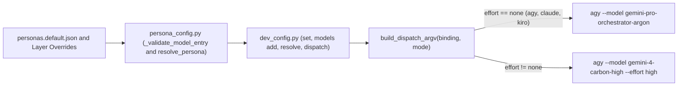

# Antigravity Orchestrator Aliases and Effortless Model Support Design

- **Date**: 2026-11-18
- **Status**: Approved (Gate 1)
- **PIC**: gdusuhcb123
- **Repository**: `ai-agent-tools`
- **Target Skill**: `d3nexus:dev-config`
- **Lifecycle Track**: Single-Component Plan (`dev-brainstorming` -> `writing-plans`)

## Table of Contents

- [1. Problem Statement and Root Causes](#1-problem-statement-and-root-causes)
- [2. Goals and Non-Goals](#2-goals-and-non-goals)
- [3. Shared Contract Warnings](#3-shared-contract-warnings)
- [4. Architecture and Model Catalogue Design](#4-architecture-and-model-catalogue-design)
- [5. CLI Resolution and Dispatch Argv Contract](#5-cli-resolution-and-dispatch-argv-contract)
- [6. Error Handling, Edge Cases, and Concurrency Alignment](#6-error-handling-edge-cases-and-concurrency-alignment)
- [7. Verification and Testing Strategy](#7-verification-and-testing-strategy)

## 1. Problem Statement and Root Causes

Live verification against the `agy` CLI (`agy models` and `agy --sandbox --mode plan --model ...`) shows two fixed-effort composite models exposed on Antigravity accounts: `gemini-pro-orchestrator` (`Orchestrator (Carbon)`, `gemini5h` pool) and `gemini-pro-orchestrator-argon` (`Orchestrator (Argon)`, `argonWeekly` pool). Passing `--effort <level>` to either model causes `agy` to exit `1` immediately before inference:

```text
error: invalid model selection (--model "gemini-pro-orchestrator-argon" --effort "high"): --effort is not supported for model "gemini-pro-orchestrator-argon"
```

Omitting `--effort` succeeds (`exit 0`) and returns model output cleanly.

Three concrete blockers currently prevent `d3nexus` (`ai-agent-tools`) from binding and dispatching these models reliably:

1. **Missing Built-In Catalogue Aliases (`scripts/personas.default.json`)**: The default catalogue lacks built-in aliases for `carbon` (`gemini-4-carbon-{effort}`, Observation `#24`), `orchestrator-carbon` (`gemini-pro-orchestrator`), and `orchestrator-argon` (`gemini-pro-orchestrator-argon`).
2. **Unconditional `--effort` Injection (`scripts/persona_config.py`)**: `build_dispatch_argv()` unconditionally appends `["--effort", effort]` for `cli == "agy"` (as well as `claude` and `kiro`), breaking headless `dev_config.py dispatch` and `dev_config.py resolve --format argv` on effortless models.
3. **Mandatory Effort Flags on CLI Commands (`scripts/dev_config.py`)**: Both `models add` (`--efforts` required) and `set` (`_resolve_set_request` requiring positional `effort` or `--effort`) force users to supply a reasoning effort even when targeting a fixed-effort model that does not support one.

## 2. Goals and Non-Goals

### Goals

- Introduce canonical sentinel effort `"none"` (`"efforts": ["none"]`) for models that do not accept a reasoning-effort CLI flag, keeping `PersonaBinding.effort: str` and `efforts: list[str]` 100% backward-compatible across `lifecycle_runner.py`, `resume_context.py`, `agy_profile_pool.py`, and `check_tasks.py`.
- Add built-in `carbon`, `orchestrator-carbon`, and `orchestrator-argon` entries to `scripts/personas.default.json` while keeping all seven existing `presets` (`default`, `gemini-saver`, `claude-hybrid`, `all-hydrogen`, `codex-kiro`, `all-claude`, `all-codex`) unchanged.
- Omit `--effort` in `build_dispatch_argv()` whenever `binding.effort == "none"` for `agy`, `claude`, and `kiro`, while preserving `codex` behavior (`_CODEX_EFFORT_MAP["none"] == "none"`).
- Allow omitting `--efforts` on `dev_config.py models add` (defaulting to `"none"`) and omitting `effort` / `--effort` on `dev_config.py set` only when the resolved target model declares `efforts == ["none"]`, while preserving existing `exit 1` validation errors for multi-effort or non-`"none"` models.
- Document the new built-in aliases and effortless `set` / `models add` usage in `skills/dev-config/SKILL.md`.

### Non-Goals

- Modifying existing preset bindings in `scripts/personas.default.json`.
- Modifying `docs/dev-config-quick-guide.en.md` or any `*.vi.md` mirrors unless separately requested.
- Changing `run_external_review.py` (which already invokes `agy` without `--effort`).

## 3. Shared Contract Warnings

`shared-contracts/` is absent in `ai-agent-tools` (standalone CLI tooling and plugin repository). No Hub or Satellite wire contracts are affected.

## 4. Architecture and Model Catalogue Design



### Default Catalogue Additions (`scripts/personas.default.json`)

Add three entries under `"models"` without modifying any existing `"presets"`:

```json
{
  "carbon": {
    "cli": "agy",
    "id": "gemini-4-carbon-{effort}",
    "efforts": ["low", "medium", "high"]
  },
  "orchestrator-carbon": {
    "cli": "agy",
    "id": "gemini-pro-orchestrator",
    "efforts": ["none"]
  },
  "orchestrator-argon": {
    "cli": "agy",
    "id": "gemini-pro-orchestrator-argon",
    "efforts": ["none"]
  }
}
```

- `carbon` automatically resolves via `derive_quota_pool()` to `"gemini5h"`.
- `orchestrator-carbon` automatically resolves via `derive_quota_pool()` to `"gemini5h"`.
- `orchestrator-argon` automatically resolves via `derive_quota_pool()` to `"argonWeekly"` because `"argon"` appears in `"id"`.

### Schema Validation Invariant (`scripts/persona_config.py`)

In `_validate_model_entry(alias, entry)`:

- `"none"` is permitted in `efforts` strictly as the sole element `["none"]`.
- Mixing `"none"` with any other effort level (for example `["none", "high"]`) raises `PersonaConfigError`.
- Embedding `"{effort}"` inside `entry["id"]` when `efforts == ["none"]` raises `PersonaConfigError` so literal `-{effort}` placeholders are never substituted with `-none`.

## 5. CLI Resolution and Dispatch Argv Contract

### Dispatch Argv Construction (`scripts/persona_config.py`)

In `build_dispatch_argv(binding, mode)`:

- **`cli == "agy"`**:
  - Construct `effort_args = [] if binding.effort == "none" else ["--effort", binding.effort]`.
  - In `read-only` mode: `["agy", "--sandbox", "--mode", "plan", "--model", model_id, *effort_args]`.
  - In `write` mode: `["agy", "--model", model_id, *effort_args, "--mode", "auto"]`.
- **`cli == "claude"` and `cli == "kiro"`**:
  - Omit `["--effort", effort]` whenever `binding.effort == "none"`.
- **`cli == "codex"`**:
  - Keep existing `_CODEX_EFFORT_MAP["none"] == "none"` (`-c model_reasoning_effort=none`) behavior unchanged.

### `models add` CLI Default (`scripts/dev_config.py`)

- Update parser registration `p_madd.add_argument("--efforts", default="none")` so omitting `--efforts` stores `["none"]` (and `--efforts none` also stores `["none"]`).
- Passing `--efforts ""` or whitespace-only still splits to an empty list and raises `PersonaConfigError`.

### `set` Effort Inference and Validation (`scripts/dev_config.py`)

In `_resolve_set_request` and `_resolve_catalogue_alias`:

1. Reject mixed positional and flag forms (`(flag_model is not None or flag_effort is not None) and (model is not None or effort is not None)`) unchanged.
2. Reject flag mode with `--effort` provided and `--model` omitted (`flag_effort is not None and flag_model is None`) with `"--model and --effort are both required when using flags"`, preserving existing `FPG-EC-08` test expectations (`set programmer --provider kiro --effort high`).
3. When a `raw_model` (`flag_model` or positional `model`) is supplied while `raw_effort` is `None`:
   - Load the merged `models` catalogue and look up `raw_model` by exact alias or fixed `entry["id"] == raw_model` (respecting `provider` if given).
   - If the matched entry defines `efforts == ["none"]`, infer `effort = "none"` and continue through provider, effort, and `--profile` validation.
   - Otherwise (if `raw_model` is unknown or requires selectable effort levels such as `hydrogen`, `carbon`, or `kiro-sonnet`), raise the existing `PersonaConfigError` (`"--model and --effort are both required when using flags"` in flag mode, or `"the following arguments are required: model, effort (or use --model and --effort)"` in positional mode).
4. Both omitted and explicit `none` syntax succeed for effortless models, while non-`"none"` efforts fail cleanly:
   - `dev_config.py set orchestrator orchestrator-argon` -> sets `("orchestrator-argon", "none")`.
   - `dev_config.py set orchestrator orchestrator-argon none` -> sets `("orchestrator-argon", "none")`.
   - `dev_config.py set orchestrator --provider agy --model orchestrator-argon` -> sets `("orchestrator-argon", "none")`.
   - `dev_config.py set orchestrator --provider agy --model gemini-pro-orchestrator-argon` -> sets `("orchestrator-argon", "none")`.
   - `dev_config.py set orchestrator orchestrator-argon high` -> exits `1` with `Unsupported effort 'high' for model 'orchestrator-argon'; allowed: none`.

### Skill Documentation (`skills/dev-config/SKILL.md`)

- Update the `models add` and `set` synopsis and examples to document the default `carbon`, `orchestrator-carbon`, and `orchestrator-argon` aliases, optional `--efforts` defaulting to `none`, and omitting effort when binding effortless models.

## 6. Error Handling, Edge Cases, and Concurrency Alignment

- **Atomic Failure Preservation**: Invalid `set` or `models add` calls (such as `["none", "high"]`, `"{effort}"` template paired with `["none"]`, or omitted effort on `carbon`/`hydrogen`) fail inside validation before `locked_update_layer()` writes to disk, leaving global and project configuration files byte-for-byte unchanged.
- **Downstream Consumer Compatibility**: `lifecycle_runner.py` (`resolve_binding` reading `allowed[-1]`) and `agy_profile_pool.py` (`exhaustion_report` reading `efforts[-1]`) receive `"none"` cleanly without `IndexError` or `None` coercion.
- **Concurrency with `review_cap_and_risk_triage`**: The packaged epic `review_cap_and_risk_triage` (`0/4` tasks started) modifies `cmd_status` and `_validate_policy_and_low_quota`. Implementation of this spec runs in an isolated git worktree off `main` and modifies disjoint functions (`_validate_model_entry`, `build_dispatch_argv` in `persona_config.py`; `p_madd`, `_resolve_set_request` in `dev_config.py`), ensuring a clean rebase for `review_cap_and_risk_triage`.

## 7. Verification and Testing Strategy

Add a dedicated parametrized suite `tests/test_agy_effortless_models.py` (and register it in `scripts/verify.sh`) covering:

1. Default catalogue verification for `carbon` (`gemini5h`), `orchestrator-carbon` (`gemini5h`), and `orchestrator-argon` (`argonWeekly`), confirming all seven existing presets remain unchanged.
2. Schema validation rejecting `efforts: ["none", "high"]` and `id: "foo-{effort}"` paired with `efforts: ["none"]`.
3. `build_dispatch_argv()` omitting `--effort` in both `read-only` and `write` modes when `effort == "none"`, while preserving `--effort` for `carbon`, `argon`, and `hydrogen` (and preserving `codex` `-c model_reasoning_effort=none`).
4. `dev_config.py set` positional and flag forms omitting effort on `orchestrator-argon` and `orchestrator-carbon` (by alias and raw ID `gemini-pro-orchestrator-argon`), explicit `none`, rejection of `high`, and rejection of omitted effort on `carbon` and `hydrogen`.
5. `dev_config.py models add` omitting `--efforts` and defaulting to `["none"]`.

Run full regression verification before completion:

- `pytest tests/test_agy_effortless_models.py tests/test_fpg_*.py`
- `./scripts/verify.sh`
- `@quality_check` (`python` profile)
- `python3 skills/doc_quality_check/resources/scripts/check_document.py --require-toc` on updated docs
