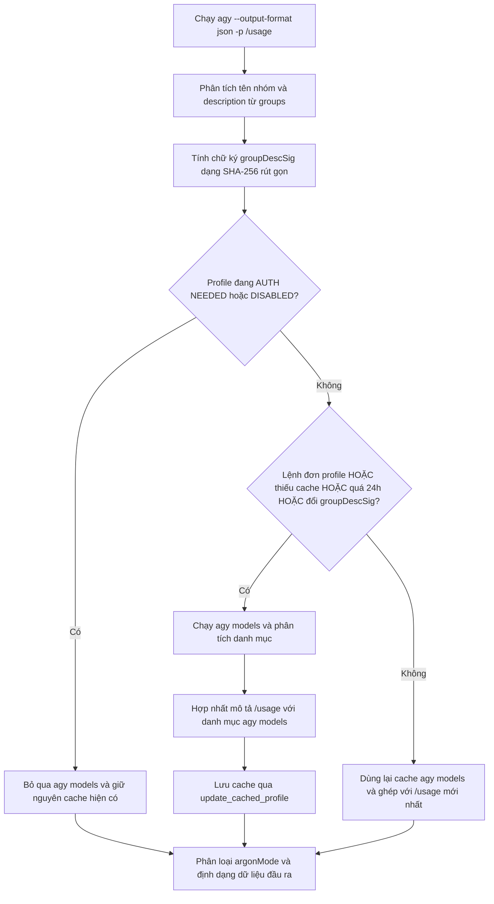
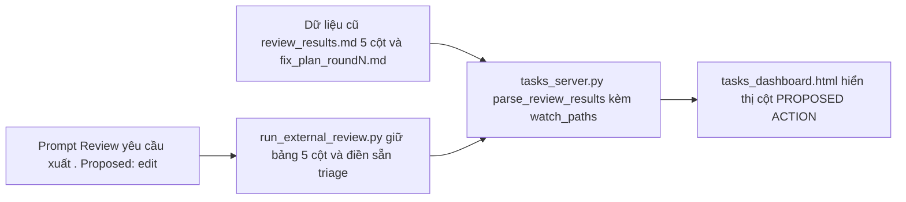

# Đặc tả Thiết kế Mô hình động Check-Quota và Proposed Action trong Review

- **Ngày**: 2026-11-18
- **PIC**: nguyenhieu000690
- **Trạng thái**: Bản nháp (Chờ Gate 1)
- **Phạm vi**: Epic hợp nhất kết hợp nâng cấp `/check-quota` (khám phá mô hình động, badge theo năng lực thực tế, và xử lý Argon dùng chung pool trên `scripts/agy_quota.py`, `skills/refresh-session/resources/scripts/refresh_session.py`, `scripts/types/quota_dashboard.types.ts`, `skills/check-quota/resources/dashboard/quota_dashboard.html`) với khôi phục cột `Proposed Action` trong `/check-tasks` và `run_external_review.py` (`skills/dev-implementation/references/external-review-prompt.md`, `skills/dev-implementation/references/local-review-prompt.md`, `skills/dev-implementation/resources/scripts/run_external_review.py`, `skills/check-tasks/resources/scripts/tasks_server.py`, `skills/check-tasks/resources/dashboard/tasks_dashboard.html`)
- **Bước tiếp theo**: Chuyển sang `d3nexus:dev-designer` để thiết kế HLD, BDD và danh sách tác vụ Kanban cho epic hợp nhất (`check_quota_dynamic_models_and_review_action`) sau khi được duyệt Gate 1

## Mục lục

- [1. Phát biểu vấn đề và nguyên nhân gốc](#1-phát-biểu-vấn-đề-và-nguyên-nhân-gốc)
- [2. Mục tiêu và ngoài phạm vi](#2-mục-tiêu-và-ngoài-phạm-vi)
- [3. Kiến trúc Phần A cho mô hình động và nhóm quota dùng chung](#3-kiến-trúc-phần-a-cho-mô-hình-động-và-nhóm-quota-dùng-chung)
- [4. Kiến trúc Phần B cho chuỗi xử lý Proposed Action trong Review](#4-kiến-trúc-phần-b-cho-chuỗi-xử-lý-proposed-action-trong-review)
- [5. Cảnh báo Shared Contract](#5-cảnh-báo-shared-contract)
- [6. Chiến lược kiểm thử và giảm thiểu rủi ro](#6-chiến-lược-kiểm-thử-và-giảm-thiểu-rủi-ro)

## 1. Phát biểu vấn đề và nguyên nhân gốc

### 1.1 Phần A Mô hình động và lỗi báo sai Argon INACTIVE

Dữ liệu thực tế từ Antigravity CLI (`/usage` và `agy models`) trên các profile hiện có cho thấy hai cấu trúc nhóm quota và danh sách model hoàn toàn khác nhau:

- Trên các profile gói Ultra (`hoangcongtam690`, `nguyenhieu000690`), lệnh `agy --output-format json -p "/usage"` chỉ trả về hai nhóm quota (`"Gemini Models"` và `"Claude and GPT models"`) và **không có nhóm thứ ba cho Argon**. Trường `description` của `"Gemini Models"` liệt kê `Gemini 4 Carbon, Gemini 4 Argon, Gemini 4 Hydrogen, Orchestrator (Carbon), Orchestrator (Argon), Gemini 3.8 Flash`, còn `"Claude and GPT models"` liệt kê `Claude Sonnet 4.6, Claude Opus 4.6, GPT-OSS 120B`. Song song đó, `agy models` trả về 18 ID model gồm cả `gemini-4-carbon-*`, `gemini-4-argon-*`, `gemini-pro-orchestrator` và `gemini-pro-orchestrator-argon`.
- Trên profile gói Pro (`danhdue`), `/usage` trả về ba nhóm quota: `"Gemini Models"` (`Gemini 4 Hydrogen, Gemini 3.8 Flash`), `"Claude and GPT models"` (`Claude Opus 5.5, Claude Sonnet 5.5, GPT-OSS 120B`), và nhóm thứ ba tách biệt `"Gemini 4 Argon"` (`gemini-argon-wtu-weekly`). Đáng chú ý, `groups[0].description` của `danhdue` không liệt kê `Orchestrator (Argon)` dù `agy models` có `gemini-pro-orchestrator-g1-pro` (`Orchestrator (Argon)`), chứng minh sự cần thiết của việc kết hợp cả mô tả `/usage` và `agy models`.

Mã nguồn hiện tại trong [scripts/agy_quota.py](../../../scripts/agy_quota.py), [skills/refresh-session/resources/scripts/refresh_session.py](../../../skills/refresh-session/resources/scripts/refresh_session.py) và [skills/check-quota/resources/dashboard/quota_dashboard.html](../../../skills/check-quota/resources/dashboard/quota_dashboard.html) đang gặp ba vấn đề lớn:

1. `parse_quota_items()` bỏ qua hoàn toàn `g.get("description")`, chỉ kiểm tra tên nhóm (`"gemini models"`, `"claude"`, `"argon"`), nên không thu thập được danh sách model thực tế theo từng nhóm.
2. `print_dashboard_cards()`, `renderProfileCard()`, `openProfileInfoModal()` và các badge ở header đang hardcode chuỗi tĩnh (`"Gemini 3.8 / Pro 5H"`, `"Claude 5.5 / GPT 5H"`, `"Gemini 4 Argon Weekly"`), làm mất thông tin về `Carbon`, `Argon`, `Orchestrator` và sự khác biệt phiên bản (`4.6` so với `5.5`).
3. `format_profile_for_dashboard()` gán `has_argon = items["argon_weekly"]["available"]`, khiến các tài khoản dùng chung pool Gemini (`hoangcongtam690`, `nguyenhieu000690`) bị ẩn badge Argon hoặc hiển thị sai `INACTIVE` / `Unavailable N/A`. Nghiêm trọng hơn, `refresh_session.py` (`ping_profile()`) vẫn bắn ping `Argon 7D` dư thừa mỗi khi `"argon"` có trong `available_models` nhưng `argon_weekly` rỗng, ngay cả khi Argon đã dùng chung quota `"Gemini Models"`.
4. Dù `hoangcongtam690` (`sub=104967295718101115720`) và `nguyenhieu000690` (`sub=117259606861581511265`) có token/email riêng nhưng `retrieveUserQuotaSummary` đồng bộ `resetTime` và tỷ lệ còn lại ở backend, người dùng đã yêu cầu **tuyệt đối tách biệt từng profile**: `/check-quota` không được dựa vào `retrieveUserQuotaSummary` để gộp hoặc hiển thị chung pool giữa các profile.

### 1.2 Phần B Thiếu dữ liệu Proposed Action trên giao diện Cross-Model Review

Trên giao diện `/check-tasks` (tab `Cross-Model Review`, ví dụ epic `duet_refrain_harmonization`), cột `PROPOSED ACTION` luôn hiển thị `—` cho mọi dòng dù đề xuất sửa đã có trong `.devtool/epic/<epic>/fix_plan_round<N>.md`.

Quá trình truy vết chỉ ra nguyên nhân gốc ở ba tầng:

1. **Lệch chuẩn định dạng giữa các prompt review**: [skills/principal-review/references/principal-review-prompt.md](../../../skills/principal-review/references/principal-review-prompt.md) yêu cầu kết thúc mỗi finding bằng `. Proposed: <edit>`, nhờ đó tab `Principal Review` hiển thị đầy đủ `Proposed Action`. Ngược lại, [skills/dev-implementation/references/external-review-prompt.md](../../../skills/dev-implementation/references/external-review-prompt.md) và [skills/dev-implementation/references/local-review-prompt.md](../../../skills/dev-implementation/references/local-review-prompt.md) dừng ở `<problem>` và thiếu `. Proposed: <edit>`.
2. **Script điều phối luôn điền `?`**: [skills/dev-implementation/resources/scripts/run_external_review.py](../../../skills/dev-implementation/resources/scripts/run_external_review.py) hardcode ký tự `?` cho `Proposed action` trong `top_risk_findings_section()` và `triage()`, trong khi `check()` và `finding_rows()` bắt buộc bảng `review_results.md` luôn giữ đúng 5 cột (`len(cells) == 5`).
3. **Bộ phân tích và cache trong `tasks_server.py` thiếu fallback**: [skills/check-tasks/resources/scripts/tasks_server.py](../../../skills/check-tasks/resources/scripts/tasks_server.py) (`parse_review_results()`) chỉ tìm chuỗi `Proposed:\s*(.+)` trong `cells[3]` (`Problem`), luôn coi `cells[4]` là `decision`, chưa đọc fallback từ `.devtool/epic/<epic>/fix_plan_round<N>.md` (cột `Action` trong `## Summary Matrix` hoặc mục `- **Proposed Action (...):**` trong `### Finding #N`), và chưa đưa `fix_plan_round*.md` vào `watch_paths`.

## 2. Mục tiêu và ngoài phạm vi

### 2.1 Mục tiêu

1. Phân tích danh sách model động theo từng nhóm quota từ `/usage` (`groups[].description`) kết hợp `agy models` theo chiến lược **Hybrid + Cache** (`groupDescSig` + TTL 24 giờ).
2. Hiển thị chính xác badge gói và năng lực ở header (`ULTRA`, `PRO`, `FREE`, `DEV`, `Carbon`, `Argon`, `Orchestrator`) cùng danh sách model thực tế trên thẻ Web UI, modal chi tiết, thẻ CLI và bảng CLI `--table`.
3. Bổ sung phân loại `argonMode` (`"separate"` | `"shared_gemini"` | `"none"`) và **Shared-Pool Mirror** (`sharedPool: true`) để tài khoản `shared_gemini` phản chiếu quota `geminiWeekly` sang hàng Argon (hiển thị `"Shared w/ Gemini Pool"` thay vì `INACTIVE`), tránh tính trùng điểm quota và bỏ ping `Argon 7D` dư thừa.
4. Bổ sung lưu cache (`update_cached_profile()`) cho nhánh CLI `refresh <profile>` để đồng bộ với `all` và HTTP refresh.
5. Cập nhật prompt External/Local Review sinh `. Proposed: <edit>`, điền trước `Proposed action` trong `run_external_review.py` nhưng vẫn bảo toàn hợp đồng 5 cột của `review_results.md`, đồng thời nâng cấp `parse_review_results()` hỗ trợ đa tiền tố, bảng 5/6 cột, fallback từ `fix_plan_round<N>.md` và làm mới cache qua `watch_paths`.

### 2.2 Ngoài phạm vi

1. **Không gộp hay liên kết pool chéo giữa các profile**: Tuyệt đối không dùng `retrieveUserQuotaSummary` để ghép pool giữa các tài khoản; mỗi profile hiển thị độc lập hoàn toàn.
2. **Không phá vỡ cấu trúc bảng 5 cột trong `review_results.md`**: `run_external_review.py check()` tiếp tục kiểm tra đúng 5 cột trong `review_results.md`; nội dung đề xuất nằm trong `. Proposed: <edit>` ở cột `Problem` và trong `fix_plan_round<N>.md`.
3. **Không gọi `agy models` với profile không khả dụng**: Bỏ qua gọi `agy models` khi profile đang ở trạng thái `AUTH NEEDED` hoặc `DISABLED`.

## 3. Kiến trúc Phần A cho mô hình động và nhóm quota dùng chung

### 3.1 Luồng khám phá mô hình Hybrid + Cache

Mỗi lần truy vấn quota luôn phân tích `groups[].description` trực tiếp từ JSON `/usage` vì không tốn tiến trình phụ. Lệnh `agy models` được gọi có chọn lọc theo luồng sau:



Các lệnh thao tác đơn profile (`check-quota <profile>`, `check-quota refresh <profile>`, `/api/refresh`, `execute_ping_profile()`) luôn làm mới `agy models` khi profile hợp lệ. Lệnh quét hàng loạt (`all`, `/api/refresh-all`) chỉ gọi `agy models` nếu thiếu cache, `modelsFetchedAt` quá 24 giờ, hoặc `groupDescSig` thay đổi.

### 3.2 Phân tích Backend, phân loại argonMode và chặn Ping dư thừa

Trong [scripts/agy_quota.py](../../../scripts/agy_quota.py) và [skills/refresh-session/resources/scripts/refresh_session.py](../../../skills/refresh-session/resources/scripts/refresh_session.py):

1. **`parse_usage_group_models(groups: list) -> dict`**: Duyệt các nhóm trong `/usage`, đọc `g.get("description", "")` theo từng nhóm (`gemini`, `claude`, `argon`), tách danh sách tên model, chuẩn hóa khoảng trắng và tính mã băm ổn định `groupDescSig` từ danh sách cặp `(group_name, description)`.
2. **`parse_agy_models_catalog(stdout: str) -> list[dict]`**: Mở rộng `parse_agy_models_output(stdout: str) -> list[str]` để trích xuất bản ghi có cấu trúc `{id, label, quotaFamily, tags}` (nhận diện `carbon`, `argon`, `orchestrator`, `hydrogen`, `flash`, `claude`, `gpt`, và tag gói như `g1-pro`). Việc gộp `parse_usage_group_models()` với `parse_agy_models_catalog()` bù đắp các model không xuất hiện trong `description` của `/usage` (ví dụ `Orchestrator (Argon)` từ `gemini-pro-orchestrator-g1-pro` trên `danhdue`).
3. **Phân loại `argonMode`**:
   - `"separate"`: `/usage` có nhóm Argon riêng (`"argon"` trong tên nhóm, ví dụ `"Gemini 4 Argon"` / `gemini-argon-wtu-weekly`). Đặt `argonWeekly.sharedPool = false`.
   - `"shared_gemini"`: `/usage` không có nhóm Argon riêng VÀ (`"argon"` xuất hiện trong `description` của nhóm Gemini HOẶC có model Argon/Orchestrator-Argon trong `modelCatalog` / `availableModels`). Phản chiếu tỷ lệ phần trăm, chuỗi còn lại, thời gian reset và trạng thái khả dụng của `geminiWeekly` sang `argonWeekly` kèm `sharedPool: true` và `mode: "shared_gemini"`.
   - `"none"`: Không có cả nhóm Argon riêng lẫn năng lực Argon (`argonWeekly.available = false`, `mode: "none"`).
4. **Chốt chặn ping `Argon 7D`**: Cả `execute_ping_profile()` (`agy_quota.py`) và `ping_profile()` / `_extract_usage_buckets()` / `check_profile_has_argon()` (`refresh_session.py`) kiểm tra `argonMode`. Chỉ kích hoạt ping `Argon 7D` riêng khi `argonMode == "separate"` và bucket Argon riêng đang chưa kích hoạt/rỗng; không bắn ping `Argon 7D` cho tài khoản `"shared_gemini"` khi `"Gemini Models"` đã hoạt động.
5. **Lưu cache cho lệnh CLI `refresh`**: Cập nhật nhánh `refresh` trong `main()` của `scripts/agy_quota.py` gọi `update_cached_profile()` tương tự `all` và HTTP `/api/refresh` để dữ liệu model và quota mới được lưu bền vững.

### 3.3 Lược đồ TypeScript tương thích ngược trong `quota_dashboard.types.ts`

Mở rộng [scripts/types/quota_dashboard.types.ts](../../../scripts/types/quota_dashboard.types.ts) bằng các trường tùy chọn bổ sung và giữ nguyên toàn bộ thuộc tính cũ:

```typescript
export type ArgonMode = 'separate' | 'shared_gemini' | 'none';

export interface ModelCatalogEntry {
  id: string;
  label?: string;
  quotaFamily: 'gemini' | 'claude' | 'argon' | 'other';
  tags: string[];
}

export interface ProfileCapabilities {
  tier: string;
  hasCarbon: boolean;
  hasArgon: boolean;
  argonMode: ArgonMode;
  hasOrchestrator: boolean;
  badges: string[];
}
```

- `QuotaBucket`: bổ sung tùy chọn `sharedPool?: boolean` và `mode?: ArgonMode`.
- `QuotaGroup`: bổ sung tùy chọn `models?: string[]`.
- `ProfileQuotaState`: bổ sung `availableModels?: string[]`, `modelCatalog?: ModelCatalogEntry[]`, `groupModels?: { gemini: string[]; claude: string[]; argon: string[] }`, `capabilities?: ProfileCapabilities`, `modelsFetchedAt?: string`, `groupDescSig?: string`; tính `hasArgon = (argonMode !== "none")` để cả profile `separate` và `shared_gemini` đều khớp bộ lọc Argon.

### 3.4 Giao diện Web, Modal, Badge ở Header và Đầu ra CLI

- **Badge động** ([skills/check-quota/resources/dashboard/quota_dashboard.html](../../../skills/check-quota/resources/dashboard/quota_dashboard.html)): Thay thế cách gắn badge cứng hiện tại bằng badge sinh từ `capabilities.badges` (`ULTRA`, `PRO`, `FREE`, `DEV`, `Carbon`, `Argon`, `Orchestrator`) kèm tooltip ghi rõ trạng thái dùng chung pool (`"Shared w/ Gemini Pool"`) khi phù hợp.
- **Thẻ nhóm Quota và phản chiếu Shared-Pool**:
  - Thẻ `Gemini Models` hiển thị danh sách `groupModels.gemini` thực tế (có fallback an toàn nếu dữ liệu cache cũ chưa có trường mới).
  - Thẻ `Claude & GPT` hiển thị danh sách `groupModels.claude` thực tế (ví dụ `Claude Sonnet 4.6, Claude Opus 4.6, GPT-OSS 120B` so với `5.5`).
  - Thẻ `Gemini 4 Argon`: với `separate` hiển thị bucket độc lập; với `shared_gemini` hiển thị thanh phần trăm, bộ đếm reset phản chiếu từ `geminiWeekly` cùng nhãn `"Shared w/ Gemini Pool"` và danh sách model Argon thay cho `INACTIVE`; với `none` sẽ ẩn hoặc báo không khả dụng.
- **Tính điểm Quota và sắp xếp Auto-Switch (`getProfileQuotaScore()`, `isProfileSchedulable()`)**: Khi `argonWeekly.sharedPool === true`, không tính cộng dồn trùng lặp `argonWeekly` với `geminiWeekly` vào tổng điểm, đồng thời không trừ điểm oan tài khoản `shared_gemini`.
- **Modal thông tin Profile (`openProfileInfoModal()`)**: Bổ sung danh sách model chi tiết theo từng nhóm, tập badge năng lực, `argonMode`, `modelsFetchedAt` và `groupDescSig`.
- **Giao diện CLI (`print_dashboard_cards()`, `print_all_summary()`)**: Thay chuỗi model cố định trên thẻ bằng danh sách model động theo nhóm, đồng thời gắn nhãn `(Shared Gemini)` cùng phần trăm/thời gian reset phản chiếu ở chế độ `--table` khi `argonMode == "shared_gemini"`.

## 4. Kiến trúc Phần B cho chuỗi xử lý Proposed Action trong Review

### 4.1 Luồng xử lý từ Prompt đến Dashboard



### 4.2 Đồng bộ Prompt và điền sẵn Triage trong `run_external_review.py`

1. Cập nhật [skills/dev-implementation/references/external-review-prompt.md](../../../skills/dev-implementation/references/external-review-prompt.md) và [skills/dev-implementation/references/local-review-prompt.md](../../../skills/dev-implementation/references/local-review-prompt.md) theo đúng mẫu của [skills/principal-review/references/principal-review-prompt.md](../../../skills/principal-review/references/principal-review-prompt.md):
   ```text
   - [Critical|Important|Minor] <artefact>:<location> — <problem>. Proposed: <edit>
   ```
2. Bảo toàn cấu trúc bảng Markdown 5 cột (`| # | Severity | File / Target | Problem | Decision |`) trong [skills/dev-implementation/resources/scripts/run_external_review.py](../../../skills/dev-implementation/resources/scripts/run_external_review.py) (`render_round()`, `check()`, `finding_rows()`) để mọi kiểm tra tự động `len(cells) == 5` không bị gián đoạn.
3. Cập nhật `top_risk_findings_section()` và `triage()` trong `run_external_review.py` để tách `. Proposed: <edit>` từ `problem` và điền sẵn vào `Proposed action` trong `fix_plan_round<N>.md` / báo cáo tóm tắt thay vì hardcode `?` (chỉ để `?` nếu không có đề xuất).

### 4.3 Bộ phân tích đa chiến lược và Fallback trong `tasks_server.py`

Nâng cấp `parse_review_results()` trong [skills/check-tasks/resources/scripts/tasks_server.py](../../../skills/check-tasks/resources/scripts/tasks_server.py):

1. **Nhận diện cột theo dòng tiêu đề bảng**: Kiểm tra tiêu đề bảng Markdown ở từng round, hỗ trợ cả bảng 5 cột chuẩn (`#`, `Severity`, `File / Target`, `Problem`, `Decision`) lẫn bảng 6 cột có cột `Proposed Action` / `Action` tách riêng mà không nhầm sang `decision`.
2. **Mở rộng biểu thức chính quy trích xuất từ cột Problem**: Hỗ trợ `. Proposed: <text>`, `Proposed action: <text>`, `Fix: <text>` và `Suggestion: <text>` (theo sau dấu `.`, `;` hoặc `—`), tách gọn phần đề xuất sang `proposed_action` khỏi `problem`.
3. **Fallback theo round từ `fix_plan_round<N>.md`**: Nếu `proposed_action` vẫn rỗng sau khi đọc `review_results.md` / `principal_review.md`, đọc `.devtool/epic/<epic>/fix_plan_round<N>.md` (hoặc `fix_plan.md`):
   - Phân tích mục `### Finding #<N>` để lấy dòng `- **Proposed Action (...):** <text>` (gồm cả `Proposed Action (Adjusted)` hoặc `Action`).
   - Phân tích bảng `## Summary Matrix` để ánh xạ số thứ tự `#` sang cột `Action`.
   - Ưu tiên nội dung chi tiết ở `### Finding #<N>` nếu có, sau đó mới dùng `Summary Matrix`.
4. **Cập nhật `watch_paths` làm mới cache**: Bổ sung toàn bộ đường dẫn `fix_plan_round*.md` và `fix_plan.md` phát hiện được trong thư mục epic vào `watch_paths` của `_file_stat_sig()` trong `_REVIEW_PARSE_CACHE`, giúp giao diện `/check-tasks` phản ánh thay đổi tức thì khi chỉnh sửa fix plan.

### 4.4 Hiển thị trên `tasks_dashboard.html`

Kiểm tra `buildReviewFindingsTableHtml()` và `formatReviewTokens()` trong [skills/check-tasks/resources/dashboard/tasks_dashboard.html](../../../skills/check-tasks/resources/dashboard/tasks_dashboard.html) hiển thị nhất quán giá trị `f.proposed_action` trên cả tab `Principal Review` và `Cross-Model Review`, chỉ render `—` khi cả bảng markdown và tệp `fix_plan` đều không có dữ liệu.

## 5. Cảnh báo Shared Contract

Kho mã `ai-agent-tools` là bộ công cụ plugin độc lập và không chứa thư mục `shared-contracts/` (`api_contract.md`, `architecture_and_flow.md`, `gaps_and_rfcs.md` đều không tồn tại). Vì vậy không phát sinh thay đổi hay miễn trừ hợp đồng liên repo. Mọi trường JSON mới thêm cho `/check-quota` (`availableModels`, `modelCatalog`, `groupModels`, `capabilities`, `modelsFetchedAt`, `groupDescSig`, `sharedPool`, `mode`) và `/check-tasks` (`proposed_action`) đều là trường bổ sung tương thích ngược với các thành phần tiêu thụ hiện hành.

## 6. Chiến lược kiểm thử và giảm thiểu rủi ro

### 6.1 Phạm vi kiểm thử dự kiến

Tuân thủ quy trình TDD Tam vai trò tại Giai đoạn 3 (`dev-implementation`):

- **Bộ test Quota** ([tests/test_agy_quota.py](../../../tests/test_agy_quota.py) và test cho `refresh_session`):
  - Phân tích kết hợp `description` từ `/usage` và `agy models` cho gói Ultra (`shared_gemini`, Carbon + Argon + Orchestrator, Claude 4.6) và gói Pro (`separate`, Hydrogen + Flash + Argon tách biệt + Orchestrator `g1-pro`, Claude 5.5).
  - Kiểm chứng cơ chế Hybrid + Cache: gọi `agy models` ở lệnh đơn profile và khi cache thiếu/hết hạn 24h/đổi `groupDescSig`, dùng lại cache khi quét `all`, và bỏ qua hoàn toàn profile `AUTH NEEDED` / `DISABLED`.
  - Kiểm chứng `shared_gemini` phản chiếu `geminiWeekly` sang `argonWeekly` (`sharedPool: true`), không tính trùng điểm ở `getProfileQuotaScore()`, bỏ ping `Argon 7D` trong `execute_ping_profile()` và `ping_profile()`, lưu cache ở nhánh CLI `refresh`, và đảm bảo tách biệt tuyệt đối giữa các profile.
- **Bộ test Review Proposed Action** ([skills/dev-implementation/resources/scripts/test_run_external_review.py](../../../skills/dev-implementation/resources/scripts/test_run_external_review.py), [tests/test_check_tasks_server.py](../../../tests/test_check_tasks_server.py), [tests/test_cehm_history_aggregator.py](../../../tests/test_cehm_history_aggregator.py)):
  - Xác nhận `run_external_review.py check()` vẫn đạt chuẩn 5 cột trên `review_results.md` chứa `. Proposed: <edit>`.
  - Kiểm chứng `top_risk_findings_section()` và `triage()` điền sẵn `Proposed action` khi có đề xuất và fallback về `?` khi thiếu.
  - Kiểm chứng `parse_review_results()` trích xuất được đa tiền tố (`Proposed:`, `Proposed action:`, `Fix:`, `Suggestion:`), bảng 6 cột, fallback `### Finding #N` + `Summary Matrix` từ `fix_plan_round<N>.md` (với fixture theo cấu trúc `duet_refrain_harmonization`), và vô hiệu hóa cache qua `watch_paths` khi sửa file `fix_plan`.

### 6.2 Kiểm thử thực tế và cổng chất lượng repo

- Chạy kiểm tra CLI thực tế (`agy_quota.py` card và `--table`) trên các profile tại máy (`hoangcongtam690`, `nguyenhieu000690`, `danhdue`).
- Mở cả `quota_dashboard.html` và `tasks_dashboard.html` bằng Chrome DevTools qua subagent `browser` để kiểm chứng badge động, danh sách model từng nhóm, nhãn `"Shared w/ Gemini Pool"` và dữ liệu cột `PROPOSED ACTION`.
- Chạy [scripts/verify.sh](../../../scripts/verify.sh) và cổng `@quality_check` trước khi trình Gate 5.

### 6.3 Rủi ro chính và biện pháp giảm thiểu

- **Biến động chuỗi mô tả `/usage` từ Google**: Giảm thiểu bằng đối khớp họ model không phân biệt hoa thường, giữ nguyên tên hiển thị gốc và fallback an toàn khi thiếu `description`.
- **Độ trễ khi quét hàng loạt `all`**: Giảm thiểu bằng Hybrid + Cache (`groupDescSig` + TTL 24 giờ) và bỏ qua tài khoản chưa đăng nhập/vô hiệu hóa để không phát sinh tiến trình `agy models` ở trạng thái ổn định.
- **Cache bộ nhớ cũ trong `tasks_server.py`**: Giảm thiểu bằng việc theo dõi mtime của mọi `fix_plan_round*.md` và `fix_plan.md` qua `watch_paths` trong `_REVIEW_PARSE_CACHE`.
- **Ảnh hưởng công cụ kiểm tra bảng 5 cột của `review_results.md`**: Giảm thiểu bằng cách giữ nguyên `len(cells) == 5` trong `review_results.md` và `run_external_review.py check()`.
