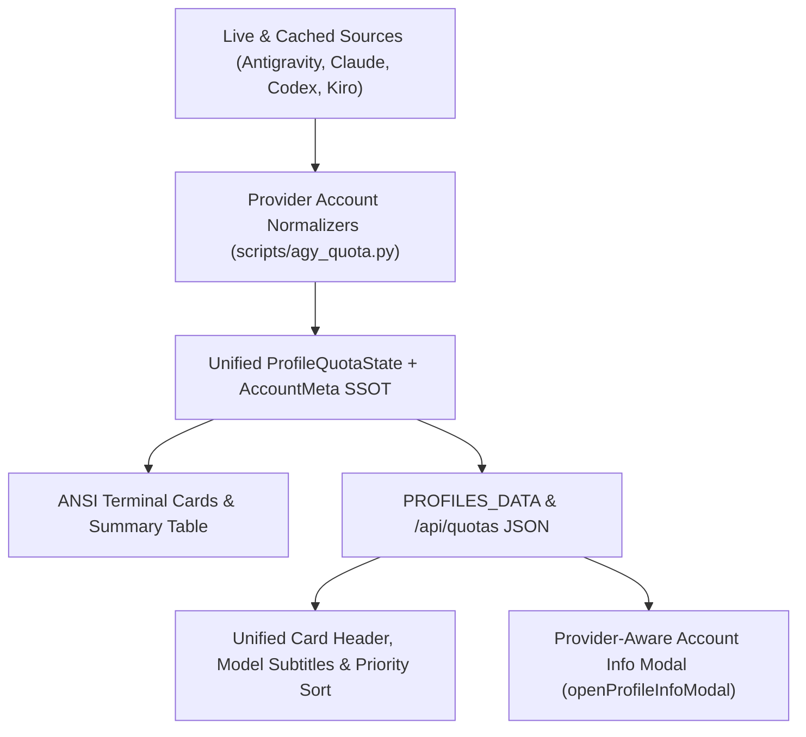

# Check-Quota Dynamic Provider Account Tiers, Priority Derivation, and Unified UI Design

- **Date**: 2026-11-18
- **Status**: Draft (Pending Gate 1 Review)
- **PIC**: nguyenhieu000690
- **Repository**: `ai-agent-tools`
- **Target Skill**: `d3nexus:check-quota`

## Table of Contents

- [1. Problem Statement and Live Provider Findings](#1-problem-statement-and-live-provider-findings)
- [2. Goals and Non-Goals](#2-goals-and-non-goals)
- [3. Shared Contract Warnings](#3-shared-contract-warnings)
- [4. Architecture and Normalized Account Metadata Contract](#4-architecture-and-normalized-account-metadata-contract)
- [5. Provider-Specific Extraction, Tier Mapping, and Priority Matrix](#5-provider-specific-extraction-tier-mapping-and-priority-matrix)
- [6. Dashboard UI, Info Modal, Sorting, and Daemon Sync](#6-dashboard-ui-info-modal-sorting-and-daemon-sync)
- [7. Error Handling, Offline Fallbacks, and Security](#7-error-handling-offline-fallbacks-and-security)
- [8. Verification and Testing Strategy](#8-verification-and-testing-strategy)

## 1. Problem Statement and Live Provider Findings

Direct inspection of live payloads across all four supported LLM providers (`Antigravity`, `Claude`, `Codex`, and `Kiro`) revealed that `scripts/agy_quota.py` and `skills/check-quota/resources/dashboard/quota_dashboard.html` hardcode static vendor strings and fixed priority numbers instead of surfacing the dynamic account tiers, entitlements, and model rosters returned by each provider:

1. **Antigravity (`agy --output-format json -p /usage`, `agy models`, `state.vscdb`)**:
   - `format_profile_for_dashboard()` computes `capabilities["tier"]` (`"ULTRA"`, `"PRO"`, `"FREE"`), yet overwrites top-level `tier` to `"PRO"` or `"FREE"` and hardcodes `priority = 50` for all non-free profiles (`ULTRA`, `PRO + Argon`, and `PRO` standard alike).
   - `execute_ping_profile()` checks `tier == "PRO"` when reading cached 5H availability, which treats `tier == "ULTRA"` as unavailable on cache fallback.
   - `parse_usage_group_models()` splits raw `/usage` `description` strings on commas without stripping the live `"Models within this group: "` prefix and without filtering prose descriptions on dedicated Pro Argon groups (`"For paid Pro plans, Argon quota is separate..."`), polluting `groupModels` with prose clauses.
2. **Anthropic Claude (`Claude Code-credentials` Keychain, `~/.claude.json`, `/api/oauth/profile`, `/api/oauth/usage`)**:
   - `fetch_claude_quota()` discards `subscriptionType` (`"pro"`, `"max"`, `"team"`, `"enterprise"`, `"free"`) and `rateLimitTier` (`"default_claude_ai"`, `"default_claude_max_5x"`, `"default_claude_max_20x"`) from Keychain / `.claude.json` `oauthAccount`, hardcoding `tier: "ANTHROPIC"`, `priority: 100`, and legacy model text `"Claude 3.7 Sonnet / Opus 3.5"`.
   - `quota_dashboard.html` renders static `ANTHROPIC` + `AI PROVIDER` pills with no dynamic plan badge, no `Priority` pill, and no `ℹ` Account Info modal button.
3. **OpenAI Codex (`wham/usage` API and `~/.codex/auth.json` JWT claims)**:
   - `fetch_codex_quota()` ignores `api_data["plan_type"]` (`"plus"`, `"pro"`, `"team"`, `"enterprise"`, `"edu"`, `"free"`), `api_data["model_usage"]` (for example `{"gpt-6-astra": {"available": true}}`), and `api_data["credits"]`, hardcoding `tier: "OPENAI"`, `priority: 95`, legacy `"gpt-4.5 / o3-mini"` text, and a hardcoded `"02/12"` tooltip date on reset credits. Offline fallback also ignores decodable JWT `chatgpt_plan_type` and `email` claims inside `~/.codex/auth.json`.
4. **Kiro CLI (`AmazonCodeWhispererService.GetUsageLimits` and `kiro-cli whoami`)**:
   - `parse_kiro_usage_limits()` and `fetch_kiro_quota()` hardcode `priority: 90` across all Kiro tiers (`KIRO POWER`, `KIRO PRO+`, `KIRO PRO`, `KIRO STUDENT`, `KIRO FREE`), drop cached `tier`, `email`, and `creditsPool` limits during offline fallback, and omit the `Priority` pill and `ℹ` Account Info modal on the web card.
5. **Sorting and Stale Daemon Memory**:
   - `DEFAULT` sort in `quota_dashboard.html` sorts Antigravity profiles purely alphabetically (`A-Z`), burying `ULTRA` (`80`) and `PRO + Argon` (`60`) accounts behind `FREE` (`20`) accounts. Long-lived `_serve` daemons also continue serving stale Python code in memory if `scripts/agy_quota.py` changes on disk.

## 2. Goals and Non-Goals

### Goals

- Normalize account tier, plan badge, vendor badge, deterministic dynamic `priority`, available model roster, and rich non-secret `accountMeta` in `scripts/agy_quota.py` across all four providers (`Antigravity`, `Claude`, `Codex`, `Kiro`) for both CLI and Web UI consumers.
- Fix live Antigravity `/usage` description parsing (`"Models within this group:"` prefix removal and prose-sentence filtering), `tier != "FREE"` ping eligibility, and `state.vscdb` email enrichment.
- Render unified header badges (`[Vendor Pill]`, `[Dynamic Plan Badge]`, `[Priority: X]`, `[Status]`), `ℹ` Account Info modal support, and dynamic model subtitles across all four providers in `quota_dashboard.html`, including `Gemini 4 Carbon & Argon Weekly` (`Shared w/ Gemini Pool`) on Antigravity `ULTRA` cards.
- Update `DEFAULT` sort to pin `claude -> codex -> kiro` at the top and order Antigravity profiles by `priority` descending with `A-Z` tie-breaking, and auto-detect code/cache updates cleanly.

### Non-Goals

- Exposing OAuth access tokens, refresh tokens, or raw JWT strings in HTML, JSON APIs, or logs.
- Dynamic burn-rate telemetry mutation of `priority` scores at runtime (priorities remain deterministic functions of provider account tier and capability).

## 3. Shared Contract Warnings

`shared-contracts/` is absent in `ai-agent-tools`. All TypeScript type updates are confined to `scripts/types/quota_dashboard.types.ts` within this repository.

## 4. Architecture and Normalized Account Metadata Contract



### Extended Schema (`scripts/types/quota_dashboard.types.ts`)

Add `AccountMeta` and optional top-level provider display fields on `ProfileQuotaState`:

```typescript
export interface AccountMeta {
  provider: 'antigravity' | 'claude' | 'codex' | 'kiro';
  vendorLabel: string;        // e.g. 'GOOGLE', 'ANTHROPIC', 'OPENAI', 'KIRO'
  planType: string;           // normalized slug: 'ultra' | 'pro_argon' | 'pro' | 'free' | 'max_20x' | ...
  planLabel: string;          // UI badge text: 'ULTRA', 'CLAUDE PRO', 'CHATGPT PLUS', 'KIRO STUDENT', ...
  organizationName?: string;
  organizationType?: string;
  billingType?: string;
  rateLimitTier?: string;
  authSource?: string;        // e.g. 'Anthropic Live API', 'Local Cache', 'Builder ID', 'ChatGPT OAuth'
  cliCommand?: string;        // e.g. 'nguyenhieu000690-cli', 'claude', 'codex', 'kiro-cli'
  configPath?: string;        // e.g. '~/antigravity_homes/<p>', '~/.claude.json', '~/.codex/auth.json'
  secondaryPath?: string;     // e.g. keychain path or credentials source
  extraUsageEnabled?: boolean;
  extraUsageSummary?: string;
  resetCredits?: number;
  creditsSummary?: string;
  overageStatus?: string;
  overageRateSummary?: string;
}
```

## 5. Provider-Specific Extraction, Tier Mapping, and Priority Matrix

### 5.1 Deterministic Priority Matrix

| Provider | Detected Account Tier / Entitlement | `tier` / `planLabel` | `priority` |
| :--- | :--- | :--- | :--- |
| **Claude** | Max 20x (`rateLimitTier` contains `20x`) | `CLAUDE MAX 20X` | `110` |
| **Claude** | Max 5x / Max (`subscriptionType == "max"` or `has_claude_max`) | `CLAUDE MAX 5X` / `CLAUDE MAX` | `105` |
| **Claude** | Enterprise (`enterprise`) | `CLAUDE ENTERPRISE` | `105` |
| **Claude** | Team (`team`) | `CLAUDE TEAM` | `102` |
| **Claude** | Pro (`pro` / `claude_pro` / `has_claude_pro`) | `CLAUDE PRO` | `100` |
| **Claude** | API (`api` / `console`) | `CLAUDE API` | `98` |
| **Claude** | Free (`free`) | `CLAUDE FREE` | `40` |
| **Codex** | Pro / Enterprise (`plan_type` in `pro`, `enterprise`) | `CHATGPT PRO` / `CHATGPT ENTERPRISE` | `98` |
| **Codex** | Team / Edu (`plan_type` in `team`, `edu`, `business`) | `CHATGPT TEAM` / `CHATGPT EDU` | `96` |
| **Codex** | Plus (`plan_type == "plus"`) | `CHATGPT PLUS` | `95` |
| **Codex** | API Key (`auth_mode == "apikey"`) | `OPENAI API` | `92` |
| **Codex** | Free (`plan_type == "free"`) | `CHATGPT FREE` | `35` |
| **Kiro** | Power (`POWER` in title/type or `limit >= 10000`) | `KIRO POWER` | `94` |
| **Kiro** | Pro+ (`PRO_PLUS` / `PRO+` or `limit >= 2000`) | `KIRO PRO+` | `92` |
| **Kiro** | Pro / Student (`PRO` / `STUDENT`, `~1000` credits) | `KIRO PRO` / `KIRO STUDENT` | `90` |
| **Kiro** | Free (`FREE` in title/type or `limit <= 100`) | `KIRO FREE` | `30` |
| **Antigravity** | Ultra (`capabilities.tier == "ULTRA"`) | `ULTRA` | `80` |
| **Antigravity** | Pro with Dedicated Argon (`tier == "PRO"` and `argonMode == "separate"`) | `PRO` (`+ Argon`) | `60` |
| **Antigravity** | Pro Standard (`tier == "PRO"` and `argonMode != "separate"`) | `PRO` | `50` |
| **Antigravity** | Free (`tier == "FREE"`) | `FREE` | `20` |

### 5.2 Provider Extraction Rules

1. **Antigravity (`normalize_antigravity_account`)**:
   - Promote `capabilities["tier"]` (`"ULTRA"`, `"PRO"`, `"FREE"`) directly to top-level `tier` and compute `priority` (`80`, `60`, `50`, `20`).
   - Read non-secret `email` from `state.vscdb` (`ItemTable` key `antigravityAuthStatus` JSON `email`) when present, falling back to cached `email` or `<profile>@gmail.com`.
   - In `parse_usage_group_models()`: strip leading `r"^models\s+within\s+this\s+group\s*:\s*"` (case-insensitive) before comma-splitting, and skip prose sentences (descriptions lacking model keywords or containing prose markers such as `"for paid"`, `"quota is"`, `"available on"`, `"within each group"`).
   - In `execute_ping_profile()`: replace `tier == "PRO"` with `tier not in ("FREE", "")` (or `tier != "FREE"` when `tier` is present) so `ULTRA` profiles retain 5H ping eligibility on cache fallback.
2. **Claude (`normalize_claude_account`)**:
   - Extend `get_claude_oauth_token()` (or companion `read_claude_account_hints()`) to return non-secret OAuth metadata (`subscriptionType`, `rateLimitTier`) from Keychain `Claude Code-credentials` / `.credentials.json` alongside `.claude.json` `oauthAccount` (`emailAddress`, `organizationName`, `organizationType`, `organizationRateLimitTier`, `userRateLimitTier`, `billingType`, `hasExtraUsageEnabled`).
   - Optionally refresh `/api/oauth/profile` at most once per 24h ONLY when both `subscriptionType` and `organizationType` are missing locally.
   - Derive `availableModels` dynamically from scoped quota buckets (or active Claude Code tier family) and surface `extra_usage` summary if enabled.
3. **Codex (`normalize_codex_account`)**:
   - Extract `plan_type`, `email`, `model_usage` (keys where `available` is truthy, e.g. `gpt-6-astra`), `credits`, and `rate_limit_reset_credits.available_count` from `wham/usage`.
   - Add `_decode_jwt_claims_unverified(token)` (stdlib `base64.urlsafe_b64decode` on JWT segment 1, never logging raw tokens) to extract `email` and `https://api.openai.com/auth` -> `chatgpt_plan_type` from `~/.codex/auth.json` when offline or when `wham/usage` omits fields.
4. **Kiro (`normalize_kiro_account`)**:
   - Normalize `subscriptionInfo.subscriptionTitle` and `subscriptionInfo.type` (`Q_DEVELOPER_STANDALONE_*`), `usageBreakdownList[0]` (`used`, `limit`, `bonuses`, `overageRate`, `overageCap`), and `whoami` auth method (`Builder ID` / `SSO`).
   - On offline or transient API failure, preserve cached `tier`, `planLabel`, `priority`, `email`, and `creditsPool` (`used`, `limit`, `remaining`) from `_peek_cached_profile("kiro")` instead of resetting to `"KIRO"` / `"Kiro CLI User"` / `1000.0`.

## 6. Dashboard UI, Info Modal, Sorting, and Daemon Sync

1. **Unified Card Header (`quota_dashboard.html`)**:
   - **Providers (`claude`, `codex`, `kiro`)**: Render `[Name] [ℹ] [Vendor Pill: ✺ ANTHROPIC / ✱ OPENAI / 👻 KIRO] [Dynamic Plan Badge: CLAUDE PRO / CHATGPT PLUS / KIRO STUDENT ...] [Priority: X] [● Status]` (plus `[🎟️ N RESET CREDIT]` without hardcoded `"02/12"` date on Codex when `resetCredits > 0`).
   - **Antigravity**: Render `[profile] [ℹ] [✦ ULTRA / ◆ PRO / ◇ FREE] [Priority: 80/60/50/20] [◈ Carbon] [✣ Argon] [⌘ Orchestrator] [● Status]`.
2. **Card Body & Ultra Shared Carbon/Argon Row**:
   - Render `geminiRoster` subtitle under both `Gemini Models 5H` and `Gemini Weekly` cards on Antigravity profiles.
   - When an Antigravity profile has `argonMode === "shared_gemini"` and `capabilities.hasCarbon === true` (`ULTRA`), title Row 3 **`Gemini 4 Carbon & Argon Weekly`** with badge `Shared w/ Gemini Pool` and roster `getCarbonArgonOrchestratorModels(data)` (`Gemini 4 Carbon, Gemini 4 Argon, Orchestrator (Carbon), Orchestrator (Argon)`).
   - On `Codex`, render dynamic model subtitle (for example `Available models: gpt-6-astra`) on `Codex 5-Hour Limit` when `availableModels` is non-empty.
   - On `Claude`, render `extraUsageSummary` subtitle on the session bucket when `extra_usage.is_enabled` is true.
3. **Provider-Aware `openProfileInfoModal(profile)`**:
   - Enable the `ℹ` button for both Antigravity profiles and all three AI Providers (`claude`, `codex`, `kiro`).
   - For Providers, display Email, Vendor + Plan + Priority, Organization / Billing / Rate-Limit Tier / Credits / Overages, Available Models / Quota Scopes, CLI Command (`claude`, `codex`, `kiro-cli`), and Config Path (`~/.claude.json`, `~/.codex/auth.json`, `kiro-cli`), hiding Antigravity-specific `Argon Mode` and `profile.keychain-db` rows when `data.isProvider` is true.
4. **Default Sorting & Search**:
   - `DEFAULT` sort in `getOrderedProfiles()`: pin `claude -> codex -> kiro` at the top, then sort Antigravity profiles by `(Number(PROFILES_DATA[b]?.priority ?? 50) - Number(PROFILES_DATA[a]?.priority ?? 50)) || a.localeCompare(b)`.
   - Extend `searchInput` matching in `renderAllProfiles()` to match `tier`, `planLabel`, `vendorLabel`, `availableModels`, and `accountMeta.organizationName`.
5. **CLI & Daemon Code-Sync Safety**:
   - Update CLI renderers (`print_dashboard_cards`, `print_claude_card`, `print_codex_card`, `print_kiro_card`) to print dynamic `tier`/`planLabel` and `Priority: {priority}` instead of hardcoded `50`/`100`/`95`/`90`.
   - In `_serve` HTTP handler (`/api/quotas` and `/`), track `Path(__file__).stat().st_mtime` at startup and `os.execv(sys.executable, [sys.executable, *sys.argv])` (or reload cleanly on mismatch) when `scripts/agy_quota.py` has been updated on disk so long-lived daemons never serve stale logic from memory.

## 7. Error Handling, Offline Fallbacks, and Security

- **Zero Secret Leakage**: Never include `accessToken`, `refreshToken`, `id_token`, `kas_token`, or raw headers in `accountMeta`, `PROFILES_DATA`, `/api/quotas`, or exception messages. JWT decoding uses pure local `base64.urlsafe_b64decode` on payload claims only and catches malformed base64/JSON silently.
- **Preservation Across `DISABLED` / `AUTH NEEDED`**: Extend `_preserve_cached_model_meta()` to also preserve `tier`, `priority`, `planLabel`, and `accountMeta` from cached state when a profile enters `AUTH NEEDED` or `DISABLED`.

## 8. Verification and Testing Strategy

1. **Live-Sample Grounded Unit Tests (`tests/test_check_quota_dynamic_provider_tiers.py`)**:
   - Test `parse_usage_group_models()` against verbatim captured live Antigravity `/usage` payloads (`"Models within this group: Gemini 4 Carbon, ..."` on Ultra and `"For paid Pro plans, Argon quota is separate..."` on Pro) asserting zero prefix/prose leakage.
   - Test `Antigravity` (`ULTRA=80`, `PRO+Argon=60`, `PRO=50`, `FREE=20`), `Claude` (`MAX 20X=110`, `MAX 5X=105`, `TEAM=102`, `PRO=100`, `FREE=40`), `Codex` (`PRO=98`, `TEAM=96`, `PLUS=95`, `API=92`, `FREE=35` + offline JWT fallback + `gpt-6-astra` `model_usage`), and `Kiro` (`POWER=94`, `PRO+=92`, `STUDENT/PRO=90`, `FREE=30` + offline cache preservation).
2. **Node VM Dashboard UI Tests**:
   - Assert unified header badges (`CLAUDE PRO`, `CHATGPT PLUS`, `KIRO STUDENT`, `ULTRA`, dynamic `Priority: ...`, and `ℹ` button) render across all 4 providers.
   - Assert `ULTRA` renders `Gemini 4 Carbon & Argon Weekly` with `Shared w/ Gemini Pool` and roster subtitles on `Gemini Models 5H` and `Gemini Weekly`.
   - Assert `DEFAULT` sort places `claude, codex, kiro` first, followed by `ULTRA (80)` -> `PRO+Argon (60)` -> `PRO (50)` -> `FREE (20)` with `A-Z` tie-breaking, and `openProfileInfoModal()` populates provider metadata cleanly.
3. **End-to-End Quality Gate & Live Refresh**:
   - Run full `pytest` + `@quality_check` (`verify_polyglot_registry.py` and `scripts/verify.sh`), then restart the background `:8765` server and refresh live quota data.
