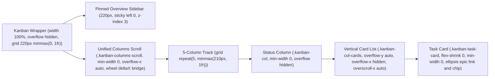

# Check-Tasks Kanban Sticky Overview, Unified Horizontal Scroll, and Epic-Scoped Stage Telemetry Design

- **Date**: 2026-11-18
- **Status**: Approved (Gate 1 + Phase 2 Kanban Scroll & Compact Width Refinement)
- **PIC**: nguyenhieu000690
- **Repository**: `ai-agent-tools`
- **Target Skill**: `d3nexus:check-tasks`

## Table of Contents

- [1. Problem Statement and Root Causes](#1-problem-statement-and-root-causes)
- [2. Goals and Non-Goals](#2-goals-and-non-goals)
- [3. Shared Contract Warnings](#3-shared-contract-warnings)
- [4. Architecture and Layout Design](#4-architecture-and-layout-design)
- [5. Epic-Scoped Telemetry and Stage Label Normalization](#5-epic-scoped-telemetry-and-stage-label-normalization)
- [6. Error Handling, Edge Cases, and Backward Compatibility](#6-error-handling-edge-cases-and-backward-compatibility)
- [7. Verification and Testing Strategy](#7-verification-and-testing-strategy)

## 1. Problem Statement and Root Causes

Inspection of the live `/check-tasks` web dashboard (`skills/check-tasks/resources/dashboard/tasks_dashboard.html`) and backend harvester (`skills/check-tasks/resources/scripts/check_tasks.py`) against multi-epic repositories revealed four concrete UI and telemetry defects:

1. **Unpinned Kanban Overview Sidebar**: In `renderKanbanDashboard()`, the outer board uses `display: grid; grid-template-columns: 220px 1fr`. Because bare `1fr` resolves to `minmax(auto, 1fr)` in CSS Grid and parent Tier 1 wrappers do not enforce `min-width: 0; max-width: 100%`, wide 5-column content stretches the container instead of keeping the `220px` `OVERVIEW` sidebar pinned stationary on the left.
2. **Per-Column Horizontal Scrollbars Instead of a Unified 5-Column Scroll Track**: Each `.kanban-col-cards` sets `overflow-y: auto` without `overflow-x: hidden`, while `.kanban-task-card` renders unbroken snake_case epic identifiers (`[translation_studio_sync_and_standalone](...).en.md...` and `🗂 translation_studio_sync_and_standalone`) without `min-width: 0`, `overflow-wrap: anywhere`, or `text-overflow: ellipsis`. Per CSS Overflow Level 3, pairing `overflow-y: auto` with `overflow-x: visible` computes `overflow-x: auto` on each individual column, spawning per-column horizontal scrollbars rather than scrolling all five status columns (`Backlog`, `To Do`, `In Progress`, `Review`, `Done`) together inside a single horizontal scroll track.
3. **Orphan Stage Index Prefix in Vertical Sub-Step Titles**: Horizontal 6-pill stepper definitions store numbered labels (`1. Spec` through `6. Finish`) in `stage.label`. Both `buildSubStepsHtml()` (`3. Tasks: 4/20 (20%)`) and Kanban `EPICS PROGRESS` subtitles (`3. Tasks · 4/20 (20%)`) reuse `stage.label` verbatim in standalone vertical blocks where no `1.` or `2.` sibling items exist above them.
4. **Cross-Epic Task Count Contamination (`4/4 Completed (20%)` vs `4/20 (20%)`)**: In `check_tasks.py`, `repo.pipeline_telemetry` invokes `build_epic_pipeline_telemetry(repo_path, active_epic, done_tasks=task_progress.done_tasks, total_tasks=task_progress.total_tasks)`, passing repository-wide counts across all epics (for example, `4` tasks from `translation_studio_sync_and_standalone` plus `16` backlog tasks from `mac_mini_to_cloud_roadmap` = `20`) instead of scoping `done_tasks` and `total_tasks` to `active_epic` (reconciled with packaged `.devtool/epic/<slug>/task_*.md` counts). In addition, `seen_tasks` deduplicates by `tf.stem` alone rather than `(_normalize_slug(epic), tf.stem)`, risking cross-epic stem collisions when two epics share `task_01_*.md` filenames.
5. **Flexbox Card Height Collapse When a Column Exceeds `680px` (`16` Backlog Tasks Crushed to `32px`)**: Setting `overflow: hidden` on `.kanban-task-card` and its inner rows (`.kanban-epic-link-row` and chip container) inside `.kanban-col-cards` (`display: flex; flex-direction: column; max-height: 680px; overflow-y: auto`) without `flex-shrink: 0` shifts their W3C CSS Flexbox §4.5 automatic minimum height (`min-height: auto`) to `0` with `flex-shrink: 1`. When `Backlog` contains 16 tasks (`~2312px > 680px`), Flexbox shrinks all 16 cards equally to `32px` slivers, collapsing the Epic link and chip rows to `0px` and clipping the footer row and wrapped title lines.
6. **Horizontal Trackpad Scroll Blocked Over Column Items & Wide Default Columns (`260px` -> `210px`)**: Setting `overscroll-behavior: contain` on `.kanban-col-cards` blocks horizontal scroll chaining (`overscroll-behavior-x: contain`) across the entire `680px` body of all 5 columns, and Chromium on macOS latches two-finger horizontal trackpad gestures with slight vertical jitter (`deltaY != 0`) onto the inner `overflow-y: auto` `.kanban-col-cards` container, discarding `deltaX`. In addition, `repeat(5, minmax(260px, 1fr))` (`1300px` + `220px` Overview = `1520px`) makes empty columns overly wide on standard laptop viewports; `repeat(5, minmax(210px, 1fr))` (`1050px` + `220px` = `1270px`) provides a compact default fit while preserving horizontal scroll on narrower windows.

## 2. Goals and Non-Goals

### Goals

- Pin the `220px` `OVERVIEW` panel stationary on the left edge of the Kanban board (`renderKanbanDashboard`) while keeping vertical scrolling smooth for `EPICS PROGRESS`.
- Enforce a single unified horizontal scroll container (`.kanban-columns-scroll`) wrapping all five status columns (`Backlog`, `To Do`, `In Progress`, `Review`, `Done`), and strictly eliminate per-column horizontal scrollbars in both in-page Kanban and `#modal-kanban`.
- Strip leading numeric stage prefixes (`^\d+\.\s*`) when rendering standalone vertical sub-step headers (`Tasks: 4/4 (100%)`, `HLD & Principal: ...`) and Kanban `EPICS PROGRESS` stage summaries (`Tasks · 4/4 (100%)`), while preserving `1. Spec` through `6. Finish` inside the horizontal 6-pill stepper row.
- Scope `done_tasks` and `total_tasks` per epic in `check_tasks.py` and `tasks_dashboard.html` (reconciling active `.devtool/features/` tasks with packaged `.devtool/epic/<slug>/task_*.md` wave totals and deduplicating `seen_tasks` by `(normalized_epic, task_id)`).

### Non-Goals

- Redesigning Kanban drag-and-drop task mutation (the board remains read-only synced from `.devtool/` files).
- Changing the 6-stage lifecycle percentage weights or Gate 1-5 FSM rules.

## 3. Shared Contract Warnings

`shared-contracts/` is absent in `ai-agent-tools` (standalone agent plugin and CLI tooling repository). No Hub or Satellite wire contracts are affected.

## 4. Architecture and Layout Design

### CSS and DOM Contract in `tasks_dashboard.html`

1. **Tier 1 & Kanban Wrapper Containment**:
   - Ensure `#repo-detail-content-<repo>`, its Tier 1 card container, and `#kanban-dashboard-wrapper-<repo>` apply `min-width: 0; max-width: 100%;` so wide child tracks never stretch the page width.
   - Change the outer grid inside `renderKanbanDashboard()` from `grid-template-columns: 220px 1fr` to `grid-template-columns: 220px minmax(0, 1fr); width: 100%; max-width: 100%; position: relative;`.
2. **Pinned Overview Sidebar**:
   - Apply `width: 220px; min-width: 220px; max-width: 220px; position: sticky; left: 0; z-index: 3; background: #090c14; border-right: 1px solid #1e2638;` to the left `OVERVIEW` column so it never scrolls horizontally.
3. **Single Horizontal Scroll Container, Non-Shrinking Cards, and Compact `210px` Columns**:
   - `.kanban-columns-scroll` owns horizontal scrolling exclusively: `min-width: 0; width: 100%; overflow-x: auto; overflow-y: hidden; overscroll-behavior-x: contain; display: grid; grid-template-columns: repeat(5, minmax(210px, 1fr));`.
   - Each `.kanban-col` sets `min-width: 0; overflow: hidden; display: flex; flex-direction: column;`, with `flex-shrink: 0` on its column header row.
   - Each `.kanban-col-cards` sets `min-width: 0; overflow-y: auto; overflow-x: hidden; overscroll-behavior-y: contain; overscroll-behavior-x: auto;` so vertical scroll stays contained per column without blocking horizontal scroll chaining.
   - Register a single delegated `{ passive: false }` `wheel` bridge (`ensureKanbanHorizontalWheelBridge()`) on `document` that intercepts wheel gestures inside `.kanban-columns-scroll` when `scroller.scrollWidth > scroller.clientWidth` and `Math.abs(deltaX) > Math.abs(deltaY)`, advancing `scroller.scrollLeft` across all 5 columns simultaneously even when the pointer is over a vertically scrollable `.kanban-col-cards` list (bypassing Chromium trackpad `overflow-y` scroll-latching) while leaving vertical gestures (`Math.abs(deltaY) >= Math.abs(deltaX)`) native.
   - Inside `.kanban-task-card`, apply `flex-shrink: 0; min-width: 0; max-width: 100%; overflow: hidden; padding: 10px; gap: 6px;` (plus `flex-shrink: 0` on all direct child row containers `.kanban-task-card > div` and no inline `transition: all` override), wrap task titles with `overflow-wrap: anywhere; word-break: break-word;`, and constrain epic link/chip spans with `max-width: 100%; overflow: hidden; text-overflow: ellipsis; white-space: nowrap; display: inline-block;`.
   - Apply the same unified horizontal track (`overflow-x: auto` on the 5-column track with `repeat(5, minmax(210px, 1fr))`, `overflow-x: hidden`, and `flex-shrink: 0` per card) inside `openKanbanModal()` (`#modal-kanban`).
4. **Scroll Snapshot Preservation**:
   - Preserve `data-scroll-id="kanban-board-scroll-<repo>"` on `.kanban-columns-scroll` and `data-scroll-id="kanban-col-<repo>-<status>"` on `.kanban-col-cards` so `captureAllScrollPositions()` / `restoreAllScrollPositions()` retain both horizontal board position and per-column vertical scroll across polling refreshes.

## 5. Epic-Scoped Telemetry and Stage Label Normalization

### 5.1 Stripping Orphan Stage Index Prefixes Outside the Horizontal Stepper

- Introduce a small pure helper in both layers:
  - Python (`check_tasks.py`): `_strip_stage_index_prefix(label: str) -> str` using `re.sub(r"^\d+\.\s*", "", str(label or "").strip())`.
  - JavaScript (`tasks_dashboard.html`): `stripStageIndexPrefix(label)` using `String(label || '').replace(/^\d+\.\s*/, '').trim()`.
- Keep `stage.label` as `"1. Spec"`, `"2. HLD & Principal"`, `"3. Tasks"`, `"4. Gate 4 QA"`, `"5. Cross-Review"`, `"6. Finish"` so `buildStagePillsHtml()` continues rendering numbered pills left-to-right across the horizontal 6-stage stepper.
- Update standalone vertical consumers to use the stripped stage title:
  - `buildSubStepsHtml()` in `tasks_dashboard.html`: renders `<strong>Tasks:</strong> 4/4 (100%)` instead of `3. Tasks: 4/20 (20%)`.
  - `active_sub_step_summary` in `check_tasks.py` and `synthesizePipelineTelemetry()` / `renderKanbanDashboard()` in `tasks_dashboard.html`: renders `Tasks · 4/4 (100%)` and `HLD & Principal · HLD, BDD & Tasks` without leading `3.` or `2.`.

### 5.2 Epic-Scoped Task Counts and Multi-Wave Packaging Parity

- **Task Deduplication Key (`check_tasks.py`)**:
  - Change `seen_tasks` in `scan_task_progress()` from `set[str]` (`task_id`) to `set[tuple[str, str]]` keyed by `(_normalize_slug(effective_epic), task_id)` so two distinct epics in the same repository never shadow each other's `task_01_*.md` files.
- **Primary Active Epic Telemetry (`check_tasks.py`)**:
  - When building `repo.pipeline_telemetry` for `active_epic`, filter `task_progress.tasks` to tasks matching `_normalize_slug(active_epic)` rather than passing repository-wide `task_progress.done_tasks` and `task_progress.total_tasks`.
  - In `build_epic_pipeline_telemetry()`, compute `total_tasks = max(total_tasks, dir_task_count)` (instead of only using `dir_task_count` when `total_tasks == 0`) so packaged multi-wave epics where Wave 1 promoted `4` of `20` tasks into `.devtool/features/` while `16` remain in `.devtool/epic/<slug>/` accurately report `4/20 (20%)` rather than `4/4 (100%)`.
- **Frontend Epic Execution & Kanban Overview (`tasks_dashboard.html`)**:
  - Resolve per-epic `effectiveTotalCount = Math.max(epicTasks.length, Number(epicMeta?.task_count || 0), Number(epicPt?.stages?.[2]?.total_tasks || 0))` (using `epicMeta.task_count` when higher than promoted `epicTasks.length`, and never falling back to repo-wide `repo.task_progress.task_completion_pct` when `allTasks` contains multiple epics).
  - Ensure `activeTaskName` only displays `'All tasks completed ✓'` when `effectiveTotalCount > 0 && doneCount >= effectiveTotalCount`; if `doneCount < effectiveTotalCount` and no promoted `in-progress`/`todo` task is currently present between waves, display `'Promoting next wave tasks...'`.

## 6. Error Handling, Edge Cases, and Backward Compatibility

- **Legacy / Single-Epic Payloads**: When a repository has a single epic or legacy payload omitting `epics_summary` and `pipeline_telemetry`, `synthesizePipelineTelemetry()` falls back cleanly to `epicTasks` or `repo.task_progress`, preserving full backward compatibility with `LTSP-EC-03`.
- **Empty Columns & Narrow Viewports**: On narrow viewports (`< 1280px`), `OVERVIEW` remains pinned at `220px` while `.kanban-columns-scroll` scrolls smoothly across all `5 * 210px = 1050px` columns (including horizontal two-finger trackpad swipes over 16-card columns); on laptop and ultrawide monitors (`>= 1360px`), `minmax(210px, 1fr)` fits all 5 columns cleanly and expands them evenly to fill available space with zero horizontal scrollbar.
- **Existing Stepper Pill Tests**: Keeping `1. Spec` .. `6. Finish` on `stage.label` preserves all assertions in `tests/test_ltsp_dashboard_ui.py` and `tests/test_cehm_dashboard_modal_ui.py`.

## 7. Verification and Testing Strategy

1. **Automated Unit & Node VM Dashboard Tests (`tests/test_check_tasks_kanban_and_telemetry_fixes.py`)**:
   - Verify `.kanban-columns-scroll` uses a single horizontal scroll track (`overflow-x: auto`), `.kanban-col-cards` enforces `overflow-x: hidden`, `OVERVIEW` sidebar is pinned (`position: sticky; left: 0;`) inside `220px minmax(0, 1fr)`, and long unbroken epic slugs truncate cleanly without per-column horizontal overflow.
   - Verify `buildSubStepsHtml()` renders `Tasks: 4/4 (100%)` (no `3.` prefix) while `buildStagePillsHtml()` still renders `1. Spec` through `6. Finish`.
   - Verify multi-epic repositories (`4/4` done in `epic_a` + `0/16` backlog in `epic_b`, including overlapping `task_01` stems) report `4/4 (100%)` on `epic_a` and `0/16 (0%)` on `epic_b`, while a multi-wave packaged epic (`4` done in `.devtool/features/`, `20` `task_*.md` in `.devtool/epic/<slug>/`) reports `4/20 (20%)` everywhere without premature `'All tasks completed ✓'`.
2. **Regression & Quality Gate**:
   - Run full pytest suite (`tests/test_ltsp_dashboard_ui.py`, `tests/test_cehm_dashboard_modal_ui.py`, and all existing suites) plus `@quality_check` (`verify_polyglot_registry.py` and `scripts/verify.sh`), and restart live `check-tasks` daemon if running.
