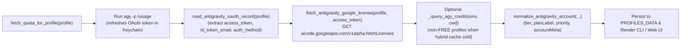

# Dynamic Google Profile Data Discovery for Antigravity Quota Dashboard

- **Date**: 2026-11-24
- **PIC**: huynhminhtien0510
- **Status**: Draft (Pending Gate 1 Approval)
- **Scope**: `scripts/agy_quota.py`, `skills/check-quota/resources/dashboard/quota_dashboard.html`, `tests/test_check_quota_dynamic_provider_tiers.py`

## Table of Contents

- [1. Problem Statement and Goals](#1-problem-statement-and-goals)
- [2. Architecture and Data Flow](#2-architecture-and-data-flow)
- [3. Component Specifications](#3-component-specifications)
- [4. UI and CLI Presentation](#4-ui-and-cli-presentation)
- [5. Error Handling, Security, and Caching](#5-error-handling-security-and-caching)
- [6. Testing and Verification Criteria](#6-testing-and-verification-criteria)
- [7. Shared Contract Warnings](#7-shared-contract-warnings)

---

## 1. Problem Statement and Goals

Currently, Antigravity profile cards on the Quota Dashboard and CLI (`scripts/agy_quota.py`) suffer from two static-fallback limitations:

1. **Missing `ULTRA` vs `PRO` Tier Differentiation**: `agy --output-format json -p /usage` only outputs `command.data.groups` and `command.data.description`. It never populates `plan_name`, `tier`, or `tier_name`. Consequently, `plan_raw` is always empty (`""`) and every paid account with a 5-hour bucket defaults to `"PRO"` (`Priority: 50` or `60`), even when the Google account is subscribed to **Google AI Ultra** (`g1-ultra-tier`, e.g., profile `tess`).
2. **Synthetic `<profile>@gmail.com` Email Fallback**: `read_antigravity_vscdb_email(profile)` checks only the legacy path `~/antigravity_homes/<profile>/Library/Application Support/Antigravity/User/globalStorage/state.vscdb` and key `antigravityAuthStatus`. Isolated profiles store their SQLite database under `~/antigravity_homes/<profile>/data/User/globalStorage/state.vscdb` (under `google.google-antigravity` -> `antigravity-storage.agy.onboarding.lastLoginUsername`) and store the live OAuth `id_token_email` directly inside the profile Keychain (`~/antigravity_homes/<profile>/Library/Keychains/<profile>.keychain-db`).

### Goals

- Dynamically fetch each Antigravity profile's real Google subscription license (`userTier`, `tierDisplayName`, `upgradeSubscription`) from `GET https://aicode.googleapis.com/v1alpha:fetchLicenses` using the profile's OAuth token.
- Dynamically resolve the authenticated Google email and `auth_method` (`consumer` vs `enterprise`) from the profile Keychain OAuth record and `data/User/globalStorage/state.vscdb`.
- Dynamically probe or preserve AI credits (`remaining_credits` via `agy --output-format json -p /credits`) for non-FREE profiles within the 24-hour hybrid discovery cache window.
- Surface the live Google tier (`ULTRA`, `PRO`, `FREE`), official plan display name (`Google AI Ultra`, `Google AI Pro`, `Antigravity Starter Quota`), priority (`80`, `60`, `50`, `20`), and credits metadata in both the CLI and the Web Dashboard (`quota_dashboard.html`).

---

## 2. Architecture and Data Flow



---

## 3. Component Specifications

### 3.1 Keychain & OAuth Record Reader (`read_antigravity_oauth_record`)

- Reads the `gemini` / `antigravity` generic password from `~/antigravity_homes/<profile>/Library/Keychains/<profile>.keychain-db` (after unlocking with `KC_PASS`), or falls back to `.gemini/antigravity-cli/antigravity-oauth-token` and `.gemini/jetski-standalone-oauth-token`.
- Strips the `go-keyring-base64:` prefix when present and base64-decodes the JSON payload.
- Returns a dictionary containing:
  - `access_token`: string (in-memory only, never serialized to disk/HTML).
  - `email`: string from `id_token_email` (or unverified JWT decode of `token.id_token` if present).
  - `auth_method`: string (`"consumer"`, `"enterprise"`, etc.).
  - `expiry`: string ISO timestamp from `token.expiry`.

### 3.2 Multi-Path `state.vscdb` Email Reader (`read_antigravity_vscdb_email`)

- Checks both candidate SQLite paths in read-only URI mode (`?mode=ro`):
  1. `~/antigravity_homes/<profile>/data/User/globalStorage/state.vscdb`
  2. `~/antigravity_homes/<profile>/Library/Application Support/Antigravity/User/globalStorage/state.vscdb`
- Queries `ItemTable` for:
  - `antigravityAuthStatus` -> JSON `{"email": "..."}`
  - `google.google-antigravity` -> JSON `{"antigravity-storage": {"agy.onboarding.lastLoginUsername": "..."}}`
- Email resolution precedence in `normalize_antigravity_account`:
  1. Live `id_token_email` from Keychain / OAuth token file.
  2. Email from `read_antigravity_vscdb_email(profile)`.
  3. Explicit/cached email (when not matching the synthetic `<profile>@gmail.com` fallback or when `<profile>@gmail.com` is the actual authenticated address).
  4. Fallback `<profile>@gmail.com`.

### 3.3 Live Google License Fetcher (`fetch_antigravity_google_license`)

- Performs `GET https://aicode.googleapis.com/v1alpha:fetchLicenses` with header `Authorization: Bearer <access_token>` and `Accept: application/json` (`timeout=4.0`).
- Parses `licenses[0]`:
  - `userTier`: e.g. `"g1-ultra-tier"`, `"g1-pro-tier"`, `"free-tier"`, `"standard-tier"`.
  - `tierDisplayName`: e.g. `"Google AI Ultra"`, `"Google AI Pro"`, `"Antigravity Starter Quota"`.
  - `upgradeSubscription`: `{"text": "...", "url": "..."}`.
- Maps license data to canonical tier:
  - `"ultra"` in `userTier.lower()` or `tierDisplayName.lower()` -> `tier = "ULTRA"`.
  - `"free"` in `userTier.lower()` or `"starter"` in `tierDisplayName.lower()` -> `tier = "FREE"`.
  - `"pro"` or `"standard"` in `userTier.lower()` or `tierDisplayName.lower()` -> `tier = "PRO"`.
- If the HTTP call fails (e.g. offline, expired token in standalone check, or mocked test environment without network), falls back gracefully to cached license metadata in `cached_entry.get("accountMeta")` or `plan_name` / `has_5h` heuristic.

### 3.4 AI Credits Discovery (`_query_agy_credits`)

- When `should_fetch_models` is True (i.e. single-profile refresh or cold 24h hybrid cache) and the resolved tier is not `"FREE"`, invokes `agy --output-format json -p /credits` in the isolated temporary directory (`timeout=15`).
- Parses `command.data.remaining_credits` (integer) and `command.data.upgrade_uri` (string).
- When `batch_mode=True` and the hybrid cache is warm, reuses `remainingCredits` from `cached_entry.get("accountMeta")`.

### 3.5 Normalized `accountMeta` Contract (`normalize_antigravity_account`)

`normalize_antigravity_account` produces:

```json
{
  "provider": "antigravity",
  "vendorLabel": "GOOGLE",
  "planType": "ultra | pro_argon | pro | free",
  "planLabel": "ULTRA | PRO | FREE",
  "userTier": "g1-ultra-tier | g1-pro-tier | free-tier",
  "tierDisplayName": "Google AI Ultra | Google AI Pro | Antigravity Starter Quota",
  "authSource": "antigravity-oauth",
  "authMethod": "consumer",
  "cliCommand": "<profile>-cli",
  "configPath": "~/antigravity_homes/<profile>",
  "secondaryPath": "~/antigravity_homes/<profile>/Library/Keychains/<profile>.keychain-db",
  "remainingCredits": 0,
  "creditsSummary": "0 AI credits remaining",
  "upgradeText": "You are subscribed to the best Google AI plan.",
  "upgradeUrl": "https://antigravity.google/g1-upgrade"
}
```

Priority mapping:
- `ULTRA` (`planType = "ultra"`): `priority = 80`
- `PRO` with standalone Argon (`planType = "pro_argon"`): `priority = 60`
- `PRO` standard / shared Gemini pool (`planType = "pro"`): `priority = 50`
- `FREE` (`planType = "free"`): `priority = 20`

---

## 4. UI and CLI Presentation

1. **Profile Card Header (`quota_dashboard.html` & CLI)**:
   - Displays `✦ ULTRA` (purple gradient badge) for `ULTRA` profiles, `◆ PRO` (blue badge) for `PRO` profiles, and `◇ FREE` (slate badge) for `FREE` profiles.
2. **Profile Info Modal (`ℹ` — `openProfileInfoModal` in `quota_dashboard.html`)**:
   - **Tài khoản Google (Email)**: Displays the live Google email (`data.email`).
   - **Gói dịch vụ (Tier)**: Displays `<TIER> • <tierDisplayName> (<userTier>) • Priority <priority>` when `tierDisplayName` / `userTier` are present from Google, plus Argon mode suffix and `creditsSummary` if available.

---

## 5. Error Handling, Security, and Caching

- **Strict Credential Hygiene**: `access_token` and `refresh_token` are never included in `accountMeta`, `PROFILES_DATA`, logs, or HTTP responses.
- **Zero Regression in Offline / Mocked Environments**: If Keychain has no token or `fetchLicenses` returns an error, `fetch_quota_for_profile` and `format_profile_for_dashboard` preserve any previously cached `userTier` / `tierDisplayName` / `tier`, or fall back cleanly to the `has_5h` heuristic.
- **Disabled / Auth-Needed Preservation**: `_preserve_cached_model_meta` preserves `tier`, `priority`, `planLabel`, `vendorLabel`, and `accountMeta` (including `userTier` and `tierDisplayName`) when a profile transitions to `DISABLED` or `AUTH NEEDED`.

---

## 6. Testing and Verification Criteria

- Unit tests verifying:
  - `read_antigravity_oauth_record` parses `go-keyring-base64:` payloads and fallback JSON files without leaking tokens.
  - `read_antigravity_vscdb_email` resolves email from both `data/User/globalStorage/state.vscdb` (`google.google-antigravity`) and legacy `antigravityAuthStatus`.
  - `fetch_antigravity_google_license` and `_derive_profile_capabilities` / `normalize_antigravity_account` map `g1-ultra-tier` -> `ULTRA` (`priority=80`), `g1-pro-tier` -> `PRO` (`priority=50/60`), `free-tier` -> `FREE` (`priority=20`).
  - `openProfileInfoModal` in `quota_dashboard.html` displays `tierDisplayName`, `userTier`, and `priority`.
- Full pytest suite and `@quality_check` pass with zero errors.

---

## 7. Shared Contract Warnings

No `shared-contracts/` directory or symlink exists in `ai-agent-tools`; this change is internal to the `check-quota` skill and `scripts/agy_quota.py`.
