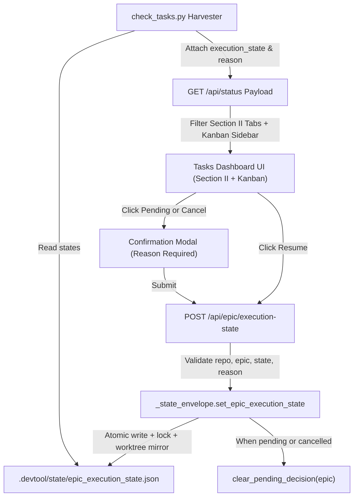

# Tasks UI Epic Execution Tabs (Doing / Pending / Cancelled) Design

- **PIC**: danhdue
- **Date**: 2026-11-26
- **Scope**: `scripts/_state_envelope.py`, `skills/check-tasks/resources/scripts/check_tasks.py`, `skills/check-tasks/resources/scripts/tasks_server.py`, `skills/check-tasks/resources/dashboard/tasks_dashboard.html`

## Table of Contents

- [Overview](#overview)
- [Goals and Non-Goals](#goals-and-non-goals)
- [Shared Contract Warnings](#shared-contract-warnings)
- [Architecture and Data Flow](#architecture-and-data-flow)
- [State Persistence Schema](#state-persistence-schema)
- [Backend Harvester and REST API](#backend-harvester-and-rest-api)
- [Frontend UI Design](#frontend-ui-design)
- [Error Handling and Edge Cases](#error-handling-and-edge-cases)
- [Testing Plan](#testing-plan)

## Overview

In Section II (**Worktree & Profile (PIC) Execution**) of the Check-Tasks Dashboard, all active epics are currently rendered in a single flat list with no way to temporarily pause (`Pending`) or shelve (`Cancelled`) an epic without manually editing git-tracked documents or removing worktrees. This design adds a non-destructive local execution-state layer supporting three lifecycle tabs (**Doing**, **Pending**, **Cancelled**), confirmation dialogs with required reason capture, one-click **Resume**, and matching status filtering on the **Kanban Dashboard**.

## Goals and Non-Goals

### Goals

- Provide three tabs in Section II (**Doing**, **Pending**, **Cancelled**) with live counts per repository.
- Display all active in-progress epics in **Doing** by default — including epics still in Stage 1/2 before `handoff.md` is generated.
- Show **Pending** and **Cancel** buttons on every epic card in the **Doing** tab.
- Require a confirmation modal dialog with a non-empty reason input before transitioning an epic to **Pending** or **Cancelled**, and display the recorded reason on the card in those tabs.
- Show a **Resume** button on every epic card in the **Pending** and **Cancelled** tabs to move it immediately back to **Doing**.
- Default the **Kanban Dashboard** to displaying **Doing** epics and their tasks, while offering a 3-way filter (**Doing** / **Pending** / **Cancelled**) in the Kanban sidebar.
- Clear active `pending_decision` alerts for epics moved to **Pending** or **Cancelled** without mutating git-tracked files, branches, or worktrees.

### Non-Goals

- Modifying HLD Markdown files (`- **Status**:`), `handoff.md`, or task frontmatter on disk.
- Deleting git branches, removing worktrees, or archiving `.devtool/features/` tasks on **Cancel**.
- Cross-machine git synchronization of UI pause/cancel states.

## Shared Contract Warnings

`shared-contracts/` is not present in this repository (`ai-agent-tools` is a standalone agent kit). No cross-repository wire contract warnings apply.

## Architecture and Data Flow



## State Persistence Schema

Stored in `.devtool/state/epic_execution_state.json` via `scripts/_state_envelope.py` using the existing atomic JSON writer, cross-worktree lock (`_state_lock`), and shared `.devtool/` mirroring:

```json
{
  "schema_version": 1,
  "generation": 2,
  "states": {
    "gemma_lyric_editor_model": {
      "state": "pending",
      "reason": "Waiting for upstream dataset validation",
      "updated_at": "2026-11-26T04:45:00Z"
    }
  }
}
```

### State Envelope Helpers

- `read_epic_execution_states(repo_root, extra_devtool_dirs=None) -> dict[str, dict[str, str]]`: Reads the highest-generation `epic_execution_state.json` across primary repo and worktrees, returning the normalized `states` mapping.
- `set_epic_execution_state(repo_root, epic_slug, state, *, reason="", extra_devtool_dirs=None) -> dict[str, Any]`:
  - Validates `state in ("doing", "pending", "cancelled")`.
  - When `state in ("pending", "cancelled")`: requires non-empty trimmed `reason`; writes `{ "state": state, "reason": reason.strip(), "updated_at": utc_iso }` under normalized epic slug; clears any matching `pending_decision.json` entry (for both `_` and `-` slug variants) so alerts stop firing.
  - When `state == "doing"`: removes matching epic slug keys (both `_` and `-` variants) from `states`, restoring default active behavior.

## Backend Harvester and REST API

### Harvester (`skills/check-tasks/resources/scripts/check_tasks.py`)

- Read `epic_execution_state.json` during `scan_repo()` via `_read_state_snapshot(repo_path, "epic_execution_state.json", {})`.
- For every epic entry in `epics_summary.epics`:
  - Attach `execution_state` (`"doing"` by default, or `"pending"` / `"cancelled"` when matched by normalized slug).
  - Attach `execution_state_reason` (`""` when `"doing"`, otherwise stored reason string) and `execution_state_updated_at`.
  - When `execution_state in ("pending", "cancelled")`, force `is_action_required = False` and `action_prompt = ""` on that epic summary entry.
- Attach summary counts `doing_count`, `pending_count`, and `cancelled_count` to `epics_summary`.
- When the primary `active_epic` has `execution_state in ("pending", "cancelled")`, suppress repo-level `is_human_action_required` for that epic so its paused/cancelled state does not keep a red badge on the repository tab.

### REST API (`skills/check-tasks/resources/scripts/tasks_server.py`)

- Add `set_epic_execution_state_for_repo(workspace_root, repo_name, epic_slug, state, reason="") -> dict[str, Any]`:
  - Validates `repo_name` resolves cleanly inside `workspace_root`, `epic_slug` matches safe identifier characters (no path traversal), `state in {"doing", "pending", "cancelled"}`, and `reason.strip()` is non-empty when `state in {"pending", "cancelled"}`.
  - Calls `_state_envelope.set_epic_execution_state(...)` and returns `{ "status": "ok", "repo": repo_name, "epic": epic_slug, "state": state, "reason": reason.strip() }`.
- Wire `POST /api/epic/execution-state` in `do_POST`: returns HTTP `200` on success, HTTP `400` with `{ "status": "error", "error": "..." }` on validation errors.

## Frontend UI Design

### Section II — Worktree & Profile (PIC) Execution

1. **Three Tabs (`Doing`, `Pending`, `Cancelled`)**:
   - Render a compact tab strip at the top of Section II per repository (`executionTabByRepo[repo.name]`, defaulting to `'doing'`):
     - `⚡ Doing (N)` — all active/in-progress epics (including Stage 1/2 epics before `handoff.md`) with `execution_state === 'doing'`.
     - `⏸ Pending (M)` — epics with `execution_state === 'pending'`.
     - `✕ Cancelled (K)` — epics with `execution_state === 'cancelled'`.
   - Each tab displays a clean empty-state placeholder when its filtered list is empty.
2. **Card Controls (Row 4)**:
   - On **Doing** cards: render **`⏸ Pending`** and **`✕ Cancel`** buttons alongside existing IDE/CLI/Review actions.
   - On **Pending** and **Cancelled** cards: render a reason banner (`Reason: <execution_state_reason>`) and a **`▶ Resume`** button that moves the epic back to **Doing**.
3. **Confirmation Dialog (`#modal-epic-state-confirm`)**:
   - Clicking **`⏸ Pending`** or **`✕ Cancel`** opens a modal dialog displaying the target epic, action type, and a required `<textarea>` for the reason.
   - Submitting validates non-empty reason, sends `POST /api/epic/execution-state`, applies optimistic UI update + toast feedback, and refreshes `/api/status`.

### Kanban Dashboard Filtering

- Add a compact 3-button status filter (`Doing` | `Pending` | `Cancelled`) in the Kanban sidebar above `EPICS PROGRESS`, tracked per repository (`kanbanExecutionFilterByRepo[repo.name]`, defaulting to `'doing'`).
- Filter all Kanban views consistently by the selected execution state:
  - `OVERVIEW` status counts (Backlog, To Do, In Progress, Review, Done) reflect only tasks belonging to epics in the selected state.
  - `EPICS PROGRESS` lists only epics matching the selected state.
  - `FILTER BY EPIC` dropdown lists only matching epics (auto-resetting `selectedEpicFilter` to `'all'` if the previously selected epic moved out of the current state).
  - The 5 Kanban columns render only tasks belonging to epics matching the selected state.

## Error Handling and Edge Cases

- **Slug normalization**: Match `_` and `-` slug variants consistently between `epic_execution_state.json`, `epics_summary`, `task_progress.tasks`, and `pending_decision.json`.
- **Empty reason rejection**: Both frontend modal validation and backend `POST /api/epic/execution-state` reject blank reasons for `pending` / `cancelled`.
- **Network/API failure**: Roll back optimistic UI state and display a danger toast without corrupting local state.
- **Done/Archived epics**: Epics already marked `status: "done"` remain in completed history and are excluded from Section II execution tabs.

## Testing Plan

1. **State Envelope Unit Tests**: Verify `set_epic_execution_state`, `read_epic_execution_states`, reason persistence, worktree mirroring, `doing` removal, and automatic `pending_decision` clearing.
2. **Harvester & Server API Integration Tests**: Verify `check_tasks.py` propagates `execution_state`, `execution_state_reason`, counts, and suppresses `is_action_required` for `pending`/`cancelled`; verify `POST /api/epic/execution-state` returns `200` on valid payloads and `400` on missing reason, invalid state, or path traversal.
3. **Dashboard UI Tests**: Verify Section II 3-tab rendering (`Doing`, `Pending`, `Cancelled`), `Pending`/`Cancel` modal confirmation with required reason, `Resume` action, and Kanban sidebar `Doing`/`Pending`/`Cancelled` filtering.
4. **Full Kit Verification**: Run `bash scripts/verify.sh --quiet` after implementation.
