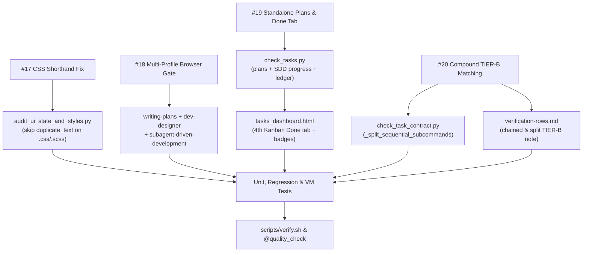

# Observer Hardening Batch 2 Design Specification

- **PIC**: duvthinh403
- **Date**: 2026-11-27
- **Branch**: `feat/observer-hardening-batch2` (from `main` at `8b094c8`)
- **Worktree**: `.worktrees/observer_hardening_batch2`
- **Scope**: Task-Observer Observations `#17`, `#18`, `#19`, `#20`

## Table of Contents

- [Overview and Goals](#overview-and-goals)
- [Shared Contract Warnings](#shared-contract-warnings)
- [Architecture and Data Flow](#architecture-and-data-flow)
- [Component 1: Web UI Audit Stylesheet Guard](#component-1-web-ui-audit-stylesheet-guard)
- [Component 2: Hermetic Playwright Primary Browser Gate](#component-2-hermetic-playwright-primary-browser-gate)
- [Component 3: Check-Tasks Standalone Plans and Done Tab](#component-3-check-tasks-standalone-plans-and-done-tab)
- [Component 4: Compound TIER-B Capability Matching](#component-4-compound-tier-b-capability-matching)
- [Error Handling and Edge Cases](#error-handling-and-edge-cases)
- [Testing and Verification Strategy](#testing-and-verification-strategy)
- [Zero-Impact Safety Boundaries and Dependencies](#zero-impact-safety-boundaries-and-dependencies)

## Overview and Goals

Following the merge of `observer_hardening_2026_11` (`8b094c8`), four additional field defects and workflow gaps (`#17`–`#20`) were logged during real multi-profile execution:

1. **Observation `#17` (`web-quality-check`)**: `audit_text_truncation_and_overflow()` applies the prose `DUPLICATE_PHRASE_PATTERN` regex to `.css` and `.scss` files when `run_all_ui_reviews()` passes `target_files=ui_modified`, falsely flagging valid multi-axis CSS shorthands (`background-size: 14px 14px`, `border-radius: 10px 10px 0 0`, `border-color: #fff transparent transparent`).
2. **Observation `#18` (`writing-plans`, `dev-designer`, `subagent-driven-development`)**: Browser verification instructions default to interactive Chrome DevTools (`browser` subagent / `DevToolsActivePort`), which fails with `ENOENT` in isolated multi-profile `HOME` environments while project-local Playwright Chromium runs hermetically.
3. **Observation `#19` (`check-tasks`)**: `harvest_epics_overview()` and `extract_task_progress()` ignore standalone feature plans under `docs/superpowers/plans/*.md` (and `PROJECT_LEDGER.md` milestones without `.devtool/epic/` directories), and the Kanban UI lacks a `Done` (Recently Completed) tab to inspect completed standalone plans and epics.
4. **Observation `#20` (`dev-designer`, `dev-implementation`)**: `dev-designer/references/verification-rows.md` chains `ruff` and `mypy` in one `TIER-B` row with `&&`, whereas `matches_cap()` in `check_task_contract.py` only checks the leading token prefix of the entire row.

### Goals

- Eliminate CSS/SCSS shorthand false positives in `audit_ui_state_and_styles.py` while keeping `LEFT_CLIP_PATTERN` active on stylesheets.
- Standardize hermetic Playwright E2E + screenshot assertions as the primary automated browser gate across open-source planning/design/execution skills, with `DevToolsActivePort` pre-flight checks and documented ruling fallbacks for interactive Chrome DevTools (strictly free of personal paths or profile identifiers).
- Extend `check_tasks.py` and `tasks_dashboard.html` to discover standalone `docs/superpowers/plans/*.md` features (excluding `*.vi.md`), read `.superpowers/sdd/*/progress.md` and `PROJECT_LEDGER.md`, and expose a top-10 `Done` (Recently Completed) Kanban filter tab with `Plan` / `Epic` / `Ledger` badges without contaminating active task counts.
- Extend `matches_cap()` in `check_task_contract.py` to split unconditional sequential shell chains (`&&` and `;`, rejecting `||` and `|` bypasses) and document the grammar clearly in `verification-rows.md`.
- Cover every modified script and skill with unit, regression, and Node.js `vm` UI tests passing `bash scripts/verify.sh` and `@quality_check`.

### Non-Goals

- Editing files on the `main` checkout, sibling repositories (`lyrics-sync`, `D3Nexus`, `nexus`), or installed plugin directories (`~/.gemini/config/plugins/d3nexus`, `~/.claude/plugins/`, `~/.codex/`).
- Running `scripts/release.sh`, `git push`, or `git pull` into installed plugins.
- Modifying `lyrics-sync/skill-observations/observation-log/0017`–`0020` directly (delivered as a post-merge manual checklist).
- Refactoring unrelated sections of `check_tasks.py` or `tasks_dashboard.html`.

## Shared Contract Warnings

None — `ai-agent-tools` does not contain a `shared-contracts/` directory (self-contained agent kit repository).

## Architecture and Data Flow



All four components are cleanly decoupled along module boundaries so each maps to an independent task with its own TDD cycle and regression suite.

## Component 1: Web UI Audit Stylesheet Guard

### Target

- `skills/web-quality-check/resources/scripts/audit_ui_state_and_styles.py` (`audit_text_truncation_and_overflow`, lines 831–904)
- `tests/test_audit_ui_state_and_styles.py`

### Design

1. Reuse the existing module constant `STYLESHEET_EXTENSIONS = frozenset({".css", ".scss"})` (line 47).
2. Inside `audit_text_truncation_and_overflow()`:
   - Keep `LEFT_CLIP_PATTERN.search(content)` executing for every candidate file, including `.css` and `.scss` files passed through `target_files=ui_modified` by `run_all_ui_reviews()`.
   - Immediately before the `DUPLICATE_PHRASE_PATTERN` line scan, add:

```python
if cf.suffix.lower() in STYLESHEET_EXTENSIONS:
    continue
```

3. Keep default glob extensions unchanged when `target_files is None`, and keep both `LEFT_CLIP_PATTERN` and `DUPLICATE_PHRASE_PATTERN` unchanged for template and script extensions (`.html`, `.astro`, `.jinja`, `.jinja2`, `.js`, `.ts`, `.jsx`, `.tsx`, `.vue`, `.svelte`).

## Component 2: Hermetic Playwright Primary Browser Gate

### Targets

- `skills/writing-plans/SKILL.md`
- `skills/dev-designer/SKILL.md`
- `skills/dev-designer/references/task-template-examples.md`
- `skills/subagent-driven-development/SKILL.md`
- `tests/test_ohk2_skill_docs.py` (new doc-contract test registered in `scripts/verify.sh`)

### Design

1. **Generalization & Confidentiality**: Express all rules in tool- and environment-agnostic open-source prose ("isolated multi-profile `HOME` environments", "Chrome user data directory", "`DevToolsActivePort`"). Never embed machine-specific paths (`/Users/...`), personal usernames, or profile names.
2. **Primary Automated Browser Gate**:
   - In `writing-plans/SKILL.md` (Overview, Section 3 `Live Web Browser Verification`, Step 6 template, and Self-Review `#5`) and `dev-designer/SKILL.md` + `references/task-template-examples.md` (Anti-Rationalization table, Platform 3-Tier Testing Matrix, Mermaid `BROWSER_VERIFY` node):
     - Specify **hermetic Playwright E2E assertions + screenshot capture** (running against project-local bundled Chromium inside the project's virtual environment or `node_modules`, independent of host `HOME`) as the primary automated browser verification gate for Web/UI tasks.
     - Treat interactive Chrome DevTools (`browser` subagent) verification as a supplementary visual check that MUST be preceded by a `DevToolsActivePort` pre-flight check (confirming a live remote-debugging Chrome session in the active profile's user data directory) and paired with a documented fallback to hermetic Playwright E2E + screenshots when `DevToolsActivePort` is absent.
3. **Execution Ruling Fallback**:
   - In `subagent-driven-development/SKILL.md` (Setup / Rulings guidance): explicitly state that when a plan mandates interactive `browser` subagent verification in an isolated multi-profile `HOME` environment and pre-flight detects missing `DevToolsActivePort` (`ENOENT`), the controller executes the hermetic Playwright E2E + screenshot gate, records a `Ruling:` line in the SDD ledger explaining the fallback and what it costs if wrong, and continues without stalling.
4. **Frontmatter & Namespace Discipline**: Preserve strictly `name` + `description` YAML frontmatter on every `SKILL.md` and `d3nexus:` cross-references throughout.

## Component 3: Check-Tasks Standalone Plans and Done Tab

### Targets

- `skills/check-tasks/resources/scripts/check_tasks.py`
- `skills/check-tasks/resources/dashboard/tasks_dashboard.html`
- `tests/test_check_tasks_standalone_plans.py` (new Python + Node.js `vm` test suite registered in `scripts/verify.sh`)
- `scripts/verify.sh` (register new test suites)

### Backend Design (`check_tasks.py`)

1. **Data Model Extension**:
   - Add `completed_tasks: list[dict[str, Any]] = field(default_factory=list)` to `TaskProgress` (default empty list for full backwards compatibility).
   - Keep `TaskProgress.tasks`, `total_tasks`, `done_tasks`, `in_progress_tasks`, `todo_tasks`, `backlog_tasks`, `review_tasks`, and `percentage` strictly scoped to **active (non-completed, non-abandoned)** epics and standalone plans so active progress calculations and existing tests remain unaffected.

2. **Project Ledger Parsing (`_parse_project_ledger_milestones(repo_path)`)**:
   - Parse `.devtool/PROJECT_LEDGER.md` entries matching `- **[YYYY-MM-DD] \`<slug>\`**: <summary>` (with or without backticks around `<slug>`).
   - Return a mapping keyed by `_normalize_slug(slug)` storing `slug`, `date` (`YYYY-MM-DD`), `summary`, `mtime` (UTC epoch derived from `YYYY-MM-DD` plus declaration order tie-breaker so later entries on the same day sort newer).

3. **Standalone Plan Discovery (`_discover_standalone_plans(repo_path)`)**:
   - Scan `docs/superpowers/plans/*.md` in `repo_path` AND in non-root linked worktrees (`.worktrees/*` and `scan_worktrees()`), **strictly excluding `*.vi.md`** (Rule 11) and dotfiles.
   - Derive slug by stripping leading `YYYY-MM-DD-` prefix and trailing `.en.md` / `.md` extension (and, if both `<stem>.md` and `<stem>.en.md` exist, preferring `<stem>.md`).
   - Extract plan title from the first `# ` heading (stripping optional trailing `Implementation Plan` for concise display) and extract tasks from all `### Task <N>: <title>` headings (`re.compile(r"^###\s+Task\s+(\d+)\s*:\s*(.+)$")`).
   - Inspect `.superpowers/sdd/<plan-stem>/progress.md` (checking both active worktrees and root repo) for lines matching:
     - `Task <N>: complete` (case-insensitive) -> task status `"done"`
     - `Task <N>: fix round` -> task status `"in-progress"`
     - Otherwise -> `"todo"` (or `"done"` for every task if the plan slug is completed in `PROJECT_LEDGER.md`).
   - Determine plan lifecycle status:
     - `"done"` when `_is_completed_epic(slug, completed_slugs)` is true.
     - `"in_progress"` when a matching worktree/branch (`feat/<slug>` or `epic/<slug>`) exists, `.superpowers/sdd/<plan-stem>/progress.md` exists, or `.devtool/state/<slug>.md` exists (even if all tasks in `progress.md` are marked complete while awaiting merge/completion).
     - `"unstarted"` otherwise.
   - Deduplicate against `.devtool/epic/` by `_normalize_slug(slug)`: `.devtool/epic/` always wins when both exist.

4. **`harvest_epics_overview(repo_path)` Integration**:
   - Tag `.devtool/epic/` items with `"source_kind": "epic"`.
   - Append deduplicated standalone plan items with `"source_kind": "plan"`, `"plan_path"`, `"task_count": len(tasks)`, `"completed_date"` (from ledger if present), and `"milestone_summary"` (from ledger if present).
   - Append deduplicated `PROJECT_LEDGER.md` milestones that lack both `.devtool/epic/<slug>/` and a matching standalone plan file with `"source_kind": "ledger"`, `"status": "done"`, `"task_count": 0`, `"completed_date"`, `"milestone_summary"`, and `"mtime"` from the ledger date/order.
   - Recompute `EpicsSummary` totals (`total`, `completed`, `in_progress`, `unstarted`, `abandoned`) across all entries and keep existing sort order (`in_progress` -> backlog -> `done` newest-first -> `abandon`).

5. **`extract_task_progress(repo_path, active_epic)` Integration**:
   - For **active** (non-completed, non-abandoned) standalone plans discovered via `_discover_standalone_plans()`, emit each `### Task N:` item into `all_tasks` with:
     - `id`: `f"task_{n:02d}"`
     - `title`: `f"Task {n}: {task_title}"`
     - `status`: per-task status from `progress.md` (`done` / `in-progress` / `todo`)
     - `priority`: `"medium"`
     - `epic`: `slug`
     - `labels`: `["plan"]`
     - `source`: `"plan"` (or `"worktree"` when sourced from a worktree)
   - Populate `TaskProgress.completed_tasks` for the **top 10 most recently completed** items (sorted by `mtime` descending across completed standalone plans and completed epics):
     - For a completed standalone plan: emit its `### Task N:` items with `status: "done"`, `source: "plan"`.
     - For a completed `.devtool/epic/<slug>/`: emit its archived `task_*.md` items (if present) with `status: "done"`, `source: "root"`.
     - For a completed `source_kind == "ledger"` entry (or epic/plan with 0 task files): omit raw task rows and let the UI render a synthesized milestone card from `milestone_summary` + `completed_date` (avoiding duplicate phantom data).

### Frontend Design (`tasks_dashboard.html`)

1. **Kanban 4-Tab Status Filter (`Doing | Pending | Cancelled | Done`)**:
   - Update `setKanbanExecutionFilter()` to allow `'done'` alongside `'doing'`, `'pending'`, `'cancelled'`.
   - Expand `data-kanban-exec-filter-bar` to 4 equal columns (`repeat(4, minmax(0, 1fr))`) adding a `Done` button (`data-kanban-exec-filter="done"`, accent `#10b981`).
   - When `activeExecFilter === 'done'`:
     - Select completed items from `repo.epics_summary.epics` where `e.status === 'done'`, sorted newest-first by `mtime`, capped to **top 10** (`RECENTLY_COMPLETED_LIMIT = 10`).
     - Render sidebar section header `RECENTLY COMPLETED` with count badge `${shown}/${totalDone}` (showing `${shown}` when all fit within 10).
     - Render a compact source badge on each item (`Plan`, `Epic`, or `Ledger`) plus task count (`N/N Tasks`) or `Milestone` and relative/completed date.
     - Pull task cards from `repo.task_progress.completed_tasks` matching the top-10 completed slugs (or the specifically selected completed slug); if a selected (or listed) completed item has zero entries in `completed_tasks` (e.g. `source_kind === 'ledger'`), render one clean read-only milestone card in the `Done` column containing `milestone_summary` and `completed_date`.
   - When `activeExecFilter` is `'doing'`, `'pending'`, or `'cancelled'`, keep behavior identical to today (plus rendering active standalone plan tasks seamlessly with a `Plan` chip and `docs/superpowers/plans/` label instead of broken `.en.md` link text).

2. **Epics Overview & Roadmap Parity**:
   - Update Epics Overview source caption from `.devtool/epic/` to `.devtool/epic/ · plans/`.
   - In `renderRoadmapTableRows()`, display a subtle inline pill (`Plan` / `Ledger`) next to `e.slug` when `e.source_kind` is `'plan'` or `'ledger'`, keeping `'epic'` rows unchanged.
   - Include `completed_tasks` and `source_kind` in `buildKanbanSig()` so live polling updates DOM deterministically.

## Component 4: Compound TIER-B Capability Matching

### Targets

- `skills/dev-implementation/resources/scripts/check_task_contract.py` (`check_python_tier_b`, `matches_cap`, lines 822–907)
- `skills/dev-designer/references/verification-rows.md` (lines 35–58)
- `skills/dev-implementation/resources/scripts/test_check_task_contract.py`

### Design

1. **Sequential Subcommand Splitter (`_split_sequential_subcommands(command: str) -> list[list[str]]`)**:
   - Tokenize `command` using `shlex.shlex(command, posix=True, punctuation_chars=True)` with `lexer.whitespace_split = True` (falling back to `command.split()` on `ValueError`) so both spaced (`cmd1 && cmd2`, `cmd1 ; cmd2`) and unspaced (`cmd1;cmd2`) separators tokenize cleanly.
   - Walk tokens in order:
     - On `&&` or `;`: finalize current subcommand (if non-empty) and start the next unconditional subcommand (resetting skip mode).
     - On `||` or `|`: finalize current subcommand (if non-empty) and enter skip mode until the next `&&` or `;`, because commands after `||` only run on failure and commands after `|` receive piped stdin rather than running as independent verification gates.
     - On any other token: append to current subcommand when not in skip mode.
2. **Updating `matches_cap(cap: list[str], command: str) -> bool`**:
   - Iterate over `sub` in `_split_sequential_subcommands(command)` and return `True` if any `sub` satisfies the existing capability prefix rules:
     - `sub == cap`
     - `len(cap) > 1 and sub[:len(cap) - 1] == cap[:-1]`
     - `len(sub) >= len(cap) and sub[:len(cap)] == cap`
     - `allow_historical_prefix` with `_cap_tool_prefix(cap)`
   - Preserves strict runner enforcement (e.g., bare `mypy` still fails when manifest requires `uv run mypy`) and strict target enforcement for `todo` tasks.
3. **Fallback Branch Alignment (when `python-quality.json` is absent)**:
   - Use `_split_sequential_subcommands(r.command)` and `tc.strip_wrappers(sub)` per sequential subcommand so `ruff check . && mypy --strict src` passes while `ruff check . || mypy --strict src` fails.
4. **Reference Documentation (`verification-rows.md`)**:
   - Keep the Python `V4 | TIER-B` chained example intact and add a concise note under the Python section stating that `check_task_contract.py` splits sequential `&&` / `;` chains in `TIER-B` rows (excluding `||` and `|`), so both a single chained `V4` row and separate `V4`/`V5` `TIER-B` rows satisfy registered `lint` and `type_check` capabilities.

## Error Handling and Edge Cases

| Component | Edge Case | Expected Behavior |
|---|---|---|
| `#17` UI Audit | `.CSS` / `.SCSS` uppercase suffix | Normalized via `.lower()`, skips `duplicate_text`, retains `text_clipping` |
| `#17` UI Audit | `.css` with both `border-radius: 10px 10px 0 0` and left-clip flex rule | Reports only `text_clipping`, zero `duplicate_text` |
| `#18` Skill Docs | Automated scan for personal paths (`/Users/`, profile names) | Zero matches across all edited open-source skill files |
| `#19` Check-Tasks | `docs/superpowers/plans/2026-11-14-foo.vi.md` exists alongside `.en.md` or `.md` | `.vi.md` is strictly ignored (never opened or listed) |
| `#19` Check-Tasks | Plan slug matches an existing `.devtool/epic/<slug>/` (dash vs underscore) | Deduplicated via `_normalize_slug()`; `.devtool/epic/` entry takes precedence |
| `#19` Check-Tasks | Repo has >10 completed epics/plans/milestones | Kanban `Done` tab shows only the 10 most recent; `Epics Overview` counts all completed |
| `#19` Check-Tasks | Active repo has completed standalone plans in `PROJECT_LEDGER.md` | `task_progress.total_tasks`, `done_tasks`, and `percentage` exclude completed plans (`Doing` unaffected) |
| `#19` Check-Tasks | Unreadable or malformed `.superpowers/sdd/*/progress.md` | Gracefully suppressed; tasks default to `todo` (or `done` if completed in ledger) |
| `#20` Contract | `cmd1 && cmd2` vs `cmd1;cmd2` (no space around `;`) | Both split cleanly into `[cmd1, cmd2]` and match registered capabilities |
| `#20` Contract | `uv run ruff check . || uv run mypy --strict src` or `echo ok \| uv run mypy --strict src` | Rejected (`missing registered type_check capability`) |
| `#20` Contract | `uv run ruff check . && mypy --strict src` when manifest specifies `uv run mypy --strict src` | Rejected (runner mismatch in second subcommand) |
| `#20` Contract | Malformed shell quotes in `command` | Graceful fallback without uncaught `ValueError` |

## Testing and Verification Strategy

1. **Component 1 (`#17`)**: Parametrized unit + git-backed integration tests in `tests/test_audit_ui_state_and_styles.py` exercising direct `audit_text_truncation_and_overflow()` and `run_all_ui_reviews()` with modified `.css`/`.scss`/`.html`.
2. **Component 2 (`#18`)**: Doc-contract test suite `tests/test_ohk2_skill_docs.py` asserting valid `SKILL.md` frontmatter (`name` + `description` only), presence of Playwright primary gate + `DevToolsActivePort` pre-flight/fallback guidance, `d3nexus:` cross-refs, and absence of personal paths.
3. **Component 3 (`#19`)**: Unit, integration, and Node.js `vm` DOM/JS harness tests in `tests/test_check_tasks_standalone_plans.py` covering `harvest_epics_overview()`, `extract_task_progress()`, `progress.md` states, `.vi.md` exclusion, epic deduplication, ledger-only milestones, top-10 `Recently Completed` cap, and 4-tab Kanban rendering.
4. **Component 4 (`#20`)**: Unit + CLI regression tests in `skills/dev-implementation/resources/scripts/test_check_task_contract.py` covering `&&`, `;`, unspaced `;`, separate rows, `||`/`|` bypass rejection, wrong-runner rejection, and historical prefix compatibility.
5. **Repository Gates** (all executed strictly inside `.worktrees/observer_hardening_batch2`):
   - `python3 -m pytest` across all new and impacted test suites
   - `bash scripts/verify.sh`
   - `@quality_check` (`python-quality-check` epic/pr capabilities: `ruff format --check`, `ruff check`, `mypy`, `pytest`, `verify.sh`)

## Zero-Impact Safety Boundaries and Dependencies

- **Worktree Isolation**: All spec, plan, source, test, and commit writes occur strictly inside `/Users/danhdueexoictif/AllProjects/ai-agent-tools/.worktrees/observer_hardening_batch2` on branch `feat/observer-hardening-batch2`.
- **Main Checkout Protection**: Never edit files in `/Users/danhdueexoictif/AllProjects/ai-agent-tools` (`main`), and do not run dual-root `resume_context.py` write commands that mutate `main/.devtool/` or `main/.vscode/settings.json`.
- **External Boundary**: Never write to `lyrics-sync`, `D3Nexus`, `nexus`, `~/.gemini/config/plugins/d3nexus`, `~/.claude/plugins/`, or `~/.codex/`. Never run `scripts/release.sh`, `git push`, or `git pull` into live plugins.
- **Post-Merge Handoff**: Stop before merge/release and present a full verification summary plus a manual status-update checklist for observations `#17`–`#20` in `lyrics-sync/skill-observations/observation-log/`.
