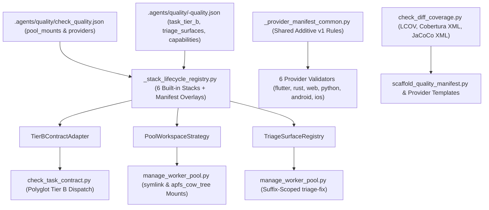

# Open-Closed Polyglot Lifecycle and Quality Architecture Design

- **Date**: 2026-11-27
- **Epic Slug**: `polyglot_lifecycle_and_quality_architecture`
- **Status**: Draft (Pending Gate 1 Approval)
- **PIC**: duvthinh403
- **Selected Approach**: Approach A — Typed Python Registry with Manifest Overlays and Shared Additive Validator Helper
- **Reference Inputs (Read-Only)**: `nexus` commit `49a6ee7a` (`polyglot-quality-lifecycle-handoff.md` and `scripts/check_lcov_threshold.py`)

## Table of Contents

- [Problem Statement and Goals](#problem-statement-and-goals)
- [Shared Contract Warnings](#shared-contract-warnings)
- [System Architecture Overview](#system-architecture-overview)
- [Component 1 Declarative Stack Lifecycle Registry](#component-1-declarative-stack-lifecycle-registry)
- [Component 2 Portable Multi-Format Diff-Coverage Engine](#component-2-portable-multi-format-diff-coverage-engine)
- [Component 3 Unified Quality Schemas Validators and Scaffolder](#component-3-unified-quality-schemas-validators-and-scaffolder)
- [Component 4 Lifecycle Documentation and Tier C1 vs Tier C2 Standardization](#component-4-lifecycle-documentation-and-tier-c1-vs-tier-c2-standardization)
- [Failure Modes and Risk Mitigations](#failure-modes-and-risk-mitigations)
- [Verification and Testing Strategy](#verification-and-testing-strategy)
- [Non-Goals and Boundaries](#non-goals-and-boundaries)

## Problem Statement and Goals

The `d3nexus` toolkit in `ai-agent-tools` orchestrates `dev-lifecycle`, `dev-designer`, `dev-implementation`, `setup_quality_check`, and `quality_check` across polyglot mobile, web, systems, and backend repositories (`python`, `flutter`, `rust`, `web`, `android`, `ios`). Production hardening on the `nexus` repository (`49a6ee7a`) exposed five structural gaps where lifecycle automation remained Python-centric or brittle across stacks:

1. **Python-only Tier B enforcement**: `skills/dev-implementation/resources/scripts/check_task_contract.py` only inspects Python tasks (`check_python_tier_b`) and misses Flutter/Dart, Rust, Web, Android, and iOS static-gate coverage as well as polyglot tasks touching multiple languages.
2. **Destructive cache symlinking in worker pools**: `skills/dev-implementation/resources/scripts/manage_worker_pool.py` symlinks `.dart_tool` as a directory symlink, which breaks `.gitignore` directory rules (`.dart_tool/`) in Flutter/Melos workspaces and fails to copy nested package `.dart_tool/` trees or gitignored secrets (`secureFiles/`, `local.properties`, `*.xcconfig`).
3. **Unsuffix-scoped Tier 1 risk triage**: `manage_worker_pool.py` applies a single global Python-biased regex set during `triage-fix` regardless of file extension, missing Dart/Rust/Web/Kotlin/Swift surfaces and risking cross-stack false positives, while `_is_test_file()` omits Dart, Rust, Kotlin, and Swift test patterns.
4. **Missing portable diff-coverage and uneven provider contracts**: Hunk-level diff-coverage enforcement only exists as a repo-local script in `nexus`, `web-quality-check` lacks a formal JSON schema, `check-quality.schema.json` and provider validators reject additive hooks (`pool_mounts`, `task_tier_b`, `triage_surfaces`, `standards_catalog`, dual-floor coverage, unified audit/security capabilities), and `scaffold_quality_manifest.py` still emits destructive Android `"cleanup": ["pkill", "-9", "java"]`.
5. **Python-hardcoded lifecycle docs and ambiguous Tier C boundary**: `dev-designer` and `dev-implementation` docs hardcode `uv run pytest` and conflate fast host/VM subcutaneous integration (`Tier C1`) with device/simulator/Playwright E2E (`Tier C2`).

### Design Goals

- **Strict Open-Closed extensibility**: Support all 6 built-in stack families (`python`, `flutter`, `rust`, `web`, `android`, `ios`) out of the box with zero cross-stack coupling, and allow any consumer repo to override or extend behavior purely through `.agents/quality/<stack>-quality.json` and `.agents/quality/check_quality.json`.
- **Zero third-party dependencies**: All kit runtime scripts remain Python 3 stdlib only.
- **Additive v1 backwards compatibility**: Existing consumer manifests (`D3Nexus`, `lyrics-sync`, `nexus`, `ai-agent-tools`) continue to validate with `PASS` without forced migration; `setup_quality_check` scaffolds the complete upgraded contract by default.

## Shared Contract Warnings

- `ai-agent-tools` is a self-contained plugin kit repository and has **no `shared-contracts/` directory or symlink**.
- No Hub (`D3Nexus`) or Satellite (`lyrics-sync`, `nexus`) wire contracts, API payloads, or adjacent repository files are modified by this epic.
- Read-only reference files from `nexus` (`polyglot-quality-lifecycle-handoff.md` and `scripts/check_lcov_threshold.py`) were inspected strictly as design inputs; no writes occur outside `ai-agent-tools`.

## System Architecture Overview



### Module Ownership and Dependency Boundaries

| Component | Path | Responsibility | Depends On |
| :--- | :--- | :--- | :--- |
| Stack Lifecycle Registry | `skills/dev-implementation/resources/scripts/_stack_lifecycle_registry.py` | Frozen 6-stack descriptors, manifest overlay loading, `TierBContractAdapter`, `PoolWorkspaceStrategy`, `TriageSurfaceRegistry` | Python 3 stdlib only |
| Task Contract Checker | `skills/dev-implementation/resources/scripts/check_task_contract.py` | Task frontmatter/section/verification validation; delegates Tier B checks to `TierBContractAdapter` | `_stack_lifecycle_registry.py` |
| Worker Pool Manager | `skills/dev-implementation/resources/scripts/manage_worker_pool.py` | Slot lifecycle, cache mounts, clean/staging exclusions, Tier 1 diff triage | `_stack_lifecycle_registry.py` |
| Portable Diff-Coverage CLI | `skills/quality_check/resources/scripts/check_diff_coverage.py` | Multi-format coverage parser (`lcov`, `cobertura`, `jacoco`) + hunk-level git diff-coverage & dual-floor evaluator | Python 3 stdlib + `git` |
| Shared Provider Validator Helper | `skills/quality_check/resources/scripts/_provider_manifest_common.py` | Additive v1 validation for `standards_catalog`, `task_tier_b`, `triage_surfaces`, `extensions`, dual-floor `coverage`, unified capabilities, 4 profiles | Python 3 stdlib only |
| Registry & Provider Validators | `skills/quality_check/resources/scripts/validate_quality_contract.py` + 6 `validate_*_quality.py` | Validate `check_quality.json` (`pool_mounts`) and each stack manifest against v1 schemas | `_provider_manifest_common.py` |
| Scaffolder & Schemas | `skills/setup_quality_check/resources/scripts/scaffold_quality_manifest.py` + 7 JSON schemas | Auto-detect stacks and scaffold full 4-profile unified manifests with portable diff-coverage | Python 3 stdlib only |

## Component 1 Declarative Stack Lifecycle Registry

Location: `skills/dev-implementation/resources/scripts/_stack_lifecycle_registry.py` (Python 3 stdlib only).

### Core Data Model

- `StackDescriptor` (frozen dataclass):
  - `stack_id: str` (`python`, `flutter`, `rust`, `web`, `android`, `ios`, or custom manifest id)
  - `extensions: tuple[str, ...]` (normalized lowercase with leading dot)
  - `test_path_patterns: tuple[str, ...]` (suffix/path test classifiers for `_is_test_file`)
  - `default_tier_b: TierBPolicy`
  - `default_surfaces: SurfaceRuleSet`
- `PoolMountRule` (frozen dataclass):
  - `path: str` (relative path or glob pattern from repo root)
  - `mode: Literal["symlink", "cow_copy"]`
  - `optional: bool = True`
- `SurfaceRuleSet` (frozen dataclass):
  - `signature: tuple[re.Pattern[str], ...]`
  - `api_wire: tuple[re.Pattern[str], ...]`
  - `persistence: tuple[re.Pattern[str], ...]`
  - `concurrency: tuple[re.Pattern[str], ...]`
  - `test_weakening: tuple[re.Pattern[str], ...]`
  - `test_assertion: tuple[re.Pattern[str], ...]`

### Built-In 6-Stack Matrix

#### 1. `TierBContractAdapter` (consumed by `check_task_contract.py`)

Dispatch algorithm:
1. Extract all paths from `Allowed files` (stripping `(new)` / `(existing)` annotations while recording whether new files exist) and derive the unique lowercase file suffix set.
2. Scan `.agents/quality/*-quality.json` in `repo_root` (if `repo_root` is available):
   - If one or more provider manifests exist, resolve active stacks by intersecting the task's `Allowed files` extensions against active manifests (matching built-in stack ids from `<stack>-quality.json` plus any custom manifest declaring `"extensions"`).
   - If **no** `.agents/quality/*-quality.json` manifests exist at all (e.g., standalone unit test fixtures or legacy Python repos), preserve the existing legacy `check_python_tier_b` fallback when `.py` files are touched.
3. Evaluate every matched stack independently (supporting polyglot single tasks touching `.rs` + `.ts`, `.py` + `.js`, or `.dart` + `.rs`/`.kt`/`.swift`) while guaranteeing **0% invocation on untouched stacks**.
4. Reuse `_split_sequential_subcommands()` (splitting `&&` and `;` outside quotes) so compound verification commands match capability prefixes cleanly across all 6 stacks.
5. Honor optional `"task_tier_b"` overrides in `.agents/quality/<stack>-quality.json`:
   - `format_prefixes: list[str]`, `lint_prefixes: list[str]`, `typecheck_prefixes: list[str]`, `boundary_prefixes: list[str]`, `boundary_triggers: list[str]` (path substrings/filenames), `require_all_allowed_files_in_format: bool`.

Built-in default Tier B contracts per stack:

| Stack | Extensions | Mandatory Format / Lint / Typecheck Rows | Conditional Boundary Check Triggers |
| :--- | :--- | :--- | :--- |
| `flutter` | `.dart` | `dart format` covering all `.dart` `Allowed files` (including `(new)` files before `git add`) or workspace `dart format --output=none --set-exit-if-changed`; `dart analyze` or `flutter analyze` | When `domain/` or `pubspec.yaml` is in `Allowed files`: require configured boundary/hygiene check (`boundaries`, `architecture`, or `melos run` boundary script) |
| `rust` | `.rs` | `cargo fmt --check` (or `cargo fmt --all -- --check`); `cargo clippy` with `-D warnings` | When `Cargo.toml` or `domain` crate paths are in `Allowed files`: require `xtask` / configured `architecture` boundary check |
| `web` | `.ts`, `.tsx`, `.js`, `.mjs`, `.astro` | Configured linter/guard (`eslint`, `biome`, `npm run lint`, `check_vanilla_js.py`, or manifest `lint` capability) and type-checker (`tsc --noEmit`, `astro check`, `npm run check`, or manifest `type_check` capability) | Optional via manifest `task_tier_b.boundary_triggers` |
| `python` | `.py` | Full `Allowed files` coverage in `ruff check`, `ruff format --check`, and `mypy`/`pyright`/`ty` | When cross-module/package changes touch `pyproject.toml` or multiple top-level packages and `architecture`/`lint-imports` is configured: require `lint-imports` / `architecture` check |
| `android` | `.kt`, `.kts` | `spotlessCheck` and `detekt` (via `./gradlew` or `gradle`) | When `domain/` or public ABI (`*.api` / `public` API modules) change: require `:konsist-test:test` / `apiCheck` (or configured `architecture`/`bcv` capability) |
| `ios` | `.swift` | `swiftformat --lint` and `swiftlint lint --strict` | When `domain/` or `Project.swift`/`Package.swift` change: require `ArchTests` or `check_module_boundaries.sh` (or configured `architecture`/`boundaries` capability) |

#### 2. `PoolWorkspaceStrategy` (consumed by `manage_worker_pool.py`)

Replaces the flat `CACHE_DIR_CANDIDATES` symlink loop with a declarative two-mode strategy:

- **`symlink` mode** (O(1) shared binary/package caches at slot root):
  - `target`, `node_modules`, `.astro`, `.venv`, `.gradle`, `.build`, `Pods`
- **`cow_copy` (`apfs_cow_tree`) mode** (copy-on-write directory/file tree clone via `cp -c -R` on macOS Darwin with automatic fallback to `shutil.copytree` / `shutil.copy2` on Linux or cross-volume APFS failure — **never a symlink** so `.gitignore` directory rules like `.dart_tool/` remain intact):
  - Root `.dart_tool`
  - Nested Melos/Flutter `.dart_tool` directories discovered dynamically in `main_wt`: `packages/*/.dart_tool`, `features/*/.dart_tool`, `bricks/*/hooks/.dart_tool`
  - Gitignored local secrets/configs when present in `main_wt` and ignored by git: `secureFiles`, `local.properties`, `android/local.properties`, `*.xcconfig`, `ios/Flutter/*.xcconfig`, `macos/Flutter/*.xcconfig`
- **Manifest extensibility**: Reads optional `"pool_mounts"` array from `.agents/quality/check_quality.json` where each entry is `{"path": "<rel-path-or-glob>", "mode": "symlink" | "cow_copy"}`. Security invariant: reject any path containing `..` or absolute paths escaping the repository root.
- **Git clean, snapshot, triage, and staging isolation**:
  - `PoolWorkspaceStrategy.get_excluded_relpaths(slot_path, main_wt)` returns every active mounted path (both symlinked and `cow_copy` materialized paths) so:
    1. `sync_slot()` passes `-e <path>` to `git clean -fd` for every active mount.
    2. `capture_slot_tree_sha()` excludes every active mount from the temporary `GIT_INDEX_FILE`.
    3. `triage_fix_slot()` passes `:(exclude)<path>` to `git diff`.
    4. `finalize_slot()` unstages any mounted path (whether symlink or `cow_copy`) before committing, preventing accidental secret or `.dart_tool` commits.

#### 3. `TriageSurfaceRegistry` (consumed by `manage_worker_pool.py` `triage-fix`)

Scopes every `SurfaceRuleSet` strictly by `Path(changed_file).suffix.lower()` (zero cross-firing across stacks):

| Suffixes | `signature` | `api_wire` | `persistence` | `concurrency` | `test_weakening` (added lines in test files) |
| :--- | :--- | :--- | :--- | :--- | :--- |
| `.dart` | `MethodChannel\|EventChannel\|@HostApi\|@FlutterApi\|ffi\.` | `@RestApi\|@GET\|@POST\|fromJson` | `DriftDatabase\|outbox_entries` | `Isolate\.\|Completer<` | `skip:\s*(?:true\|['"])` |
| `.rs` | `pub\s+(?:async\s+)?(?:fn\|struct\|enum\|trait)` | `unsafe\b\|extern\s+"C"` | `sqlx::query\|SELECT\|INSERT\s+INTO` | `tokio::spawn\|Mutex\|RwLock` | `#\[ignore\b` |
| `.ts`, `.tsx`, `.js`, `.mjs`, `.astro` | `export\s+(?:async\s+)?(?:function\|class\|interface\|type)` | `fetch\(\|WebSocket\|EventSource` | `indexedDB\|localStorage` | `Worker\(\|SharedArrayBuffer` | `\.(?:skip\|fixme)\(` |
| `.kt`, `.kts` | `(?:suspend\s+)?fun\s+\|interface\s+` | `@(?:GET\|POST\|PUT\|DELETE\|Entity\|Dao)\b\|MethodChannel` | `RoomDatabase\|SQLiteDatabase` | `Mutex\|CoroutineScope\|Dispatchers\.` | `@(?:Ignore\|Disabled)\b` |
| `.swift` | `public\s+(?:func\|struct\|class\|protocol\|enum\|actor)` | `Codable\|URLSession\|FlutterMethodChannel` | `@Model\|NSManagedObject\|sqlite3` | `\bactor\s+\|Task\.detached\|NSLock` | `XCTSkip\|@Test\([^)]*\.disabled` |
| `.py` | Existing Python `def`/`class` public signature rules | Existing FastAPI/router/Pydantic rules | Existing SQLAlchemy/SQL/Alembic rules | Existing `asyncio`/lock/thread rules | Existing `pytest.mark.skip`/`xfail`/`unittest.skip` rules |

Additional polyglot test-file classification (`_is_test_file`):
- Directory markers: `/tests/`, `/test/`, `/__tests__/`, `/integration_test/`, `/androidTest/`, `/UnitTests/`, `/UITests/`.
- Filename markers: `test_*.py`, `*_test.py`, `*_test.dart`, `*_test.rs`, `*.test.*`, `*.spec.*`, `*Test.kt`, `*Tests.kt`, `*Spec.kt`, `*Test.swift`, `*Tests.swift`.
- Assertion regexes extended per suffix so test assertion weakening counts `expect(`, `assert_eq!`, `assert!`, `assertEquals`, `assertTrue`, `XCTAssert`, `#expect(`, `verify(` alongside Python `assert`.
- Optional `"triage_surfaces"` object in `.agents/quality/<stack>-quality.json` can append or override regex lists per category (`signature`, `api_wire`, `persistence`, `concurrency`, `test_weakening`) for that stack's extensions; invalid regexes are flagged during manifest validation rather than crashing at triage time.

## Component 2 Portable Multi-Format Diff-Coverage Engine

Location: `skills/quality_check/resources/scripts/check_diff_coverage.py` (Python 3 stdlib only; referenced via `{skills_dir}/quality_check/resources/scripts/check_diff_coverage.py`).

### Capabilities and CLI Contract

Ported and generalized from `nexus/scripts/check_lcov_threshold.py` with modular format adapters feeding a unified `CoverageDataset` (`da_by_file: dict[str, dict[int, int]]`, `fallback_by_file: dict[str, tuple[int, int]]`):

- **Supported Formats** (`--format auto|lcov|cobertura|jacoco`, default `auto`):
  - **LCOV**: `SF:` / `DA:` / `LF:` / `LH:` (Flutter `lcov.info`, Rust `cargo llvm-cov --lcov`, Web Vitest/V8/Istanbul LCOV, Swift `llvm-cov export -format=lcov`).
  - **Cobertura XML**: `<packages>/<package>/<classes>/<class filename="...">/<lines>/<line number="..." hits="..."/>` (Python `pytest --cov --cov-report=xml`, JS/TS Cobertura).
  - **JaCoCo XML**: `<report>/<package name="...">/<sourcefile name="...">/<line nr="..." ci="..." mi="..."/>` (Android/Kotlin `./gradlew jacocoTestReport`, where covered hits = `1 if ci > 0 else 0`).
- **Auto-detection**: Inspects XML root tag (`<coverage>` -> `cobertura`, `<report>` -> `jacoco`) or LCOV markers (`SF:` / `end_of_record` -> `lcov`), emitting a clear error exit code `2` on unreadable/unknown formats.
- **CLI Flags**:
  - `report_files...` (one or more coverage report paths, merged cleanly with `max` hit count per `(file, line)`)
  - `--format {auto,lcov,cobertura,jacoco}`
  - `--repo-root <path>` (default `.`)
  - `--source-root <prefix>` (repeatable prefix for resolving relative `<class filename>` / JaCoCo package paths)
  - `--min-coverage <float>` (workspace overall line coverage floor, `0..100` or `0..1` normalized cleanly; default `0.0` when running diff-only)
  - `--min-package-coverage <float>` (optional per-package floor)
  - `--exclude-package-floor <pkg>` (repeatable package name excluded from per-package floor)
  - `--package-group <dir>` (repeatable workspace subpackage root prefix; defaults include `packages`, `features`, `crates`, `apps`, `services`, `modules`, `libs`, `src`)
  - `--diff-base <git-ref>` (computes `git merge-base <diff-base> HEAD` + `git diff -U0` + untracked source files)
  - `--diff-files <path>` (repeatable explicit file override for deterministic unit testing without git)
  - `--min-diff-coverage <float>` (hunk-level diff coverage floor, e.g., `80.0`)
  - `--source-ext <.ext>` (repeatable extension filter for diff-coverage; defaults to all 6 stacks' source extensions when omitted)
  - `--exclude-suffix <suffix>` (repeatable generated-code exclusion; sensible multi-stack defaults including `.g.dart`, `.freezed.dart`, `.gen.dart`, `.pb.dart`, `.pb.rs`, `.pb.swift`, `.d.ts`, `GeneratedPluginRegistrant.swift`)
  - `--json` (optional machine-readable JSON summary output for provider ingestion)
- **Untested New-File Fallback**: Retains `nexus`'s conservative heuristic counting executable non-comment/non-brace lines when a newly added source file is completely absent from coverage reports, generalized for `#` (Python), `//` / `/* */` (Dart/Rust/TS/JS/Kotlin/Swift), and brace-only/annotation-only lines so adding uncovered production files cannot bypass diff coverage.
- **Exit Codes**: `0` = PASS, `1` = FAIL (threshold breach), `2` = BLOCKED/usage error (missing file, malformed report, invalid git ref).

## Component 3 Unified Quality Schemas Validators and Scaffolder

### 1. Registry Contract (`check-quality.schema.json` and `validate_quality_contract.py`)

- Allow optional top-level `"pool_mounts"` in `.agents/quality/check_quality.json`:
  ```json
  {
    "pool_mounts": [
      { "path": "packages/*/.dart_tool", "mode": "cow_copy" },
      { "path": "target", "mode": "symlink" }
    ]
  }
  ```
- Validate each `pool_mounts` entry: `path` must be a non-empty relative string without `..` path traversal or leading `/`; `mode` must be `"symlink"` or `"cow_copy"`.
- Preserve `schema_version: 1` and all existing `providers` validation behavior.

### 2. Shared Additive v1 Provider Contract (`_provider_manifest_common.py` + 6 Provider Schemas & Validators)

Create `skills/quality_check/resources/scripts/_provider_manifest_common.py` and update all 6 provider skills (`flutter`, `rust`, `web`, `python`, `android`, `ios`):

- **Add missing schema**: Create `skills/web-quality-check/resources/schemas/web-quality.schema.json` matching the draft `2020-12` conventions of the other 5 providers.
- **4 Profiles across all 6 schemas**: `pr`, `epic`, `scheduled`, `release` (keep `required: ["pr", "epic"]` so existing repos remain valid; `scheduled` and `release` are optional in validation and always generated by `setup_quality_check`).
- **Unified Additive Capabilities across all 6 schemas**:
  - `anti_stub`, `security`, `security_deps`, `pr_diff_audit`, `workspace_audit` (invoked with `--all-files`), `pr_impact`, `workspace_impact` (invoked with `--all-files`), plus existing stack-native capabilities (`format`, `lint`, `clippy`, `check`, `type_check`, `analyze`, `architecture`, `boundaries`, `bcv`, `test`, `test_unit`, `test_e2e`, `ui_review`, `coverage`, `acceptance`, `contracts`, `contract_diff`, `^contracts_[a-z0-9_]+$`).
  - Keep Android `cleanup` optional in `android-quality.schema.json` strictly for backwards compatibility with existing consumer repositories, while removing `"cleanup": ["pkill", "-9", "java"]` from `scaffold_quality_manifest.py`, `valid_android_quality.json`, and `android-quality-check/SKILL.md`.
- **Dual-Floor `coverage` Object**:
  - Required: `command` (`string[]`), `threshold` (`0..1`).
  - Optional additive fields: `min_package_coverage` (`0..1`), `exclude_package_floor` (`string[]`), `min_diff_coverage` (`0..1`), `diff_base` (`string`), `lcov_path` / `report_path` / `profdata_path` (`string`).
- **Optional Top-Level Additive Keys across all 6 Provider Schemas & Validators**:
  - `standards_catalog` (`string`, relative path e.g. `.agents/quality/standards_catalog.json` — validated as non-empty relative path without `..`).
  - `extensions` (`string[]`, each matching `^\.[a-z0-9]+$`).
  - `task_tier_b` (object with optional `format_prefixes`, `lint_prefixes`, `typecheck_prefixes`, `boundary_prefixes`, `boundary_triggers`, `require_all_allowed_files_in_format`).
  - `triage_surfaces` (object mapping `signature | api_wire | persistence | concurrency | test_weakening` to `string[]` of valid regex patterns, compiled and verified during validation).
- **Provider SKILL.md & Reference Updates**:
  - Update each of the 6 `*-quality-check/SKILL.md` files (keeping strictly `name` + `description` frontmatter) to document the 4 profiles, unified capabilities, dual-floor coverage / `check_diff_coverage.py`, `standards_catalog.json`, and optional `task_tier_b`/`triage_surfaces` hooks.
  - Ensure every new file under `skills/` (`_provider_manifest_common.py`, `check_diff_coverage.py`, `web-quality.schema.json`, `_stack_lifecycle_registry.py`) is referenced by a skill `SKILL.md` or tracked script so `scripts/verify.sh` §8 passes.

### 3. `setup_quality_check` Scaffolder and Templates

Update `skills/setup_quality_check/resources/scripts/scaffold_quality_manifest.py`, `skills/setup_quality_check/SKILL.md`, and templates (`polyglot-check-quality.template.json`, `web-quality.template.json`):

- Scaffold all **4 profiles** (`pr`, `epic`, `scheduled`, `release`) for every detected stack (`flutter`, `rust`, `web`, `python`, `android`, `ios`) and in `check_quality.json`.
- Scaffold unified capability placeholders/commands:
  - `pr`: fast static + unit + `pr_diff_audit` + `pr_impact` + `anti_stub` + `security` + diff-coverage command (using `{skills_dir}/quality_check/resources/scripts/check_diff_coverage.py`).
  - `epic`: full static + boundaries/architecture + test + dual-floor `coverage` + `anti_stub` + `security` + `pr_diff_audit` + `pr_impact`.
  - `scheduled`: full workspace sweep adding `security_deps`, `workspace_audit` (`--all-files`), `workspace_impact` (`--all-files`).
  - `release`: strict release gate combining `epic` + `security_deps` + `workspace_audit` + `workspace_impact`.
- Scaffold `"standards_catalog": ".agents/quality/standards_catalog.json"` and a starter `.agents/quality/standards_catalog.json` when absent (without overwriting existing files).
- Scaffold stack-appropriate `"pool_mounts"` in `check_quality.json` when Flutter (`packages/*/.dart_tool`, `.dart_tool` with `cow_copy`) or mobile secret configs are detected.
- **Remove** `"cleanup": ["pkill", "-9", "java"]` from Android scaffolding completely.

## Component 4 Lifecycle Documentation and Tier C1 vs Tier C2 Standardization

Update four lifecycle instruction files (preserving frontmatter rules and `d3nexus:` namespace):

1. `skills/dev-designer/SKILL.md`
2. `skills/dev-designer/references/verification-rows.md`
3. `skills/dev-implementation/SKILL.md`
4. `skills/dev-implementation/references/worker-execution-rules.md`

### Required Documentation Updates

- Replace hardcoded Python-only fixer/tier examples (`uv run pytest ...`) with a concise 6-stack platform-mapped command table (`python`, `flutter`, `rust`, `web`, `android`, `ios`).
- Explicitly standardize the **Tier C1 vs Tier C2** split:
  - **`Tier C1` (Mandatory Subcutaneous / Host-VM Integration, `< 5s`)**: Runs in every task/epic without hardware or browser infrastructure — e.g., `flutter test test/integration/*_integration_test.dart` (in-memory Drift/BLoC/widget integration), `cargo nextest run --test '*'` (Rust integration tests), Vitest/Node wire & DOM contract tests (Web), `uv run pytest tests/integration/` (Python), JVM/Robolectric integration tests (Android), `swift test` / XCTest host integration (iOS).
  - **`Tier C2` (`Needs:`-Gated Live E2E / Device / Browser)**: Requires external runtime declared via `Needs:` (`device`, `simulator`, `emulator`, `playwright`, `docker`) — e.g., Flutter `integration_test/` on simulator/emulator, Playwright headless Chromium E2E, Android `connectedCheck`, iOS `xcodebuild test` on Simulator, live DB/network E2E.
- Document `TierBContractAdapter` polyglot verification row requirements, `PoolWorkspaceStrategy` (`symlink` vs `apfs_cow_tree`), `TriageSurfaceRegistry` suffix isolation, and `{skills_dir}/quality_check/resources/scripts/check_diff_coverage.py` invocation in `verification-rows.md` and `worker-execution-rules.md`.

## Failure Modes and Risk Mitigations

| Risk / Failure Mode | Root Cause | Mitigation |
| :--- | :--- | :--- |
| APFS clone failure (`cp -c -R`) on Linux or cross-filesystem mounts | `cp -c` is macOS APFS-only and fails on ext4/tmpfs or cross-volume copies | Detect `sys.platform == "darwin"`, probe `cp -c -R` and gracefully fall back to `shutil.copytree(..., symlinks=False, dirs_exist_ok=True)` on non-zero returncode |
| Accidental staging/commit of `cow_copy` secrets (`secureFiles/`, `local.properties`, `*.xcconfig`) or `.dart_tool` | Unlike symlinks, real copied files inside a slot can be swept by `git add -A` if not gitignored or explicitly excluded | Exclude every active mount path across all 4 pool operations (`sync_slot` `git clean -fd -e`, `capture_slot_tree_sha`, `triage_fix_slot`, and `finalize_slot` unstage) and never copy tracked files |
| Path traversal via malicious `"pool_mounts"` or `"standards_catalog"` | User-edited JSON containing `../` or `/etc/...` | Validate all relative paths with `Path.resolve().is_relative_to(repo_root)` and reject `..` or absolute paths in both validators and `PoolWorkspaceStrategy` |
| Breaking existing consumer manifests or existing kit tests | Tightening schema `required` arrays or removing accepted legacy keys | Strict additive v1 compatibility: new profiles/capabilities/fields are optional in schemas and validators; existing fixtures pass unchanged |
| Cross-stack false positives in `TierBContractAdapter` or `TriageSurfaceRegistry` | Matching global regexes or activating stacks not present in `Allowed files` | Strict suffix scoping in `TriageSurfaceRegistry` and exact intersection of `Allowed files` suffixes with active manifests in `TierBContractAdapter` |
| `scripts/verify.sh` §8 orphan file check or §5 forbidden prefix check | New scripts/schemas unreferenced in `SKILL.md` or accidental `superpowers:` string | Reference every new script/schema in its owning `SKILL.md`, run `check_document.py`, and run `bash scripts/verify.sh --full` |

## Verification and Testing Strategy

All new and modified code will be covered by automated pytest suites registered in `scripts/verify.sh`:

1. **`tests/test_stack_lifecycle_registry.py`**:
   - Unit tests for all 6 built-in stacks (`TierBContractAdapter`, `PoolWorkspaceStrategy`, `TriageSurfaceRegistry`).
   - Manifest overlay tests (`task_tier_b`, `triage_surfaces`, `pool_mounts`, custom 7th stack via `extensions`, path traversal rejection).
2. **`tests/test_check_task_contract.py` (extended)**:
   - Polyglot single-task dispatch (`.rs` + `.ts`, `.py` + `.js`, `.dart` + `.rs`/`.kt`/`.swift`), 0% invocation on untouched stacks, `(new)` `.dart`/`.py` coverage, chained `&&`/`;` subcommand matching, conditional boundary triggers, and legacy Python fallback when no `.agents/quality/*-quality.json` exists.
3. **`tests/test_manage_worker_pool.py` (extended)**:
   - `apfs_cow_tree` / fallback copy for `.dart_tool`, `packages/*/.dart_tool`, `features/*/.dart_tool`, `bricks/*/hooks/.dart_tool`, `secureFiles/`, `local.properties`, `*.xcconfig`, and custom `pool_mounts`; symlink preservation for `target`/`node_modules`/`.venv`/etc.; verifying none are deleted by `sync_slot` or staged/committed by `finalize_slot`.
   - Suffix-scoped `triage-fix` verifying every stack's 5 surface categories trigger on matching suffixes and never cross-fire on other suffixes, plus polyglot `_is_test_file` and assertion weakening checks.
4. **`tests/test_check_diff_coverage.py`**:
   - Fixture tests for **LCOV**, **Cobertura XML**, and **JaCoCo XML** (auto-detection + explicit `--format`), hunk-level `--diff-base` / `--diff-files`, `--min-diff-coverage`, dual-floor (`--min-coverage`, `--min-package-coverage`, `--exclude-package-floor`), `--source-ext`, generated-code exclusions, and untracked new-file fallback detection.
5. **Schema, Validator & Scaffolder tests** (extended across `validate_quality_contract`, all 6 `test_validate_*_quality.py`, and `test_scaffold_quality_manifest.py`):
   - Validate additive v1 fields (`pool_mounts`, `standards_catalog`, `task_tier_b`, `triage_surfaces`, dual-floor `coverage`, unified capabilities, 4 profiles), verify legacy manifests still pass, verify `web-quality.schema.json` matches fixtures, verify Android scaffolder omits `pkill -9 java`.
6. **Full Quality Gate**:
   - `bash scripts/verify.sh --full`
   - `@quality_check` (`profile: epic` — `ruff format --check`, `ruff check`, `mypy`, `pytest tests`, `verify.sh`) with `PASS` and 0 findings.

## Non-Goals and Boundaries

- **No changes outside `ai-agent-tools`**: Consumer repositories (`nexus`, `D3Nexus`, `lyrics-sync`) are not modified in this epic.
- **No `git push` or automated release**: `scripts/release.sh` and `git push` are strictly excluded; handoff will output the exact local sync command for `/Users/danhdueexoictif/.gemini/config/plugins/d3nexus` after merge.
- **No third-party Python packages**: Keep zero external runtime dependencies (`jsonschema` is not required at runtime; validators use Python stdlib).
- **No destructive live tool invocations in unit tests**: All tests run hermetic against temporary directories/git repos without requiring Dart, Cargo, Gradle, Xcode, or Playwright binaries on the test host.
