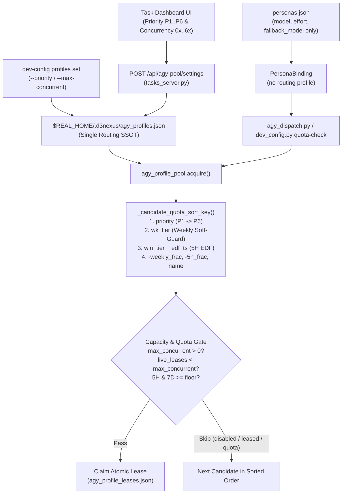

# Priority-Only Agy Pool Routing and Multi-Platform Dispatch Specification

- **PIC**: tess
- **Date**: 2026-11-28
- **Status**: Draft (Gate 1 Review)
- **Repository**: `ai-agent-tools` (from `main` at `615cb83`)
- **Scope**: Remove persona `preferred_profile` (`_preferred_first` and `dev-config set --profile`) so pooled `agy` dispatch strictly obeys Task Dashboard `priority` and `max_concurrent`, paired with a complete routing audit across AI Provider CLIs and workspace engineering platforms

## Table of Contents

- [Overview and Goals](#overview-and-goals)
- [Shared Contract Warnings](#shared-contract-warnings)
- [Root Cause Analysis](#root-cause-analysis)
- [Architecture and Candidate Ordering](#architecture-and-candidate-ordering)
- [Component Specifications](#component-specifications)
- [AI Provider and Runtime CLI Routing Report](#ai-provider-and-runtime-cli-routing-report)
- [Workspace Repository and Engineering Platform Report](#workspace-repository-and-engineering-platform-report)
- [Error Handling and Backward Compatibility](#error-handling-and-backward-compatibility)
- [Testing and Verification Strategy](#testing-and-verification-strategy)
- [Zero-Impact Safety Boundaries](#zero-impact-safety-boundaries)

## Overview and Goals

During parallel Stage 3 and Gate 4 execution across multi-repository workspaces, Antigravity (`agy`) headless tasks concentrated heavily onto a single account (`khangatuaon248`, Priority `P2`, `max_concurrent = 6`) even while `tess` was configured at **Priority `P1`** (`max_concurrent = 6`) and completely idle on the Task Dashboard (`check-tasks --ui`). Changing profile priorities on the Task Dashboard had no effect until all six concurrent slots on `khangatuaon248` were saturated or exhausted.

### Goals

1. **Single Source of Truth for Pool Routing**: Make `$REAL_HOME/.d3nexus/agy_profiles.json` (managed live via the Task Dashboard `🔑 Agy Profile Pool` panel and `dev-config profiles set`) the **sole** control plane for Antigravity profile selection order (`priority`) and slot capacity (`max_concurrent`).
2. **Eliminate `_preferred_first` Pre-Sort Hijack**: Remove `_preferred_first()` and the `preferred_profile` parameter from [agy_profile_pool.py](../../../scripts/agy_profile_pool.py), [agy_dispatch.py](../../../scripts/agy_dispatch.py), and [dev_config.py](../../../scripts/dev_config.py).
3. **Retire `dev-config set --profile` Safely**: Remove `--profile` from `dev-config set` while tolerating and ignoring legacy `"profile"` keys already present on disk in `$REAL_HOME/.d3nexus/personas.json` or `.agents/config/personas.json` with a non-blocking warning in `dev-config status`.
4. **Clean Global Host Configuration**: Strip `"profile": "khangatuaon248"` from all three persona overrides (`ai_architect_reviewer`, `orchestrator`, `programmer`) in `$REAL_HOME/.d3nexus/personas.json`.
5. **Deliver Unified Multi-Platform Audit**: Document exact account selection, concurrency, and quota gate mechanics across all five AI Provider CLIs (`agy`, `claude`, `codex`, `kiro`, `ollama`) and all six workspace engineering platforms (`Python`, `Rust`, `Flutter`, `Android`, `iOS`, `Web`).

### Non-Goals

- Changing `dev-config low-quota --profile <name>` or `resume_context.py --profile <name>` (those scope turn-budget throttling and IDE window-title PIC detection, not pool candidate ordering).
- Adding multi-account pooling to single-session CLIs (`claude`, `codex`, `kiro`) or local `ollama`.
- Modifying external review `run_external_review.py` provider priority rules (covered separately in the report section for architectural visibility).

## Shared Contract Warnings

None — `ai-agent-tools` is the standalone agent kit repository and does not contain a `shared-contracts/` directory or symlink.

## Root Cause Analysis

Inspection of the live configuration and dispatch call chain revealed two compounding causes:

### Hidden Persona Override Pinning

In `$REAL_HOME/.d3nexus/personas.json`, every persona override explicitly pinned `"profile": "khangatuaon248"`:

```json
{
  "overrides": {
    "ai_architect_reviewer": {
      "model": "carbon",
      "effort": "medium",
      "profile": "khangatuaon248"
    },
    "orchestrator": {
      "model": "carbon",
      "effort": "medium",
      "profile": "khangatuaon248"
    },
    "programmer": {
      "model": "neon",
      "effort": "xhigh",
      "profile": "khangatuaon248"
    }
  }
}
```

On the Web Task Dashboard ([tasks_dashboard.html](../../../skills/check-tasks/resources/dashboard/tasks_dashboard.html), `buildPersonaBindingsHtml()`), the `🎭 Persona Bindings` card renders `persona`, `alias (cli)`, `model_id`, `effort`, and `sources.model`, but omits `b.profile`. As a result, the global pin remained invisible in the browser UI while the `🔑 Agy Profile Pool` card displayed `tess` at `P1` (`6x`) and `khangatuaon248` at `P2` (`6x`).

### Unconditional Priority Bypass in `_preferred_first`

In [agy_profile_pool.py](../../../scripts/agy_profile_pool.py), `_order_pool_candidates()` first sorts pool entries correctly by `(priority, wk_tier, win_tier, edf_ts, ...)` via `_candidate_quota_sort_key()`, and then calls `_preferred_first(ordered, preferred_profile)`:

```python
def _order_pool_candidates(...) -> list[dict[str, Any]]:
    ordered = sorted(pool, key=lambda entry: _candidate_quota_sort_key(...))
    return _preferred_first(ordered, preferred_profile)

def _preferred_first(pool: list[dict[str, Any]], preferred_profile: str | None) -> list[dict[str, Any]]:
    if preferred_profile is None:
        return pool
    preferred = [entry for entry in pool if entry["profile"] == preferred_profile]
    others = [entry for entry in pool if entry["profile"] != preferred_profile]
    return preferred + others
```

Both [agy_dispatch.py](../../../scripts/agy_dispatch.py) (`dispatch_persona()`) and [dev_config.py](../../../scripts/dev_config.py) (`_check_agy_pool_quota()`) pass `preferred_profile=binding.profile` into `acquire()`. Because `khangatuaon248` was configured with `max_concurrent: 6` and `allow_concurrent_ag_run: true`, `_preferred_first()` forced `khangatuaon248` to index `0` on every acquisition attempt—absorbing up to **six simultaneous worker leases** before `P1` (`tess`) could receive even one task, and bypassing both Task Dashboard `Priority` and 5-hour EDF staggering.

## Architecture and Candidate Ordering



### Deterministic Candidate Sort Tuple

Once `_preferred_first()` is removed, `_order_pool_candidates()` orders every enabled profile strictly by `_candidate_quota_sort_key()`:

| Rank | Key Element | Behavior (`gemini5h` Pool) | Behavior (`argonWeekly` Pool) |
| :--- | :--- | :--- | :--- |
| `1` | `priority` | Ascending integer (`1` = highest priority on Task Dashboard) | Ascending integer (`1` = highest priority on Task Dashboard) |
| `2` | `wk_tier` | `0` healthy (`>= 20%` or resets `<= 12h`), `1` soft-guarded (`< 20%` and `> 12h`), `2` at/below `7d_min_fraction` (`2%`) | `0` healthy (`>= 20%` or resets `<= 12h`), `1` soft-guarded (`< 20%`), `2` below `agy_argon_min_fraction` (`10%`) |
| `3` | `win_tier` | `0` active 5H window (`15% <= frac < 99%`), `1` fresh (`>= 99%` or expired), `2` uncached, `3` cached `< 15%` | `0` active weekly (`< 99%`), `1` fresh (`>= 99%`), `2` uncached, `3` cached `< 10%` |
| `4` | `edf_ts` | Earliest active `resetTime` first (`win_tier == 0`) to finish open 5H windows before opening fresh accounts | Earliest weekly `resetTime` first (`win_tier == 0`) |
| `5` | `-eff_wk` | Highest remaining weekly fraction first | Highest remaining Argon weekly fraction first |
| `6` | `-eff_5h` | Highest remaining 5H fraction first | Omitted (single weekly window) |
| `7` | `profile` | Alphabetical profile name (`a -> z`) | Alphabetical profile name (`a -> z`) |

### Concurrency Gate Semantics

- `max_concurrent == 0`: Profile is marked `skipped[profile] = "disabled"`. Existing holders finish gracefully (`🔒 in use (draining)` on Task Dashboard), and zero new tasks are scheduled onto it.
- `max_concurrent >= 1`: When `allow_concurrent_ag_run: true` (currently enabled globally in `agy_profiles.json`) or when running on the host profile (`direct`), up to `max_concurrent` concurrent leases are permitted before rotating to the next candidate. When `allow_concurrent_ag_run: false` on a non-host profile, concurrency caps at `1` exclusive lease and skips profiles with a resident IDE/CLI process.

## Component Specifications

### Component 1: Pool Engine Cleanup (`scripts/agy_profile_pool.py`)

- Delete `_preferred_first()`.
- Remove `preferred_profile: str | None = None` from `_order_pool_candidates()`, `_attempt_acquire_once()`, and `acquire()`.
- Update docstrings so `acquire()` documents strict `(priority, wk_tier, win_tier, edf_ts, ...)` ordering.

### Component 2: Dispatch and Quota-Check Callers (`scripts/agy_dispatch.py` and `scripts/dev_config.py`)

- In [agy_dispatch.py](../../../scripts/agy_dispatch.py) (`dispatch_persona()`), remove `preferred_profile=binding.profile` from `_pool.acquire(...)`.
- In [dev_config.py](../../../scripts/dev_config.py) (`_check_agy_pool_quota()`), remove `preferred_profile=binding.profile` from `_pool.acquire(...)`.

### Component 3: Persona Schema Tolerance and CLI Cleanup (`scripts/persona_config.py` and `scripts/dev_config.py`)

- **`scripts/persona_config.py`**:
  - Keep `"profile"` accepted during raw JSON validation in `_ALLOWED_OVERRIDE_FIELDS` (so existing `personas.json` files on disk never trigger a hard `PersonaConfigError` crash on load), **ignore** it during persona resolution (`PersonaBinding.profile` defaults to `None` and is never populated, and `sources` never records `"profile"`), and add a helper `collect_legacy_profile_warnings(project_root, real_home=...)` that detects any `overrides.<persona>.profile` key still present in global or project `personas.json`.
  - Remove `"profile"` from `cli_overrides` handling.
- **`scripts/dev_config.py`**:
  - Remove `--profile` (`dest="set_profile"`) from the `set` subparser (`p_set`), `_checked_set_profile()`, `_resolve_set_request()`, and `cmd_set()`. Passing `--profile` to `dev-config set` exits with code `1` (`unrecognized arguments: --profile`), preventing silent no-op confusion.
  - Keep `--profile` on `dev-config low-quota` (`p_lq`), which scopes 5-hour low-quota turn-budget halving to a named profile.
  - Surface any legacy `overrides.<persona>.profile` keys under `Warnings:` in `dev-config status` (and `warnings` array in `dev-config status --json`):
    `Legacy setting '<layer> personas.json overrides.<persona>.profile' is ignored; configure pool priority and concurrency on Task Dashboard or via 'dev-config profiles set'.`
  - Executing `dev-config set <persona> ...` writes only `{"model": ..., "effort": ..., "fallback_model": ...}`, automatically pruning any stale `"profile"` key in that scope.

### Component 4: Host Config, Documentation, and Regression Suites

- **Host Configuration (`$REAL_HOME/.d3nexus/personas.json`)**: Remove `"profile": "khangatuaon248"` from `overrides.ai_architect_reviewer`, `overrides.orchestrator`, and `overrides.programmer`, preserving `carbon (medium)` and `neon (xhigh)` plus custom catalogue entries.
- **Skill & User Docs**: Update [SKILL.md](../../../skills/dev-config/SKILL.md), [dev-config-quick-guide.en.md](../../dev-config-quick-guide.en.md), and [dev-config-quick-guide.vi.md](../../dev-config-quick-guide.vi.md) to remove `set ... --profile` examples and point users to Task Dashboard `Priority` / `Concurrency` controls and `dev-config profiles set`.
- **Automated Tests**: Update `tests/test_fpg_agy_profile_pool.py`, `tests/test_fpg_set_provider_model_profile.py`, `tests/test_fpg_persona_config.py`, and `tests/test_fpg_agy_dispatch.py`.

## AI Provider and Runtime CLI Routing Report

The kit orchestrates five distinct AI Provider CLIs across two execution paths: **Persona Task Dispatch** (`dev_config.py dispatch` for Stage 2 revisers, Stage 3 implementers/reviewers/fixers, and Gate 4 verifiers) and **External Review** (`run_external_review.py` for Stage 2 `/principal-review` and Stage 3 `/cross-model-review`).

### Provider Routing Comparison Matrix

| Provider CLI | Catalogue Aliases | Account & Session Mechanism | Concurrency Control | Quota Pool & Hard Floors | Uses Task Dashboard Pool? |
| :--- | :--- | :--- | :--- | :--- | :--- |
| **Antigravity (`agy`)** — *Persona Dispatch* | `argon`, `hydrogen`, `neon`, `carbon`, `orchestrator-neon`, `orchestrator-argon` | Multi-profile isolation under `$REAL_HOME/antigravity_homes/<name>` (`direct` on host, `zsh -ic 'ag_run <name> cli ...'` off-host) | Per-profile `max_concurrent` (`0x`..`6x`) + atomic `fcntl.flock` leases in `agy_profile_leases.json` (`180s` TTL, `30s` heartbeat) | `gemini5h`: `5H >= 15%` AND `7D > 2%`<br/>`argonWeekly`: `Argon >= 10%`<br/>+ `20%` weekly soft-guard | **Yes (100% after this spec)** |
| **Antigravity (`agy`)** — *External Review* | Raw model ID or alias via `review.providers.agy` | Host session profile only (`$AGY_PROFILE` or basename of `$HOME`), invoked as `agy --sandbox --mode plan --model <id>` | Single synchronous review process per epic round (no `agy_profile_pool` lease) | `Argon >= 10%` **OR** `5H >= 15%` (`evaluate_provider_quota`) | **No** (runs on active host profile when selected) |
| **Claude Code (`claude`)** | `claude-opus`, `claude-sonnet` | Single host OAuth session (`_dispatch_direct_non_pool`) | Bounded by orchestrator wave slots (default 2 parallel worktree slots); no multi-account pool | `provider`: `5H >= 15%` AND `7D > 2%` via `fetch_claude_quota()` | **No** (single host account) |
| **OpenAI Codex (`codex`)** | `codex-gpt` (`gpt-6.1-sol`), `codex-terra` | Single host `~/.codex/auth.json` session (`_dispatch_direct_non_pool`) | Bounded by orchestrator wave slots (default 2 slots); no multi-account pool | `provider`: `5H >= 15%` AND `7D > 2%` via `fetch_codex_quota()` | **No** (single host account) |
| **Kiro CLI (`kiro`)** | `kiro-opus` (`claude-opus-5.5`), `kiro-sonnet` (`claude-sonnet-5.5`) | Single host AWS Builder ID / Kiro session (`_dispatch_direct_non_pool`) | Bounded by orchestrator wave slots; no multi-account pool | `provider`: Monthly `>= 3%` AND `>= 15.0` credits via `fetch_kiro_quota()` | **No** (single host account) |
| **Ollama (`ollama`)** | `gemma4:31b-it-qat` (via `review.providers.ollama`) | Local HTTP daemon (`http://localhost:11434`), manual `--cli ollama` review only | Queued internally by local Ollama server GPU/VRAM scheduler | Local compute (excluded from `--auto-quota` `PROVIDER_PRIORITY`) | **No** (local inference server) |

### Live Antigravity Pool Snapshot and Post-Fix Routing Order

Out of **24 discovered Antigravity profiles** on the host, **9 profiles** are registered in `$REAL_HOME/.d3nexus/agy_profiles.json` (`allow_concurrent_ag_run: true` globally). Removing `preferred_profile` restores the exact Task Dashboard routing order below:

| Effective Order | Profile | Dashboard Priority | Max Concurrent | Cached 5H Quota | Cached Weekly Quota | Live State (Audit Time) | Post-Fix Dispatch Behavior |
| :--- | :--- | :--- | :--- | :--- | :--- | :--- | :--- |
| **1** | `tess` | **P1** | `6x` | `85.3%` (expired -> fresh `100%`) | `72.6%` | `✓ free` | **Primary target**: receives up to 6 concurrent tasks first |
| **2** | `khangatuaon248` | **P2** | `6x` | `87.4%` (expired -> fresh `100%`) | `61.0%` | `🔒 1 lease` (`gate4-verifier-r1`) | **Tier-2 overflow**: used only after `tess` (`P1`) fills all 6 slots or exhausts quota |
| **3** | `danhdue` | **P2** | `2x` | uncached (`win_tier=2`) | uncached | `✓ free` | **Tier-2 sibling**: probed after cached fresh `P2` accounts or ordered by EDF once cached |
| **4** | `duvthinh403` | **P2** | `2x` | uncached (`win_tier=2`) | uncached | `✓ free` | **Tier-2 sibling**: up to 2 concurrent slots |
| **5** | `thau03880` | **P2** | `2x` | uncached (`win_tier=2`) | uncached | `✓ free` | **Tier-2 sibling**: up to 2 concurrent slots |
| **6** | `duedd` | **P3** | `2x` | `31.4%` (expired -> fresh `100%`) | `13.1%` (`< 20%` soft-guard) | `✓ free` | **Tier-3 fallback**: used only when all `P1` and `P2` capacity is busy/exhausted |
| **7** | `huynhminhtien0510` | **P4** | `2x` | `58.8%` (expired -> fresh `100%`) | `22.8%` | `✓ free` | **Tier-4 fallback**: up to 2 concurrent slots |
| **8** | `brother` | **P5** | `2x` | `44.4%` (expired -> fresh `100%`) | `11.2%` (`< 20%` soft-guard) | `✓ free` | **Tier-5 reserve**: last active reserve before exhaustion halt |
| **Skipped** | `hau` | **P2** | `2x` | `79.4%` | `1.5%` (`<= 2.0%` floor) | `⛔ exhausted (weekly)` | **Blocked until `2026-12-03T07:04:30Z`** (`wk_tier=2` / `exhausted_until`) |

> **Architectural Observation (`run_external_review.py` with `agy`)**: In repositories where `.devtool/review_config.json` sets `provider_priority` with `"agy"` first (currently `nexus`), `run_external_review.py` checks quota and runs `agy --sandbox --mode plan` on the **current host IDE profile** (`$AGY_PROFILE`), not through `agy_profile_pool.py`. All Stage 3 worker dispatches (`task-implementer`, `task-reviewer`, `review-fixer`, `gate4-verifier`), however, route 100% through `dev_config.py dispatch` -> `agy_profile_pool.acquire()`.

## Workspace Repository and Engineering Platform Report

Audit across all repositories under `AllProjects` covering all six supported quality/engineering platforms (`Python`, `Rust`, `Flutter`, `Android`, `iOS`, `Web`):

### Cross-Platform Repository Audit Table

| Engineering Platform | Workspace Repositories | Registered `@quality_check` Providers | Project `.agents/config/personas.json` | External Review Priority (`.devtool/review_config.json`) | Active Git Worktrees | Impact of Global `khangatuaon248` Pin & Fix |
| :--- | :--- | :--- | :--- | :--- | :--- | :--- |
| **Python & Agent Kit** | `ai-agent-tools`, `lyrics-sync`, `McpGemini2Antigravity`, `digital_wallet/django-digital-wallet` | `agent-tools-python` (`ai-agent-tools`); `python-core`, `web-quality` (`lyrics-sync`) | `ai-agent-tools`: `max_task_review_passes=2`, `max_fix_passes=1` (no persona override); others: `none` | `ai-agent-tools`: `claude -> codex -> kiro -> agy`<br/>`lyrics-sync`: `codex -> claude -> kiro -> agy` | `ai-agent-tools`: `2`<br/>`lyrics-sync`: `23` | **High**: Neither repo overrode persona bindings at project scope, so all `agy` subagent dispatches inherited global `profile=khangatuaon248`. Post-fix: routes to `P1` (`tess`) first. |
| **Rust Systems & Hub** | `D3Nexus` (Hub SSOT), `fsrs-rs` | `rust-core`, `web-quality`, `python-core` (`D3Nexus`) | `none` (inherits global `$REAL_HOME/.d3nexus/personas.json`) | `D3Nexus`: `codex -> claude -> kiro -> agy`<br/>`fsrs-rs`: `claude -> codex -> kiro -> agy` | `D3Nexus`: `3`<br/>`fsrs-rs`: `1` | **High**: Parallel Cargo/Nextest waves in `D3Nexus` inherited global `khangatuaon248`. Post-fix: obeys Task Dashboard `P1`..`P5` pool settings. |
| **Flutter Cross-Platform** | `nexus` (Satellite), `digital_wallet/bloc_digital_wallet` | `flutter-core` (Melos / FVM / Dart analyzer / LCOV) | `none` (inherits global `$REAL_HOME/.d3nexus/personas.json`) | `nexus`: **`agy -> claude -> codex -> kiro`** | `nexus`: `5` (`D3Nexus`, `nexus_study_telemetry...` x3, `quality_check_and_lifecycle_hardening`) | **Critical (Active Lease Holder)**: `nexus` worktree `quality_check_and_lifecycle_hardening` held the active `gate4-verifier-r1` lease on `khangatuaon248` during audit while `tess` (`P1`) was idle; `nexus` also places `agy` #1 in external review priority. |
| **Android Native (Kotlin)** | `digital_wallet/android_digital_wallet`, `KotlinLeetCode` | `android-core` (Gradle, Spotless, Detekt, Konsist) | `none` (inherits global `$REAL_HOME/.d3nexus/personas.json`) | `KotlinLeetCode`: `claude -> codex -> kiro -> agy` | `KotlinLeetCode`: `2` | **High**: Recent Stage 3 parallel waves on `android_digital_wallet` inherited global `khangatuaon248`. Post-fix: distributes cleanly across `P1` then `P2` slots. |
| **iOS Native (Swift)** | `digital_wallet/ios_digital_wallet`, `nexus/ios` | `ios-core` (Tuist, SwiftPM, SwiftFormat, SwiftLint, ArchTests) | `none` (inherits global `$REAL_HOME/.d3nexus/personas.json`) | Inherits global/kit defaults (`claude -> codex -> kiro -> agy`) | `1` | **High**: Modified alongside `quality_check_and_lifecycle_hardening` at `02:28` local time; inherited global `khangatuaon248`. Post-fix: routes via `P1` (`tess`). |
| **Web Frontend & Dashboards** | `ai-agent-tools` (`tasks_dashboard.html`, `quota_dashboard.html`), `D3Nexus`, `lyrics-sync` | `web-quality` (Astro/TS/JS, Zero-Console Watchdog, UI State/Style Audit) | Controlled via parent repo | Controlled via parent repo | Shared with parent repos | **Control Plane**: `tasks_dashboard.html` + `tasks_server.py` (`/api/agy-pool/settings`) now act as the authoritative live UI for Priority (`P1`..`P6`) and Concurrency (`0x`..`6x`) without hidden persona overrides. |

### Key Takeaways Across Workspace Platforms

1. **Zero Project-Level Persona Pinning Found**: None of the repositories or worktrees under `AllProjects` define `overrides.<persona>.profile` in `.agents/config/personas.json` (`ai-agent-tools` is the only repo with `.agents/config/personas.json`, containing only review pass caps). Cleaning `$REAL_HOME/.d3nexus/personas.json` and removing `_preferred_first` immediately fixes routing across **every** repository and worktree on the machine.
2. **Legacy `.devtool/review_config.json` Presence**: Seven repositories (`agy`, `ai-agent-tools`, `D3Nexus`, `fsrs-rs`, `KotlinLeetCode`, `lyrics-sync`, `nexus`) still carry legacy `.devtool/review_config.json` files containing ignored `providers.programmer` / `providers.assistant` keys and fallback `provider_priority` lists. These do not affect `agy_profile_pool` profile selection, and `dev-config status` already surfaces migration hints for them.
3. **Capacity Headroom**: With `tess` at `P1` (`6x`) and `khangatuaon248` (`6x`) + `danhdue`/`duvthinh403`/`thau03880` (`2x` each) at `P2`, the workspace has **6 primary `P1` slots + 12 secondary `P2` slots + 6 reserve `P3`–`P5` slots = 24 concurrent pooled `agy` slots** governed directly from the Task Dashboard.

## Error Handling and Backward Compatibility

1. **Existing `personas.json` Files with `"profile"`**:
   - Loading `$REAL_HOME/.d3nexus/personas.json` or `.agents/config/personas.json` containing `"profile": "<name>"` **must not raise `PersonaConfigError`**. That prevents breaking any background daemon, `check-tasks` scan, or older worktree before cleanup runs.
   - Instead, `resolve_persona()` ignores `"profile"` (returning `PersonaBinding(..., profile=None)`), and `dev-config status` prints a clear warning naming the layer and persona.
2. **Explicit `dev-config set ... --profile` Invocations**:
   - Fails fast with exit code `1` via `argparse` (`unrecognized arguments: --profile`), ensuring scripts or humans never falsely assume `--profile` still pins an account.
3. **Draining Disabled Profiles (`0x` on Task Dashboard)**:
   - Unchanged: setting concurrency to `0x` on the Task Dashboard writes `max_concurrent: 0` to `agy_profiles.json`, immediately preventing new acquisitions while allowing in-flight leases (such as `gate4-verifier-r1`) to complete and release normally.

## Testing and Verification Strategy

1. **Unit & Contract Tests (`pytest`)**:
   - `tests/test_fpg_agy_profile_pool.py`: Remove `preferred_profile` assertions; add regression test proving `acquire()` selects `P1` ahead of `P2` regardless of persona configuration and rotates through `P2` entries by `(wk_tier, win_tier, edf_ts, -eff_wk, -eff_5h, profile)`.
   - `tests/test_fpg_set_provider_model_profile.py`: Update `set` flag-form tests to verify `--provider`, `--model`, `--effort`, and `--fallback` work cleanly while `--profile` is rejected with exit `1`.
   - `tests/test_fpg_persona_config.py`: Add backward-compatibility test verifying a `personas.json` layer containing `"profile": "legacy_prof"` loads without error, resolves `binding.profile is None`, and emits a legacy warning in `dev-config status`.
   - `tests/test_fpg_agy_dispatch.py`: Verify `dispatch_persona()` calls `_pool.acquire()` without `preferred_profile`.
2. **Document & Kit Gate**:
   - Run `python3 skills/doc_quality_check/resources/scripts/check_document.py --require-toc` on both spec files.
   - Run full `bash scripts/verify.sh` and `@quality_check` after implementation.

## Zero-Impact Safety Boundaries

- **No Unauthorized Git Push**: All commits remain strictly local per Critical Rule 3.
- **Live Lease Preservation**: Cleaning `$REAL_HOME/.d3nexus/personas.json` and updating `agy_profile_pool.py` never touches `$REAL_HOME/.d3nexus/agy_profile_leases.json`, leaving any running `gate4-verifier` or Stage 3 worker lease undisturbed.
- **Sibling Repo Isolation**: No files inside `D3Nexus`, `nexus`, `lyrics-sync`, or `digital_wallet` are modified.
