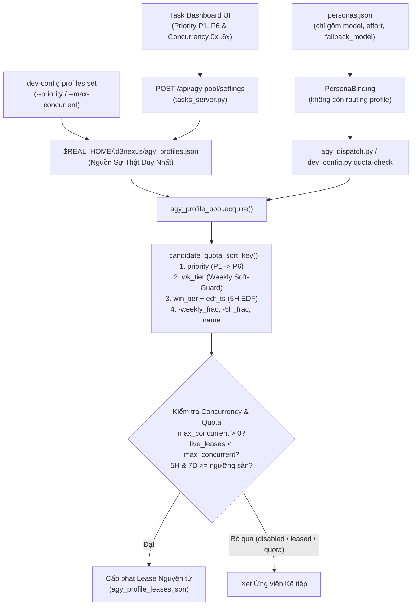

# Đặc tả Thiết kế Điều phối Agy Pool Thuần theo Priority và Báo cáo Đa Nền tảng

- **PIC**: tess
- **Ngày**: 2026-11-28
- **Trạng thái**: Bản thảo (Chờ duyệt Gate 1)
- **Repository**: `ai-agent-tools` (từ nhánh `main` tại `615cb83`)
- **Phạm vi**: Gỡ bỏ hoàn toàn cơ chế `preferred_profile` theo persona (`_preferred_first` và `dev-config set --profile`) để 100% lượt cấp phát `agy` tuân thủ nghiêm ngặt `Priority` và `Concurrency` trên Task Dashboard, kèm báo cáo kiểm toán toàn diện trên từng AI Provider CLI và từng nền tảng kỹ thuật trong workspace

## Mục lục

- [Tổng quan và Mục tiêu](#tổng-quan-và-mục-tiêu)
- [Cảnh báo Hợp đồng Dùng chung](#cảnh-báo-hợp-đồng-dùng-chung)
- [Phân tích Nguyên nhân Gốc rễ](#phân-tích-nguyên-nhân-gốc-rễ)
- [Kiến trúc và Thứ tự Ưu tiên Pool](#kiến-trúc-và-thứ-tự-ưu-tiên-pool)
- [Đặc tả Chi tiết Từng Thành phần](#đặc-tả-chi-tiết-từng-thành-phần)
- [Báo cáo Điều phối theo Nền tảng AI Provider CLI](#báo-cáo-điều-phối-theo-nền-tảng-ai-provider-cli)
- [Báo cáo Hiện trạng theo Dự án và Nền tảng Kỹ thuật](#báo-cáo-hiện-trạng-theo-dự-án-và-nền-tảng-kỹ-thuật)
- [Xử lý Lỗi và Tương thích Ngược](#xử-lý-lỗi-và-tương-thích-ngược)
- [Chiến lược Kiểm thử và Xác minh](#chiến-lược-kiểm-thử-và-xác-minh)
- [Ranh giới An toàn Không Ảnh hưởng Chéo](#ranh-giới-an-toàn-không-ảnh-hưởng-chéo)

## Tổng quan và Mục tiêu

Trong quá trình chạy song song các tác vụ Stage 3 và Gate 4 trên nhiều dự án, các tiến trình Antigravity (`agy`) headless bị dồn tải liên tục vào tài khoản `khangatuaon248` (Priority `P2`, `max_concurrent = 6`) mặc dù tài khoản `tess` đang được cấu hình ở **Priority `P1`** (`max_concurrent = 6`) và hoàn toàn rảnh (`free`) trên Task Dashboard (`check-tasks --ui`). Việc thay đổi bậc `Priority` trên giao diện Task Dashboard trở nên vô nghĩa cho đến khi cả 6 slot của `khangatuaon248` bị chiếm kín hoặc cạn quota.

### Mục tiêu

1. **Một Nguồn Sự Thật Duy Nhất (SSOT) cho Điều phối Pool**: Biến `$REAL_HOME/.d3nexus/agy_profiles.json` (điều khiển trực tiếp qua bảng `🔑 Agy Profile Pool` trên Task Dashboard và lệnh `dev-config profiles set`) thành nơi **duy nhất** quyết định thứ tự ưu tiên (`priority`) và số luồng đồng thời (`max_concurrent`) của các tài khoản `agy`.
2. **Xóa bỏ hàm vượt quyền `_preferred_first`**: Gỡ bỏ hàm `_preferred_first()` và tham số `preferred_profile` khỏi [agy_profile_pool.py](../../../scripts/agy_profile_pool.py), [agy_dispatch.py](../../../scripts/agy_dispatch.py), và [dev_config.py](../../../scripts/dev_config.py).
3. **Loại bỏ cờ `dev-config set --profile` an toàn**: Xóa tùy chọn `--profile` khỏi lệnh `dev-config set`, đồng thời tự động bỏ qua an toàn các khóa `"profile"` cũ còn sót trong file `$REAL_HOME/.d3nexus/personas.json` hoặc `.agents/config/personas.json` kèm cảnh báo rõ ràng khi chạy `dev-config status`.
4. **Làm sạch cấu hình Global trên máy Host**: Xóa `"profile": "khangatuaon248"` khỏi cả 3 persona (`ai_architect_reviewer`, `orchestrator`, `programmer`) trong `$REAL_HOME/.d3nexus/personas.json`.
5. **Báo cáo tổng hợp đa nền tảng**: Thống kê chính xác cơ chế chọn tài khoản, giới hạn luồng song song (concurrency) và kiểm soát quota trên cả 5 nền tảng AI Provider CLI (`agy`, `claude`, `codex`, `kiro`, `ollama`) cùng toàn bộ 6 nền tảng kỹ thuật dự án trong `AllProjects` (`Python`, `Rust`, `Flutter`, `Android`, `iOS`, `Web`).

### Ngoài phạm vi

- Không thay đổi cờ `dev-config low-quota --profile <name>` hoặc `resume_context.py --profile <name>` (vì hai cờ này dùng để bật chế độ tiết kiệm turn theo tài khoản và đồng bộ tên PIC trên thanh tiêu đề cửa sổ IDE, không can thiệp vào việc chọn profile trong pool).
- Không tạo pool đa tài khoản cho các CLI đơn phiên (`claude`, `codex`, `kiro`) hoặc máy chủ cục bộ `ollama`.
- Không thay đổi thứ tự ưu tiên nhà cung cấp của `run_external_review.py` (nhưng được phân tích đầy đủ trong mục báo cáo để nắm rõ hành vi).

## Cảnh báo Hợp đồng Dùng chung

Không có — `ai-agent-tools` là kho mã công cụ điều phối độc lập và không chứa thư mục hay symlink `shared-contracts/`.

## Phân tích Nguyên nhân Gốc rễ

Kiểm tra trực tiếp cấu hình hệ thống và chuỗi gọi hàm cấp phát cho thấy hai nguyên nhân cộng hưởng:

### Ghim ngầm Profile trong Persona Overrides

Trong file `$REAL_HOME/.d3nexus/personas.json`, cả 3 persona đều đang bị ghim cứng `"profile": "khangatuaon248"`:

```json
{
  "overrides": {
    "ai_architect_reviewer": {
      "model": "carbon",
      "effort": "medium",
      "profile": "khangatuaon248"
    },
    "orchestrator": {
      "model": "carbon",
      "effort": "medium",
      "profile": "khangatuaon248"
    },
    "programmer": {
      "model": "neon",
      "effort": "xhigh",
      "profile": "khangatuaon248"
    }
  }
}
```

Trên giao diện Web Task Dashboard ([tasks_dashboard.html](../../../skills/check-tasks/resources/dashboard/tasks_dashboard.html), hàm `buildPersonaBindingsHtml()`), thẻ `🎭 Persona Bindings` chỉ hiển thị `persona`, `alias (cli)`, `model_id`, `effort`, và `sources.model`, hoàn toàn **không hiển thị trường `b.profile`**. Do đó, cấu hình ghim cứng này "tàng hình" trên Dashboard trong khi bảng `🔑 Agy Profile Pool` bên dưới vẫn hiện `tess` là `P1` (`6x`) và `khangatuaon248` là `P2` (`6x`).

### Hàm `_preferred_first` Vượt mặt Hoàn toàn Priority của Dashboard

Trong [agy_profile_pool.py](../../../scripts/agy_profile_pool.py), hàm `_order_pool_candidates()` vốn đã sắp xếp đúng thứ tự `(priority, wk_tier, win_tier, edf_ts, ...)` qua `_candidate_quota_sort_key()`, nhưng ngay sau đó lại gọi `_preferred_first(ordered, preferred_profile)`:

```python
def _order_pool_candidates(...) -> list[dict[str, Any]]:
    ordered = sorted(pool, key=lambda entry: _candidate_quota_sort_key(...))
    return _preferred_first(ordered, preferred_profile)

def _preferred_first(pool: list[dict[str, Any]], preferred_profile: str | None) -> list[dict[str, Any]]:
    if preferred_profile is None:
        return pool
    preferred = [entry for entry in pool if entry["profile"] == preferred_profile]
    others = [entry for entry in pool if entry["profile"] != preferred_profile]
    return preferred + others
```

Cả [agy_dispatch.py](../../../scripts/agy_dispatch.py) (`dispatch_persona()`) lẫn [dev_config.py](../../../scripts/dev_config.py) (`_check_agy_pool_quota()`) đều truyền `preferred_profile=binding.profile` vào `acquire()`. Vì `khangatuaon248` có `max_concurrent: 6` và `allow_concurrent_ag_run: true`, `_preferred_first()` luôn đẩy `khangatuaon248` lên vị trí số `0` ở mọi lần xin lease — nhồi tối đa **6 tác vụ chạy song song** vào `khangatuaon248` trước khi `tess` (`P1`) nhận được dù chỉ 1 tác vụ, đồng thời phá vỡ cả thuật toán gom cửa sổ 5H EDF.

## Kiến trúc và Thứ tự Ưu tiên Pool



### Bộ Khóa Sắp xếp Tất định (7 Tầng)

Sau khi xóa `_preferred_first()`, `_order_pool_candidates()` sắp xếp mọi profile thuần túy theo `_candidate_quota_sort_key()`:

| Thứ bậc | Trường khóa | Hành vi với nhóm `gemini5h` (`hydrogen`, `neon`, `carbon`) | Hành vi với nhóm `argonWeekly` (`argon`, `orchestrator-argon`) |
| :--- | :--- | :--- | :--- |
| `1` | `priority` | Số nguyên tăng dần (`1` = ưu tiên cao nhất trên Task Dashboard) | Số nguyên tăng dần (`1` = ưu tiên cao nhất trên Task Dashboard) |
| `2` | `wk_tier` | `0` khỏe (`>= 20%` hoặc sắp reset `<= 12h`), `1` bảo vệ mềm (`< 20%` và còn `> 12h`), `2` chạm sàn cứng `<= 2%` | `0` khỏe (`>= 20%` hoặc sắp reset `<= 12h`), `1` bảo vệ mềm (`< 20%`), `2` dưới sàn Argon `10%` |
| `3` | `win_tier` | `0` cửa sổ 5H đang mở (`15% <= frac < 99%`), `1` cửa sổ mới (`>= 99%` hoặc đã qua giờ reset), `2` chưa có cache, `3` cache `< 15%` | `0` cửa sổ tuần đang mở (`< 99%`), `1` mới (`>= 99%`), `2` chưa có cache, `3` cache `< 10%` |
| `4` | `edf_ts` | Ưu tiên `resetTime` gần nhất trước (`win_tier == 0`) để tận dụng hết quota cửa sổ 5H đang chạy trước khi mở tài khoản mới | Ưu tiên `resetTime` tuần gần nhất trước (`win_tier == 0`) |
| `5` | `-eff_wk` | Ưu tiên tài khoản còn tỷ lệ quota tuần cao hơn | Ưu tiên tài khoản còn tỷ lệ Argon tuần cao hơn |
| `6` | `-eff_5h` | Ưu tiên tài khoản còn tỷ lệ quota 5H cao hơn | Không áp dụng (chỉ dùng cửa sổ tuần) |
| `7` | `profile` | Thứ tự bảng chữ cái tên tài khoản (`a -> z`) | Thứ tự bảng chữ cái tên tài khoản (`a -> z`) |

### Cơ chế Kiểm soát Concurrencies

- `max_concurrent == 0` (`0x` trên Dashboard): Tài khoản bị đánh dấu `skipped[profile] = "disabled"`. Các lease đang chạy dở vẫn được hoàn tất an toàn (`🔒 in use (draining)`), tuyệt đối không nhận thêm task mới.
- `max_concurrent >= 1` (`1x`..`6x` trên Dashboard): Khi bật `allow_concurrent_ag_run: true` (hiện đang bật toàn cục trong `agy_profiles.json`) hoặc trên tài khoản host (`direct`), hệ thống cho phép cấp phát tối đa đúng `max_concurrent` luồng đồng thời trước khi xoay sang tài khoản kế tiếp. Nếu tắt `allow_concurrent_ag_run: false` ở tài khoản phụ, giới hạn về `1` luồng độc quyền và né tài khoản đang mở sẵn IDE/CLI.

## Đặc tả Chi tiết Từng Thành phần

### Thành phần 1: Dọn dẹp Bộ chọn Pool (`scripts/agy_profile_pool.py`)

- Xóa hoàn toàn hàm `_preferred_first()`.
- Xóa tham số `preferred_profile: str | None = None` khỏi `_order_pool_candidates()`, `_attempt_acquire_once()`, và `acquire()`.
- Cập nhật docstring của `acquire()` phản ánh đúng thứ tự `(priority, wk_tier, win_tier, edf_ts, ...)`.

### Thành phần 2: Cập nhật Luồng Dispatch và Quota-Check (`scripts/agy_dispatch.py` và `scripts/dev_config.py`)

- Trong [agy_dispatch.py](../../../scripts/agy_dispatch.py) (`dispatch_persona()`), xóa đối số `preferred_profile=binding.profile` khi gọi `_pool.acquire(...)`.
- Trong [dev_config.py](../../../scripts/dev_config.py) (`_check_agy_pool_quota()`), xóa đối số `preferred_profile=binding.profile` khi gọi `_pool.acquire(...)`.

### Thành phần 3: Tương thích Ngược Schema và Gỡ Cờ CLI (`scripts/persona_config.py` và `scripts/dev_config.py`)

- **`scripts/persona_config.py`**:
  - Vẫn chấp nhận khóa `"profile"` trong `_ALLOWED_OVERRIDE_FIELDS` khi kiểm tra cú pháp JSON thô (để các file `personas.json` cũ trên đĩa không bao giờ làm sập `PersonaConfigError`), nhưng **bỏ qua hoàn toàn** khi phân giải `resolve_persona()` (`PersonaBinding.profile` luôn là `None` và không ghi `"profile"` vào `sources`). Bổ sung hàm `collect_legacy_profile_warnings(project_root, real_home=...)` để phát hiện các khóa `overrides.<persona>.profile` cũ còn tồn đọng.
  - Xóa `"profile"` khỏi luồng `cli_overrides`.
- **`scripts/dev_config.py`**:
  - Gỡ bỏ `--profile` (`dest="set_profile"`) khỏi subcommand `set` (`p_set`), `_checked_set_profile()`, `_resolve_set_request()`, và `cmd_set()`. Nếu gọi `dev-config set ... --profile`, CLI trả lỗi exit code `1` ngay lập tức để người dùng không lầm tưởng cờ này còn hiệu lực.
  - Giữ nguyên `--profile` trên `dev-config low-quota` (`p_lq`).
  - Hiển thị cảnh báo rõ trong `dev-config status` nếu phát hiện khóa `"profile"` cũ trong `personas.json`:
    `Legacy setting '<layer> personas.json overrides.<persona>.profile' is ignored; configure pool priority and concurrency on Task Dashboard or via 'dev-config profiles set'.`
  - Mọi lệnh `dev-config set <persona> ...` mới sẽ tự động ghi đè object sạch không chứa `"profile"`.

### Thành phần 4: Dọn Cấu hình Máy Host, Tài liệu và Bộ Test

- **Cấu hình máy Host (`$REAL_HOME/.d3nexus/personas.json`)**: Xóa `"profile": "khangatuaon248"` khỏi `overrides.ai_architect_reviewer`, `overrides.orchestrator`, và `overrides.programmer`, giữ nguyên `carbon (medium)`, `neon (xhigh)` và danh mục model tùy chỉnh.
- **Tài liệu & Skill**: Cập nhật [SKILL.md](../../../skills/dev-config/SKILL.md), [dev-config-quick-guide.en.md](../../dev-config-quick-guide.en.md), và [dev-config-quick-guide.vi.md](../../dev-config-quick-guide.vi.md).
- **Bộ kiểm thử tự động**: Cập nhật `tests/test_fpg_agy_profile_pool.py`, `tests/test_fpg_set_provider_model_profile.py`, `tests/test_fpg_persona_config.py`, và `tests/test_fpg_agy_dispatch.py`.

## Báo cáo Điều phối theo Nền tảng AI Provider CLI

Bộ công cụ `ai-agent-tools` điều phối **5 nền tảng AI Provider CLI** qua 2 luồng thực thi tách biệt: **Persona Worker Dispatch** (`dev_config.py dispatch` cho Stage 2 reviser, Stage 3 implementer/reviewer/fixer, Gate 4 verifier) và **External Review** (`run_external_review.py` cho Stage 2 `/principal-review` và Stage 3 `/cross-model-review`).

### Ma trận Cơ chế Tài khoản, Concurrency và Quota của 5 AI Provider

| Nền tảng CLI | Alias Model trong Catalogue | Cơ chế Tài khoản & Phiên chạy | Kiểm soát Concurrency | Ngưỡng Quota & Bảo vệ | Ăn theo Pool trên Task Dashboard? |
| :--- | :--- | :--- | :--- | :--- | :--- |
| **Antigravity (`agy`)** — *Persona Dispatch* | `argon`, `hydrogen`, `neon`, `carbon`, `orchestrator-neon`, `orchestrator-argon` | Đa tài khoản cô lập tại `$REAL_HOME/antigravity_homes/<name>` (`direct` nếu trùng host, `zsh -ic 'ag_run <name> cli ...'` nếu khác host) | Theo `max_concurrent` (`0x`..`6x`) từng profile + khóa nguyên tử `fcntl.flock` trong `agy_profile_leases.json` (TTL `180s`, heartbeat `30s`) | `gemini5h`: `5H >= 15%` VÀ `7D > 2%`<br/>`argonWeekly`: `Argon >= 10%`<br/>+ bảo vệ mềm tuần `20%` | **Có (100% sau thiết kế này)** |
| **Antigravity (`agy`)** — *External Review* | Model ID hoặc alias trong `review.providers.agy` | Chỉ dùng profile của phiên host hiện tại (`$AGY_PROFILE` hoặc tên thư mục `$HOME`), gọi `agy --sandbox --mode plan --model <id>` | 1 tiến trình review đồng bộ cho mỗi vòng của epic (không mượn lease từ `agy_profile_pool`) | `Argon >= 10%` **HOẶC** `5H >= 15%` (`evaluate_provider_quota`) | **Không** (chạy trực tiếp trên host profile khi tới lượt) |
| **Claude Code (`claude`)** | `claude-opus`, `claude-sonnet` | 1 tài khoản OAuth trên máy host (`_dispatch_direct_non_pool`) | Giới hạn bởi số slot worktree song song của orchestrator (mặc định 2 slot); không có pool đa tài khoản | `provider`: `5H >= 15%` VÀ `7D > 2%` qua `fetch_claude_quota()` | **Không** (1 tài khoản host) |
| **OpenAI Codex (`codex`)** | `codex-gpt` (`gpt-6.1-sol`), `codex-terra` | 1 tài khoản trong `~/.codex/auth.json` (`_dispatch_direct_non_pool`) | Giới hạn bởi số slot worktree của orchestrator (mặc định 2 slot); không có pool đa tài khoản | `provider`: `5H >= 15%` VÀ `7D > 2%` qua `fetch_codex_quota()` | **Không** (1 tài khoản host) |
| **Kiro CLI (`kiro`)** | `kiro-opus` (`claude-opus-5.5`), `kiro-sonnet` (`claude-sonnet-5.5`) | 1 tài khoản AWS Builder ID / Kiro trên host (`_dispatch_direct_non_pool`) | Giới hạn bởi số slot worktree của orchestrator; không có pool đa tài khoản | `provider`: Tháng `>= 3%` VÀ còn `>= 15.0` credits qua `fetch_kiro_quota()` | **Không** (1 tài khoản host) |
| **Ollama (`ollama`)** | `gemma4:31b-it-qat` (qua `review.providers.ollama`) | Daemon HTTP nội bộ (`http://localhost:11434`), chỉ dùng khi gọi thủ công `--cli ollama` | Xếp hàng nội bộ theo GPU/VRAM của tiến trình Ollama server | Tài nguyên máy cục bộ (không nằm trong danh sách tự động `--auto-quota`) | **Không** (máy chủ cục bộ) |

### Trạng thái Thực tế của Agy Pool và Thứ tự Cấp phát Sau Khi Sửa

Trên tổng số **24 profile Antigravity** phát hiện trên máy, hiện có **9 profile** được đưa vào pool `$REAL_HOME/.d3nexus/agy_profiles.json` (`allow_concurrent_ag_run: true`). Sau khi gỡ `preferred_profile`, thứ tự cấp phát thực tế sẽ khớp tuyệt đối với cấu hình trên Task Dashboard:

| Thứ tự Thực tế | Tài khoản Profile | Priority Dashboard | Max Concurrent | Quota 5H (Cache) | Quota Tuần (Cache) | Trạng thái lúc Kiểm tra | Hành vi Cấp phát Sau Khi Sửa |
| :--- | :--- | :--- | :--- | :--- | :--- | :--- | :--- |
| **1** | `tess` | **P1** | `6x` | `85.3%` (đã qua giờ reset -> `100%`) | `72.6%` | `✓ free` | **Chủ lực số 1**: nhận tối đa đủ 6 luồng đồng thời đầu tiên |
| **2** | `khangatuaon248` | **P2** | `6x` | `87.4%` (đã qua giờ reset -> `100%`) | `61.0%` | `🔒 1 lease` (`gate4-verifier-r1`) | **Tầng 2**: chỉ nhận task sau khi `tess` (`P1`) đã kín cả 6 luồng hoặc cạn quota |
| **3** | `danhdue` | **P2** | `2x` | chưa cache (`win_tier=2`) | chưa cache | `✓ free` | **Tầng 2 cùng bậc**: probe khi tài khoản `P2` có cache đã đầy, hoặc đua EDF bình đẳng khi đã có cache |
| **4** | `duvthinh403` | **P2** | `2x` | chưa cache (`win_tier=2`) | chưa cache | `✓ free` | **Tầng 2 cùng bậc**: tối đa 2 luồng đồng thời |
| **5** | `thau03880` | **P2** | `2x` | chưa cache (`win_tier=2`) | chưa cache | `✓ free` | **Tầng 2 cùng bậc**: tối đa 2 luồng đồng thời |
| **6** | `duedd` | **P3** | `2x` | `31.4%` (đã qua giờ reset -> `100%`) | `13.1%` (bảo vệ mềm `< 20%`) | `✓ free` | **Dự phòng Tầng 3**: chỉ dùng khi toàn bộ `P1` và `P2` đều kín slot hoặc hết quota |
| **7** | `huynhminhtien0510` | **P4** | `2x` | `58.8%` (đã qua giờ reset -> `100%`) | `22.8%` | `✓ free` | **Dự phòng Tầng 4**: tối đa 2 luồng đồng thời |
| **8** | `brother` | **P5** | `2x` | `44.4%` (đã qua giờ reset -> `100%`) | `11.2%` (bảo vệ mềm `< 20%`) | `✓ free` | **Dự phòng Tầng 5**: chốt chặn cuối trước khi dừng báo hết pool |
| **Bỏ qua** | `hau` | **P2** | `2x` | `79.4%` | `1.5%` (`<= 2.0%` sàn cứng) | `⛔ exhausted (weekly)` | **Tạm khóa tới `2026-12-03T07:04:30Z`** do chạm sàn quota tuần |

> **Lưu ý kiến trúc quan trọng (`run_external_review.py` với `agy`)**: Ở dự án cấu hình `provider_priority` đặt `"agy"` lên đầu (hiện tại là `nexus`), script `run_external_review.py` kiểm tra quota và gọi `agy --sandbox --mode plan` trực tiếp trên **profile của phiên IDE hiện tại** (`$AGY_PROFILE`), chứ không mượn lease qua `agy_profile_pool.py`. Ngược lại, 100% worker thực thi Stage 3 (`task-implementer`, `task-reviewer`, `review-fixer`, `gate4-verifier`) đều đi qua `dev_config.py dispatch` -> `agy_profile_pool.acquire()`.

## Báo cáo Hiện trạng theo Dự án và Nền tảng Kỹ thuật

Kiểm toán toàn bộ các kho mã trong `AllProjects` trải rộng trên đủ **6 nền tảng kỹ thuật** (`Python`, `Rust`, `Flutter`, `Android`, `iOS`, `Web`):

### Bảng Kiểm toán Cấu hình trên 6 Nền tảng Kỹ thuật

| Nền tảng Kỹ thuật | Dự án trong `AllProjects` | Quality Providers (`@quality_check`) | `.agents/config/personas.json` Cấp Dự án | Thứ tự Review Ngoài (`.devtool/review_config.json`) | Số Worktree Đang Mở | Mức độ Ảnh hưởng bởi Lỗi Ghim `khangatuaon248` & Kết quả Sau Khi Sửa |
| :--- | :--- | :--- | :--- | :--- | :--- | :--- |
| **Python & Agent Kit** | `ai-agent-tools`, `lyrics-sync`, `McpGemini2Antigravity`, `digital_wallet/django-digital-wallet` | `agent-tools-python` (`ai-agent-tools`); `python-core`, `web-quality` (`lyrics-sync`) | `ai-agent-tools`: chỉ đặt `max_task_review_passes=2`, `max_fix_passes=1` (không ghim profile); các repo khác: không có | `ai-agent-tools`: `claude -> codex -> kiro -> agy`<br/>`lyrics-sync`: `codex -> claude -> kiro -> agy` | `ai-agent-tools`: `2`<br/>`lyrics-sync`: `23` | **Cao**: Không có override cấp dự án nên toàn bộ lượt dispatch `agy` đều kế thừa global `profile=khangatuaon248`. Sau khi sửa: ưu tiên thẳng vào `P1` (`tess`). |
| **Rust Systems & Hub** | `D3Nexus` (Hub SSOT), `fsrs-rs` | `rust-core`, `web-quality`, `python-core` (`D3Nexus`) | Không có (kế thừa hoàn toàn global `$REAL_HOME/.d3nexus/personas.json`) | `D3Nexus`: `codex -> claude -> kiro -> agy`<br/>`fsrs-rs`: `claude -> codex -> kiro -> agy` | `D3Nexus`: `3`<br/>`fsrs-rs`: `1` | **Cao**: Các wave Cargo/Nextest chạy song song trong `D3Nexus` trước đây bị dồn vào `khangatuaon248`. Sau khi sửa: ăn chuẩn theo bậc `P1`..`P5` trên Dashboard. |
| **Flutter Đa Nền tảng** | `nexus` (Satellite), `digital_wallet/bloc_digital_wallet` | `flutter-core` (Melos / FVM / Dart analyzer / LCOV) | Không có (kế thừa global `$REAL_HOME/.d3nexus/personas.json`) | `nexus`: **`agy -> claude -> codex -> kiro`** | `nexus`: `5` (`D3Nexus`, `nexus_study_telemetry...` x3, `quality_check_and_lifecycle_hardening`) | **Rất cao (Đang giữ Lease thực tế)**: Worktree `quality_check_and_lifecycle_hardening` đang giữ lease `gate4-verifier-r1` trên `khangatuaon248` dù `tess` (`P1`) rảnh hoàn toàn; đồng thời `nexus` ưu tiên `agy` số 1 cho External Review. |
| **Android Native (Kotlin)** | `digital_wallet/android_digital_wallet`, `KotlinLeetCode` | `android-core` (Gradle, Spotless, Detekt, Konsist) | Không có (kế thừa global `$REAL_HOME/.d3nexus/personas.json`) | `KotlinLeetCode`: `claude -> codex -> kiro -> agy` | `KotlinLeetCode`: `2` | **Cao**: Các đợt chạy Stage 3 song song trên `android_digital_wallet` bị hút hết về `khangatuaon248`. Sau khi sửa: phân tải đúng `P1` rồi mới tràn sang `P2`. |
| **iOS Native (Swift)** | `digital_wallet/ios_digital_wallet`, `nexus/ios` | `ios-core` (Tuist, SwiftPM, SwiftFormat, SwiftLint, ArchTests) | Không có (kế thừa global `$REAL_HOME/.d3nexus/personas.json`) | Theo mặc định kit (`claude -> codex -> kiro -> agy`) | `1` | **Cao**: Vừa có hoạt động lúc `02:28` cùng thời điểm lease `khangatuaon248`; kế thừa trực tiếp global `personas.json`. Sau khi sửa: ăn theo `P1` (`tess`). |
| **Web Frontend & Dashboards** | `ai-agent-tools` (`tasks_dashboard.html`, `quota_dashboard.html`), `D3Nexus`, `lyrics-sync` | `web-quality` (Astro/TS/JS, Zero-Console Watchdog, UI Audit) | Theo repo cha | Theo repo cha | Dùng chung với repo cha | **Mặt phẳng Điều khiển**: `tasks_dashboard.html` + `tasks_server.py` (`/api/agy-pool/settings`) chính thức trở thành bảng điều khiển thời gian thực có hiệu lực 100% cho `Priority` (`P1`..`P6`) và `Concurrency` (`0x`..`6x`). |

### Tổng kết Phát hiện Quan trọng trên Toàn Workspace

1. **Không có dự án nào ghim lẻ ở cấp Project**: Rà soát toàn bộ `AllProjects` (bao gồm cả các worktree) xác nhận không có bất kỳ file `.agents/config/personas.json` nào chứa khóa `"profile"`. Do đó, chỉ cần gỡ bỏ `_preferred_first` trong kit và xóa `"profile": "khangatuaon248"` ở `$REAL_HOME/.d3nexus/personas.json` là **toàn bộ dự án trên cả 6 nền tảng lập tức tuân theo Task Dashboard**.
2. **Tệp `.devtool/review_config.json` thế hệ cũ**: Có 7 repo còn giữ `.devtool/review_config.json` (chứa khóa cũ `providers.programmer` / `providers.assistant` vốn đã bị hệ thống bỏ qua). Chúng không ảnh hưởng đến việc chọn profile trong `agy_profile_pool`.
3. **Tổng công suất luồng song song khả dụng**: Với `tess` ở `P1` (`6x`), cụm `P2` hoạt động gồm `khangatuaon248` (`6x`) + `danhdue`/`duvthinh403`/`thau03880` (`2x` mỗi tài khoản), và cụm dự phòng `P3`–`P5` (`6x`), hệ thống có tổng cộng **24 slot `agy` đồng thời** (`6` slot `P1` + `12` slot `P2` + `6` slot `P3`–`P5`) vận hành đúng trật tự cấu hình trên Task Dashboard.

## Xử lý Lỗi và Tương thích Ngược

1. **Đọc an toàn file `personas.json` cũ còn chứa `"profile"`**:
   - Khi đọc `$REAL_HOME/.d3nexus/personas.json` hoặc `.agents/config/personas.json` có sẵn khóa `"profile"`, hệ thống **tuyệt đối không ném lỗi `PersonaConfigError`** nhằm bảo vệ các daemon `check-tasks` và các worktree đang chạy.
   - Hàm `resolve_persona()` tự động bỏ qua trường này (`PersonaBinding.profile = None`) và `dev-config status` in cảnh báo hướng dẫn điều chỉnh trên Task Dashboard.
2. **Chặn rõ ràng khi gọi `dev-config set ... --profile`**:
   - Trả mã thoát `1` ngay từ tầng phân tích tham số (`unrecognized arguments: --profile`) để không ai nhầm tưởng cờ này vẫn còn ghim được tài khoản.
3. **Cơ chế rút tải êm (`0x` Concurrency trên Task Dashboard)**:
   - Giữ nguyên: khi chỉnh về `0x` trên Dashboard, `agy_profiles.json` cập nhật `max_concurrent: 0`, chặn ngay task mới nhưng vẫn để các task đang chạy dở (như `gate4-verifier-r1`) hoàn thành trọn vẹn.

## Chiến lược Kiểm thử và Xác minh

1. **Unit Test & Contract Test (`pytest`)**:
   - `tests/test_fpg_agy_profile_pool.py`: Gỡ bỏ các test `preferred_profile` cũ; bổ sung test khẳng định `acquire()` luôn chọn `P1` trước `P2` và xoay vòng trong cùng bậc ưu tiên theo `(wk_tier, win_tier, edf_ts, -eff_wk, -eff_5h, profile)`.
   - `tests/test_fpg_set_provider_model_profile.py`: Kiểm tra `dev-config set` với `--provider`, `--model`, `--effort`, `--fallback` hoạt động bình thường và từ chối `--profile` với mã thoát `1`.
   - `tests/test_fpg_persona_config.py`: Kiểm tra file `personas.json` cũ có `"profile": "legacy_prof"` vẫn nạp thành công, trả về `binding.profile is None`, và phát sinh cảnh báo trong `dev-config status`.
   - `tests/test_fpg_agy_dispatch.py`: Xác minh `dispatch_persona()` gọi `_pool.acquire()` không truyền `preferred_profile`.
2. **Kiểm định Chất lượng Tài liệu & Toàn bộ Kit**:
   - Chạy `python3 skills/doc_quality_check/resources/scripts/check_document.py --require-toc` cho cả hai file đặc tả.
   - Chạy `bash scripts/verify.sh` và `@quality_check` sau khi triển khai mã nguồn.

## Ranh giới An toàn Không Ảnh hưởng Chéo

- **Không tự ý `git push`**: Mọi commit chỉ lưu cục bộ theo đúng Critical Rule 3.
- **Bảo toàn các Lease đang chạy**: Việc dọn `$REAL_HOME/.d3nexus/personas.json` và cập nhật `agy_profile_pool.py` không đụng chạm tới `$REAL_HOME/.d3nexus/agy_profile_leases.json`, không làm gián đoạn bất kỳ worker nào đang thực thi.
- **Cô lập Repo lân cận**: Không chỉnh sửa bất kỳ tệp nào bên trong `D3Nexus`, `nexus`, `lyrics-sync`, hay `digital_wallet`.
