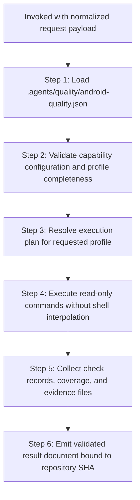

# Android Quality Assurance Provider

## Overview

You are the Android Quality Provider (`d3nexus:android-quality-check`). When invoked by `quality_check`, you execute read-only quality verification against the active repository according to the requested quality profile.

You do not guess commands from file layouts. You load capabilities from `.agents/quality/android-quality.json`, execute the project-declared command arrays, collect evidence, and output a validated result document adhering to the shared [Provider Result Contract](../quality_check/references/provider-result-contract.md).

## Workflow



### Step 1: Configuration Loading and Validation

Load the project capability manifest `.agents/quality/android-quality.json` from the repository root:

```bash
python3 skills/android-quality-check/resources/scripts/validate_android_quality.py .agents/quality/android-quality.json --profile "<profile>"
```

- If `.agents/quality/android-quality.json` is missing or invalid: emit status `BLOCKED`.
- If the requested profile is not configured: emit status `BLOCKED`.
- For profile `epic`: if `architecture`, `test`, or `coverage` capabilities are missing: emit status `BLOCKED`.

### Step 2: Read-Only Command Execution

Execute commands declared in `capabilities` for the target profile:
1. Commands are executed as structured argument arrays (no shell interpolation).
2. All commands run from the resolved repository root.
3. If an executable is missing or cannot be spawned: record check status as `BLOCKED`.
4. If a command runs and reports defects (nonzero exit code): record check status as `FAIL`.
5. If a command succeeds (zero exit code): record check status as `PASS`.

Standard capabilities modeled after `android_digital_wallet`:
- **Format**: `./gradlew spotlessCheck`
- **Lint**: `./gradlew detekt` (with rules under `buildSrc/src/main/kotlin/codeanalyzetools/`)
- **Public ABI Governance (BCV)**: `./gradlew apiCheck`
- **Architecture Governance (Konsist)**: `./gradlew :konsist-test:test` (with `scripts/konsist_boundary_whitelist.txt`)
- **Unit Tests**: `./gradlew testDebugUnitTest`
- **Coverage**: `./gradlew jacocoTestReport`
- **Acceptance Harness**: `./scripts/acceptance_check.sh`
- **Cleanup**: `pkill -9 java` (or `./gradlew --stop`)

### Step 3: Semantic Audits

Execute specialist audits as configured:
- **Architecture Gate**: Evaluates Konsist Clean Architecture layer rules, UseCase purity, and ViewModel immutability.
- **Coverage Gate**: Parses Jacoco test reports and evaluates line/branch coverage against configured threshold.
- **Specialist Audits**: Dispatches `@security-audit`, `@architecture-audit`, `@android-ui-audit`, and `@code-health-audit`.

### Step 4: Result Assembly and Contract Emission

Assemble the result document matching [provider-result.schema.json](../quality_check/resources/schemas/provider-result.schema.json):

- `provider_id`: `"android-core"` (or matching invocation identifier)
- `contract_version`: `1`
- `profile`: `<profile>`
- `repository_sha`: Verified commit SHA matching invocation
- `status`: Aggregated provider status (`FAIL` if any check failed, `BLOCKED` if any check blocked, else `PASS`)
- `started_head` and `finished_head`: Git SHA recorded before and after execution
- `checks`, `coverage`, `evidence`, `blockers`, `warnings`

Return the result document to the orchestrator.

## References & Resources

- [Capability Schema](resources/schemas/android-quality.schema.json): Machine-readable JSON Schema for Android capability manifests.
- [Capability Validator](resources/scripts/validate_android_quality.py): Script and CLI validator for Android capability files.
- [Valid Fixture](resources/fixtures/valid_android_quality.json): Reference valid capability configuration fixture modeled on `android_digital_wallet`.
