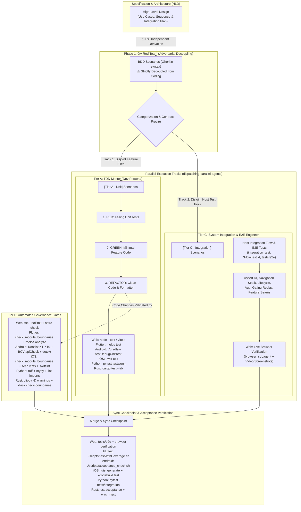

# Development Designer

## Overview
This skill transforms high-level product or technical requirements into a structured, developer-ready Epic for **Web Applications**, **Flutter**, **Android Native**, **iOS Native**, **Python**, and **Rust Core / Polyglot** projects. It creates a centralized High-Level Design (HLD) document, formalizes an **Integration Test Plan** covering analyzed use cases and boundary edge cases, and breaks the work down into granular Kanban tasks enforcing Behavior-Driven Development (BDD), Test-Driven Development (TDD), and strict Definition of Done (DoD), fully aligned with `dev-implementation`'s Tri-Persona workflow (QA Red Team + TDD Master + System Integration Engineer).

This skill is **Stage 2** of the Epic Lifecycle. The surrounding stages, the five approval
gates, and what each stage hands over are owned by the
[`dev-lifecycle`](../dev-lifecycle/SKILL.md) skill. Gate 2 (task breakdown confirmed) is
enforced below, at the Checkpoint before task files are written.

## When to Use
- When the user provides a high-level requirement or problem statement and asks for a technical design or task breakdown.
- When starting a new major feature, epic, or large-scale refactoring.
- When generating architecture diagrams (Use Cases, Sequence, Architecture) and converting them into actionable tasks.
- When the `dev-brainstorming` skill routes here after spec approval, for a spec it judged epic-scale.

## Input

This skill can start from either:

1. **A raw high-level requirement** given directly by the user (standalone use).
2. **An approved spec from the `dev-brainstorming` skill** (preferred entry point — the spec has already been through clarifying questions, alternatives, and user approval). For epic-scale work, `dev-brainstorming` relocates the `.en.md` and `.vi.md` spec pair into this epic's own directory before invoking this skill — so both specs already live alongside the HLD and task files this skill generates.

When invoked with an approved spec, **treat it as the source of truth for scope and decisions already made** — do not re-litigate architecture choices or trade-offs the user already approved. Your job is to *formalize* it: translate its architecture/components/data-flow into the Mermaid diagrams and structured sections below, and break it into Kanban tasks. If the spec is missing something this skill requires (e.g., a rollout strategy), fill the gap, but don't override decisions the spec already made.

Record the link back to the matching-language source in each Epic **Meta Data** section: the
English HLD links to the `.en.md` spec and the Vietnamese HLD links to the `.vi.md` spec. These are
same-directory links, so the HLD and original spec pair remain traceable without leaving
`.devtool/epic/<epic_name>/`. If there is no source spec (standalone use), omit this field.

If the original `dev-brainstorming` request was decomposed into multiple sub-project specs, each spec maps to **its own separate epic** — never merge multiple specs into one epic directory.

## Workflow / Prompt Instructions

When invoked, you MUST strictly follow this exact 3-step workflow to organize the user's requirements:

### Step 0: Detect Target Platform
Detect the active project platform architecture:
- **Web Applications / Frontend**: Root or app package contains `package.json` with web frameworks (`astro.config.*`, `vite.config.*`, `next.config.*`, `nuxt.config.*`, `svelte.config.*`, `webpack.config.*`).
- **Flutter**: Root contains `pubspec.yaml` or `melos.yaml`.
- **Android Native**: Root contains `settings.gradle.kts`, `settings.gradle`, or `build.gradle.kts` (without root `pubspec.yaml`).
- **iOS Native**: Root contains `Project.swift`, `Tuist.swift`, or `Package.swift`.
- **Python**: Root contains `pyproject.toml`, `setup.py`, `Pipfile`, or `requirements.txt`.
- **Rust Core / Polyglot**: Root contains `Cargo.toml`.

### Step 1: Create the Epic Overview Document (HLD/RFC)
Generate the Epic Overview documents inside a dedicated directory: `.devtool/epic/<epic_name>/`.

**Self-sufficiency check (source spec placement)**: if this epic has a source spec and its `.en.md`
and `.vi.md` pair is not already inside `.devtool/epic/<epic_name>/` — for example, the pair is
still under `docs/superpowers/specs/` — relocate both files before writing anything else. Check
every relative link in both files from the new location and fix failures. Commit the pair's move on
its own before generating the HLD. Never move only one language or leave the pair split across
`docs/` and `.devtool/epic/`.

You MUST generate two language variants for the overview document:
- English: `.devtool/epic/<epic_name>/<epic_name>.en.md`
- Vietnamese: `.devtool/epic/<epic_name>/<epic_name>.vi.md`

Each document MUST contain the following sections:

1. **Table of Contents (Mục lục)**: A linked entry for every `##` section in the document.
2. **Meta Data**: Epic name, Status, Target Release, Platform (`Web Application`, `Flutter`, `Android Native`, `iOS Native`, `Python`, or `Rust Core`), and `Source Spec` link if this epic was derived from an approved `dev-brainstorming` spec.
3. **Background (Bối cảnh)**: The problem statement or context (Why are we doing this?).
4. **Goals & Non-Goals**: Clearly define what is expected to be achieved and what is strictly out of scope to avoid scope creep.
5. **Architecture & Technical Design**:
   - **High-Level Architecture**: Use `mermaid flowchart TD` (or `flowchart LR`) to show component interactions. NEVER use legacy `graph TD` (`graph` is legacy Mermaid syntax; `flowchart` is the modern standard that enables per-subgraph `direction` control, richer node shapes, better rendering engines, and styling).
   - **Use Cases**: Use `mermaid flowchart` to define Actors and their interactions with the system.
   - **Sequence Diagram**: Use `mermaid sequenceDiagram` with explicit participants and message flows to show the step-by-step lifecycle of the primary flow.
   - **Diagram Standards & Lint Rules (Mermaid & Graphviz DOT)**:
     - All Mermaid diagrams MUST use `flowchart` instead of `graph`, quote node labels containing special characters, parentheses `()`, brackets `[]`, braces `{}`, colons `:`, slashes `/`, ampersands `&` (e.g. `node1["Component (Core Logic)"]`), use clean alphanumeric IDs with underscores, avoid trailing semicolons, and properly close subgraphs (`end`).
     - Any Graphviz (DOT) diagrams MUST follow semantic shapes (`diamond` for decisions `?`, `box` for actions, `plaintext` for commands, `ellipse` for states, `octagon` for warnings, `doublecircle` for start/complete), terminate statements with semicolons `;`, quote multi-word IDs/labels, use `->` in `digraph`, and prefix visual subgraphs with `cluster_`.
   - **Markdown Lint Standards**: All generated markdown files (`.en.md`, `.vi.md`, `bdd_scenarios.*.md`, `task_*.md`) MUST strictly adhere to markdown lint rules: single H1 top-level title, no skipped heading levels, space after `#`, no trailing punctuation in headings, all code blocks tagged with language identifiers (no bare fences), and clean formatting hygiene (no trailing whitespace, no hard tabs).
   - **Check 1 (Shift-Left Impact Analysis)**: Run `check_code_impact.py` on planned touchpoints and core symbols:
     ```bash
     python3 skills/impact-analysis/resources/scripts/check_code_impact.py \
       --files <planned_files> \
       --symbols <core_classes> \
       --base-ref develop
     ```
     Inspect blast radius, downstream callers, native `MethodChannel` bridges, and coverage safety nets before freezing contracts.
   - **Integration Test Plan & Boundary Matrix**: Map every Use Case and Sequence Diagram interaction into an explicit Integration Test Plan. Detail the end-to-end integration boundaries, mock/live services, data stores, and multi-component seams. For Web/UI applications, explicitly specify the **Visual & Browser Verification Matrix** (target viewports, URL routes/query parameters, interactive states, audio/video playback, and DOM verification).
   - **Integration Test Roots**: The Integration Test Plan MUST contain the line `Integration test roots: <dir>, <dir>` naming every directory that holds integration tests. Defaults: `tests/e2e/` (Web), `integration_test/` (Flutter), `app/src/test/` and `shell/src/test/` (Android), `App/Tests/` and `Shell/Tests/` (iOS), `tests/integration/` (Python), `tests/` (Rust). `check_bdd_traceability.py` scans exactly these directories.
   - **Comprehensive BDD Test Scenarios**: A detailed Gherkin suite (`Given - When - Then`) covering all Use Cases and Sequence Diagram flows across the **Mandatory 5-Dimension Boundary Matrix**:
     1. **Happy Paths**: Normal data flow and standard successful outcomes.
     2. **Edge Cases & Boundaries**: Null inputs, empty arrays/collections, malformed payloads, boundary numbers.
     3. **State Transitions**: Valid and invalid state transitions (MVI Action -> State / Event).
     4. **Async / Race Conditions**: Rapid consecutive user interactions (debouncing, stream transformers, cancellation).
     5. **Failures & Storage/Network Resilience**: Timeouts, 4xx/5xx HTTP errors, offline states, corrupted storage/DB.
6. **BDD Output in Epic Directory**:
   - In addition to embedding scenarios in the Epic Overview, generate a synchronized pair:
     - English, canonical: `.devtool/epic/<epic_name>/bdd_scenarios.en.md`
     - Vietnamese: `.devtool/epic/<epic_name>/bdd_scenarios.vi.md`
   - Each file MUST contain a linked table of contents covering every `##` section.
   - Both files MUST organize scenarios by Use Case, exhaustively covering all 5 dimensions above in Gherkin syntax.
   - **Scenario IDs**: Every `Scenario:` or `Scenario Outline:` line starts with a unique identifier in brackets, before any tier tag: `Scenario: [PY-HP-01] [Tier C - Integration] ...`. Shape: uppercase segments joined by `-`, ending in digits; convention `<EPIC>-<DIM>-<NN>` with `HP`, `EC`, `ST`, `AR`, `FR` for the five dimensions. The `.vi.md` file carries exactly the same identifiers, untranslated. The first segment is this epic's prefix and MUST NOT be used by any other epic in the project, because integration test roots hold every epic's tests; list the prefixes already taken with `grep -ho '\[[A-Z][A-Z0-9]*-' .devtool/epic/*/bdd_scenarios.en.md | sort -u`.
   - **Dual Value Purpose**:
     1. *Human Maintenance (Living Documentation)*: Enables any incoming developer to instantly comprehend the business intent, state transitions, boundary limits, and resilience rules without wading through implementation code.
     2. *Instant AI Agent Context Injection*: Provides a dense, unambiguous behavioral contract that can be loaded into an AI Agent's context window in one shot, eliminating hallucinations and ensuring rigorous compliance during implementation or bug fixes.
7. **Rollout Strategy & Mitigation**: Describe how to deploy this safely (e.g., phased rollout, feature flags) and fallback plans.
8. **Kanban Tasks Breakdown**: A list of links pointing to the individual task files created in Step 2.

**Canonical language**: Every durable design document uses an `.en.md` and `.vi.md` pair. The
`.en.md` variant is the source of truth for tooling/agents — always write and update it first. The
`.vi.md` variant is a translation for local team communication and MUST be kept in sync whenever
the `.en.md` changes; never let the two diverge in structure, facts, or table-of-contents coverage.

Before the task-breakdown checkpoint, verify both design-document pairs mechanically:

```bash
python3 skills/doc_quality_check/resources/scripts/check_document.py \
  --require-toc --require-bilingual \
  .devtool/epic/<epic_name>/<epic_name>.en.md \
  .devtool/epic/<epic_name>/<epic_name>.vi.md \
  .devtool/epic/<epic_name>/bdd_scenarios.en.md \
  .devtool/epic/<epic_name>/bdd_scenarios.vi.md
```

### Checkpoint: Confirm Task Breakdown Before Writing Task Files
Before generating any task file, list the proposed tasks as a short numbered summary (title + one-line scope each) and ask the user to confirm the breakdown and granularity. This is a lightweight check, not a full brainstorming dialogue — the architecture is already approved (from the spec or from this skill's own Step 1); only the *task split* is new and unapproved. Only proceed to write task files once the user confirms or adjusts the list.

Beside each proposed task, list the epic scenario identifiers it will cover (its future `Covers:` line, see Tier C — BDD Automation below), so the user approves the scenario-to-task mapping together with the split.

### Concurrent-Epic Backlog Rule
Before writing any task file, check `.devtool/features/*.md` (excluding the `done/` and `archived/` subfolders) for a task whose `epic:` frontmatter field names a *different* epic and whose `status` is `todo`, `in-progress`, or `review` — that means another epic is actively being worked on right now. If so:
- Set every task this run generates for the new epic to `status: "backlog"` instead of the usual default `"todo"`, so it's queued rather than shown as ready-to-pick-up while the other epic is still active.
- Note in the new Epic Overview's Meta Data **Status** field that the epic is queued behind the other epic by name (e.g. `Status: Queued (backlog) — behind logging-refactor`).
- This skill does not flip tasks from `backlog` to `todo` itself later — that's a human call once the blocking epic's tasks all reach `done`.

If no other epic has any active (`todo`/`in-progress`/`review`) task, generate tasks with the normal default `status: "todo"` as usual.

### Step 2: Generate LachyFS Kanban Tasks
Break the Epic down into granular implementation tasks. **Crucially, each task must be structured around Behavior-Driven Development (BDD), Test-Driven Development (TDD), and Integration Flow Testing** to feed directly into the Tri-Persona (QA Red Team + TDD Master + System Integration Engineer) execution workflow in `dev-implementation`. Wherever the task produces testable behavior, generate Markdown task files located at `.devtool/features/task_<number>_<name>.md` (and mirrored in `.devtool/epic/<epic_name>/task_<number>_<name>.md` as permanent epic outputs).

#### Task Lifecycle & Archival Model
- **Creation**: Tasks are generated into `.devtool/features/task_<number>_<name>.md` and mirrored into `.devtool/epic/<epic_name>/task_<number>_<name>.md`.
- **In-Flight**: As tasks complete during `dev-implementation`, `sync_task_status.py` moves them from `.devtool/features/` into `.devtool/features/done/`.
- **Epic Completion Archival**: When all tasks of an epic finish and the epic status transitions to `Done` (`sync_task_status.py epic <epic_dir> Done`), all completed tasks and draft superpowers documents are archived permanently into `.devtool/epic/<epic_dir>/`. Relative markdown links are rewritten to point locally, and `.devtool/features/done/` is left clean with zero lingering task files.

#### Mandatory 3-Tier Testing Standard in Task Breakdown
Every Epic breakdown MUST explicitly structure and address all 3 testing tiers across the Tri-Persona system based on the target platform:

##### 💙 For Flutter Projects:
- **Tier A (Unit / Package Tests)**: Tasks covering module/feature logic, BLoCs, UseCases, Repositories, Parsers with isolated unit tests (`fvm flutter test` or `melos test` using `bloc_test`, Mocktail). Executed by the **TDD Master (Dev Persona)**.
- **Tier B (Tooling & Governance Tests)**: Tasks that touch feature packages or public APIs MUST verify module boundaries (`./scripts/check_module_boundaries.sh`), license headers (`./scripts/check_license_header.sh`), code formatting (`melos format`), and static analysis (`melos analyze`).
- **Tier C (Acceptance & App Tests)**: Every Epic MUST include an explicit final integration task (e.g. `Task N: Host App Integration & Acceptance Tests`) verifying the Host composition root (`lib/` composition, `AppRoutes`, `AppEventBus`), full end-to-end user navigation flows, and running the automated acceptance/integration harness (`fvm flutter test integration_test` or `./scripts/testWithCoverage.sh`). Executed by the **System Integration Engineer (Integration Persona)**.

##### 🤖 For Android Native Projects:
- **Tier A (Unit / Package Tests)**: Tasks covering module/feature logic, MVI ViewModels, UseCases, Repositories, Parsers with isolated unit tests (`./gradlew testDebugUnitTest` using JUnit, MockK, Turbine). Executed by the **TDD Master (Dev Persona)**.
- **Tier B (Tooling & Governance Tests)**: Tasks that touch architectural rules, convention plugins, or public API signatures MUST include verification with Konsist rules K1–K10 (`./gradlew :konsist-test:test`) and BCV public ABI checks (`./gradlew apiCheck`), Detekt, and Spotless (`./gradlew check`).
- **Tier C (Acceptance & App Tests)**: Every Epic MUST include an explicit final integration task verifying Host composition root (`:app` + `:shell`), full end-to-end user navigation flows, DFM on-demand splits, and running the automated acceptance harness (`./scripts/acceptance_check.sh`). Executed by the **System Integration Engineer (Integration Persona)**.

##### 🍎 For iOS Native Projects:
- **Tier A (Unit / Package Tests)**: Tasks covering module/feature logic, MVI ViewModels, UseCases, Repositories, Parsers with isolated unit tests (`swift test --package-path <PackagePath>` using Swift Testing `@Test` or XCTest). Executed by the **TDD Master (Dev Persona)**.
- **Tier B (Tooling & Governance Tests)**: Tasks that touch feature packages or public API contracts MUST verify module boundaries (`bash scripts/check_module_boundaries.sh`), AST architecture governance rules K1–K10 (`swift test --package-path ArchTests`), static analysis (`swiftlint lint --strict --config quality/.swiftlint.yml`), and code formatting (`swiftformat --config quality/.swiftformat . --lint`).
- **Tier C (Acceptance & App Tests)**: Every Epic MUST include an explicit final integration task verifying Host composition root (`App/` + `Shell/`), `AppRoutes`, RouteProvider registration, end-to-end user navigation flows, and running the automated acceptance harness (`tuist generate --no-open && xcodebuild test ...`). Executed by the **System Integration Engineer (Integration Persona)**.

##### 🌐 For Web Applications & Frontend Projects:
- **Tier A (Unit & State Tests)**: Tasks covering component logic, domain utilities, reactive stores, state machines, parsers, and reducers with isolated unit tests (`node --test`, Vitest, Jest). Executed by the **TDD Master (Dev Persona)**.
- **Tier B (Tooling, Types & Governance Tests)**: Tasks touching components, pages, or shared modules MUST verify type soundness (`tsc --noEmit`), framework diagnostics (`astro check` or framework linter), code style/formatting (`prettier --check` / `eslint`), and module boundaries.
- **Tier C (Acceptance, E2E & Live Browser Verification)**: Every Web Epic MUST include an explicit final integration task (e.g. `Task N: Integration & Live Browser Verification`) verifying application composition roots, router navigation flows, running the automated integration harness (`tests/e2e/*.test.ts`, Playwright, Cypress) **AND executing Live Web Browser Verification**. The agent MUST launch the local dev/preview server, navigate using `browser_subagent`, record a video session (`.webp`), capture screenshot artifacts, and assert real DOM states, user interactions, audio/video playback, and visual layout against analyzed use cases and edge cases. Executed by the **System Integration Engineer (Integration Persona)**.

##### 🐍 For Python Projects:
- **Tier A (Unit Tests)**: Tasks covering module/domain logic, services, models, and parsers with isolated unit tests (`pytest tests/unit/` using `pytest-mock`, `unittest.mock`). Executed by the **TDD Master (Dev Persona)**.
- **Tier B (Tooling & Governance Tests)**: Tasks touching modules or public APIs MUST verify code formatting and linting (`ruff check .`, `ruff format --check .`), strict type checking (`mypy --strict src`), and architectural layer boundaries (`lint-imports` or `import-linter` via `.importlinter`).
- **Tier C (Acceptance & Integration Tests)**: Every Epic MUST include an explicit final integration task verifying service composition roots, API integrations, database workflows, and running automated integration/acceptance tests (`pytest tests/integration/` and `pytest tests/e2e/`). Executed by the **System Integration Engineer (Integration Persona)**.

##### 🐍 For Python Projects:
- **Tier A (Unit Tests)**: Tasks covering module/domain logic, services, models, and parsers with isolated unit tests (`pytest tests/unit/` using `pytest-mock`, `unittest.mock`). Executed by the **TDD Master (Dev Persona)**.
- **Tier B (Tooling & Governance Tests)**: Tasks touching modules or public APIs MUST verify code formatting and linting (`ruff check .`, `ruff format --check .`), strict type checking (`mypy --strict src`), and architectural layer boundaries (`lint-imports` or `import-linter` via `.importlinter`).
- **Tier C (Acceptance & Integration Tests)**: Every Epic MUST include an explicit final integration task verifying service composition roots, API integrations, database workflows, and running automated integration/acceptance tests (`pytest tests/integration/` and `pytest tests/e2e/`). Executed by the **System Integration Engineer (Integration Persona)**.

##### 🦀 For Rust Core & Polyglot Backend Projects:
- **Tier A (Unit / Crate Tests)**: Tasks covering core domain models, business logic, parsers, algorithms, and state machines with isolated unit tests (`cargo test --lib`). Executed by the **TDD Master (Dev Persona)**.
- **Tier B (Tooling & Governance Tests)**: Tasks touching shared crates or public APIs MUST verify formatting (`just fmt` or `cargo fmt --check`), clippy warnings denied (`just lint` or `cargo clippy -D warnings`), dependency licensing/security (`cargo deny check`), and architecture boundaries (`cargo run -p xtask -- check-boundaries`).
- **Tier C (Acceptance & App Tests)**: Every Epic MUST include an explicit final integration task verifying composition roots, WASM bindings (`just wasm-test`), FFI exports, and running end-to-end acceptance tests (`cargo test --test '*'` or `just acceptance`). Executed by the **System Integration Engineer (Integration Persona)**.

##### 🔗 Tier C — BDD Automation (All Platforms)
- Every scenario in `bdd_scenarios.en.md` MUST be covered by **at least one automated integration test**, whatever its tier tag. One test may cover several scenarios. There are no waivers: a scenario that cannot be automated is rewritten before Gate 2.
- The test carries the scenario identifier in its name, description or tag (`test_py_hp_01_...`, `func test_PY_HP_01_...()`, `testWidgets('[PY-HP-01] ...')`, ``@Test fun `PY-HP-01 ...`()``) and lives under one of the HLD's `Integration test roots`.
- Each identifier is assigned to at least one task through that task's `Covers:` line. The final Tier C task takes every identifier no earlier task covers.



> [!IMPORTANT]
> ### ⚡ PARALLEL EXECUTION RULES (TIER A & TIER C CONCURRENCY)
> When executing via `dispatching-parallel-agents`, the Lead Agent may dispatch **Subagent 1 (Dev Persona — Tier A)** and **Subagent 2 (SDET Persona — Tier C)** concurrently, provided these 3 inviolable rules are satisfied:
> 
> 1. **Rule 1: Strict Contract Freeze (Zero Contract Drift)**:
>    - All public interface contracts (`AppRoutes`, `AppEventBus`, DTOs, State/Action contracts) must be locked during Phase 1 BDD authoring.
>    - Neither agent is permitted to rename, alter types, or mutate public contract signatures during parallel execution without a synchronized pause.
> 
> 2. **Rule 2: Disjoint File Sets (Zero Git Merge Conflicts)**:
>    - **Subagent 1 (Dev)**: Restricted strictly to feature/package sources (`apps/{app}/src/**` in Web; `features/{name}/**`, `packages/{package}/**` in Flutter; `:features:*`, `:packages:*` in Android; `Features/{Name}/**`, `Packages/{Name}/**` in iOS; `src/{package}/**` in Python; `src/{package}/**` in Python; `crates/{crate}/src/**` in Rust).
>    - **Subagent 2 (SDET)**: Restricted strictly to Host App integration testbeds (`tests/e2e/**` in Web; `integration_test/**` in Flutter; `app/src/test/**`, `shell/src/test/**` in Android; `App/Tests/**`, `Shell/Tests/**` in iOS; `tests/integration/**` in Python; `tests/integration/**` in Python; `tests/**` in Rust).
>    - **NEITHER agent** may modify shared root build or workspace files (`package.json`, `astro.config.*` in Web; `pubspec.yaml`, `melos.yaml` in Flutter; `settings.gradle.kts`, `buildSrc/**` in Android; `Project.swift`, `Workspace.swift`, `Tuist.swift` in iOS; `pyproject.toml` in Python; `pyproject.toml` in Python; root `Cargo.toml` in Rust) concurrently.
> 
> 3. **Rule 3: ATDD Sync Checkpoint & Verification**:
>    - Subagent 2's integration flow tests initially act as **ATDD Red Tests** (failing while Subagent 1's code is in-flight).
>    - Once both subagents report completion, the Lead Agent performs the **Sync Checkpoint**: merges the branches, validates that the integration tests turn **GREEN**, and runs the Tier C acceptance check.

Task files are English-only — do not generate a `.vi.md` variant for `task_*.md` and do not mix
Vietnamese prose into their section headers or body. They are the sole language-pair exception in
this workflow; the spec, Epic Overview, and BDD scenario documents remain bilingual.

Each task file MUST adhere to this exact structure:

1. **YAML Frontmatter (LachyFS Kanban Markdown compatible)**:
   ```yaml
   ---
   id: "task_<number>_<name>"
   status: "todo"          # one of: backlog | todo | in-progress | review | done — see Concurrent-Epic Backlog Rule above
   priority: "high"        # one of: low | medium | high
   assignee: null
   epic: "<epic_name>"
   dueDate: null
   created: "<ISO-8601 timestamp, set once at creation>"
   modified: "<ISO-8601 timestamp, update on every edit>"
   completedAt: null       # set to an ISO-8601 timestamp only when status becomes "done"
   labels: ["architecture", "feature"]
   order: "a<number>"
   ---
   ```
2. **Title**: `# Task <number>: <Task Name>`
3. **Epic Reference**: A link back to the parent HLD, e.g. `Epic: [<epic_name>](../epic/<epic_name>/<epic_name>.en.md)`. This is the agent's entry point back to architecture/diagram context.
4. **Requirement Analysis**: Context and requirements specific to this task.
5. **Relevant Files & Context Pointers**: An explicit bullet list of exact file/directory paths this task reads or modifies.
6. **Design Rationale**: Architecture decisions or design patterns chosen. **Crucially, review the available skills in `.agents/skills/` and explicitly note applicable skills here**:
   - **For Web Tasks**: `browser_subagent` (live browser verification), Node.js `--test` / Vitest, Astro check, Playwright.
   - **For Python Tasks**: `python-quality-check`, `pytest`, `ruff`, `mypy`, `import-linter`.
   - **For Python Tasks**: `python-quality-check`, `pytest`, `ruff`, `mypy`, `import-linter`.
   - **For Rust Tasks**: `rust-quality-check`, `xtask`, `wasm-pack`.
   - **For Flutter Tasks**: `flutter-ui-audit`, Mason bricks (`mason make pac_mvi_feature`), `build_runner`.
   - **For Android Tasks**: `android-ui-audit`, `android-api-integration`, `moshi_dto_generator`.
   - **For iOS Tasks**: `ios-ui-audit`, Tuist (`tuist generate`), `ArchTests`.
7. **Impact Analysis & Blast Radius**: Document predictive impact analysis for this specific task:
   - **Target Files & Symbols**: Classes, functions, and interfaces to be created or modified.
   - **Downstream Callers**: Known caller files that consume the target symbols.
   - **Cross-Platform Bridges**: Any `MethodChannel` or Native bridge contracts touched.
   - **Target Test Coverage Threshold**: Minimum line coverage threshold (100% for Security, $\ge 85\%$ for Domain UseCases, $\ge 80\%$ for UI/BLoC).
8. **BDD Scenarios & Acceptance Criteria (The QA Persona)**:
   Document this section under the markdown heading `### BDD SCENARIOS`.
   Directly under that heading, write the line `Covers: <ID>, <ID>` naming the epic scenario identifiers from `bdd_scenarios.en.md` whose integration tests this task writes. Omit the line only when the task covers no epic scenario, for example a Tier B tooling task.
   Define behavioral scenarios using Gherkin syntax (`Given - When - Then`).

   **Strict Adversarial Independence Mandate**:
   - The QA Persona MUST author BDD scenarios **completely decoupled from implementation code**.
   - Do NOT base scenarios on implementation ease or existing code internals. Base them **PURELY on the Epic's HLD specifications, Use Cases (flowchart), and Sequence Diagrams**.
   - The QA Persona's sole objective is to act as an adversarial quality gate: expose all unhandled edge cases, boundaries, race conditions, and system failure modes before any coding begins.

   **Mandatory Self-Review**: Cross-check these scenarios directly against the Use Cases (flowchart) and Sequence Diagrams defined in the Epic's HLD document (`<epic_name>.en.md`) to guarantee zero missing requirements.
   Exhaustively apply Boundary Value Analysis & Equivalence Partitioning across 5 dimensions:
   - **Happy Paths**: Normal data flow and standard successful outcomes.
   - **Edge Cases & Boundaries**: Null inputs, empty arrays/collections, malformed payloads, boundary numbers.
   - **State Transitions**: Valid and invalid state transitions (MVI Action -> State / Event).
   - **Async / Race Conditions**: Rapid consecutive user interactions (debouncing, stream transformers, cancellation).
   - **Failures & Storage/Network Resilience**: Timeouts, 4xx/5xx HTTP errors, offline states, corrupted storage/DB.

   **Tier Categorization Tagging & 100% Traceability Mandate**:
   - `[Tier A - Unit]`: Scenarios covering class/function level logic, BLoCs/ViewModels, UseCases, Repositories, Parsers, and Guards. Must be covered 100% by unit tests.
   - `[Tier C - Integration]`: Scenarios covering end-to-end user navigation, Host App lifecycle, Tab switching, Auth Gating & Replay, and multi-component seams (including media playback synchronization, live database states, and web route transitions). Must be covered 100% by integration tests.
   - **Zero Uncovered Scenarios Rule**: Every authored BDD scenario across all 5 dimensions MUST map to at least one automated test case. Unit tests with mocks do NOT substitute for Tier C integration tests.

9. **Test & Verification Checklist**:
   - **For Flutter Tasks (Dev Persona / Integration Persona)**:
     - [ ] **RED**: Translate all `[Tier A - Unit]` BDD scenarios into failing unit/BLoC tests (`bloc_test`, Mocktail). Confirm tests fail for the right reasons before writing implementation code.
     - [ ] **GREEN**: Write minimal implementation code to satisfy the tests (use Mason `pac_mvi_feature` if creating a new feature package).
     - [ ] **REFACTOR**: Optimize performance (`const` constructors), format (`melos format` / `dartfmt.sh`), check module boundaries (`./scripts/check_module_boundaries.sh`), and verify zero linter warnings (`melos analyze`).
     - [ ] **Tier C (Integration)**: Configure Host App integration testbed (`integration_test/`), assert navigation, lifecycle, and run `./scripts/testWithCoverage.sh`.
   - **For Android Tasks (Dev Persona / Integration Persona)**:
     - [ ] **RED**: Translate all `[Tier A - Unit]` BDD scenarios into failing unit tests (`./gradlew testDebugUnitTest`).
     - [ ] **GREEN**: Write minimal implementation code to satisfy the tests.
     - [ ] **REFACTOR**: Format (`./gradlew spotlessApply`), check lint (`./gradlew detekt`), and verify Konsist (`./gradlew :konsist-test:test`).
     - [ ] **Tier C (Integration)**: Host App composition testbed (`:app` / `:shell`), assert user flows, and run `./scripts/acceptance_check.sh`.
   - **For iOS Tasks (Dev Persona / Integration Persona)**:
     - [ ] **RED**: Translate all `[Tier A - Unit]` BDD scenarios into failing Swift unit tests (`swift test --package-path <PackagePath>`). Confirm tests fail for the right reasons before writing implementation code.
     - [ ] **GREEN**: Write minimal Swift implementation code to satisfy the tests (Clean Architecture + MVI, pure Swift domain).
     - [ ] **REFACTOR**: Optimize SwiftUI body re-evaluation, format (`swiftformat --config quality/.swiftformat .`), lint (`swiftlint lint --strict --config quality/.swiftlint.yml`), verify module boundaries (`bash scripts/check_module_boundaries.sh`), and verify AST rules (`swift test --package-path ArchTests`).
     - [ ] **Tier C (Integration)**: Host App composition testbed (`App/Tests` + `Shell/Tests`), assert user flows, and run simulator acceptance check (`tuist generate --no-open && xcodebuild test ...`).
   - **For Web Tasks (Dev Persona / Integration Persona)**:
     - [ ] **RED**: Translate all `[Tier A - Unit]` BDD scenarios into failing unit/store tests (`node --test` or `vitest`). Confirm tests fail for the right reasons before writing implementation code.
     - [ ] **GREEN**: Write minimal implementation code to satisfy the tests.
     - [ ] **REFACTOR**: Optimize component render lifecycles, run typecheck (`tsc --noEmit`), lint/framework check (`npx astro check`), and format (`prettier`).
     - [ ] **Tier C (Integration & Live Browser Verification)**: Run automated integration tests (`tests/e2e/*.test.ts`). For tasks with Web UI/frontend deliverables, run the local dev/preview server and execute Live Web Browser Verification using `browser_subagent`. Capture video (`.webp`) and screenshot artifacts to verify UI layout, responsive behavior, and edge-case use cases.
   - **For Python Tasks (Dev Persona / Integration Persona)**:
     - [ ] **RED**: Translate all `[Tier A - Unit]` BDD scenarios into failing unit tests (`pytest tests/unit/`). Confirm failure before writing code.
     - [ ] **GREEN**: Write minimal implementation code satisfying the tests.
     - [ ] **REFACTOR**: Format and lint (`ruff format .`, `ruff check . --fix`), check types (`mypy`), and verify layer boundaries (`lint-imports`).
     - [ ] **Tier C (Integration)**: Run integration test suites (`pytest tests/integration/` and `pytest tests/e2e/`).
   - **For Python Tasks (Dev Persona / Integration Persona)**:
     - [ ] **RED**: Translate all `[Tier A - Unit]` BDD scenarios into failing unit tests (`pytest tests/unit/`). Confirm failure before writing code.
     - [ ] **GREEN**: Write minimal implementation code satisfying the tests.
     - [ ] **REFACTOR**: Format and lint (`ruff format .`, `ruff check . --fix`), check types (`mypy`), and verify layer boundaries (`lint-imports`).
     - [ ] **Tier C (Integration)**: Run integration test suites (`pytest tests/integration/` and `pytest tests/e2e/`).
   - **For Rust Tasks (Dev Persona / Integration Persona)**:
     - [ ] **RED**: Translate all `[Tier A - Unit]` BDD scenarios into failing unit tests (`cargo test --lib`). Confirm failure before writing code.
     - [ ] **GREEN**: Write minimal implementation code satisfying the tests.
     - [ ] **REFACTOR**: Run `just fmt`, `just lint` (`cargo clippy -D warnings`), and boundary checks (`cargo run -p xtask -- check-boundaries`).
     - [ ] **Tier C (Integration)**: Run crate integration tests (`cargo test --test '*'`), WASM tests (`just wasm-test`), and acceptance tests (`just acceptance`).

   **TDD Adaptation**: For tasks that are pure refactors or config changes with no new behavior, state the adaptation explicitly (e.g., "run existing test suite / analyzer to confirm zero regressions").
10. **Definition of Done (DoD)**: Acceptance criteria (100% BDD scenario coverage across Tier A unit and Tier C integration tests with zero uncovered scenarios, passes Tier A/B/C verification, clean git status; for Web/UI deliverables: automated integration tests pass AND live browser verification artifacts are captured via `browser_subagent`).
11. **Dependencies & Blockers**: Link to blocking/blocked task files as markdown links (e.g. `Blocked by [Task 1](task_1_create_package.md)`).
12. **References & Rollback**: Links to docs, APIs, and a rollback strategy if this specific task fails.

### Step 3: Finalize & Commit
Before committing — and whether or not `auto_commit` is enabled — confirm that every epic scenario is assigned to a task. `SKILL_DIR` is the directory containing this `SKILL.md`:

```bash
python3 "$SKILL_DIR"/../dev-implementation/resources/scripts/check_bdd_traceability.py plan \
  --scenarios .devtool/epic/<epic_name>/bdd_scenarios.en.md \
  --tasks .devtool/epic/<epic_name>/task_*.md
```

It must exit 0. Exit 1 names the unassigned, unknown or malformed identifiers: fix the task files or the scenario documents and run it again. Pass the epic directory's task mirrors, never `.devtool/features/task_*.md`, which can hold other epics' tasks.

After the Epic Overview and all confirmed task files are written (or updated), commit them to git:
- Read `.agents/config.json` — check the `auto_commit` setting.
- If `auto_commit: true`: stage exactly the generated/modified paths (the epic's `.devtool/epic/<epic_name>/` directory and each new/modified `.devtool/features/task_*.md` file). Then commit:
  - New epic: `git commit -m "[<EPIC_NAME>] Generate epic and task breakdown" -m "- <task 1 title>\n- <task 2 title>"`
  - Update to an existing epic: `git commit -m "[<EPIC_NAME>] Add tasks to epic" -m "- <task title>"`

  Follow [Commit Message Format](../../rules/CRITICAL_RULES.md#commit-message-format) — bracketed
  scope, one-line title, one bullet per task written. No `Co-Authored-By` or other trailer.
- If `auto_commit: false`: skip staging and committing entirely.

### Updating an Existing Epic
When new requirements arrive for an epic already in progress, append new task files continuing the sequence, and append links to the Epic Overview's Kanban Tasks Breakdown section (in both `.en.md` and `.vi.md`). Update the Mermaid diagrams if architecture changes. If the epic's `bdd_scenarios.en.md` predates scenario identifiers, retrofit the whole epic first — identifiers, `Covers:` lines and the `Integration test roots:` line, as dev-implementation Phase 1 step 3 describes — before running the Step 3 `plan` check.

## Red Flags - STOP and Start Over
- Writing task files before the user has confirmed the task breakdown checkpoint.
- Omitting the final Tier C (Acceptance & App Tests) task from the Epic breakdown.
- Omitting Tier C integration tests that exercise analyzed use cases, edge cases, and boundary conditions.
- Claiming a Web/UI Epic or task is complete without live browser verification (running preview/dev server and inspecting visual/DOM states with `browser_subagent`).
- Using Android test commands (`./gradlew`) on a Flutter/iOS project, or Flutter test commands (`melos test`) on Android/iOS, or iOS test commands (`swift test`) on Flutter/Android.
- Creating the Epic overview in the project root instead of `.devtool/epic/<epic_name>/`.
- Defaulting new tasks to `status: "todo"` without checking for another epic's active tasks first.
- Mixing languages within a single task file.
- Using legacy Mermaid syntax (`graph TD`/`graph LR` instead of `flowchart TD`/`flowchart LR`), unquoted special-character labels, or malformed Graphviz (DOT) diagrams.
- Violating markdown lint standards (e.g. untagged code blocks, heading skips, trailing whitespace).
- Writing a scenario in `bdd_scenarios.*.md` without a bracketed identifier, or a task that writes integration tests without its `Covers:` line.
- Committing the epic before `check_bdd_traceability.py plan` exits 0.
