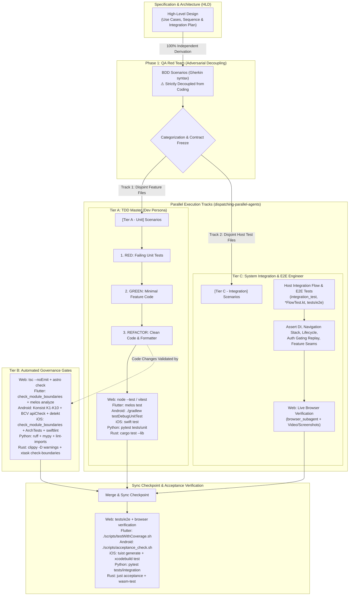

# Development Designer — Task Templates, Platform Matrices & Examples

> Detailed templates and platform command matrices extracted from [dev-designer/SKILL.md](../SKILL.md) to keep the core designer prompt compact.

---

## 1. LachyFS Kanban Task Frontmatter & Structure

```yaml
---
id: "task_<number>_<name>"
status: "todo"          # backlog | todo | in-progress | review | done
priority: "high"        # low | medium | high
assignee: null
epic: "<epic_name>"
dueDate: null
created: "<ISO-8601 timestamp>"
modified: "<ISO-8601 timestamp>"
completedAt: null
labels: ["architecture", "feature"]
order: "a<number>"
review_tier: "full"     # optional: "full" for high-risk/multi-module tasks; omit or "skip" for trivial single-file tasks
---
```

### Canonical Section Layout (`task_<number>_<name>.md`)
1. **Title**: `# Task <number>: <Task Name>`
2. **Epic Reference**: `Epic: [<epic_name>](../epic/<epic_name>/<epic_name>.en.md)`
3. **Requirement Analysis**: Context, boundaries, and acceptance constraints for this single task.
4. **Files**:
   - `Allowed files:` Exact paths or globs (`*`, `?`, `**`) this task may create `(new)`, edit, or delete (no bare directories; omit `.devtool/` status/mirror/evidence files except explicit protected paths).
   - `Read-only context:` Paths only read, including `(new)` files from upstream tasks.
   - **Surgical `target_files` Anchors**: Under `## Impact Analysis & Blast Radius`, whenever modifying an existing file `> 200` lines, list the exact target symbol plus `(L<start>-L<end>)` line range so Stage 3 implementers use bounded reads.
5. **Design Rationale & Applicable Skills**:
   - Web: `browser_subagent`, Node.js `--test` / Vitest, Astro check, Playwright
   - Python: `python-quality-check`, `pytest`, `ruff`, `mypy`, `import-linter`
   - Rust: `rust-quality-check`, `xtask`, `wasm-pack`
   - Flutter: `flutter-ui-audit`, Mason bricks, `build_runner`
   - Android: `android-ui-audit`, `android-api-integration`, `moshi_dto_generator`
   - iOS: `ios-ui-audit`, `tuist generate`, `ArchTests`
6. **Impact Analysis & Blast Radius**: Target Files & Symbols (with `(L<start>-L<end>)` for files `> 200` lines), Downstream Callers, Cross-Platform Bridges (`MethodChannel`), Target Coverage Threshold (`100%` Security, `>= 85%` Domain, `>= 80%` UI).
7. **BDD Scenarios (`### BDD SCENARIOS`)**: `Covers: <ID>, <ID>` directly under heading (omit only on zero-scenario tooling tasks), followed by verbatim `Given / When / Then` blocks copied from `bdd_scenarios.en.md`.
8. **Verification (`## Verification`)**: See [`verification-rows.md`](verification-rows.md) and [`verification-row-grammar.md`](verification-row-grammar.md).
   ```markdown
   | ID | Phase | Command | Expect | Needs |
   |----|-------|---------|--------|-------|
   | V1 | RED | `uv run pytest -q --tb=short --maxfail=3 tests/unit/test_taxonomy.py::test_parse_node` | exit 1; contains "FAILED" | — |
   | V2 | GREEN | `uv run pytest -q --tb=short --maxfail=3 tests/unit/test_taxonomy.py` | exit 0; contains "passed" | — |
   | V3 | TIER-B | `uv run ruff check src tests` | exit 0 | — |
   | V4 | TIER-C | `uv run pytest -q --tb=short --maxfail=3 tests/integration/test_taxonomy_bdd.py --junitxml=build/test-results/task_1.xml` | exit 0; results build/test-results/task_1.xml | TEST_DATABASE_URL |
   ```
   Follow with verbatim boilerplate:
   ```markdown
   ## Stop and Report If

   - A command, path, symbol or anchor named in this task does not match the repository.
   - A Verification row fails for a reason other than its Expect.
   - The work needs a change to a file outside Allowed files, or to a protected path.
   - The work needs a change to this task's Verification table, Definition of Done, Allowed files or
     Covers line.
   - A variable named in the Needs column is unset.
   ```
   Then `## Decisions Already Made`, `## Definition of Done` (`(V2, V4)` or `(Gate 5)` on every bullet), `## Dependencies & Blockers` (`Blocked by [Task N](...)`), and `## References & Rollback`.

---

## 2. `task_01` Shared-Contract Templates

### Case A — Hub Mode (`shared-contracts/` Physical Directory)
- **Title**: `# Task 1: Update Canonical Shared Contracts and Cross-Repo Ledger (<domain>)`
- **Persona**: Contract Owner / System Architect + QA Red Team.
- **Files Allowed**: `shared-contracts/<domain>/api_contract.md`, `shared-contracts/<domain>/architecture_and_flow.md`, `shared-contracts/<domain>/gaps_and_rfcs.md` (`(new)` if first creation).
- **Decisions Already Made**: Exact schema shapes, field types, defaults, and Non-Breaking Schema Guarantees.
- **Verification**: `check_document.py`, schema diff audit, Non-Breaking Schema checks.
- **Output**: Parallel Handoff Summary listing domain, modified contract paths, payload additions/rules, and satellite task prompts.

### Case B — Satellite Mode (`shared-contracts/` Symbolic Link)
- **Title**: `# Task 1: Synchronize Consumer Models, Adapters, and Fixtures with Upstream Contract (<domain>)`
- **Persona**: TDD Master (Tier A) + QA Red Team.
- **Files Allowed**: Satellite-internal DTOs, serializers, clients, fixtures, tests only — **STRICTLY EXCLUDES `shared-contracts/`**.
- **Interactive Cross-Repo Hub Commit Flow (when sharing local filesystem)**:
  1. Write proposed RFC/contract additions through the symlink into Hub's physical files (`gaps_and_rfcs.md`, `api_contract.md`).
  2. Display `git -C $(readlink -f shared-contracts)/.. diff shared-contracts/<domain>/`.
  3. Stop and ask: *"Do you confirm committing this contract change to the Hub repository? (Y/N)"*.
  4. On confirmation: `git -C $(readlink -f shared-contracts)/.. add shared-contracts/<domain>/ && git -C $(readlink -f shared-contracts)/.. commit -m "[CONTRACT] <title>"`.
  5. Record watermark: `python3 skills/sync-shared-contracts/resources/scripts/sync_contracts.py ack --domain <domain> --snapshot <new_snapshot_id>`.

---

## 3. Platform 3-Tier Testing Matrix

| Platform | Tier A (Unit) | Tier B (Governance & Lint) | Tier C (Integration & Acceptance) |
|---|---|---|---|
| **Flutter** | `fvm flutter test` / `melos test` (`bloc_test`, Mocktail) | `check_module_boundaries.sh`, `check_license_header.sh`, `melos format`, `melos analyze` | `integration_test/` host composition root (`AppRoutes`, `AppEventBus`), `./scripts/testWithCoverage.sh` |
| **Android** | `./gradlew testDebugUnitTest` (JUnit, MockK, Turbine) | Konsist K1–K10 (`:konsist-test:test`), BCV (`apiCheck`), Detekt, Spotless | Host `:app` + `:shell`, `./scripts/acceptance_check.sh` |
| **iOS** | `swift test --package-path <Pkg>` | `check_module_boundaries.sh`, `ArchTests`, `swiftlint`, `swiftformat --lint` | `App/` + `Shell/` composition root, `tuist generate --no-open && xcodebuild test` |
| **Web / FE** | `node --test`, Vitest, Jest | `tsc --noEmit`, framework check (`astro check`), `prettier --check`, `eslint` | `tests/e2e/*.test.ts` + live `browser_subagent` `.webp`/DOM/CSS verification |
| **Python** | `uv run pytest -q --tb=short --maxfail=3 tests/unit/` | `ruff check`, `ruff format --check`, `mypy --strict`, `lint-imports` | `tests/integration/` & `tests/e2e/` (`uv run pytest -q --tb=short --maxfail=3`) |
| **Rust** | `cargo test --lib` | `cargo fmt --check`, `cargo clippy -D warnings`, `cargo deny check`, `xtask check-boundaries` | `cargo test --test '*'` / `just acceptance` + `just wasm-test` |

---

## 4. Parallel Execution Architecture & Diagram Rules



### Parallel Track Rules (`dispatching-parallel-agents`)
1. **Strict Contract Freeze**: Lock public interface contracts (`AppRoutes`, `AppEventBus`, DTOs, State/Action signatures) before spawning Subagent 1 (Tier A) and Subagent 2 (Tier C).
2. **Disjoint File Sets**: Subagent 1 touches only feature/package sources (`src/{pkg}/**`, `features/**`, `crates/*/src/**`); Subagent 2 touches only host integration testbeds (`tests/e2e/**`, `integration_test/**`, `tests/integration/**`); neither edits root manifests (`package.json`, `pubspec.yaml`, `pyproject.toml`, `Cargo.toml`) concurrently.
3. **ATDD Sync Checkpoint**: Subagent 2's integration flow tests act as ATDD Red tests until both merge at Sync Checkpoint and verify Green.

---

## 5. HLD Document Structure & Diagram Lint Standards

Required sections for `.devtool/epic/<epic_name>/<epic_name>.en.md` (and `.vi.md` companion at Stage 4):
1. **Table of Contents**: Links every `##` heading.
2. **Meta Data**: Epic name, Status, `- **PIC**: <profile_account_id>`, Target Release, Platform, `- **Depends on epic**: <list or none>`, `Source Spec` link (when derived from `dev-brainstorming`).
3. **Background**: Problem statement and goals.
4. **Goals & Non-Goals**: Scope fence.
5. **Architecture, Feature Map & Technical Design ("Prompt to Maintain")**:
   - 1 `mermaid flowchart TD`/`LR` architecture diagram (never legacy `graph TD`/`LR`).
   - Conditional `mermaid sequenceDiagram` (multi-actor/async/IPC/state-machine epics only).
   - **Feature Maintenance Map**: Canonical Source Paths & Entry Points, Core Invariants & Config Knobs, Extension & Troubleshooting Guide.
   - **Integration Test Plan**: `Integration test roots:`, `Protected paths:`, `Integration results:`, optional `Integration results (live, needs: ...)`, and `## Verification Environment`.
6. **Shared Contract Impact**: `None — self-contained feature` or schema/field/protocol rules + compatibility plan.
7. **BDD Suite Reference**: Links `.devtool/epic/<epic_name>/bdd_scenarios.en.md` (do not inline raw Gherkin in the HLD).
8. **Rollout Strategy & Mitigation**: Phased rollout and rollback plan.
9. **Kanban Tasks Breakdown**: Links to task files.
10. **Spec Errata**: Symmetric `[SE-NN]` entries across `.en.md` and `.vi.md`.

### Diagram & Markdown Lint Rules
- **Mermaid**: Always `flowchart` (never `graph`), quote labels containing `()[]{}::/&`, clean alphanumeric/underscore IDs, no trailing semicolons, close every `subgraph ... end`.
- **Graphviz DOT**: Semantic shapes (`diamond`, `box`, `plaintext`, `ellipse`, `octagon`, `doublecircle`), semicolons after statements, quoted multi-word IDs, `->` in `digraph`, `cluster_` subgraph prefix.
- **Markdown**: Single H1, no skipped heading levels, space after `#`, no trailing punctuation in headings, language tags on all fenced code blocks, no trailing whitespace or hard tabs.
